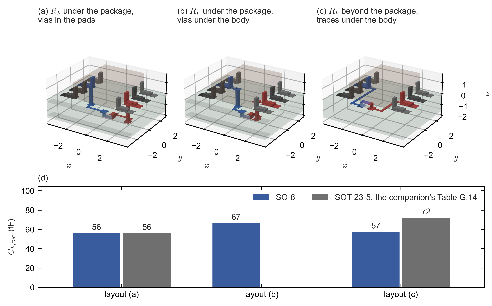
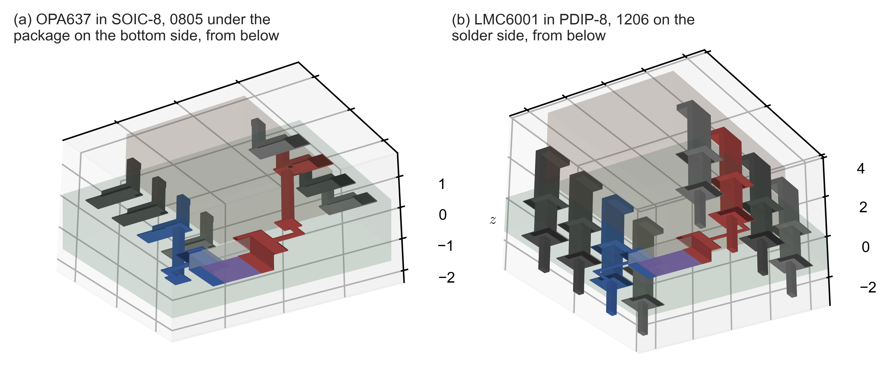
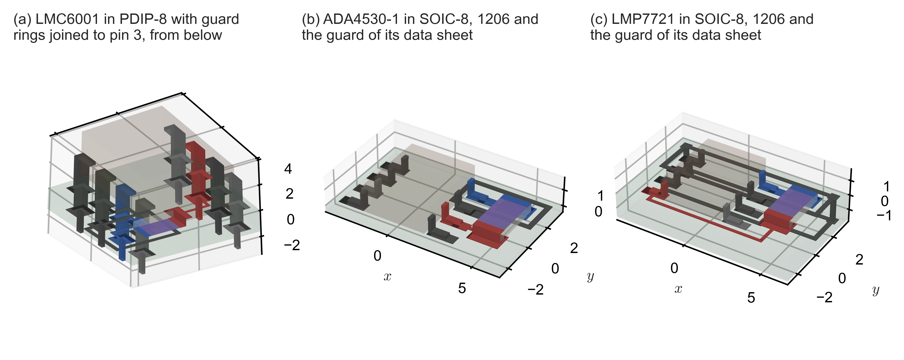
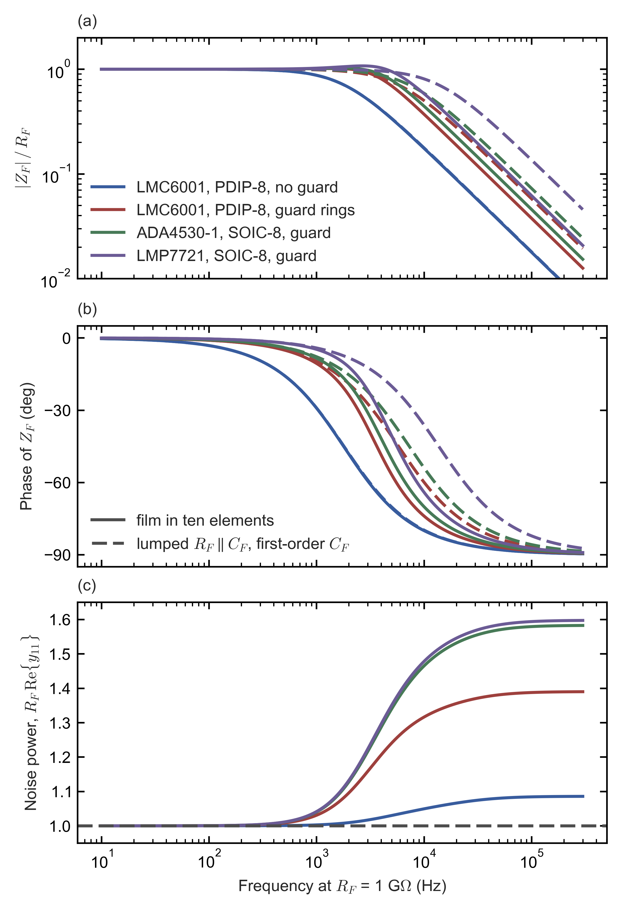

# Feedback networks in eight-lead packages and under guard rings

Side note to the two transimpedance-amplifier notes: field solutions of SOIC-8 and PDIP-8 layouts, guarded feedback resistors as distributed lines, and the inductance of the leads.

> This note was created with significant AI assistance. It may contain errors, so check the cited datasheet pages, tables and scripts before relying on a figure. The note itself is dedicated to the public domain under CC0 1.0; no copyright is reserved.

## 1. What this note adds to the two notes

The capacitance across the feedback resistor sets the bandwidth of a transimpedance amplifier (TIA) wherever the resistor, rather than the amplifier, limits it, and it decides how large an external feedback capacitor every other design needs. Both notes of this repository take that capacitance from particular layouts. The [balanced-photodiode note](../TIA_opamp_survey_2026-10-25/TIA_opamp_survey.md) computes it with finite-element field solutions for an 0402 or 0603 resistor beside the OPA855 and around the OPA846 in its SOT-23-5 package (its Sections G.14.9 and G.14.10), and its designs use 0.08 pF with corners at 0.05 and 0.12 pF (its Table 1.1). The [high-gain note](../TIA_high_gain_survey_2026-11-02/TIA_high_gain_survey.md) assumes 0.1 pF for its sweeps. It also treats the resistor as a distributed RC line, with an end-to-end capacitance $C_{ee}$ and a capacitance $C_g$ from the resistive film to the conductor beneath it, which it estimates with parallel plates and lists as still to be measured (its Section 3.4 and its Appendix C, item 3).

Three questions were left open, and this note answers them with the same solver, the finite-element package pcbcap at the root of this repository, and the same conventions.

1. The OPA846 also comes in an SO-8 package (data sheet [1], p. 2). Does that package change the capacitance of the balanced-photodiode note's Section G.14.10?
2. The precision and electrometer amplifiers of the high-gain note come in SOIC-8 and PDIP-8 packages, and their data sheets show guard rings that surround the summing node and pass under the feedback resistor. What capacitance do such layouts have, and what does a guard under the resistor do to its response and to its noise?
3. Both notes compute electrostatic capacitances, which leave out every inductance. The leads of SOIC-8 and PDIP-8 packages are longer than those of the SOT-23-5. Can their inductance still be left out?

The answers, with the sections that derive them, are these.

- **The OPA846 in SO-8** has 56.1 fF across its feedback network with the resistor, an 0402, under the package, the same as the 56.0 fF of the SOT-23-5. With the resistor beyond the package it has 57.5 fF, against 72.0 fF for the SOT-23-5 counterpart. Moving the vias from the pads to under the body raises the first value to 66.5 fF (Section 3).
- **The inductance of the leads** changes the effect of the feedback capacitance at the 308-MHz loop crossover of the balanced-photodiode note's 2-kΩ OPA846 design by 2.3 % in SOT-23-5, 2.9 % in SOIC-8 and 4.0 % in PDIP-8, far less than the ±13 % tolerance of that capacitance, and a field solution of the same leads and paths with FastHenry gives 2.2 %, 2.8 % and 4.0 %. In the high-gain range it stays below 1 % for loop crossovers up to 133–559 MHz, far above the crossovers of the amplifiers that come in these packages (Section 4 and Appendix C).
- **High-gain layouts without a guard** give 93.3 fF for the OPA637 in SOIC-8 with an 0805 resistor and 88.4 fF for the LMC6001 in PDIP-8 with a 1206 resistor, which supports the high-gain note's 0.1 pF (Section 5).
- **A guard that passes under the resistor** lowers the first-order capacitance to 11.6–27.4 fF, but it couples 169–176 fF to the film, six to fifteen times as much. At its own corner the resistor is then a distributed line. Its bandwidth is 0.58–0.84 of the corner that the first-order capacitance predicts, as if the capacitance were 20.0–32.7 fF; its response rises by at most 0.63 dB before it falls; and its Johnson noise rises by 1.0–1.8 dB at the predicted corner and by 0.5–1.0 dB averaged over the band. Against the same PDIP-8 layout without a guard, the guard still widens the band 2.7 times (Sections 6 and 7.2).
- **Whether the amplifier matters** depends on the gain. Far above the crossover gain of the high-gain note's Eq. (20), 4.0–9.5 GΩ for these layouts with their amplifiers on its 20-pF photodiode, the network alone sets the TIA's response. Below it the amplifier sets the response and the network its damping: an external feedback capacitor sized from the first-order value then overdamps the loop and gives 7–35 % less bandwidth than the design intends (Section 7.3).

Section 8 states what each of the two notes takes from these results. Every three-dimensional layout of this note can also be turned and zoomed on an interactive page of its own, which Appendix A lists.

## 2. The models

The capacitance between two nets depends on every conductor near them, so each package is modelled from its drawing, at the middle of each tolerance, as the balanced-photodiode note's Section G.14.10 does for the SOT-23-5. This section states the dimensions, the boards and the mesh, and two checks of the mesh.

### 2.1 The two packages

Table 1 lists the dimensions of the two package models and the drawings they come from. The SOIC-8 follows TI's drawing D0008A (4214825/C), on p. 29 of the OPA846 data sheet [1] with the example land pattern on p. 30; the same drawing is in the data sheets of the LMC662 [5, p. 30], the LMP7721 [3, p. 32] and the OPA627/OPA637 [6, p. 43]. TI gives no lower limit of the package height, so the body's thickness is taken from Analog Devices' drawing of the same JEDEC outline (MS-012), which gives a height of 1.35–1.75 mm [2, p. 52, Figure 139]: its midpoint, 1.55 mm, less the stand-off of 0.18 mm. The PDIP-8 follows TI's drawing P (R-PDIP-T8, 4040082/E), on p. 33 of the LMC662 data sheet [5] and p. 25 of the LMC6001 data sheet [4]. TI does not dimension the body's thickness either; Analog Devices' drawing of the same JEDEC outline (MS-001) gives 2.92–4.95 mm with 3.30 mm nominal [7, p. 19, Figure 50], and the nominal value is taken.

*Table 1. The two package models (mm): the range that each drawing gives and the value used. The pitch, the rows and the lead dimensions are those of the leads outside the body.*

| Dimension | SOIC-8, drawing | SOIC-8, model | PDIP-8, drawing | PDIP-8, model |
|---|---|---|---|---|
| Body, length × width | 4.81–5.00 × 3.81–3.98 | 4.905 × 3.895 | 9.02–10.16 × 6.10–6.60 | 9.59 × 6.35 |
| Body thickness | not given; height at most 1.75 | 1.37 | not given; seated height at most 5.08 | 3.30 |
| Stand-off | 0.11–0.25 | 0.18 | at least 0.51 | 0.51 |
| Pitch | 1.27 | 1.27 | 2.54 | 2.54 |
| Across the rows | 5.80–6.19 from tip to tip | 5.995 | 7.62–8.26 at the gauge plane | 7.62 between the leads' centre lines |
| Lead width × thickness | 0.31–0.51 × 0.13–0.25 | 0.41 × 0.19 | shoulder 1.14–1.78, pin 0.38–0.53; thickness 0.25 | 1.46 and 0.455; 0.25 |
| Foot, or lead below the seating plane | foot 0.41–1.27 | 0.84 | at least 3.18 | 3.18 |
| Land pattern | pads 1.55 × 0.6, rows 5.4 apart (TI's example) | the same | not given | holes of 0.8 drill, round pads of 1.6 |

Each gull-wing lead of the SOIC-8 is built like those of the SOT-23-5: a foot on its pad, a riser at the inner end of the foot, and a shoulder from the body's side, at half the body's thickness. Each PDIP-8 lead is a horizontal exit from the body, a vertical shoulder down to the seating plane, on which the package stands, and a narrow pin through the plated hole and out below the board. The lead frame, the die and the bond wires inside the body are left out, as for the SOT-23-5, because no drawing gives them (the balanced-photodiode note's Section G.11). A round hole filled with solder around its lead is modelled as a square of the same far field. The balanced-photodiode note's Eq. (G.58) gives that square's side as $s = 0.8472\,d$, which is 0.678 mm for the 0.8-mm drill. Each round pad becomes the square of the same area, with the side $d_{pad}\sqrt{\pi}/2$ = 1.6 mm × 0.8862 = 1.418 mm, which keeps the pad's capacitance to a nearby plane.

### 2.2 Resistors, boards and nets

The OPA846 layouts carry an 0402 resistor, as in the balanced-photodiode note's 2-kΩ designs. The high-gain layouts carry a 1206, the size of the high-gain note's own estimate (its Section 3.4), except the OPA637 layout, which keeps an 0805, because its vias at the inner ends of the pads of pins 2 and 6 would land on the pads of a 1206. The 1206 body follows the rule of the balanced-photodiode note's Table G.2: 3.20 × 1.60 mm, 0.55 mm thick with 0.45 and 0.70 mm as corners, and terminations wrapping 0.45 mm onto the top face. These are the values most of five makers print: Panasonic ERJ (AOA0000C301, p. 3), Yageo RC (RC_L V.14, p. 4, Table 1), Vishay CRCW (20035, p. 11), KOA RK73B (p. 1) and TT Electronics WCR (p. 1). Its pads are those of the IPC-7351 table of Vishay document 28950 (Rev. 12-Jul-2022, p. 1): 1.15 mm long and 1.80 mm wide, 1.75 mm apart. The repository's file `TIA_opamp_survey_2026-10-25/data/parasitic_cf/geometry_and_permittivity.md` lists every value with its page.

The OPA846 layouts lie on the four-layer FR-4 board of the balanced-photodiode note's Section G.14.10, 1.6 mm thick with ground planes 0.2 mm inside each face, which are cut away 0.5 mm beyond the package's pads and the network. The high-gain layouts lie on a two-layer board with no plane near the network, the usual practice around a high-impedance input. Each layout sits in a grounded box: 16 mm wide for the SOIC-8 layouts and 24 mm wide for the PDIP-8 ones, with 8 or 12 mm of air above and below the board.

In every layout the net A is the amplifier's output and the net B its inverting input, the summing node. The non-inverting input, both supplies and every guard are at AC ground: in a TIA the guard is held at the potential of the non-inverting input. Each pin with no internal connection is a floating conductor of its own. The following are assumptions, because no document dimensions them: traces 0.2 mm wide, 0.3 mm of clearance, vias with a 0.3-mm drill and pads 0.55 mm wide, the resistor's body 30 µm above its pads, and guard rings 0.3 mm wide with 0.3 mm of clearance to the summing node's copper.

### 2.3 The mesh, and two checks of it

The leads, holes, traces and guard rings of these packages are several times longer than those of the SOT-23-5 network, and at the element sizes of the balanced-photodiode note's Section G.14.10 they would need 1.4–2.5 million elements, more than the workstation's memory allows. Every conductor except the resistor therefore gets coarser edges than in that section: 7.5 µm times the mesh's refinement factor, which is 5.66 for the OPA846 layouts, 11.3 for the SOIC-8 high-gain layouts and 16 for the PDIP-8 layouts. The resistor, its pads and its solder keep the 15-µm edges of that section, because most of the coupling lies there. The meshes have 0.70–1.09 million elements.

Two checks measure what these choices change. The SOT-23-5 layout (a) of the balanced-photodiode note's Table G.14, solved with the coarse edges, gives 56.15 fF against the published 56.03 fF, 0.21 % more, and capacitances to ground 0.4 % above the published ones, with 0.58 instead of 1.08 million elements. The OPA637 layout solved at refinement 16 instead of 11.3 gives 93.38 fF against 93.29 fF, 0.1 % more. Each value of this note comes from one mesh, and an error of a few tenths of a percent is expected, as in the balanced-photodiode note's Section G.14.10. A boundary-element program unrelated to pcbcap, FasterCap, reproduces the balanced-photodiode note's 0402 in a uniform medium within 0.7 %, but fails on the same part with its dielectrics: on panels on which it reproduces the uniform medium within 0.3 %, it gives the capacitance from a terminal to ground as 69–70 fF from one solve and 45–47 fF from another, two values that must be equal, against pcbcap's 54 fF. FastCap 2.0 gives no result on the part at all (Appendix D). Neither failure affects the values of this note, which pcbcap computes with the dielectrics in place and with the errors estimated above.

## 3. The OPA846 in SO-8

The balanced-photodiode note computes its 2-kΩ OPA846 design in the SOT-23-5 package. The amplifier also comes in SO-8 [1, p. 2], whose wider body leaves more room between the pins, so the routing of the feedback network can change. Figure 1 shows three layouts with the standard pinout of a single amplifier: pin 2 the inverting input, pin 3 the non-inverting input, pin 4 the negative supply, pin 6 the output, pin 7 the positive supply, and pins 1, 5 and 8 not connected.

- **Layout (a)** puts the resistor on the bottom side, centred under the package, reached through vias at the inner ends of the pads of pins 2 and 6. This is what the data sheet advises for boards with parts on both sides [1, p. 18, item c], and it is the SO-8 counterpart of the SOT-23-5 layout (a).
- **Layout (b)** is the same with the vias under the body, 0.3 mm inside the inner ends of the pads, each joined to its pad by a short trace. In layout (a) the vias lie in the pads, under the solder paste, and TI's land-pattern notes ask for such vias to be filled, plugged or tented [8, p. 39, note 5]; vias beside the pads under the body are covered by the solder mask and need nothing special.
- **Layout (c)** puts the resistor on the top side, beyond the end of the package at pins 4 and 5, with a trace from each of pins 2 and 6 running inward under the body and along it to the resistor. It is the SO-8 counterpart of the SOT-23-5 layout (b).

*Figure 1. The OPA846 in SO-8 with its feedback resistor, an 0402, in the three layouts of Section 3: (a) on the bottom side under the package, through vias in the pads of pins 2 and 6; (b) the same with the vias under the body; (c) on the top side beyond pins 4 and 5, with a trace from each of pins 2 and 6 under the body. The output's net is red, the summing node's net blue, the grounded pins dark grey and the unconnected pins mid grey; the film is purple, and the board with its two planes (green) and the package's mould (brown) are drawn translucent. Lengths in mm; $z$ is measured up from the board's top surface. (d) $C_F$ of each layout beside its SOT-23-5 counterpart from the balanced-photodiode note's Table G.14.*

Table 2 gives the results. The resistor's own share of the coupling, the part that lies in its alumina body, is the same 21.5 fF in all three layouts; the routing makes the differences, as in the SOT-23-5.

*Table 2. The OPA846 in SO-8 with an 0402 (fF): $C_F$, the capacitance across the feedback network, beside its SOT-23-5 counterpart; the capacitances to ground of the output's net ($C_{A0}$) and of the summing node's net ($C_{B0}$); and the shares of $C_F$ that lie in the board, the resistor's alumina, the mould and the air. One mesh each, 0.85–0.92 million elements.*

| Layout | $C_F$ | SOT-23-5 counterpart | $C_{A0}$ | $C_{B0}$ | Board, alumina, mould, air |
|---|---|---|---|---|---|
| (a) under the package, vias in the pads | 56.1 | 56.0 | 304 | 304 | 25.1, 21.5, 3.0, 6.4 |
| (b) under the package, vias under the body | 66.5 | – | 297 | 298 | 34.5, 21.5, 3.6, 6.9 |
| (c) beyond the package, traces under the body | 57.5 | 72.0 | 286 | 363 | 24.1, 21.5, 5.6, 6.3 |

Three points follow.

- **With the resistor under the package, the package type makes no difference.** Layout (a) gives 56.1 fF in SO-8 and 56.0 fF in SOT-23-5: the resistor and its vias dominate, and both packages put them at similar distances.
- **Vias under the body cost 10 fF.** In layout (b) the two via barrels, one of each net, stand 2.7 mm apart through the board instead of 4.4 mm, and the board's share rises from 25.1 to 34.5 fF. Vias in the pads, filled or tented, give the lower value.
- **The wider body helps the top-side layout.** In layout (c) the two traces run under the body along opposite rows of pins, 2.65 mm apart, and $C_F$ is 57.5 fF. In the SOT-23-5 counterpart the trace from the resistor's far pad passes 0.40 mm from the output pin's pad, and $C_F$ is 72.0 fF (the balanced-photodiode note's Section G.14.10). The price in SO-8 is a larger capacitance at the summing node, 363 fF, because the summing node's trace runs beside the grounded pins 3 and 4.

All three values lie inside the 53–72 fF of the SOT-23-5 layouts, so the nominal 0.08 pF of the balanced-photodiode note's Table 1.1, with its corners at 0.05 and 0.12 pF, holds for the SO-8 as well.

## 4. The inductance of the leads

The field solutions are electrostatic: they contain no magnetic field and therefore no inductance (the balanced-photodiode note's Section G.14.1). That is adequate while the inductance in the path of the feedback current is too small to change the feedback network at the loop's crossover frequency, where the feedback capacitance sets the phase margin. The leads of SOIC-8 and PDIP-8 packages are longer than those of the SOT-23-5, so this section estimates their inductance and its effect, and Appendix C computes the same leads and paths with FastHenry, which divides each conductor into thin filaments and computes their resistances and their self- and mutual inductances [9, p. 6].

**What a series inductance does.** Between the output pin and the summing-node pin, the feedback network $R_F \parallel C_F$ lies in series with the inductance $L_x$ of its connections: traces, vias, the leads outside the body, and the lead frame and bond wire inside it. With $1/Z_F = 1/R_F + j\omega C_F$, the network that the amplifier sees is $Z_F' = Z_F + j\omega L_x$, and

$$
\frac{Z_F'}{Z_F} = 1 + j\omega L_x\left(\frac{1}{R_F} + j\omega C_F\right) = 1 - \omega^2 L_xC_F + j\,\frac{\omega L_x}{R_F} .
\tag{1}
$$

Two small numbers therefore measure the change:

$$
\delta_1 = \omega^2 L_xC_F , \qquad \delta_2 = \frac{\omega L_x}{R_F} .
\tag{2}
$$

The first is the fractional change of the capacitive part: the capacitance looks larger by the factor $1/(1 - \delta_1)$. The second is the phase added, in radians. Both are evaluated at the loop crossover.

**The inductance of a straight conductor.** A lead or trace is a chain of straight segments, and the inductance of the path is estimated as the sum of their partial self-inductances, which the Neumann formula gives. Two parallel filaments of length $l$ that lie side by side over the same span, a distance $d$ apart, have the partial mutual inductance

$$
M(l, d) = \frac{\mu_0}{4\pi}\int_0^l\!\!\int_0^l \frac{\mathrm dx\,\mathrm dx'}{\sqrt{(x - x')^2 + d^2}}
= \frac{\mu_0}{2\pi}\left[\,l\,\mathrm{asinh}\frac{l}{d} - \sqrt{l^2 + d^2} + d\,\right] ,
\tag{3}
$$

where the inner integral is $\mathrm{asinh}((l - x)/d) + \mathrm{asinh}(x/d)$, the substitution $x \to l - x$ makes the two terms equal, and $x\,\mathrm{asinh}(x/d) - \sqrt{x^2 + d^2}$ is an antiderivative of $\mathrm{asinh}(x/d)$. A conductor of finite cross-section is a bundle of such filaments, and its partial self-inductance is the average of $M$ over pairs of points of its cross-section. For a thin strip of width $w$ with uniform current, the distance $s$ between two random points of the width has the density $2(w - s)/w^2$, and for a thin-walled tube of radius $a$ two points at the angle $\psi$ apart are the chord $2a\sin(\psi/2)$ apart, with $\psi$ uniform:

$$
L_{strip}(l, w) = \int_0^w \frac{2(w - s)}{w^2}\,M(l, s)\,\mathrm ds , \qquad
L_{tube}(l, a) = \frac{1}{2\pi}\int_0^{2\pi} M\!\left(l,\ 2a\sin\frac{\psi}{2}\right)\mathrm d\psi .
\tag{4}
$$

The sum of the partial self-inductances leaves out three effects, which act in opposite directions, so it is an estimate rather than a bound. Equation (4) treats each trace and lead as a strip without thickness that carries a uniform current, while a real one has a finite thickness, and at high frequency its current crowds towards its edges; both lower its partial self-inductance. The sum also leaves out the mutual inductance between the pieces, which adds where two of them carry the current the same way and subtracts where they carry it in opposite directions. In the layouts of this note the path does not run out to the resistor and back beside itself, but crosses from a pin on one side of the package to a pin on the other. On each side the via, or the filled hole of the PDIP-8, stands in line with the riser or the shoulder of the lead above it and carries the current the same way, and the traces of the two sides carry it the same way as well; the pieces that carry opposite currents, the vertical pieces of the two sides, stand 2.7–8.0 mm apart. Eddy currents in nearby ground planes lower the inductance a little more. FastHenry, which accounts for the first two effects, puts the whole paths between 6.3 % below and 4.3 % above the sum, and 0.9–6.3 % below it at the 308-MHz crossover of the design below; ground planes take another 0.7–0.9 % off (Appendix C).

**The leads.** The current enters a gull-wing lead along its soldered foot, so half the foot is counted; then the riser, from the pad up to the middle of the shoulder; then the stretch of shoulder outside the body. Each is a strip of the lead's width. In a PDIP-8 lead with the network on the solder side, the current runs up the filled hole, a tube of the hole's radius through the 1.6-mm board, then up the shoulder from the seating plane to the exit, and along the exit to the body, each a strip of the shoulder's width. Equation (4) with the dimensions of Table 1 gives 0.266 nH per lead of the SOT-23-5, 0.546 nH per lead of the SOIC-8 and 1.361 nH per lead of the PDIP-8 (Table 3). FastHenry gives 0.194, 0.401 and 1.614 nH at 308 MHz (Appendix C): the gull-wing leads, 0.15 and 0.19 mm thick on widths of 0.40 and 0.41 mm, lie 27 % and 26 % below their sums, and the PDIP-8 lead lies 19 % above its sum, because its filled hole and its shoulder stand in line. No drawing dimensions the lead frame and bond wire inside the body. TI's model of the OPA846 puts 2.35 nH at its inverting input (the balanced-photodiode note's Table B.1), and that value is taken for each of the two pins in every package, as an assumption.

*Table 3. Partial self-inductance of one lead outside the body, by Eq. (4), with the dimensions of Table 1 and of the SOT-23-5 model of the balanced-photodiode note's Section G.14.10.*

| Package | Segments of one lead (length × width or radius, mm) | Inductance (nH) |
|---|---|---|
| SOT-23-5 | half the foot 0.225 × 0.40: 0.049; riser 0.600 × 0.40: 0.216 | 0.266 |
| SOIC-8 | half the foot 0.420 × 0.41: 0.126; riser 0.960 × 0.41: 0.418; shoulder outside the body 0.020 × 0.41: 0.001 | 0.546 |
| PDIP-8 | filled hole, a tube 1.600 long of radius 0.400: 0.438; shoulder 2.285 × 1.46: 0.840; exit 0.510 × 1.46: 0.084 | 1.361 |

**The 2-kΩ OPA846 design.** The balanced-photodiode note's OPA846 design has $R_F$ = 2 kΩ, a total feedback capacitance of 0.75 pF (its Table 4.1) and a loop crossover of 308 MHz in SPICE (its Section 4.5). With the routing of layout (a) in each package, both leads and both internal allowances, $L_x$ is 8.11 nH in SOT-23-5, 10.14 nH in SOIC-8 (4.35 nH of traces and vias, 2 × 0.55 nH of leads and 2 × 2.35 nH inside) and 14.37 nH in PDIP-8 (6.94 nH of traces under the package, 2 × 1.36 nH and 2 × 2.35 nH; a PDIP-8 version of the 2-kΩ network with an 0402 on the solder side). For the SOIC-8, Eq. (2) gives

$$
\delta_1 = (2\pi\times308\ \mathrm{MHz})^2\times10.14\ \mathrm{nH}\times0.75\ \mathrm{pF} = 0.0285 ,
\qquad
\delta_2 = \frac{2\pi\times308\ \mathrm{MHz}\times10.14\ \mathrm{nH}}{2\ \mathrm{k\Omega}} = 0.0098\ \mathrm{rad} ,
\tag{5}
$$

that is 2.85 % and 0.56°. The same arithmetic gives 2.28 % for the SOT-23-5 and 4.03 % and 0.80° for the PDIP-8. With the paths that FastHenry computes at 308 MHz in place of the sums of traces, vias and leads (Appendix C), and the same 2 × 2.35 nH inside, $L_x$ is 7.90 nH in SOT-23-5, 9.82 nH in SOIC-8 and 14.27 nH in PDIP-8. For the SOIC-8, Eq. (2) then gives $\delta_1 = (2\pi\times308\ \mathrm{MHz})^2\times9.82\ \mathrm{nH}\times0.75\ \mathrm{pF}$ = 0.0276, that is 2.76 %, and the same arithmetic gives 2.22 % for the SOT-23-5 and 4.01 % for the PDIP-8, each within 0.1 percentage point of the values from the sums; the ground planes of the field models lower the first two by a further 0.01 percentage point. Put the other way round, $\delta_1$ stays below 1 % while $L_x \le 0.01/(\omega^2C_F)$ = 3.56 nH. The package therefore moves the effective feedback capacitance at the crossover by 2–4 %, mostly through the assumed internal allowance, while the note's designs already carry ±0.1 pF, ±13 % of 0.75 pF, as the tolerance of that capacitance (the balanced-photodiode note's Section G.15). The electrostatic values hold for these designs within that margin, and the SO-8 is no worse than the SOT-23-5 by more than 0.6 percentage points.

**The high-gain range.** The first number of Eq. (2) does not depend on $R_F$, and the second falls as $R_F$ grows, so the loop crossover decides. Setting $\delta_1$ = 0.01 gives the crossover frequency below which the inductance changes the feedback capacitance by less than 1 %:

$$
f_{1\%} = \frac{1}{2\pi}\sqrt{\frac{0.01}{L_xC_F}} .
\tag{6}
$$

For the PDIP-8 with $C_F$ = 1 pF it is $\sqrt{0.01/(14.37\ \mathrm{nH}\times1\ \mathrm{pF})}/(2\pi)$ = 133 MHz. Table 4 gives the rest. A loop crosses over at $f_c = GBW\,C_F/(C_F + C_T)$, below the amplifier's gain–bandwidth product $GBW$, because at high frequency the feedback factor is the capacitive divider $C_F/(C_F + C_T)$, where $C_T$ is the total capacitance at the summing node. The electrometers of the high-gain note have gain–bandwidth products of 1.3–17 MHz (its Table A.1), and the OPA637 has 80 MHz at a gain of 10 [6, p. 12]. Their crossovers lie far below every entry of Table 4, so the leads' inductance is negligible for them. Only the wideband FET amplifiers of the high-gain note, with 230 MHz to 4 GHz (its Section 5.5), could approach $f_{1\%}$ at its lowest gains. The phase term is negligible throughout: with the PDIP-8's $L_x$ at 80 MHz and 10 kΩ, $\delta_2$ is $7.2\times10^{-4}$ rad, 0.04°. The resistor's own inductance acts as the negative capacitance $-L_s/R^2$ in parallel with it; for an 0805, $L_s$ = 1.1 nH (KOA's Table 1, p. 3, in its technical note TN-010, the balanced-photodiode note's reference [A30]), which at 10 kΩ is 0.011 fF, 0.014 % of its capacitance.

*Table 4. The loop crossover frequency below which the inductance $L_x$ of the network's connections changes the feedback capacitance by less than 1 %, Eq. (6) (MHz). With the $L_x$ of FastHenry (Appendix C), each frequency is 0.3–1.6 % higher.*

| Package, $L_x$ | $C_F$ = 0.1 pF | 0.2 pF | 0.5 pF | 1.0 pF |
|---|---|---|---|---|
| SOT-23-5, 8.11 nH | 559 | 395 | 250 | 177 |
| SOIC-8, 10.14 nH | 500 | 353 | 224 | 158 |
| PDIP-8, 14.37 nH | 420 | 297 | 188 | 133 |

## 5. High-gain layouts without a guard

The high-gain note runs its amplifier sweeps with 0.1 pF across the feedback resistor, a value consistent with measured parts and with the balanced-photodiode note's estimate (that note's Section G.15). This section checks it on two layouts with the amplifiers and packages of that range, and Figure 2 shows them.

- **The OPA637 in SOIC-8** (data sheet [6], p. 3; its PDIP-8 version is withdrawn, p. 33) carries an 0805 on the bottom side, centred under the package, reached through vias at the inner ends of the pads of pins 2 and 6.
- **The LMC6001 in PDIP-8** (data sheet [4], p. 3) carries a 1206 on the solder side between the leads of pins 2 and 6, centred under the package, with a trace from each pad.

*Figure 2. The high-gain layouts without a guard (Section 5), both seen from below: (a) the OPA637 in SOIC-8 with an 0805 under the package on the bottom side, reached through vias in the pads of pins 2 and 6; (b) the LMC6001 in PDIP-8 with a 1206 on the solder side between the leads of pins 2 and 6. Colours as in Figure 1. Each panel has its own scale; lengths in mm, and $z$ is measured up from the board's top surface. From below, the numbers of the $x$ and $y$ axes are left out.*

*Table 5. The high-gain layouts without a guard (fF), on a two-layer board with no plane near the network. Columns as in Table 2.*

| Layout | $C_F$ | $C_{A0}$ | $C_{B0}$ | Board, alumina, mould, air |
|---|---|---|---|---|
| OPA637, SOIC-8, 0805 under the package | 93.3 | 263 | 267 | 43.0, 39.6, 4.4, 6.2 |
| LMC6001, PDIP-8, 1206 on the solder side | 88.4 | 453 | 454 | 41.4, 30.8, 9.5, 6.7 |

Both values lie close to the high-gain note's 0.1 pF (Table 5). The board and the resistor's alumina carry about equal shares; with no plane near the network, the field lines between the two nets' traces, pads and holes run through the board, and the PDIP-8's long leads add 9.5 fF through the mould. For $R_F$ = 1 GΩ the resistor's own pole, $f_R = 1/(2\pi R_FC_F)$, lies at

$$
f_R = \frac{1}{2\pi\times1\ \mathrm{G\Omega}\times93.3\ \mathrm{fF}} = 1.71\ \mathrm{kHz}
\tag{7}
$$

for the OPA637 layout and at 1.80 kHz for the LMC6001 layout, against 1.59 kHz for 0.1 pF. These two layouts keep the network free of copper beneath the resistor. With a guard they change, as the next two sections show.

## 6. Guards under the resistor: the first-order capacitance

At the highest gains the summing node needs a guard against leakage (the high-gain note's Section 8.2). The layouts that the amplifiers' makers publish draw that guard around the whole summing node, and since one pad of the feedback resistor belongs to the summing node, the guard passes under the resistor's body between its two pads. The high-gain note's Section 3.4 warns that copper at signal ground under the film acts as a negative feedback capacitance and can make the response peak. This section computes three such layouts, which Figure 3 shows.

- **The LMC6001 in PDIP-8 with guard rings** is the layout of Section 5 with a grounded ring around the summing node on both sides of the board: on the solder side around the pad of pin 2, its trace and the resistor's input pad, passing under the resistor between its pads; on the component side around the pad of pin 2. Both rings are joined to the pad of pin 3, the non-inverting input. The LMC6001 [4, p. 19] and OPA627/OPA637 [6, p. 21] data sheets show guard rings of this kind.
- **The ADA4530-1 in SOIC-8** has a pinout of its own: pin 1 the non-inverting input, pins 2 and 7 the guard buffer's outputs, pin 3 an internal connection, left open here, pin 4 the negative supply, pin 5 the positive supply, pin 6 the output and pin 8 the inverting input [2, p. 10]. ADI's Figure 122 shows the TIA layout [2, p. 42]: the guard ring, driven from pin 7, "is extended around" the left half of the feedback resistor and of a feedback capacitor, "to ensure that the entire high impedance node is surrounded by guard". The model has the resistor, a 1206, beside the row of pins 6, 7 and 8 and parallel to it, and the guard as a ring 0.3 mm wide around pin 8, its trace and the resistor's input half; the figure's filled guard shape becomes a ring, its feedback capacitor is left out, and so are the guard plane and via fence that the data sheet describes on pp. 42–43.
- **The LMP7721 in SOIC-8** has pin 1 the non-inverting input, pins 2, 5 and 7 unconnected, pin 3 the negative supply, pin 4 the output, pin 6 the positive supply and pin 8 the inverting input [3, p. 3]. TI's Figure 54 shows a guard trace that encircles both inputs and is tied to the two unconnected pins beside them, 2 and 7, and the text beside it asks for guard traces "on both sides of the PCB" [3, p. 25]. That figure shows no feedback resistor, so the model places the 1206 as in the ADA4530-1 layout, beside pin 8 with the guard passing between its pads. The guard loop closes under the body between pins 2 and 7 and is joined between the two sides by two vias. The output, pin 4, sits at the far corner, so its trace runs around the other end of the package.

*Figure 3. The guarded high-gain layouts (Sections 6 and 7): (a) the LMC6001 in PDIP-8 with guard rings on both sides, joined to pin 3, seen from below; (b) the ADA4530-1 in SOIC-8 with a 1206 and the guard of ADI's Figure 122, driven from pin 7; (c) the LMP7721 in SOIC-8 with a 1206 and the guard of TI's Figure 54 on both sides, tied to pins 2 and 7. The guards are dark grey, like the grounded pins; other colours as in Figure 1. Each panel has its own scale; lengths in mm, and $z$ is measured up from the board's top surface.*

*Table 6. The guarded layouts (fF), each with the LMC6001 layout without a guard for comparison. $C_F$ is the first-order capacitance, the electrostatic value with the film at its DC potential; other columns as in Table 2.*

| Layout | $C_F$ | $C_{A0}$ | $C_{B0}$ | Board, alumina, mould, air |
|---|---|---|---|---|
| LMC6001, PDIP-8, no guard (Table 5) | 88.4 | 453 | 454 | 41.4, 30.8, 9.5, 6.7 |
| LMC6001, PDIP-8, guard rings | 27.4 | 564 | 860 | 13.1, 16.4, 8.1, −10.1 |
| ADA4530-1, SOIC-8, guard of ADI's Figure 122 | 21.8 | 346 | 464 | 12.7, 18.4, 2.4, −11.7 |
| LMP7721, SOIC-8, guard of TI's Figure 54 | 11.6 | 573 | 479 | 4.6, 17.9, 1.7, −12.5 |

The guard rings cut the first-order capacitance of the PDIP-8 layout from 88.4 to 27.4 fF, by a factor of 3.2, and the two vendor layouts give 21.8 and 11.6 fF (Table 6). Two mechanisms act together. First, the guard intercepts part of the field that ran from one termination to the other through the board and the air, and turns it into capacitance from each termination to the guard. Second, the guard lies under the film at signal ground, the case $a = 0$ of the high-gain note's Eq. (26a): a stretch of film at the position $u$ from the summing-node end, with the capacitance $C_k$ to the guard, adds $-C_k\,u(1 - u)$ to the feedback capacitance, because the current it draws through $C_k$ is supplied partly through the summing node. The negative share of the air shows where both happen: there the fields that the two nets drive end on the guard and run in the same direction, so that region subtracts from $C_F$.

The guard's price at the summing node is its capacitance to ground: $C_{B0}$ of the PDIP-8 layout rises from 454 to 860 fF. That 0.41 pF adds to $C_T$; against the 20-pF photodiode of the high-gain note's examples it is 2 %.

The first-order values describe the resistor only at frequencies where the capacitance along the film draws little current. Section 7 shows that the film's capacitance to the guard is six to fifteen times these values, so at the resistor's own corner they no longer suffice.

## 7. The guarded resistor as a distributed line

The first-order capacitance is exact to first order in $\omega R_FC$, where $C$ is any capacitance that loads the film (the balanced-photodiode note's Section G.14.1). At the resistor's own corner, $\omega R_FC_F$ = 1, so a film whose capacitance to the guard, $C_g$, is several times $C_F$ has $\omega R_FC_g = C_g/C_F$ well above 1 there: it is a distributed RC line, the high-gain note's Section 3.4, with the field solution in place of the uniform line. This section computes its full response and noise, first for the network alone (Section 7.2) and then inside the amplifier's loop (Section 7.3).

### 7.1 How the film is computed

**The method.** The film is divided along its length into $n$ = 10 elements, and its potential is written as a sum of the hat functions of their nodes, so that node 0 is the summing node's termination with its whole net, node 10 the output's, and nodes 1–9 points of the film (Appendix B). One field solution per node, with that node at 1 V and everything else at 0 V, gives the 11 × 11 capacitance matrix $\mathbf C$ between the nodes; the eleven solves of one layout share one mesh of 1.03–1.23 million elements. The film's resistance gives the conductance matrix $\mathbf G$ of ten resistors $R_F/10$ in a chain. At the angular frequency $\omega$ the nodes obey $(\mathbf G + j\omega\mathbf C)\,\mathbf V = \mathbf I$, with no current injected at the inner nodes. Eliminating the inner nodes gives two admittances: $y_F$, the current that the network delivers into the summing node per volt at the output, with the summing node held at 0 V, whose inverse $Z_F = 1/y_F$ is the transimpedance with an ideal amplifier; and $y_{11}$, the admittance at the summing node with the output held at 0 V. By Nyquist's theorem the film then drives the noise current

$$
S_i = 4k_BT\,\mathrm{Re}\{y_{11}\}
\tag{8}
$$

into the summing node, one-sided, at the temperature $T$, so $R_F\,\mathrm{Re}\{y_{11}\}$ is the film's noise power relative to that of a lumped resistor, $4k_BT/R_F$ (the high-gain note derives the same for the uniform line, its Eq. (27)). At low frequency $y_F$ tends to $1/R_F + j\omega C_F$ with exactly the first-order $C_F$, and the ten-element solutions reproduce Table 6 to within 0.15 %: 27.45, 21.83, 11.61 and 88.40 fF.

The film's capacitance to the grounded conductors, $C_g$, follows from the same matrix: it is the capacitance of the film to everything outside the network when the film and both terminations are at the same potential, the row sums of the inner nodes scaled by $n/(n - 1)$ (Appendix B). At the first-order corner $f_1 = 1/(2\pi R_FC_F)$ the electrical length of the line, in the sense of the high-gain note's Section 3.4, is

$$
|\theta_1| = \sqrt{\omega_1R_FC_g} = \sqrt{\frac{C_g}{C_F}} ,
\tag{9}
$$

for example $\sqrt{169.4\ \mathrm{fF}/21.83\ \mathrm{fF}}$ = 2.79 for the ADA4530-1 layout.

**How accurate ten elements are.** The same field solutions also give the capacitance matrix of five elements, exactly and without a new solve, because the hat functions of five elements are sums of those of ten and the field equation is linear (Appendix B). The error of linear elements falls as $1/n^2$, so the difference between five and ten elements, divided by 3, estimates the error of ten. For the four layouts it is below 0.2 % for every bandwidth, below 0.4 % for every value at $f_1$ and below 0.7 % at $3f_1$, although $|\theta|$ reaches 4–7 there; the films couple strongly to their own terminations and, through the alumina, to their other parts, so that their potential varies smoothly along their length. Against the exact uniform line, the same estimate agrees with the true error, and ten elements are within 2.3 % at $|\theta|$ = 4 (Appendix B).

### 7.2 The network alone

With an ideal amplifier the transimpedance is $-Z_F$, so Figure 4 and Table 7 describe the feedback network by itself. Section 7.3 shows when a TIA with a real amplifier follows it.

*Figure 4. The feedback network of the guarded layouts of Figure 3 and of the PDIP-8 layout without a guard (Figure 2(b)) against frequency at $R_F$ = 1 GΩ; for another $R_F$ every frequency scales as $1/R_F$. (a) $|Z_F|/R_F$ and (b) the phase of $Z_F$, with the film in ten elements (solid) and as the lumped $R_F\parallel C_F$ with the first-order $C_F$ of Table 6 (dashed). (c) The film's noise power relative to a lumped resistor, $R_F\,\mathrm{Re}\{y_{11}\}$ of Eq. (8); the lumped resistor gives 1 (grey, dashed).*

*Table 7. The guarded networks with the film in ten elements: $C_g$; the electrical length $|\theta_1|$ at the first-order corner $f_1$, Eq. (9); $f_1$ and the −3-dB frequency $f_{-3\,\mathrm{dB}}$ at $R_F$ = 1 GΩ; the capacitance $C_{bw} = 1/(2\pi R_Ff_{-3\,\mathrm{dB}})$ that a lumped network would need for that bandwidth; the largest rise of $|Z_F|$ above $R_F$; $|Z_F|/R_F$ and its phase at $f_1$, where the lumped model gives 0.707 and −45°; and the film's noise power relative to a lumped resistor at $f_1$ and averaged from 0 to $f_{-3\,\mathrm{dB}}$.*

| Layout | $C_g$ (fF) | $\lvert\theta_1\rvert$ | $f_1$, $f_{-3\,\mathrm{dB}}$ (kHz) | $C_{bw}$ (fF) | Largest rise | At $f_1$: $\lvert Z_F\rvert/R_F$, phase | Noise at $f_1$; mean to $f_{-3\,\mathrm{dB}}$ |
|---|---|---|---|---|---|---|---|
| LMC6001, PDIP-8, no guard | 51.6 | 0.76 | 1.80, 1.80 | 88.2 | none | 0.708, −45.2° | +0.03 dB; +0.01 dB |
| LMC6001, PDIP-8, guard rings | 174.7 | 2.52 | 5.80, 4.86 | 32.7 | 0.12 dB at 0.24 $f_1$ | 0.614, −61.5° | +1.01 dB; +0.49 dB |
| ADA4530-1, SOIC-8, guard | 169.4 | 2.79 | 7.29, 5.81 | 27.4 | 0.19 dB at 0.24 $f_1$ | 0.589, −62.5° | +1.51 dB; +0.77 dB |
| LMP7721, SOIC-8, guard | 176.4 | 3.90 | 13.71, 7.95 | 20.0 | 0.63 dB at 0.19 $f_1$ | 0.438, −71.0° | +1.80 dB; +1.00 dB |

Figure 4 and Table 7 show four results.

- **Without a guard the lumped model holds.** The PDIP-8 film has only 51.6 fF to the grounded conductors around it, 0.58 of $C_F$, and $|\theta_1|$ = 0.76. Its −3-dB frequency lies within 0.2 % of the first-order corner, and its noise rises by 0.01 dB over the band.
- **With a guard the band ends before the first-order corner.** The guarded films have 169–176 fF to the guard and $|\theta_1|$ = 2.5–3.9. Their −3-dB frequencies are 0.84, 0.80 and 0.58 of the first-order corner, so the bandwidth is that of a lumped network with 32.7, 27.4 and 20.0 fF, not 27.4, 21.8 and 11.6 fF. For the LMP7721, $C_{bw} = 1/(2\pi\times1\ \mathrm{G\Omega}\times7.95\ \mathrm{kHz})$ = 20.0 fF. Around and above the corner, $y_F$ written as $G + j\omega C$ has $G$ = 0.74–0.78 of $1/R_F$ and $C$ = 25–42 fF: the guard draws part of the film's current before it reaches the summing node, and the capacitance that the guard does not intercept takes over.
- **The response barely peaks.** It rises by 0.12–0.63 dB at 0.19–0.24 of the first-order corner before it falls. The first-order capacitance stays positive in all three layouts, unlike the resistor over a grounded plane of the high-gain note's Table 3, which peaks by 4.6 dB once the plane's $C_g$ reaches six times $C_{ee}$.
- **The resistor's noise rises near the corner.** Its noise power is 1.01–1.80 dB above that of a lumped resistor at the first-order corner and 0.49–1.00 dB above it on average from 0 to the −3-dB frequency. Above about ten times the corner it levels off at 1.4–1.6 times the lumped value, because the film's potential is then set by its capacitances to its terminations, to the guard and to its own other parts, whereas over a plane, with capacitance only to ground, it keeps rising as $\sqrt\omega$ (the high-gain note's Section 3.4).

The PDIP-8 pair shows the trade in one layout. The guard widens the band from 1.80 to 4.86 kHz at 1 GΩ, 2.7 times, and costs 0.49 dB of the resistor's noise power averaged over the wider band. Without a guard, a resistor 2.7 times smaller would give that band and 2.7 times the noise power, 4.3 dB more. As a way to bandwidth the guard therefore remains the better one, but it makes the response a distributed one: an equalizer designed from the first-order capacitance would be wrong at $f_1$ by 1.2 dB for the PDIP-8 rings, 1.6 dB for the ADA4530-1 layout and 4.2 dB for the LMP7721 layout. A guard that ends at the resistor's input pad instead of passing under its body would keep most of the film away from the guard; that variant has not been computed.

### 7.3 Inside the amplifier's loop

A real amplifier shares the response wherever its loop gain is not large, so whether Section 7.2 describes the TIA depends on the amplifier, the photodiode and the gain. At the summing node, at the voltage $v_-$, the photocurrent $I$ enters, the network delivers $y_Fv_o$ and draws $y_{11}v_-$, and the photodiode with the amplifier's input draws $Y_Dv_-$. With $v_o = -Av_-$, where $A$ is the open-loop gain, Kirchhoff's current law gives $I + y_Fv_o + (Y_D + y_{11})\,v_o/A = 0$, so

$$
Z_T = \frac{v_o}{I} = -\frac{1}{y_F + Y_n/A} , \qquad Y_n = Y_D + y_{11} ,
\tag{10}
$$

the two-port form of the high-gain note's Eq. (6). With the loop gain $T = Ay_F/Y_n$ it reads $Z_T = -Z_F\,T/(1 + T)$: where $|T| \gg 1$ the network alone sets the response, and near the loop's crossover, $|T|$ = 1, the amplifier shares it. The network enters the loop twice, through $y_F$ and through $y_{11}$.

Equation (10) is evaluated for each guarded layout with the amplifier it was drawn for, on the high-gain note's 20-pF photodiode, the S1336-18BK with a 2-GΩ shunt resistance (its Table 1). The amplifiers have gain–bandwidth products of 1.3 MHz (LMC6001), 2 MHz (ADA4530-1) and 17 MHz (LMP7721) and 8 pF of input capacitance (the high-gain note's Table A.1; the LMC6001 and LMP7721 data sheets give none, and 8 pF is that note's assumption, its Appendix C, item 5). The amplifier is an integrator, $A = 2\pi\,GBW/(j\omega)$, as in the high-gain note's Eq. (17). The total capacitance at the summing node, $C_T$, is then 28.5–28.9 pF, including the network's own capacitance to ground. The comparison is the lumped first-order network in the same loop, $y_F = 1/R_F + j\omega C_F$ and $y_{11} = 1/R_F + j\omega(C_F + C_{B0})$, where $C_{B0}$ is the first-order capacitance of the summing node's end to ground from the same matrix, so that the two agree at low frequency.

The high-gain note's Eq. (20) divides the gains into two regimes. Below the crossover gain $R_F^* = C_T/(\pi\,GBW\,C_F^2)$ the amplifier limits the bandwidth, and above it the resistor does. For the ADA4530-1 layout,

$$
R_F^* = \frac{28.46\ \mathrm{pF}}{\pi\times2\ \mathrm{MHz}\times(21.83\ \mathrm{fF})^2} = 9.5\ \mathrm{G\Omega} ,
\tag{11}
$$

and it is 9.4 GΩ for the LMC6001 rings and 4.0 GΩ for the LMP7721 layout. Table 8 therefore evaluates 1, 10 and 100 GΩ. At 1 GΩ a flat response needs more feedback capacitance than these networks have, so the table adds the case with an ideal external capacitor across the resistor, of the size that makes the first-order total equal to the maximally flat value of the high-gain note's Eq. (18); at 10 and 100 GΩ the networks already exceed that value, and no capacitor is added.

*Table 8. The guarded networks inside the loop of their amplifiers on the 20-pF photodiode: the −3-dB frequency of the network alone (ideal amplifier, Section 7.2), of the loop with the film in ten elements, and of the loop with the lumped first-order network; the largest rise of $\lvert Z_T\rvert$ above its DC value; and the loop's phase margin. The external capacitor is the one of a maximally flat design sized from the first-order value. `g_guard_loop.py`.*

| Layout and amplifier | $R_F$; external capacitor | $f_{-3\,\mathrm{dB}}$ (Hz): network alone; loop; loop, lumped | Rise (dB): loop; loop, lumped | Phase margin: loop; loop, lumped |
|---|---|---|---|---|
| LMC6001 with guard rings | 1 GΩ; none | 4863; 3737; 3998 | 5.96; 6.90 | 34°; 26° |
| | 1 GΩ; 56.7 fF | 1936; 2489; 2668 | 0.09; 0 | 73°; 66° |
| | 10 GΩ; none | 486; 558; 817 | 0.47; 0 | 82°; 67° |
| | 100 GΩ; none | 48.6; 49.4; 60.7 | 0.14; 0 | 89°; 87° |
| ADA4530-1 with its guard | 1 GΩ; none | 5812; 4627; 4997 | 5.67; 6.96 | 36°; 26° |
| | 1 GΩ; 45.6 fF | 2398; 3048; 3334 | 0.12; 0 | 74°; 66° |
| | 10 GΩ; none | 581; 664; 1028 | 0.51; 0 | 82°; 67° |
| | 100 GΩ; none | 58.1; 59.0; 76.4 | 0.21; 0 | 89°; 87° |
| LMP7721 with its guard | 1 GΩ; none | 7948; 9206; 13760 | 1.60; 3.54 | 73°; 39° |
| | 1 GΩ; 11.5 fF | 5524; 6314; 9737 | 0.55; 0 | 82°; 66° |
| | 10 GΩ; none | 795; 820; 1682 | 0.70; 0 | 88°; 79° |
| | 100 GΩ; none | 79.5; 79.7; 140 | 0.63; 0 | 90°; 89° |

Table 8 answers the question in three regimes.

- **Far above $R_F^*$ the network sets the response.** At 100 GΩ the loop's −3-dB frequency lies within 0.3–1.6 % of the network's own, with phase margins of 89–90°: Figure 4 is then the TIA's response, and the amplifier does not change it. The lumped first-order model would overestimate that bandwidth by 23–75 %.
- **Near $R_F^*$ both matter.** At 10 GΩ the loop's −3-dB frequency is 3–15 % above the network's own, because the loop's second-order response lifts it a little near its corner, and the lumped model would overestimate it 1.5–2.1 times.
- **Below $R_F^*$ the amplifier sets the response, and the network sets its damping.** At 1 GΩ the guarded networks alone are too small for these amplifiers on 28.5–28.9 pF, and the loop peaks by 1.6–6.0 dB with phase margins of 34–73°. The lumped model predicts more peaking, 3.5–7.0 dB, and less margin, 26–39°, because near the crossover the network's effective capacitance, the $C$ of 25–42 fF in Section 7.2, exceeds the first-order value. An external capacitor sized from the first-order value therefore overdamps the loop: phase margins of 73–82° instead of the intended 66°, −3-dB frequencies 7–35 % below the flat design's, and, for the LMP7721 layout, a 0.55-dB rise that the network brings with it. The external capacitor of a guarded layout has to be sized from the computed response, Eq. (10) with $y_F$ and $y_{11}$ of the field solution, or trimmed on the bench.

Two points hold in every regime. The resistor's noise current at the summing node, Eq. (8), does not depend on the amplifier, so the noise of Section 7.2, referred to the input, holds in every loop. And without a guard the two models agree in the loop as well: for the LMC6001 layout of Section 5 they give 2521 and 2532 Hz at 1 GΩ and 188.6 and 188.3 Hz at 10 GΩ.

## 8. What the two notes take from this

**The balanced-photodiode note.** The OPA846 in SO-8 gives 56–67 fF, inside the 53–72 fF of the SOT-23-5 layouts of its Section G.14.10, so its Table 1.1 value of 0.08 pF, with corners at 0.05 and 0.12 pF, covers both packages. The inductance of the leads, which its field solutions leave out, changes the effect of the 2-kΩ OPA846 design's feedback capacitance at the crossover by 2.3–4.0 %, inside its ±0.1-pF tolerance.

**The high-gain note.**

- Its 0.1 pF matches two unguarded layouts of its own range, 93.3 and 88.4 fF (Section 5).
- For the capacitances that its Appendix C, item 3, lists as still to be measured, the field solutions give $C_g$ = 52 fF for the PDIP-8 layout without a guard and 169–176 fF for the layouts with a guard under the resistor. These are computed values for these layouts, which a measurement with the injection method of its Section 3.5 should still confirm.
- A guard that passes under the resistor, as in the layouts the amplifiers' makers publish, is the case $a = 0$ of its Section 3.4, and Section 7 quantifies it: the network's band ends at 0.58–0.84 of the first-order corner, its response rises by at most 0.63 dB, and the resistor's noise rises by 1.0–1.8 dB at that corner. Above its crossover gain this is the TIA's response; below it, an external capacitor sized from the first-order value overdamps the loop (Section 7.3).
- The inductance of the leads is negligible at its gains (Section 4).

## Appendix A. Files

The scripts and records of this note lie in the folder of the balanced-photodiode note, beside those of its Appendix G; the paths below are relative to the repository.

- `pcbcap/pcbcap/packages.py` builds the SOT-23-5, SOIC-8 and PDIP-8 models, and its docstrings give every dimension with its source.
- `pcbcap/pcbcap/distributed.py` divides the film into elements and computes $y_F$, $y_{11}$ and the error estimate of Appendix B; the check `python -m pcbcap.checks run uniform_rc_line` compares it with the exact uniform line.
- `TIA_opamp_survey_2026-10-25/scripts_archive/parasitic_cf/numerical/g_eight_lead_3d.py` builds and solves the layouts of Sections 3, 5 and 6; `run_eight_lead.sh` runs them all and writes `TIA_opamp_survey_2026-10-25/data/parasitic_cf/numerical/eight_lead_3d.json`.
- `TIA_opamp_survey_2026-10-25/scripts_archive/parasitic_cf/numerical/g_guard_ladder.py` solves the layouts of Section 7 with the film in ten elements (`guard_ladder.json` in the same data folder) and evaluates them (`guard_ladder_response.json`).
- `TIA_opamp_survey_2026-10-25/scripts_archive/parasitic_cf/numerical/g_guard_loop.py` evaluates Eq. (10) for Table 8 from the same record (`guard_loop.json`).
- `TIA_opamp_survey_2026-10-25/scripts_archive/parasitic_cf/inductance_estimates.py` evaluates Eqs. (1)–(6), its part (F) for this note.
- `TIA_opamp_survey_2026-10-25/scripts_archive/parasitic_cf/fasthenry_validation.py` builds the leads and paths of Section 4 for FastHenry2, runs them, and computes from the results every number of Appendix C, Eq. (C.1) among them; `TIA_opamp_survey_2026-10-25/data/parasitic_cf/fasthenry/` holds every input, impedance matrix and result, and its README lists them all, at every filament level and plane grid.
- `pcbcap/pcbcap/fastercap.py` turns a pcbcap layout into FasterCap's input, with panels on the faces between media merged into rectangles, checks their areas against gmsh's fragments of the same layout, runs FasterCap and reads its matrix; the checks `fastercap_export_box`, `fastercap_export_free` and `fastercap_reader` of `python -m pcbcap.checks` test it.
- `TIA_opamp_survey_2026-10-25/scripts_archive/parasitic_cf/numerical/fastercap_validation.py` defines the cases of Appendix D, among them the uniform medium, the fine metal, the fine metal and dielectric and the far faces cut of its tests, with the last one's uniform-medium control, runs them, and runs pcbcap's film-free 0402 in both media; its command `view` lists every box of the part and draws it at true proportions, and its commands `fastcap2` and `fastcap2-plan` run FastCap 2.0 on the same panels and work out its cubes and preconditioner blocks from the panels alone. `TIA_opamp_survey_2026-10-25/data/parasitic_cf/fastercap/` holds every input, log and result and the views of the panels, and its README lists every refinement step of every run, what each solve of the runs on panels as exported gives by itself, and every run of FastCap 2.0.
- `TIA_opamp_survey_2026-10-25/scripts_archive/parasitic_cf/numerical/fastcap2_large_panels.py` measures the panels larger than 2 mm in FastCap 2.0's inputs and computes the root cube and the numbers that follow Eq. (D.7).
- `TIA_opamp_survey_2026-10-25/scripts_archive/parasitic_cf/numerical/g_resistor_3d.py` computes Table D.2 (case `fillet_0402`, recorded in `resistor_3d.json` of `TIA_opamp_survey_2026-10-25/data/parasitic_cf/numerical/`) and draws its fillets (case `fillet_0402_views`, in that folder's `fillet_views/`).
- `TIA_opamp_survey_2026-10-25/scripts_archive/parasitic_cf/numerical/make_side_note_figures.py` draws Figures 1–4 from the records.

The interactive pages show each layout in three dimensions, with every net, pin and dielectric named:

- the OPA846 in SO-8, layouts (a), (b) and (c): https://photonzq.github.io/photodiode-tia-notes/TIA_opamp_survey_2026-10-25/figures/layout_views/opa846_so8_double_sided_0402.html, https://photonzq.github.io/photodiode-tia-notes/TIA_opamp_survey_2026-10-25/figures/layout_views/opa846_so8_vias_under_0402.html and https://photonzq.github.io/photodiode-tia-notes/TIA_opamp_survey_2026-10-25/figures/layout_views/opa846_so8_under_body_0402.html;
- the OPA637 and the LMC6001 without a guard: https://photonzq.github.io/photodiode-tia-notes/TIA_opamp_survey_2026-10-25/figures/layout_views/opa637_so8_bottom_0805.html and https://photonzq.github.io/photodiode-tia-notes/TIA_opamp_survey_2026-10-25/figures/layout_views/lmc6001_dip8_bottom_1206.html;
- the guarded layouts: https://photonzq.github.io/photodiode-tia-notes/TIA_opamp_survey_2026-10-25/figures/layout_views/lmc6001_dip8_bottom_guard_1206.html, https://photonzq.github.io/photodiode-tia-notes/TIA_opamp_survey_2026-10-25/figures/layout_views/ada4530_so8_1206.html and https://photonzq.github.io/photodiode-tia-notes/TIA_opamp_survey_2026-10-25/figures/layout_views/lmp7721_so8_1206.html;
- all layouts, including those of the balanced-photodiode note's Sections G.14.9 and G.14.10: https://photonzq.github.io/photodiode-tia-notes/TIA_opamp_survey_2026-10-25/figures/layout_views/index.html.

## Appendix B. The film in finite elements

This appendix derives the model of Section 7 and its two checks. The module `pcbcap/pcbcap/distributed.py` implements it.

### B.1 The potential along the film

Let $u$ run along the film from 0 at the summing node's termination to 1 at the output's. With $n$ equal elements, the film's potential is written as

$$
V(u) = \sum_{j=0}^{n} V_j\,h_j(u) , \qquad h_j(u) = \max\bigl(0,\ 1 - |nu - j|\bigr) ,
\tag{B.1}
$$

the hat functions of the nodes $u_j = j/n$. Node 0 stands for the summing node's termination together with its whole net (pad, trace, lead), node $n$ for the output's, and the nodes in between for points of the film. The potential is taken as uniform across the film's width, which holds when the film's surroundings do not vary across its width, as for a guard that crosses under the resistor at right angles to its axis. Because $\sum_j (j/n)\,h_j(u) = u$, the DC profile, linear from the summing node to the output, is exactly the node vector $u_j = j/n$.

### B.2 The capacitance matrix

Let $\psi_j$ be the field with node $j$ at 1 V and every other conductor at 0 V, so that the film carries the potential $h_j$. The capacitance matrix between the nodes is

$$
C_{jk} = \int \varepsilon\,\nabla\psi_j\cdot\nabla\psi_k\,\mathrm dV ,
\tag{B.2}
$$

the Maxwell matrix of the balanced-photodiode note's Section G.14.1, with the nodes as nets. The solver imposes $h_j$ by dividing the film into $n$ films, each with a linear potential between its two nodes, so that the kinks of $h_j$ lie on mesh lines. One layout thus needs $n + 1$ = 11 solves. The row sum $\sum_k C_{jk}$ is the capacitance of node $j$ to everything outside the network. For a film with uniform capacitance to its surroundings, each inner node carries $C_g/n$ of it and each end node $C_g/(2n)$ besides its net's own; $C_g$ is therefore taken as $n/(n - 1)$ times the sum over the inner nodes.

### B.3 The conductance matrix

Let the film have the sheet resistance $R_s$, the length $g$ and the width $w$, so that $R = R_sg/w$, and let $s = gu$ be the distance along it. The power it dissipates is $P = (w/R_s)\int_0^g (\mathrm dV/\mathrm ds)^2\,\mathrm ds$. On one element of length $g/n$ the potential is linear from $V_a$ to $V_b$, so $\mathrm dV/\mathrm ds = (V_b - V_a)\,n/g$, whose square integrates over the element to $(V_b - V_a)^2\,n/g$; with $w/R_s = g/R$ each element contributes

$$
P_{ab} = \frac{n}{R}\,(V_b - V_a)^2 , \qquad \mathbf G = \frac{n}{R}\begin{pmatrix} 1 & -1 \\ -1 & 1 \end{pmatrix} \ \text{per element},
\tag{B.3}
$$

so that $\mathbf G$ is the matrix of a chain of $n$ resistors $R/n$. For the linear profile, $P = n\times(n/R)\times(1/n)^2 = 1/R$, the power of 1 V across $R$.

### B.4 The two admittances

At the angular frequency $\omega$ the nodal equations are $\mathbf Y\mathbf V = \mathbf I$ with $\mathbf Y = \mathbf G + j\omega\mathbf C$ and $\mathbf I$ the currents injected at the nodes. Let $i$ be the summing node, $o$ the output and $\mathrm I$ the inner nodes, which carry no injected current. With the output at 1 V and the summing node held at 0 V, the inner nodes take $\mathbf V_{\mathrm I} = -\mathbf Y_{\mathrm{II}}^{-1}\mathbf Y_{\mathrm Io}$, and the current that the network delivers into the summing node is

$$
y_F = -\left(Y_{io} - \mathbf Y_{i\mathrm I}\,\mathbf Y_{\mathrm{II}}^{-1}\,\mathbf Y_{\mathrm Io}\right) , \qquad Z_F = \frac{1}{y_F} .
\tag{B.4}
$$

With the summing node at 1 V and the output held at 0 V, the current that the summing node supplies is

$$
y_{11} = Y_{ii} - \mathbf Y_{i\mathrm I}\,\mathbf Y_{\mathrm{II}}^{-1}\,\mathbf Y_{\mathrm Ii} .
\tag{B.5}
$$

### B.5 The low-frequency limit and the noise

At $\omega$ = 0 the inner nodes take the DC profile and $y_F = 1/R$. To first order in $\omega$ they keep it, and each node $j$ draws the displacement current $j\omega(\mathbf C\mathbf u)_j$. The resistive chain, with both ends held, delivers the fraction $v_j = 1 - u_j$ of a current injected at node $j$ to the summing node, in inverse proportion to the resistances to the two ends. Summing over the nodes gives

$$
y_F = \frac{1}{R} + j\omega C_F + O(\omega^2) , \qquad C_F = -\mathbf v^{\mathsf T}\mathbf C\,\mathbf u ,
\tag{B.6}
$$

which is the first-order capacitance of the electrostatic solution, $-\int\varepsilon\,\nabla\varphi_u\cdot\nabla\varphi_v\,\mathrm dV$, written in the node basis. In this model only the film dissipates, because every dielectric is lossless. A passive network in thermal equilibrium at the temperature $T$, with every terminal but one held at a fixed potential, drives into that terminal a noise current with the one-sided spectral density $4k_BT\,\mathrm{Re}\{y\}$, where $y$ is the admittance seen there (Nyquist's theorem). The summing node is held by the loop, the output by the amplifier and the guard by its own source, so the film's noise at the summing node is Eq. (8) with $y_{11}$ of Eq. (B.5).

### B.6 The error estimate

A hat function of $n/m$ elements is a sum of those of $n$ elements with the coefficients of linear interpolation,

$$
H_J(u) = \sum_j P_{jJ}\,h_j(u) , \qquad P_{jJ} = \max\left(0,\ 1 - \frac{|j - mJ|}{m}\right) ,
\tag{B.7}
$$

exactly, because $H_J$ is linear between the coarse nodes, which are also fine nodes. The field equation and its boundary conditions are linear, so the field of the potential $H_J$ is $\sum_j P_{jJ}\psi_j$, and the capacitance matrix of the coarse elements is

$$
\mathbf C' = \mathbf P^{\mathsf T}\,\mathbf C\,\mathbf P ,
\tag{B.8}
$$

from the same field solutions. The end nodes remain the same nets. With linear elements the error falls as $1/n^2$: if $y_n = y + K/n^2$ and $y_{n/2} = y + 4K/n^2$, the error of $n$ elements is

$$
y_n - y \approx \frac{y_{n/2} - y_n}{3} ,
\tag{B.9}
$$

Richardson's rule, which Section 7 applies with $n$ = 10 and $m$ = 2.

### B.7 The check against the uniform line

For a film whose only capacitance is $C_g$, spread uniformly to ground, the line equations give exactly (the high-gain note's Eq. (25) without $C_{ee}$)

$$
y_F = \frac{\theta}{R\sinh\theta} , \qquad y_{11} = \frac{\theta\coth\theta}{R} , \qquad \theta^2 = j\omega RC_g .
\tag{B.10}
$$

For this case Eq. (B.2) becomes the consistent mass matrix of linear elements, $(C_g/n)$ times $\bigl(\begin{smallmatrix} 1/3 & 1/6 \\ 1/6 & 1/3 \end{smallmatrix}\bigr)$ per element, the integral of $C_g\,h_jh_k$ over one element. Evaluated with Eqs. (B.4) and (B.5), ten elements are within 0.014 %, 0.21 %, 0.90 %, 2.3 % and 8.3 % of $y_F$ at $|\theta|$ = 1, 2, 3, 4 and 6, and within 0.026 %, 0.21 %, 0.44 %, 0.66 % and 1.5 % of $y_{11}$. The order of convergence between 16 and 32 elements is 2.002 for $y_F$ and 2.000 for $y_{11}$. The estimate (B.9) gives 2.40 % at $|\theta|$ = 4 where the true error of ten elements is 2.30 %, and 9.2 % at $|\theta|$ = 6 against 8.3 %. The pcbcap check `uniform_rc_line` runs this comparison.

## Appendix C. The leads and paths in a field solution

Section 4 sums the partial self-inductances of straight pieces, each a strip without thickness or a thin-walled tube that carries a uniform current, and leaves out the mutual inductance between the pieces and the eddy currents in the ground planes. This appendix computes the same pieces and paths with FastHenry, which divides each conductor into thin filaments of uniform current and solves for the currents in all of them at each frequency, with every self- and mutual inductance between them [9, p. 6]. It shows how far the sum lies from the inductance of the conductors as they are, and why.

**The models.** Every conductor is copper with the resistivity $\rho = 1.7\times10^{-8}\ \Omega\,\mathrm m$. The leads are built as Section 4 builds them (Table 3), each piece as thick as the lead: 0.15 mm in the SOT-23-5 model of the balanced-photodiode note's Section G.14.10, and 0.19 mm in the SOIC-8 and 0.25 mm in the PDIP-8 (Table 1). The filled hole of the PDIP-8 and each via are cages of 16 parallel strips, 10 µm thick, on the circle of the hole or the via, joined at both ends. The paths are those of $L_x$ in Section 4 without the 2 × 2.35 nH inside the package: layout (a) of the balanced-photodiode note's Section G.14.10 for the SOT-23-5, layout (a) of Section 3 for the SOIC-8, and the PDIP-8 layout with the 0402 on the solder side. Each has both leads, the vias and the bottom traces, 0.2 mm wide and 35 µm thick. The joints that the sum does not count, from a via's top to the foot above it, from the bottom of a via or hole to its trace, and across the resistor between its pad centres, are ideal shorts, so that both count the same conductors. The port lies between the two leads' ends at the body, so FastHenry returns the partial inductance of the open path [9, p. 10, Section 1.2], the quantity that the sum estimates, with every mutual inductance between its pieces included.

**Filaments and frequencies.** At DC, computed at 1 kHz, every segment is a single filament and carries a uniform current. At 308 MHz, the crossover of the OPA846 design, every segment of a trace or lead is cut into 13 filaments across its width and 7 across its thickness, each half as wide as its inner neighbour [9, p. 12, Section 1.3.2], while each strip of a cage stays one filament. The outermost of 13 filaments then takes $1/(2\times(1 + 2 + 4 + 8 + 16 + 32) + 64) = 1/190$ of the width, and the outermost of 7 takes $1/(2\times(1 + 2 + 4) + 8) = 1/22$ of the thickness: 1.1 µm and 1.6 µm in a trace 0.2 mm wide and 35 µm thick, and 2.1–11 µm in the leads. The skin depth of copper at 308 MHz is $\sqrt{2\rho/(\omega\mu_0)} = \sqrt{2\times1.7\times10^{-8}\ \Omega\,\mathrm m/(2\pi\times308\ \mathrm{MHz}\times4\pi\times10^{-7}\ \mathrm{H/m})}$ = 3.74 µm, and the guide advises an outermost filament about as wide as the skin depth [9, p. 31, Section 2.4.2]. The same runs with 5 × 3 and 9 × 5 filaments show the convergence: from 9 × 5 to 13 × 7 filaments the paths change by 0.11–0.15 %, the traces by 0.05–0.13 % and the leads by 0.4–0.6 %. The ground planes are those of the field models, 35 µm of copper 0.2 and 1.4 mm below the top face, here 16 mm square, with their window 0.5 mm beyond the package's pads and the network; from grids of 64 × 64 to 96 × 96 cells the paths change by 0.06–0.14 %. The README of the data folder lists every filament level and grid (Appendix A).

*Table C.1. Partial inductance of the pieces and paths of Section 4 (nH): the sum of Eq. (4), and FastHenry at DC, with a uniform current, and at 308 MHz, with 13 × 7 filaments. The traces are 0.2 mm wide and 35 µm thick. The paths leave out the 2 × 2.35 nH assumed inside the package.*

| Piece or path | Sum of Eq. (4) | FastHenry, DC | FastHenry, 308 MHz | At 308 MHz against the sum |
|---|---|---|---|---|
| Trace 0.35 mm long | 0.135 | 0.124 | 0.115 | −15.1 % |
| Trace 1.0 mm long | 0.574 | 0.541 | 0.508 | −11.4 % |
| Trace 2.8 mm long | 2.159 | 2.068 | 1.968 | −8.8 % |
| Lead of the SOT-23-5 | 0.266 | 0.219 | 0.194 | −26.8 % |
| Lead of the SOIC-8 | 0.546 | 0.450 | 0.401 | −26.4 % |
| Lead of the PDIP-8 | 1.361 | 1.710 | 1.614 | +18.6 % |
| Path of the SOT-23-5, layout (a) | 3.411 | 3.341 | 3.197 | −6.3 % |
| Path of the SOIC-8, layout (a) | 5.442 | 5.381 | 5.121 | −5.9 % |
| Path of the PDIP-8, 0402 on the solder side | 9.665 | 10.078 | 9.575 | −0.9 % |

**Equation (4) itself.** A strip 1 µm thick that FastHenry treats as one filament is the strip of Eq. (4), and it reproduces Eq. (4) within 0.13–0.27 % for the three traces of Table C.1. Cages of 64 thin strips on the circles of the via and of the PDIP-8 hole come within 0.7 % and 0.4 % of its tube. The differences in Table C.1 therefore come from what Eq. (4) leaves out, not from the formula.

**Each piece alone.** The copper traces lie 4–8 % below their sums at DC, where their thickness alone lowers the inductance, and 9–15 % below at 308 MHz, where their current also crowds towards the edges; at 801 MHz, the crossover of the balanced-photodiode note's OPA855 design, they lie 9–16 % below. The gull-wing leads, 0.15 and 0.19 mm thick on widths of 0.40 and 0.41 mm, lie 18 % below at DC and 26–27 % below at 308 MHz.

**The PDIP-8 lead.** The PDIP-8 lead is the one piece above its sum, by 26 % at DC and 19 % at 308 MHz. Its filled hole and its shoulder stand in line and carry the current the same way, so their mutual inductance, which the sum leaves out, adds. Two collinear filaments of lengths $l_1$ and $l_2$ that meet end to end have the partial mutual inductance

$$
M_{col}(l_1, l_2) = \frac{\mu_0}{4\pi}\int_0^{l_1}\!\!\int_{l_1}^{l_1 + l_2} \frac{\mathrm dx\,\mathrm dx'}{x' - x}
= \frac{\mu_0}{4\pi}\left[\,l_1\ln\frac{l_1 + l_2}{l_1} + l_2\ln\frac{l_1 + l_2}{l_2}\,\right] ,
\tag{C.1}
$$

where the inner integral is $\ln[(l_1 + l_2 - x)/(l_1 - x)]$, and $u\ln u - u$, an antiderivative of $\ln u$, gives the outer one. With the hole's length $l_1$ = 1.600 mm, the shoulder's $l_2$ = 2.285 mm and $\mu_0/4\pi$ = 0.1 nH/mm, Eq. (C.1) gives $M_{col} = 0.1\ \mathrm{nH/mm}\times[1.600\ln(3.885/1.600) + 2.285\ln(3.885/2.285)]\ \mathrm{mm} = 0.1\ \mathrm{nH/mm}\times(1.419 + 1.213)\ \mathrm{mm}$ = 0.263 nH, and the inductance of the lead gains $2M_{col}$ = 0.53 nH. FastHenry's lead lies less far above the sum, by 0.35 nH at DC and 0.25 nH at 308 MHz. The two conductors are wide: their filaments lie up to 0.40 mm, the hole's radius, and 0.73 mm, the shoulder's half-width, off the common line, which lowers their mutual inductance below that of Eq. (C.1), and the shoulder's thickness lowers its own term.

**The whole paths.** The paths lie closer to their sums than their pieces do: at 308 MHz the SOT-23-5 and SOIC-8 paths lie 6.3 % and 5.9 % below and the PDIP-8 path 0.9 % below, and at DC they lie 2.1 % and 1.1 % below and 4.3 % above. In the SOT-23-5 and SOIC-8 paths every piece but the vias, which come within 1 % of the tube of Eq. (4), lies 9–27 % below its sum at 308 MHz, so the mutual inductances between the pieces, which the sum leaves out, add more than they take away. Each path crosses from a pin on one side of the package to a pin on the other. On each side of the SOT-23-5 and the SOIC-8 the via stands in line with the riser of the lead above it, within 0.04 mm, and carries the current the same way, as the hole and the shoulder of the PDIP-8 do, and the traces of the two sides carry it the same way as well. The pieces that carry opposite currents are the vertical pieces of the two sides, which stand 2.7 mm apart in the SOT-23-5, 4.5–4.6 mm apart in the SOIC-8 and 8.0 mm apart in the PDIP-8.

**The planes.** With 9 × 5 filaments, the two ground planes lower the SOT-23-5 path from 3.201 to 3.171 nH and the SOIC-8 path from 5.128 to 5.093 nH, by 0.9 % and 0.7 %, through the eddy currents that the path's field induces in them; their window keeps them away from the network.

**What this means for Section 4.** With FastHenry's paths in place of the sums, $\delta_1$ at the OPA846 design's crossover changes by at most 0.1 percentage point, and the frequencies of Table 4 rise by 0.3–1.6 % (Section 4). The 2 × 2.35 nH assumed inside the package, which none of these models contains, remains the largest and the least certain part of $L_x$.

## Appendix D. The 0402 in FasterCap

Every capacitance in this note and in the balanced-photodiode note's Appendix G comes from pcbcap, so a second solver of the same model, unrelated to it, would check those values. FasterCap, a boundary-element program distributed together with the FastHenry2 of Appendix C, was set up for this on the film-free 0402 of that note's Section G.14.4. It solves a conductor cube and a cube on a dielectric block correctly. It also solves the 0402's metal in a uniform medium, within 0.7 % of both of pcbcap's capacitances when it uses its Galerkin scheme. With the alumina and the board in place it fails, and tests show that neither the 0402's thin metal, the obvious suspect, nor coarse panels, next to the part or away from it, are the reason. FastCap 2.0, an older program of the same kind, gives no result on these inputs and should be avoided for such models. Neither failure stops the capacitance from being estimated: pcbcap, this repository's own finite-element package, solves the same models with their dielectrics and thin metal and estimates its own error from three meshes, as the closing paragraph explains. The appendix ends with how much the metal's thickness and a solder fillet change the capacitance itself.

**How FasterCap computes a capacitance.** FasterCap replaces every conductor and dielectric by vacuum and puts surface charges in their place: on each conductor surface the total charge, free and bound together, and on each dielectric interface the polarisation charge. The free-space Green's function then gives the potential everywhere [10, p. 2]. The surfaces are cut into panels of constant charge density [10, p. 5, Eq. (21)]. A conductor panel's equation sets the potential at its centre to the conductor's potential [10, p. 5, Eq. (22)]. A dielectric panel's equation makes the normal flux equal on its two sides, with the normal derivatives taken as differences of the potential at two points a small distance either side of its centre [10, p. 5, Eq. (23)]. The program does this for a source panel whose centroid lies closer than the longer side of the two panels, taking that panel's exact potential at points one twentieth of the centroid distance either side; for panels farther apart it takes quadratures of the source panel's field [13]. Each conductor's free charge, which is what a capacitance counts, is then the sum over its panels of each panel's total charge $q_j$ times the relative permittivity $\varepsilon_j$ of the medium that panel touches [10, p. 6, Eq. (25)]:

$$
Q = \sum_j \varepsilon_j\,q_j .
\tag{D.1}
$$

The input gives each group of conductor panels a single surrounding medium [11, 3D input files, 'C' statement]. FasterCap holds the dense matrix of the panel equations as compressed links between groups of panels and solves it by GMRES. Two groups are joined by a single link, which treats each group's charge as one, once an estimate of their coupling falls below a tolerance, and that tolerance is the product of the mesh refinement value set by the option `-m` and the ratio set by `-d` [11, Run Menu dialog box; 13, Solver/SolveCapacitance.cpp and CAutoRefine::RefineMutual]. In its automatic mode it refines the panels until the capacitance matrix changes by less than a set fraction between two refinements [11, Run Menu dialog box]. A fixed refinement with a large `-m` keeps the input panels as they are, but solves them faithfully only with a small `-d`: at `-m100` and the default `-d1`, the 0402's input of the third test below gets 3.4 links per panel, against 418–534 in FasterCap's Galerkin runs of the uniform medium on meshes of its own refinement. The runs below that solve panels as exported therefore use `-m100` with `-d0.001` or `-d0.0001`, links to the tolerance 0.1 or 0.01.

**What it gives.** The exported geometry is checked independently of FasterCap. Every kind of panel, a conductor with the medium it touches or a pair of media, has the area that gmsh's fragments of the same layout give, to $10^{-13}$, and two ways of orienting the dielectric panels give the same 0402 result to $10^{-5}$. A conductor cube of 1 mm comes out within 0.08 % of its known capacitance, 73.510 fF [12]. A cube half sunk in a block of relative permittivity 4.2 converges smoothly on fixed Galerkin meshes, with 16–28 GMRES iterations, up to 148 375 panels. FasterCap's automatic mode stops 7 % below the finest of these, because it stops when the result changes little, not when the error is small. The 0402 is not solved (Table D.1). In the grounded 8-mm box that pcbcap solves, every GMRES solve converges up to 12 233 panels, yet $C_F$ lies 29–33 % below pcbcap's value and $C_{A0}$ 69–74 % above it, and neither moves much towards pcbcap's values as the panels multiply twentyfold. Beyond 18 918 panels the iterations climb into the hundreds and, from 40 386 panels, past the limit of 1 000. At 57 042 panels $C_{A0}$, a capacitance to ground, turns negative. FasterCap's warnings that the capacitance matrix is not diagonally dominant tell nothing in the box: every row of a conductor inside the grounded box sums to zero, so rounding alone sets them off, and they appear in the converged runs of the uniform medium below as well. In free space the automatic mode stops at 1 534 panels. Refined further, its results jump beyond about 10 000 panels and its solves fail from 34 591 panels, and fixed Galerkin meshes of 63 983 and 112 931 panels fail in their solves as well.

*Table D.1. The film-free 0402 of the balanced-photodiode note's Section G.14.4 in pcbcap and in FasterCap (fF). "Box" is the grounded box of half-width 8 mm in which pcbcap solves it. "Free" has no ground nearby: FasterCap's board is 16 mm square, and pcbcap's value is extrapolated over enclosures of 8–32 mm, so that comparison is only rough. "Uniform" sets every permittivity to 1; "fine metal" cuts every face of the metal into panels no wider than the metal is thick; "fine metal and dielectric" also cuts every face inside a window of 1.7 × 0.7 × 0.47 mm around the part into panels of 30 µm or less, and "far faces cut" also cuts every face outside that window, the board's and the box's, into panels no longer than 1, 0.5 or 0.25 mm. "As exported" solves the input panels without refining them (`-m100`), with links to the tolerance stated: 0.1 for `-d0.001` and 0.01 for `-d0.0001`. Where $C_{A0}$ has two values, the first is the charge that the solve with A at 1 V leaves on the box and the second the charge that the box's own solve puts on A, which reciprocity makes equal. Panel counts are those of FasterCap's solver, which splits each input quadrilateral in two.*

| Solver and model | Panels or unknowns | GMRES iterations | $C_F$ | $C_{A0}$ |
|---|---|---|---|---|
| pcbcap, box, three meshes | 115 055–455 866 unknowns | – | 39.77 ± 0.07, extrapolated | 54.08 ± 0.12, extrapolated |
| pcbcap, free | – | – | 42.09 | – |
| pcbcap, box, uniform, three meshes | 114 970–455 489 unknowns | – | 9.870 ± 0.017, extrapolated | 25.350 ± 0.015, extrapolated |
| FasterCap, box, uniform, collocation, automatic, where it stops | 52 691 | 10–25 | 9.63 | 25.30 |
| FasterCap, box, uniform, Galerkin, three fixed meshes | 14 122–52 691 | 6–14 | 9.81–9.87 | 25.37–25.51 |
| FasterCap, box, uniform, far faces cut to 0.5 mm, Galerkin, as exported, links to 0.1 | 29 178 | 10 | 8.96 | 24.54 and 24.16 |
| FasterCap, box, uniform, far faces cut to 0.5 mm, Galerkin, as exported, links to 0.01 | 29 178 | 10–11 | 9.84 | 25.30 and 25.40 |
| FasterCap, box, fine metal, automatic, first step | 15 008 | 19–27 | 30.0 | 87.2 |
| FasterCap, box, fine metal, automatic, steps 2–11 | 17 292–133 211 | 18 to 1 000 | 23.2 to 60.8 | 50.5 to 96.6 |
| FasterCap, box, fine metal and dielectric, Galerkin, as exported, links to 0.1 and 0.01 | 20 234 | 53–57; the box's solve 1 000 | 36.9–40.7 | 69.0–71.6, from the solve with A at 1 V |
| FasterCap, box, fine metal and dielectric, collocation, automatic, steps 1–7 | 20 230–52 696 | 19 to 1 000 | 23.1 to 31.5 | 80.8 to 100.5 |
| FasterCap, box, fine metal and dielectric, far faces cut to 1, 0.5 and 0.25 mm, Galerkin, as exported, links to 0.1 | 24 582–89 460 | 65–864 | 36.9–37.5 | 69.5–70.2 and 45.4–47.4 |
| FasterCap, box, automatic, steps 2–10 | 586–12 233 | 9–33 | 26.5–28.3 | 91.2–94.1 |
| FasterCap, box, automatic, steps 11–14 | 18 918–57 042 | 52 to 1 000 | 24.8 to 65.8 | 74.5 to −36.4 |
| FasterCap, free, automatic, where it stops | 1 534 | 8–10 | 31.0 | 83.5 |
| FasterCap, free, Galerkin, fixed mesh | 63 983 | 84 and 1 000 | 35.4 | 79.3 |
| FasterCap, free, Galerkin, fixed mesh | 112 931 | 1 000 and 1 000 | 132.6 | −176.1 |

**A weak point of thin metal on a dielectric.** FasterCap's formulation has a weak point that the 0402 has in two places: metal much thinner than its panels, with a different permittivity on each face, in the 15-µm terminations against the alumina and the 35-µm pads on the FR-4. Take one panel on each face of a thin sheet of metal: squares of side $s$, a distance $d \ll s$ apart. The inner one touches a dielectric of relative permittivity $\varepsilon_{in}$, the outer one air, $\varepsilon_{out}$, and they carry the total charges $q_{in}$ and $q_{out}$. A square of side $s$ with the total charge $q$ spread uniformly has at its centre the potential

$$
\phi_{11} = \frac{q}{4\pi\varepsilon_0 s^2}\iint\frac{\mathrm dx\,\mathrm dy}{\sqrt{x^2+y^2}} = \frac{q}{4\pi\varepsilon_0 s}\,4\ln\!\left(1+\sqrt2\right) = 3.53\,\frac{q}{4\pi\varepsilon_0 s} ,
\tag{D.2}
$$

where the integral over the square is eight times $\int_0^{\pi/4}\mathrm d\theta\int_0^{s/(2\cos\theta)}\mathrm dr = (s/2)\ln(1+\sqrt2)$. At the centre of the facing panel the same charge gives

$$
\phi_{21} = \frac{q}{4\pi\varepsilon_0 s^2}\iint\frac{\mathrm dx\,\mathrm dy}{\sqrt{x^2+y^2+d^2}} \approx \phi_{11} - \frac{q\,d}{2\varepsilon_0 s^2} ,
\tag{D.3}
$$

because $\int_0^\infty 2\pi\rho\,\left[(\rho^2+d^2)^{-1/2} - \rho^{-1}\right]\mathrm d\rho = -2\pi d$, and the corners of the square, far from the axis, change this only by a term of order $d^2/s$. The two panels' equations, each setting its potential to the conductor's, therefore differ only by the fraction

$$
\frac{\phi_{11}-\phi_{21}}{\phi_{11}} = \frac{\pi}{2\ln(1+\sqrt2)}\,\frac{d}{s} = 1.78\,\frac{d}{s} .
\tag{D.4}
$$

The sum of the two charges, $q_{in} + q_{out}$, belongs to the eigenvalue $\phi_{11}+\phi_{21} \approx 2\phi_{11}$ and is fixed firmly by the conductor's potential. Their difference, $q_{in} - q_{out}$, which is charge moved from one face to the other, belongs only to $\phi_{11}-\phi_{21}$. An error in the two equations therefore moves the difference about $2/(1.78\,d/s) = 1.12\,s/d$ times more than the sum, whether it comes from the constant charge of panels near the metal's edges, from the compressed matrix or from the solver's tolerance. FasterCap starts from panels of 0.2–0.5 mm on the terminations' faces, which makes the factor 15–37 for their 15-µm metal, and from panels of up to 0.6 mm on the pads, which makes it up to 19 for their 35-µm copper. Eq. (D.1) then weights the two faces differently:

$$
Q = \varepsilon_{in}q_{in} + \varepsilon_{out}q_{out} = \frac{\varepsilon_{in}+\varepsilon_{out}}{2}\,(q_{in}+q_{out}) + \frac{\varepsilon_{in}-\varepsilon_{out}}{2}\,(q_{in}-q_{out}) .
\tag{D.5}
$$

On the terminations, with alumina (9.7) inside and air outside, the weights of the sum and the difference are 5.35 and 4.35; on the pads, with FR-4 (4.2) below and air above, 2.6 and 1.6. The capacitance thus depends almost as much on the least accurate combination in the solution as on the most accurate one. In a uniform medium, $\varepsilon_{in} = \varepsilon_{out}$, the difference drops out of Eq. (D.5), so thin metal in air would do no harm to the capacitance. The cube has no thin metal at all, and the cube on the block, whose faces in the two media lie a millimetre apart, has $d/s$ of order one; both are solved correctly.

**The tests.** Four runs test whether this weak point, the dielectric panels next to it or the coarse faces away from it is what fails. The first solves the same model in a uniform medium, with every permittivity set to 1, so that the difference drops out of Eq. (D.5) and only the thin metal remains; pcbcap solves the same model on its three meshes. FasterCap converges smoothly, with 10–25 GMRES iterations per solve, and stops at 52 691 panels with $C_{A0}$ = 25.30 fF, 0.2 % below pcbcap's 25.350 ± 0.015 fF, and $C_F$ = 9.63 fF, 2.5 % below pcbcap's 9.870 ± 0.017 fF. Its $C_F$ changes by only 0.04 % over its last refinement, so the 2.5 % is the error of FasterCap's collocation, not of its refinement. Its Galerkin scheme, on fixed meshes of 14 122, 27 241 and 52 691 panels, gives $C_F$ = 9.85, 9.87 and 9.81 fF and $C_{A0}$ = 25.37, 25.51 and 25.45 fF, within 0.6 % and 0.7 % of pcbcap's values. The second keeps the dielectrics and cuts every face of the metal into panels no wider than the metal's thickness, which makes $d/s$ in Eq. (D.4) of order one; that takes 7 484 input panels. Its first step, at 15 008 panels with every solve converged within 27 iterations, gives $C_F$ = 30.0 fF and $C_{A0}$ = 87.2 fF, 25 % below and 61 % above pcbcap's values. Its refinement then breaks down as before, with solves at the limit of 1 000 iterations from 41 355 panels. The thin metal is therefore not what FasterCap fails on: it solves the metal correctly in a uniform medium, and with the weak point removed the model with dielectrics is as wrong as before.

The third run also cuts every face inside a window around the part, 1.7 mm long, 0.7 mm wide and 0.47 mm high, into panels of 30 µm or less, the height of the stand-off: the alumina's faces and the board's top around the pads as well as the metal, 10 111 input panels in all. Its automatic refinement, with collocation, gives 23–32 fF and 81–100 fF over seven steps before its solves fail. Solved as exported with links to 0.1 and 0.01, the same input gives $C_F$ = 36.9–40.7 fF and $C_{A0}$ = 69.0–71.6 fF, the latter 28–32 % above pcbcap's value. Fine dielectric panels next to the metal do not cure it either. What stays coarse in that input is the board away from the part and the box: the board's bottom face, 1.6 mm below the pads, reaches FasterCap as one panel 16 mm square, its top face beyond the window as five panels up to 16 mm long, and the box as 14 panels. The fourth run cuts every face outside the window into panels no longer than 1, 0.5 and 0.25 mm, 12 291, 18 857 and 44 730 input panels, and solves them as exported. The same panels of 0.5 mm in the uniform medium check this way of solving: with links to 0.01 they give $C_F$ = 9.84 fF and $C_{A0}$ = 25.30 fF, within 0.3 % and 0.2 % of pcbcap's values, and with links to 0.1 they give 8.96 and 24.54 fF, 9 % and 3 % below them. With the dielectrics and links to 0.1, every solve converges, $C_F$ stays at 36.9–37.5 fF, and $C_{A0}$ from the solve with A at 1 V stays at 69.5–70.2 fF; cutting the far faces moves it by about 1 fF, away from pcbcap's value. The coarse faces away from the part are therefore not the cause either. Links to 0.01 on these panels did not fit in the workstation's free memory, so FasterCap kept them on disk, as it does when five times their size exceeds the free memory [11, Run Menu dialog box]; the 0.5-mm case, 2.3 GB of links read back at about 68 MB/s, took about 34 s per GMRES iteration and was stopped after 26 minutes. With the faces whole, tightening the links from 0.1 to 0.01 raises $C_{A0}$ from the solve with A at 1 V from 69.0 to 71.6 fF, away from pcbcap's value as well.

**Checking FasterCap's input and its answer.** Since FasterCap fails only where the dielectrics enter, its input was checked there for errors, and none was found. Every face of the exported 0402 has the area and the pair of media that gmsh's fragments of the same layout give. Each conductor panel carries the permittivity of the medium it touches: 4.2 on the pads' undersides, 9.7 on the terminations' inner faces and 4.2 on the box's walls beside the board. The three files of conductor panels are chained so that FasterCap returns three conductors, A, B and the box. Every dielectric panel's reference point lies 1 µm off it on the side of the lower permittivity, which two ways of orienting the panels confirm. FasterCap's answers, however, break reciprocity, which makes any capacitance matrix of conductors and dielectrics symmetric. Each column of its matrix is one solve, with one conductor at 1 V and the others at 0 V, so $C_{A0}$ comes out twice: as the charge that the solve with A at 1 V leaves on the box, and as the charge that the box's own solve puts on A. On the panels of the fourth test, with every solve converged, the first is 69.5–70.2 fF and the second 45.4–47.4 fF, about 50 % apart, with pcbcap's 54.08 fF between them, while the same panels in the uniform medium give 25.30 and 25.40 fF, 0.4 % apart. $C_F$, the coupling between the two terminals, stays reciprocal within 1.3 % on the same panels. The automatic runs break reciprocity in the same direction: at 12 233 panels in the box, the box's row gives −88 and −92 fF for its coupling to B and A, while its column gives −43 and −40 fF, and in free space the two couplings between A and B differ by 7 %. FasterCap's solution of the dielectric problem is therefore inaccurate in the coupling between the terminals and the box, on every input tried, and these runs do not show which part of its treatment fails.

**How thin metal is usually handled.** Thin metal on a dielectric is the everyday case of a printed-circuit trace, and boundary-element solvers handle it in three standard ways.

The first is to make the panels on and around the metal about as small as its thickness, so that $d/s$ in Eq. (D.4) is of order one and the two faces' equations lie well apart; the second test above does this. In a trace model this costs little: a 35-µm trace 0.1–0.35 mm wide is 10–35 % as thick as it is wide, and panels fine enough for the charge at its edges are already about that size. The 0402's terminations are only 3–4 % as thick as their faces are wide (15 µm on 0.35–0.5 mm).

The second is a sheet of zero thickness, whose two faces are one panel carrying the total charge $\sigma_t$ of both. Its free charge then follows from Gauss's law on each face rather than from a split between two panels. Just off the sheet the fields are $E_{pv} + \sigma_t/2\varepsilon_0$ on the side of permittivity $\varepsilon_1$ and $\sigma_t/2\varepsilon_0 - E_{pv}$ on the side of $\varepsilon_2$, so that

$$
\sigma_f = \varepsilon_0\left[\varepsilon_1\left(E_{pv} + \frac{\sigma_t}{2\varepsilon_0}\right) + \varepsilon_2\left(\frac{\sigma_t}{2\varepsilon_0} - E_{pv}\right)\right] = \frac{\varepsilon_1+\varepsilon_2}{2}\,\sigma_t + \varepsilon_0\,(\varepsilon_1 - \varepsilon_2)\,E_{pv} .
\tag{D.6}
$$

The third is a Green's function that already contains the board's layers, so that the interfaces need no panels at all.

FasterCap offers only the first, which its input must carry itself: its Green's function is that of free space [10, p. 2], and Eq. (D.1) gives each panel a single permittivity, so a sheet lying on an interface cannot be given its free charge. Its automatic refinement is meant to start from panels as coarse as possible [11, 3D input files, Input File Structure], which is why the second test cuts the metal's faces in its input.

**Why FastCap 2.0 should be avoided here.** FastCap 2.0, the multipole-accelerated boundary-element program from M.I.T. [14], was set up as a second check of the same panels, to tell a fault of FasterCap from a fault of the input. It gives no result, even for the uniform medium on which FasterCap and pcbcap agree, and it should be avoided for models like these: a part of a millimetre, cut into panels of 30 µm, inside a box whose faces are single panels. FastCap 2.0 takes its panels as they are, without refining them [14, input.c, the command-line options], so it was given the input of the third test above, once with every permittivity set to 1, which leaves the 7 939 panels of the metal and the box, and once as it is.

The program sorts the panels' centroids into a hierarchy of cubes. The root cube spans the largest extent of the centroids, but every direction in which the centroids extend less than the largest panel is first widened by that panel's longer diagonal $t$ [14, mulSetup.c, placeq]. In the uniform model the centroids extend 16.0, 16.0 and 17.6 mm, and the box's side faces, 16 × 17.6 mm, have $t$ = 23.8 mm, so every direction is widened and the root cube's side becomes $L_0$ = 17.6 mm + 23.8 mm = 41.4 mm. A cube of level $\ell$ has the side $1.01\,L_0/2^\ell$, 163 µm at level 8 and 81.6 µm at level 9. For every cube of the finest level the preconditioner inverts the matrix of the panels in that cube and its 26 neighbours [14, mulMats.c, olmulMatPrecond], about $n^3$ operations for $n$ panels. At level 8 these blocks reach 2 690 panels and $2.5\times10^{11}$ operations in all, and the set-up had not finished when the run was stopped after 20 minutes. At level 0, where the one block is the whole matrix, neither model finished within an hour. At level 9 the blocks reach 748 panels and $2.2\times10^{10}$ operations, and the set-up finishes, but GMRES on the box's column, with the box at 1 V and the metal at 0 V, reached iteration 7 448 in the remaining time without reaching the requested residual of $10^{-3}$. GMRES without restarts, as the program runs it, reaches the exact solution within as many iterations as there are unknowns in exact arithmetic, and the program allows exactly that many, 7 939 [14, capsolve.c, gmres; mulGlobal.h, MAXITER]. The program prints no residuals, so its output does not show why the iteration stalls. Left to choose the level itself, FastCap 2.0 goes one level deeper until more than 90 % of the occupied cubes hold at most $(p+1)^2$ = 16 centroids for the expansion order $p$ = 3 [14, mulSetup.c, placeq; mulGlobal.h, EXRTSH]. That is level 11 for the uniform model, whose cube pointers alone take 78.5 GB, and level 3 for the model with the dielectrics, where one block holds 10 103 of its 10 111 panels. Since the uniform model already fails at levels 8 and 9, the model with the dielectrics was not run there.

Even a converged solution would treat the large panels wrongly. The expansions put each panel's charge at the panel's centroid [14, mulMulti.c, mulQ2Multi; mulLocal.c, mulQ2Local], which suits panels smaller than their cube; the box's faces, 16 mm wide, are wider than every cube in which the program forms expansions, at most 10.45 mm at level 2 [14, mulSetup.c, linkcubes], and the program's own warning for a panel larger than its cube is switched off [14, mulSetup.c, placeq]. A panel of area $A$ that carries the charge $q$ spread uniformly, as FastCap 2.0's panels do, produces at a point a distance $d$ from it on its axis the potential $q\,\langle 1/r\rangle/4\pi\varepsilon_0$, where, with the panel replaced by the disc of equal area,

$$
\left\langle \frac{1}{r}\right\rangle = \frac{1}{\pi R^2}\int_0^R \frac{2\pi\rho\,\mathrm d\rho}{\sqrt{\rho^2+d^2}} = \frac{2}{R^2}\left(\sqrt{R^2+d^2}-d\right) , \qquad R = \sqrt{A/\pi} .
\tag{D.7}
$$

The box's top face, a square of 16 mm, lies $d$ = 7.86 mm above the centroid of the 0402's metal. With $R^2 = 256\ \mathrm{mm^2}/\pi = 81.5\ \mathrm{mm^2}$ and $d^2 = 61.8\ \mathrm{mm^2}$, Eq. (D.7) gives $\langle 1/r\rangle = 2\times(\sqrt{143.3} - 7.86)\ \mathrm{mm}/81.5\ \mathrm{mm^2} = 2\times(11.97 - 7.86)\ \mathrm{mm}/81.5\ \mathrm{mm^2}$ = 1/(9.92 mm), and quadrature over the square itself gives 1/(9.97 mm), whereas the point charge at the centroid gives 1/(7.86 mm), 27 % more. Seen from the metal's centroid, the six faces of the box act on the part 19–28 % too strongly. In the model with the dielectrics the board's lower face, one panel 16 mm square and 1.74 mm below the metal's centroid, acts 3.2 times too strongly: Eq. (D.7) gives 1/(5.47 mm) and quadrature 1/(5.50 mm), against 1/(1.74 mm) for the point charge.

These inputs leave the box and the board coarse because FasterCap refines them itself and is meant to start from panels as coarse as possible [11, 3D input files, Input File Structure]. FastCap 2.0 would need every large face cut in its input into panels small against their distance from the part, and it is not used in this note. The capacitance itself remains computable with pcbcap, as the closing paragraph explains.

**How much the metal's thickness matters for the capacitance.** It matters little. The balanced-photodiode note's Table G.12 changes one detail of the 0402 at a time. Doubling the termination metal from 15 to 30 µm adds 0.63 fF to $C_F$, 1.6 %, and copper of 18 or 70 µm instead of 35 µm changes it by −0.63 and +1.14 fF, −1.6 % and +2.8 %.

**How much a solder fillet matters.** A real joint also has a fillet of solder on each end face, which the models of both notes leave out. Table D.2 adds one to the 0402 with its film, one change at a time at the middle mesh of the 0402 study, as the balanced-photodiode note's Table G.12 does. The fillet is a staircase of boxes on the end face, as wide as the part. The low one is a third of $T$ high and reaches 0.15 mm over the pad, as in that note's Table G.12. The two full-height ones reach the top of the end cap and either the same 0.15 mm over the pad or the pad's outer end, 0.25 mm beyond the end face. These shapes bracket a real fillet; they are not measured ones. The low fillet changes $C_F$ by −0.01 fF and $C_{A0}$ by +0.05 fF, both below the mesh error of about 0.11 fF at this level. The full-height fillets raise $C_F$ by 0.29 and 0.58 fF, 0.7 % and 1.4 %, and $C_{A0}$ by 0.50 and 1.11 fF, 0.9 % and 2.0 %.

The extra $C_F$ is stored almost wholly in the air: the share of $C_F$ held there rises by 0.27 and 0.52 fF, the share in the board by 0.02 and 0.06 fF, and the share in the alumina not at all. A fillet sits on the outer end face, which faces away from the other terminal, so a low one adds nothing across the resistor. A tall one raises the metal at each end, and the two fillets then couple through the air around the part. Even the largest fillet the pads allow changes $C_F$ by less than the copper's weight does.

A fillet also gives the current a wider way from the pad up into the end cap, which lowers the resistor's own inductance $L_s$. That inductance acts only as the negative capacitance $-L_s/R^2$ across the resistor (Section 4). At the 2 kΩ of the balanced-photodiode note's designs, even 1 nH, about the 1.1 nH of an 0805, gives $1\ \mathrm{nH}/(2\ \mathrm{k\Omega})^2$ = 0.25 fF. That is 0.03 % of the OPA846 design's 0.75 pF and 0.13 % of the OPA855 design's 0.20 pF, so no change of $L_s$ by a fillet matters.

*Table D.2. Solder fillets on the 0402 with its film, one change at a time from the reference model of the balanced-photodiode note's Section G.14.4, at the middle mesh of its 0402 study, with the enclosure at 8 mm (fF). The shares are the parts of $C_F$ stored in each medium.*

| Fillet on each end face | $C_F$ | Share in air | Share in alumina | Share in the board | $C_{A0}$ |
|---|---|---|---|---|---|
| None (the reference) | 40.26 | 4.15 | 21.49 | 14.62 | 54.58 |
| A third of $T$ high, 0.15 mm over the pad | 40.25 | 4.20 | 21.48 | 14.57 | 54.62 |
| To the end cap's top, 0.15 mm over the pad | 40.55 | 4.42 | 21.49 | 14.64 | 55.08 |
| To the end cap's top and the pad's outer end | 40.84 | 4.67 | 21.49 | 14.68 | 55.69 |

**What this means.** The two boundary-element programs fail on this model, but its capacitance can still be estimated, and every capacitance of this note is estimated with pcbcap, this repository's own finite-element package. pcbcap solves Laplace's equation for the potential throughout the box on a mesh of tetrahedra, as its README, `pcbcap/README.md`, derives: each dielectric is a region of its own permittivity, the continuity of the flux across an interface follows from the weak form itself, the metal and the box's walls are boundaries held at fixed potentials, and the capacitances are integrals of the field. None of the weak points above arises there. No conductor's charge is split between two facing panels as in Eq. (D.5), no charge is moved to a centroid, and the far faces of the box and the board lie in elements that the convergence study refines with all the others. What remains is the error of the mesh, which pcbcap measures by Richardson extrapolation over three meshes: ±0.07 fF on $C_F$ = 39.77 fF for this 0402 in the box (Table D.1). The same solver reproduces exact closed forms to better than one part in $10^4$ (the balanced-photodiode note's Table G.10) and the analytic cases of its own checks (`python -m pcbcap.checks`). In a uniform medium FasterCap's Galerkin scheme confirms pcbcap's model of the 0402's metal to 0.7 % on meshes of its own refinement, the scatter of that series, and to 0.3 % on the panels of the fourth test. With the dielectrics neither boundary-element program confirms or contradicts pcbcap: FasterCap's two values of $C_{A0}$ lie on either side of pcbcap's but 50 % apart, so pcbcap's own error estimate for that model stands. The film would enter FasterCap as strips 2 µm thick with 2-µm gaps, so the cases with the film were not run.

## References

The two notes of this repository are cited by name and linked in Section 1. Page numbers are the PDF pages of each document.

- [1] Texas Instruments, OPA846 data sheet, SBOS250E, revised Dec. 2008.
- [2] Analog Devices, ADA4530-1 data sheet, Rev. C.
- [3] Texas Instruments, LMP7721 data sheet, SNOSAW6E, revised Dec. 2014.
- [4] Texas Instruments, LMC6001 data sheet, SNOS694I, revised Sep. 2015.
- [5] Texas Instruments, LMC66x (LMC662) data sheet, SNOSC51D, revised Feb. 2024.
- [6] Texas Instruments, OPA627/OPA637 data sheet, SBOS165C, revised Jan. 2025.
- [7] Analog Devices, AD620 data sheet, Rev. H.
- [8] Texas Instruments, OPA855 data sheet, SBOS622D, revised May 2025.
- [9] M. Kamon, C. Smithhisler and J. White, FastHenry User's Guide, version 3.0, Research Laboratory of Electronics, Massachusetts Institute of Technology, 26 Sep. 1996, distributed with FastHenry2 3.6.2 (FastFieldSolvers), the build used in Appendix C.
- [10] E. Di Lorenzo, The Treatment of Dielectrics in FasterCap, white paper WP130503, revision 02, FastFieldSolvers, Nov. 2023.
- [11] FastFieldSolvers, FasterCap help (FasterCap.chm), distributed with FasterCap 6.0.7 of 29 Jul. 2019, the version used in Appendix D.
- [12] C.-O. Hwang and M. Mascagni, Electrical capacitance of the unit cube, J. Appl. Phys. 95, 3798 (2004), https://doi.org/10.1063/1.1664031, abstract.
- [13] E. Di Lorenzo, FasterCap source code (LGPL), https://github.com/ediloren/FasterCap, branch master: file Solver/Autorefine.cpp, functions CAutoRefine::PotEstimateOpt (the branch for a dielectric panel), CAutoRefine::RefineMutual and CAutoRefine::RefineCriteria; file Solver/SolveCapacitance.cpp, where the link tolerance m_dEps is set to m_dEpsRatio times m_dMeshEps, the values of `-d` and `-m`.
- [14] Massachusetts Institute of Technology, FastCap 2.0 source code, version of 18 Sep. 1992, https://github.com/ediloren/FastCap2: branch master, directory src, files capsolve.c, input.c, mulGlobal.h, mulLocal.c, mulMats.c, mulMulti.c and mulSetup.c, with the functions and constants named in the text; branch WinMSVS, directory FASTCAP, holds E. Di Lorenzo's Windows port, version 3.6 (FastFieldSolvers), the build run in Appendix D.
