# Operational amplifiers for high-gain photodiode transimpedance amplifiers: 100 kΩ to 1 GΩ, from DC to a few megahertz

Design study and amplifier survey for weak light, November 2026.

> This note was created with significant AI assistance. It may contain errors, so check the cited datasheet pages, tables and scripts before relying on a figure. The note itself is dedicated to the public domain under CC0 1.0; no copyright is reserved. The manufacturers' SPICE model files are not covered: each remains under its vendor's terms (`spice/models/README.md`).

> **Which note to read.** This note covers transimpedance amplifiers (TIAs) whose feedback resistor $R_F$ lies between 100 kΩ and 1 GΩ. That range serves signal photocurrents from about a picoampere to a few tens of microamperes, bandwidths from below a kilohertz to a few megahertz, and photodiodes of any material with capacitances from a few picofarads to several nanofarads. Its companion note, [*Operational amplifiers for a balanced-photodiode transimpedance amplifier: 1 pF, 1.5–2 kΩ, ≥ 150 MHz, 0.1–10 mA of DC photocurrent*](../TIA_opamp_survey_2026-10-25/TIA_opamp_survey.md), covers the opposite corner, where the photocurrent is large and the bandwidth is high. The photocurrent decides which note applies. Its shot noise equals the Johnson noise of the feedback resistor at $I = 2k_BT/(qR_F)$, which is 51.4 mV divided by $R_F$ at 25 °C (Eq. (2)). If the current you must handle is above about 10 µA and the bandwidth above about 10 MHz, the feedback resistor can only be a few kilohms, the light sets the noise floor, and the amplifier's stability and output swing decide the design; read the companion. If the signal is below about 10 µA, and certainly below 1 µA, the feedback resistor has to be 100 kΩ or more to keep its own noise below the signal's. Then the amplifier's input current, its voltage noise acting on the photodiode's capacitance, the photodiode's shunt resistance and the feedback resistor's own capacitance decide the design, and this note applies. Table 0 compares the two regimes.

*Table 0. The two regimes. The entries for this note are derived in Chapters 1–6; those for the companion are its own conclusions.*

| | This note | Companion note |
|---|---|---|
| Feedback resistor $R_F$ | 100 kΩ – 1 GΩ | 1.5–2 kΩ |
| Photocurrent | about 1 pA to 50 µA, single diode | 0.1–10 mA DC in a balanced pair, small RF signal |
| Bandwidth | below 1 kHz to a few MHz | at least 150 MHz |
| Photodiode | 1 pF to 4 nF; shunt resistance from about 1 kΩ to tens of GΩ | 1 pF for the pair |
| What sets the noise floor | the Johnson noise of $R_F$, the diode's own shunt noise, and the amplifier's $e_n$ acting on the node capacitance | the shot noise of the DC photocurrent |
| What limits the bandwidth | the amplifier's gain–bandwidth product on the node capacitance, and above a crossover gain the capacitance of $R_F$ itself | loop stability at a noise gain of only 7–12 |
| What limits accuracy | the input bias current and leakage, and the offset multiplied by $1+R_F/R_{sh}$ | the output swing (the largest undistorted signal) |
| Amplifier classes | precision JFET and CMOS op amps, electrometers, wideband FET op amps, discrete-JFET composites | fast decompensated bipolar and FET op amps |

Three facts organize the design of a high-gain TIA, and this note is built around them.

The first is that the feedback resistor sets a noise floor that no amplifier can beat. Its Johnson noise current, $\sqrt{4k_BT/R_F}$, falls from 406 fA/√Hz at 100 kΩ to 4.06 fA/√Hz at 1 GΩ. Raising $R_F$ therefore lowers the floor, but it also lowers the largest current the output can carry and, through the resistor's own capacitance, the bandwidth. The right $R_F$ is the largest that keeps the output in range and leaves the bandwidth needed; any signal above $2k_BT/(qR_F)$ carries more shot noise than the resistor adds in any case.

The second is that the amplifier enters through three terms, and their weights change from one gain decade to the next. Its current noise matters once its power exceeds the resistor's, which happens above $R_{F,\mathrm{crit}} = 4k_BT/i_n^2$. Its voltage noise matters through the admittance of the summing node: at low frequency through the parallel resistance of $R_F$ and the photodiode's shunt resistance $R_{sh}$, and at high frequency through the total capacitance $C_T$ at the node. Its DC input current and offset voltage cause errors that grow with $R_F$ and with the low-frequency noise gain $1+R_F/R_{sh}$. The photodiode's material enters only through its capacitance, its shunt resistance and their temperature dependence.

The third is that the bandwidth has two ceilings. The amplifier's is $\sqrt{GBW/(2\pi R_F C_T)}$, set by its gain–bandwidth product and the node capacitance. The resistor's is $1/(2\pi R_F C_{par})$, set by the resistor's own parasitic capacitance $C_{par}$, typically 0.05–0.2 pF. The second takes over above a crossover gain $R_F^* = C_T/(\pi\,GBW\,C_{par}^2)$, which is 16 MΩ for 10 pF and 20 MHz and 160 MΩ for 100 pF. In that regime the resistor does not behave as a lumped $R\parallel C$. It is a distributed RC line whose capacitance to the ground plane beneath it can cancel its end-to-end capacitance, or overturn it and make the response peak. This note therefore models the feedback resistor as a distributed line, and Section 3.4 explains how and why.

The chapters follow these facts. Chapter 1 describes the circuit, the photodiode as the amplifier sees it, with examples from datasheets, and what each gain decade fixes before any amplifier is chosen. Chapter 2 derives the noise of the circuit exactly, term by term, and Chapter 3 its bandwidth, its stability and the behaviour of the feedback resistor. Chapter 4 maps which term dominates at each gain and frequency. Chapter 5 surveys 21 op amps and three discrete-JFET front ends by class, and Chapter 6 turns the results into a selection for each gain decade. Chapter 7 covers what lies beyond a single linear TIA: gain ranging, logarithmic amplifiers, switched integrators, and the point at which a detector with internal gain is the better answer. Chapter 8 deals with the DC errors, leakage and guarding that decide the accuracy at the highest gains. Chapter 9 checks the analysis against the manufacturers' SPICE models in ngspice and LTspice, and checks the approximate formulas of Chapter 3 against the full model. Chapter 10 gives the conclusions. The tables are collected in Appendix A, and Appendices B–E hold the methods, the open questions, the references and the files.

The result, briefly, depends on the gain and on the photodiode's capacitance.

- **From 100 kΩ to 1 MΩ** the amplifier sets the bandwidth, and the voltage noise acting on the node capacitance dominates the upper part of the band. With a small photodiode, low-noise FET-input op amps such as OPA1656, OPA2156 and ADA4625-1 come within 2.5–3.6 dB of the resistor-and-diode floor at 0.3–1 MHz. OPA1656 and OPA2156, whose gain–bandwidths at high noise gain are 53 and 25 MHz, can instead reach wider bands with their smallest stable feedback capacitors: OPA1656 0.65–1.9 MHz at 5.8–6.0 dB, and OPA2156 0.39–1.26 MHz at 3.4–3.6 dB. Wideband FET parts such as OPA818, OPA657 and LTC6268-10 reach 1.3–18 MHz, but at 9.5–23 dB of excess noise. Bipolar inputs are out above a few kilohms and zero-drift parts above about 1 MΩ, because their current noise exceeds the resistor's above $R_{F,\mathrm{crit}}$: 5.7 kΩ for OPA211 and 1.65 MΩ for OPA388.
- **At 10 MΩ** the two ceilings meet. The wideband FET parts reach the resistor's own limit, 150–180 kHz with 0.1 pF, at 2.3–8.0 dB of excess noise. The precision parts with 5–22 MHz of gain–bandwidth stop at 58–110 kHz.
- **From 100 MΩ to 1 GΩ** the resistor's capacitance sets the bandwidth, at 16 kHz and 1.6 kHz with 0.1 pF. With a small photodiode the better FET-input parts come within 0.6–2.5 dB of the floor at 100 MΩ and within 0.3–1.7 dB at 1 GΩ. What separates the candidates is DC accuracy over temperature. At 1 GΩ and 85 °C the bias current and offset of a JFET part cost 0.3–1 V at the output, those of an electrometer (ADA4530-1, OPA928) 60–80 µV.
- **With a large photodiode**, a few hundred picofarads to nanofarads, the voltage noise on the capacitance dominates at every gain up to 100 MΩ. Even the best monolithic parts sit 10–17 dB above the floor. A discrete low-noise JFET in front of an op amp removes about 11–18 dB of that term.
- **When the photodiode's shunt resistance is below $R_F$**, as for extended-InGaAs or germanium diodes, the diode's own Johnson noise sets the floor, and the offset and the loss of bandwidth grow as $R_F/R_{sh}$. There $R_F$ should be no more than about ten times $R_{sh}$, and the amplifier should have low voltage noise rather than low current noise.
- **For a signal at low frequency** the noise density at that frequency counts, not the band (Section 6.8). The capacitive term then fades: a large photodiode needs no composite, and from 10 MΩ up the electrometers come within 0.1 dB of the floor at 100 Hz, so their DC accuracy costs no noise. The 1/f corners decide only where the critical voltage noise of Eq. (30a) is small. On photodiodes with low shunt resistance ADA4625-1, OPA827 and OPA828 stay within 0.5 dB at 100 Hz while OPA1656 and OPA2156 do not, and at 100 kΩ the wideband parts lose up to 7.6 dB.
- **The manufacturers' SPICE models confirm these results** (Chapter 9). For the precision parts they agree with the analytic model within 7% in bandwidth and 0.7 dB in excess noise. They also show one further rule: the amplifier's DC open-loop gain must exceed ten times the mid-band noise gain $(C_T + C_F)/C_F$. On large photodiodes at high gain that noise gain reaches thousands, and four of the wideband parts, with only 65–92 dB of open-loop gain, fail it.

---

## 1. The circuit, the photodiode, and what each gain decade fixes

### 1.1 The circuit and the symbols

The circuit is the ordinary inverting TIA. The photodiode connects the op amp's inverting input, the summing node, to ground, either directly (zero bias, the photovoltaic mode) or through a bias voltage (reverse bias, the photoconductive mode). The feedback resistor $R_F$ runs from the output back to the summing node, and the non-inverting input is grounded. The circuit holds the summing node at virtual ground, so the photocurrent $I_{ph}$ flows through $R_F$ and the output is $V_{out} = -I_{ph}R_F$. Figure 1 shows the circuit with every element that the analysis of this note uses.

The symbols used throughout are these.

- $I_{ph}$ is the photocurrent, $C_D$ the photodiode's capacitance, $R_{sh}$ its shunt resistance and $I_D$ its dark current under reverse bias. The series resistance of the diode, tens of ohms, is negligible at the frequencies of this note.
- $e_n$ and $i_n$ are the op amp's input voltage- and current-noise densities, $C_{CM}$ and $C_{DIFF}$ its common-mode and differential input capacitances, $GBW$ its gain–bandwidth product, $I_B$ its input bias current and $V_{OS}$ its offset voltage.
- $C_T = C_D + C_{CM} + C_{DIFF} + C_{PCB}$ is the total capacitance from the summing node to AC ground, with $C_{PCB}$ that of the pads and traces. With the non-inverting input grounded, the differential capacitance also connects the node to ground, so it adds to $C_T$.
- $C_F$ is the total capacitance across $R_F$: the resistor's own parasitic capacitance $C_{par}$ plus any capacitor added on purpose.
- $T$ = 298.15 K (25 °C), the temperature of the datasheet tables, so $4k_BT = 1.6466\times10^{-20}$ J and $k_BT/q = 25.69$ mV, with $k_B$ Boltzmann's constant and $q$ the electron charge.

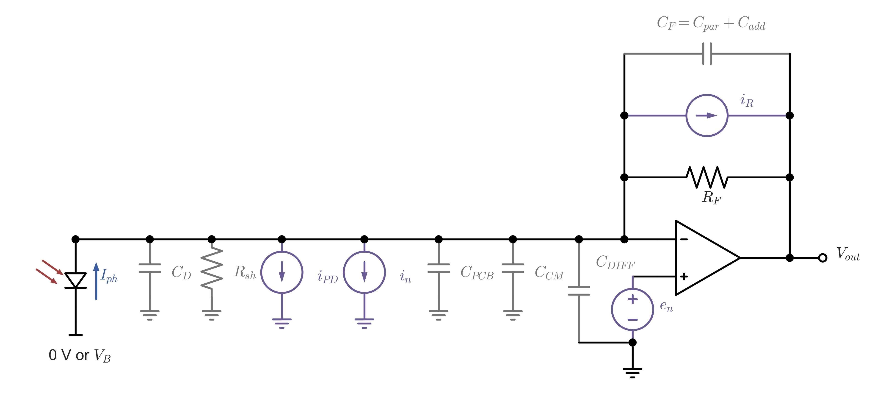

*Figure 1. The inverting TIA of this note with every element of Eq. (8). The photodiode delivers the photocurrent $I_{ph}$ into the summing node; its cathode sits at ground (zero bias) or at a reverse bias $V_B$. Grey elements are the capacitances and the shunt resistance that the circuit cannot avoid: the photodiode's $C_D$ and $R_{sh}$, the board's $C_{PCB}$, the amplifier's common-mode input capacitance $C_{CM}$ from its inverting input to ground, its differential input capacitance $C_{DIFF}$ between its two inputs, and the feedback capacitance $C_F$, the resistor's own $C_{par}$ plus any capacitor $C_{add}$ placed on purpose. $C_{DIFF}$ ends on the non-inverting input, which is grounded, so it connects the summing node to ground just as $C_{CM}$ does; that is why the two add in $C_T$. The noise sources are purple: $i_R$, the Johnson noise of $R_F$; $i_{PD}$, the photodiode's thermal noise $4k_BT/R_{sh}$ together with the shot noise $2q\,(I_{ph} + I_D)$; the amplifier's current noise $i_n$; and its voltage noise $e_n$, drawn between the grounded non-inverting pin and the amplifier. Through the loop the summing node follows $e_n$, so $e_n$ drives a current through every capacitance at the node, $C_{DIFF}$ included (Eq. (9)). All but $e_n$ are currents at the summing node and are referred to the input unchanged (Section 2.1).*

These are the conventions of the companion note (its Section 1), which the present note keeps wherever the two overlap.

### 1.2 The photodiode as the amplifier sees it

The amplifier does not care what the photodiode is made of. It sees a current source $I_{ph}$ in parallel with a capacitance $C_D$ and a resistance $R_{sh}$, which is the equivalent circuit Hamamatsu gives for its silicon photodiodes, together with a series resistance (KSPD9001E04, p. 2) [P5]. The material enters only through the values of $C_D$ and $R_{sh}$, their dependence on bias and temperature, and the dark current. Hamamatsu obtains $R_{sh}$ from the dark current measured at a reverse bias of 10 mV (KSPD9001E04, p. 4) [P5]. It is therefore the slope resistance of the diode near zero bias, and at zero bias its Johnson noise $4k_BT/R_{sh}$ is the diode's own noise in the dark.

Table 1 collects examples from four Hamamatsu datasheets: small and medium silicon photodiodes, a large-area silicon PIN diode, InGaAs diodes from 0.3 to 5 mm, and InGaAs diodes extended to 2.6 µm. They span the whole range a high-gain TIA meets.

*Table 1. Capacitance and shunt resistance of example photodiodes at 25 °C unless stated. $C_t$ is the terminal capacitance at the stated reverse bias $V_R$; $R_{sh}$ is measured at $V_R$ = 10 mV. The last column is the frequency $1/(2\pi R_{sh}C_t)$ above which the capacitance, not the shunt resistance, sets the photodiode's admittance (typical values). Sources: S1336 series KSPD1022E09, p. 1 [P1]; S3204/S3584 series KPIN1051E10, p. 1 and the capacitance curve on p. 3, read by eye [P4]; G12180 series KIRD1121E11, p. 1 (diameters) and p. 3, with footnote \*6 for the bias of the three smallest [P2]; G12183 series KIRD1119E10, pp. 1 and 3 [P3].*

| Photodiode | Material, size | $C_t$ (typ) | Bias for $C_t$ | $R_{sh}$ min / typ | $1/(2\pi R_{sh}C_t)$ |
|---|---|---|---|---|---|
| S1336-18BK | Si, 1.1 × 1.1 mm | 20 pF | 0 V, 10 kHz | 0.5 / 2 GΩ | 4.0 Hz |
| S1336-5BK | Si, 2.4 × 2.4 mm | 65 pF | 0 V, 10 kHz | 0.3 / 1 GΩ | 2.4 Hz |
| S1336-44BK | Si, 3.6 × 3.6 mm | 150 pF | 0 V, 10 kHz | 0.2 / 0.6 GΩ | 1.8 Hz |
| S1336-8BK | Si, 5.8 × 5.8 mm | 380 pF | 0 V, 10 kHz | 0.1 / 0.4 GΩ | 1.0 Hz |
| S3204-08 | Si PIN, 18 × 18 mm | about 1.7 nF; 130 pF | 0.1 V; 70 V | not given; dark current 6 nA typ at 70 V | – |
| S3584-08 | Si PIN, 28 × 28 mm | about 3.7 nF; 300 pF | 0.1 V; 70 V | not given; dark current 10 nA typ at 70 V | – |
| G12180-003A | InGaAs, ⌀0.3 mm | 5 pF | 5 V, 1 MHz | 200 / 1000 MΩ | 32 Hz |
| G12180-010A | InGaAs, ⌀1 mm | 55 pF | 5 V, 1 MHz | 25 / 125 MΩ | 23 Hz |
| G12180-030A | InGaAs, ⌀3 mm | 450 pF | 1 V, 1 MHz | 4 / 20 MΩ | 18 Hz |
| G12180-050A | InGaAs, ⌀5 mm | 1000 pF | 1 V, 1 MHz | 1.3 / 6.5 MΩ | 24 Hz |
| G12180-250A | InGaAs, ⌀5 mm, cooled to −20 °C | 1000 pF | 1 V, 1 MHz | 90 / 500 MΩ | 0.3 Hz |
| G12183-003K | InGaAs to 2.6 µm, ⌀0.3 mm | 50 pF | 0 V, 1 MHz | 20 / 100 kΩ | 32 kHz |
| G12183-010K | InGaAs to 2.6 µm, ⌀1 mm | 500 pF | 0 V, 1 MHz | 2.8 / 14 kΩ | 23 kHz |
| G12183-030K | InGaAs to 2.6 µm, ⌀3 mm | 4 nF | 0 V, 1 MHz | 0.25 / 1.4 kΩ | 28 kHz |
| G12183-210K | InGaAs to 2.6 µm, ⌀1 mm, cooled to −20 °C | 400 pF | 0 V, 1 MHz | 55 / 280 kΩ | 1.4 kHz |

Four points follow from the table.

- **The capacitance grows with area, and the shunt resistance falls with it.** Within one series the product $R_{sh}C_t$ is roughly constant. In the S1336 series it is 40 ms for the smallest and 152 ms for the largest diode, and in the G12180 series 5–9 ms. The corner $1/(2\pi R_{sh}C_t)$ in the last column is therefore a property of the material and its temperature rather than of the size.
- **The material sets the shunt resistance by orders of magnitude.** Silicon diodes have gigaohms, InGaAs diodes megaohms to a gigaohm, and InGaAs extended to 2.6 µm only kilohms to 100 kΩ. For the extended diodes the corner lies at 23–32 kHz, so their admittance is resistive over the whole band of a high-gain TIA. Germanium diodes, not tabulated here because no datasheet was read (Appendix C, item 1), fall in the same low-resistance class.
- **Reverse bias trades capacitance for dark current.** The 28 × 28 mm S3584-08 falls from about 3.7 nF at 0.1 V to 300 pF at 70 V, read from its capacitance curve, but then carries 10 nA of dark current (typical), whose shot noise $\sqrt{2qI_D}$ = 57 fA/√Hz exceeds the Johnson noise of a 10-MΩ resistor (40.6 fA/√Hz).
- **Cooling raises the shunt resistance.** Cooling the 5-mm InGaAs diode to −20 °C raises its typical shunt resistance from 6.5 MΩ to 500 MΩ, a factor of 77, and cooling the 1-mm extended diode raises it from 14 kΩ to 280 kΩ, a factor of 20.

**Temperature.** The shunt resistance falls fast with temperature, at a rate that depends on the diode. For the S1336 series the dark current at 10 mV rises by a factor of 1.15 per °C (S1336 series, p. 1) [P1]. Since $R_{sh}$ is that voltage divided by that current, it halves every $\ln 2/\ln 1.15$ = 4.96 °C. For the G12180 series the curves of shunt resistance against temperature are straight lines on a log scale, about six decades from −40 °C to +100 °C (G12180 series, p. 5, read by eye) [P2]. That is a decade per 23–25 °C, or a halving every 7–8 °C. Analog Devices states, for the large-area photodiodes it has in mind, that the shunt resistance halves every 10 °C (ADA4530-1 data sheet Rev. C, p. 44) [D1]. A design that must work at 85 °C should therefore expect $R_{sh}$ to be $2^{60/5}\approx4000$ times smaller than at 25 °C for a diode like the S1336, and $2^{60/10} = 64$ times smaller for one that follows the 10-°C rule.

### 1.3 What each gain decade fixes before any amplifier is chosen

Four quantities depend on $R_F$ alone, and they frame everything that follows.

**The noise floor.** The feedback resistor's Johnson noise is a current of density

$$
i_R = \sqrt{\frac{4k_BT}{R_F}}
\tag{1}
$$

at the summing node, where it adds to the signal like a photocurrent. No amplifier can reduce it. For $R_F$ = 1 MΩ, $i_R = \sqrt{1.6466\times10^{-20}\ \mathrm{J}/10^{6}\ \Omega}$ = 128 fA/√Hz.

**The shot-noise crossover.** A photocurrent $I$ carries shot noise of density $\sqrt{2qI}$. Setting $2qI$ equal to $4k_BT/R_F$ gives the current above which the light's own noise exceeds the resistor's:

$$
I_x = \frac{2k_BT}{qR_F} = \frac{51.4\ \mathrm{mV}}{R_F}.
\tag{2}
$$

At 25 °C, $2k_BT/q = 2\times25.69$ mV = 51.4 mV, so $I_x$ is 514 nA at 100 kΩ and 51.4 pA at 1 GΩ. Above $I_x$ the measurement is limited by the light, and a larger $R_F$ gains nothing in noise. Below $I_x$ the resistor dominates, and a larger $R_F$ helps as $\sqrt{R_F}$ in signal-to-noise ratio, because the signal grows as $R_F$ and the resistor's noise voltage as $\sqrt{R_F}$.

**The full-scale current.** An output that can swing $V_{sw}$ carries at most

$$
I_{\max} = \frac{V_{sw}}{R_F}.
\tag{3}
$$

For a ±15-V part with 10 V of usable swing this is 100 µA at 100 kΩ and 10 nA at 1 GΩ. For a 5-V rail-to-rail part with about 2.4 V it is 24 µA and 2.4 nA. Any DC current, dark current or background light included, uses part of this range.

**The resistor's own bandwidth.** A resistor with parasitic capacitance $C_{par}$ across it has the pole

$$
f_R = \frac{1}{2\pi R_FC_{par}}.
\tag{4}
$$

A TIA cannot be faster than this unless its response is equalized afterwards (Section 3.5). The parasitic capacitance of a surface-mount resistor and its pads is of the order of 0.1 pF. Analog Devices uses 100 fF as "a practical minimum stray capacitance value" for resistors up to 1 TΩ (ADA4530-1 data sheet Rev. C, p. 39, Table 9) [D1]. Texas Instruments (TI) writes that the feedback resistor "has a parasitic shunt capacitance that may be as large as 0.2 pF" (SSZTBC4, p. 1) [A3], and older TI application notes, written for leaded resistors, use 0.4–0.5 pF (SBOA061, p. 2, Fig. 3; SBOA034, pp. 4 and 7) [A2, A1]. With 0.1 pF, $f_R$ is 15.9 MHz at 100 kΩ, 159 kHz at 10 MΩ and 1.59 kHz at 1 GΩ.

The four quantities combine into a result that holds at every gain. Over the bandwidth of the resistor's own pole, the Johnson noise of $R_F$ integrates to an output voltage of $\sqrt{k_BT/C_{par}}$, independent of $R_F$. The single-pole noise bandwidth is $(\pi/2)f_R = 1/(4R_FC_{par})$, so the output noise power is $(4k_BT/R_F)\,R_F^2/(4R_FC_{par}) = k_BT/C_{par}$. The DC dynamic range of a resistor-limited TIA over its full band is therefore

$$
DR = \frac{V_{sw}}{\sqrt{k_BT/C_{par}}},
\tag{5}
$$

the same for every $R_F$. With $C_{par}$ = 0.1 pF, $\sqrt{k_BT/C_{par}} = \sqrt{4.116\times10^{-21}\ \mathrm{J}/10^{-13}\ \mathrm{F}}$ = 203 µV rms, so a 10-V swing gives $10\ \mathrm{V}/203\ \mu\mathrm{V} = 4.9\times10^{4}$, or 93.8 dB. Choosing $R_F$ moves this window of about five decades along the current axis, together with the bandwidth, but does not widen it. A wider window needs gain ranging or a logarithmic amplifier (Chapter 7).

Table 2 evaluates Eqs. (1)–(4) for the five decades of this note, and Figure 2 plots the currents over a wider range of $R_F$, with the companion note's regime marked for comparison.

*Table 2. What each gain decade fixes: the resistor's noise floor, Eq. (1); the shot-noise crossover, Eq. (2); the full-scale current for 10 V and 2.4 V of swing, Eq. (3); and the resistor's own pole for 0.05, 0.1 and 0.2 pF, Eq. (4). 25 °C.*

| $R_F$ | $\sqrt{4k_BT/R_F}$ | $I_x = 2k_BT/(qR_F)$ | $I_{\max}$ at 10 V | $I_{\max}$ at 2.4 V | $f_R$ at 0.05 / 0.1 / 0.2 pF |
|---|---|---|---|---|---|
| 100 kΩ | 406 fA/√Hz | 514 nA | 100 µA | 24 µA | 31.8 / 15.9 / 7.96 MHz |
| 1 MΩ | 128 fA/√Hz | 51.4 nA | 10 µA | 2.4 µA | 3.18 / 1.59 / 0.796 MHz |
| 10 MΩ | 40.6 fA/√Hz | 5.14 nA | 1 µA | 240 nA | 318 / 159 / 79.6 kHz |
| 100 MΩ | 12.8 fA/√Hz | 514 pA | 100 nA | 24 nA | 31.8 / 15.9 / 7.96 kHz |
| 1 GΩ | 4.06 fA/√Hz | 51.4 pA | 10 nA | 2.4 nA | 3.18 / 1.59 / 0.796 kHz |

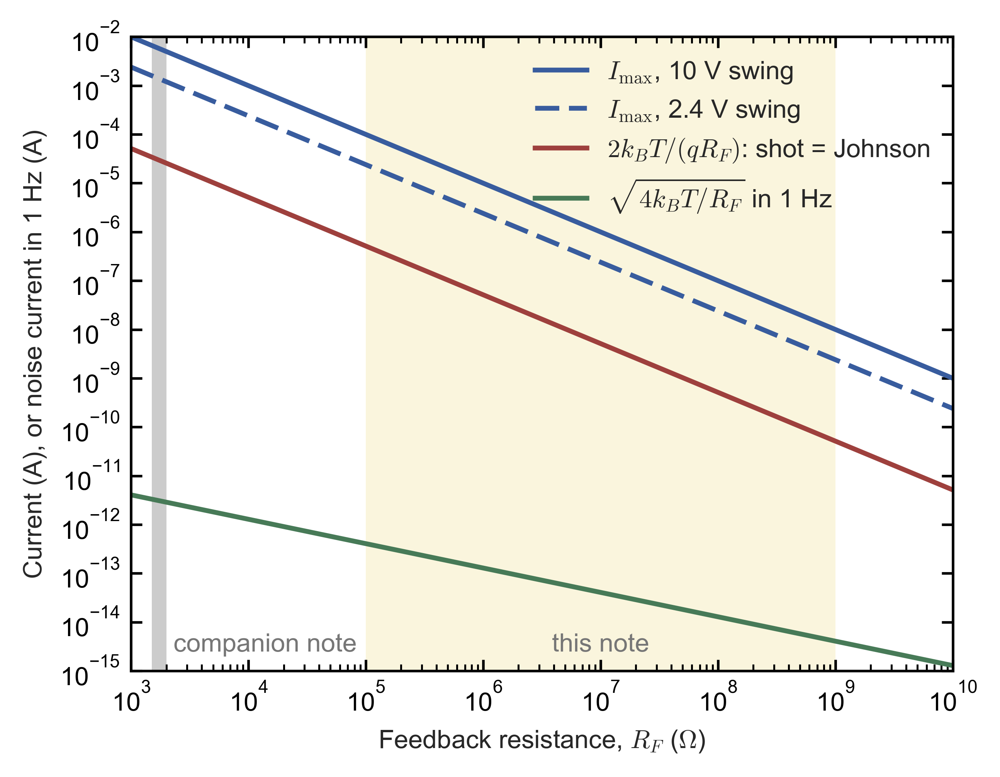

*Figure 2. The current window of a TIA against its feedback resistance: the full-scale current for 10 V and 2.4 V of swing, Eq. (3); the current whose shot noise equals the resistor's Johnson noise, Eq. (2); and the resistor's Johnson noise in a 1-Hz band, Eq. (1). Above the red line the light's own noise dominates; between the red and green lines the resistor's noise does. The shaded band is the range of this note; the grey band at 1.5–2 kΩ is the companion note's.*

### 1.4 Conventions of the analysis

The analysis in Chapters 2–6 uses the following conventions. Appendix B lists them with the scripts that apply them.

- **Values.** Typical values at 25 °C from the datasheets, with each page cited in Table A.1. Maxima are used for the DC errors, which Chapter 8 also evaluates at 85 °C.
- **Feedback capacitance.** The resistor's own capacitance is $C_{par}$ = 0.1 pF unless stated, with 0.05 and 0.2 pF as the range. The board adds $C_{PCB}$ = 1 pF at the summing node. The total feedback capacitance $C_F$ is the smallest value at or above $C_{par}$ that keeps the transimpedance within 0.1 dB of maximally flat (Section 3.1). If $C_{par}$ alone already achieves that, the design is called resistor-limited.
- **Noise band and excess noise.** Noise is integrated over 1 Hz to the −3 dB bandwidth $f_{-3\,\mathrm{dB}}$ of each design. The excess noise $\Delta N$ is the ratio, in decibels, of the total to the floor that no amplifier can remove: the Johnson noise of $R_F$ plus the diode's own shunt noise, integrated over the same band (Eq. (16)).
- **Photodiode bias.** The photodiode is at zero bias unless stated, so it contributes $4k_BT/R_{sh}$ and no dark current.

---

## 2. The noise of a high-gain TIA

Every comparison in this note is made on the noise referred to the photocurrent, so this chapter derives it first. Section 2.1 gives it exactly for the circuit of Figure 1, and the following sections take its terms one at a time: the floor that the feedback resistor and the photodiode set (Section 2.2), the amplifier's current noise (Section 2.3) and voltage noise (Section 2.4), the rule that matches the two to the summing node (Section 2.5), the signal's own shot noise (Section 2.6) and temperature (Section 2.7). Section 2.8 defines the figure of merit by which Chapters 4–6 compare the designs.

### 2.1 The input-referred noise of the circuit

This section derives the noise of the TIA referred to the photocurrent, for any feedback network, and shows that the loop gain drops out of it (Eq. (7)). The noise analysis treats the feedback element as a general two-port, not as a lumped $R_F\parallel C_F$, because Section 3.4 needs the same result for a resistor with distributed capacitance. The two-port is described by its short-circuit admittances. With $V_1$ the summing-node voltage and $V_2$ the output voltage, the current flowing from the summing node into the network is $I_1 = y_{11}V_1 + y_{12}V_2$. The network is passive and reciprocal, so $y_{12} = y_{21}$, and we write $y_f = -y_{21}$, the transfer admittance from the output to the summing node. For a lumped resistor and capacitor, $y_{11} = y_f = 1/R_F + j\omega C_F$. The photodiode and the amplifier's input capacitances form the source admittance $Y_s = 1/R_{sh} + j\omega C_T$, and the op amp has open-loop gain $A(s)$ with its voltage noise $e_n$ in series with the grounded non-inverting input.

Kirchhoff's current law at the summing node, with a current $I_{in}$ injected into it, reads $I_{in} = Y_sV_1 + I_1 = Y_nV_1 - y_fV_2$, where $Y_n = Y_s + y_{11}$ is the total admittance of the node with the output grounded. The op amp sets $V_2 = A\,(e_n - V_1)$.

*The signal.* With $e_n$ = 0, $V_1 = -V_2/A$, and the node equation gives $I_{in} = -V_2\,(y_f + Y_n/A)$. The transimpedance is therefore

$$
Z_T = \frac{V_2}{I_{in}} = -\frac{1}{y_f + Y_n/A}.
\tag{6}
$$

Where the loop gain $T = Ay_f/Y_n$ is large, $Z_T \to -1/y_f$, which is $-R_F/(1 + j\omega R_FC_F)$ for the lumped network.

*The voltage noise.* With $I_{in}$ = 0, the node equation gives $V_1 = y_fV_2/Y_n$, and the op amp gives $V_2 = A\,(e_n - y_fV_2/Y_n)$, so $V_2 = Ae_n/(1 + Ay_f/Y_n)$. Dividing this output by $|Z_T|$ refers it to the input as a current:

$$
i_{e} = \frac{Ae_n}{1 + Ay_f/Y_n}\left(y_f + \frac{Y_n}{A}\right) = e_n\,Y_n\,\frac{Ay_f + Y_n}{Y_n + Ay_f} = e_n\,Y_n .
\tag{7}
$$

The result is exact: the loop gain cancels completely, so the input-referred voltage-noise current is $e_n$ times the admittance of the summing node. The loop gain decides how far up in frequency the transimpedance keeps its value, that is the bandwidth, but not the input-referred noise density.

*The other sources.* Every other noise source is a current at the summing node and enters as it is. This holds for the op amp's input current noise $i_n$, for the photodiode's own noise, and for the signal's shot noise. It also holds for the thermal noise of the feedback network. A passive network at temperature $T$ has a short-circuit noise current at its port 1 of spectral density $4k_BT\,\mathrm{Re}\{y_{11}\}$; its port-2 noise current flows into the op amp's output, a voltage source, and has no effect. The input-referred noise current density is therefore

$$
S_i(f) = 4k_BT\,\mathrm{Re}\{y_{11}\} + \frac{4k_BT}{R_{sh}} + 2q\,(I_{ph} + I_D) + i_n^2(f) + e_n^2(f)\,\bigl|Y_s + y_{11}\bigr|^2 ,
\tag{8}
$$

in A²/Hz. The second term is the photodiode's noise at zero bias, and the dark-current term replaces it under reverse bias. For the lumped network $\mathrm{Re}\{y_{11}\} = 1/R_F$, and the last term becomes

$$
e_n^2\,|Y_n|^2 = e_n^2\left[\left(\frac{1}{R_F} + \frac{1}{R_{sh}}\right)^2 + \bigl(2\pi f\,(C_T + C_F)\bigr)^2\right].
\tag{9}
$$

With $R_{sh}\to\infty$ and $I_D$ = 0 this is the companion note's Eq. (23), derived there for its own circuit. The rest of this chapter takes Eq. (8) term by term.

### 2.2 The floor set by the feedback resistor and the photodiode

The first two terms of Eq. (8) are the floor that no amplifier can remove:

$$
S_{\mathrm{floor}} = \frac{4k_BT}{R_F} + \frac{4k_BT}{R_{sh}} = \frac{4k_BT}{R_F\parallel R_{sh}} .
\tag{10}
$$

If $R_{sh}\gg R_F$, the floor is the resistor's. If $R_{sh}$ is comparable to or below $R_F$, it is the photodiode's, and raising $R_F$ further hardly lowers it. For the 1-mm extended-InGaAs diode of Table 1, $R_{sh}$ = 14 kΩ gives a Johnson noise of $\sqrt{1.6466\times10^{-20}/1.4\times10^{4}}$ = 1.08 pA/√Hz. With $R_F$ = 1 MΩ the floor is $\sqrt{1.6466\times10^{-20}\,(10^{-6} + 1/1.4\times10^{4})}$ = 1.09 pA/√Hz, so the resistor contributes 1.4% of the power. A resistor of ten times $R_{sh}$ already brings the floor within $10\log_{10}(1.1)$ = 0.41 dB of the diode's own; beyond that, a larger $R_F$ buys almost nothing in noise and, as Sections 3.3 and 8.1 show, costs bandwidth and offset. The photodiode's datasheet confirms this reading of the floor. For the S1336-18BK, the Johnson noise of its typical 2-GΩ shunt resistance is $\sqrt{1.6466\times10^{-20}/2\times10^{9}}$ = 2.87 fA/√Hz, which, divided by its peak responsivity of 0.5 A/W, gives 5.7 fW/√Hz. That is exactly the noise-equivalent power the datasheet lists for it, $5.7\times10^{-15}\ \mathrm{W/Hz^{1/2}}$ (S1336 series, p. 1) [P1]. For the S1336-8BK, 0.4 GΩ gives 6.42 fA/√Hz and 12.8 fW/√Hz, against the listed $1.3\times10^{-14}\ \mathrm{W/Hz^{1/2}}$. The datasheet's noise-equivalent power is thus the shunt resistance's Johnson noise, which supports reading $R_{sh}$ as the diode's noise source at zero bias.

Under reverse bias the diode contributes the shot noise of its dark current, $2qI_D$, instead. The large-area S3584-08 at 70 V, with 10 nA typical, contributes 57 fA/√Hz (Section 1.2), which exceeds the floor of any $R_F$ above 5 MΩ.

### 2.3 The amplifier's current noise

The current noise of a FET-input op amp is, at low frequency, the shot noise of its gate leakage current, $i_n = \sqrt{2qI_B}$. Like any current at the summing node, it competes with the resistor's Johnson noise, and it dominates above the critical resistance

$$
R_{F,\mathrm{crit}} = \frac{4k_BT}{i_n^2} \quad\left(= \frac{2k_BT}{qI_B} = \frac{51.4\ \mathrm{mV}}{I_B}\ \text{for pure shot noise}\right).
\tag{11}
$$

The second form is Eq. (2) with the bias current in place of the photocurrent: the gate current is simply a dark current that the amplifier adds. Table A.2 lists $R_{F,\mathrm{crit}}$ for every part from its datasheet value of $i_n$, and the classes separate cleanly.

- **CMOS electrometers.** ADA4530-1 and OPA928 both specify 0.07 fA/√Hz at 0.1 Hz (ADA4530-1, p. 4; OPA928, p. 4) [D1, D2], so $R_{F,\mathrm{crit}} = 1.6466\times10^{-20}/(7\times10^{-17})^2$ = 3.4 TΩ, far beyond the range of this note.
- **Precision JFET and CMOS parts.** OPA140 and OPA145 specify 0.8 fA/√Hz, OPA320 0.6, OPA828 1.2, OPA827 2.2 and ADA4625-1 4.5 fA/√Hz, all at 1 kHz [D9, D10, D13, D7, D8, D6]. Their critical resistances run from 813 MΩ (ADA4625-1) to 46 GΩ (OPA320).
- **A bias-current-cancelled electrometer.** LMP7721 has a typical bias current of only 3 fA but a current noise of 0.01 pA/√Hz = 10 fA/√Hz at 1 kHz (LMP7721, pp. 6–7) [D3]. That is about 320 times the shot noise of 3 fA, which is 0.031 fA/√Hz. The data sheet attributes the low bias current to "input bias current cancellation amplifier circuitry" (p. 1) [D3]. A cancellation subtracts one DC current from another, but the noises of the two add, so a cancelled bias current says nothing about the current noise. Its $R_{F,\mathrm{crit}}$ is 165 MΩ, and at 1 GΩ its current noise is 7 dB above the floor (Table A.3).
- **A general-purpose CMOS part.** LMC662's data sheet gives 4 fA/√Hz at 1 kHz (Rev. D, p. 6) [D5]. Its revision history, however, states that this value replaced the earlier 0.0002 pA/√Hz, that is 0.2 fA/√Hz, "to align with modern noise test setup" (p. 23). The 4 fA/√Hz therefore describes the test setup rather than the part, and the model uses the earlier 0.2 fA/√Hz. Even that is conservative. A CMOS input without bias-current cancellation draws only the leakage currents $I_1$ and $I_2$ of its two input-protection diodes. They flow in opposite directions, so the bias current is their difference. Each, however, is a stream of independent charges with its own shot noise, and the noise powers add: $i_n = \sqrt{2q(|I_1| + |I_2|)}$. For LMC662's typical bias current of 2 fA (p. 6) this is $\sqrt{2\times1.602\times10^{-19}\ \mathrm{C}\times2\ \mathrm{fA}}$ = 0.025 fA/√Hz if one diode dominates, and 0.057 fA/√Hz if the two leak 10 fA together. With 0.2 fA/√Hz, $R_{F,\mathrm{crit}}$ is 412 GΩ, so LMC662's current noise is negligible at every gain of this note.
- **Low-noise CMOS audio-class parts.** OPA1656 specifies 6 fA/√Hz and OPA2156 19 fA/√Hz at 1 kHz [D11, D12], giving 457 MΩ and 46 MΩ.
- **Zero-drift and auto-zero parts.** OPA388 specifies 100 fA/√Hz at 1 kHz and OPA381 20 fA/√Hz at 10 kHz [D15, D14], giving 1.65 MΩ and 41 MΩ. A plausible mechanism is the charge that the input switches inject at every clock cycle, but the datasheets give only the values.
- **Bipolar parts.** OPA211 specifies 1.7 pA/√Hz at 1 kHz [D17], so $R_{F,\mathrm{crit}}$ = 5.7 kΩ: a bipolar input is unsuitable for any gain of this note, except where the photodiode's own shunt resistance is a few kilohms (Section 6.6).

*Frequency dependence.* The datasheet current noise of FET-input parts rises at high frequency. For LTC6268-10 it is 7 fA/√Hz at 100 kHz and about 0.18 pA/√Hz at 1 MHz and 0.89 pA/√Hz at 10 MHz; for OPA818 it is 3 fA/√Hz at 10 kHz and 145 fA/√Hz at 1 MHz, from a curve its datasheet labels as simulated. These values are taken from the companion note's records of the two datasheets (its data/specs files) [D18, D20]. Part of this rise is the input transistors' channel noise coupled through their gate capacitance, which Eq. (8) already counts in $e_n\,\omega C_T$, since $C_T$ includes $C_{CM}$ and $C_{DIFF}$. The model adds the datasheet curve as well, which may count that part twice and therefore errs on the pessimistic side. For parts without a curve, $i_n$ is held at its specified value. Below the first point of a curve that starts above 1 kHz and rises, as for the wideband parts, the model continues the rise downwards with the slope from the first point to the first point at least a decade above it. It adds in quadrature the shot noise of the typical bias current, $\sqrt{2qI_{B,\mathrm{typ}}}$, because the shot noise of the gate current is the floor below which the current noise of a FET input cannot fall. Holding the first point flat down to DC instead would overstate the noise at high gain. For OPA818 the floor is 1.1 fA/√Hz, against the 3 fA/√Hz specified at 10 kHz, and at 1 GΩ it lowers the excess noise from 1.5 to 0.5 dB (Section 9.8). The rise matters only at 100 kΩ to 10 MΩ with megahertz bandwidths. OPA818's 145 fA/√Hz at 1 MHz, for example, exceeds the 128 fA/√Hz of a 1-MΩ resistor.

*Temperature.* The gate current of a FET-input op amp "doubles for every 10 °C increase in temperature, while the bias current of bipolar op amps decreases" (Hamamatsu technical note KSPD9001E04, p. 10) [P5]. A part whose current noise is shot noise therefore gains a factor $\sqrt2$ in $i_n$ per 10 °C, and its $R_{F,\mathrm{crit}}$ falls by a factor of 2 per 10 °C, or 64 from 25 °C to 85 °C. Chapter 8 uses the specified maxima at 85 °C for the DC errors.

### 2.4 The amplifier's voltage noise acting on the summing node

The loop holds the summing node at the amplifier's voltage noise $e_n$, so $e_n$ drives a current through everything connected to the node: the resistances $R_F$ and $R_{sh}$, and the whole node capacitance $C_T + C_F$ (Eq. (7)). It is the amplifier term that grows with the photodiode's capacitance and with frequency, and Chapter 4 shows where it dominates. Equation (9) has two parts, and they dominate in different places.

*At low frequency* the voltage noise sees the conductance $1/R_F + 1/R_{sh}$. Compared with the floor of Eq. (10), its contribution is $e_n^2/(R_F\parallel R_{sh})^2$ against $4k_BT/(R_F\parallel R_{sh})$. The voltage noise therefore matters at low frequency only if it exceeds the Johnson voltage noise of the parallel resistance,

$$
e_{n,\mathrm{crit}} = \sqrt{4k_BT\,(R_F\parallel R_{sh})} .
\tag{12}
$$

For a parallel resistance of 100 kΩ or more this is at least $\sqrt{1.6466\times10^{-20}\times10^{5}}$ = 40.6 nV/√Hz, larger than the voltage noise of every part in this survey above 100 Hz. The low-frequency term matters only for diodes with low shunt resistance. For the 14-kΩ extended-InGaAs diode, $e_{n,\mathrm{crit}}$ = 15.2 nV/√Hz, so an amplifier with more voltage noise than that adds more than the diode's own noise. It also matters in the flicker region of CMOS parts: ADA4530-1 has 80 nV/√Hz at 10 Hz (p. 4) [D1].

*At high frequency* the voltage noise sees the node capacitance $C_T + C_F$, and its contribution grows as $f^2$ in power. It equals the floor at

$$
f_e = \frac{\sqrt{4k_BT/(R_F\parallel R_{sh})}}{2\pi\,e_n\,(C_T + C_F)} .
\tag{13}
$$

For a 1-MΩ TIA with OPA1656 (2.9 nV/√Hz at 10 kHz, 11 pF of input capacitance [D11]) on the 20-pF S1336-18BK, with 1 pF of board capacitance and about 0.3 pF of feedback capacitance, $C_T + C_F$ = 32.3 pF and $f_e$ = 128.3 fA/√Hz ÷ (2π × 2.9 nV/√Hz × 32.3 pF) = 218 kHz. On the 380-pF S1336-8BK with ADA4625-1 (3.3 nV/√Hz, 19.9 pF [D6]), $C_T + C_F$ ≈ 402 pF and $f_e$ = 15 kHz at the same gain. Above $f_e$ the voltage noise dominates, and below it the floor does. Chapter 4 maps $f_e$ against the bandwidth for every gain.

*Flicker noise* enters both parts of Eq. (9). In the capacitive part, a $1/f$ density in $e_n^2$ times the $f^2$ of the capacitance still grows as $f$. Flicker noise therefore matters only when $f_e$ falls inside the flicker region. That happens for CMOS parts at the highest gains: the corner of ADA4530-1 is near 300 Hz (80 nV/√Hz at 10 Hz against 14 nV/√Hz at 10 kHz), and a 1-GΩ TIA on a small photodiode has its $f_e$ between 1 and 6 kHz (Section 3.5).

### 2.5 Matching the amplifier to the node impedance

Neither the voltage noise nor the current noise of an amplifier says on its own whether the part suits a given gain, because the node weighs the two differently at each gain and frequency. Their ratio does, and it is the quickest way to place an amplifier class in the gain range. The two amplifier terms of Eq. (8), $i_n^2$ and $e_n^2|Y_n|^2$, are equal when the impedance of the node equals

$$
R_{opt} = \frac{e_n}{i_n} ,
\tag{14}
$$

the familiar optimum source resistance. An amplifier is well matched to a TIA when $R_{opt}$ lies near the node impedance $1/|Y_n|$ over the band, and badly matched when it lies far from it on either side. For a bipolar OPA211, $R_{opt}$ = 1.1 nV ÷ 1.7 pA = 650 Ω. For ADA4625-1 it is 3.3 nV ÷ 4.5 fA = 0.73 MΩ, for OPA140 5.1 nV ÷ 0.8 fA = 6.4 MΩ, and for ADA4530-1 about 16 nV ÷ 0.07 fA = 230 GΩ. The node impedance of a TIA is at most $R_F\parallel R_{sh}$ and falls as $1/(2\pi fC_T)$ above the node's corner. At 1 GΩ with the 20-pF diode, and 29–38 pF in total at the node, it is 2.6–3.4 MΩ at the 1.6-kHz band edge, which suits OPA140; an electrometer's $R_{opt}$ is far above it, so its larger voltage noise costs more than its tiny current noise saves (Section 6.5). This is the single most useful rule for choosing an amplifier class, and Chapter 6 applies it decade by decade.

### 2.6 The signal's shot noise and the noise-equivalent power

The signal's own shot noise is the third term of Eq. (8). Above $I_x$ of Eq. (2) it dominates, and the measurement is shot-noise limited. In the regime of this note signals are usually near or below $I_x$, which is why $R_F$ is chosen large. The noise-equivalent power of the receiver is $\sqrt{S_i}/\mathcal{R}$, with $\mathcal{R}$ the responsivity in A/W. A 1-GΩ TIA with a resistor-limited floor of 4.06 fA/√Hz and a 0.5-A/W silicon diode reaches 8.1 fW/√Hz, the same order as the diode's own 5.7 fW/√Hz of Section 2.2. Below that power level the photodiode and TIA cannot do better, whatever the amplifier; Section 7.4 discusses detectors with internal gain.

### 2.7 Temperature

The floor and the amplifier terms change with temperature at very different rates. The resistor's Johnson noise rises only as $\sqrt{T}$, by 9.6% from 25 °C to 85 °C. The FET gate current doubles every 10 °C, so

$$
I_B(T_A) = I_B(25\ ^\circ\mathrm{C})\cdot 2^{(T_A - 25\ ^\circ\mathrm{C})/10\ ^\circ\mathrm{C}} ,
\tag{15}
$$

a factor of 64 at 85 °C. The photodiode's shunt resistance halves every 5–10 °C (Section 1.2), a factor of 64 to 4000. A design that is resistor-limited at 25 °C can therefore be limited by the photodiode or by the amplifier's gate current at 85 °C. For the S1336-18BK, the datasheet's dark-current coefficient of 1.15 per °C, if it holds over the whole 60 °C, takes its typical 2 GΩ to $2\ \mathrm{G\Omega}/1.15^{60}$ = 0.46 MΩ. With $4k_BT = 1.978\times10^{-20}$ J at 85 °C, the diode's own noise is then $\sqrt{1.978\times10^{-20}/4.6\times10^{5}}$ = 210 fA/√Hz, above the floor of any $R_F$ larger than about 0.5 MΩ. The coefficient is specified as a single number (p. 1) [P1], so this extrapolation is an estimate. It shows that weak-light measurements at high gain need the photodiode kept cool, not only the amplifier.

### 2.8 The figure of merit

The designs of Chapters 4–6 are compared by their excess noise over the floor that no amplifier can remove, integrated over the band of each design:

$$
\Delta N = 10\log_{10}\frac{\int_{f_1}^{f_{-3\,\mathrm{dB}}} S_i(f)\,df}{\int_{f_1}^{f_{-3\,\mathrm{dB}}} \bigl(4k_BT\,\mathrm{Re}\{y_{11}\} + 4k_BT/R_{sh}\bigr)\,df} ,
\tag{16}
$$

with $f_1$ = 1 Hz and $f_{-3\,\mathrm{dB}}$ the −3 dB bandwidth of the design. $\Delta N$ = 0 dB means that the amplifier adds nothing, and 3 dB that it doubles the noise power. The companion note uses the same form with only $R_F$ in the denominator (its Section 4.6). Here the photodiode's shunt noise is included because, at the highest gains, it is part of the floor, and an amplifier should not be blamed for it.

---

## 3. Bandwidth, stability and the feedback resistor

Chapter 2 gave the noise density; this chapter gives the band over which it is integrated, and the stability of the loop that sets that band. A high-gain TIA has two bandwidth limits: the amplifier's gain–bandwidth product acting on the node capacitance, and the feedback resistor's own capacitance. Section 3.1 derives the first, together with the feedback capacitance that gives a flat response. Section 3.2 finds the gain at which the second takes over, Section 3.3 treats photodiodes with low shunt resistance, Section 3.4 models the resistor as the distributed line it is, and Section 3.5 weighs four ways to more bandwidth.

### 3.1 The loop and the maximally flat feedback capacitance

Once $R_F$ is chosen, the feedback capacitance $C_F$ is the one value left, and it sets both the flatness and the width of the response. This section derives the $C_F$ of a maximally flat response and the bandwidth it gives (Eqs. (18) and (19)), then two properties of the high-gain loop that keep the analysis simple, and one that limits it. For the lumped network and a photodiode whose shunt resistance is much larger than $R_F$, the admittances of Section 2.1 are $y_f = y_{11} = (1 + sR_FC_F)/R_F$ and $Y_n = [1 + sR_F(C_T + C_F)]/R_F$. Above its open-loop corner a compensated op amp is an integrator, $A(s) = \omega_t/s$ with $\omega_t = 2\pi\,GBW$. Substituting both into Eq. (6) gives

$$
Z_T(s) = -\frac{R_F}{1 + s\left(R_FC_F + \dfrac{1}{\omega_t}\right) + s^2\,\dfrac{R_F\,(C_T + C_F)}{\omega_t}} ,
\tag{17}
$$

a second-order low-pass with natural frequency $\omega_0 = \sqrt{\omega_t/[R_F(C_T + C_F)]}$ and damping set by the coefficient of $s$, $2\zeta/\omega_0 = R_FC_F + 1/\omega_t$. In the regime of this note $1/\omega_t$ is negligible beside $R_FC_F$. The response is maximally flat (Butterworth, $\zeta = 1/\sqrt2$) when $R_FC_F = \sqrt2/\omega_0$, which gives

$$
C_F = \sqrt{\frac{C_T + C_F}{\pi R_F\,GBW}} \approx \sqrt{\frac{C_T}{\pi R_F\,GBW}} ,
\tag{18}
$$

and a −3 dB bandwidth equal to the natural frequency,

$$
f_{-3\,\mathrm{dB}} = \sqrt{\frac{GBW}{2\pi R_F\,(C_T + C_F)}} .
\tag{19}
$$

For $R_F$ = 1 MΩ, $C_T$ = 101 pF and $GBW$ = 20 MHz, Eq. (18) gives $C_F$ = 1.28 pF and Eq. (19) 176 kHz. The model of Appendix B, which evaluates Eq. (6) numerically, gives 175.9 kHz with no peaking and a phase margin of 66° at that $C_F$. The often-quoted design value $C_F = \sqrt{C_T/(2\pi R_F\,GBW)}$, used for example in Eqs. 8–9 of the ADA4625-1 data sheet (Rev. C, p. 28) [D6], is smaller by $\sqrt2$. It gives $\zeta$ = 0.5 and a 1.25-dB peak. The data sheet itself says that this choice "maximizes the signal bandwidth with a 45° phase margin but is marginal for stability" (p. 28), and that the optimum $C_F$ is found on the bench (p. 29) [D6]. The designs of this note use the smallest $C_F$ that keeps the response within 0.1 dB of maximally flat, which lies between the two values and gives phase margins of 63–66°.

Two properties of the high-gain loop simplify the analysis. First, the loop crosses unity at about $f_x \approx GBW\cdot C_F/(C_T + C_F)$, where the noise gain is $(C_T + C_F)/C_F$. In this note's amplifier-limited designs on the 20-pF diode that noise gain at crossover is 4–160 at 100 kΩ, 11–130 at 1 MΩ and 34–220 at 10 MΩ, so $f_x$ is a small fraction of the gain–bandwidth product. For ADA4625-1 at 1 MΩ on the 20-pF diode, for example, the design has $C_F$ = 0.78 pF, a noise gain of 47 at crossover and $f_x \approx$ 18 MHz/47 = 0.38 MHz, far below any second pole of the amplifier. A single-pole model is then adequate, whereas the companion note, whose loop crosses at a noise gain of 7–12 near 1 GHz, needed the digitized open-loop curves. Two parts of this survey need more than a single pole. OPA1656 specifies 20 MHz of bandwidth at unity gain but 53 MHz of gain–bandwidth at a gain of 100 (p. 6) [D11], and its vendor's SPICE model shows why. Its open-loop gain is a single pole of 56 MHz up to about 300 kHz, and then falls faster, with 21° of extra phase lag at 1 MHz and 29° at 3 MHz (Section 9.2). OPA2156 shows the same pattern more mildly: 20 MHz at unity gain, 25 MHz at a gain of 100 (p. 6) [D12], and 8° of extra phase lag at 1 MHz in its SPICE model. The model therefore uses 53 and 25 MHz for these two parts, each multiplied by the shape of its open-loop gain beyond a single pole. Second, decompensated op amps, which are stable only above a minimum noise gain of 7 (OPA657, OPA818) or 10 (LTC6268-10), are stable in every design of this note, because the noise gain at crossover is far larger. Their extra gain–bandwidth therefore counts in full.

One further property of the loop limits the analysis rather than simplifying it. The integrator model $A = \omega_t/s$ holds only above the amplifier's open-loop corner, $GBW/A_0$, where $A_0$ is the DC open-loop gain; below that corner the gain stays at $A_0$. In Eq. (6) the node admittance enters the transimpedance as $Y_n/A$. At frequencies below the open-loop corner it therefore adds $Y_n/A_0$ to the feedback admittance, and its capacitive part acts as an extra feedback capacitance of $(C_T + C_F)/A_0$. That lowers the bandwidth in the same way as a larger $C_F$ would. The extra capacitance is at most a tenth of $C_F$, and the loss of bandwidth correspondingly small, when

$$
A_0 \geq 10\,\frac{C_T + C_F}{C_F} ,
\tag{19a}
$$

that is, when the DC open-loop gain exceeds the mid-band noise gain at least tenfold. The precision op amps of this note, with $A_0$ of 110–154 dB, meet this condition in every design. Four wideband parts, OPA656, OPA657, OPA818 and ADA4817-1, with 65–92 dB, fail it on large photodiodes at high gain, where the noise gain reaches thousands. ADA4817-1 fails it even on the 20-pF photodiode from 1 MΩ up, and OPA818 only on the 500-pF and 1-nF photodiodes. LTC6268-10, with 108 dB, meets it everywhere. For OPA657, whose $A_0$ is 70 dB (a factor of 3,160), the noise gain at 1 GΩ on the 380-pF photodiode with 0.1 pF is about 3,900. Its bandwidth there falls to 963 Hz in SPICE, against 1.59 kHz for the resistor's own pole. The SPICE checks of Section 9.2 found this limit. The model therefore uses each amplifier's datasheet $A_0$ (Table A.1), and Tables 6.1–6.5 leave out the 63 designs of the sweep that fail the condition, which Table A.3 marks.

### 3.2 When the resistor, not the amplifier, sets the bandwidth

A real resistor carries a fraction of a picofarad across itself, so the feedback capacitance can never be smaller than that. This section finds the gain at which the resistor's own capacitance takes the bandwidth over from the amplifier, and how the noise differs on the two sides of that gain. Equation (19) holds while the $C_F$ that Eq. (18) asks for is larger than the resistor's own capacitance $C_{par}$. As $R_F$ grows, Eq. (18) asks for less, and at the crossover gain

$$
R_F^* = \frac{C_T}{\pi\,GBW\,C_{par}^2}
\tag{20}
$$

the bare resistor already provides it. Above $R_F^*$ the loop is overdamped by $C_{par}$ alone, the bandwidth approaches the resistor's pole $f_R = 1/(2\pi R_FC_{par})$ of Eq. (4), and the amplifier's gain–bandwidth no longer matters. With $C_{par}$ = 0.1 pF and $GBW$ = 20 MHz, $R_F^*$ = 15.9 MΩ for $C_T$ = 10 pF, 159 MΩ for 100 pF and 1.59 GΩ for 1 nF. An electrometer with 2 MHz moves these ten times higher, and a wideband part with 200 MHz ten times lower (Appendix A, Table A.4). Above $R_F^*$ an amplifier needs only $GBW \geq C_T/(\pi R_FC_{par}^2)$ to reach the ceiling. At 1 GΩ with 40 pF this is 1.3 MHz, which even the electrometers meet. At $R_F^*$ itself the two formulas differ by $\sqrt2$, because a maximally flat response with its feedback pole at $f_R$ has its −3 dB point at $\sqrt2\,f_R$. Figure 3 plots both ceilings.

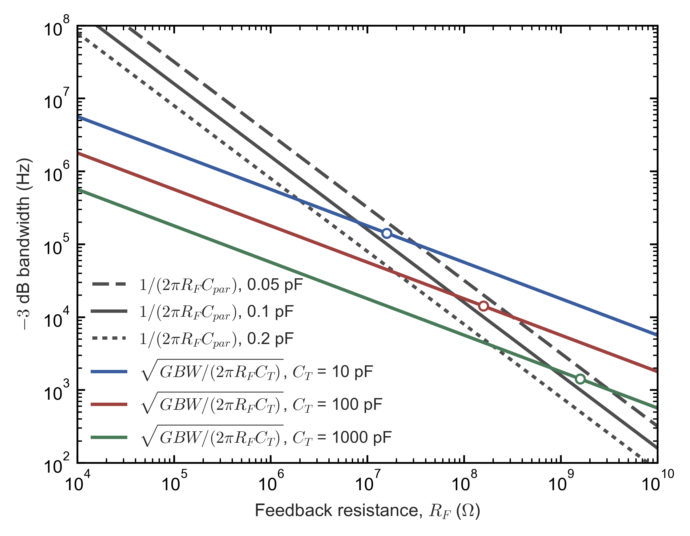

*Figure 3. The two bandwidth ceilings of a TIA. Grey: the resistor's own pole, Eq. (4), for 0.05, 0.1 and 0.2 pF. Coloured: the maximally flat bandwidth of Eq. (19) for a 20-MHz amplifier on 10 pF, 100 pF and 1 nF. The circles mark the crossover gain $R_F^*$ of Eq. (20) for 0.1 pF. Left of a circle the amplifier limits the bandwidth; right of it the resistor does.*

The two regimes differ in their noise as well, and two short formulas show how.

*Amplifier-limited regime.* Ignoring the photodiode's shunt resistance, the voltage noise reaches the floor at $f_e$ of Eq. (13), and the bandwidth is Eq. (19). Their ratio is

$$
\frac{f_e}{f_{-3\,\mathrm{dB}}} = \frac{1}{e_n}\sqrt{\frac{4k_BT}{2\pi\,(C_T + C_F)\,GBW}} ,
\tag{21}
$$

independent of $R_F$. Integrating $1 + (f/f_e)^2$ from 0 to $B$ gives $B\,[1 + B^2/(3f_e^2)]$, so the excess noise over the band is approximately

$$
\Delta N \approx 10\log_{10}\!\left[1 + \frac{1}{3}\left(\frac{f_{-3\,\mathrm{dB}}}{f_e}\right)^{2}\right] .
\tag{22}
$$

For ADA4625-1 on the 20-pF diode ($C_T + C_F$ = 41.7 pF, 18 MHz, 3.3 nV/√Hz), Eq. (21) gives $\sqrt{1.6466\times10^{-20}/(2\pi\times41.7\ \mathrm{pF}\times18\ \mathrm{MHz})}/3.3\ \mathrm{nV}$ = 0.57, and Eq. (22) gives 3.1 dB. The full model, which adds the current noise and the shunt resistance, gives 3.5–3.6 dB at 100 kΩ to 10 MΩ (Table A.3). On the 380-pF diode (402 pF) the ratio is 0.18 and the excess 10.4 dB; the full model gives 11.0 dB. In the amplifier-limited regime, then, the excess noise is fixed by the amplifier's voltage noise, the node capacitance and the gain–bandwidth product, whatever the gain. A faster amplifier buys bandwidth only as $\sqrt{GBW}$ and lets the $e_n\,\omega C$ noise into the band in exchange. The one way to have both is a lower $e_n\,C_T$: a quieter input device, or less capacitance.

*Resistor-limited regime.* With the bandwidth at $f_R$ the ratio becomes

$$
\frac{f_e}{f_R} = \frac{\sqrt{4k_BT\,R_F}\;C_{par}}{e_n\,(C_T + C_F)} ,
\tag{23}
$$

which grows as $\sqrt{R_F}$. At 1 GΩ, 0.1 pF, 3.3 nV/√Hz and 41 pF it is $\sqrt{1.6466\times10^{-11}}\times10^{-13}/(3.3\times10^{-9}\times4.1\times10^{-11})$ = 3.0. The resistor-limited band therefore contains less and less $e_n\,\omega C$ noise as the gain rises. That is why, at the highest gains, almost every FET-input amplifier comes close to the floor, and the choice turns on DC accuracy instead (Chapter 6).

### 3.3 Photodiodes with low shunt resistance

Some photodiodes have a shunt resistance far below the feedback resistors of this note, such as the extended-InGaAs diode of Table 1 with 14 kΩ. Section 2.2 showed what a shunt resistance comparable to or below $R_F$ does to the floor; this section shows what it does to the loop. At low frequency the noise gain is $1 + R_F/R_{sh}$, so the loop crosses unity at about $GBW/(1 + R_F/R_{sh})$. The bandwidth can be no higher:

$$
f_{-3\,\mathrm{dB}} \lesssim GBW\,\frac{R_{sh}}{R_F + R_{sh}} .
\tag{24}
$$

The circuit has become a voltage amplifier of gain $R_F/R_{sh}$, acting on the photovoltage $I_{ph}R_{sh}$ that the diode develops across its own shunt resistance. For the 14-kΩ extended-InGaAs diode and ADA4625-1 (18 MHz), Eq. (24) gives 252 Hz at 1 GΩ, and the full model gives 235 Hz. At 1 MΩ it gives 249 kHz, but the 520 pF at the node raises the noise gain further and the model gives 79 kHz. The same noise gain multiplies the offset voltage: the output error is $V_{OS}(1 + R_F/R_{sh})$. Hamamatsu warns that if the feedback resistance exceeds the shunt resistance, the op amp's voltage noise and offset are multiplied by $(1 + R_f/R_{sh})$ (KSPD9001E04, p. 9) [P5], and Analog Devices gives the same expression for the offset (ADA4530-1, p. 44, Eqs. 19–20) [D1]. With 80 µV of maximum offset and $R_F$ = 1 GΩ on 14 kΩ, the output error is 80 µV × 71 400 = 5.7 V. Together with Eq. (10), this fixes the rule for such diodes: $R_F$ no larger than about ten times $R_{sh}$, and any further gain in a voltage stage after the TIA, where it costs no noise because the diode's own noise already dominates.

### 3.4 The feedback resistor as a distributed RC line

**Why a lumped model is not enough.** In the resistor-limited regime the transimpedance is the feedback resistor's own response, so whatever the resistor's admittance does with frequency becomes the transfer function of the instrument. The usual description of the resistor, a resistance $R$ in parallel with one capacitance $C_{par}$, assumes that every electric field line that leaves the resistor ends on its other terminal. A chip resistor is built differently. It is a resistive film that runs the length of a ceramic body between two metal end caps. In a TIA one end cap sits at the summing node, which the loop holds at virtual ground, and the other sits at the output. At low frequency the potential along the film therefore rises linearly from zero to $V_{out}$. At a fraction $u$ of the way from the summing-node end, where $u$ runs from 0 to 1, it is $u\,V_{out}$. The film has two kinds of parasitic capacitance.

- The first runs from one end cap to the other, through the body, the air and the pads. We call it $C_{ee}$, for end to end. It is an ordinary two-terminal capacitor, and the lumped model describes it correctly.
- The second runs from the film to whatever conductor lies under or beside it, usually the ground plane. We call its total $C_g$. It is spread along the film. The share of it that belongs to a short slice of the film sees the difference between that slice's potential and the conductor's potential. Because the film's potential changes along its length, each slice drives a different current through its share, and the shares cannot be gathered into a single capacitor between two nodes.

A resistive film with capacitance spread along it to a conductor is a uniform RC line. It is the same structure as a long on-chip interconnect or an integrated polysilicon resistor over its substrate, and it is analysed with the same theory as a transmission line. Analog Devices points at the distributed capacitance when it warns that current-noise calculations above the $R_FC_F$ pole are "error prone due to the distributed parasitic nature of $C_F$" (ADA4530-1 data sheet Rev. C, p. 39) [D1]. For integrated TIAs, Knorr and Zimmermann modelled the polysilicon feedback resistor as a uniform RC line to the substrate [[A5]](https://doi.org/10.1109/TCSI.2003.816322); only the abstract of their paper was read (Appendix C, item 2). Seidl, Swoboda and Zimmermann used the same model and built an integrated resistor that removes the effect [[A6]](https://doi.org/10.1049/el:20053310). Their work is described at the end of this section. This note applies the model to a discrete resistor on a circuit board. It does so for two reasons: the model predicts effects that a lumped model cannot (the response can peak, and the resistor's noise rises with frequency), and it changes the layout rules and the limits of equalization.

**The model.** Imagine the film cut into many short slices (Figure 4). Each slice is a small resistor in series with its neighbours, with a small capacitor from the slice to the conductor below. The film is then a ladder of series resistors and shunt capacitors, which is exactly the circuit that SPICE would simulate. In the limit of infinitely many slices the ladder becomes a transmission line whose inductance and shunt conductance are zero, so the standard transmission-line results apply with a series resistance $R$ and a shunt capacitance $C_g$ for the whole line (Appendix B.5, Steps 1 and 2). The quantity that decides how the line behaves is

$$
\theta = \sqrt{j\omega RC_g} = (1 + j)\sqrt{\frac{\omega RC_g}{2}} ,
$$

which plays the role of the line's electrical length. Its real part tells how strongly a signal applied at one end is attenuated before it reaches the other end, and its imaginary part tells how far it is delayed in phase. Both grow together, in proportion to $\sqrt{\omega}$. A signal therefore does not travel along an RC line as a wave. It diffuses into the line, the way heat diffuses into a rod. While $|\theta|$ is well below 1, the whole film follows its low-frequency potential profile and the lumped model holds. When $|\theta|$ approaches 1 and beyond, the far part of the film no longer follows the near end. For 1 GΩ and 0.3 pF, $|\theta| = 1$ at $f = 1/(2\pi RC_g)$ = 530 Hz.

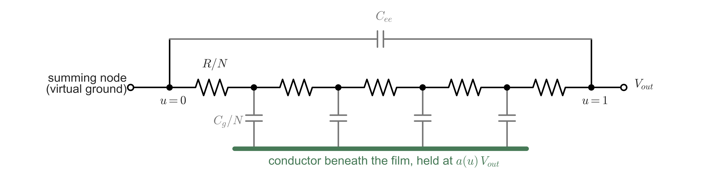

*Figure 4. The feedback resistor's film as a ladder of $N$ slices. Each slice is a resistance $R/N$ in series with its neighbours, with a capacitance $C_g/N$ to the conductor beneath the film, which is held at $a(u)\,V_{out}$ at the position $u$, from 0 at the summing-node end cap to 1 at the output end cap. $C_{ee}$, from end cap to end cap, is an ordinary lumped capacitance. A grounded plane has $a = 0$, a plane driven at a fraction of the output $a = \alpha$, and a graded guard $a = u$. As $N$ grows the ladder becomes the uniform RC line of Eq. (25); Section 9.4 simulates it with $N$ = 20.*

The analysis of Section 2.1 needs two quantities from the feedback network. The first is $y_{11}$, the current that flows into the network from the summing node per volt at the summing node, with the output held at zero. The second is $y_f$, the current that the network delivers into the summing node per volt at the output, with the summing node held at zero. For the line with $C_{ee}$ in parallel they are

$$
y_{11} = \frac{\theta}{R}\coth\theta + j\omega C_{ee}, \qquad
y_f = \frac{\theta}{R\,\sinh\theta} + j\omega C_{ee} .
\tag{25}
$$

The second expression, without $C_{ee}$, is Eq. (1) of Seidl, Swoboda and Zimmermann written as an admittance (their $Z_{\pi0}$ is $1/y_f$; p. 1301) [[A6]](https://doi.org/10.1049/el:20053310). Appendix B.5 derives both expressions from the ladder. When $\theta$ is small, both reduce to the lumped $1/R + j\omega C_{ee}$. The two admittances go straight into Eqs. (6) and (8). The transimpedance uses $y_f$ and the node admittance $Y_n = Y_s + y_{11}$. The noise uses $4k_BT\,\mathrm{Re}\{y_{11}\}$ for the resistor and $e_n^2|Y_s + y_{11}|^2$ for the amplifier's voltage noise. No other change to the analysis is needed, which is why Section 2.1 used the two-port form.

**What the line does at low frequency.** While $|\theta|$ is below about 1, a line over a grounded plane behaves like the resistor with a capacitance $C_{ee} - C_g/6$ across it and a capacitance $C_g/2$ from each end to ground:

$$
y_f \approx \frac{1}{R} + j\omega\Bigl(C_{ee} - \frac{C_g}{6}\Bigr), \qquad
y_{11} \approx \frac{1}{R} + j\omega\Bigl(C_{ee} + \frac{C_g}{3}\Bigr) .
\tag{26}
$$

The capacitance to the plane thus subtracts $C_g/6$ from the end-to-end capacitance in the feedback path. With the output held at zero, both the bridging element and the shunt at the summing node lead from the summing node to ground, so $y_{11}$ contains their sum, $C_{ee} - C_g/6 + C_g/2 = C_{ee} + C_g/3$. This $C_g/3$ is what the amplifier's voltage noise sees in addition to $C_{ee}$. At $C_g = 6C_{ee}$ the feedback capacitance of Eq. (26) vanishes, and with more $C_g$ it becomes negative. The transimpedance then rises with frequency before it falls.

Equation (26) can be derived with nothing more than current division. The derivation also covers a conductor driven to a potential other than ground, which the remedies below need. Let the conductor under the slice at position $u$ be held at the potential $a(u)\,V_{out}$; for a grounded plane, $a = 0$. At low frequency the film stays close to its linear profile $u\,V_{out}$, so the slice's share of the capacitance, $C_g\,du$, passes the current $j\omega C_g\,du\,[a(u) - u]\,V_{out}$ from the conductor into the film. Both ends of the film are held at fixed potentials, the summing node by the loop and the output by the op amp. The injected current therefore divides between the two ends as any current injected into a resistor with held ends does, in inverse proportion to the resistances: $uR$ towards the summing node and $(1-u)R$ towards the output. The fraction that reaches the summing node is $(1-u)R/R = 1-u$. Adding the contributions of all the slices gives the change of the transfer admittance. The same argument with the summing-node end at 1 V and the output at zero gives the change of $y_{11}$. In that case the slice sits at $1-u$ volts, and a conductor that is grounded or driven from the output is at zero. The results are

$$
\Delta y_f = j\omega C_g\int_0^1\bigl[a(u) - u\bigr](1-u)\,du , \qquad
\Delta y_{11} = j\omega C_g\int_0^1 (1-u)^2\,du .
\tag{26a}
$$

For a grounded plane the first integral is $-\int_0^1 u(1-u)\,du = -(\tfrac12 - \tfrac13) = -\tfrac16$, and the second is $\tfrac13$, which gives Eq. (26). The physical reading is direct. A grounded plane drains current out of the film before that current reaches the summing node, so for a given output voltage less current arrives. A feedback capacitor does the opposite, and the plane therefore acts as a negative feedback capacitance. A 400-section ladder evaluated at 0.01 Hz (`hg_model.ladder_y`) gives −0.16667 and +0.33333 for the two coefficients, and a capacitance of $0.50000\,C_g$ from the summing node to ground. The series expansion of Eq. (25), which gives the same coefficients, is in Appendix B.5 (Step 3).

**What it does, in full.** Figure 5 shows the transimpedance $-1/y_f$ of a 1-GΩ resistor with $C_{ee}$ = 0.05 pF for four values of $C_g$, with an ideal amplifier so that only the network is seen. Table 3 gives the numbers. Every frequency scales as $1/(RC)$, so the same curves hold at 10 MΩ with all frequencies a hundred times higher, and the peaking depends only on the ratio $C_g/C_{ee}$.

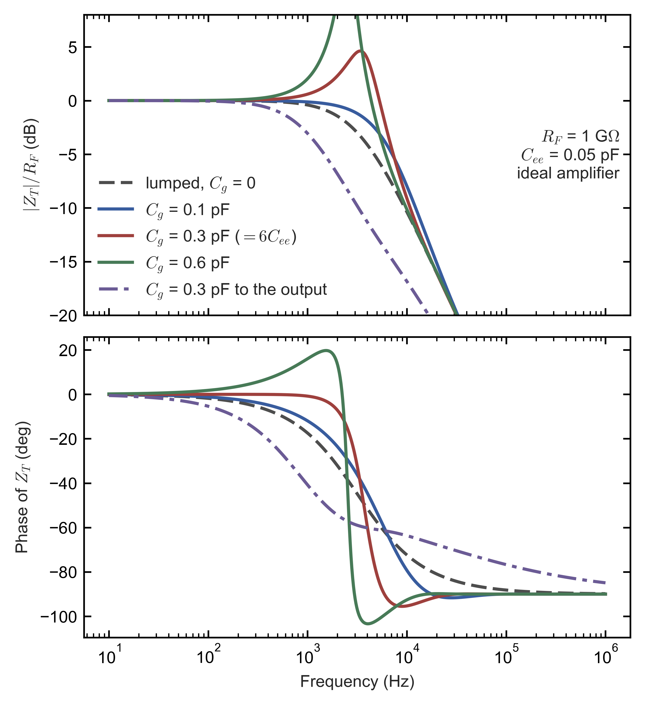

*Figure 5. Transimpedance of a 1-GΩ feedback resistor with 0.05 pF end to end and a distributed capacitance $C_g$ to a ground plane, computed from Eq. (25) with an ideal amplifier. The dashed curve is the lumped resistor. The dash-dot curve has 0.3 pF to a plane driven from the output instead of ground, for which the transfer admittance is $y_{11}$ (Eq. (28) with $\alpha = 1$).*

*Table 3. The distributed feedback resistor of Figure 5 in numbers ($R$ = 1 GΩ; divide frequencies by 10 for 10 GΩ or multiply by 100 for 10 MΩ). Peaking is the maximum of $|Z_T|/R$; the lumped pole for comparison is $1/(2\pi RC_{ee})$. "Noise ×2" is the frequency at which the line's input noise current, $4k_BT\,\mathrm{Re}\{y_{11}\}$, has doubled (Eq. (27)). Model of Appendix B, `hg_numbers.py`.*

| $C_{ee}$ | $C_g$ | $C_g/C_{ee}$ | First-order $C_{ee} - C_g/6$ | Peak | −3 dB, plane at ground | Lumped pole | −3 dB, plane at output | Noise ×2 |
|---|---|---|---|---|---|---|---|---|
| 0.05 pF | 0 | 0 | 0.05 pF | none | 3.19 kHz | 3.18 kHz | 3.19 kHz | – |
| 0.05 pF | 0.1 pF | 2 | 0.033 pF | none | 5.22 kHz | 3.18 kHz | 1.86 kHz | 13.9 kHz |
| 0.05 pF | 0.3 pF | 6 | 0 | +4.6 dB at 3.4 kHz | 6.4 kHz | 3.18 kHz | 0.99 kHz | 4.6 kHz |
| 0.05 pF | 0.6 pF | 12 | −0.05 pF | +15.4 dB at 2.5 kHz | 5.3 kHz | 3.18 kHz | 0.58 kHz | 2.3 kHz |
| 0.1 pF | 0.3 pF | 3 | 0.05 pF | +0.1 dB at 1.1 kHz | 3.19 kHz | 1.59 kHz | 0.76 kHz | 4.6 kHz |

Three conclusions follow from the table.

- **Modest ground capacitance helps.** With $C_g/C_{ee}$ = 2 the response stays monotonic and its corner moves from 3.18 kHz to 5.22 kHz, because the plane removes part of the effective feedback capacitance.
- **Large ground capacitance makes the response peak.** At a ratio of 6 the peak is 4.6 dB, and at 12 it is 15.4 dB. A TIA whose resistor sits over a solid ground plane can therefore ring after a step, even with a well-behaved amplifier, and a lumped model that predicts a smooth pole at $1/(2\pi RC_{ee})$ will not show it.
- **An equalizer designed from a lumped measurement will be wrong.** Equalization (Section 3.5) needs the actual response, and near the corner that differs from a single pole by several decibels and tens of degrees.

**Why the low-frequency form fails at the corner.** The scaling of Table 3 has a simple reason, and the same reason limits Eq. (26). When the resistor sets the bandwidth, the corner lies near $\omega = 1/(RC_{ee})$. There $\omega RC_g = C_g/C_{ee}$, so the line's electrical length at its own corner, $|\theta| = \sqrt{C_g/C_{ee}}$, depends only on the ratio of the two capacitances and not on $R$. This also tells when the distributed capacitance matters. Where a deliberate $C_F$ much larger than $C_g$ sets the corner, as in the amplifier-limited regime below $R_F^*$, the line is short at the corner and $C_g$ is a small correction. Where the resistor's own capacitance sets the corner, $|\theta|$ there lies between 1 and 2.6 for the ratios of 1 to 7 that real boards give (see the estimate below), and the low-frequency form is no longer accurate. The numbers of this note therefore come from Eq. (25), or from a ladder where the conductor is not grounded, and Eq. (26) serves only to explain them.

**The line's own noise.** The feedback resistor's contribution to the input-referred noise is a current with the power density $4k_BT\,\mathrm{Re}\{y_{11}\}$ (Eq. (8)). This is Nyquist's theorem applied at the summing node: a passive network at temperature $T$ drives into a short circuit a noise current whose power density is $4k_BT$ times the real part of the admittance it presents there. Carrying the current-division argument of Eq. (26a) one step further gives the first correction to that real part (Appendix B.5, Step 4):

$$
\mathrm{Re}\{y_{11}\} \approx \frac{1}{R}\left[1 + \frac{(\omega RC_g)^2}{45}\right] .
\tag{27}
$$

The line's noise current therefore rises above its low-frequency value. Far above the corner the summing node sees only the part of the film within about one diffusion length of its end, because the capacitance to the plane shunts the rest of the film to ground. A shorter piece of film has a lower resistance, and a lower resistance has a larger Johnson noise current. In this limit $\mathrm{Re}\{y_{11}\}$ grows as $\sqrt{\omega C_g/(2R)}$ (Step 5). For 1 GΩ and 0.3 pF, Eq. (25) gives $R\,\mathrm{Re}\{y_{11}\}$ = 1.08 at 1 kHz, 1.28 at 2 kHz, 1.55 at 3 kHz, 1.83 at 4 kHz and 1.99 at 4.6 kHz. Equation (27) is within 3% of these values up to 2 kHz and overestimates them beyond. It places the doubling at $\omega RC_g = \sqrt{45}$, or 3.6 kHz, where the exact doubling is at 4.6 kHz (Table 3). Averaged from 0 to 4 kHz, the line's noise power is 1.3 times its low-frequency value, or 1.2 dB more. Near and above the resistor's corner the floor of Eq. (10) is therefore not flat, which matters when the response is equalized beyond the corner (Section 3.5).

**Driving the conductor beneath the resistor.** The conductor under the resistor need not be grounded. If it is driven from the output, the integrand of Eq. (26a) changes, and the plane's effect can be reversed, cancelled at low frequency or cancelled completely. For a conductor held at a fixed fraction $\alpha$ of the output, an exact relation follows from superposition alone (Appendix B.5, Step 6). The current into the summing node is the fraction $\alpha$ of the current with the conductor tied to the output, plus the fraction $1 - \alpha$ of the current with the conductor grounded. In terms of the admittances, and with Eq. (26a) for the low-frequency form,

$$
y_f(\alpha) = \alpha\,y_{11} + (1 - \alpha)\,y_{f0}
\approx \frac{1}{R} + j\omega\left[C_{ee} + C_g\left(\frac{\alpha}{2} - \frac{1}{6}\right)\right] ,
\tag{28}
$$

where $y_{f0}$ is the transfer admittance of Eq. (25) over a grounded conductor. Four cases matter.

- **A conductor tied to the output** ($\alpha = 1$) gives $y_f = y_{11} \approx 1/R + j\omega(C_{ee} + C_g/3)$. The conductor now pushes current into the film, most of it near the summing node, and acts as an additional feedback capacitance. The response is monotonic, with the corner of a lumped $R\parallel(C_{ee} + C_g/3)$. For 0.05 and 0.3 pF at 1 GΩ that corner is 0.99 kHz, against 3.2 kHz for the bare resistor (Table 3).
- **A conductor at one third of the output** ($\alpha = 1/3$) cancels the low-frequency effect of $C_g$ on the feedback path. The feedback capacitance is then $C_{ee}$, and the summing node keeps $C_g/3$ to the conductor. What remains is of higher order in $\omega RC_g$, and at the corner it is not small. For 1 GΩ and 0.3 pF at 4 kHz, where $\omega RC_g$ = 7.5, Eqs. (25) and (28) give $R\,(y_f - j\omega C_{ee}) = 0.825 + j\,0.174$ instead of 1. That is why the response ends somewhat below that of a resistor without a conductor beneath it (Section 9.4).
- **A graded guard** is a conductor whose potential follows the film's low-frequency profile, $a(u) = u$. It makes the integrand of Eq. (26a) zero everywhere. No current then flows through $C_g$ at any frequency, the film's potential stays exactly linear, and $y_f = 1/R + j\omega C_{ee}$ exactly (Step 7). The conductor still loads the summing node with $C_g/3$ through $y_{11}$.
- **Strips at graded potentials** approximate the guard. Each strip is held at the potential of the middle of the stretch of film above it. For a strip of width $h$, as a fraction of the length, centred on $m$, the integrand of Eq. (26a) is $(m - u)(1 - u)$. Its part that is linear in $u - m$ averages to zero over the strip, and its quadratic part leaves $h^3/12$ (Step 8). Four strips at $V_{out}/8$, $3V_{out}/8$, $5V_{out}/8$ and $7V_{out}/8$ therefore leave $4\times(1/4)^3/12 = 1/192$ of $C_g$, which is 0.0016 pF for 0.3 pF.

Section 9.4 puts all of these into a loop with the vendors' macromodels. With OPA140, 1 GΩ, 0.05 pF end to end and 0.3 pF beneath, the bandwidth is 4.01 kHz both without a conductor and with the ideal graded guard. Over a grounded plane it is 5.84 kHz, with a 7.45-dB peak and a 54% overshoot in the step response. It is 1.01 kHz with the conductor tied to the output, 3.69 kHz with 2% overshoot at one third of the output, and 3.56 kHz without overshoot with four strips (Table 9.4).

None of these drives changes the line's own noise of Eq. (27). The noise current at the summing node is found with every other terminal of the network held at its potential, and the op amp's output and a guard's driver are both low-impedance sources that hold their nodes. The noise current is therefore that of the line over a grounded conductor, whatever potential the conductor follows (Step 9). A guard restores the transfer function but not the noise. Only a smaller $C_g$, for example a cut-out in the plane, reduces both.

On a board the drive comes from a resistive divider between the output and ground (Figure 6), never from the summing node. The divider's current and its Johnson noise then reach the summing node only through $C_g$. With divider resistors of a few kilohms the noise voltage on the conductor is a few nanovolts per root hertz. Through 0.1 pF at 4 kHz it injects about $4\ \mathrm{nV/\sqrt{Hz}}\times2\pi\times4\ \mathrm{kHz}\times0.1\ \mathrm{pF} = 1\times10^{-17}\ \mathrm{A/\sqrt{Hz}}$, four hundred times less than the 4 fA/√Hz of a 1-GΩ resistor. The strip nearest the summing node is not at the summing node's potential. The guard ring of Section 8.2, which is at that potential, must therefore lie between the two, or the leakage across the gap becomes a DC error.

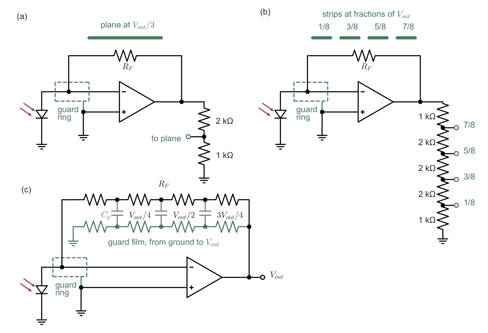

*Figure 6. Three ways to drive the conductor beside the feedback resistor, each from the output and never from the summing node. (a) A plane at $V_{out}/3$, from a divider of 2 kΩ over 1 kΩ, cancels the plane's low-frequency effect on the feedback path (Eq. (28) with $\alpha = 1/3$). (b) Four strips at $V_{out}/8$, $3V_{out}/8$, $5V_{out}/8$ and $7V_{out}/8$, each at the mid-point potential of its quarter of the film, from a divider of 1, 2, 2, 2 and 1 kΩ; they leave $C_g/192$. (c) The ideal graded guard, a resistive film beneath $R_F$ that is grounded under the summing-node end and tied to the output at the other. Both films are drawn as four equal slices. Because the summing node is a virtual ground, both rise linearly from zero to $V_{out}$, so the junctions that face each other sit at the same potential, $V_{out}/4$, $V_{out}/2$ and $3V_{out}/4$, and the capacitance $C_g$ between the films carries no current; this is the principle of the capacitive coupled distributed resistor (CCDR) of Seidl, Swoboda and Zimmermann, described at the end of Section 3.4. In all three the summing node keeps its own guard ring at its potential, ground (Section 8.2), between it and the nearest driven copper. Divider resistors of a few kilohms put only nanovolts of noise on the conductor, which reach the summing node through $C_g$.*

**Shielding the resistor: which potential?** A conductor around the resistor acts through Eq. (26a), whether it is a plane below it, a ring beside it or a can over it, and the same rule covers the end caps. A capacitance $C_k$ from a point of the feedback path at position $u_k$ to a conductor at $a_kV_{out}$ changes the transfer admittance by $j\omega C_k(a_k - u_k)(1 - u_k)$. The output end cap, at $u = 1$, therefore never matters: its capacitance only loads the op amp. The summing-node end cap, at $u = 0$, adds $a_kC_k$ to the feedback capacitance and $C_k$ to the capacitance of the summing node. A shield that passes between the two end caps also intercepts part of $C_{ee}$ and turns it into these two end-cap capacitances. Five choices follow.

- **A shield at ground, or at the summing node's potential driven by a buffer,** is at signal ground, $a = 0$. It subtracts $C_g/6$, may remove part of $C_{ee}$ as well, and makes the response peak once the net feedback capacitance turns negative: 7.45 dB with OPA140 for 0.3 pF at 1 GΩ (Table 9.4). This is the right potential for a guard around the summing-node pad and the amplifier's input, where it stops leakage (Section 8.2), but not for copper along the resistor.
- **A shield connected to the summing node itself** gives exactly the transfer admittance of a shield tied to the output, $y_f = y_{11}$ (Appendix B.5, Step 11), so it slows the response just as much. In addition, its own capacitance to its surroundings joins the summing node. That raises $C_T$ and the $e_n\,\omega C$ noise, and it enlarges the area through which leakage reaches the node. It is the worst of the five.
- **A shield tied to the output** gives a smooth, monotonic response, with the corner of $R\parallel(C_{ee} + C_g/3 + C_s)$, where $C_s$ is the capacitance from the summing-node end cap to the shield. For 0.3 pF at 1 GΩ that costs a factor of four in bandwidth (Table 9.4). Its leakage into the summing node is proportional to $V_{out}$, so it acts as a resistance in parallel with $R_F$: a gain error, not an offset.
- **No conductor near the resistor**, a cut-out in the plane with no copper nearby, gives the widest band, that of $R\parallel C_{ee}$, and the smallest rise of the line's noise. The film's remaining capacitance then goes to whatever lies near it, such as the enclosure, other parts or a hand, and is neither known nor constant.
- **A guard driven at one third of the output, or graded strips,** from a divider between the output and ground, gives nearly the band of the bare resistor (3.56–3.69 kHz against 4.01 kHz in Table 9.4), while it shields the film and fixes its surroundings. A single plane at $V_{out}/3$ adds $C_s/3$ through the summing-node end cap. Graded strips, whose first strip is close to zero, add almost nothing.

Shielding therefore pays only when the shield is driven at the potential that the film already has. None of this replaces a shield around the whole front end. At high gain the summing node turns any stray capacitance to a changing voltage into signal. A capacitance of 1 fF to a conductor carrying 1 V at 50 Hz injects $2\pi\times50\ \mathrm{Hz}\times1\ \mathrm{fF}\times1\ \mathrm{V}$ = 0.31 pA, which a 1-GΩ TIA turns into 0.31 mV. The same 1 fF to mains wiring at 230 V gives 72 pA, or 72 mV. The photodiode, the summing node, the feedback network and the amplifier must therefore sit together in a closed, grounded metal enclosure, and any cable to the photodiode must be shielded as well. The copper around the resistor only sets the resistor's surroundings inside that enclosure. Within it, the cut-out is the simple default when nothing near the resistor moves. The driven guard is the better choice when the resistor must be shielded, or when its response must not depend on its surroundings. In both cases the summing-node pad and the amplifier's input keep their own guard ring at the summing node's potential (Section 8.2). Because the rise of the line's noise depends only on $C_g$, whatever drives the conductor, a guard should lie no closer to the film than the shielding requires.

**The integrated precedent.** Seidl, Swoboda and Zimmermann met the problem of this section in an integrated optical receiver for optical-storage drives, built in a modified 0.5-µm silicon BiCMOS process with an integrated pin photodiode [[A6]](https://doi.org/10.1049/el:20053310). Their paper covers five points.

- **The problem.** Their 200-kΩ polysilicon feedback resistor lies on field oxide over the substrate, with $C_{FOX}$ = 66.3 fF between the two. They describe it with Knorr and Zimmermann's uniform-line model, $Z_{\pi0} = R_{poly}\sinh\sqrt S/\sqrt S$ with $S = j\omega R_{poly}C_{FOX}$ (their Eq. (1), p. 1301), which is $1/y_f$ of Eq. (25) without $C_{ee}$. They place its cutoff at the normalized frequency $\omega R_{poly}C_{FOX}$ = 9.18, which is 110 MHz for their resistor (p. 1301). Evaluating Eq. (25) there gives $|\sinh\theta/\theta| = \sqrt2$, so their cutoff is the frequency at which the line's transfer impedance has risen by 3 dB.
- **What it costs.** Their amplifier has 38.9 dB of open-loop gain and a dominant pole at $6.1\times10^9$ s⁻¹, with 4 fF of feedback capacitance and 130 fF at the input, of which 60 fF is the photodiode's. With an ideal 200-kΩ resistor their TIA formula gives 716 MHz. A simulation that includes the parasitic capacitance of a normal polysilicon resistor gives 75 MHz, which matches the 67 MHz measured on their earlier receiver with the same resistor value (p. 1301).
- **The remedy.** Their capacitive coupled distributed resistor (CCDR) places a second resistor directly beneath the polysilicon one: an n-well, whose resistance is lowered by two n⁺ implants (Fig. 1, p. 1301). The polysilicon resistor runs from the output to the summing node. The well runs beneath it from the output to ground, with its grounded end under the summing-node end of the polysilicon resistor (Figs. 1b and 2, p. 1301). Because the summing node is a virtual ground, the two films carry the same potential profile, and the oxide between them sees no voltage. In their words, $C_{FOX}$ then "has no effect" (p. 1301). In the terms of Eq. (26a), the well is a graded guard, $a(u) = u$. The bandwidth is then limited by the well's own capacitance to the substrate and by the stray capacitance of the polysilicon resistor. The authors therefore keep the well's time constant $R_{well}C_{well\text{-}sub}$ small against $R_{poly}C_{FOX}$, using the n⁺ implants to lower $R_{well}$ while the well stays narrow (p. 1301).
- **The result.** The receiver reached −3-dB bandwidths of 615 MHz at 660 nm and 603 MHz at 410 nm, flat within 1 dB, with a transimpedance of 201 kΩ. Its transimpedance–bandwidth products were 123 and 121 THzΩ (Fig. 3 and text, p. 1302). At 660 nm its rise and fall times were 562 and 531 ps, and its sensitivities were −29.4 dBm at 1 Gbit/s and −27.0 dBm at 1.25 Gbit/s, for a bit-error ratio of $10^{-9}$ (p. 1302). Against their earlier receiver, the bandwidth rose from 67 to 615 MHz, about nine times (p. 1302).
- **Its origin.** The authors describe the CCDR as a development of their earlier capacitive coupled voltage divider, in which a single coupling capacitor took the place of the distributed one (p. 1301) [[A7]](https://doi.org/10.1049/el:20031162), [[A8]](https://doi.org/10.1109/ISSCC.2004.1332798). Those two papers were not read (Appendix C, item 15).

**What the integrated remedy offers a board.** The principle carries over to a board directly, but its payoff is different, for three reasons.

- **On a board the limit is usually $C_{ee}$, which no guard removes.** On the chip the distributed capacitance, 66 fF against 4 fF of feedback capacitance, dominated, so removing it multiplied the bandwidth. On a board, $C_{ee}$ of 0.05–0.2 pF is comparable with $C_g/6$ or larger. A graded guard returns the response exactly to that of the resistor without a conductor beneath it, 4.01 kHz in Table 9.4, and no further.
- **The CCDR's connection is the right one for a board.** Its guard runs from the output to ground, not across the feedback resistor, which is what the divider described above does. The guard's current and noise therefore stay out of the summing node.
- **What a guard buys on a board is control.** A conductor under the resistor is often wanted, as a shield for the high-impedance film against pickup, or simply because the ground plane is there. Driven at one third of the output, or as graded strips, it no longer makes the response peak, and to first order the response no longer depends on the unknown $C_g$. That makes an equalizer (Section 3.5) predictable.

**A split resistor with guarded junctions.** The one place where the principle of the CCDR can widen a board's bandwidth is a feedback resistor split into $N$ equal resistors in series. The split divides the end-to-end capacitance by $N$, because the $N$ end-to-end capacitances are then in series (Section 3.5). Each junction between two resistors, however, carries the capacitance $C_j$ of its pads to the plane, at the position $u_k = k/N$ along the string. Equation (26a), with the integral replaced by a sum over the junctions, gives their low-frequency effect on the feedback capacitance as $C_j\sum_k(a_k - u_k)(1 - u_k)$, where $a_kV_{out}$ is the potential of the conductor under junction $k$. As an example, take three 333-MΩ resistors with 0.05 pF each, which give $C_{ee}/3$ = 0.0167 pF for the string, and an assumed 0.2 pF per junction.

- Over a grounded plane the two junctions add $-0.2\ \mathrm{pF}\times[(1/3)(2/3) + (2/3)(1/3)] = -0.089$ pF. The net feedback capacitance is then −0.072 pF, and the response peaks strongly.
- Over a plane tied to the output they add $+0.2\ \mathrm{pF}\times[(2/3)^2 + (1/3)^2] = +0.111$ pF. The net, 0.128 pF, is more than the 0.05 pF of a single resistor, so the split has made things worse.
- If instead each junction pad is surrounded by a guard held at its own low-frequency potential $u_kV_{out}$ (Figure 7), the junction capacitances see no voltage and carry no current. The equal end-to-end capacitances then divide the output voltage in the same ratio as the equal resistors, so the junctions stay at $u_kV_{out}$ at every frequency, and the string is exactly $R\parallel C_{ee}/N$ (Step 10).

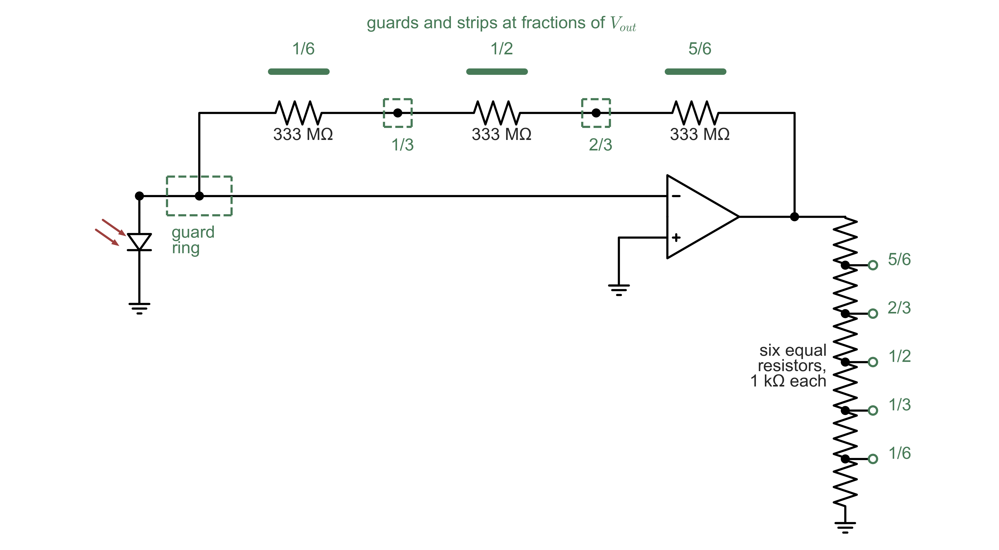

*Figure 7. A 1-GΩ feedback resistor split into three 333-MΩ resistors with guarded junctions, the arrangement proposed above and not simulated (Appendix C, item 16). Each junction pad sits inside a guard held at its own low-frequency potential, $V_{out}/3$ or $2V_{out}/3$, so that the pad's capacitance to its surroundings carries no current, and each resistor body has a strip at its mid-point potential, $V_{out}/6$, $V_{out}/2$ or $5V_{out}/6$. One divider of six equal resistors of 1 kΩ between the output and ground supplies all five potentials. With matched end-to-end capacitances the string is then exactly $R\parallel C_{ee}/3$ (Appendix B.5, Step 10). The summing node keeps its own guard ring at ground.*

This is the principle of the CCDR applied where a board can gain from it. It holds under four conditions. First, the end-to-end capacitances of the parts must match, since a mismatch moves the junction potentials away from their guards' potentials above the corner. Second, the body of each part needs its own strip at its mid-point potential, as in the four-strip case above, and any direct capacitance between pads that are not neighbours must be kept small or intercepted by a guard. Third, the guard nearest the summing node must again be separated from it by the summing node's own guard ring. Fourth, the amplifier must have the gain–bandwidth to use the wider band. By Eq. (20) that takes $GBW \geq C_T/[\pi R(C_{ee}/N)^2]$, which is $20\ \mathrm{pF}/[\pi\times1\ \mathrm{G\Omega}\times(0.0167\ \mathrm{pF})^2]$ = 23 MHz for the three-part string on a 20-pF photodiode. The arrangement has not been simulated or built for this note (Appendix C, item 16).

**How large are $C_{ee}$ and $C_g$?** No resistor datasheet among the sources read gives them separately, so they are board-specific quantities to be measured (Appendix C, item 3). A parallel-plate estimate shows the order of magnitude. Take a 1206 resistor, 3.2 × 1.6 mm, with its film on a 0.55-mm alumina substrate ($\varepsilon_r$ = 9.8), a 35-µm air gap under the part, and the plane under FR-4 ($\varepsilon_r$ = 4.4). These dimensions are assumptions, not data. The three layers in series give

$$
\frac{1}{C_g} = \frac{1}{\varepsilon_0\varepsilon_{Al}A/d_{Al}} + \frac{1}{\varepsilon_0A/d_{gap}} + \frac{1}{\varepsilon_0\varepsilon_{FR4}A/d_{FR4}} ,
\tag{29}
$$

with $A$ = 5.12 mm². The alumina gives 0.81 pF and the gap 1.30 pF. With the plane 0.2 mm below, as on a four-layer board, FR-4 gives 1.00 pF and $C_g$ = 0.33 pF; with the plane 1.5 mm below, as on a two-layer board, $C_g$ = 0.10 pF. Fringing fields are neglected, so these values are a rough guide. With $C_{ee}$ of 0.05–0.1 pF, a 1206 resistor over the inner ground plane of a four-layer board lies at $C_g/C_{ee}$ ≈ 3–7, which in Table 3 ranges from a barely visible peak to more than 4 dB. A two-layer board, or a cut-out in the plane, keeps the ratio near 1–2.

**How the model is used in this note.** The sweeps of Chapters 4–6 keep the lumped resistor with $C_{par}$ = 0.1 pF, so that all amplifiers share one baseline that is not tied to an unmeasured board. The distributed model is used for Figure 5 and Table 3, for the layout rules of Section 8.4 and the limits of equalization in Section 3.5, and in the SPICE check of Section 9.4. In the scripts, `hg_model.urc_y` evaluates Eq. (25), and `hg_model.ladder_y` solves an $N$-section ladder under a conductor with any potential profile $a(u)$. For $\omega RC_g$ up to 30, which is five times the corner for the case of Table 3, a ladder of 10 sections is within 4.3% in magnitude and 4.9° in phase of Eq. (25), 20 sections within 1.2% and 1.2°, and 50 sections within 0.2% and 0.2° (`hg_numbers.py`). Section 9.4 uses 20 sections in SPICE.

### 3.5 Four ways to more bandwidth, and what each costs

Sections 3.1–3.4 set the bandwidth that a single feedback resistor allows: the amplifier's ceiling below the crossover gain and the resistor's own pole above it. Four techniques promise more: an equalizer after the TIA, a T-network or a smaller resistor followed by a voltage stage, a resistor split in two, and a bootstrapped photodiode. This section says what each gains and what it costs in noise or offset.

**Equalization.** In the resistor-limited regime the bandwidth can be extended by following the TIA with a filter whose zero cancels the resistor's pole, $(1 + sR_FC_F)/(1 + sR_FC_F/k)$, which widens the band by $k$ (Figure 8). The input-referred noise density of Eq. (8) does not change, because it does not depend on what follows the TIA. The widened band, however, admits more of the rising $e_n\,\omega C$ noise. Equalization is therefore useful up to about $f_e$ of Eq. (13) and costs noise beyond it. Table A.5 evaluates $f_e$ for four amplifiers. On the 20-pF diode at 1 GΩ, $f_e$ is 5.8 kHz for ADA4625-1 and 4.1 kHz for OPA140, against $f_R$ = 1.59 kHz: equalization can gain a factor of 2.6–3.7. For the electrometers ADA4530-1 and OPA928 it is 1.75–1.76 kHz, with their larger voltage noise, so equalization gains nothing. On the 380-pF diode $f_e$ is below $f_R$ for all four (0.08–0.91 kHz), and equalization gains nothing. Equalization also needs an accurate model of the resistor's response. With the distributed line of Section 3.4 a single-pole equalizer leaves errors of several decibels near the corner, and the capacitances depend on the board, so the response must be measured. A practical method is to inject a known current through a small series capacitor from a signal generator, $i = j\omega C_{inj}V$, and fit $C_{ee}$ and $C_g$ to the measured transimpedance. Above the corner the line's own noise also rises, by Eq. (27).

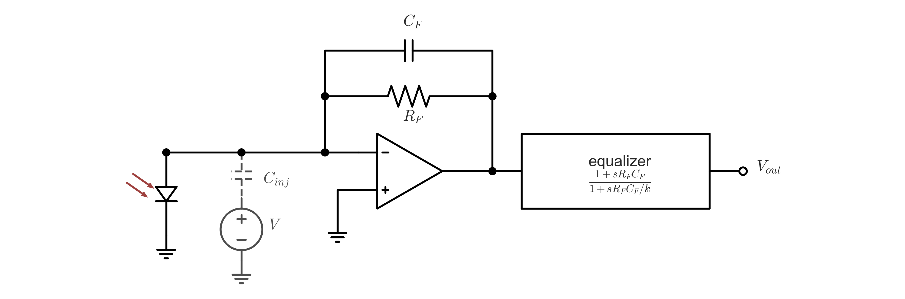

*Figure 8. Equalization and its calibration. The equalizer after the TIA, $(1 + sR_FC_F)/(1 + sR_FC_F/k)$, cancels the resistor's pole and widens the band by $k$; it does not change the input-referred noise density. To measure the resistor's actual response, which the distributed capacitance of Section 3.4 makes differ from a single pole, a generator drives the known current $i = j\omega C_{inj}V$ into the summing node through a small capacitor $C_{inj}$, drawn dashed because it is connected only during the calibration, and $C_{ee}$ and $C_g$ are fitted to the measured transimpedance.*

**The T-network.** A T-network (Figure 9 (a)) replaces the single feedback resistor by a smaller resistor $R_1$ from the summing node to a node T, a resistor $R_2$ from T to the output, and a resistor $R_3$ from T to ground. Because the summing node is a virtual ground, the photocurrent $I$ flows through $R_1$ and sets T to $IR_1$ in magnitude. $R_3$ then draws $IR_1/R_3$ to ground, so $R_2$ carries $I(1 + R_1/R_3)$, and the output is

$$
|V_{out}| = I\left[R_1\left(1 + \frac{R_2}{R_3}\right) + R_2\right] \approx k\,R_1\,I , \qquad k = 1 + \frac{R_2}{R_3} .
\tag{29a}
$$

A 10-MΩ resistor with $k$ = 100 thus gives 1 GΩ. Four properties follow from Eq. (29a) and the circuit.

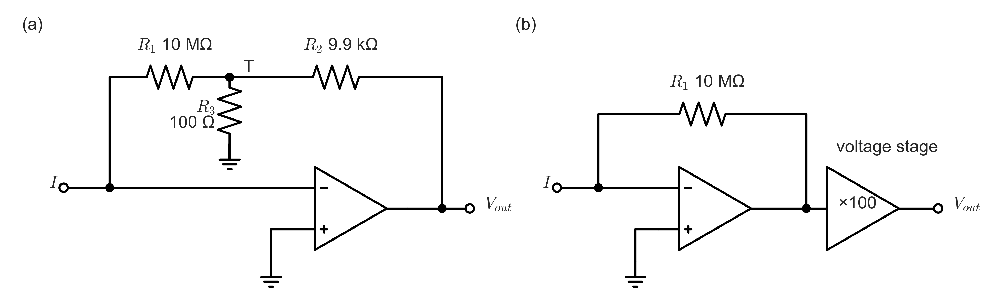

*Figure 9. Two ways to reach 1 GΩ with a 10-MΩ resistor (Table 3.1). (a) A T-network: $R_1$ = 10 MΩ from the summing node to the node T, $R_2$ = 9.9 kΩ from T to the output and $R_3$ = 100 Ω from T to ground, so that $k = 1 + R_2/R_3$ = 100 and the transimpedance is $kR_1$ (Eq. (29a)); the whole Johnson noise current of $R_1$ reaches the input. (b) The same 10 MΩ alone, followed by a voltage stage of gain 100: the same noise floor and offset, and $\sqrt{100}$ = 10 times the amplifier-limited bandwidth of the T (Eq. (29b)).*

- *Noise.* $R_1$ runs from the virtual-ground summing node to the low-impedance node T, so its whole Johnson noise current, $\sqrt{4k_BT/R_1}$, enters the input. That is $k$ times the noise power of a real resistor of $kR_1$, or $10\log_{10}k$ dB more: 20 dB for 10 MΩ with $k$ = 100. $R_2$ and $R_3$ add the noise voltage $\sqrt{4k_BT\,(R_2\parallel R_3)}$ at T. It drives the current $\sqrt{4k_BT\,(R_2\parallel R_3)}/R_1$ through $R_1$, which is smaller than $R_1$'s own noise current by the factor $\sqrt{(R_2\parallel R_3)/R_1}$ and therefore negligible.
- *Offset and low-frequency voltage noise.* With a high-resistance photodiode, the amplifier's noise gain at DC is $1 + R_2/R_3 = k$. The output offset is therefore $kV_{OS}$, which is $V_{OS}/R_1$ referred to the input, $k$ times that of a single resistor; the amplifier's low-frequency voltage noise grows in the same way. The error from the bias current, $I_B$ times the transimpedance, is the same as with a single resistor. TI's application note on photodiode amplifiers with OPA128 states for these reasons that "a very high resistance feedback resistor is often better than a low resistance in a T network" (SBOA061, p. 2) [A2].
- *Loop and bandwidth.* T passes only $1/k$ of the output on to $R_1$, so the loop is that of a TIA with $R_1$ driven by an amplifier with the gain–bandwidth $GBW/k$. By Eq. (19) its amplifier-limited bandwidth is that of Eq. (29b) below: the same as for a single resistor of $kR_1$, whereas $R_1$ alone reaches $\sqrt{k}$ times more. The T does move the resistor's own pole up $k$-fold, to $1/(2\pi R_1C_{par})$. It therefore beats a single resistor only where that resistor is limited by its own capacitance, and only up to Eq. (29b).
- *A voltage stage instead.* A TIA with $R_1$, followed by a voltage stage of gain $k$ (Figure 9 (b)), has the same noise floor and the same multiplied offset, because its floor is again that of $R_1$. Its first stage, however, runs at the noise gain of $R_1$ alone and reaches $\sqrt{k}$ times the bandwidth of the T.

$$
f_{-3\,\mathrm{dB}} = \sqrt{\frac{GBW/k}{2\pi R_1\,(C_T + C_F)}} = \sqrt{\frac{GBW}{2\pi kR_1\,(C_T + C_F)}}
\tag{29b}
$$

Table 3.1 compares the options for 1 GΩ. For ADA4625-1 on the 20-pF photodiode, Eq. (29b) gives $\sqrt{18\ \mathrm{MHz}/(2\pi\times1\ \mathrm{G\Omega}\times41\ \mathrm{pF})}$ = 8.4 kHz, and both T-networks stop near it, at 8.8–9.0 kHz. The voltage stages reach 22 and 88 kHz with the same noise floors. All four lose 6–16 dB of noise density against the single 1-GΩ resistor. That resistor is limited to 1.65 kHz by its own capacitance, but it can be equalized to about $f_e$, 5.8 kHz for this amplifier and photodiode (Table A.5), without losing its floor.

*Table 3.1. Three ways to 1 GΩ of transimpedance, with ADA4625-1 on the 20-pF, 2-GΩ photodiode. Each resistor has 0.1 pF of its own, and each design follows the 0.1-dB rule of Section 1.4. The voltage stage has 45 MHz of gain–bandwidth and 4 nV/√Hz. The floor of a real 1-GΩ resistor and the photodiode is 4.97 fA/√Hz. The output offsets assume 80 µV at each amplifier; a zero-drift voltage stage halves the two-stage values. `t_network_vs_second_stage.py`.*

| Design | Bandwidth | Noise at 100 Hz | Output offset |
|---|---|---|---|
| Single 1-GΩ resistor | 1.65 kHz | 6.71 fA/√Hz | 0.12 mV |
| T-network, 100 MΩ with $k$ = 10 | 9.0 kHz | 13.9 fA/√Hz | 0.84 mV |
| T-network, 10 MΩ with $k$ = 100 | 8.8 kHz | 40.9 fA/√Hz | 8.0 mV |
| 100 MΩ, then a ×10 voltage stage | 22.0 kHz | 13.9 fA/√Hz | 1.6 mV |
| 10 MΩ, then a ×100 voltage stage | 88.2 kHz | 40.9 fA/√Hz | 16 mV |

A T-network or a voltage stage is acceptable wherever $R_1$'s noise does not dominate anyway. That is the case when the signal's own shot noise exceeds it, above $2k_BT/(qR_1)$ by Eq. (2), which is 0.51 nA for 100 MΩ and 5.1 nA for 10 MΩ. It is also the case when the photodiode's shunt resistance lies below $R_1$, so that the diode's own noise dominates (Section 6.6), and on large photodiodes, where $e_n\,\omega C_T$ dominates at the bandwidth needed. Otherwise the better design is the largest resistor whose own pole, or equalized response, covers the band, followed by a voltage stage if more gain is needed. Between a T-network and that voltage stage, the stage is preferable: it is faster, and it can be filtered or AC-coupled. The T-network saves one op amp. It keeps a moderate resistor at the summing node, which is cheaper, more stable and less affected by leakage resistance in parallel with it. And its higher noise gain can stabilize a decompensated op amp.

**Splitting the resistor.** Two resistors of $R_F/2$ in series halve the end-to-end capacitance and are recommended by TI when the required $C_F$ is below about 0.15 pF (OPA818 data sheet, p. 23, as cited in the companion's Section 8.10) [D20]. The junction between them, however, adds capacitance to the plane, so the string is more like the grounded line of Section 3.4, with a larger $C_g/C_{ee}$. A split resistor should therefore sit over a cut-out in the plane, or have each junction guarded at its own fraction of the output (Section 3.4). A plane tied to the output also stops the peaking, but it adds more feedback capacitance than the split removes.

**Bootstrapping the photodiode.** A follower that drives the photodiode's far terminal with the summing node's voltage keeps the voltage across $C_D$ constant. The photodiode's capacitance then carries no signal current, and the op amp sees only its own input capacitance and the board's. Hobbs shows such a circuit, a cascode plus a bootstrap follower around a 100-pF photodiode with a 301-kΩ feedback resistor, reaching about 2 MHz with its carrier-to-noise ratio only 3.3 dB below the shot-noise limit at 1 MHz (Hobbs, OPN April 2001, p. 45, Figs. 8–10) [[A4]](https://doi.org/10.1364/OPN.12.4.000044). The follower's own voltage noise now appears across $C_D$, so the noise is that of the follower's input device times $\omega C_D$. Bootstrapping is thus a way to reach the bandwidth of a small capacitance with the noise of a discrete input device. It helps in the amplifier-limited regime and not above $R_F^*$, where the resistor sets the bandwidth. The companion note found the break-even for its 1-pF node at 1.9–3.7 pF (its Table A8.4), so in this note's regime, with tens of picofarads to nanofarads, bootstrapping is well inside its useful range.

---

## 4. Which term dominates, at which gain and frequency

Chapters 2 and 3 give each noise term and each bandwidth limit as a formula. This chapter puts them together for the photodiodes of Table 1, so that the dominant term can be read off for any gain and frequency. The results come from the full model (Eqs. (6) and (8), with the design rule of Section 1.4), not from the approximations.

### 4.1 Maps of the largest noise term

Figure 10 shows, for every feedback resistance from 10 kΩ to 10 GΩ and every frequency from 0.01 Hz to 100 MHz, which of the five terms of Eq. (8) is largest. The amplifier is ADA4625-1, a low-noise JFET op amp that is a reasonable choice over most of the range. The left panel is the small silicon photodiode (20 pF, 2 GΩ) and the right panel the large InGaAs photodiode (1 nF, 6.5 MΩ). The black line is the −3 dB bandwidth of each design, and frequencies above it are paled, because noise there is filtered out.

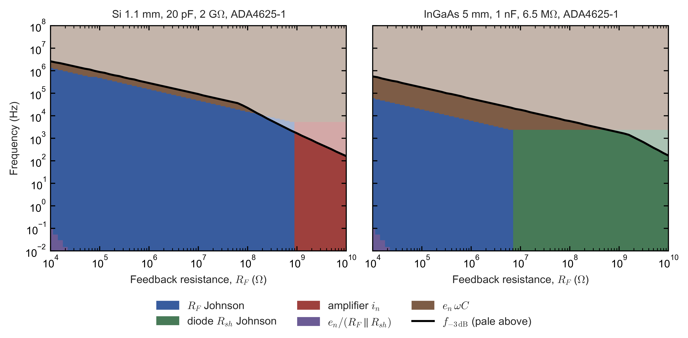

*Figure 10. The largest term of the input-referred noise, Eq. (8), against feedback resistance and frequency, for ADA4625-1 with $C_{par}$ = 0.1 pF and 1 pF of board capacitance. Left: S1336-18BK-like photodiode, 20 pF and 2 GΩ. Right: G12180-050A-like photodiode, 1 nF and 6.5 MΩ. The black line is the −3 dB bandwidth of the design at each $R_F$, and the region above it is paled.*

Five regions appear, and each has a boundary given by an equation of Chapters 2–3.

- **The resistor's Johnson noise** (blue) fills the low-frequency part of the band wherever $R_F$ is below the photodiode's shunt resistance and below the amplifier's $R_{F,\mathrm{crit}}$. Its upper edge is $f_e$ of Eq. (13), which falls as $1/\sqrt{R_F}$.
- **The voltage noise on the node capacitance** (brown) fills the band above $f_e$. In the amplifier-limited regime, left of the kink in the black line, Eq. (21) fixes $f_e/f_{-3\,\mathrm{dB}}$ independently of $R_F$. The brown wedge under the black line therefore has the same relative height at every gain up to the kink. For the small diode $f_e$ is 0.57 of the bandwidth, which leaves the upper 43% of the band dominated by $e_n\,\omega C$. For the large diode $f_e/f_{-3\,\mathrm{dB}} \approx$ 0.1, so it dominates almost the whole band.
- **The resistor's own ceiling.** The kink in the black line is the crossover gain $R_F^*$ of Eq. (20): $40.9\ \mathrm{pF}/(\pi\times18\ \mathrm{MHz}\times(0.1\ \mathrm{pF})^2)$ = 72 MΩ for the small diode and 1.8 GΩ for the large one. Right of the kink the bandwidth follows the resistor's pole, and the brown wedge shrinks, as Eq. (23) predicts.
- **The amplifier's current noise** (red) takes over at the right edge of the left panel, above $R_{F,\mathrm{crit}}$ = 813 MΩ for ADA4625-1 (Eq. (11)). An amplifier with less current noise, such as OPA140 with 25.7 GΩ, moves this boundary off the map.
- **The photodiode's own shunt noise** (green) takes over in the right panel above $R_F \approx R_{sh}$ = 6.5 MΩ, as Eq. (10) predicts. There a larger $R_F$ no longer lowers the floor. Beyond about 1 GΩ the bandwidth also starts to fall faster than the resistor's pole, because the noise gain $1 + R_F/R_{sh}$ eats the loop gain (Eq. (24)).

The fifth term, the voltage noise on the conductance (purple), appears only in the bottom-left corner of both maps. There the flicker noise of ADA4625-1 below 1 Hz meets the small conductance of a 10-kΩ resistor. For this amplifier it never matters within the band. It does matter for a CMOS amplifier on a low-shunt-resistance photodiode (Table 4b).

### 4.2 Noise spectra of the five gain decades

Figure 11 shows the input-referred noise density itself, for the five gain decades, with ADA4625-1 on the 380-pF silicon photodiode. Each curve is flat at the floor of Eq. (10) at low frequency (dashed), turns up at $f_e$, and rises as $f$ above it, along a single asymptote $e_n\,2\pi f\,C_T$ that is the same for every gain. The circles mark the bandwidth of each design. Raising $R_F$ by a decade lowers the floor by $\sqrt{10}$ but moves $f_e$ down by $\sqrt{10}$ as well, and the bandwidth down by $\sqrt{10}$ while the amplifier limits it. The band of every design up to 100 MΩ therefore ends in the same position relative to the asymptote, about 5.5 times above $f_e$ (Eq. (21) gives $f_e/f_{-3\,\mathrm{dB}}$ = 0.18), so the voltage noise dominates every one of them.

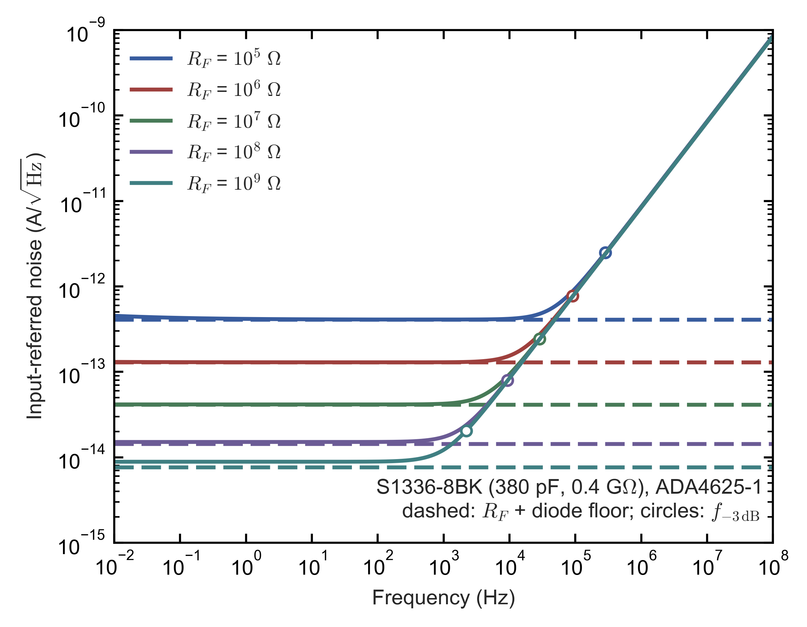

*Figure 11. Input-referred noise density of a TIA with ADA4625-1 on a 380-pF, 0.4-GΩ silicon photodiode (S1336-8BK) at $R_F$ = 100 kΩ to 1 GΩ. Solid: total, Eq. (8). Dashed: the floor of Eq. (10). Circles: the −3 dB bandwidth of each design.*

### 4.3 How much each term contributes

Table 4a gives the two largest terms in the band of each design, and their shares of the integrated noise power, for ADA4625-1 on all five photodiodes of the sweep. Table 4b gives the same for the electrometer ADA4530-1. The pattern of Figures 10 and 11 holds across all of them, and the shares show how strongly one term dominates.

*Table 4a. The two largest terms of Eq. (8) in the band [1 Hz, $f_{-3\,\mathrm{dB}}$] and their shares of the noise power, with the bandwidth of the design; "R" marks a resistor-limited design. ADA4625-1, $C_{par}$ = 0.1 pF. `hg_analysis.py`, `hg_tables.py`.*

| Photodiode | 100 kΩ | 1 MΩ | 10 MΩ | 100 MΩ | 1 GΩ |
|---|---|---|---|---|---|
| S1336-18BK (Si, 20 pF, 2 GΩ) | $e_n\,\omega C$ 56%, $R_F$ 44%; 878 kHz | $e_n\,\omega C$ 55%, $R_F$ 45%; 284 kHz | $e_n\,\omega C$ 54%, $R_F$ 45%; 90.8 kHz | $R_F$ 53%, $e_n\,\omega C$ 38%; 22 kHz R | $i_n$ 44%, $R_F$ 36%; 1.67 kHz R |
| G12180-010A (InGaAs, 55 pF, 125 MΩ) | $e_n\,\omega C$ 69%, $R_F$ 31%; 644 kHz | $e_n\,\omega C$ 68%, $R_F$ 31%; 206 kHz | $e_n\,\omega C$ 67%, $R_F$ 30%; 65.8 kHz | $e_n\,\omega C$ 53%, $R_F$ 24%; 20.8 kHz | diode $R_{sh}$ 77%, $i_n$ 12%; 1.71 kHz R |
| S1336-8BK (Si, 380 pF, 0.4 GΩ) | $e_n\,\omega C$ 92%, $R_F$ 8%; 284 kHz | $e_n\,\omega C$ 92%, $R_F$ 8%; 90.8 kHz | $e_n\,\omega C$ 92%, $R_F$ 8%; 28.7 kHz | $e_n\,\omega C$ 89%, $R_F$ 8%; 9.07 kHz | $e_n\,\omega C$ 59%, diode $R_{sh}$ 22%; 2.2 kHz R |
| G12180-050A (InGaAs, 1 nF, 6.5 MΩ) | $e_n\,\omega C$ 97%, $R_F$ 3%; 179 kHz | $e_n\,\omega C$ 96%, $R_F$ 3%; 56.6 kHz | $e_n\,\omega C$ 92%, diode $R_{sh}$ 5%; 17.9 kHz | $e_n\,\omega C$ 64%, diode $R_{sh}$ 34%; 5.66 kHz | diode $R_{sh}$ 83%, $e_n\,\omega C$ 16%; 1.79 kHz |
| G12183-010K (InGaAs to 2.6 µm, 500 pF, 14 kΩ) | $e_n\,\omega C$ 64%, diode $R_{sh}$ 30%; 250 kHz | diode $R_{sh}$ 79%, $e_n\,\omega C$ 16%; 79.1 kHz | diode $R_{sh}$ 93%, $e_n/(R_F\parallel R_{sh})$ 4%; 25.3 kHz | diode $R_{sh}$ 95%, $e_n/(R_F\parallel R_{sh})$ 5%; 2.38 kHz R | diode $R_{sh}$ 94%, $e_n/(R_F\parallel R_{sh})$ 6%; 222 Hz R |

*Table 4b. As Table 4a, for the electrometer ADA4530-1.*

| Photodiode | 100 kΩ | 1 MΩ | 10 MΩ | 100 MΩ | 1 GΩ |
|---|---|---|---|---|---|
| S1336-18BK (Si, 20 pF, 2 GΩ) | $e_n\,\omega C$ 64%, $R_F$ 32%; 322 kHz | $e_n\,\omega C$ 64%, $R_F$ 36%; 109 kHz | $e_n\,\omega C$ 63%, $R_F$ 37%; 35.3 kHz | $e_n\,\omega C$ 63%, $R_F$ 36%; 11.3 kHz | $R_F$ 45%, $e_n\,\omega C$ 32%; 2.03 kHz R |
| G12180-010A (InGaAs, 55 pF, 125 MΩ) | $e_n\,\omega C$ 79%, $R_F$ 19%; 226 kHz | $e_n\,\omega C$ 79%, $R_F$ 21%; 73.8 kHz | $e_n\,\omega C$ 77%, $R_F$ 21%; 23.6 kHz | $e_n\,\omega C$ 69%, $R_F$ 17%; 7.55 kHz | diode $R_{sh}$ 61%, $e_n\,\omega C$ 31%; 2.25 kHz R |
| S1336-8BK (Si, 380 pF, 0.4 GΩ) | $e_n\,\omega C$ 96%, $R_F$ 4%; 95.1 kHz | $e_n\,\omega C$ 96%, $R_F$ 4%; 30.8 kHz | $e_n\,\omega C$ 96%, $R_F$ 4%; 9.61 kHz | $e_n\,\omega C$ 95%, $R_F$ 4%; 3.04 kHz | $e_n\,\omega C$ 92%, diode $R_{sh}$ 6%; 960 Hz |
| G12180-050A (InGaAs, 1 nF, 6.5 MΩ) | $e_n\,\omega C$ 98%, $R_F$ 2%; 59.3 kHz | $e_n\,\omega C$ 98%, $R_F$ 2%; 19 kHz | $e_n\,\omega C$ 96%, diode $R_{sh}$ 2%; 5.99 kHz | $e_n\,\omega C$ 82%, diode $R_{sh}$ 17%; 1.89 kHz | diode $R_{sh}$ 52%, $e_n\,\omega C$ 48%; 606 Hz |
| G12183-010K (InGaAs to 2.6 µm, 500 pF, 14 kΩ) | $e_n\,\omega C$ 65%, $e_n/(R_F\parallel R_{sh})$ 17%; 83.8 kHz | diode $R_{sh}$ 41%, $e_n/(R_F\parallel R_{sh})$ 41%; 27.1 kHz | $e_n/(R_F\parallel R_{sh})$ 63%, diode $R_{sh}$ 36%; 3.14 kHz R | $e_n/(R_F\parallel R_{sh})$ 88%, diode $R_{sh}$ 12%; 280 Hz R | $e_n/(R_F\parallel R_{sh})$ 97%, diode $R_{sh}$ 3%; 28 Hz R |

Four observations summarize the tables.

- **With a small, high-shunt-resistance photodiode**, the band splits roughly evenly between the resistor and the voltage noise up to about 10 MΩ. The resistor takes over at 100 MΩ. At 1 GΩ the amplifier's current noise joins it for ADA4625-1, whose $R_{F,\mathrm{crit}}$ is 813 MΩ, while the resistor stays largest for the electrometer.
- **With a large photodiode**, the voltage noise takes 89–98% of the noise power at every gain up to 100 MΩ, and the electrometer, with four to five times more voltage noise, is worse there than the JFET part.
- **With a photodiode whose shunt resistance is a few megohms**, that resistance dominates above $R_F \approx R_{sh}$, whatever the amplifier.
- **With a photodiode of 14 kΩ**, the diode's noise dominates from 1 MΩ up for the JFET part. For the CMOS electrometer, the voltage noise on the conductance dominates instead, because its flicker noise (80 nV/√Hz at 10 Hz) exceeds $e_{n,\mathrm{crit}}$ = 15.2 nV/√Hz of Eq. (12). Its bandwidth also collapses to 28 Hz at 1 GΩ, by Eq. (24) with its 2-MHz gain–bandwidth product.

---

## 5. The amplifier classes

The 21 op amps of this survey fall into six classes, and three discrete JFETs stand for a seventh, the composite front end. Table 5 summarizes them by the quantities of Chapters 2 and 3, and Table A.1 gives every value with its datasheet page. The parts are examples of their classes, chosen from what was available as a datasheet, not an exhaustive market scan.

*Table 5. The amplifier classes by the quantities that matter for a high-gain TIA (typical values at 25 °C from Table A.1). $R_{F,\mathrm{crit}}$ is Eq. (11) and $R_{opt}$ Eq. (14), the latter with $e_n$ at 1 kHz or the nearest specified frequency. $A_0$ is the DC open-loop gain, which must exceed ten times the mid-band noise gain (Section 3.1).*

| Class | Examples | $e_n$, white (nV/√Hz) | $i_n$ (fA/√Hz) | $C_{CM}+C_{DIFF}$ (pF) | $I_B$ max, 25 °C / 85 °C | $GBW$ (MHz) | $A_0$ (dB) | $R_{F,\mathrm{crit}}$ | $R_{opt}$ |
|---|---|---|---|---|---|---|---|---|---|
| CMOS electrometer | ADA4530-1, OPA928, LMC6001A | 14–22 | 0.07–0.13 | 8–9 | 20–25 fA / 20 fA–2 pA | 1.3–2.5 | 126–143 (LMC6001A not given) | 1–3.4 TΩ | 0.17–0.23 TΩ |
| Cancelled-bias CMOS | LMP7721 | 6.5 | 10 | not given | 20 fA / 0.9 pA | 17 | 111 | 165 MΩ | 0.65 MΩ |
| Precision JFET | ADA4625-1, OPA828, OPA827, OPA140, OPA145 | 3.3–7 | 0.8–4.5 | 9–20 | 8–75 pA / 0.3–1 nA | 5.5–45 | 123–150 | 0.8–26 GΩ | 0.7–9 MΩ |
| Low-noise CMOS | OPA1656, OPA2156, OPA320 | 2.9–7 at 10 kHz | 0.6–19 | 9–11 | 0.9–40 pA / 0.05–1.5 nA | 20–53 | 132–154 | 0.05–46 GΩ | 0.2–14 MΩ |
| Wideband FET | OPA656, OPA657, OPA818, ADA4817-1, LTC6268-10 | 2.2–6 | 1.3–16 at 0.1 MHz, rising | 0.55–5.2 | 20 fA–25 pA / 0.9 pA–5 nA | 230–4000 | 65–108 | 0.3–10 GΩ | 0.6–3.7 MΩ |
| Zero-drift and auto-zero CMOS | OPA388, OPA381 | 7; 70 at 10 kHz for OPA381 | 20–100 | 3.5–6.5 | 50–350 pA / 0.4–3 nA | 10–18 | 135–148 | 1.65–41 MΩ | 70 kΩ–3.5 MΩ |
| Bipolar | OPA211 | 1.1 | 1700 | 10 | 175 nA / 190 nA | 45 | 110 | 5.7 kΩ | 650 Ω |
| Discrete-JFET composite | IF3601, LSK170, BF862 + op amp | 0.35–0.9 | from gate current, ≤ 6–18 | 12–710 | 0.1–1 nA (maxima) | set by the design | set by the design | ≥ 51 MΩ at the maxima | – |

### 5.1 CMOS electrometers

Electrometer amplifiers are built for the smallest possible input current, and at the highest gains of this note that current, multiplied by $R_F$, is the DC error (Chapter 8). ADA4530-1 and OPA928 specify a bias current of 20 fA maximum at 25 °C, and ±20 fA maximum from −40 °C to 85 °C, at a relative humidity below 50% (ADA4530-1, p. 3; OPA928, p. 4) [D1, D2]. Both have an integrated guard buffer, whose output follows the input common-mode voltage within 100 µV (ADA4530-1) or 50 µV (OPA928) maximum, to drive a guard ring around the inputs (Chapter 8). Their current noise of 0.07 fA/√Hz is far below the Johnson noise of any resistor in this note. Their weakness is voltage noise: ADA4530-1 has 80 nV/√Hz at 10 Hz, 16 at 1 kHz and 14 at 10 kHz (p. 4), and OPA928 18 nV/√Hz at 100 Hz and 15 at 1 kHz (p. 4). With 8–9 pF of input capacitance and gain–bandwidth products of 2–2.5 MHz, they are slow and noisy on capacitance. LMC6001A, an older part, has 25 fA maximum, 22 nV/√Hz and 1.3 MHz (LMC6001, pp. 4, 9) [D4]. By Eq. (14) their optimum source resistance is hundreds of gigaohms, far above the node impedance of any TIA with a photodiode on it (Section 2.5). They belong where DC accuracy at the highest gains, over temperature and humidity, matters more than the last decibel of noise (Section 6.5).

### 5.2 A bias-current-cancelled CMOS amplifier

LMP7721 shows that a femtoampere bias current does not by itself mean low current noise. It reaches a typical bias current of 3 fA through cancellation circuitry (p. 1), with 20 fA maximum at 25 °C and 900 fA at 85 °C, 6.5 nV/√Hz at 1 kHz and 17 MHz (LMP7721, pp. 6–7) [D3]. Its current noise of 10 fA/√Hz is the trap described in Section 2.3: it exceeds the Johnson noise of any $R_F$ above 165 MΩ, and at 1 GΩ it adds 7.1 dB to the floor on the small photodiode (Table A.3a). The datasheet does not specify its input capacitance. LMP7721 suits 1–100 MΩ, where its low voltage noise and femtoampere bias current help, but not 1 GΩ.

### 5.3 Precision JFET op amps

The precision JFET op amps are the general-purpose class of this note: their voltage noise and current noise are both moderate, and their ratio matches the node impedances of most designs. ADA4625-1, OPA828, OPA827, OPA140 and OPA145 combine 3.3–7 nV/√Hz with 0.8–4.5 fA/√Hz and 9–20 pF [D6–D10]. Their bias currents are picoamperes at 25 °C (8–75 pA maximum) and double every 10 °C. At 85 °C the maxima are 0.3–1 nA, from the datasheet limits at 85 °C or interpolated between those at 25 °C and 125 °C (Appendix B.1). Their optimum source resistances of 0.7–9 MΩ (Eq. (14)) lie in the middle of the node impedances of this note. That is why they are the best general choice from 1 MΩ to 1 GΩ wherever DC accuracy at elevated temperature does not decide. Within the class:

- **ADA4625-1** has the lowest voltage noise, 5.5/3.6/3.3 nV/√Hz at 10/100/1000 Hz (p. 4) [D6], and suits large capacitances. Its 4.5 fA/√Hz limits it to about 800 MΩ.
- **OPA140 and OPA145** have the lowest current noise, 0.8 fA/√Hz (pp. 7 and 6) [D9, D10], and suit 1 GΩ on small diodes.
- **OPA828** has the widest bandwidth, 45 MHz (p. 6) [D7], with 4 nV/√Hz at 1 kHz and 1.2 fA/√Hz.
- **OPA827** lies between them, with 4 nV/√Hz, 2.2 fA/√Hz and 22 MHz (p. 6) [D8].

### 5.4 Low-noise CMOS op amps

The low-noise CMOS op amps match the voltage noise of the best JFET parts at 10 kHz and above, though not at low frequency, which makes them the quietest choice at the lower gains, whose bands reach far above 10 kHz. OPA1656 and OPA2156 reach 2.9–3.0 nV/√Hz at 10 kHz, as low as the best JFET parts, with only 1.9 pF of common-mode input capacitance, although their differential capacitance is 9.1 pF (OPA1656, p. 6; OPA2156, pp. 5–6) [D11, D12]. Both specify 20 MHz at unity gain. At a gain of 100, OPA1656 specifies 53 MHz and OPA2156 25 MHz. For both the higher figure applies at the noise gains of this note, as their SPICE models confirm (Section 9.2). Their flicker noise is high: 11.8–12 nV/√Hz at 100 Hz. So is their current noise: 6 and 19 fA/√Hz at 1 kHz, which limits them to 457 MΩ and 46 MΩ. Their bias currents are 20–40 pA maximum. At equal bandwidth they are the quietest choices at 100 kΩ to 10 MΩ on small and medium photodiodes, and both can trade their extra gain–bandwidth for more bandwidth, OPA1656 for about twice as much (Section 6.1). Above 10 MΩ their current noise limits them. OPA320 is a 5-V rail-to-rail CMOS part with 8.5 nV/√Hz at 1 kHz, 0.6 fA/√Hz, 0.9 pA maximum bias current at 25 °C and 50 pA at 85 °C (pp. 7–8) [D13]. Its low bias current over temperature makes it a good compromise at 1 GΩ (Section 6.5).

### 5.5 Wideband FET op amps

The wideband FET op amps are built for speed: they give the widest bandwidth at the lowest gains, and as the gain rises they are the first to reach the resistor's own pole (Section 3.2). OPA656, OPA657, OPA818, ADA4817-1 and LTC6268-10 offer 230 MHz to 4 GHz of gain–bandwidth with 0.55–5.2 pF of input capacitance [D16, D19, D20, D21, D18]. OPA657, OPA818 and LTC6268-10 are decompensated, stable only above a noise gain of 7 or 10, which every design of this note exceeds (Section 3.1). Their white voltage noise is 2.2–6 nV/√Hz, but their flicker corners lie at 1–50 kHz. OPA818 has 8.4 nV/√Hz at 1 kHz. For LTC6268-10, its 0.1–10 Hz noise of 12.6 µV peak to peak implies about 28 nV/√Hz at 1 kHz, an estimate explained in Appendix B.1. Their current noise rises with frequency (Section 2.3). Their bias currents are picoamperes at 25 °C, nanoamperes at 85 °C, except LTC6268-10, a CMOS part, with 20 fA and 0.9 pA. They give the widest bandwidth at 100 kΩ to 1 MΩ, at a high noise cost (Section 6.1). At 10 MΩ and above they reach the resistor's ceiling, and with a small photodiode they come close to the floor there (Sections 6.3–6.4). Their DC open-loop gains are low: 65–92 dB for OPA656, OPA657, OPA818 and ADA4817-1, and 108 dB for LTC6268-10 (Table A.1). On large photodiodes at high gain, where the mid-band noise gain reaches thousands, the first four fail the condition of Section 3.1 and lose bandwidth, and Tables 6.1–6.5 leave those designs out. ADA4817-1 fails it on every photodiode from 1 MΩ up.

### 5.6 Zero-drift and auto-zero op amps

Zero-drift and auto-zero op amps are built for the smallest offset, which matters wherever a large low-frequency noise gain multiplies it. OPA388 has 0.25 µV of typical offset and 0.005 µV/°C of drift, but 100 fA/√Hz of current noise and 350 pA of maximum bias current (pp. 7–8) [D15]. OPA381, an auto-zero part marketed for transimpedance use, has 20 fA/√Hz at 10 kHz and a voltage noise of 70 nV/√Hz at 10 kHz, falling to 10 nV/√Hz above 1 MHz (p. 3) [D14]. Their current noise limits them to 1.65 MΩ and 41 MΩ (Eq. (11)), and in the sweep they are 5–26 dB above the floor (Table A.3). Their offset advantage matters only where the offset, multiplied by $1 + R_F/R_{sh}$, dominates the DC error, which is the case for low-shunt-resistance photodiodes (Section 6.6).

### 5.7 Bipolar op amps

A bipolar input has the lowest voltage noise of the op amps in this survey, but the shot noise of its base current gives it by far the largest current noise. OPA211 has 1.1 nV/√Hz at 1 kHz but 1.7 pA/√Hz and 175 nA of maximum bias current (p. 8) [D17]. Its optimum source resistance of 650 Ω is two to six orders of magnitude below the node impedances of this note. It has a place only on photodiodes with a shunt resistance of a few kilohms at the lowest gain, where its voltage noise competes with the diode's own noise. Even there the low-noise FET parts are as good (Section 6.6).

### 5.8 Discrete-JFET composites

When the voltage noise on a large capacitance dominates, as it does for every photodiode above a few hundred picofarads (Chapter 4), the cure is an input device with less $e_n$ per unit of capacitance than any op amp's. A discrete JFET in front of an op amp provides it. The JFET is a common-source stage, often cascoded, inside the op amp's feedback loop, and $R_F$ returns from the final output to its gate. Three devices from the companion note's folder show the range:

- **IF3601**, 0.35 nV/√Hz at 100 Hz, 175 mS, 650 pF of input capacitance at $V_{GS}$ = −4 V, and 0.1 nA maximum gate leakage at −10 V (IF3601 data sheet, pp. 1–3) [D22]. Its capacitance curve shows about 290 pF at −4 V and 900 pF at 0 V, which does not match the table, so the table value is used.
- **LSK170**, 0.9 nV/√Hz at 1 kHz (1.9 maximum) and 1.4 at 10 Hz, 22 mS, 20 pF, and 0.5 nA maximum gate operating current (LSK170 data sheet, p. 2) [D23].
- **BF862**, 0.8 nV/√Hz at 100 kHz, 10 pF, and 1 nA maximum gate leakage, from the companion's device table [D24].

For a family of FETs with the same transit frequency $f_T = g_m/(2\pi C_{iss})$, the channel noise is $e_n^2 = 4k_BT\Gamma/g_m = 4k_BT\Gamma/(2\pi f_TC_{iss})$, with $\Gamma \approx 2/3$. The $e_n\,\omega C$ term then has the power $e_n^2\omega^2(C_x + C_{iss})^2 \propto (C_x + C_{iss})^2/C_{iss}$, where $C_x$ is the node capacitance without the FET. Setting its derivative with respect to $C_{iss}$ to zero, $2(C_x + C_{iss})/C_{iss} - (C_x + C_{iss})^2/C_{iss}^2 = 0$, gives the optimum

$$
C_{iss} = C_x ,
\tag{30}
$$

the capacitive-matching rule (the companion's Eq. (58)). At the optimum the noise power grows only in proportion to $C_x$, whereas for a fixed amplifier it grows as $C_x^2$. A device should therefore be chosen with an input capacitance near that of the photodiode. The comparison against ADA4625-1, the lowest-noise op amp of the survey, confirms the rule. With the input capacitance of each device included, the product $e_n\,C_T$ at 10 kHz falls by these factors (Table A.6, from `hg_numbers.py`):

- **100 pF:** 3.0 dB (IF3601), 10.9 dB (LSK170) and 12.9 dB (BF862);
- **380 pF:** 10.8, 11.2 and 12.5 dB;
- **1 nF:** 15.0, 11.2 and 12.4 dB;
- **3.7 nF:** 18.0, 11.3 and 12.3 dB.

The small devices win on small diodes, and IF3601 wins on large ones. Since the $e_n\,\omega C$ noise integrates as the cube of the bandwidth, equal noise allows the bandwidth to grow by the 2/3 power of the amplitude ratio: 2.3–4.0 times for the cases above.

In the sweep the composites are modelled with an assumed composite gain–bandwidth product of 50 MHz, a design choice rather than a datasheet value. Their current noise is the shot noise of the maximum gate current, which overstates it because the typical gate current is not specified. With these assumptions IF3601 brings the 380-pF silicon photodiode from 11.1 dB of excess noise with ADA4625-1 to 3.0 dB, at the same bandwidth of about 290 kHz at 100 kΩ. It brings the 1-nF InGaAs photodiode from 14.8 dB to 4.0 dB, at 228 kHz instead of 179 kHz (Table A.3). On the small photodiode BF862 and LSK170 composites come within 0.7–1.4 dB of the floor at 100 kΩ to 10 MΩ, against 3.5–3.6 dB for ADA4625-1. Above 10 MΩ the maximum gate currents of 0.1–1 nA, whose shot noise is 5.7–18 fA/√Hz, compete with the resistor. The composites' advantage there depends on the actual gate current, which must be measured (Appendix C, item 4). Gate current also rises with drain–gate voltage through impact ionization, so the drain voltage of a composite for high gain should be kept low.

A SPICE model of such a composite confirms the estimate (Section 9.5, Figure 12). An LSBF862 common-source stage with a cascode and a 1-kΩ drain load, followed by an integrator, brings the 380-pF photodiode from 12.4–12.6 dB of excess noise with OPA140 to 2.8 dB, at 1.8 times the bandwidth. It brings the 1-nF photodiode from 12.5–16.5 dB to 3.1–5.2 dB. The SPICE composite is 1.7–2.4 dB quieter than the analytic BF862 estimate and about 15% slower, because the LSBF862 model card's noise and capacitances differ from the BF862 data-sheet values (Table 9.5).

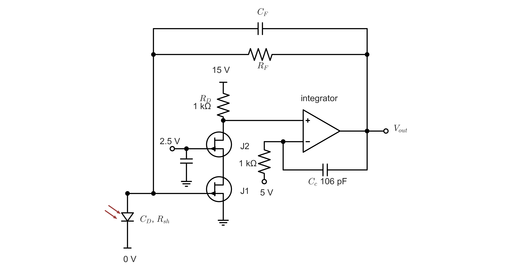

*Figure 12. The discrete-JFET composite simulated in Section 9.5. J1, an LSBF862 in common source with its gate at the summing node, is cascoded by J2, whose gate is held at 2.5 V and bypassed. $R_D$ = 1 kΩ from 15 V carries 10 mA with the drain at 5 V, so the stage's voltage gain $g_mR_D$ is about 33. The integrator senses the drain against 5 V: its non-inverting input is on the drain and its inverting input returns to 5 V through 1 kΩ, so the loop settles with the drain at 5 V. With $C_c$ = 106 pF in its feedback its unity-gain frequency is $1/(2\pi\times1\ \mathrm{k\Omega}\times106\ \mathrm{pF})$ = 1.5 MHz, which with the gain of about 33 gives the composite the 50 MHz of gain–bandwidth assumed in the sweep. $R_F$ and $C_F$ return from the integrator's output to J1's gate, where the photodiode's $C_D$ and $R_{sh}$ also sit. In SPICE the integrator is an ideal transconductance-and-capacitor stage.*

### 5.9 Integrated photodiode-amplifiers

OPT101 integrates a 2.29 × 2.29 mm photodiode with a TIA and a 1-MΩ feedback resistor, and gives 14 kHz of bandwidth at 0.45 A/W (650 nm) from a single 2.7–36 V supply (OPT101 data sheet, p. 1) [D28]. Integration removes the board's leakage and stray capacitance at the summing node, which is the dominant practical problem of a discrete TIA at high gain (Chapter 8), at the price of a fixed gain and a fixed photodiode.

---

## 6. Selection by gain range

This chapter turns Chapters 2–5 into a choice for each gain decade. Table 6 is the summary. Sections 6.1–6.5 give the reasons and the numbers for each decade, and Sections 6.6 and 6.7 treat the two kinds of photodiode that change the rules: those with low shunt resistance and those with large capacitance. Section 6.8 asks what changes when the signal sits at low frequency, where the band integral no longer describes the measurement. Every number comes from the sweep of Appendix B: 21 op amps and three composites, five photodiodes and five gains, each design with the smallest feedback capacitance that keeps it within 0.1 dB of maximally flat, $C_{par}$ = 0.1 pF and 1 pF of board capacitance. The excess noise $\Delta N$ of Eq. (16) is measured against the resistor-plus-diode floor over each design's own band. DC errors are output errors from the maximum bias current and offset, at 25 °C and 85 °C. The room-temperature part of a DC error can be removed by subtracting a dark reading; its change with temperature cannot, unless the dark reading is repeated in operation. Tables 6.1–6.5 leave out the designs whose DC open-loop gain is less than ten times their mid-band noise gain (Section 3.1). Their narrow bandwidth, not low noise, would otherwise rank them among the quietest. Table A.3 marks them with "A".

*Table 6. What dominates and what to choose, by gain decade. "Small" photodiodes are those of tens of picofarads with gigaohm shunt resistance (S1336-18BK); "large" are those of hundreds of picofarads or more (S1336-8BK, G12180-050A). $\Delta N$ and bandwidths from Tables 6.1–6.5 and A.3; DC errors at 85 °C on the small photodiode.*

| $R_F$ | What dominates the noise in band | What sets the bandwidth | What sets the DC error | Choice for a small photodiode | Choice for a large photodiode |
|---|---|---|---|---|---|
| 100 kΩ | $R_F$ up to $f_e$ ≈ 0.6–0.7 of the band, $e_n\,\omega C$ above it; $e_n\,\omega C$ almost throughout for a large diode | the amplifier: 0.5–1.5 MHz for precision parts, 4–18 MHz for wideband parts | offset | ADA4625-1 (3.6 dB, 0.88 MHz) or OPA2156 (3.6 dB, 1.26 MHz); OPA1656 or OPA2156 held to 1 MHz by a larger $C_F$ (2.6–2.7 dB), or OPA1656 at 1.9 MHz (5.9 dB); BF862 or LSK170 composite (0.7–1.1 dB, 1.4–1.6 MHz); wideband FET parts beyond 2 MHz at 13.6–23 dB | IF3601 composite (3–4 dB); otherwise ADA4625-1 or OPA2156 (11–16 dB) |
| 1 MΩ | as at 100 kΩ, everything $\sqrt{10}$ lower in frequency | the amplifier: 0.2–0.5 MHz; wideband parts reach 1.3–1.9 MHz, near the resistor's pole | offset | as at 100 kΩ (3.4–3.5 dB at 0.28–0.39 MHz, or 2.5–2.7 dB held to 0.33 MHz; OPA1656 also at 0.65 MHz with 6.0 dB); OPA818 at the resistor's 1.84 MHz with 9.5 dB | as at 100 kΩ |
| 10 MΩ | $R_F$ and $e_n\,\omega C$ about equal (small); $e_n\,\omega C$ (large) | the resistor (150–180 kHz) for wideband parts; the amplifier (58–150 kHz) for precision parts | offset, plus bias current at 85 °C (3–15 mV for precision parts, 52 mV for OPA656 and OPA657) | OPA818 (2.3 dB, 162 kHz, resistor-limited); OPA2156 (3.6 dB, 121 kHz) or OPA1656 (5.2 dB, 183 kHz); BF862 or LSK170 composite (1.3–1.4 dB, 141–165 kHz) | composite; otherwise ADA4625-1 or OPA2156 (10.9–11.6 dB) |
| 100 MΩ | $R_F$ (small); $e_n\,\omega C$ (large) | the resistor, 16 kHz, for most parts; the amplifier for large diodes (5–10 kHz) | bias current: 30–500 mV at 85 °C for JFET parts, 5 mV for OPA320, 44 µV for ADA4530-1 | OPA818, OPA657 (0.6–1.2 dB) if 0.07–0.5 V at 85 °C is acceptable; OPA1656 (1.5 dB); OPA320 (3.8 dB, 5 mV); ADA4530-1, OPA928 (4.3–5.2 dB, 30–45 µV) | ADA4625-1, OPA2156 (10–11.5 dB) or a composite |
| 1 GΩ | $R_F$ plus the diode's $R_{sh}$; the amplifier's $i_n$ above its $R_{F,\mathrm{crit}}$; $e_n\,\omega C$ for a large diode | the resistor, 1.6 kHz, unless equalized | bias current and leakage: JFET parts 0.3–1 V at 85 °C, OPA320 50 mV, electrometers 60–80 µV | OPA140, OPA828, OPA145 (0.3–0.4 dB) where the temperature is held; OPA320 (0.4 dB, 50 mV); ADA4530-1, OPA928 (1.5–1.7 dB, < 0.1 mV) where DC accuracy decides | OPA828, ADA4625-1 (4.8–5.2 dB) |

The table follows three rules from Chapters 2–3. Below the crossover gain $R_F^*$ the amplifier sets the bandwidth and the excess noise is fixed by $e_n$, $C_T$ and $GBW$ (Eqs. (21)–(22)). Above $R_F^*$ the resistor sets the bandwidth and the voltage noise fades from the band (Eq. (23)). The amplifier's current noise and DC input current gain weight with every decade (Eqs. (11) and (15)).

### 6.1 100 kΩ

*Table 6.1. The four quietest designs and the fastest one for each photodiode at 100 kΩ (excess noise $\Delta N$, Eq. (16); −3 dB bandwidth). Composites are excluded here and shown in Section 6.7.*

| Photodiode | Four quietest ($\Delta N$; bandwidth) | Fastest (bandwidth; $\Delta N$) |
|---|---|---|
| S1336-18BK (Si, 20 pF) | ADA4625-1 3.6 dB, 878 kHz; OPA2156 3.6 dB, 1.26 MHz; OPA145 3.7 dB, 541 kHz; OPA140 4.4 dB, 706 kHz | LTC6268-10 18.4 MHz, 23.1 dB |
| G12180-010A (InGaAs, 55 pF) | ADA4625-1 5.1 dB, 644 kHz; OPA2156 5.5 dB, 858 kHz; OPA145 5.9 dB, 379 kHz; OPA140 6.3 dB, 511 kHz | LTC6268-10 11.3 MHz, 27.2 dB |
| S1336-8BK (Si, 380 pF) | ADA4625-1 11.1 dB, 284 kHz; OPA2156 11.8 dB, 349 kHz; OPA145 12.4 dB, 160 kHz; OPA140 12.6 dB, 223 kHz | LTC6268-10 4.35 MHz, 35.3 dB |
| G12180-050A (InGaAs, 1 nF) | OPA211 14.2 dB, 284 kHz; ADA4625-1 14.8 dB, 179 kHz; OPA2156 15.6 dB, 218 kHz; OPA145 16.2 dB, 99.6 kHz | LTC6268-10 2.68 MHz, 39.4 dB |
| G12183-010K (InGaAs to 2.6 µm, 500 pF, 14 kΩ) | ADA4625-1 4.7 dB, 250 kHz; OPA2156 5.2 dB, 308 kHz; OPA211 5.7 dB, 401 kHz; OPA145 5.8 dB, 139 kHz | LTC6268-10 3.84 MHz, 27.5 dB |

At 100 kΩ the floor is 406 fA/√Hz, high enough that every FET input's current noise is negligible (all $R_{F,\mathrm{crit}}$ exceed 1.6 MΩ, Table A.2), and even the bipolar OPA211 competes on the largest photodiode. The amplifier sets the bandwidth, and the voltage noise on the node capacitance decides the excess, as Eq. (22) predicts. The quietest parts are therefore those with the lowest $e_n$ at 0.1–1 MHz and modest input capacitance: OPA1656 and OPA2156 (2.9–3.0 nV/√Hz at 10 kHz), then ADA4625-1 (3.3 nV/√Hz, but 19.9 pF). OPA1656 is missing from Table 6.1, which ranks each part at its own widest flat bandwidth. With 53 MHz of gain–bandwidth at high noise gain, its smallest stable $C_F$ gives 1.94 MHz at 5.9 dB (Table A.3a). OPA2156, with 25 MHz, reaches 1.26 MHz at 3.6 dB. Held to OPA2156's bandwidth by a larger $C_F$, OPA1656 is slightly quieter than OPA2156: 3.56 against 3.64 dB at 100 kΩ, 3.22 against 3.37 dB at 1 MΩ and 3.14 against 3.63 dB at 10 MΩ. Held to 1 MHz, 330 kHz and 100 kHz, the two come within 2.4–3.0 dB of the floor (`hg_equal_bandwidth_check.py`). The fastest is always LTC6268-10, which reaches 2.7–18 MHz by Eq. (19) with its 4-GHz gain–bandwidth product, at 23–39 dB of excess. Between these extremes OPA818, ADA4817-1 and OPA656 trade noise for bandwidth along the line that Eq. (22) describes: at 4.1–15 MHz on the small diode they have 13.6–16.5 dB of excess (Table A.3a). The DC error is that of the offset, 0.1–2 mV, since even 20 pA of bias current makes only 2 µV at 100 kΩ. At this gain, then, the choice is between a low-noise precision part at up to about 1 MHz and a wideband part beyond it, with a discrete-JFET composite (Section 6.7) when both noise and bandwidth matter.

### 6.2 1 MΩ

*Table 6.2. As Table 6.1, at 1 MΩ.*

| Photodiode | Four quietest ($\Delta N$; bandwidth) | Fastest (bandwidth; $\Delta N$) |
|---|---|---|
| S1336-18BK (Si, 20 pF) | OPA2156 3.4 dB, 388 kHz; ADA4625-1 3.5 dB, 284 kHz; OPA145 3.5 dB, 179 kHz; OPA140 4.2 dB, 226 kHz | OPA657 1.86 MHz, 16.5 dB |
| G12180-010A (InGaAs, 55 pF) | ADA4625-1 5.0 dB, 206 kHz; OPA2156 5.2 dB, 265 kHz; OPA145 5.7 dB, 124 kHz; OPA140 6.1 dB, 165 kHz | OPA818 2.16 MHz, 17.7 dB |
| S1336-8BK (Si, 380 pF) | ADA4625-1 11.0 dB, 90.8 kHz; OPA2156 11.6 dB, 110 kHz; OPA145 12.2 dB, 50.5 kHz; OPA140 12.5 dB, 71.3 kHz | LTC6268-10 1.39 MHz, 35.4 dB |
| G12180-050A (InGaAs, 1 nF) | ADA4625-1 14.2 dB, 56.6 kHz; OPA2156 14.8 dB, 67.3 kHz; OPA145 15.5 dB, 31.5 kHz; OPA140 15.8 dB, 44.5 kHz | LTC6268-10 858 kHz, 39.1 dB |
| G12183-010K (InGaAs to 2.6 µm, 500 pF, 14 kΩ) | ADA4625-1 1.0 dB, 79.1 kHz; OPA2156 1.1 dB, 96.2 kHz; OPA827 1.5 dB, 88.7 kHz; OPA140 1.5 dB, 62.8 kHz | LTC6268-10 1.23 MHz, 18.1 dB |

At 1 MΩ the pattern is the same (Table 6.2), with every frequency $\sqrt{10}$ lower, as Eq. (19) and Eq. (13) both scale as $1/\sqrt{R_F}$. Two changes appear. The zero-drift OPA388 and the bipolar OPA211 have fallen out: OPA388's 100 fA/√Hz is now comparable with the 128 fA/√Hz floor, and OPA211's 1.7 pA/√Hz exceeds it thirteen times. Second, the wideband parts with the smallest input capacitance begin to meet the resistor's ceiling. OPA818 is resistor-limited at 1.84 MHz with 0.1 pF. Equation (4) gives 1.59 MHz for the bare pole, but a design near the crossover gain $R_F^*$ has a response close to maximally flat, whose −3 dB point lies between $f_R$ and $\sqrt2\,f_R$ (Section 3.2). On the extended-InGaAs diode, $R_F$ = 1 MΩ is already 71 times $R_{sh}$, and the diode's own noise takes 79% of the band (Table 4a). Every decent amplifier is then within 1 dB of the floor, but the bandwidth and the offset suffer (Section 6.6).

### 6.3 10 MΩ

*Table 6.3. As Table 6.1, at 10 MΩ.*

| Photodiode | Four quietest ($\Delta N$; bandwidth) | Fastest (bandwidth; $\Delta N$) |
|---|---|---|
| S1336-18BK (Si, 20 pF) | OPA818 2.3 dB, 162 kHz; ADA4625-1 3.5 dB, 90.8 kHz; OPA145 3.5 dB, 58 kHz; OPA2156 3.6 dB, 121 kHz | OPA1656 183 kHz, 5.2 dB |
| G12180-010A (InGaAs, 55 pF) | ADA4625-1 4.8 dB, 65.8 kHz; OPA2156 5.1 dB, 82.8 kHz; OPA145 5.3 dB, 39.2 kHz; OPA140 5.8 dB, 52.2 kHz | LTC6268-10 163 kHz, 12.2 dB |
| S1336-8BK (Si, 380 pF) | ADA4625-1 10.9 dB, 28.7 kHz; OPA2156 11.5 dB, 34.5 kHz; OPA145 12.0 dB, 16 kHz; OPA140 12.4 dB, 22.5 kHz | LTC6268-10 183 kHz, 29.5 dB |
| G12180-050A (InGaAs, 1 nF) | ADA4625-1 11.0 dB, 17.9 kHz; OPA2156 11.6 dB, 21.3 kHz; OPA145 12.2 dB, 9.95 kHz; OPA140 12.5 dB, 14.1 kHz | LTC6268-10 213 kHz, 35.0 dB |
| G12183-010K (InGaAs to 2.6 µm, 500 pF, 14 kΩ) | ADA4625-1 0.3 dB, 25.3 kHz; OPA2156 0.3 dB, 30.1 kHz; OPA1656 0.4 dB, 44 kHz; OPA827 0.4 dB, 28 kHz | LTC6268-10 185 kHz, 5.6 dB |

At 10 MΩ the two ceilings of Section 3.2 meet (Table 6.3). On the small photodiode, the wideband parts reach the resistor's own pole: OPA818 and LTC6268-10 at 162 kHz, OPA657 at 151 kHz, and OPA656 at 179 kHz, which lies between $f_R$ and $\sqrt2\,f_R$ for the same reason as at 1 MΩ. ADA4817-1 fails the open-loop-gain condition of Section 3.1 on this diode from 1 MΩ up and is left out. Because Eq. (23) now gives $f_e/f_R$ of about 1, the resistor-limited designs carry only 2.3–8.0 dB of excess (Table A.3a). OPA818 is the quietest single op amp here, at 2.3 dB and 162 kHz, within 12% of the fastest, OPA1656 at 183 kHz. The precision and low-noise CMOS parts stay amplifier-limited at 58–183 kHz with 3.5–7.3 dB. The DC error is still dominated by the offset at 25 °C, but at 85 °C the bias current of the JFET parts adds 3–50 mV (Table A.3a). On the large photodiodes nothing changes: the voltage noise takes over 90% of the band, and only a lower $e_n\,C_T$ helps (Section 6.7).

### 6.4 100 MΩ

*Table 6.4. As Table 6.1, at 100 MΩ.*

| Photodiode | Four quietest ($\Delta N$; bandwidth) | Fastest (bandwidth; $\Delta N$) |
|---|---|---|
| S1336-18BK (Si, 20 pF) | OPA818 0.6 dB, 16 kHz; OPA657 1.2 dB, 14.9 kHz; OPA1656 1.5 dB, 17.7 kHz; OPA656 1.9 dB, 15.6 kHz | OPA140 22.5 kHz, 3.9 dB |
| G12180-010A (InGaAs, 55 pF) | OPA818 1.6 dB, 15.8 kHz; OPA1656 2.5 dB, 19.9 kHz; ADA4625-1 3.6 dB, 20.8 kHz; OPA145 3.9 dB, 12.5 kHz | OPA827 22.5 kHz, 4.5 dB |
| S1336-8BK (Si, 380 pF) | ADA4625-1 10.1 dB, 9.07 kHz; OPA145 11.2 dB, 5.04 kHz; OPA2156 11.5 dB, 10.9 kHz; OPA140 11.6 dB, 7.12 kHz | LTC6268-10 16 kHz, 25.1 dB |
| G12180-050A (InGaAs, 1 nF) | ADA4625-1 4.4 dB, 5.66 kHz; OPA145 5.3 dB, 3.14 kHz; OPA2156 5.6 dB, 6.72 kHz; OPA140 5.6 dB, 4.44 kHz | LTC6268-10 16 kHz, 22.3 dB |
| G12183-010K (InGaAs to 2.6 µm, 500 pF, 14 kΩ) | ADA4625-1 0.2 dB, 2.38 kHz; OPA827 0.3 dB, 2.9 kHz; OPA828 0.3 dB, 5.28 kHz; OPA1656 0.5 dB, 5.99 kHz | LTC6268-10 16 kHz, 5.4 dB |

At 100 MΩ the resistor sets the bandwidth for almost every part on the small photodiodes, at 15–22 kHz (Table 6.4). The designs above the 15.9 kHz of the bare 0.1-pF pole are those near their crossover gain $R_F^*$ (for OPA140 it is 110 MΩ by Eq. (20)), whose response is close to maximally flat with its −3 dB point at up to $\sqrt2\,f_R$ = 22.5 kHz. The excess is small for every FET-input part with a small input capacitance and moderate current noise: 0.6–1.2 dB for OPA818 and OPA657, and 1.5–2.5 dB for OPA1656, OPA828, OPA827 and ADA4625-1. The electrometers have 4.3–5.2 dB because of their larger voltage noise (Table A.3a). The choice now turns on DC accuracy, because the bias current multiplied by 100 MΩ is no longer small. At 25 °C the maximum output errors on the small photodiode are 1.1–7.6 mV for the precision JFET parts and 3.8 mV for OPA818. At 85 °C they are 31–99 mV and 71 mV, 0.13–0.5 V for the other wideband parts, 5.2 mV for OPA320, 0.82 mV for LTC6268-10, and 28–44 µV for the electrometers. For a measurement at a controlled temperature with periodic dark subtraction, OPA818 or OPA1656 gives the lowest noise. For one that must hold its zero over a wide temperature range, OPA320, LTC6268-10 or an electrometer is the better choice, at 3.5–5.2 dB of excess noise instead of 0.6–1.5 dB. LMP7721, at 4.4 dB here, is still usable, because 100 MΩ is below its $R_{F,\mathrm{crit}}$ of 165 MΩ.

### 6.5 1 GΩ

*Table 6.5. As Table 6.1, at 1 GΩ.*

| Photodiode | Four quietest ($\Delta N$; bandwidth) | Fastest (bandwidth; $\Delta N$) |
|---|---|---|
| S1336-18BK (Si, 20 pF) | OPA140 0.3 dB, 1.69 kHz; OPA828 0.4 dB, 1.61 kHz; OPA145 0.4 dB, 1.75 kHz; OPA657 0.4 dB, 1.49 kHz | LMC6001A 2.2 kHz, 3.1 dB |
| G12180-010A (InGaAs, 55 pF) | OPA828 0.1 dB, 1.65 kHz; OPA140 0.2 dB, 1.79 kHz; OPA827 0.2 dB, 1.69 kHz; OPA818 0.3 dB, 1.58 kHz | ADA4530-1 2.25 kHz, 1.6 dB |
| S1336-8BK (Si, 380 pF) | OPA828 4.8 dB, 1.85 kHz; ADA4625-1 5.2 dB, 2.2 kHz; OPA827 5.6 dB, 2.13 kHz; OPA1656 5.7 dB, 1.81 kHz | OPA140 2.25 kHz, 7.6 dB |
| G12180-050A (InGaAs, 1 nF) | ADA4625-1 0.8 dB, 1.79 kHz; OPA145 1.0 dB, 1.01 kHz; OPA140 1.1 dB, 1.42 kHz; OPA827 1.3 dB, 2.01 kHz | OPA828 2.17 kHz, 1.5 dB |
| G12183-010K (InGaAs to 2.6 µm, 500 pF, 14 kΩ) | ADA4625-1 0.3 dB, 222 Hz; OPA827 0.3 dB, 270 Hz; OPA828 0.4 dB, 470 Hz; OPA140 0.7 dB, 147 Hz | LTC6268-10 1.96 kHz, 11.6 dB |

At 1 GΩ the floor is 4.06 fA/√Hz, and three amplifier properties that were negligible at lower gains now decide (Table 6.5).

- **Current noise.** Parts whose $R_{F,\mathrm{crit}}$ lies below 1 GΩ lose: ADA4625-1 (813 MΩ) has 2.7 dB on the small photodiode, OPA1656 (457 MΩ) 4.0 dB, LMP7721 (165 MΩ) 7.1 dB and OPA2156 (46 MΩ) 11.9 dB. The winners on the small photodiode are the parts with sub-femtoampere current noise, OPA140, OPA145 and OPA320 (0.3–0.4 dB), together with OPA828 and OPA657, whose 1.2–1.3 fA/√Hz is below a third of the floor in amplitude and below a tenth in power.
- **Voltage noise on capacitance.** On the 380-pF diode, $f_e$ lies below the resistor's 1.6-kHz pole (Table A.5), and the lowest $e_n$ wins again: OPA828 and ADA4625-1, at 4.8–5.2 dB.
- **DC accuracy.** With maximum bias currents, the output errors at 25 °C are 8.5–75 mV for the JFET parts, 1.1 mV for OPA320 and 58–80 µV for the electrometers. At 85 °C they become 0.31–0.99 V, 50 mV and 58–80 µV.

The electrometers are 1.5–1.7 dB above the floor on the small diode. Their voltage noise is the reason: $f_e$ = 1.75 kHz (Table A.5) lies at the band edge, and their flicker corner lies inside the band (Section 2.4). That is the price of a zero that holds from −40 °C to 85 °C within 20 fA. The choice at 1 GΩ is therefore a choice of what matters more. Where the temperature is controlled and the dark level can be subtracted, OPA140, OPA145 or OPA828 come within 0.4 dB of the floor. Where the zero must hold unattended, OPA320 (0.4 dB, 50 mV at 85 °C) or an electrometer (1.5–1.7 dB, below 0.1 mV) is the answer. At this gain the leakage of the board (Chapter 8) is as large an error as the amplifier's bias current, so the electrometers' guard buffers are part of the reason to choose them.

### 6.6 Photodiodes with low shunt resistance

For the extended-InGaAs photodiode with 14 kΩ of shunt resistance, Eqs. (10), (12) and (24) set three limits that do not depend on the amplifier class.

- **The floor.** Above $R_F \approx 10\,R_{sh}$ = 140 kΩ, the floor is the diode's own 1.08 pA/√Hz, and a larger $R_F$ lowers it by less than 0.4 dB (Section 2.2).
- **The amplifier's voltage noise.** It must stay below $e_{n,\mathrm{crit}} = \sqrt{4k_BT\,(R_F\parallel R_{sh})}$, which is 15.2 nV/√Hz at large $R_F$. The CMOS electrometers fail this in their flicker region; the sweep shows ADA4530-1's $e_n/(R_F\parallel R_{sh})$ term taking 63–97% of the band from 10 MΩ up (Table 4b).
- **The bandwidth and the offset.** The bandwidth falls as $GBW\,R_{sh}/R_F$, to 235 Hz at 1 GΩ for ADA4625-1. The offset grows as $1 + R_F/R_{sh}$, to 5.7 V at 1 GΩ for 80 µV.

The right design is therefore $R_F \approx$ 100–150 kΩ with a low-voltage-noise part: ADA4625-1 or OPA2156, which come within 4.7–5.2 dB of the diode's floor at 250–308 kHz (Table 6.1), or OPA1656, which reaches 488 kHz at 8.0 dB. Any further gain belongs in a voltage stage after the TIA. Since the offset is multiplied by $1 + R_F/R_{sh}$ (about 8 at 100 kΩ), a zero-drift part has a real advantage here, and OPA388 at 100 kΩ has 7.7 dB of excess, 190 kHz and 2.3 mV of error at 85 °C (Table A.3e). Cooling the diode is the most effective single step: two-stage cooling to −20 °C raises the 1-mm diode's shunt resistance from 14 kΩ to 280 kΩ (Table 1), which lowers its floor by $10\log_{10}20$ = 13 dB.

### 6.7 What helps with a large photodiode

For photodiodes of a few hundred picofarads and more, the voltage noise on the capacitance dominates up to 100 MΩ (Table 4a), and no monolithic op amp of the survey comes within 10 dB of the floor. Four remedies exist, and Section 3.5 and Section 5.8 give their physics.

- **A discrete-JFET composite** lowers $e_n\,C_T$ by 11–18 dB (Section 5.8). In the sweep it brings the 380-pF diode to 3.0 dB (IF3601) and the 1-nF diode to 2.1–4.0 dB at 100 kΩ–10 MΩ, at equal or higher bandwidth than the best op amp (Table A.3c–d).
- **Bootstrapping** removes the photodiode's capacitance from the op amp's loop. The noise is that of the bootstrap device's $e_n$ times $\omega C_D$, but the bandwidth is set by the small remaining capacitance (Section 3.5).
- **Reverse bias** cuts the capacitance by up to a factor of 12 (3.7 nF to 300 pF for the S3584-08, Table 1) but adds the dark current's shot noise. It pays below the gain at which that shot noise reaches the resistor's floor, $R_F = 2k_BT/(qI_D)$ by Eq. (2): 5.1 MΩ for 10 nA.
- **Cooling** raises the shunt resistance, by a factor of 77 for the 5-mm InGaAs diode at −20 °C (Table 1). That matters at the highest gains, where the diode's shunt noise joins the voltage noise as the dominant term (Table 4a, G12180-050A at 100 MΩ–1 GΩ).

### 6.8 Signals at low frequency

The excess noise $\Delta N$ of the sweep integrates each design's noise over its whole band, and the upper part of the band dominates that integral. A measurement whose signal sits at low frequency, such as chopped light, a lock-in measurement or a slow modulation, sees instead the noise density near its own frequency. There the amplifiers' 1/f corners decide and the capacitive term is small, so the ranking can differ from that of Tables 6.1–6.5. This section gives the voltage noise an amplifier may have at a given frequency, evaluates the sweep's designs at 10 Hz and 100 Hz (Tables A.8a–b), and states where the choice of Sections 6.1–6.7 changes.

**What an amplifier may add.** At a frequency $f$ the voltage-noise term of Eq. (8) is $e_n^2(f)\,|Y_n(f)|^2$, with $|Y_n|^2 = G^2 + [2\pi f\,(C_T + C_F)]^2$ and $G = 1/R_F + 1/R_{sh}$. Flicker noise raises $e_n^2$ as $1/f$, while the capacitive part of $|Y_n|^2$ falls as $f^2$, so toward low frequency the capacitance matters less, not more, and only the conductance keeps the voltage noise in play. The voltage noise that alone would double the floor of Eq. (10) at the frequency $f$ is

$$
e_{n,\mathrm{crit}}(f) = \frac{\sqrt{4k_BT\,G}}{|Y_n(f)|},
\tag{30a}
$$

which is Eq. (12) where the conductance dominates $|Y_n|$, and $\sqrt{4k_BT\,G}/[2\pi f\,(C_T + C_F)]$ where the capacitance does. Table 6.6 evaluates it at 100 Hz, with 10 pF of amplifier input capacitance and 1 pF of board capacitance. On the small and medium photodiodes it is 41 nV/√Hz at 100 kΩ and hundreds of nanovolts per root hertz above that. On the 14-kΩ photodiode it is about 15 nV/√Hz at every gain, the Johnson voltage noise of $R_{sh}$. On the 380-pF photodiode it falls to 58 and 31 nV/√Hz at 100 MΩ and 1 GΩ, because there the capacitance still dominates $|Y_n|$ at 100 Hz: $2\pi\times100\ \mathrm{Hz}\times391\ \mathrm{pF}$ = 0.25 µS, against $G$ = 3.5 nS at 1 GΩ.

*Table 6.6. The voltage noise $e_{n,\mathrm{crit}}$ of Eq. (30a) at 100 Hz, in nV/√Hz, which alone would double the floor of the resistor and the photodiode, with 10 pF of amplifier input capacitance and 1 pF of board capacitance. `hg_low_frequency_noise.py`.*

| Photodiode | 100 kΩ | 1 MΩ | 10 MΩ | 100 MΩ | 1 GΩ |
|---|---|---|---|---|---|
| S1336-18BK (Si, 20 pF, 2 GΩ) | 40.6 | 128.3 | 397.4 | 594.2 | 254.4 |
| G12180-010A (InGaAs, 55 pF, 125 MΩ) | 40.6 | 127.7 | 364.5 | 380.8 | 286.9 |
| S1336-8BK (Si, 380 pF, 0.4 GΩ) | 40.6 | 124.5 | 154.3 | 58.3 | 30.9 |
| G12180-050A (InGaAs, 1 nF, 6.5 MΩ) | 40.2 | 104.6 | 94.5 | 79.2 | 77.2 |
| G12183-010K (InGaAs to 2.6 µm, 500 pF, 14 kΩ) | 14.2 | 15.1 | 15.2 | 15.2 | 15.2 |

**What Tables A.8a–b show.**
- **On a photodiode with low shunt resistance the 1/f corner decides.** On the 14-kΩ photodiode at 100 Hz, ADA4625-1 adds 0.2–0.3 dB to the floor, OPA827 0.3–0.4 dB, OPA828 0.4–0.5 dB and OPA140 0.6–0.7 dB. The zero-drift OPA388, which has no 1/f noise, adds 0.9–1.0 dB at 10 Hz and at 100 Hz alike. OPA1656 and OPA2156 add 2.1–2.3 dB at 100 Hz and 7.4–8.7 dB at 10 Hz, so on this photodiode they suit only a band that stays above about 1 kHz. The electrometers add 3.8–8.7 dB, OPA818 5.9–6.3 dB and LTC6268-10 15.5–16.0 dB, while the discrete-JFET composites stay within 0.1 dB.
- **At 100 kΩ the wideband parts and the electrometers lose.** On the small photodiode at 100 Hz, LTC6268-10 adds 7.6 dB, ADA4817-1 4.4 dB, ADA4530-1 2.5 dB and OPA818 1.5 dB; at 10 Hz OPA1656 and OPA2156 add 2.1–2.5 dB. From 10 MΩ up the voltage noise no longer matters on the small and medium photodiodes.
- **From 10 MΩ up the electrometers lose their noise penalty.** At 100 Hz ADA4530-1 and OPA928 come within 0.1 dB of the floor at 100 MΩ and 1 GΩ on the small photodiode, against 4.3–5.2 dB and 1.5–1.7 dB over the band (Table A.3a). A slow measurement at these gains therefore gives up nothing for the electrometers' DC accuracy and guard buffers (Section 6.5).
- **A large photodiode no longer needs a composite.** At 100 Hz the precision JFET-input parts stay within 0.4 dB of the floor up to 100 MΩ on the 380-pF and 1-nF photodiodes, against 10–20 dB over the band at 100 kΩ–10 MΩ (Tables A.3c–d). At 1 GΩ on the 380-pF photodiode, where $e_{n,\mathrm{crit}}$ is 31 nV/√Hz, ADA4530-1 adds 3.7 dB, OPA818 2.3 dB and ADA4625-1 1.4 dB, the last from its current noise, while OPA828, OPA827 and OPA140 add 0.2–0.4 dB.
- **The current noise, as modelled, changes little.** The model holds each FET input's current noise at its datasheet value below the datasheet's frequency. For a JFET input that value is the shot noise of the gate current, which is white; for the CMOS parts whose current noise exceeds that shot noise (Appendix C, item 20), its behaviour below 1 kHz is not specified. $R_{F,\mathrm{crit}}$ of Eq. (11) therefore still rules out OPA2156 from 100 MΩ up, at every frequency. The bipolar OPA211 grows worse toward low frequency, with 2.3 pA/√Hz at 100 Hz.

**What else changes at low frequency.** Three points follow.

*The feedback resistor's excess noise.* With the output at a DC voltage $V_{out}$, the feedback resistor carries a DC current and adds 1/f excess noise. Its noise index NI is the rms excess noise in microvolts per volt of DC per decade of frequency, and a $1/f$ density integrates over one decade to its value at $f$ times $\sqrt{f\ln 10}$, so that

$$
e_{\mathrm{ex}}(f) = \frac{10^{\mathrm{NI}/20}\ \mathrm{\mu V/V}\times V_{out}}{\sqrt{f\ln 10}}.
\tag{30b}
$$

It stays below the resistor's Johnson noise $\sqrt{4k_BTR_F}$ if $\mathrm{NI} < 20\log_{10}\!\left(\sqrt{4k_BTR_F}\,\sqrt{f\ln 10}/(1\ \mathrm{\mu V/V}\times V_{out})\right)$. At 100 Hz with 10 V across the resistor, that is −24 dB for 100 kΩ and +15.8 dB for 1 GΩ. A high-value resistor's own Johnson noise hides its excess noise, whereas a resistor of 100 kΩ or less with volts across it needs a low-noise type; its datasheet gives the noise index.

*Zero bias.* A reverse-biased photodiode adds the shot noise of its dark current (Section 2.2), and possibly low-frequency excess noise that the model does not include, so a slow measurement favours zero bias wherever the capacitance allows it.

*The gaps in the data.* Below their first datasheet point the model holds the voltage noise of LMC662 and LMC6001A flat from 1 kHz, that of OPA381 from 10 kHz, and that of OPA656 and the BF862 composite from 100 kHz, so their entries in Tables A.8a–b are lower bounds (Appendix C, item 22). The 100-Hz values of OPA320 and LMP7721 continue their datasheet slopes, and that of ADA4530-1 is interpolated between its 10-Hz and 1-kHz values.

---

## 7. Beyond a single linear TIA

Equation (5) showed that a resistor-limited TIA has a window of about five decades of current, $V_{sw}/\sqrt{k_BT/C_{par}}$ = 93.8 dB for 10 V of swing and 0.1 pF. Changing $R_F$ moves the window but does not widen it. Signals spanning more than five decades, such as optical power meters, absorbance measurements and laser-diode test, therefore need gain ranging, a logarithmic amplifier, or an integrator. This chapter treats the three, and then the point at which a detector with internal gain is the better answer.

### 7.1 Gain ranging

Several feedback resistors, selected by switches, extend the window decade by decade, but the switches bring three errors of their own into the summing node.

- **Leakage of the off switches.** An open switch with off-resistance $R_{off}$ and the output voltage across it injects $V_{out}/R_{off}$. To keep that below a current $I_{allowed}$ the switch needs $R_{off} \geq V_{out}/I_{allowed}$: $5\times10^{14}$ Ω for 20 fA at 10 V. A switch placed between a resistor and the output does not escape the problem, because the unselected resistor then connects the summing node to a floating node whose leakage reaches the summing node through it. The standard remedy is a T-arrangement of two series switches with a shunt switch that ties their junction to the summing node's potential when open (Figure 13). The inner switch then sees almost no voltage and leaks almost nothing, while the outer switch's leakage goes to the shunt.
- **Capacitance.** Each switch's capacitance adds to $C_F$ of its range when closed and to $C_T$ when open, which lowers the bandwidth (Eq. (4)) and raises the $e_n\,\omega C$ term (Eq. (9)).
- **Charge injection.** Opening or closing a switch injects a charge $Q_{inj}$ into the summing node, which appears at the output as $\Delta V_{out} = Q_{inj}/C_F$. With 1 pC on 0.1 pF this is 10 V, enough to saturate the output, after which the circuit recovers with the time constant $R_FC_F$, 0.1 ms at 1 GΩ and 0.1 pF, or longer if the amplifier saturated. A range change at high gain is therefore a slow event, and dielectric relaxation in the board (Section 8.3) can lengthen it further.

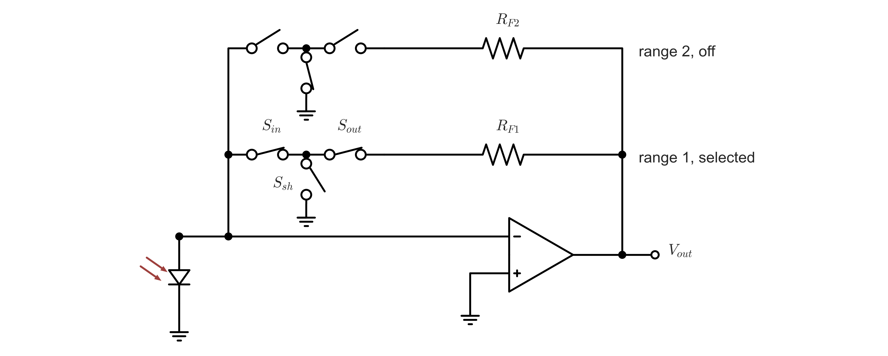

*Figure 13. Gain ranging with T-switches. Each range's feedback resistor connects to the summing node through an inner switch $S_{in}$ and an outer switch $S_{out}$, and a shunt switch $S_{sh}$ ties their junction to ground, the summing node's potential, while the range is off. Range 1 is selected: $S_{in}$ and $S_{out}$ are closed and $S_{sh}$ is open. In range 2 the outer switch carries the output voltage, but its leakage flows into the closed shunt, and the inner switch sees almost no voltage and so leaks almost nothing. Each switch's capacitance adds to $C_F$ when closed and to $C_T$ when open, and each change of range injects charge.*

The on-resistance of a switch in series with $R_F$ is negligible at the gains of this note. Keeping the switch out of the signal path altogether, by sensing the output at the selected resistor's output end, removes even that error.

### 7.2 Logarithmic amplifiers

**Principle.** Replacing $R_F$ by a bipolar transistor, with its collector at the summing node, its base at ground and its emitter driven by the output, gives a transdiode logarithmic amplifier (Figure 14). The collector current equals the photocurrent, so the output is

$$
V_{out} = -V_T\ln\frac{I_{ph}}{I_S} , \qquad V_T = \frac{k_BT}{q} ,
\tag{31}
$$

with $I_S$ the transistor's saturation current: 59.2 mV per decade at 25 °C, $V_T\ln10 = 25.69\ \mathrm{mV}\times2.303$. Equation (31) has two temperature dependences. The slope is proportional to the absolute temperature, +0.34%/°C at 25 °C. $I_S$ changes much faster, roughly doubling every few degrees. A second, matched transistor carrying a reference current $I_{ref}$ cancels $I_S$, giving a log-ratio amplifier,

$$
V_{out} = K\log_{10}\frac{I_1}{I_2} ,
\tag{32}
$$

and a gain stage with a temperature-dependent resistor compensates the slope. Integrated parts work this way. LOG112 has 7.5 decades from 100 pA to 3.5 mA, a scale factor of 0.5 V per decade and internal resistors that compensate the change of gain with temperature (LOG112 data sheet, p. 1) [D25]. Its log conformity error is 0.2% maximum over 1 nA–100 µA and 0.13% typical over 7.5 decades, and its gain changes by 0.01%/°C maximum (p. 3). LOG114 covers eight decades from 100 pA to 10 mA on a single 5-V supply, with 0.375 V per decade (LOG114 data sheet, p. 1) [D26]. Analog Devices' AD8304 covers the same 160 dB, 100 pA to 10 mA, from a single supply of 3.0–5.5 V (AD8304 data sheet Rev. A, p. 1) [D29]. ADL5303 has the same architecture and nearly the same specifications in a 16-lead package (ADL5303 data sheet Rev. D, pp. 1 and 3) [D30]. In both, the photocurrent flows in the collector of a scaled NPN transistor in the feedback path of a low-offset JFET amplifier, and the summing node is held at 0.5 V, with guard pins on either side of the input that follow it (AD8304, p. 1). The slope at the VLOG pin is laser-trimmed to 200 mV per decade, which is 10 mV per decibel of optical power, within 196–204 mV for AD8304 at 25 °C, and the intercept is trimmed to 100 pA (p. 2). The law conformance error is 0.1 dB typical and 0.7 dB maximum from 1 nA to 1 mA (p. 2). Both parts also bias the photodiode adaptively, with about 0.1 V at 100 pA rising linearly to 2 V at 10 mA. That keeps the dark current small at low light and the diode fast at high light (p. 1).

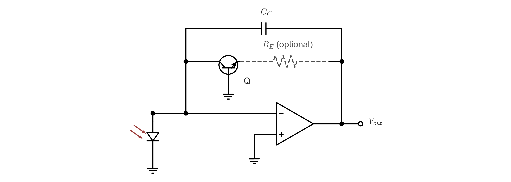

*Figure 14. The transdiode logarithmic amplifier. The transistor Q replaces $R_F$: its collector is at the summing node, its base at ground and its emitter is driven by the output, so its collector current equals the photocurrent and the output is $-V_T\ln(I_{ph}/I_S)$ (Eq. (31)). The compensation capacitor $C_C$ across it sets the bandwidth, $I/(2\pi V_TC_C)$ (Eq. (33)), and the optional emitter resistor $R_E$ limits the loop gain at the top of the range (Eq. (34)).*

**Bandwidth.** The small-signal resistance of the transistor is $r_e = V_T/I$, which falls from 257 MΩ at 100 pA to 25.7 Ω at 1 mA. With a compensation capacitor $C_C$ across it, the log amplifier is a TIA with $R_F = r_e$ and $C_F = C_C$, and its bandwidth is the feedback pole,

$$
f_{-3\,\mathrm{dB}} = \frac{1}{2\pi r_eC_C} = \frac{I}{2\pi V_TC_C} .
\tag{33}
$$

The bandwidth is proportional to the current. With $C_C$ = 10 pF it is 62 Hz at 100 pA, 620 Hz at 1 nA, 6.2 kHz at 10 nA and 62 kHz at 100 nA (Table A.7). The measured 3-dB response of LOG112 has the same slope and lies a factor of about 1.5–2 below Eq. (33). With 10 pF its curves pass about 30–40 Hz at 100 pA and 0.3–0.6 kHz at 1 nA, and they flatten at 30–500 kHz at high currents, where the amplifier takes over (p. 6, upper right; read by eye) [D25]. AD8304 and ADL5303 give about 2 kHz at 1 nA, rising in proportion to the current up to 10 MHz (AD8304, p. 1; ADL5303, p. 1) [D29], [D30]. Their LTspice models follow Eq. (33) from 100 pA to about 1 µA, with an effective $C_C$ of about 1.5 pF when 10 pF of photodiode capacitance sits at the input (Section 9.6). A log amplifier is thus fast at the top of its range and slow at the bottom, so a falling optical signal is followed much more slowly than a rising one.

**Stability.** The loop of a transdiode log amplifier runs from the output through the emitter, which a common-base transistor passes to the collector with a current gain near 1, into the node impedance $Z_n$ of the summing node and back to the op amp's input. Its loop gain is therefore

$$
T(s) = A(s)\,\frac{Z_n(s)}{r_e + R_E} ,
\tag{34}
$$

with $R_E$ an optional resistor in series with the emitter. At high currents $r_e$ is small, and with a capacitive node, $Z_n = 1/(sC_T)$, Eq. (34) has two integrators in the loop, the op amp's and the node's. Without compensation it would oscillate at the top of the range. $R_E$ limits the loop gain, and $C_C$ provides a feedback path that dominates at high frequency, as $C_F$ does in a TIA. The minimum $C_C$ therefore grows with the largest current, and Eq. (33) then sets the bandwidth at the smallest current. LOG112 states the trade explicitly. The smallest usable capacitor is set by the maximum of $I_2$ and the minimum of $I_1$, and "larger values of $C_C$ make the LOG112 and LOG2112 more stable, but reduce the frequency response" (p. 8) [D25]. Its curves of minimum $C_C$ run from below 2 pF to beyond 1 µF as the current ratio grows (p. 6, upper left). The datasheet also suggests switching $C_C$ according to the output level to get the highest overall bandwidth (p. 8). A wide dynamic range and a high bandwidth at the low end exclude each other, through Eqs. (33) and (34).

**Noise.** The transistor's collector current carries its own shot noise, $2qI$, which adds to the photocurrent's $2qI$. The input-referred noise of a log amplifier is therefore

$$
i_n^2 = 4qI , \qquad \frac{v_{n,out}}{V_T} = \sqrt{\frac{4q}{I}} ,
\tag{35}
$$

3 dB above the shot noise of the signal itself, plus the op amp's own terms. At 1 nA the relative noise is $\sqrt{4\times1.602\times10^{-19}/10^{-9}}$ = $2.53\times10^{-5}$ per √Hz, or 650 nV/√Hz at the core's 59.2-mV/decade output. In a 1-kHz band that is a relative error of $8.0\times10^{-4}$, which corresponds to $8.0\times10^{-4}/\ln10$ = 0.035% of a decade. At the low end the op amp's bias current sets the limit. LOG112 specifies ±5 pA, doubling every 10 °C, with 30 nV/√Hz and 4 fA/√Hz at 1 kHz (p. 3), so at 100 pA its bias current is already 5% of the signal at 25 °C. At the high end the transistor's bulk resistances distort the law: at 4.5 mA on ±5 V supplies, or 10 mA on ±12 V, the total output error of LOG112 "can be between 15% and 25%" (p. 9) [D25].

Real log amplifiers are much noisier than Eq. (35) at low currents. AD8304's output noise at 1 kHz, read by eye from its measured spectra, is about 40, 5.5 and 1.0 µV/√Hz at 1, 10 and 100 nA (AD8304, p. 5, TPC 9) [D29]. Equation (35), scaled to its 200 mV per decade, gives 2.2, 0.70 and 0.22 µV/√Hz. The vendor's LTspice model reproduces the measurement within about 10% (Section 9.6). The excess, 5–20 times at 1–100 nA, comes from the amplifier's own circuit rather than from the input current. Its mechanism was not identified (Appendix C, item 6). At 1 kHz and above about 1 µA the measured noise flattens near 0.15 µV/√Hz.

**When to use one.** A log amplifier is the right choice when the signal spans more than five decades, the measurement is ratiometric or logarithmic by nature (absorbance, optical power in dBm), and the bandwidth needed at the low end is modest. Equation (35) sets only the floor of the noise penalty, 3 dB against shot noise. Real log amplifiers lie well above it at low currents, so their data-sheet noise curves, not Eq. (35), belong in a noise budget. For bandwidth at low currents, or linear accuracy better than the conformity error, gain ranging (Section 7.1) or two TIAs of different gains in parallel are better.

### 7.3 Switched integrators and current-input ADCs

A switched integrator collects the photocurrent on a capacitor $C_{int}$ in the op amp's feedback path for a time $T$, reads the output, and then resets $C_{int}$ with a switch (Figure 15). It has no feedback resistor. Whether that matters depends on how large the resistor's noise is compared with the other noise of a measurement. The comparison is clearest when every noise is counted as a charge per measurement, because an integrator measures charge: the mean current over $T$ is the charge collected divided by $T$.

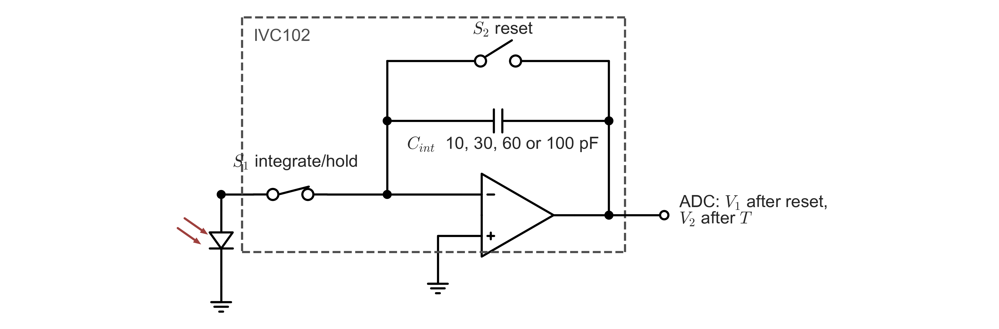

*Figure 15. A switched integrator in the arrangement of IVC102. The input switch $S_1$ connects the photodiode during the integration and disconnects it to hold. The photocurrent charges $C_{int}$, which IVC102 provides as 10, 30 and 60 pF on chip, alone or together up to 100 pF, and the reset switch $S_2$ discharges it before each measurement. The ADC samples the output once after the reset, $V_1$, and once after the integration time $T$, $V_2$. The charge is $C_{int}(V_2 - V_1)$, and the double sampling removes the reset noise and the charge that $S_2$ injects.*

**The feedback resistor's noise as a charge.** A resistor is a noise source that never stops. Its Johnson noise current, with the power density $4k_BT/R_F$, keeps adding charge for as long as the measurement lasts. Averaging white noise over a time $T$ passes a noise bandwidth of $1/(2T)$, so the noise charge that the resistor adds in one measurement has the variance

$$
Q_R^2 = \frac{4k_BT}{R_F}\cdot\frac{1}{2T}\cdot T^2 = \frac{2k_BT\,T}{R_F} .
\tag{35a}
$$

A TIA at its resistor-limited corner, $f_R = 1/(2\pi R_FC_{par})$ of Eq. (4), has the noise bandwidth of a single pole, $(\pi/2)f_R$. Setting this equal to $1/(2T)$ gives the equivalent measurement time $T = 1/(\pi f_R) = 2R_FC_{par}$, and Eq. (35a) becomes

$$
Q_R = 2\sqrt{k_BT\,C_{par}} ,
\tag{35b}
$$

independent of $R_F$ and of the bandwidth. At 25 °C this is 179, 253 and 358 electrons rms for 0.05, 0.1 and 0.2 pF. It equals the reset noise of a capacitor of $4C_{par}$, but it is spread over the whole measurement instead of being frozen at one instant, so no double sampling can remove it. Equation (35b) is the charge form of Eq. (36). The signal's own shot noise, $\sqrt{qIT}$ as a charge, equals $Q_R$ at $I = 4k_BT\,C_{par}/(qT)$. With $T = 1/(\pi f_R)$ that is $4\pi k_BT\,f_RC_{par}/q$, the $I_{\min,\mathrm{shot}}$ of Eq. (36) for the bandwidth $f_R$: 51 pA for 1 GΩ and 0.1 pF.

**The integrator's own noise.** An integrator is read by correlated double sampling. One sample of the output, $V_1$, is taken just after the reset switch opens, a second, $V_2$, after the time $T$, and the charge is $Q = C_{int}(V_2 - V_1)$. Five sources of noise remain.

- *Shot noise of the signal and the dark current.* The number of electrons collected in $T$, $IT/q$, follows Poisson statistics, so its standard deviation is its square root, and the noise charge is $\sqrt{qIT}$. This is the true limit, and the integrator can reach it.
- *The photodiode's own thermal noise.* At zero bias the diode's shunt resistance adds $2k_BT\,T/R_{sh}$ to the variance, which is Eq. (35a) with $R_{sh}$ in place of $R_F$. The integrator cannot remove it, because it belongs to the detector.
- *Reset noise.* By equipartition, $\tfrac12C_{int}\langle V^2\rangle = \tfrac12k_BT$, so the opening switch freezes on the capacitor a random charge with the standard deviation $\sqrt{k_BT\,C_{int}}$: 400 electrons for 1 pF. Double sampling removes it exactly. The first sample is $V_1 = V_{ref} + v_{kTC} + v_{inj}$, where $v_{inj}$ is the step caused by the charge that the switch injects (below). The second is $V_2 = V_1 + Q_{sig}/C_{int}$, plus the noise added during $T$. Their difference contains neither $v_{kTC}$ nor $v_{inj}$.
- *The amplifier's voltage noise on the node capacitance.* Referred to the input, $e_n$ acts as a charge $e_nC_T$, where $C_T$ is all the capacitance at the summing node, $C_{int}$ included. If each sample is read through a filter with the time constant $\tau$, whose noise bandwidth is $1/(4\tau)$, two independent samples give the variance of Eq. (35c) below.
- *Flicker noise and leakage.* Double sampling acts as a high-pass filter on the amplifier's $1/f$ noise, whose contribution therefore grows only slowly with $T$. The leakage of the open switch and the op amp's bias current are integrated with the signal, as an offset together with its shot noise, and both roughly double every 10 °C.

$$
\sigma_Q^2 = 2\,e_n^2C_T^2\cdot\frac{1}{4\tau} = \frac{e_n^2C_T^2}{2\tau}
\tag{35c}
$$

Equation (35c) is the term $e_n\,\omega C_T$ of a TIA in another form. In both circuits the amplifier's voltage noise enters as $e_nC_T$ times the square root of the readout bandwidth, and an integrator does not escape it. An integrator therefore removes exactly one term, the feedback resistor's.

**When the integrator wins.** Table 7.1 compares a 1-GΩ TIA with 0.1 pF, whose corner is 1.59 kHz, with an integrator that measures over the equivalent $T$ = 0.2 ms.

*Table 7.1. Noise charge per measurement, in electrons rms, of a 1-GΩ TIA with 0.1 pF and of a switched integrator, for $T$ = 0.2 ms at 25 °C and an amplifier with 3 nV/√Hz. The node capacitance is 32 pF for the 20-pF photodiode (20 pF, 11 pF of amplifier input and 1 pF of board) and 400 pF for the 380-pF photodiode. The amplifier's series noise, Eq. (35c) with $\tau = T/2$, is counted in both circuits. `integrator_vs_tia.py`.*

| Photodiode | Resistor, Eq. (35b) | Photodiode's own noise | Amplifier, Eq. (35c) | TIA, total | Integrator, total | Integrator better by |
|---|---|---|---|---|---|---|
| 20 pF, zero bias, 2 GΩ shunt resistance | 253 | 179 | 42 | 313 | 184 | 4.6 dB |
| 20 pF, reverse-biased, 1 pA of dark current | 253 | 35 | 42 | 259 | 55 | 13.4 dB |
| 380 pF, zero bias, 0.4 GΩ shunt resistance | 253 | 400 | 530 | 711 | 664 | 0.6 dB |

The integrator thus wins when four conditions hold.

1. The signal current lies below $I_{\min,\mathrm{shot}}$ of Eq. (36), where the resistor's noise exceeds the signal's own shot noise.
2. The photodiode's own parallel noise lies below the resistor's: a shunt resistance above $R_F$ at zero bias, or, under reverse bias, a dark current below $2k_BT/(qR_F)$, which is 51 pA for 1 GΩ. Cooling helps in both cases.
3. The node capacitance is small enough that Eq. (35c) stays below Eq. (35b). With $\tau = T/10$ = 20 µs, 3 nV/√Hz and 0.1 pF, this requires $C_T < 2\sqrt{2\tau\,k_BT\,C_{par}}/e_n$ = 86 pF.
4. A sampled output is acceptable.

On photodiodes of hundreds of picofarads both circuits are limited by $e_nC_T$, and only a quieter input device or less capacitance helps (Sections 5.8 and 6.7). An integrator also decouples the dynamic range from the noise. A TIA's $R_F$ is limited by the largest current, $R_F \leq V_{sw}/I_{\max}$ (Eq. (3)), and with it the resistor's noise floor. An integrator's full scale, a charge of $C_{int}V_{sw}$ per measurement, carries no resistor noise, and its range in current can be moved by choosing $T$. TI's comparison of the two architectures for a 100-pF photodiode with 100 nA of full-scale current shows the combined effect (SBOA034, p. 6, Table II) [A1]:

- **Optimized for noise**, a TIA with OPA124 (0.5 pF of feedback capacitance) reaches 3.2 kHz of signal bandwidth with 200 µV rms of noise and 94 dB of signal-to-noise ratio. A switched integrator with ACF2101 (100 pF) reaches 50 Hz with 35 µV rms and 109 dB.
- **Optimized for bandwidth**, a TIA with OPA627 reaches 3.2 kHz with 400 µV rms and 88 dB, and the integrator (1.5 pF) 3.35 kHz with 100 µV rms and 100 dB.

At the same bandwidth the integrator wins by 12 dB in that example. Without double sampling, the reset noise stays in the measurement, and an integrator beats a resistor-limited TIA only if $\sqrt{k_BT\,C_{int}} < 2\sqrt{k_BT\,C_{par}}$, that is, if $C_{int} < 4C_{par}$. For 0.1 pF that means less than 0.4 pF, which leaves little full-scale charge.

**Why image sensors read about one electron.** Image sensors show what an integrator can do when the capacitance is small. A floating diffusion of about 1 fF converts one electron into $q/C$ = 160 µV, and its reset noise, $\sqrt{k_BT\times1\ \mathrm{fF}}$ = 12.7 electrons, is removed by double sampling. The series noise of Eq. (35c) scales with $C_T$, so going from the 32 pF of a discrete photodiode's node to 1 fF divides it by 32,000. Even the small in-pixel transistor, which is far noisier than a precision op amp, then reaches about one electron. The pinned photodiode is what makes this possible. It transfers its whole charge to the floating diffusion, so the collecting area does not load the sense node. A discrete photodiode at an integrator's input has no such transfer: its tens of picofarads to nanofarads sit at the summing node, which is why condition 3 above decides the case for board designs.

**Charge injection by the reset switch.** A MOS switch that turns off releases its channel charge, $Q_{ch} = C_{ox}WL(V_{GS} - V_T)$, where $C_{ox}$ is the gate capacitance per unit area, $W$ and $L$ the channel width and length, and $V_{GS} - V_T$ the gate overdrive. Part of this charge, together with the charge that the falling gate couples through its overlap capacitance, lands on the summing node and from there on $C_{int}$. For an on-chip switch with a 7-nm oxide, $C_{ox} = \varepsilon_{ox}/t_{ox}$ = 3.9 × 8.854 pF/m ÷ 7 nm = 4.93 fF/µm². With $W/L$ = 1 µm/0.18 µm and 1.5 V of overdrive, $Q_{ch}$ = 4.93 fF/µm² × 0.18 µm² × 1.5 V = 1.33 fC, or 8,300 electrons. About half of it gives a step of 67 mV on 10 fF and of 0.67 V on 1 fF. For IVC102 the data sheet's offset, at most ±20 mV on 100 pF after 1 ms of zero input current, includes the switch's charge injection (p. 2, note 2), so the injected charge is at most 2 pC. The same 2 pC gives 0.02 V on 100 pF, 0.2 V on 10 pF, 2 V on 1 pF and 20 V on 0.1 pF.

For accuracy, charge injection is mostly harmless. The reset switch always opens at the same node voltages, the reference level, so the injected charge does not depend on the signal, and its random part is the thermal noise frozen at turn-off, the reset noise above. Both appear in $V_1$ and cancel in $V_2 - V_1$. Charge injection therefore costs headroom rather than accuracy, and it limits how small $C_{int}$, and so how high the gain, can be: on 1 pF, the 2 pC of IVC102's specification already takes a tenth of a ±10-V swing. Five reset effects remain after double sampling.

- *Signal-dependent injection.* Switches that open at a signal-dependent voltage, such as sampling switches, inject a signal-dependent charge; a reset switch does not.
- *Dielectric absorption of $C_{int}$.* After a reset the capacitor gives back part of its previous voltage, an error proportional to the previous measurement's signal (Section 8.3). C0G, PTFE or polystyrene capacitors keep it small.
- *Leakage of the open switch.* It adds charge, its shot noise and its temperature drift during the integration.
- *Timing.* The first sample must wait until the op amp has recovered from the injection step, and no clock edge may fall within the integration.
- *Dead time.* The reset interrupts the measurement unless two integrators alternate, as in DDC264.

Four measures reduce the injection itself. A dummy switch of half the size, driven by the opposite clock, forms its channel as the main switch's channel collapses, and so takes up the charge that the main switch releases on its side. Complementary NMOS and PMOS switches in parallel release charges of opposite sign. A slow gate edge lets the released charge flow back through the still-conducting channel to the low-impedance side, the op amp's output. Charge balancing avoids the reset altogether: a comparator triggers fixed charge packets from a reference capacitor whenever the integrator reaches a threshold, and the packets are counted. Each packet's injection is the same, so it becomes a gain error rather than an offset.

**Resetting with light.** Charge-sensitive preamplifiers for cooled semiconductor radiation detectors have long avoided both the feedback resistor and the reset switch. An opto-electronic feedback preamplifier for high-resolution nuclear spectroscopy was published in 1969 by Goulding, Walton and Malone [[A9]](https://doi.org/10.1016/0029-554X%2869%2990314-0), which was read here only by its title. Two later reports from the same laboratory describe the method and its limits [[A10]](https://doi.org/10.1109/TNS.1979.4329670), [[A11]](https://doi.org/10.1109/TNS.1982.4335922).

- *How it works.* The input JFET integrates the detector's charge on a feedback capacitor of about 0.5 pF, and the output rises in steps. When the output exceeds an upper threshold, an LED optically coupled to the FET is switched on (Figure 16). Its light raises the current through the FET's drain–gate junction to about 0.1–1 µA, many orders of magnitude above the detector's leakage, and that current drives the output back. At a lower threshold the LED is switched off again. The reset takes 1–10 µs. The detector, the feedback capacitor, the LED and the FET sit together in the cryostat, cooled nearly to the temperature of liquid nitrogen (Landis, Madden and Goulding, LBL-8135, p. 3) [A10].
- *Why it was used.* Between resets the reset path is the FET's own drain–gate junction, which is already part of the input. Nothing is added at the gate, neither a resistor nor a switch, so the input capacitance is the smallest possible (Landis, Cork, Madden and Goulding, LBL-13214, p. 1) [A11], and the charge-restoration path adds no noise at low frequency (LBL-8135, p. 5). Only the series noise of Eq. (35c) and the shot noise of the leakage remain. The measured squared resolution followed $1/\tau$ with the shaping time $\tau$, which is the signature of pure series noise, and reached 500 eV at very low energies with a 13-pF germanium detector and a 0.5-pF feedback capacitor (LBL-8135, p. 5). With 2.96 eV per electron–hole pair in germanium at 77 K, 500 eV of full width at half maximum is $500/(2.355\times2.96)$ ≈ 72 electrons rms.
- *What it costs.* The reports list five limits. Only one detector polarity can be used, because the reset current flows in one direction through the junction. After-effects of the light pulse can last hundreds of microseconds, so the dead time after a reset is much longer than the reset itself. They come from charge stored in parts of the FET, from light that some LEDs still emit after they are switched off, and from light reaching the detector's surface, to which germanium is particularly sensitive at the LED's long wavelengths. The LED's output, its coupling to the FET and the FET's sensitivity to light are poorly controlled, so the reset speed varies from unit to unit. LED drive currents of up to 100 mA cause crosstalk between the channels of a multi-detector system (LBL-13214, p. 1; LBL-8135, p. 4). Finally, a pulse that triggers a reset is lost, which makes the losses depend on the pulse size: with a 2-V reset range and 0.2-V pulses, every tenth pulse is lost. Delaying the reset until the triggering event has been processed removes this loss; a prompt reset lost 25% of the counts in a 5.1-MeV peak, a delayed one none (LBL-8135, pp. 3, 6–7).
- *What replaced it.* In a pulsed transistor reset, a low-leakage transistor with a small collector–base capacitance injects a reset current of about 50 µA into the input. It adds less than 0.4 pF, works with either detector polarity, needs only small switching currents and shows no slow after-effects (LBL-13214, pp. 1–2).

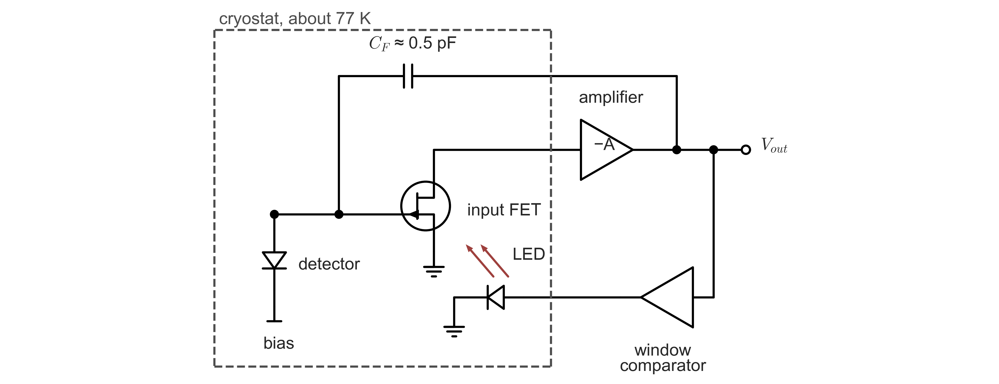

*Figure 16. Optical reset of a charge-sensitive preamplifier for a cooled semiconductor detector (LBL-8135, LBL-13214). The detector's charge is integrated on a feedback capacitor of about 0.5 pF around the input FET and the rest of the inverting amplifier. When the output crosses the upper threshold of the window comparator, the LED is switched on; its light raises the current of the FET's drain–gate junction to 0.1–1 µA, which discharges $C_F$ in 1–10 µs, until the lower threshold switches the LED off. Nothing is added at the gate between resets. Detector, FET, $C_F$ and LED sit together in the cryostat.*

For a photodiode integrator on a board, the lesson is the same as for the reset switch. What matters is what the reset element adds to the summing node between resets: its capacitance, its leakage and their noise. A photodiode front end could be reset optically in the same way, with a small auxiliary photodiode connected so that its photocurrent opposes the signal's and lit by an LED during the reset; its capacitance and dark current then join the summing node, and the after-effects and dead time come with it. With a photodiode of tens of picofarads or more, the few tenths of a picofarad that a low-leakage switch adds are negligible, and double sampling handles its injection, so a switch remains the practical choice.

**Parts.** A complete single-channel switched integrator is IVC102. It combines a FET-input op amp, three on-chip integrating capacitors of 10, 30 and 60 pF, and low-leakage FET switches for integration, hold and reset. Its data sheet presents it as a precision, lower-noise alternative to transimpedance circuits that need a very high feedback resistance (IVC102 data sheet, p. 1) [D31]. Its output is $V_O = -I_{IN}T_{INT}/C_{INT}$, so the gain is set by the integration time rather than by a resistor. With all three capacitors, 100 pF, and an integration time of 1 ms, a current of 1 pA gives $10^{-12}\ \mathrm{A}\times10^{-3}\ \mathrm{s}/10^{-10}\ \mathrm{F}$ = 10 µV at the output, and 100 nA gives 1 V. Its input bias current is 100 fA typical and 750 fA maximum, its nonlinearity is 0.005% typical, and its op amp has 10 nV/√Hz at 1 kHz and 2 MHz of gain–bandwidth (p. 2). The capacitors are specified only within 80–120 pF, which matches the gain error of +25%/−17% maximum (p. 2), so the gain must be calibrated. A reset settles to 0.01% in 6 µs (p. 2).

Integrators suit low-bandwidth, many-channel and pulsed measurements, and they are built into current-input ADCs. DDC264, for example, integrates 64 channels with a dual switched integrator per channel, 20-bit conversion, a noise of 6.3 ppm of full scale, and integration times from 160 µs to 1 s, "allowing currents from fAs to µAs to be continuously measured" (DDC264 data sheet, p. 1) [D27]. Their output is sampled, with the aliasing that implies.

**For a board design.** An integrator such as IVC102, or a current-input ADC such as DDC264, is worth its sampled output when the currents lie below a few tens of picoamperes, the photodiode is small or reverse-biased with little dark current, the measurement is sampled or frame-based anyway, and a wide dynamic range is wanted at low noise. A TIA remains the better choice for a continuous analog output, at currents above $I_{\min,\mathrm{shot}}$, and on large photodiodes, where $e_nC_T$ limits both circuits.

### 7.4 When to change the detector

The TIA reaches the shot-noise limit when the photocurrent exceeds $I_x$ of Eq. (2). Its largest usable feedback resistance is in turn limited by the bandwidth $B$ through the resistor's own pole, $R_F \leq 1/(2\pi BC_{par})$. Together these give the smallest photocurrent that a TIA can measure at the shot-noise limit in a bandwidth $B$, without equalization:

$$
I_{\min,\mathrm{shot}} = \frac{2k_BT}{q}\cdot2\pi BC_{par} = \frac{4\pi k_BT\,BC_{par}}{q} .
\tag{36}
$$

With $C_{par}$ = 0.1 pF this is 32 pA in 1 kHz, 32 nA in 1 MHz and 32 fA in 1 Hz, where it needs $R_F$ = 1.6 TΩ. Equalization over a factor $k$ (Section 3.5) lowers it by up to $k$, as long as the band stays below $f_e$. Below $I_{\min,\mathrm{shot}}$ the resistor's noise dominates, and the signal-to-noise ratio falls in proportion to the photocurrent instead of its square root. There a switched integrator helps if the measurement can be sampled (Section 7.3), and so does a detector with internal gain: an avalanche photodiode, a photomultiplier or a photon counter. With gain $M$ and excess noise factor $F$, the noise referred to the primary photocurrent is

$$
S_{i,\mathrm{prim}} = 2qI_{ph}F + \frac{S_{\mathrm{amp}}}{M^2} ,
\tag{37}
$$

so the gain divides the amplifier's and the resistor's noise by $M^2$ at the price of the factor $F$ on the shot noise. Internal gain pays when $S_{\mathrm{amp}}/M^2$ would otherwise exceed $2qI_{ph}F$, that is, below about $I_{\min,\mathrm{shot}}$ of Eq. (36). Hobbs makes the opposite point for currents above it. A well-designed front end often makes an expensive avalanche photodiode or photomultiplier unnecessary. In his case it was a bootstrapped cascode with a 2-MHz bandwidth, whose measured noise stayed within 0.5–1 dB of the shot noise up to 1 MHz (Hobbs, OPN April 2001, p. 45) [[A4]](https://doi.org/10.1364/OPN.12.4.000044).

---

## 8. DC errors, leakage and guarding

At 100 MΩ and above, Chapter 6 found that the amplifiers differ more in DC accuracy than in noise. This chapter collects the DC errors and the board-level effects that are as large as the amplifier's own errors at those gains.

### 8.1 The DC error budget

The output error of the TIA in the dark has three sources: the offset voltage, multiplied by the low-frequency noise gain; the bias current; and any leakage current into the summing node, both multiplied by $R_F$:

$$
V_{err} = V_{OS}\left(1 + \frac{R_F}{R_{sh}}\right) + \bigl(I_B + I_{leak}\bigr)R_F .
\tag{38}
$$

Analog Devices gives the same terms for a photodiode TIA (ADA4530-1 data sheet, p. 44, Eqs. 17–20) [D1]. Table A.3 evaluates Eq. (38) without leakage, with the maximum $V_{OS}$ and the maximum $I_B$ at 25 °C and 85 °C, for every design. On the small, high-shunt-resistance photodiode the offset dominates up to about 10 MΩ and the bias current above, as Section 6.4 described. On the 14-kΩ photodiode the offset term dominates at every gain, because $R_F/R_{sh}$ reaches 71 at 1 MΩ.

A resistor in series with the non-inverting input, equal to $R_F\parallel R_{sh}$, cancels the bias-current error when the two input currents match, as in bipolar parts. TI's OPA128 photodiode circuit uses 400 MΩ there, bypassed by 1000 pF so that its Johnson noise does not reach the amplifier (SBOA061, p. 2, Fig. 3) [A2]. For FET-input parts the two bias currents do not match. The OPA656 data sheet therefore recommends no resistor at the non-inverting input, because the bias currents "do not match but are so low to begin with (< 20 pA) that dc errors due to input bias currents are negligible" (OPA656 data sheet, p. 14) [D16]. Unbypassed, any resistance $R$ there adds $\sqrt{4k_BTR}$ to $e_n$, which the node capacitance then turns into current noise (the companion's Section 4.10).

### 8.2 Leakage and guarding

A leakage resistance $R_{ins}$ from a conductor at potential $\Delta V$ to the summing node injects $\Delta V/R_{ins}$, which Eq. (38) multiplies by $R_F$. Analog Devices writes that it is "very difficult to maintain high insulation resistance values in glass epoxy (such as FR-4) PCB materials", and that "resistance values of 10 TΩ to 100 TΩ are achievable" (ADA4530-1 data sheet, p. 34) [D1]. With 10 V across 10 TΩ, that is 1 pA, or 1 mV at the output of a 1-GΩ TIA. That is comparable with the bias current of a precision JFET part at 25 °C and fifty times the 20-fA limit of an electrometer. The cure is a guard: a conductor that surrounds the summing node and is held at the summing node's own potential. The insulation between guard and node then sees only the offset voltage, microvolts, and its leakage becomes negligible, while the leakage from other conductors flows into the guard instead of the node. For the inverting TIA with its non-inverting input grounded, the summing node is at ground potential, so the guard is a ground ring around it. For a single-supply TIA with the non-inverting input at a mid-supply voltage, the guard must be driven at that voltage. The integrated guard buffers of ADA4530-1 and OPA928 do exactly this, within 100 µV and 50 µV maximum (Section 5.1). Hamamatsu likewise recommends guard rings and PTFE terminals for photodiode amplifiers at high gain (KSPD9001E04, p. 10) [P5].

### 8.3 Dielectric relaxation

Every insulator polarizes with a delay after the voltage across it changes, and the polarization current that follows can last for minutes. Analog Devices measured it on two board laminates with a large alternating test voltage. FR-4 "requires 1 hour to dissipate the dielectric relaxation current to less than 10 fA", while Rogers 4350B, a ceramic-filled laminate, "requires less than 20 sec to dissipate the dielectric relaxation current to less than 1 fA" (ADA4530-1 data sheet, p. 35) [D1]. For a high-gain TIA this matters whenever a voltage near the summing node changes: when the photodiode's bias is switched, after a range change (Section 7.1), or after the output has saturated. A feedback or integration capacitor, if one is added, should likewise have a low-absorption dielectric.

### 8.4 Humidity, contamination and the layout of the summing node

The insulation resistance of the board depends on moisture. Analog Devices writes that at lower temperatures, below about 70 °C, "the insulation resistance creates more significant leakage current errors than the amplifier itself", so that "the relative humidity of the air is the most important error source at lower temperatures" (ADA4530-1 data sheet, p. 35) [D1]. Its bias-current limits are therefore specified at a relative humidity below 50% (p. 3). Flux residues and handling contamination have the same effect, and the same data sheet devotes sections to cleaning and handling, solder paste, guard rings, guard planes and via fences, cables and connectors (pp. 37–43). These were not read in detail for this note (Appendix C, item 7).

Section 3.4 adds three layout rules for the feedback resistor and the summing node.

- **No grounded plane under the feedback resistor.** A grounded plane makes the response peak (Table 3). Either cut the plane away, or replace it under the resistor by copper driven at one third of the output, or by strips at graded potentials, from a resistive divider between the output and ground (Section 3.4, Figure 6, Table 9.4). Copper tied to the output also stops the peaking, but it divides the bandwidth by three to four. Copper around the resistor should never be tied to the summing node itself, which slows the response as much as tying it to the output and adds to the node's capacitance and leakage. The strip nearest the summing node must be separated from it by the summing node's own guard ring.
- **A short summing node.** Keep it with the photodiode close by, because every picofarad there adds to $C_T$ and thus to the $e_n\,\omega C$ noise. A photodiode at the end of a cable adds the cable's capacitance in full, together with the noise that the cable's movement generates.
- **The guard ring of Section 8.2** around the summing node and the non-inverting input, on both sides of the board where possible.
- **A shielded enclosure for the whole front end.** The photodiode, the summing node, the feedback network and the amplifier belong together in a closed, grounded metal enclosure, with any cable to the photodiode shielded as well. At 1 GΩ, 1 fF of stray capacitance to a 1-V, 50-Hz source already gives 0.31 mV at the output (Section 3.4). Copper around the feedback resistor does not replace this enclosure; it only sets the resistor's surroundings inside it.

### 8.5 Temperature

Section 2.7 showed that the bias current of a FET input doubles every 10 °C (Eq. (15)) and that the photodiode's shunt resistance halves every 5–10 °C, while the resistor's noise rises only as $\sqrt{T}$. Both effects enter Eq. (38): the bias-current term grows by 64 from 25 °C to 85 °C, and the offset term by the growth of $R_F/R_{sh}$. For the S1336-18BK at 1 GΩ, $R_F/R_{sh}$ rises from 0.5 at 25 °C to about 2200 at 85 °C, using the dark-current coefficient as in Section 2.7, so that 25 µV of offset becomes a 55-mV error. Weak-light measurements at high gain therefore need the photodiode, and preferably the whole summing node, at a controlled temperature, and a cooled photodiode where the shunt resistance limits the floor (Section 6.7).

---

## 9. Checking the model against SPICE and against its own approximations

Chapters 2–8 rest on an analytic model: the exact relations of Section 2.1 evaluated with datasheet values, a single-pole amplifier, and, for the feedback resistor, the distributed line of Section 3.4. This chapter tests that model in two ways. The first replaces the single-pole amplifier and the datasheet noise with the manufacturers' own SPICE macromodels, in the same circuits and at the same feedback capacitances. The second compares the approximate formulas of Chapter 3, which the text uses to explain the results, with the full model they approximate. The checks found one effect that the original analytic model left out, the amplifier's finite DC open-loop gain, and that effect is now in the model and in Section 3.1.

### 9.1 How the checks were run

Two simulators were used.

- **ngspice-46**, loaded as the shared library that KiCad 10 installs and driven from Python (`scripts_archive/ngspice_shared.py`, from the companion note), ran the Texas Instruments PSpice models and the Analog Devices model of ADA4817-1. These are OPA928 (SBOMCC0, Rev. A), OPA140 (SBOM493, Rev. D), OPA828 (SBOMAJ0, Rev. D), OPA320 (SBOM437, Rev. G, file `OPAx320-Q1.LIB`), OPA1656 (SBOMAW6, Rev. C), OPA2156 (SBOMAR0, Rev. B), OPA818 (SBOMB74B), OPA657 (SBOM137, Rev. F) and ADA4817-1 (Rev. 2.1). The TI models' "noiseless" resistors, which ngspice would otherwise make noisy at about 27 K, were translated to noiseless ngspice resistors, as in the companion note (its Appendix B.1).
- **LTspice**, run headless on netlists written by `scripts_archive/hg_ltspice.py` (`LTspice.exe -b -ascii`, with its ASCII output parsed in Python), ran the Analog Devices models that ship with LTspice. These are ADA4530-1 (`ADI1.lib`), ADA4625-1 (`ADA4625-1.sub`, encrypted), LTC6268-10 (`LTC2.lib`) and the logarithmic amplifiers AD8304 (`AD8304.lib`) and ADL5303 (`ADL5303.sub`, encrypted). The encrypted models can only be run in LTspice.

Each TIA deck holds the macromodel, $R_F$ and the $C_F$ of the analytic design, the photodiode as $C_D$ and a (noisy) $R_{sh}$, 1 pF of board capacitance, and a 10-kΩ load, all at 25 °C. An AC analysis gives the transimpedance. A noise analysis referred to the photocurrent source gives the input-referred noise density directly in A/√Hz, the quantity of Eq. (8). From these the same metrics as in Chapter 6 follow: the −3 dB bandwidth, the peaking, and the excess noise $\Delta N$ of Eq. (16) over [1 Hz, $f_{-3\,\mathrm{dB}}$]. In all, 120 TIA designs, 36 noise-characterization decks, open-loop decks for OPA1656 and OPA2156, 12 distributed-resistor cases, 6 composite front ends and 18 logarithmic-amplifier operating points were run, which takes a few minutes. The scripts are `hg_spice.py` and `hg_ltspice.py`, and the summaries are in `spice/results/`.

### 9.2 The TIA designs

The most direct check builds the designs of the sweep in SPICE, with each vendor's macromodel in place of the single-pole amplifier and the datasheet noise, and compares their bandwidth and excess noise with the analytic model. Twelve amplifiers were run at the five gains on the 20-pF and 380-pF silicon photodiodes. Figure 17 compares the bandwidth and the excess noise of all 120 designs with the analytic model, and Table 9.1 summarizes the deviations for each amplifier.

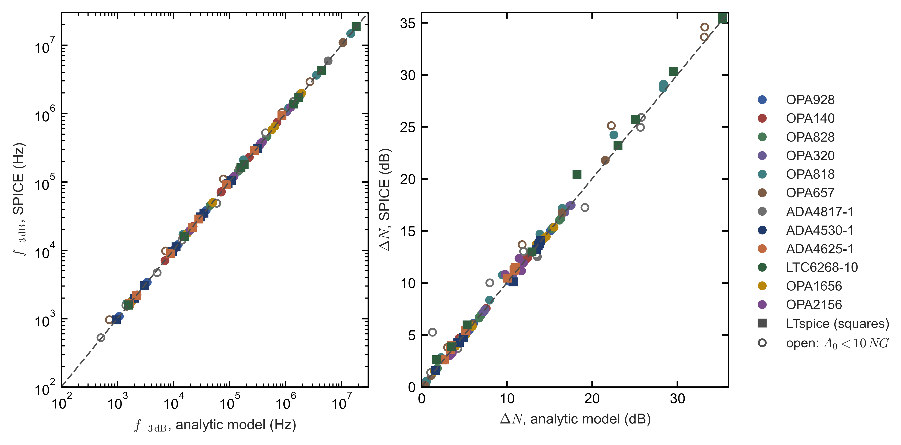

*Figure 17. The TIA designs of the sweep in SPICE against the analytic model: −3 dB bandwidth (left) and excess noise $\Delta N$ of Eq. (16) (right). Circles: ngspice; squares: LTspice; open symbols: designs whose DC open-loop gain is less than ten times the mid-band noise gain (Section 3.1). The dashed lines are 1:1.*

*Table 9.1. SPICE against the analytic model for each amplifier: the median and the largest deviation of the bandwidth (SPICE over model, minus 1) and of $\Delta N$ (SPICE minus model) over that amplifier's designs, excluding the designs whose DC open-loop gain is less than ten times the mid-band noise gain (last column), which Table 9.2 treats. `hg_spice_tables.py`.*

| Amplifier | Engine | Designs | $f_{-3\,\mathrm{dB}}$: median / largest deviation | $\Delta N$: median / largest difference | Designs with $A_0 < 10\,NG$ |
|---|---|---|---|---|---|
| OPA928 | ngspice | 10 | 0.1% / +2.0% | 0.06 / -0.11 dB | 0 |
| ADA4530-1 | LTspice | 10 | 0.7% / -4.2% | 0.10 / -0.67 dB | 0 |
| OPA140 | ngspice | 10 | 0.3% / +5.6% | 0.02 / +0.29 dB | 0 |
| OPA828 | ngspice | 10 | 0.1% / +1.1% | 0.09 / -0.13 dB | 0 |
| ADA4625-1 | LTspice | 10 | 1.2% / +7.1% | 0.30 / +0.50 dB | 0 |
| OPA320 | ngspice | 10 | 0.5% / +1.1% | 0.03 / -0.05 dB | 0 |
| OPA1656 | ngspice | 10 | 0.5% / +2.5% | 0.11 / +0.25 dB | 0 |
| OPA2156 | ngspice | 10 | 0.1% / -0.7% | 0.33 / +1.06 dB | 0 |
| OPA818 | ngspice | 10 | 1.6% / +19.2% | 0.61 / +1.69 dB | 0 |
| OPA657 | ngspice | 10 | 3.8% / +4.4% | 0.25 / +0.27 dB | 5 |
| ADA4817-1 | ngspice | 10 | 2.5% / +2.5% | 1.03 / -1.03 dB | 9 |
| LTC6268-10 | LTspice | 10 | 0.8% / -2.1% | 0.52 / +2.17 dB | 0 |

For the eight precision and low-noise CMOS parts, SPICE confirms the model's bandwidth in every design, within 7.1%, with medians of 0.1–1.2%. Their excess noise agrees within 0.67 dB, with medians of 0.02–0.33 dB, except for OPA2156 on the 380-pF photodiode at 100 MΩ and 1 GΩ. There SPICE gives 1.0 dB more, because OPA2156's macromodel has 6.5 nV/√Hz at 1 kHz against the data sheet's 4.0 nV/√Hz (Table 9.3). The conclusions of Sections 6.1–6.5 for these parts therefore stand as computed. For the wideband parts the agreement is looser but still sufficient for the ranking. OPA818's bandwidth is up to 19% higher in SPICE. Its excess noise is up to 1.7 dB higher, because its model's noise at megahertz frequencies exceeds the datasheet values the model uses. LTC6268-10's excess noise is up to 2.2 dB higher, at 1 GΩ on the large photodiode, because its macromodel has more flicker noise (37 nV/√Hz at 1 kHz) than the estimate of Appendix B.1 (28 nV/√Hz). Figure 18 shows four of the designs in full: the input-referred noise spectra and the normalized transimpedance, SPICE against model.

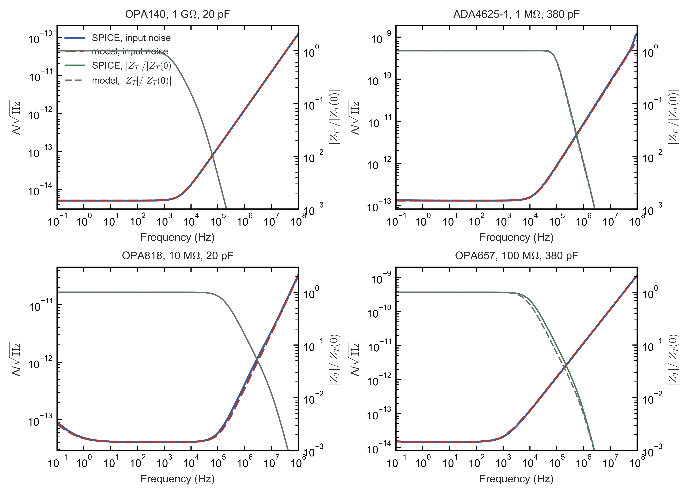

*Figure 18. Input-referred noise density (left axes) and normalized transimpedance (right axes) of four designs, SPICE (solid) against the analytic model (dashed): OPA140 at 1 GΩ on the 20-pF photodiode, ADA4625-1 at 1 MΩ on 380 pF (in LTspice), OPA818 at 10 MΩ on 20 pF and OPA657 at 100 MΩ on 380 pF. The fourth, OPA657, fails the open-loop-gain rule of Section 3.1: its transimpedance falls well before the resistor's own pole.*

**The finite open-loop gain.** The first run of these checks, made while the analytic model still used a DC open-loop gain of 120 dB for every amplifier, found that OPA657 and ADA4817-1 lost most of their bandwidth on the 380-pF photodiode at high gain. At 1 GΩ, for example, OPA657 reached 963 Hz in SPICE against the resistor's 1.59 kHz. The reason is the mid-band noise gain, $(C_T + C_F)/C_F$. Above the noise gain's zero, the loop gain is the open-loop gain divided by this noise gain. On 380 pF with $C_F$ = 0.1 pF the noise gain is about 3,900, while these two wideband amplifiers have DC open-loop gains of only 70 dB (OPA657, 3,160) and 65 dB (ADA4817-1, 1,780) (Table A.1). The loop gain is then below unity, the loop cannot hold the summing node at virtual ground, and the transimpedance falls early. The analytic model now uses each amplifier's datasheet open-loop gain (Table A.1), and Table 9.2 compares the affected designs. The model follows SPICE within 10–35%, pessimistic for OPA657 because its datasheet's 70 dB is lower than its macromodel's. The rule for design is Eq. (19a) of Section 3.1: the DC open-loop gain should exceed the mid-band noise gain at least tenfold. Tables 6.1–6.5 exclude the 63 designs of the sweep that fail it, which are marked "A" in Table A.3. All are wideband parts with 65–92 dB of open-loop gain on photodiodes of 55 pF or more, or on the 20-pF diode for ADA4817-1.

*Table 9.2. The designs on the 380-pF photodiode whose DC open-loop gain is less than ten times the mid-band noise gain: the datasheet open-loop gain, the noise gain $(C_T + C_F)/C_F$, the bandwidth in SPICE and in the analytic model with the datasheet open-loop gain, and the resistor's own pole for comparison.*

| Design | $A_0$ (datasheet) | Mid-band $NG$ | $f_{-3\,\mathrm{dB}}$, SPICE / model | Resistor pole $1/(2\pi R_FC_F)$ |
|---|---|---|---|---|
| OPA657, 100 kΩ, 380 pF | 70 dB | 557 | 2.93 MHz / 2.73 MHz | 2.29 MHz |
| OPA657, 1 MΩ, 380 pF | 70 dB | 2854 | 1.04 MHz / 868 kHz | 1.18 MHz |
| OPA657, 10 MΩ, 380 pF | 70 dB | 3863 | 111 kHz / 77.6 kHz | 159 kHz |
| OPA657, 100 MΩ, 380 pF | 70 dB | 3863 | 9.75 kHz / 7.22 kHz | 15.9 kHz |
| OPA657, 1 GΩ, 380 pF | 70 dB | 3863 | 963 Hz / 718 Hz | 1.59 kHz |
| ADA4817-1, 100 kΩ, 380 pF | 65 dB | 278 | 1.5 MHz / 1.4 MHz | 1.15 MHz |
| ADA4817-1, 1 MΩ, 380 pF | 65 dB | 1312 | 523 kHz / 441 kHz | 546 kHz |
| ADA4817-1, 10 MΩ, 380 pF | 65 dB | 3825 | 48.8 kHz / 59 kHz | 159 kHz |
| ADA4817-1, 100 MΩ, 380 pF | 65 dB | 3825 | 4.7 kHz / 5.13 kHz | 15.9 kHz |
| ADA4817-1, 1 GΩ, 380 pF | 65 dB | 3825 | 526 Hz / 507 Hz | 1.59 kHz |

**The gain–bandwidth of OPA1656 and OPA2156.** OPA1656 specifies 20 MHz of bandwidth at unity gain and 53 MHz of gain–bandwidth at a gain of 100 (p. 6) [D11], and the analytic model first used the 20 MHz. Its SPICE model (TI SBOMAW6, Rev. C) settles which value applies. An AC analysis with the loop closed at DC only, through a 1-TH inductor, and the inverting input held at signal ground by 1 F, gives the open-loop gain directly (`hg_spice_gbw_check.py`). Its DC gain is 155 dB, and its gain–bandwidth, $|A|f$, is 55.6–56.2 MHz from 10 Hz to 100 kHz and 55.1 MHz at 300 kHz. Above that it falls, to 47.3 MHz at 1 MHz and 30.4 MHz at 3 MHz, where the phase is −111.5° and −119.0° instead of −90°. Unity gain is reached at 21.1 MHz, which is the data sheet's 20 MHz. At the feedback capacitances designed for 20 MHz, SPICE gave bandwidths within 1% of a 53-MHz single pole in seven of the ten designs and within 5% in two more, but 2–16% below the 20-MHz model. The exception was 100 kΩ on the 20-pF photodiode, whose loop crosses over near 3 MHz, where the extra phase lag acts. Redesigned for a 53-MHz single pole, that design peaked by 2.7 dB in SPICE, and the 1-MΩ design on 20 pF and the 100-kΩ design on 380 pF were 20–24% wider in SPICE than in the model. The model therefore uses 53 MHz multiplied by the macromodel's open-loop shape beyond a single pole (`add_aol_shape.py`). With it, SPICE and the model agree within 2.5% in bandwidth and 0.25 dB in excess noise in all ten designs (Table 9.1). OPA2156 shows the same pattern more mildly. Its data sheet gives 20 MHz at unity gain and 25 MHz at a gain of 100 (p. 6) [D12]. Its SPICE model (TI SBOMAR0, Rev. B) has a DC gain of 154.5 dB and a gain–bandwidth of 24.8–24.9 MHz from 10 Hz to 100 kHz, and 23.2 MHz at 1 MHz, with a phase of −98.3° there and −100.7° at 3 MHz. It reaches unity gain at 18.7 MHz. At the feedback capacitances designed for 20 MHz, a 25-MHz single pole matched SPICE within 1.3% from 10 MΩ up, where the 20-MHz model was off by up to 4.4%. With 25 MHz and its open-loop shape, SPICE and the model agree within 0.7% in bandwidth in all ten designs (Table 9.1). OPA1656 and OPA2156 now reach about 1.9 and 1.2 times the bandwidths they had at 20 MHz, with the excess noise that Eq. (22) assigns to the wider bands; at the old bandwidths they are as quiet as before (Section 6.1).

### 9.3 The macromodels' own noise

The analytic model takes its noise from the datasheets, and the SPICE models carry their own. Table 9.3 compares the two. Each model's input voltage noise was taken from a unity-gain buffer with its non-inverting input driven, and its input current noise from the same circuit with a noiseless 100-MΩ resistor in series, as the excess over the voltage noise. Figure 19 shows the voltage-noise spectra against the datasheet points.

*Table 9.3. Input voltage noise at 1 kHz and input current noise at 10 Hz of each macromodel, against the datasheet values used by the analytic model (Table A.1). For LTC6268-10 the datasheet column is the estimate of Appendix B.1.*

| Amplifier | $e_n$ at 1 kHz, model / datasheet (nV/√Hz) | $i_n$ at 10 Hz, model (fA/√Hz) | Datasheet $i_n$ (fA/√Hz) |
|---|---|---|---|
| OPA928 | 15.1 / 15 | 0.073 | 0.07 at 100 mHz |
| ADA4530-1 | 15.9 / 16 | 0.0809 | 0.07 at 100 mHz |
| OPA140 | 5.11 / 5.1 | 0.79 | 0.8 at 1 kHz |
| OPA828 | 3.99 / 4 | 1.18 | 1.2 at 1 kHz |
| ADA4625-1 | 3.55 / 3.3 | 4.5 | 4.5 at 1 kHz |
| OPA320 | 8.79 / 8.5 | 0.593 | 0.6 at 1 kHz |
| OPA1656 | 4.61 / 4.3 | 5.96 | 6 at 1 kHz |
| OPA2156 | 6.53 / 4 | 19 | 19 at 1 kHz |
| OPA818 | 8.3 / 8.4 | 0.245 | 3 at 10 kHz; 2.53 at 10.2 kHz |
| OPA657 | 6.05 / 6.24 | 0.348 | 1.3 at 100 kHz |
| ADA4817-1 | 16.2 / 11.8 | 33.4 | 2.5 at 100 kHz |
| LTC6268-10 | 37.3 / 28.4 | 0.0107 | 7 at 100 kHz; 180 at 1 MHz |

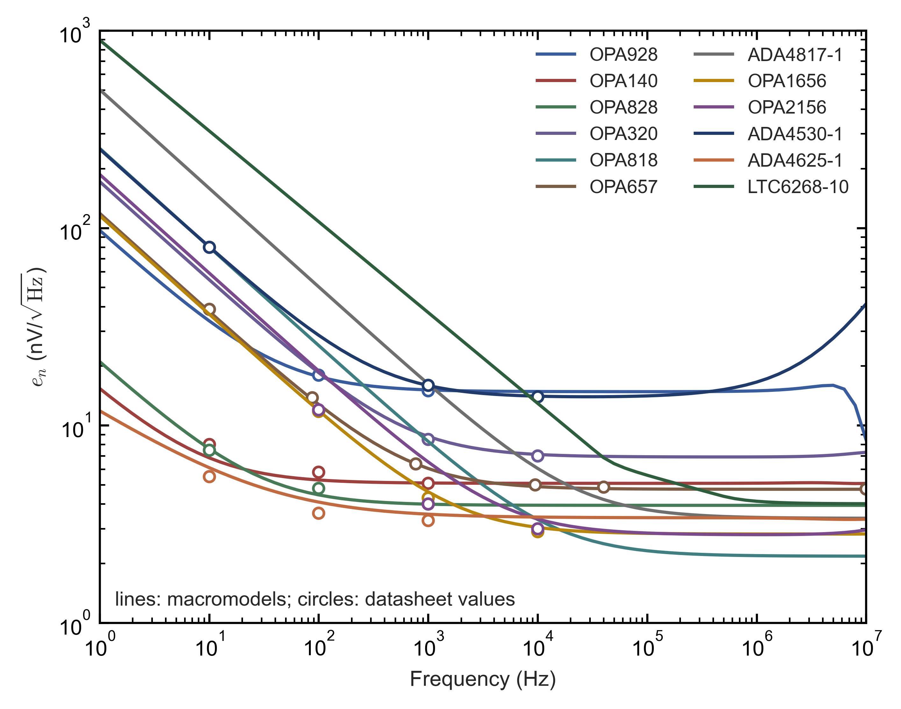

*Figure 19. Input voltage-noise density of the twelve macromodels of Table 9.3 (lines) against the datasheet values (circles).*

The precision parts' models reproduce their datasheets, voltage noise within 8% and current noise within 16%, with one exception: OPA2156's model has 6.5 nV/√Hz at 1 kHz, against 4.0 nV/√Hz in its data sheet. Two wideband models put their low-frequency current noise, 0.25–0.35 fA/√Hz for OPA818 and OPA657, below the shot noise of their own typical bias currents (1.1 and 0.8 fA/√Hz). The analytic model keeps the shot noise as the floor (Section 2.3, Appendix B.1), which is the physical lower limit. The ADA4817-1 model is noisier than its datasheet: 16.2 against 11.8 nV/√Hz at 1 kHz, and 33 fA/√Hz of current noise at 10 Hz. That accounts for its largest deviations in Table 9.1.

### 9.4 The distributed feedback resistor in a loop

Section 3.4 derived the behaviour of a feedback resistor with distributed capacitance to the conductor beneath it with an ideal amplifier. This check puts it into a real loop. A 1-GΩ resistor is modelled as a ladder of 20 sections, with 0.05 pF end to end and 0.3 pF to the conductor beneath it, on the 20-pF photodiode. The conductor beneath is varied in six ways: absent, grounded, driven from the output, driven at one third of the output, split into four strips each driven at the mid-point potential of its quarter, and graded ideally. The ideal graded guard is the arrangement of Seidl, Swoboda and Zimmermann's integrated resistor (Section 3.4). The drives are ideal voltage-controlled sources. Table 9.4 and Figure 20 give the transimpedance and the response to a 100-pA step for OPA140 and OPA928. The model column evaluates Eq. (6) with the ladder's admittances (`hg_model.ladder_y`) and a single-pole amplifier.

*Table 9.4. A 1-GΩ feedback resistor with 0.05 pF end to end and 0.3 pF to the conductor beneath it, on the 20-pF photodiode, for six treatments of that conductor: bandwidth in SPICE and in the model, peaking in SPICE and in the model, and the step overshoot in SPICE.*

| Conductor under $R_F$ | OPA140: $f_{-3\,\mathrm{dB}}$ SPICE / model; peak; step overshoot | OPA928: $f_{-3\,\mathrm{dB}}$ SPICE / model; peak; step overshoot |
|---|---|---|
| lumped (no plane) | 4.01 kHz / 3.99 kHz; 0.00 / 0.00 dB; 0% | 4.31 kHz / 4.31 kHz; 0.55 / 0.55 dB; 11% |
| plane at ground | 5.84 kHz / 5.86 kHz; 7.45 / 7.44 dB; 54% | 4.42 kHz / 4.42 kHz; 12.98 / 13.07 dB; 74% |
| plane at output | 1.01 kHz / 1.01 kHz; 0.00 / 0.00 dB; 0% | 1.08 kHz / 1.08 kHz; 0.00 / 0.00 dB; 0% |
| plane at 1/3 output | 3.69 kHz / 3.69 kHz; 0.00 / 0.00 dB; 2% | 3.86 kHz / 3.87 kHz; 0.78 / 0.79 dB; 12% |
| four strips, graded | 3.56 kHz / 3.79 kHz; 0.00 / 0.00 dB; 0% | 4.13 kHz / 4.21 kHz; 0.17 / 0.39 dB; 8% |
| ideal graded guard | 4.01 kHz / 3.99 kHz; 0.00 / 0.00 dB; 0% | 4.3 kHz / 4.3 kHz; 0.55 / 0.55 dB; 11% |

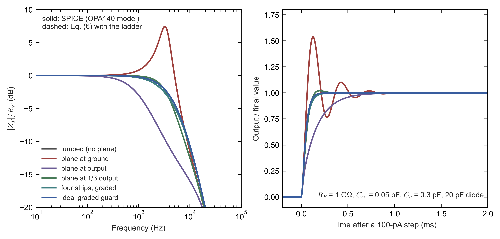

*Figure 20. The six treatments of Table 9.4 with OPA140: transimpedance in SPICE (solid) and in the model (dashed), and the SPICE response to a 100-pA step, normalized to its final value. The curves without a conductor and with the ideal graded guard coincide.*

SPICE and the model agree within 1% in bandwidth and 0.1 dB in peaking for five of the six treatments, and within 6% and 0.2 dB for the four strips. The predictions of Section 3.4 hold in a real loop.

- **A grounded plane makes the response peak and ring.** The peak is 7.45 dB with OPA140 and 13 dB with OPA928, and the step overshoots by 54% and 74%. OPA928's slower loop adds to the peak.
- **A plane driven from the output gives a smooth response,** but a quarter of the bandwidth: 1.01 kHz against 4.01 kHz for the resistor without a plane.
- **A plane driven at one third of the output removes the first-order effect** (Eq. (28)). It gives 3.69 kHz with 2% overshoot.
- **Four strips at graded potentials** give 3.56 kHz without overshoot.
- **The ideal graded guard** reproduces the resistor without a plane exactly, 4.01 kHz, because no voltage appears across the distributed capacitance.

### 9.5 The discrete-JFET composite

The composite of Section 5.8 was built from Linear Systems' LSBF862 card, the second-source BF862, as typed into the companion note's scripts. J1 is a common-source stage biased at 10 mA, with a cascode J2 and a 1-kΩ drain load, so $g_mR_D \approx 33$. It is followed by an integrator whose unity-gain frequency of 1.5 MHz gives the composite about the 50 MHz assumed in the analytic model. $C_F$ was chosen in SPICE by the rule of Section 1.4.

The second stage is an ideal transconductance-and-capacitor integrator, not an op amp macromodel. With OPA140's macromodel there, the DC solver repeatedly found latched states, with J1 cut off and the op amp's input clamps conducting. The ideal stage leaves out the second stage's own noise. An op amp's 5 nV/√Hz divided by $g_mR_D \approx 33$ is about 0.15 nV/√Hz, beside the LSBF862 model's 0.6 nV/√Hz, so it would add about 0.3 dB to the excess noise. Table 9.5 and Figure 21 compare the composite with the analytic BF862 composite and with OPA140 alone.

*Table 9.5. The LSBF862 cascode composite in SPICE against the analytic BF862 composite and OPA140 alone (analytic model): bandwidth and excess noise $\Delta N$ over [1 Hz, $f_{-3\,\mathrm{dB}}$].*

| Photodiode | $R_F$ | LSBF862 cascode, SPICE: $f_{-3\,\mathrm{dB}}$; $\Delta N$ | BF862 composite, model | OPA140 alone, model |
|---|---|---|---|---|
| S1336-8BK, 380 pF | 100 kΩ | 402 kHz; 2.8 dB | 482 kHz; 4.6 dB | 223 kHz; 12.6 dB |
| S1336-8BK, 380 pF | 1 MΩ | 128 kHz; 2.8 dB | 152 kHz; 4.6 dB | 71.3 kHz; 12.5 dB |
| S1336-8BK, 380 pF | 10 MΩ | 40.4 kHz; 2.8 dB | 48.2 kHz; 4.7 dB | 22.5 kHz; 12.4 dB |
| G12180-050A, 1 nF | 100 kΩ | 248 kHz; 5.2 dB | 297 kHz; 7.5 dB | 141 kHz; 16.5 dB |
| G12180-050A, 1 nF | 1 MΩ | 78.6 kHz; 4.8 dB | 94 kHz; 7.0 dB | 44.5 kHz; 15.8 dB |
| G12180-050A, 1 nF | 10 MΩ | 25.4 kHz; 3.1 dB | 30.4 kHz; 4.8 dB | 14.1 kHz; 12.5 dB |

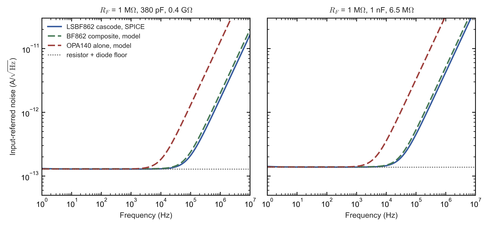

*Figure 21. Input-referred noise at $R_F$ = 1 MΩ on the 380-pF and 1-nF photodiodes: the LSBF862 cascode composite in SPICE, the analytic BF862 composite, OPA140 alone, and the resistor-plus-diode floor.*

SPICE confirms the composite's advantage. On the 380-pF photodiode it brings the excess noise from 12.4–12.6 dB with OPA140 to 2.8 dB, at 1.8 times the bandwidth. On the 1-nF photodiode it brings 12.5–16.5 dB down to 3.1–5.2 dB. The SPICE composite is 1.7–2.4 dB quieter than the analytic estimate and about 15% slower. The LSBF862 card's channel noise and capacitances differ from the BF862 datasheet values that the analytic model uses.

### 9.6 The logarithmic amplifiers

AD8304 and ADL5303 were run from 100 pA to 10 mA, with 10 pF at the input to stand for a photodiode. Each run gives the operating point, the small-signal bandwidth of $V_{LOG}$ and its noise. Table 9.6 and Figure 22 compare them with Eqs. (31), (33) and (35) and with AD8304's measured noise.

*Table 9.6. AD8304 and ADL5303 macromodels against current: the output $V_{LOG}$; the −3 dB bandwidth of $V_{LOG}$, with Eq. (33) for an effective compensation capacitance of 1.5 pF; the output noise at 1 kHz, with AD8304's measured noise read by eye from its data sheet (Rev. A, p. 5, TPC 9) and the shot-noise bound of Eq. (35) at 200 mV per decade.*

| Current | $V_{LOG}$, AD8304 / ADL5303 model | $f_{-3\,\mathrm{dB}}$, AD8304 model | Eq. (33) with 1.5 pF | Noise at 1 kHz, AD8304 model (µV/√Hz) | AD8304 measured, TPC 9 | Eq. (35) at 200 mV/decade |
|---|---|---|---|---|---|---|
| 100 pA | 0.080 / 0.071 V | 629 Hz (peak 1.4 dB) | 413 Hz | 12.4 | – | 6.95 |
| 1 nA | 0.229 / 0.209 V | 4.15 kHz | 4.13 kHz | 43.3 | about 40 | 2.2 |
| 10 nA | 0.424 / 0.408 V | 40.1 kHz | 41.3 kHz | 6.02 | about 5.5 | 0.695 |
| 100 nA | 0.621 / 0.606 V | 491 kHz | 413 kHz | 1.02 | about 1 | 0.22 |
| 1 µA | 0.818 / 0.804 V | 3.17 MHz (peak 2.9 dB) | 4.13 MHz | 0.181 | about 0.17 | 0.0695 |
| 10 µA | 1.015 / 1.003 V | 9.53 MHz (peak 9.3 dB) | 41.3 MHz | 0.157 | about 0.15 | 0.022 |
| 100 µA | 1.212 / 1.201 V | 3.3 MHz | 413 MHz | 0.147 | – | 0.00695 |
| 1 mA | 1.409 / 1.399 V | 3.19 MHz | 4.13 GHz | 0.147 | – | 0.0022 |
| 10 mA | 1.606 / 1.598 V | 3.18 MHz | 41.3 GHz | 0.147 | – | 0.000695 |

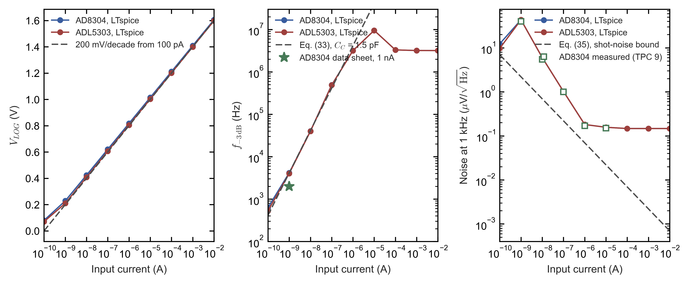

*Figure 22. AD8304 and ADL5303 in LTspice against current: output voltage (left), bandwidth (centre) and output noise at 1 kHz (right), with the 200 mV/decade law, Eq. (33) and Eq. (35), and AD8304's data-sheet values.*

Four results follow, each against an equation of Section 7.2.

- **The law.** The models follow 197 mV per decade from 1 nA to 10 mA, against the data sheet's 200 mV per decade (AD8304 Rev. A, p. 2) [D29]. The decade below 1 nA is compressed to 149 mV, consistent with the data sheet specifying the law's conformance from 1 nA only.
- **The bandwidth** is proportional to the current from 100 pA to about 1 µA, as Eq. (33) states. With 10 pF at the input, an effective compensation capacitance of 1.5 pF reproduces 4.1 kHz at 1 nA and 40 kHz at 10 nA. The data sheet quotes about 2 kHz at 1 nA (p. 1) under its own test conditions. Above 1 µA the bandwidth saturates near 3.2 MHz, with up to 9 dB of peaking at 10 µA in the model.
- **The noise is far above the shot-noise bound at low currents.** The macromodel gives 43, 6.0 and 1.0 µV/√Hz at 1 nA, 10 nA and 100 nA. AD8304's measured spectra give about 40, 5.5 and 1.0 µV/√Hz. Equation (35) at 200 mV per decade gives 2.2, 0.70 and 0.22 µV/√Hz. The vendor's model reproduces the measurement within about 10%, and both lie 5–20 times above the bound of Eq. (35) at 1–100 nA. Equation (35) is therefore a floor that a real log amplifier does not reach at low currents. The measured spectra (TPC 9) rise with frequency towards the bandwidth edge, which points to the loop's own noise rather than to the input current's.
- **At high currents** the noise flattens at 0.15 µV/√Hz, the output stage's floor.

### 9.7 How well the approximate formulas of Chapter 3 hold

Chapter 3 explains the results with approximate formulas: the bandwidth $\sqrt{GBW/(2\pi R_FC_T)}$ of Eq. (19) below $R_F^*$, the resistor's pole $f_R$ of Eq. (4) above it, and the excess noise of Eq. (22). Figure 23 compares them with the full model over the sweep.

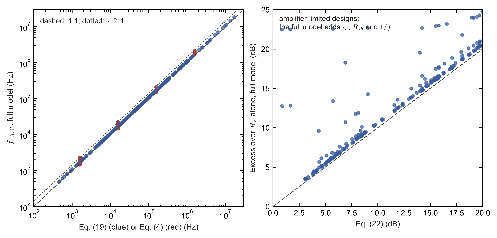

*Figure 23. The approximate formulas of Chapter 3 against the full model, for the designs of the sweep on the four photodiodes with gigaohm-to-megaohm shunt resistance, excluding those that fail the open-loop-gain rule, and OPA1656 and OPA2156, whose open-loop gains are not single poles. Left: bandwidth against Eq. (19) for amplifier-limited designs (blue) and against Eq. (4) for resistor-limited designs (red). Right: excess noise over the resistor alone against Eq. (22), amplifier-limited designs.*

- **Amplifier-limited bandwidth.** For the 252 amplifier-limited designs, the full model's bandwidth is 1.06–1.09 times Eq. (19). The design rule allows 0.1 dB of peaking, so its response is slightly less damped than maximally flat.
- **Resistor-limited bandwidth.** For the 82 resistor-limited designs it is 0.92–1.42 times $f_R$. Section 3.2 explains why it lies between $f_R$ and $\sqrt2\,f_R$, and somewhat below $f_R$ where the loop adds a pole.
- **Excess noise.** Eq. (22) predicts the full model's excess noise within 1 dB in 72% of the amplifier-limited designs, and underestimates it in all of them, by a median of 0.65 dB. The larger differences come from the terms that Eq. (22) leaves out: the amplifier's current noise and the photodiode's shunt resistance, which the full model includes.

The approximate formulas therefore describe the mechanism correctly, and the tables of the note use the full model.

### 9.8 What the checks change

Five of the checks' findings change or qualify the analysis.

1. **The DC open-loop gain** must exceed ten times the mid-band noise gain (Section 3.1). This excludes four of the wideband amplifiers, OPA656, OPA657, OPA818 and ADA4817-1, from large photodiodes at high gain. The model and Tables 6.1–6.5 now apply the rule.
2. **The low-frequency current noise of the wideband parts** is taken as the shot noise of their typical bias current below their specified frequencies, not as the specified high-frequency value (Section 2.3). This lowers OPA818's excess noise at 1 GΩ from 1.5 dB to 0.5 dB.
3. **The discrete-JFET composite** performs at least as well in SPICE as estimated (Section 5.8).
4. **The low-current noise of logarithmic amplifiers** is set by their circuits, 5–20 times above the shot-noise bound at 1–100 nA. Their data-sheet noise curves, not Eq. (35), belong in a noise budget (Section 7.2).
5. **The gain–bandwidths of OPA1656 and OPA2156** are their values at a gain of 100, 53 and 25 MHz, not their 20-MHz unity-gain bandwidths, and above about 300 kHz their open-loop gains need the shapes of their SPICE models (Section 9.2). At their smallest stable $C_F$ they now reach about 1.9 and 1.2 times the bandwidths that the note first gave them.

The other results hold: the precision parts' bandwidths and noise (Table 9.1), the distributed resistor's peaking and its board-level remedies (Table 9.4), and the approximate formulas' account of the mechanisms (Section 9.7).

---

## 10. Conclusions

### 10.1 How to choose

The design of a high-gain photodiode amplifier follows from a few quantities that can be written down before any amplifier is chosen. The steps below put them in order.

1. **Choose $R_F$ from the signal.** The largest photocurrent must fit the output swing, $R_F \leq V_{sw}/I_{\max}$ (Eq. (3)). Above $I_x = 51.4\ \mathrm{mV}/R_F$ the light's own shot noise dominates (Eq. (2)), so a larger $R_F$ gains nothing there. Over the resistor's own bandwidth a TIA spans about five decades, $V_{sw}/\sqrt{k_BT/C_{par}}$ = 94 dB for 10 V and 0.1 pF, at every gain (Eq. (5)). More needs gain ranging, a logarithmic amplifier or an integrator (Chapter 7).
2. **Know the photodiode at its operating temperature.** Its capacitance and shunt resistance are all the amplifier sees. Hamamatsu's silicon diodes have gigaohms, its InGaAs diodes megaohms, and the extended InGaAs diodes kilohms. The shunt resistance halves every 5–10 °C (Table 1, Section 1.2). If $R_{sh}$ is below about $10R_F$, the diode's own noise sets the floor (Eq. (10)). $R_F$ should then not exceed about $10R_{sh}$, any further gain belongs in a voltage stage, and cooling helps more than any amplifier (Section 6.6).
3. **Find the crossover gain.** $R_F^* = C_T/(\pi\,GBW\,C_{par}^2)$ (Eq. (20)) separates two regimes. Below it the amplifier sets the bandwidth, $\sqrt{GBW/(2\pi R_FC_T)}$, and the excess noise is fixed by $e_n$, $C_T$ and $GBW$, whatever the gain (Eqs. (21)–(22)). Above it the resistor's own capacitance sets the bandwidth, $1/(2\pi R_FC_{par})$, and the voltage noise fades from the band (Eq. (23)).
4. **Below $R_F^*$, minimize $e_n\,C_T$.** With small photodiodes the low-noise FET-input op amps (OPA1656, OPA2156, ADA4625-1) come within 2.5–3.6 dB of the floor at 100 kΩ–1 MΩ with their bandwidth held to 0.3–1 MHz. OPA1656 and OPA2156, with 53 and 25 MHz of gain–bandwidth at high noise gain, can instead reach wider bands: about twice that bandwidth at 5.8–6.0 dB for OPA1656, and about 1.2 times at 3.4–3.6 dB for OPA2156. Wideband FET parts (OPA818, OPA657, LTC6268-10) buy four to twenty times the bandwidth at 9.5–23 dB of excess, but only while their DC open-loop gain exceeds ten times the mid-band noise gain $(C_T + C_F)/C_F$ (Section 3.1). On large photodiodes at high gain, OPA656, OPA657, OPA818 and ADA4817-1, with 65–92 dB, fall short of that; LTC6268-10, with 108 dB, does not. With photodiodes of hundreds of picofarads and more, no monolithic op amp comes within 10 dB. A discrete-JFET composite, with the JFET's input capacitance matched to the photodiode's (Eq. (30)), recovers 11–18 dB, and bootstrapping recovers the bandwidth (Sections 5.8, 6.7).
5. **Above $R_F^*$, take care of the resistor.** Its capacitance to the ground plane beneath it subtracts from its end-to-end capacitance and can make the response peak by several decibels (Eq. (26), Table 3). Cut the plane away beneath it, or drive the copper there at one third of the output, or in graded strips, from a divider between the output and ground (Eq. (28), Table 9.4). Then measure the actual response, and equalize only up to $f_e$ (Eq. (13), Table A.5). A split resistor gains bandwidth only if its junctions are guarded at their own fractions of the output (Section 3.4).
6. **Check the current noise against $R_{F,\mathrm{crit}} = 4k_BT/i_n^2$** (Eq. (11)). That rules out bipolar inputs at any gain of this note (5.7 kΩ for OPA211), zero-drift parts above about 1 MΩ (1.65 MΩ for OPA388), the bias-current-cancelled LMP7721 above about 100 MΩ (165 MΩ), and ADA4625-1 at 1 GΩ (813 MΩ). A femtoampere bias current does not imply a femtoampere-level current noise (Section 2.3).
7. **At 100 MΩ and above, decide by DC accuracy.** The noise of most FET-input parts is within 0.3–2.5 dB of the floor on a small photodiode, but their bias currents grow 64-fold to 85 °C. Where the temperature is controlled and the dark level subtracted, OPA818 or OPA1656 at 100 MΩ and OPA140, OPA145 or OPA828 at 1 GΩ give the lowest noise. Where the zero must hold unattended, OPA320 (50 mV at 1 GΩ and 85 °C) or an electrometer (ADA4530-1, OPA928: below 0.1 mV) is the answer, at 0.4–1.7 dB of excess at 1 GΩ (Section 6.5).
8. **At the highest gains, the board is part of the amplifier.** Leakage, humidity and dielectric relaxation of the laminate produce errors as large as an electrometer's bias current. Guard the summing node at its own potential, keep the board clean and dry, and enclose the whole front end, photodiode included, in a grounded metal shield (Chapter 8).
9. **Below $I_{\min,\mathrm{shot}} = 4\pi k_BT\,BC_{par}/q$**, 32 pA in 1 kHz for 0.1 pF (Eq. (36)), a TIA cannot reach the shot-noise limit in the bandwidth $B$. A switched integrator or a detector with internal gain is then the better answer (Sections 7.3–7.4).

10. **For a signal at low frequency, judge the noise at that frequency, not over the band.** The capacitive term then fades, and the 1/f corners decide only where $e_{n,\mathrm{crit}}$ of Eq. (30a) is small: on photodiodes with low shunt resistance (15 nV/√Hz), at 100 kΩ (41 nV/√Hz), and on large photodiodes at 1 GΩ (31 nV/√Hz on 380 pF). Elsewhere the precision JFET parts reach the floor, and from 10 MΩ up on small photodiodes so do the electrometers; a large photodiode needs no composite (Section 6.8).

### 10.2 What the model leaves open

The analysis evaluates Eqs. (6) and (8) with datasheet values, a single-pole amplifier with its datasheet DC open-loop gain, a lumped feedback resistor in the sweep, and the distributed line of Section 3.4 for the resistor's own behaviour. Chapter 9 checked it against the manufacturers' SPICE models. For the precision parts the two agree within 7% in bandwidth and 0.7 dB in excess noise, and the distributed resistor, the discrete-JFET composite and the logarithmic amplifiers behave in SPICE as described. Three of the model's inputs remain the least certain.

- **The resistor's capacitances** $C_{ee}$ and $C_g$ depend on the board. Section 3.4 estimates them; a measurement should replace the estimate.
- **The gate currents of discrete JFETs** at their operating point are not specified. The sweep uses the maximum leakage, which overstates the composites' current noise at 100 MΩ and above.
- **The high-frequency current noise of FET-input op amps** is taken from datasheet curves where they exist, and may be counted twice for the part already included in $e_n\,\omega C_T$. Where no curve exists, the current noise is held at its low-frequency value.

Appendix C lists the open questions.

---

## Appendix A. Tables

The tables below are generated by `scripts_archive/hg_appendix_tables.py` from the data and result files named in their captions, so that no number is typed by hand.

### A.1 Amplifier data

*Table A.1. Amplifier data used in this note, typical values at 25 °C unless marked. $e_n$ in nV/√Hz and $i_n$ in fA/√Hz at the frequencies given; $I_B$ maximum at 25 °C and at the higher temperatures the datasheet gives; $C_{CM}$ and $C_{DIFF}$ in pF. Pages are PDF pages of the document named. Curves marked "companion" were digitized for the companion note and are taken from its records. Source: `data/amplifiers.json`.*

| Part | Document | Input | GBW (MHz); min. gain | $e_n$ | $i_n$ | $C_{CM}$ / $C_{DIFF}$ | $I_B$ typ; max 25 °C; hot | $V_{OS}$ max | Pages |
|---|---|---|---|---|---|---|---|---|---|
| ADA4530-1 | ADA4530-1 data sheet Rev. C | CMOS electrometer, integrated guard buffer | 2; 1 | 80 at 10 Hz; 16 at 1 kHz; 14 at 10 kHz | 0.07 at 100 mHz | 8 / 0 | 1 fA; 20 fA; 20 fA at 85 °C, 250 fA at 125 °C | 40 µV | pp. 3-4 (5 V table); 10 V and 15 V tables pp. 4-7 give the same noise, IB and CIN |
| OPA928 | OPA928 data sheet, revised Apr. 2024 | CMOS electrometer, integrated guard buffer | 2.5; 1 | 18 at 100 Hz; 15 at 1 kHz | 0.07 at 100 mHz | 6 / 3 | 1 fA; 20 fA; 20 fA at 85 °C | 25 µV | pp. 4-5 (first table); a later table on p. 8 lists IB max 75 fA |
| LMP7721 | LMP7721 data sheet, revised Dec. 2014 | CMOS electrometer, bias-current cancellation | 17; 1 | 7.5 at 400 Hz; 6.5 at 1 kHz | 10 at 1 kHz | not given | 3 fA; 20 fA; 900 fA at 85 °C, 5 pA at 125 °C | 150 µV | pp. 6-7 (5 V table); 2.7 V table pp. 5-6 |
| LMC6001A | LMC6001 data sheet SNOS694I, Sep. 2015 | CMOS electrometer | 1.3; 1 | 22 at 1 kHz | 0.13 at 1 kHz | not given | 10 fA; 25 fA; 2 pA at the temperature extremes | – | p. 4 (IB, A grade), p. 9 (GBW, noise) |
| LMC662 | LMC66x data sheet, revised Feb. 2024 | CMOS, general purpose | 1.4; 1 | 22 at 1 kHz | 0.2 at 1 kHz | not given | 2 fA; –; 4 pA at 85 °C | 3000 µV | pp. 6-7; current noise: p. 23 (revision history) |
| ADA4625-1 | ADA4625-1/ADA4625-2 data sheet Rev. C | JFET | 18; 1 | 5.5 at 10 Hz; 3.6 at 100 Hz; 3.3 at 1 kHz | 4.5 at 1 kHz | 11.3 / 8.6 | 15 pA; 75 pA; 5.5 nA at 125 °C | 80 µV | pp. 3-4 (+-18 V table); 5 V table pp. 5-6 gives CDM 12.1, CCM 16.3 pF, GBP 16 MHz |
| OPA828 | OPA828 data sheet SBOS671D, Dec. 2022 | JFET | 45; 1 | 7.5 at 10 Hz; 4.8 at 100 Hz; 4 at 1 kHz | 1.2 at 1 kHz | 9 / 6 | 1 pA; 8 pA; 400 pA at 85 °C, 3 nA at 125 °C | 300 µV | p. 5 (D package; DGN: IB 0.2/5 pA), GBW p. 6 |
| OPA827 | OPA827 data sheet SBOS376I, Jul. 2016 | JFET | 22; 1 | 4 at 1 kHz; 3.8 at 10 kHz | 2.2 at 1 kHz | 9 / 9 | 3 pA; 10 pA; 500 pA at 85 °C, 5 nA at 125 °C | 150 µV | p. 6 |
| OPA140 | OPA140 data sheet SBOS498F, Mar. 2023 | JFET, rail-to-rail output | 11; 1 | 8 at 10 Hz; 5.8 at 100 Hz; 5.1 at 1 kHz | 0.8 at 1 kHz | 7 / 10 | 500 fA; 10 pA; 3 nA at 125 °C | 120 µV | p. 7 |
| OPA145 | OPA145 data sheet SBOS427F, Mar. 2021 | JFET | 5.5; 1 | 9 at 10 Hz; 7.2 at 100 Hz; 7 at 1 kHz | 0.8 at 1 kHz | 4.3 / 5 | 2 pA; 10 pA; 600 pA at 85 °C, 10 nA at 125 °C | 150 µV | pp. 6-7 |
| OPA1656 | OPA1656 data sheet SBOS901C, Sep. 2022 | CMOS, low noise | 53; 1 | 11.8 at 100 Hz; 4.3 at 1 kHz; 2.9 at 10 kHz | 6 at 1 kHz | 1.9 / 9.1 | 10 pA; 20 pA; – | 1000 µV | p. 6 |
| OPA2156 | OPA2156 data sheet SBOS900B, Jun. 2019 | CMOS, low noise | 25; 1 | 12 at 100 Hz; 4 at 1 kHz; 3 at 10 kHz | 19 at 1 kHz | 1.9 / 9.1 | 5 pA; 40 pA; 1.5 nA at 85 °C | 200 µV | pp. 5-6 (PMOS input region, SOIC) |
| OPA320 | OPA320 data sheet SBOS513F, Dec. 2016 | CMOS, rail-to-rail | 20; 1 | 8.5 at 1 kHz; 7 at 10 kHz | 0.6 at 1 kHz | 4 / 5 | 200 fA; 900 fA; 50 pA at 85 °C, 600 pA at 125 °C | 150 µV | pp. 7-8 |
| OPA381 | OPA381 data sheet SBOS313B, Nov. 2004 | CMOS, auto-zero, transimpedance-oriented | 18; 1 | 70 at 10 kHz; 10 at 1 MHz | 20 at 10 kHz | 2.5 / 1 | 3 pA; 50 pA; – | 25 µV | p. 3 |
| OPA388 | OPA388 data sheet SBOS777D, Jul. 2020 | CMOS, zero drift | 10; 1 | 7 at 10 Hz; 7 at 100 Hz; 7 at 1 kHz; 7 at 10 kHz | 100 at 1 kHz | 4.5 / 2 | 30 pA; 350 pA; 400 pA at 85 °C, 700 pA at 125 °C | 5 µV | pp. 7-9; IB 350 pA max at 25 C, 400 pA at 0-85 C, 700 pA at -40-125 C (p. 8) |
| OPA656 | OPA656 data sheet SBOS196I, Feb. 2024 | JFET, wideband | 230; 1 | 6 at 100 kHz | 5 at 100 kHz | 0.4 / 2.6 | 2 pA; 20 pA; 5 nA at 85 °C | 1800 µV | p. 5 |
| OPA657 | OPA657 data sheet SBOS197F, Aug. 2015 | JFET, wideband, decompensated | 1600; 7 | 38.7 at 10 Hz; 13.8 at 87 Hz; 6.4 at 770 Hz; 5 at 9.5 kHz; 4.88 at 40 kHz; 4.77 at 10 MHz | 1.3 at 100 kHz | 4.5 / 0.7 | 2 pA; 20 pA; 5 nA at 85 °C | 1800 µV | companion record OPA657.json: p. 5, Fig. 13 p. 10 |
| OPA818 | OPA818 data sheet SBOS940B, Dec. 2025 | FET, wideband, decompensated | 2700; 7 | curve, 9 points: 25.5 at 102 Hz to 2.12 at 976 kHz | curve, 17 points: 3 at 10 kHz to 2.56e+03 at 97.6 MHz | 1.9 / 0.5 | 4 pA; 25 pA; 700 pA at 85 °C | 1250 µV | companion record OPA818.json: p. 5 (EC), Figs. 6-19 and 6-20 p. 10 (current-noise curve labelled simulation) |
| ADA4817-1 | ADA4817-1/ADA4817-2 data sheet Rev. A, Mar. 2009 (Chinese edition) | FET, wideband | 410; 1 | curve, 13 points: 166 at 11 Hz to 3.9 at 100 MHz | 2.5 at 100 kHz | 1.3 / 0.1 | 2 pA; 20 pA; – | 2000 µV | companion record ADA4817-1.json: p. 3 Table 1, voltage-noise curve digitized there |
| LTC6268-10 | LTC6268-10/LTC6269-10 data sheet 626810f Rev. F, Apr. 2015 | CMOS, wideband, decompensated | 4000; 10 | curve, 18 points: 890 at 1 Hz to 4.2 at 100 MHz | curve, 13 points: 7 at 100 kHz to 7.06e+03 at 100 MHz | 0.45 / 0.1 | 3 fA; 20 fA; 900 fA at 85 °C, 4 pA at 125 °C | 700 µV | companion record LTC6268-10.json: pp. 3-6; current-noise curve digitized there |
| OPA211 | OPA211 data sheet SBOS377L, Jan. 2020 | bipolar, low noise | 45; 1 | 2 at 10 Hz; 1.4 at 100 Hz; 1.1 at 1 kHz | 3.2e+03 at 10 Hz; 1.7e+03 at 1 kHz | 2 / 8 | 60 nA; 175 nA; 200 nA at 125 °C | 125 µV | pp. 8-9 (GBW 80 MHz at G = 100, 45 MHz at G = 1) |
| IF3601 composite | IF3601 data sheet IF35076-R01, Apr. 2022 (companion folder) | discrete JFET + op amp (assumed composite GBW 50 MHz) | 50; 1 | 0.35 at 100 Hz | 5.66 at 1 Hz | 710 / 0 | –; 100 pA; – | – | en 0.35 nV/rtHz at 100 Hz, VDS 3 V, ID 5 mA; Ciss 650 pF (VGS -4 V, VDS 0, 1 MHz table); Crss about 60 pF read from the Crss-VGS curve; IGSS 0.1 nA max at VGS -10 V (pp. 1-3); in_ = sqrt(2 q IGSS) as an upper bound |
| LSK170 composite | LSK170 data sheet Doc 201110 Rev. A22, Nov. 2019 (companion folder) | discrete JFET + op amp (assumed composite GBW 50 MHz) | 50; 1 | 1.4 at 10 Hz; 0.9 at 1 kHz | 12.7 at 1 Hz | 25 / 0 | –; 500 pA; – | – | en 0.9 at 1 kHz and 1.4 at 10 Hz, ID 2 mA; Ciss 20 pF; Crss 5 pF (companion table); IG 0.5 nA max operating (p. 2); in_ = sqrt(2 q IG) as an upper bound |
| BF862 composite | BF862 product specification, Jan. 2000 (companion folder) | discrete JFET + op amp (assumed composite GBW 50 MHz) | 50; 1 | 0.8 at 100 kHz | 17.9 at 1 Hz | 11.9 / 0 | –; 1 nA; – | – | companion table: en 0.8 at 100 kHz, Ciss 10 pF, Crss 1.9 pF, IGSS 1 nA max (p. 4); in_ = sqrt(2 q IGSS) as an upper bound; 1/f noise not modelled |

Notes to Table A.1. For LTC6268-10 the voltage-noise points at 1 Hz–1 kHz are estimated from its 0.1–10 Hz noise of 12.6 µV peak to peak, assuming a $1/f$ density and a peak-to-peak value of 6.6 times the rms (Appendix B.1). The composites' gain–bandwidth product of 50 MHz is an assumption, and their current noise is the shot noise of the maximum gate current, an upper bound. OPA381 and OPA388 are auto-zero and zero-drift parts; their bias currents at 85 °C are datasheet limits (OPA388) or the 25 °C limit doubled every 10 °C (OPA381), the latter an assumption.

### A.2 Figures of merit

*Table A.2. Derived figures of merit: the critical feedback resistance of Eq. (11), above which the amplifier's current noise exceeds the resistor's Johnson noise, and the optimum source resistance of Eq. (14) with $e_n$ at 1 kHz (or the nearest specified frequency). $i_n$ is the lowest-frequency specified value.*

| Part | $e_n$ at 1 kHz (nV/√Hz) | $i_n$ (fA/√Hz) | $R_{F,\mathrm{crit}}$ | $R_{opt}$ | $C_{CM}+C_{DIFF}$ (pF) | GBW (MHz) |
|---|---|---|---|---|---|---|
| ADA4530-1 | 16 | 0.07 | 3.36e+03 GΩ | 229 MΩ | 8 | 2 |
| OPA928 | 15 | 0.07 | 3.36e+03 GΩ | 214 MΩ | 9 | 2.5 |
| LMP7721 | 6.5 | 10 | 165 MΩ | 650 kΩ | not given | 17 |
| LMC6001A | 22 | 0.13 | 974 GΩ | 169 MΩ | not given | 1.3 |
| LMC662 | 22 | 0.2 | 412 GΩ | 110 MΩ | not given | 1.4 |
| ADA4625-1 | 3.3 | 4.5 | 813 MΩ | 733 kΩ | 19.9 | 18 |
| OPA828 | 4 | 1.2 | 11.4 GΩ | 3.33 MΩ | 15 | 45 |
| OPA827 | 4 | 2.2 | 3.4 GΩ | 1.82 MΩ | 18 | 22 |
| OPA140 | 5.1 | 0.8 | 25.7 GΩ | 6.38 MΩ | 17 | 11 |
| OPA145 | 7 | 0.8 | 25.7 GΩ | 8.75 MΩ | 9.3 | 5.5 |
| OPA1656 | 4.3 | 6 | 457 MΩ | 717 kΩ | 11 | 53 |
| OPA2156 | 4 | 19 | 45.6 MΩ | 211 kΩ | 11 | 25 |
| OPA320 | 8.5 | 0.6 | 45.7 GΩ | 14.2 MΩ | 9 | 20 |
| OPA381 | 70 | 20 | 41.2 MΩ | 3.5 MΩ | 3.5 | 18 |
| OPA388 | 7 | 100 | 1.65 MΩ | 70 kΩ | 6.5 | 10 |
| OPA656 | 6 | 5 | 659 MΩ | 1.2 MΩ | 3 | 230 |
| OPA657 | 6.24 | 1.3 | 9.74 GΩ | 4.8 MΩ | 5.2 | 1600 |
| OPA818 | 8.4 | 3 | 1.83 GΩ | 2.8 MΩ | 2.4 | 2700 |
| ADA4817-1 | 11.8 | 2.5 | 2.63 GΩ | 4.72 MΩ | 1.4 | 410 |
| LTC6268-10 | 28.4 | 7 | 336 MΩ | 4.06 MΩ | 0.55 | 4000 |
| OPA211 | 1.1 | 1.7e+03 | 5.7 kΩ | 647 Ω | 10 | 45 |
| IF3601 composite | 0.35 | 5.66 | 514 MΩ | 61.8 kΩ | 710 | 50 |
| LSK170 composite | 0.9 | 12.7 | 103 MΩ | 71.1 kΩ | 25 | 50 |
| BF862 composite | 0.8 | 17.9 | 51.4 MΩ | 44.7 kΩ | 11.9 | 50 |

### A.3 The design sweep

*Table A.3a. Designs on the S1336-18BK: Si, 20 pF, 2 GΩ photodiode: −3 dB bandwidth ("R" = resistor-limited, $C_F = C_{par}$ = 0.1 pF; "A" = the amplifier's DC open-loop gain is less than ten times the mid-band noise gain $(C_T + C_F)/C_F$, Section 3.1); excess noise $\Delta N$ over the resistor-plus-diode floor in [1 Hz, $f_{-3\,\mathrm{dB}}$], Eq. (16); DC output error at 85 °C from the maximum $V_{OS}$ and $I_B$, Eq. (38) without leakage. `hg_analysis.py`.*

| Part | 100 kΩ | 1 MΩ | 10 MΩ | 100 MΩ | 1 GΩ |
|---|---|---|---|---|---|
| ADA4530-1 | 322 kHz; 5.0 dB; 40 µV | 109 kHz; 4.5 dB; 40 µV | 35.3 kHz; 4.3 dB; 40 µV | 11.3 kHz; 4.3 dB; 44 µV | 2.03 kHz R; 1.7 dB; 80 µV |
| OPA928 | 362 kHz; 6.1 dB; 25 µV | 121 kHz; 5.7 dB; 25 µV | 38.3 kHz; 5.4 dB; 25 µV | 12.2 kHz; 5.2 dB; 28 µV | 1.96 kHz R; 1.5 dB; 58 µV |
| LMP7721 | 997 kHz; 6.3 dB; 1.5e+02 µV | 326 kHz; 6.2 dB; 1.5e+02 µV | 104 kHz; 6.2 dB; 1.6e+02 µV | 21 kHz R; 4.4 dB; 2.5e+02 µV | 1.65 kHz R; 7.1 dB; 1.1 mV |
| LMC6001A | 256 kHz; 6.7 dB; n/a | 86.7 kHz; 5.9 dB; n/a | 28.4 kHz; 5.7 dB; n/a | 9.07 kHz; 5.6 dB; n/a | 2.2 kHz R; 3.1 dB; n/a |
| LMC662 | 268 kHz; 6.9 dB; n/a | 89.8 kHz; 6.1 dB; n/a | 29.4 kHz; 6.0 dB; n/a | 9.39 kHz; 5.8 dB; n/a | 2.17 kHz R; 3.1 dB; n/a |
| ADA4625-1 | 878 kHz; 3.6 dB; 1.8e+02 µV | 284 kHz; 3.5 dB; 1.1 mV | 90.8 kHz; 3.5 dB; 9.9 mV | 22 kHz R; 2.5 dB; 99 mV | 1.67 kHz R; 2.7 dB; 9.9e+02 mV |
| OPA828 | 1.49 MHz; 7.0 dB; 3.4e+02 µV | 472 kHz; 6.8 dB; 7e+02 µV | 151 kHz; 6.8 dB; 4.3 mV | 18.3 kHz R; 1.9 dB; 40 mV | 1.61 kHz R; 0.4 dB; 4e+02 mV |
| OPA827 | 997 kHz; 4.7 dB; 2e+02 µV | 319 kHz; 4.5 dB; 6.5e+02 µV | 102 kHz; 4.5 dB; 5.2 mV | 21 kHz R; 2.5 dB; 50 mV | 1.65 kHz R; 0.9 dB; 5e+02 mV |
| OPA140 | 706 kHz; 4.4 dB; 1.5e+02 µV | 226 kHz; 4.2 dB; 4.3e+02 µV | 72.1 kHz; 4.1 dB; 3.2 mV | 22.5 kHz R; 3.9 dB; 31 mV | 1.69 kHz R; 0.3 dB; 3.1e+02 mV |
| OPA145 | 541 kHz; 3.7 dB; 2.1e+02 µV | 179 kHz; 3.5 dB; 7.5e+02 µV | 58 kHz; 3.5 dB; 6.2 mV | 18.3 kHz; 3.3 dB; 60 mV | 1.75 kHz R; 0.4 dB; 6e+02 mV |
| OPA1656 | 1.94 MHz; 5.9 dB; 1.1 mV | 651 kHz; 6.0 dB; 2.3 mV | 183 kHz; 5.2 dB; 14 mV | 17.7 kHz R; 1.5 dB; 1.3e+02 mV | 1.61 kHz R; 4.0 dB; 1.3 V |
| OPA2156 | 1.26 MHz; 3.6 dB; 3.5e+02 µV | 388 kHz; 3.4 dB; 1.7 mV | 121 kHz; 3.6 dB; 15 mV | 19.9 kHz R; 5.3 dB; 1.5e+02 mV | 1.63 kHz R; 11.9 dB; 1.5 V |
| OPA320 | 1.07 MHz; 7.5 dB; 1.6e+02 µV | 345 kHz; 7.3 dB; 2e+02 µV | 110 kHz; 7.3 dB; 6.5e+02 µV | 20.3 kHz R; 3.8 dB; 5.2 mV | 1.63 kHz R; 0.4 dB; 50 mV |
| OPA381 | 1.13 MHz; 10.1 dB; 3.5e+02 µV | 362 kHz; 13.6 dB; 3.2 mV | 116 kHz; 17.6 dB; 32 mV | 20.1 kHz R; 18.4 dB; 3.2e+02 mV | 1.63 kHz R; 13.3 dB; 3.2 V |
| OPA388 | 774 kHz; 5.1 dB; 45 µV | 256 kHz; 5.7 dB; 4.1e+02 µV | 81.9 kHz; 9.6 dB; 4 mV | 22.5 kHz R; 17.8 dB; 40 mV | 1.67 kHz R; 26.1 dB; 4e+02 mV |
| OPA656 | 4.11 MHz; 14.8 dB; 2.3 mV | 1.31 MHz; 14.8 dB; 6.8 mV | 179 kHz R; 8.0 dB; 52 mV | 15.6 kHz R; 1.9 dB; 5e+02 mV | 1.54 kHz R; 3.1 dB; 5 V |
| OPA657 | 10.6 MHz; 21.6 dB; 2.3 mV | 1.86 MHz R; 16.5 dB; 6.8 mV | 151 kHz R; 6.0 dB; 52 mV | 14.9 kHz R; 1.2 dB; 5e+02 mV | 1.49 kHz R; 0.4 dB; 5 V |
| OPA818 | 14.6 MHz; 16.5 dB; 1.3 mV | 1.84 MHz R; 9.5 dB; 2 mV | 162 kHz R; 2.3 dB; 8.3 mV | 16 kHz R; 0.6 dB; 71 mV | 1.59 kHz R; 0.5 dB; 7e+02 mV |
| ADA4817-1 | 5.81 MHz; 13.6 dB; 2.1 mV | 1.81 MHz A; 13.5 dB; 3.3 mV | 152 kHz R A; 4.3 dB; 15 mV | 14.4 kHz R A; 1.1 dB; 1.3e+02 mV | 1.42 kHz R A; 1.3 dB; 1.3 V |
| LTC6268-10 | 18.4 MHz; 23.1 dB; 7e+02 µV | 1.75 MHz R; 13.0 dB; 7e+02 µV | 162 kHz R; 5.4 dB; 7.1e+02 µV | 16 kHz R; 3.5 dB; 8.2e+02 µV | 1.59 kHz R; 1.8 dB; 2 mV |
| OPA211 | 1.6 MHz; 12.7 dB; 19 mV | 511 kHz; 22.5 dB; 1.9e+02 mV | 163 kHz; 32.4 dB; 1.9 V | 17.9 kHz R; 42.3 dB; 19 V | 1.61 kHz R; 51.6 dB; 1.9e+02 V |
| IF3601 composite | 358 kHz; 2.3 dB; n/a | 113 kHz; 2.2 dB; n/a | 35.7 kHz; 2.3 dB; n/a | 11.3 kHz; 2.6 dB; n/a | 2.01 kHz R; 3.9 dB; n/a |
| LSK170 composite | 1.39 MHz; 1.1 dB; n/a | 445 kHz; 1.1 dB; n/a | 141 kHz; 1.4 dB; n/a | 18.7 kHz R; 3.0 dB; n/a | 1.63 kHz R; 8.7 dB; n/a |
| BF862 composite | 1.64 MHz; 0.7 dB; n/a | 523 kHz; 0.7 dB; n/a | 165 kHz; 1.3 dB; n/a | 17.9 kHz R; 4.6 dB; n/a | 1.61 kHz R; 11.5 dB; n/a |

*Table A.3b. Designs on the G12180-010A: InGaAs, 55 pF, 125 MΩ photodiode: −3 dB bandwidth ("R" = resistor-limited, $C_F = C_{par}$ = 0.1 pF; "A" = the amplifier's DC open-loop gain is less than ten times the mid-band noise gain $(C_T + C_F)/C_F$, Section 3.1); excess noise $\Delta N$ over the resistor-plus-diode floor in [1 Hz, $f_{-3\,\mathrm{dB}}$], Eq. (16); DC output error at 85 °C from the maximum $V_{OS}$ and $I_B$, Eq. (38) without leakage. `hg_analysis.py`.*

| Part | 100 kΩ | 1 MΩ | 10 MΩ | 100 MΩ | 1 GΩ |
|---|---|---|---|---|---|
| ADA4530-1 | 226 kHz; 7.3 dB; 40 µV | 73.8 kHz; 6.8 dB; 40 µV | 23.6 kHz; 6.5 dB; 43 µV | 7.55 kHz; 5.1 dB; 74 µV | 2.25 kHz R; 1.6 dB; 3.8e+02 µV |
| OPA928 | 250 kHz; 8.6 dB; 25 µV | 81.9 kHz; 8.1 dB; 25 µV | 26.2 kHz; 7.7 dB; 27 µV | 8.37 kHz; 6.0 dB; 47 µV | 2.23 kHz R; 1.5 dB; 2.4e+02 µV |
| LMP7721 | 682 kHz; 9.1 dB; 1.5e+02 µV | 218 kHz; 8.9 dB; 1.5e+02 µV | 69.7 kHz; 8.7 dB; 1.7e+02 µV | 22 kHz; 7.1 dB; 3.6e+02 µV | 1.69 kHz R; 2.4 dB; 2.2 mV |
| LMC6001A | 179 kHz; 9.2 dB; n/a | 60 kHz; 8.7 dB; n/a | 19.4 kHz; 8.3 dB; n/a | 6.13 kHz; 6.4 dB; n/a | 1.94 kHz; 2.2 dB; n/a |
| LMC662 | 185 kHz; 9.4 dB; n/a | 62.1 kHz; 8.9 dB; n/a | 19.9 kHz; 8.4 dB; n/a | 6.28 kHz; 6.5 dB; n/a | 2.01 kHz; 2.3 dB; n/a |
| ADA4625-1 | 644 kHz; 5.1 dB; 1.8e+02 µV | 206 kHz; 5.0 dB; 1.1 mV | 65.8 kHz; 4.8 dB; 10 mV | 20.8 kHz; 3.6 dB; 99 mV | 1.71 kHz R; 0.6 dB; 9.9e+02 mV |
| OPA828 | 1.07 MHz; 9.4 dB; 3.4e+02 µV | 342 kHz; 9.3 dB; 7e+02 µV | 108 kHz; 9.0 dB; 4.3 mV | 20.6 kHz R; 4.0 dB; 41 mV | 1.65 kHz R; 0.1 dB; 4e+02 mV |
| OPA827 | 722 kHz; 6.6 dB; 2e+02 µV | 234 kHz; 6.5 dB; 6.5e+02 µV | 73.8 kHz; 6.3 dB; 5.2 mV | 22.5 kHz R; 4.5 dB; 50 mV | 1.69 kHz R; 0.2 dB; 5e+02 mV |
| OPA140 | 511 kHz; 6.3 dB; 1.5e+02 µV | 165 kHz; 6.1 dB; 4.3e+02 µV | 52.2 kHz; 5.8 dB; 3.2 mV | 16.5 kHz; 4.3 dB; 31 mV | 1.79 kHz R; 0.2 dB; 3.1e+02 mV |
| OPA145 | 379 kHz; 5.9 dB; 2.1e+02 µV | 124 kHz; 5.7 dB; 7.5e+02 µV | 39.2 kHz; 5.3 dB; 6.2 mV | 12.5 kHz; 3.9 dB; 60 mV | 1.94 kHz R; 0.3 dB; 6e+02 mV |
| OPA1656 | 1.42 MHz; 8.8 dB; 1.1 mV | 425 kHz; 8.1 dB; 2.3 mV | 125 kHz; 7.4 dB; 14 mV | 19.9 kHz R; 2.5 dB; 1.3e+02 mV | 1.63 kHz R; 1.0 dB; 1.3 V |
| OPA2156 | 858 kHz; 5.5 dB; 3.5e+02 µV | 265 kHz; 5.2 dB; 1.7 mV | 82.8 kHz; 5.1 dB; 15 mV | 22.5 kHz R; 5.0 dB; 1.5e+02 mV | 1.67 kHz R; 5.4 dB; 1.5 V |
| OPA320 | 739 kHz; 10.4 dB; 1.6e+02 µV | 236 kHz; 10.2 dB; 2e+02 µV | 75.5 kHz; 9.9 dB; 6.6e+02 µV | 22.5 kHz R; 7.6 dB; 5.3 mV | 1.69 kHz R; 0.3 dB; 51 mV |
| OPA381 | 730 kHz; 15.0 dB; 3.5e+02 µV | 234 kHz; 18.8 dB; 3.2 mV | 73.8 kHz; 22.6 dB; 32 mV | 22.5 kHz R; 24.2 dB; 3.2e+02 mV | 1.69 kHz R; 9.1 dB; 3.2 V |
| OPA388 | 529 kHz; 7.7 dB; 45 µV | 171 kHz; 7.9 dB; 4.1e+02 µV | 54.7 kHz; 10.4 dB; 4 mV | 17.3 kHz; 15.7 dB; 40 mV | 1.77 kHz R; 18.4 dB; 4e+02 mV |
| OPA656 | 2.65 MHz; 18.7 dB; 2.3 mV | 848 kHz; 18.6 dB; 6.8 mV | 196 kHz R A; 15.7 dB; 52 mV | 15.1 kHz R A; 3.7 dB; 5e+02 mV | 1.45 kHz R A; 0.8 dB; 5 V |
| OPA657 | 6.98 MHz; 25.3 dB; 2.3 mV | 1.88 MHz R A; 23.9 dB; 6.8 mV | 141 kHz R A; 11.5 dB; 52 mV | 13.4 kHz R A; 2.5 dB; 5e+02 mV | 1.34 kHz R A; 0.2 dB; 5 V |
| OPA818 | 9.21 MHz; 20.3 dB; 1.3 mV | 2.16 MHz R; 17.7 dB; 2 mV | 163 kHz R; 6.6 dB; 8.4 mV | 15.8 kHz R; 1.6 dB; 72 mV | 1.58 kHz R; 0.3 dB; 7.1e+02 mV |
| ADA4817-1 | 3.58 MHz; 17.4 dB; 2.1 mV | 1.16 MHz A; 17.6 dB; 3.3 mV | 137 kHz R A; 9.7 dB; 15 mV | 12.2 kHz R A; 2.4 dB; 1.3e+02 mV | 1.22 kHz R A; 0.5 dB; 1.3 V |
| LTC6268-10 | 11.3 MHz; 27.2 dB; 7e+02 µV | 2.01 MHz R; 22.0 dB; 7.1e+02 µV | 163 kHz R; 12.2 dB; 7.7e+02 µV | 16 kHz R; 7.7 dB; 1.4 mV | 1.59 kHz R; 2.0 dB; 7.2 mV |
| OPA211 | 1.11 MHz; 12.8 dB; 19 mV | 349 kHz; 22.5 dB; 1.9e+02 mV | 110 kHz; 32.1 dB; 1.9 V | 20.3 kHz R; 40.0 dB; 19 V | 1.63 kHz R; 43.8 dB; 1.9e+02 V |
| IF3601 composite | 342 kHz; 2.3 dB; n/a | 109 kHz; 2.3 dB; n/a | 34.5 kHz; 2.2 dB; n/a | 11 kHz; 1.8 dB; n/a | 2.03 kHz R; 0.9 dB; n/a |
| LSK170 composite | 1.06 MHz; 1.8 dB; n/a | 334 kHz; 1.7 dB; n/a | 107 kHz; 1.9 dB; n/a | 20.8 kHz R; 2.2 dB; n/a | 1.65 kHz R; 3.2 dB; n/a |
| BF862 composite | 1.14 MHz; 1.2 dB; n/a | 366 kHz; 1.3 dB; n/a | 116 kHz; 1.7 dB; n/a | 20.1 kHz R; 3.3 dB; n/a | 1.63 kHz R; 5.0 dB; n/a |

*Table A.3c. Designs on the S1336-8BK: Si, 380 pF, 0.4 GΩ photodiode: −3 dB bandwidth ("R" = resistor-limited, $C_F = C_{par}$ = 0.1 pF; "A" = the amplifier's DC open-loop gain is less than ten times the mid-band noise gain $(C_T + C_F)/C_F$, Section 3.1); excess noise $\Delta N$ over the resistor-plus-diode floor in [1 Hz, $f_{-3\,\mathrm{dB}}$], Eq. (16); DC output error at 85 °C from the maximum $V_{OS}$ and $I_B$, Eq. (38) without leakage. `hg_analysis.py`.*

| Part | 100 kΩ | 1 MΩ | 10 MΩ | 100 MΩ | 1 GΩ |
|---|---|---|---|---|---|
| ADA4530-1 | 95.1 kHz; 14.0 dB; 40 µV | 30.8 kHz; 13.8 dB; 40 µV | 9.61 kHz; 13.7 dB; 41 µV | 3.04 kHz; 13.5 dB; 52 µV | 960 Hz; 10.8 dB; 1.6e+02 µV |
| OPA928 | 105 kHz; 15.4 dB; 25 µV | 34.1 kHz; 15.3 dB; 25 µV | 10.9 kHz; 15.2 dB; 26 µV | 3.45 kHz; 14.3 dB; 33 µV | 1.09 kHz; 10.3 dB; 1.1e+02 µV |
| LMP7721 | 278 kHz; 16.2 dB; 1.5e+02 µV | 88.7 kHz; 16.2 dB; 1.5e+02 µV | 28 kHz; 16.1 dB; 1.6e+02 µV | 9.07 kHz; 15.5 dB; 2.8e+02 µV | 2.17 kHz R; 9.9 dB; 1.4 mV |
| LMC6001A | 75.5 kHz; 16.0 dB; n/a | 24.7 kHz; 15.8 dB; n/a | 7.81 kHz; 15.6 dB; n/a | 2.5 kHz; 14.8 dB; n/a | 789 Hz; 10.6 dB; n/a |
| LMC662 | 79.1 kHz; 16.4 dB; n/a | 25.6 kHz; 16.1 dB; n/a | 8.18 kHz; 16.0 dB; n/a | 2.58 kHz; 15.1 dB; n/a | 817 Hz; 10.9 dB; n/a |
| ADA4625-1 | 284 kHz; 11.1 dB; 1.8e+02 µV | 90.8 kHz; 11.0 dB; 1.1 mV | 28.7 kHz; 10.9 dB; 10 mV | 9.07 kHz; 10.1 dB; 99 mV | 2.2 kHz R; 5.2 dB; 9.9e+02 mV |
| OPA828 | 455 kHz; 16.4 dB; 3.4e+02 µV | 144 kHz; 16.3 dB; 7e+02 µV | 45.5 kHz; 16.2 dB; 4.3 mV | 14.4 kHz; 15.3 dB; 40 mV | 1.85 kHz R; 4.8 dB; 4e+02 mV |
| OPA827 | 315 kHz; 13.0 dB; 2e+02 µV | 99.6 kHz; 12.9 dB; 6.5e+02 µV | 31.8 kHz; 12.8 dB; 5.2 mV | 10.1 kHz; 12.1 dB; 50 mV | 2.13 kHz R; 5.6 dB; 5e+02 mV |
| OPA140 | 223 kHz; 12.6 dB; 1.5e+02 µV | 71.3 kHz; 12.5 dB; 4.3e+02 µV | 22.5 kHz; 12.4 dB; 3.2 mV | 7.12 kHz; 11.6 dB; 31 mV | 2.25 kHz R; 7.6 dB; 3.1e+02 mV |
| OPA145 | 160 kHz; 12.4 dB; 2.1e+02 µV | 50.5 kHz; 12.2 dB; 7.5e+02 µV | 16 kHz; 12.0 dB; 6.2 mV | 5.04 kHz; 11.2 dB; 60 mV | 1.63 kHz; 7.4 dB; 6e+02 mV |
| OPA1656 | 573 kHz; 15.5 dB; 1.1 mV | 165 kHz; 14.7 dB; 2.3 mV | 50.5 kHz; 14.3 dB; 14 mV | 15.8 kHz; 13.5 dB; 1.3e+02 mV | 1.81 kHz R; 5.7 dB; 1.3 V |
| OPA2156 | 349 kHz; 11.8 dB; 3.5e+02 µV | 110 kHz; 11.6 dB; 1.7 mV | 34.5 kHz; 11.5 dB; 15 mV | 10.9 kHz; 11.5 dB; 1.5e+02 mV | 2.05 kHz R; 9.8 dB; 1.5 V |
| OPA320 | 301 kHz; 17.6 dB; 1.6e+02 µV | 96.2 kHz; 17.5 dB; 2e+02 µV | 30.4 kHz; 17.4 dB; 6.5e+02 µV | 9.61 kHz; 16.8 dB; 5.2 mV | 2.15 kHz R; 10.7 dB; 51 mV |
| OPA381 | 291 kHz; 26.2 dB; 3.5e+02 µV | 91.9 kHz; 30.2 dB; 3.2 mV | 29.4 kHz; 34.3 dB; 32 mV | 9.28 kHz; 36.0 dB; 3.2e+02 mV | 2.17 kHz R; 29.0 dB; 3.2 V |
| OPA388 | 213 kHz; 14.7 dB; 45 µV | 68.1 kHz; 14.7 dB; 4.1e+02 µV | 21.5 kHz; 15.3 dB; 4 mV | 6.88 kHz; 18.6 dB; 40 mV | 2.17 kHz; 22.6 dB; 4e+02 mV |
| OPA656 | 1.04 MHz; 26.7 dB; 2.3 mV | 334 kHz A; 26.8 dB; 6.8 mV | 104 kHz A; 26.5 dB; 52 mV | 10.5 kHz R A; 15.9 dB; 5e+02 mV | 960 Hz R A; 4.1 dB; 5 V |
| OPA657 | 2.75 MHz A; 33.2 dB; 2.3 mV | 878 kHz A; 33.3 dB; 6.8 mV | 78.2 kHz R A; 22.3 dB; 52 mV | 7.29 kHz R A; 11.8 dB; 5e+02 mV | 720 Hz R A; 3.1 dB; 5 V |
| OPA818 | 3.58 MHz; 28.3 dB; 1.3 mV | 1.14 MHz; 28.4 dB; 2 mV | 177 kHz R; 22.6 dB; 8.3 mV | 14.9 kHz R; 13.9 dB; 72 mV | 1.47 kHz R; 8.0 dB; 7e+02 mV |
| ADA4817-1 | 1.41 MHz A; 25.7 dB; 2.1 mV | 445 kHz A; 25.8 dB; 3.3 mV | 59.3 kHz R A; 19.2 dB; 15 mV | 5.16 kHz R A; 12.0 dB; 1.3e+02 mV | 509 Hz R A; 8.0 dB; 1.3 V |
| LTC6268-10 | 4.35 MHz; 35.3 dB; 7e+02 µV | 1.39 MHz; 35.4 dB; 7e+02 µV | 183 kHz R; 29.5 dB; 7.3e+02 µV | 16 kHz R; 25.1 dB; 9.6e+02 µV | 1.58 kHz R; 18.3 dB; 3.4 mV |
| OPA211 | 455 kHz; 13.4 dB; 19 mV | 144 kHz; 22.5 dB; 1.9e+02 mV | 45.5 kHz; 32.4 dB; 1.9 V | 14.5 kHz; 41.6 dB; 19 V | 1.83 kHz R; 47.8 dB; 1.9e+02 V |
| IF3601 composite | 291 kHz; 3.0 dB; n/a | 91.9 kHz; 3.0 dB; n/a | 29 kHz; 3.0 dB; n/a | 9.18 kHz; 2.9 dB; n/a | 2.17 kHz R; 2.3 dB; n/a |
| LSK170 composite | 472 kHz; 5.4 dB; n/a | 151 kHz; 5.4 dB; n/a | 47.6 kHz; 5.4 dB; n/a | 15.1 kHz; 5.7 dB; n/a | 1.83 kHz R; 5.9 dB; n/a |
| BF862 composite | 482 kHz; 4.6 dB; n/a | 152 kHz; 4.6 dB; n/a | 48.2 kHz; 4.7 dB; n/a | 15.2 kHz; 6.0 dB; n/a | 1.81 kHz R; 8.2 dB; n/a |

*Table A.3d. Designs on the G12180-050A: InGaAs, 1 nF, 6.5 MΩ photodiode: −3 dB bandwidth ("R" = resistor-limited, $C_F = C_{par}$ = 0.1 pF; "A" = the amplifier's DC open-loop gain is less than ten times the mid-band noise gain $(C_T + C_F)/C_F$, Section 3.1); excess noise $\Delta N$ over the resistor-plus-diode floor in [1 Hz, $f_{-3\,\mathrm{dB}}$], Eq. (16); DC output error at 85 °C from the maximum $V_{OS}$ and $I_B$, Eq. (38) without leakage. `hg_analysis.py`.*

| Part | 100 kΩ | 1 MΩ | 10 MΩ | 100 MΩ | 1 GΩ |
|---|---|---|---|---|---|
| ADA4530-1 | 59.3 kHz; 17.8 dB; 41 µV | 19 kHz; 17.2 dB; 46 µV | 5.99 kHz; 14.2 dB; 1e+02 µV | 1.89 kHz; 7.5 dB; 6.6e+02 µV | 606 Hz; 2.8 dB; 6.2 mV |
| OPA928 | 65.8 kHz; 19.3 dB; 25 µV | 21 kHz; 18.6 dB; 29 µV | 6.65 kHz; 15.2 dB; 64 µV | 2.15 kHz; 7.9 dB; 4.1e+02 µV | 680 Hz; 2.1 dB; 3.9 mV |
| LMP7721 | 175 kHz; 20.3 dB; 1.5e+02 µV | 56 kHz; 19.8 dB; 1.7e+02 µV | 17.7 kHz; 16.4 dB; 3.9e+02 µV | 5.53 kHz; 8.7 dB; 2.5 mV | 1.75 kHz; 2.4 dB; 24 mV |
| LMC6001A | 47.1 kHz; 19.8 dB; n/a | 15.2 kHz; 19.2 dB; n/a | 4.81 kHz; 15.7 dB; n/a | 1.54 kHz; 8.3 dB; n/a | 487 Hz; 2.1 dB; n/a |
| LMC662 | 49.3 kHz; 20.2 dB; n/a | 15.8 kHz; 19.5 dB; n/a | 5.04 kHz; 16.1 dB; n/a | 1.61 kHz; 8.6 dB; n/a | 504 Hz; 2.2 dB; n/a |
| ADA4625-1 | 179 kHz; 14.8 dB; 1.8e+02 µV | 56.6 kHz; 14.2 dB; 1.1 mV | 17.9 kHz; 11.0 dB; 10 mV | 5.66 kHz; 4.4 dB; 1e+02 mV | 1.79 kHz; 0.8 dB; 1e+03 mV |
| OPA828 | 284 kHz; 20.3 dB; 3.4e+02 µV | 90.8 kHz; 19.8 dB; 7.5e+02 µV | 28.7 kHz; 16.4 dB; 4.8 mV | 9.07 kHz; 8.8 dB; 45 mV | 2.17 kHz R; 1.5 dB; 4.5e+02 mV |
| OPA827 | 199 kHz; 16.9 dB; 2e+02 µV | 62.8 kHz; 16.3 dB; 6.7e+02 µV | 19.9 kHz; 12.9 dB; 5.4 mV | 6.28 kHz; 6.0 dB; 52 mV | 2.01 kHz; 1.3 dB; 5.2e+02 mV |
| OPA140 | 141 kHz; 16.5 dB; 1.5e+02 µV | 44.5 kHz; 15.8 dB; 4.4e+02 µV | 14.1 kHz; 12.5 dB; 3.4 mV | 4.44 kHz; 5.6 dB; 33 mV | 1.42 kHz; 1.1 dB; 3.2e+02 mV |
| OPA145 | 99.6 kHz; 16.2 dB; 2.1e+02 µV | 31.5 kHz; 15.5 dB; 7.7e+02 µV | 9.95 kHz; 12.2 dB; 6.4 mV | 3.14 kHz; 5.3 dB; 62 mV | 1.01 kHz; 1.0 dB; 6.2e+02 mV |
| OPA1656 | 342 kHz; 19.1 dB; 1.1 mV | 102 kHz; 18.0 dB; 2.4 mV | 31.5 kHz; 14.5 dB; 15 mV | 9.83 kHz; 7.5 dB; 1.4e+02 mV | 2.13 kHz R; 1.5 dB; 1.4 V |
| OPA2156 | 218 kHz; 15.6 dB; 3.5e+02 µV | 67.3 kHz; 14.8 dB; 1.7 mV | 21.3 kHz; 11.6 dB; 16 mV | 6.72 kHz; 5.6 dB; 1.5e+02 mV | 2.15 kHz; 1.8 dB; 1.5 V |
| OPA320 | 190 kHz; 21.6 dB; 1.6e+02 µV | 60.7 kHz; 21.1 dB; 2.2e+02 µV | 19.2 kHz; 17.7 dB; 8.8e+02 µV | 6.06 kHz; 10.5 dB; 7.5 mV | 1.89 kHz; 3.6 dB; 73 mV |
| OPA381 | 179 kHz; 31.9 dB; 3.5e+02 µV | 56.6 kHz; 35.5 dB; 3.2 mV | 18.1 kHz; 36.0 dB; 32 mV | 5.79 kHz; 29.1 dB; 3.2e+02 mV | 1.81 kHz; 19.3 dB; 3.2 V |
| OPA388 | 134 kHz; 18.7 dB; 45 µV | 43 kHz; 18.2 dB; 4.1e+02 µV | 13.6 kHz; 15.1 dB; 4 mV | 4.29 kHz; 9.6 dB; 40 mV | 1.34 kHz; 7.3 dB; 4e+02 mV |
| OPA656 | 651 kHz; 30.9 dB; 2.3 mV | 203 kHz A; 30.2 dB; 7.1 mV | 65 kHz A; 26.9 dB; 55 mV | 6.35 kHz R A; 9.1 dB; 5.3e+02 mV | 599 Hz R A; 0.3 dB; 5.3 V |
| OPA657 | 1.71 MHz A; 37.3 dB; 2.3 mV | 541 kHz R A; 36.8 dB; 7.1 mV | 40.6 kHz R A; 21.0 dB; 55 mV | 3.87 kHz R A; 5.3 dB; 5.3e+02 mV | 400 Hz R A; 0.3 dB; 5.3 V |
| OPA818 | 2.23 MHz; 32.5 dB; 1.3 mV | 698 kHz; 31.9 dB; 2.1 mV | 177 kHz R A; 27.0 dB; 10 mV | 13.3 kHz R A; 10.6 dB; 90 mV | 1.3 kHz R A; 2.4 dB; 8.9e+02 mV |
| ADA4817-1 | 868 kHz A; 29.9 dB; 2.2 mV | 274 kHz A; 29.5 dB; 3.6 mV | 26.5 kHz R A; 17.5 dB; 18 mV | 2.47 kHz R A; 6.1 dB; 1.6e+02 mV | 261 Hz R A; 1.9 dB; 1.6 V |
| LTC6268-10 | 2.68 MHz; 39.4 dB; 7.1e+02 µV | 858 kHz; 39.1 dB; 8.1e+02 µV | 213 kHz R; 35.0 dB; 1.8 mV | 16 kHz R; 22.3 dB; 12 mV | 1.54 kHz R; 10.4 dB; 1.1e+02 mV |
| OPA211 | 284 kHz; 14.2 dB; 19 mV | 90.8 kHz; 22.1 dB; 1.9e+02 mV | 28.7 kHz; 28.5 dB; 1.9 V | 9.07 kHz; 30.5 dB; 19 V | 2.1 kHz R; 31.3 dB; 1.9e+02 V |
| IF3601 composite | 228 kHz; 4.0 dB; n/a | 73 kHz; 3.7 dB; n/a | 23.3 kHz; 2.1 dB; n/a | 7.37 kHz; 0.4 dB; n/a | 2.23 kHz R; 0.1 dB; n/a |
| LSK170 composite | 297 kHz; 8.5 dB; n/a | 94 kHz; 8.0 dB; n/a | 29.7 kHz; 5.3 dB; n/a | 9.39 kHz; 1.5 dB; n/a | 2.13 kHz R; 0.3 dB; n/a |
| BF862 composite | 297 kHz; 7.5 dB; n/a | 94 kHz; 7.0 dB; n/a | 30.4 kHz; 4.8 dB; n/a | 9.61 kHz; 1.5 dB; n/a | 2.13 kHz R; 0.6 dB; n/a |

*Table A.3e. Designs on the G12183-010K: InGaAs to 2.6 µm, 500 pF, 14 kΩ photodiode: −3 dB bandwidth ("R" = resistor-limited, $C_F = C_{par}$ = 0.1 pF; "A" = the amplifier's DC open-loop gain is less than ten times the mid-band noise gain $(C_T + C_F)/C_F$, Section 3.1); excess noise $\Delta N$ over the resistor-plus-diode floor in [1 Hz, $f_{-3\,\mathrm{dB}}$], Eq. (16); DC output error at 85 °C from the maximum $V_{OS}$ and $I_B$, Eq. (38) without leakage. `hg_analysis.py`.*

| Part | 100 kΩ | 1 MΩ | 10 MΩ | 100 MΩ | 1 GΩ |
|---|---|---|---|---|---|
| ADA4530-1 | 83.8 kHz; 7.6 dB; 3.3e+02 µV | 27.1 kHz; 3.8 dB; 2.9 mV | 3.14 kHz R; 4.4 dB; 29 mV | 280 Hz R; 9.2 dB; 2.9e+02 mV | 28 Hz R; 14.8 dB; 2.9 V |
| OPA928 | 92.9 kHz; 8.7 dB; 2e+02 µV | 30.1 kHz; 4.1 dB; 1.8 mV | 4 kHz R; 3.1 dB; 18 mV | 352 Hz R; 3.7 dB; 1.8e+02 mV | 35.6 Hz R; 4.7 dB; 1.8 V |
| LMP7721 | 247 kHz; 9.0 dB; 1.2 mV | 78.2 kHz; 2.9 dB; 11 mV | 25 kHz; 1.0 dB; 1.1e+02 mV | 2.3 kHz R; 0.9 dB; 1.1 V | 252 Hz R; 1.5 dB; 11 V |
| LMC6001A | 67.3 kHz; 9.8 dB; n/a | 21.8 kHz; 5.8 dB; n/a | 1.96 kHz R; 4.9 dB; n/a | 183 Hz R; 4.9 dB; n/a | 19.3 Hz R; 4.9 dB; n/a |
| LMC662 | 69.7 kHz; 10.0 dB; n/a | 22.5 kHz; 5.8 dB; n/a | 2.13 kHz R; 4.9 dB; n/a | 198 Hz R; 4.9 dB; n/a | 20.3 Hz R; 4.9 dB; n/a |
| ADA4625-1 | 250 kHz; 4.7 dB; 7.5e+02 µV | 79.1 kHz; 1.0 dB; 6.8 mV | 25.3 kHz; 0.3 dB; 67 mV | 2.38 kHz R; 0.2 dB; 6.7e+02 mV | 222 Hz R; 0.3 dB; 6.7 V |
| OPA828 | 401 kHz; 9.0 dB; 2.5 mV | 127 kHz; 2.6 dB; 22 mV | 40.1 kHz; 0.6 dB; 2.2e+02 mV | 5.28 kHz R; 0.3 dB; 2.2 V | 470 Hz R; 0.4 dB; 22 V |
| OPA827 | 278 kHz; 6.1 dB; 1.3 mV | 88.7 kHz; 1.5 dB; 11 mV | 28 kHz; 0.4 dB; 1.1e+02 mV | 2.9 kHz R; 0.3 dB; 1.1 V | 270 Hz R; 0.3 dB; 11 V |
| OPA140 | 194 kHz; 5.8 dB; 1 mV | 62.8 kHz; 1.5 dB; 9 mV | 19.9 kHz R; 0.6 dB; 89 mV | 1.5 kHz R; 0.5 dB; 8.9e+02 mV | 147 Hz R; 0.7 dB; 8.9 V |
| OPA145 | 139 kHz; 5.8 dB; 1.3 mV | 44.5 kHz; 1.8 dB; 11 mV | 9.95 kHz R; 0.9 dB; 1.1e+02 mV | 762 Hz R; 0.9 dB; 1.1 V | 77.9 Hz R; 1.1 dB; 11 V |
| OPA1656 | 488 kHz; 8.0 dB; 8.3 mV | 142 kHz; 1.9 dB; 74 mV | 44 kHz; 0.4 dB; 7.3e+02 mV | 5.99 kHz R; 0.5 dB; 7.3 V | 515 Hz R; 2.1 dB; 73 V |
| OPA2156 | 308 kHz; 5.2 dB; 1.8 mV | 96.2 kHz; 1.1 dB; 16 mV | 30.1 kHz; 0.3 dB; 1.6e+02 mV | 3.22 kHz R; 0.7 dB; 1.6 V | 293 Hz R; 3.3 dB; 16 V |
| OPA320 | 265 kHz; 10.1 dB; 1.2 mV | 84.8 kHz; 3.5 dB; 11 mV | 27.1 kHz; 1.3 dB; 1.1e+02 mV | 2.65 kHz R; 1.2 dB; 1.1 V | 247 Hz R; 1.7 dB; 11 V |
| OPA381 | 253 kHz; 19.0 dB; 5.2e+02 µV | 80.9 kHz; 15.0 dB; 5 mV | 25.9 kHz; 13.7 dB; 50 mV | 2.38 kHz R; 13.5 dB; 5e+02 mV | 222 Hz R; 13.5 dB; 5 V |
| OPA388 | 190 kHz; 7.7 dB; 81 µV | 60 kHz; 2.4 dB; 7.6e+02 µV | 18.3 kHz R; 1.0 dB; 7.6 mV | 1.37 kHz R; 0.9 dB; 76 mV | 131 Hz R; 0.9 dB; 7.6e+02 mV |
| OPA656 | 909 kHz; 18.8 dB; 15 mV | 291 kHz A; 9.9 dB; 1.4e+02 mV | 98.4 kHz A; 3.3 dB; 1.3 V | 17.5 kHz R A; 0.7 dB; 13 V | 9.95 kHz R A; 0.7 dB; 1.3e+02 V |
| OPA657 | 2.42 MHz A; 25.3 dB; 15 mV | 774 kHz A; 16.1 dB; 1.4e+02 mV | 80 kHz R A; 1.9 dB; 1.3 V | 20.1 kHz R A; 0.7 dB; 13 V | 14.4 kHz R A; 0.7 dB; 1.3e+02 V |
| OPA818 | 3.15 MHz; 20.5 dB; 10 mV | 985 kHz; 11.3 dB; 91 mV | 175 kHz R A; 1.7 dB; 9e+02 mV | 16.5 kHz R A; 0.8 dB; 9 V | 3.87 kHz R A; 2.1 dB; 90 V |
| ADA4817-1 | 1.23 MHz A; 17.9 dB; 16 mV | 397 kHz A; 9.2 dB; 1.5e+02 mV | 65 kHz R A; 1.7 dB; 1.4 V | 20.8 kHz R A; 2.0 dB; 14 V | 16.9 kHz R A; 2.2 dB; 1.4e+02 V |
| LTC6268-10 | 3.84 MHz; 27.5 dB; 5.7 mV | 1.23 MHz; 18.1 dB; 51 mV | 185 kHz R; 5.6 dB; 5e+02 mV | 16 kHz R; 5.4 dB; 5 V | 1.96 kHz R; 11.6 dB; 50 V |
| OPA211 | 401 kHz; 5.7 dB; 20 mV | 128 kHz; 5.4 dB; 2e+02 mV | 40.6 kHz; 5.4 dB; 2 V | 5.4 kHz R; 5.6 dB; 20 V | 565 Hz R; 6.9 dB; 2e+02 V |
| IF3601 composite | 271 kHz; 0.5 dB; n/a | 87.7 kHz; 0.1 dB; n/a | 27.4 kHz; 0.0 dB; n/a | 6.72 kHz R; 0.0 dB; n/a | 540 Hz R; 0.0 dB; n/a |
| LSK170 composite | 415 kHz; 1.4 dB; n/a | 133 kHz; 0.2 dB; n/a | 42 kHz; 0.0 dB; n/a | 5.79 kHz R; 0.0 dB; n/a | 534 Hz R; 0.0 dB; n/a |
| BF862 composite | 425 kHz; 1.2 dB; n/a | 134 kHz; 0.2 dB; n/a | 42.5 kHz; 0.0 dB; n/a | 5.79 kHz R; 0.0 dB; n/a | 534 Hz R; 0.0 dB; n/a |

### A.4 Crossover gains

*Table A.4. Crossover gain $R_F^* = C_T/(\pi\,GBW\,C_{par}^2)$, Eq. (20), above which the feedback resistor's own capacitance sets the bandwidth.*

| GBW | $C_T$ | $C_{par}$ = 0.05 pF | 0.1 pF | 0.2 pF |
|---|---|---|---|---|
| 2 MHz | 10 pF | 637 MΩ | 159 MΩ | 39.8 MΩ |
| 2 MHz | 100 pF | 6.37 GΩ | 1.59 GΩ | 398 MΩ |
| 2 MHz | 1000 pF | 63.7 GΩ | 15.9 GΩ | 3.98 GΩ |
| 20 MHz | 10 pF | 63.7 MΩ | 15.9 MΩ | 3.98 MΩ |
| 20 MHz | 100 pF | 637 MΩ | 159 MΩ | 39.8 MΩ |
| 20 MHz | 1000 pF | 6.37 GΩ | 1.59 GΩ | 398 MΩ |
| 200 MHz | 10 pF | 6.37 MΩ | 1.59 MΩ | 398 kΩ |
| 200 MHz | 100 pF | 63.7 MΩ | 15.9 MΩ | 3.98 MΩ |
| 200 MHz | 1000 pF | 637 MΩ | 159 MΩ | 39.8 MΩ |

### A.5 Limits of equalization

*Table A.5. How far equalization can extend the band: the frequency $f_e$ at which $e_n\,\omega C_T$ reaches the resistor-plus-diode floor, Eq. (13), with $e_n(f)$ from the datasheet curve, against the resistor's own pole $f_R$ for 0.1 pF. Equalizing beyond $f_R$ pays only up to about $f_e$. `hg_numbers.py`.*

| Amplifier | $R_F$ | Photodiode | $C_T + C_{par}$ | $f_e$ | $f_R$ |
|---|---|---|---|---|---|
| ADA4625-1 | 100 MΩ | S1336-18BK | 41 pF | 15.5 kHz | 15.9 kHz |
| ADA4625-1 | 100 MΩ | S1336-8BK | 401 pF | 1.73 kHz | 15.9 kHz |
| ADA4625-1 | 1 GΩ | S1336-18BK | 41 pF | 5.85 kHz | 1.59 kHz |
| ADA4625-1 | 1 GΩ | S1336-8BK | 401 pF | 912 Hz | 1.59 kHz |
| OPA140 | 100 MΩ | S1336-18BK | 38.1 pF | 10.8 kHz | 15.9 kHz |
| OPA140 | 100 MΩ | S1336-8BK | 398 pF | 1.12 kHz | 15.9 kHz |
| OPA140 | 1 GΩ | S1336-18BK | 38.1 pF | 4.08 kHz | 1.59 kHz |
| OPA140 | 1 GΩ | S1336-8BK | 398 pF | 578 Hz | 1.59 kHz |
| ADA4530-1 | 100 MΩ | S1336-18BK | 29.1 pF | 4.94 kHz | 15.9 kHz |
| ADA4530-1 | 100 MΩ | S1336-8BK | 389 pF | 215 Hz | 15.9 kHz |
| ADA4530-1 | 1 GΩ | S1336-18BK | 29.1 pF | 1.76 kHz | 1.59 kHz |
| ADA4530-1 | 1 GΩ | S1336-8BK | 389 pF | 80.6 Hz | 1.59 kHz |
| OPA928 | 100 MΩ | S1336-18BK | 30.1 pF | 4.65 kHz | 15.9 kHz |
| OPA928 | 100 MΩ | S1336-8BK | 390 pF | 361 Hz | 15.9 kHz |
| OPA928 | 1 GΩ | S1336-18BK | 30.1 pF | 1.75 kHz | 1.59 kHz |
| OPA928 | 1 GΩ | S1336-8BK | 390 pF | 180 Hz | 1.59 kHz |

### A.6 Discrete-JFET composites

*Table A.6. Discrete-JFET composites against ADA4625-1: the reduction of $e_n\,C_T$ at 10 kHz, with the device's input capacitance and 1 pF of board capacitance included, and the bandwidth ratio at equal $e_n\,\omega C$ noise, $(\text{ratio})^{2/3}$. `hg_numbers.py`.*

| Photodiode capacitance | Device | Reduction of $e_n C_T$ | Bandwidth ratio at equal noise |
|---|---|---|---|
| 100 pF | IF3601 | 3.0 dB (×1.41) | 1.25 |
| 100 pF | LSK170 | 10.9 dB (×3.52) | 2.31 |
| 100 pF | BF862 | 12.9 dB (×4.42) | 2.69 |
| 380 pF | IF3601 | 10.8 dB (×3.46) | 2.29 |
| 380 pF | LSK170 | 11.2 dB (×3.62) | 2.36 |
| 380 pF | BF862 | 12.5 dB (×4.21) | 2.61 |
| 1000 pF | IF3601 | 15.0 dB (×5.63) | 3.16 |
| 1000 pF | LSK170 | 11.2 dB (×3.65) | 2.37 |
| 1000 pF | BF862 | 12.4 dB (×4.16) | 2.59 |
| 3700 pF | IF3601 | 18.0 dB (×7.95) | 3.98 |
| 3700 pF | LSK170 | 11.3 dB (×3.66) | 2.38 |
| 3700 pF | BF862 | 12.3 dB (×4.13) | 2.58 |

### A.7 Logarithmic amplifier

*Table A.7. A transdiode logarithmic amplifier at 25 °C: the transistor's small-signal resistance $r_e = V_T/I$, the bandwidth $I/(2\pi V_TC_C)$ of Eq. (33) for three compensation capacitors, and the relative noise $\sqrt{4q/I}$ of Eq. (35). `hg_numbers.py`.*

| Current | $r_e$ | $f_{-3\,\mathrm{dB}}$, 10 pF | 100 pF | 1 nF | Relative noise per √Hz | Output noise per √Hz at 59.2 mV/decade |
|---|---|---|---|---|---|---|
| 100 pA | 257 MΩ | 61.9 Hz | 6.19 Hz | 619 mHz | 8.01e-05 | 2.06 µV/√Hz |
| 1 nA | 25.7 MΩ | 619 Hz | 61.9 Hz | 6.19 Hz | 2.53e-05 | 650 nV/√Hz |
| 10 nA | 2.57 MΩ | 6.19 kHz | 619 Hz | 61.9 Hz | 8.01e-06 | 206 nV/√Hz |
| 100 nA | 257 kΩ | 61.9 kHz | 6.19 kHz | 619 Hz | 2.53e-06 | 65 nV/√Hz |
| 1 µA | 25.7 kΩ | 619 kHz | 61.9 kHz | 6.19 kHz | 8.01e-07 | 20.6 nV/√Hz |
| 10 µA | 2.57 kΩ | 6.19 MHz | 619 kHz | 61.9 kHz | 2.53e-07 | 6.5 nV/√Hz |
| 100 µA | 257 Ω | 61.9 MHz | 6.19 MHz | 619 kHz | 8.01e-08 | 2.06 nV/√Hz |
| 1 mA | 25.7 Ω | 619 MHz | 61.9 MHz | 6.19 MHz | 2.53e-08 | 650 pV/√Hz |

### A.8 Noise at low frequency

*Table A.8a. Excess noise at 100 Hz over the floor of the resistor and the photodiode (dB), for $R_F$ = 100 kΩ / 1 MΩ / 10 MΩ / 100 MΩ / 1 GΩ, with each design's feedback capacitance from the sweep; the noise density does not depend on the loop gain (Eq. (7)), so the designs that Tables 6.1–6.5 leave out are included. The second column gives $e_n$ (nV/√Hz) and $i_n$ (fA/√Hz) at 100 Hz as the model takes them from Table A.1: read at that frequency, interpolated between datasheet points, extrapolated along the datasheet slope, or held at the nearest datasheet value, which makes the entry a lower bound. `hg_low_frequency_noise.py`.*

| Amplifier | $e_n$; $i_n$ | S1336-18BK (Si, 20 pF, 2 GΩ) | G12180-010A (InGaAs, 55 pF, 125 MΩ) | S1336-8BK (Si, 380 pF, 0.4 GΩ) | G12180-050A (InGaAs, 1 nF, 6.5 MΩ) | G12183-010K (InGaAs to 2.6 µm, 500 pF, 14 kΩ) |
|---|---|---|---|---|---|---|
| ADA4530-1 | 35.8 (interp.); 0.07 (held) | 2.5 / 0.3 / 0.0 / 0.0 / 0.1 | 2.5 / 0.3 / 0.0 / 0.0 / 0.1 | 2.5 / 0.3 / 0.2 / 1.4 / 3.7 | 2.5 / 0.5 / 0.6 / 0.8 / 0.8 | 8.7 / 8.2 / 8.2 / 8.2 / 8.2 |
| OPA928 | 18; 0.07 (held) | 0.8 / 0.1 / 0.0 / 0.0 / 0.0 | 0.8 / 0.1 / 0.0 / 0.0 / 0.0 | 0.8 / 0.1 / 0.1 / 0.4 / 1.3 | 0.8 / 0.1 / 0.2 / 0.2 / 0.2 | 4.2 / 3.8 / 3.8 / 3.8 / 3.8 |
| LMP7721 | 9.31 (extrap.); 10 (held) | 0.2 / 0.0 / 0.3 / 2.0 / 7.0 | 0.2 / 0.0 / 0.2 / 1.3 / 2.2 | 0.2 / 0.1 / 0.3 / 1.8 / 4.5 | 0.2 / 0.1 / 0.1 / 0.2 / 0.2 | 1.6 / 1.4 / 1.4 / 1.4 / 1.4 |
| LMC6001A | 22 (held); 0.13 (held) | 1.1 / 0.1 / 0.0 / 0.0 / 0.0 | 1.1 / 0.1 / 0.0 / 0.0 / 0.0 | 1.1 / 0.1 / 0.1 / 0.6 / 1.8 | 1.1 / 0.2 / 0.2 / 0.3 / 0.3 | 5.3 / 5.0 / 4.9 / 4.9 / 4.9 |
| LMC662 | 22 (held); 0.2 (held) | 1.1 / 0.1 / 0.0 / 0.0 / 0.0 | 1.1 / 0.1 / 0.0 / 0.0 / 0.0 | 1.1 / 0.1 / 0.1 / 0.6 / 1.8 | 1.1 / 0.2 / 0.2 / 0.3 / 0.3 | 5.3 / 5.0 / 4.9 / 4.9 / 4.9 |
| ADA4625-1 | 3.6; 4.5 (held) | 0.0 / 0.0 / 0.1 / 0.5 / 2.6 | 0.0 / 0.0 / 0.0 / 0.3 / 0.6 | 0.0 / 0.0 / 0.1 / 0.4 / 1.4 | 0.0 / 0.0 / 0.0 / 0.0 / 0.0 | 0.3 / 0.2 / 0.2 / 0.2 / 0.2 |
| OPA828 | 4.8; 1.2 (held) | 0.1 / 0.0 / 0.0 / 0.0 / 0.2 | 0.1 / 0.0 / 0.0 / 0.0 / 0.0 | 0.1 / 0.0 / 0.0 / 0.1 / 0.2 | 0.1 / 0.0 / 0.0 / 0.0 / 0.0 | 0.5 / 0.4 / 0.4 / 0.4 / 0.4 |
| OPA827 | 4.21 (extrap.); 2.2 (held) | 0.0 / 0.0 / 0.0 / 0.1 / 0.8 | 0.0 / 0.0 / 0.0 / 0.1 / 0.1 | 0.0 / 0.0 / 0.0 / 0.1 / 0.4 | 0.0 / 0.0 / 0.0 / 0.0 / 0.0 | 0.4 / 0.3 / 0.3 / 0.3 / 0.3 |
| OPA140 | 5.8; 0.8 (held) | 0.1 / 0.0 / 0.0 / 0.0 / 0.1 | 0.1 / 0.0 / 0.0 / 0.0 / 0.0 | 0.1 / 0.0 / 0.0 / 0.1 / 0.2 | 0.1 / 0.0 / 0.0 / 0.0 / 0.0 | 0.7 / 0.6 / 0.6 / 0.6 / 0.6 |
| OPA145 | 7.2; 0.8 (held) | 0.1 / 0.0 / 0.0 / 0.0 / 0.1 | 0.1 / 0.0 / 0.0 / 0.0 / 0.0 | 0.1 / 0.0 / 0.0 / 0.1 / 0.3 | 0.1 / 0.0 / 0.0 / 0.0 / 0.0 | 1.0 / 0.9 / 0.9 / 0.9 / 0.9 |
| OPA1656 | 11.8; 6 (held) | 0.4 / 0.0 / 0.1 / 0.8 / 3.9 | 0.4 / 0.0 / 0.1 / 0.5 / 1.0 | 0.4 / 0.0 / 0.1 / 0.8 / 2.5 | 0.4 / 0.1 / 0.1 / 0.2 / 0.2 | 2.3 / 2.1 / 2.1 / 2.1 / 2.1 |
| OPA2156 | 12; 19 (held) | 0.4 / 0.1 / 0.9 / 4.9 / 11.9 | 0.4 / 0.1 / 0.8 / 3.5 / 5.4 | 0.4 / 0.1 / 0.9 / 4.5 / 8.7 | 0.4 / 0.1 / 0.4 / 0.6 / 0.7 | 2.3 / 2.1 / 2.1 / 2.1 / 2.1 |
| OPA320 | 10.3 (extrap.); 0.6 (held) | 0.3 / 0.0 / 0.0 / 0.0 / 0.1 | 0.3 / 0.0 / 0.0 / 0.0 / 0.0 | 0.3 / 0.0 / 0.0 / 0.1 / 0.5 | 0.3 / 0.0 / 0.1 / 0.1 / 0.1 | 1.8 / 1.7 / 1.7 / 1.7 / 1.6 |
| OPA381 | 70 (held); 20 (held) | 6.0 / 1.2 / 1.0 / 5.2 / 12.4 | 6.0 / 1.2 / 1.0 / 3.8 / 5.7 | 6.0 / 1.3 / 1.6 / 6.4 / 11.1 | 6.1 / 1.7 / 2.1 / 2.8 / 2.9 | 14.0 / 13.5 / 13.5 / 13.5 / 13.5 |
| OPA388 | 7; 100 (held) | 0.4 / 2.1 / 8.5 / 17.7 / 26.1 | 0.4 / 2.1 / 8.2 / 15.4 / 18.4 | 0.4 / 2.1 / 8.4 / 17.0 / 22.4 | 0.4 / 1.8 / 5.3 / 6.7 / 6.9 | 1.0 / 0.9 / 0.9 / 0.9 / 0.9 |
| OPA656 | 6 (held); 5 (held) | 0.1 / 0.0 / 0.1 / 0.6 / 3.0 | 0.1 / 0.0 / 0.1 / 0.4 / 0.7 | 0.1 / 0.0 / 0.1 / 0.5 / 1.7 | 0.1 / 0.0 / 0.0 / 0.1 / 0.1 | 0.7 / 0.6 / 0.6 / 0.6 / 0.6 |
| OPA657 | 13.1; 1.3 (held) | 0.4 / 0.0 / 0.0 / 0.0 / 0.3 | 0.4 / 0.0 / 0.0 / 0.0 / 0.1 | 0.4 / 0.0 / 0.0 / 0.2 / 0.8 | 0.4 / 0.1 / 0.1 / 0.1 / 0.1 | 2.7 / 2.5 / 2.4 / 2.4 / 2.4 |
| OPA818 | 25.7; 1.14 (held) | 1.5 / 0.2 / 0.0 / 0.0 / 0.2 | 1.5 / 0.2 / 0.0 / 0.0 / 0.1 | 1.5 / 0.2 / 0.1 / 0.8 / 2.3 | 1.5 / 0.3 / 0.3 / 0.4 / 0.5 | 6.3 / 5.9 / 5.9 / 5.9 / 5.9 |
| ADA4817-1 | 54; 2.5 (held) | 4.4 / 0.7 / 0.1 / 0.2 / 1.1 | 4.4 / 0.7 / 0.1 / 0.2 / 0.3 | 4.4 / 0.7 / 0.5 / 2.7 / 6.1 | 4.5 / 1.0 / 1.2 / 1.6 / 1.7 | 11.9 / 11.4 / 11.4 / 11.4 / 11.4 |
| LTC6268-10 | 89; 0.031 (held) | 7.6 / 1.7 / 0.2 / 0.1 / 0.3 | 7.6 / 1.7 / 0.2 / 0.2 / 0.3 | 7.6 / 1.8 / 1.2 / 5.1 / 9.5 | 7.7 / 2.4 / 2.7 / 3.5 / 3.6 | 16.0 / 15.5 / 15.5 / 15.5 / 15.5 |
| OPA211 | 1.4; 2.33e+03 (interp.) | 15.3 / 25.2 / 35.2 / 45.0 / 53.4 | 15.3 / 25.2 / 34.9 / 42.6 / 45.6 | 15.3 / 25.2 / 35.1 / 44.2 / 49.7 | 15.3 / 24.6 / 31.1 / 33.0 / 33.3 | 7.0 / 7.5 / 7.5 / 7.5 / 7.5 |
| IF3601 composite | 0.35; 5.66 (held) | 0.0 / 0.0 / 0.1 / 0.7 / 3.6 | 0.0 / 0.0 / 0.1 / 0.4 / 0.9 | 0.0 / 0.0 / 0.1 / 0.6 / 1.9 | 0.0 / 0.0 / 0.0 / 0.1 / 0.1 | 0.0 / 0.0 / 0.0 / 0.0 / 0.0 |
| LSK170 composite | 1.12 (interp.); 12.7 (held) | 0.0 / 0.0 / 0.4 / 2.8 / 8.7 | 0.0 / 0.0 / 0.4 / 1.9 / 3.2 | 0.0 / 0.0 / 0.4 / 2.5 / 5.8 | 0.0 / 0.0 / 0.2 / 0.3 / 0.3 | 0.0 / 0.0 / 0.0 / 0.0 / 0.0 |
| BF862 composite | 0.8 (held); 17.9 (held) | 0.0 / 0.1 / 0.8 / 4.6 / 11.5 | 0.0 / 0.1 / 0.7 / 3.2 / 5.0 | 0.0 / 0.1 / 0.8 / 4.1 / 8.2 | 0.0 / 0.1 / 0.3 / 0.5 / 0.5 | 0.0 / 0.0 / 0.0 / 0.0 / 0.0 |

*Table A.8b. Excess noise at 10 Hz over the floor of the resistor and the photodiode (dB), for $R_F$ = 100 kΩ / 1 MΩ / 10 MΩ / 100 MΩ / 1 GΩ, with each design's feedback capacitance from the sweep; the noise density does not depend on the loop gain (Eq. (7)), so the designs that Tables 6.1–6.5 leave out are included. The second column gives $e_n$ (nV/√Hz) and $i_n$ (fA/√Hz) at 10 Hz as the model takes them from Table A.1: read at that frequency, interpolated between datasheet points, extrapolated along the datasheet slope, or held at the nearest datasheet value, which makes the entry a lower bound. `hg_low_frequency_noise.py`.*

| Amplifier | $e_n$; $i_n$ | S1336-18BK (Si, 20 pF, 2 GΩ) | G12180-010A (InGaAs, 55 pF, 125 MΩ) | S1336-8BK (Si, 380 pF, 0.4 GΩ) | G12180-050A (InGaAs, 1 nF, 6.5 MΩ) | G12183-010K (InGaAs to 2.6 µm, 500 pF, 14 kΩ) |
|---|---|---|---|---|---|---|
| ADA4530-1 | 80; 0.07 (held) | 6.9 / 1.4 / 0.2 / 0.0 / 0.0 | 6.9 / 1.4 / 0.2 / 0.0 / 0.0 | 6.9 / 1.4 / 0.2 / 0.1 / 0.3 | 6.9 / 1.6 / 0.4 / 0.3 / 0.3 | 15.1 / 14.6 / 14.6 / 14.6 / 14.6 |
| OPA928 | 21.6 (extrap.); 0.07 (held) | 1.1 / 0.1 / 0.0 / 0.0 / 0.0 | 1.1 / 0.1 / 0.0 / 0.0 / 0.0 | 1.1 / 0.1 / 0.0 / 0.0 / 0.0 | 1.1 / 0.1 / 0.0 / 0.0 / 0.0 | 5.2 / 4.8 / 4.8 / 4.8 / 4.8 |
| LMP7721 | 13.3 (extrap.); 10 (held) | 0.4 / 0.1 / 0.3 / 2.0 / 7.0 | 0.4 / 0.1 / 0.2 / 1.3 / 2.2 | 0.4 / 0.1 / 0.3 / 1.7 / 4.4 | 0.5 / 0.1 / 0.1 / 0.2 / 0.2 | 2.7 / 2.5 / 2.5 / 2.5 / 2.5 |
| LMC6001A | 22 (held); 0.13 (held) | 1.1 / 0.1 / 0.0 / 0.0 / 0.0 | 1.1 / 0.1 / 0.0 / 0.0 / 0.0 | 1.1 / 0.1 / 0.0 / 0.0 / 0.0 | 1.1 / 0.1 / 0.0 / 0.0 / 0.0 | 5.3 / 5.0 / 4.9 / 4.9 / 4.9 |
| LMC662 | 22 (held); 0.2 (held) | 1.1 / 0.1 / 0.0 / 0.0 / 0.0 | 1.1 / 0.1 / 0.0 / 0.0 / 0.0 | 1.1 / 0.1 / 0.0 / 0.0 / 0.0 | 1.1 / 0.1 / 0.0 / 0.0 / 0.0 | 5.3 / 5.0 / 4.9 / 4.9 / 4.9 |
| ADA4625-1 | 5.5; 4.5 (held) | 0.1 / 0.0 / 0.1 / 0.5 / 2.6 | 0.1 / 0.0 / 0.1 / 0.3 / 0.6 | 0.1 / 0.0 / 0.1 / 0.4 / 1.3 | 0.1 / 0.0 / 0.0 / 0.0 / 0.0 | 0.6 / 0.5 / 0.5 / 0.5 / 0.5 |
| OPA828 | 7.5; 1.2 (held) | 0.1 / 0.0 / 0.0 / 0.0 / 0.2 | 0.1 / 0.0 / 0.0 / 0.0 / 0.0 | 0.1 / 0.0 / 0.0 / 0.0 / 0.1 | 0.1 / 0.0 / 0.0 / 0.0 / 0.0 | 1.1 / 1.0 / 0.9 / 0.9 / 0.9 |
| OPA827 | 4.43 (extrap.); 2.2 (held) | 0.1 / 0.0 / 0.0 / 0.1 / 0.8 | 0.1 / 0.0 / 0.0 / 0.1 / 0.1 | 0.1 / 0.0 / 0.0 / 0.1 / 0.4 | 0.1 / 0.0 / 0.0 / 0.0 / 0.0 | 0.4 / 0.4 / 0.4 / 0.4 / 0.4 |
| OPA140 | 8; 0.8 (held) | 0.2 / 0.0 / 0.0 / 0.0 / 0.1 | 0.2 / 0.0 / 0.0 / 0.0 / 0.0 | 0.2 / 0.0 / 0.0 / 0.0 / 0.1 | 0.2 / 0.0 / 0.0 / 0.0 / 0.0 | 1.2 / 1.1 / 1.1 / 1.1 / 1.1 |
| OPA145 | 9; 0.8 (held) | 0.2 / 0.0 / 0.0 / 0.0 / 0.1 | 0.2 / 0.0 / 0.0 / 0.0 / 0.0 | 0.2 / 0.0 / 0.0 / 0.0 / 0.1 | 0.2 / 0.0 / 0.0 / 0.0 / 0.0 | 1.5 / 1.3 / 1.3 / 1.3 / 1.3 |
| OPA1656 | 32.4 (extrap.); 6 (held) | 2.1 / 0.3 / 0.1 / 0.8 / 3.9 | 2.1 / 0.3 / 0.1 / 0.5 / 0.9 | 2.1 / 0.3 / 0.1 / 0.7 / 2.1 | 2.2 / 0.3 / 0.1 / 0.1 / 0.1 | 7.9 / 7.5 / 7.4 / 7.4 / 7.4 |
| OPA2156 | 36 (extrap.); 19 (held) | 2.5 / 0.4 / 0.9 / 4.9 / 11.9 | 2.5 / 0.4 / 0.8 / 3.5 / 5.4 | 2.5 / 0.4 / 0.9 / 4.4 / 8.6 | 2.6 / 0.5 / 0.4 / 0.6 / 0.6 | 8.7 / 8.3 / 8.2 / 8.2 / 8.2 |
| OPA320 | 12.5 (extrap.); 0.6 (held) | 0.4 / 0.0 / 0.0 / 0.0 / 0.1 | 0.4 / 0.0 / 0.0 / 0.0 / 0.0 | 0.4 / 0.0 / 0.0 / 0.0 / 0.0 | 0.4 / 0.0 / 0.0 / 0.0 / 0.0 | 2.5 / 2.3 / 2.3 / 2.3 / 2.3 |
| OPA381 | 70 (held); 20 (held) | 6.0 / 1.2 / 1.0 / 5.2 / 12.4 | 6.0 / 1.2 / 1.0 / 3.7 / 5.7 | 6.0 / 1.2 / 1.0 / 4.7 / 9.0 | 6.0 / 1.4 / 0.7 / 0.8 / 0.8 | 14.0 / 13.5 / 13.5 / 13.5 / 13.5 |
| OPA388 | 7; 100 (held) | 0.4 / 2.1 / 8.5 / 17.7 / 26.1 | 0.4 / 2.1 / 8.2 / 15.4 / 18.4 | 0.4 / 2.1 / 8.4 / 17.0 / 22.4 | 0.4 / 1.8 / 5.3 / 6.7 / 6.9 | 1.0 / 0.9 / 0.9 / 0.9 / 0.9 |
| OPA656 | 6 (held); 5 (held) | 0.1 / 0.0 / 0.1 / 0.6 / 3.0 | 0.1 / 0.0 / 0.1 / 0.4 / 0.7 | 0.1 / 0.0 / 0.1 / 0.5 / 1.6 | 0.1 / 0.0 / 0.0 / 0.0 / 0.0 | 0.7 / 0.6 / 0.6 / 0.6 / 0.6 |
| OPA657 | 38.7; 1.3 (held) | 2.8 / 0.4 / 0.0 / 0.0 / 0.3 | 2.8 / 0.4 / 0.0 / 0.0 / 0.1 | 2.8 / 0.4 / 0.0 / 0.1 / 0.2 | 2.8 / 0.4 / 0.1 / 0.1 / 0.1 | 9.2 / 8.8 / 8.8 / 8.7 / 8.7 |
| OPA818 | 78.9 (extrap.); 1.13 (held) | 6.8 / 1.4 / 0.2 / 0.0 / 0.2 | 6.8 / 1.4 / 0.2 / 0.0 / 0.1 | 6.8 / 1.4 / 0.2 / 0.1 / 0.4 | 6.8 / 1.6 / 0.4 / 0.3 / 0.3 | 15.0 / 14.5 / 14.5 / 14.5 / 14.5 |
| ADA4817-1 | 174; 2.5 (held) | 12.9 / 4.5 / 0.8 / 0.2 / 1.0 | 12.9 / 4.6 / 0.8 / 0.2 / 0.3 | 12.9 / 4.5 / 0.8 / 0.6 / 1.5 | 12.9 / 5.0 / 1.8 / 1.3 / 1.3 | 21.8 / 21.3 / 21.2 / 21.2 / 21.2 |
| LTC6268-10 | 281; 0.031 (held) | 16.9 / 7.6 / 1.7 / 0.2 / 0.1 | 16.9 / 7.7 / 1.8 / 0.4 / 0.2 | 16.9 / 7.7 / 1.8 / 1.1 / 2.6 | 17.0 / 8.2 / 3.6 / 2.8 / 2.7 | 25.9 / 25.4 / 25.4 / 25.4 / 25.4 |
| OPA211 | 2; 3.2e+03 | 18.0 / 27.9 / 37.9 / 47.7 / 56.2 | 18.0 / 27.9 / 37.6 / 45.4 / 48.4 | 18.0 / 27.9 / 37.8 / 47.0 / 52.5 | 17.9 / 27.3 / 33.9 / 35.8 / 36.0 | 9.4 / 9.8 / 9.9 / 9.9 / 9.9 |
| IF3601 composite | 0.35 (held); 5.66 (held) | 0.0 / 0.0 / 0.1 / 0.7 / 3.6 | 0.0 / 0.0 / 0.1 / 0.4 / 0.8 | 0.0 / 0.0 / 0.1 / 0.6 / 1.9 | 0.0 / 0.0 / 0.0 / 0.1 / 0.1 | 0.0 / 0.0 / 0.0 / 0.0 / 0.0 |
| LSK170 composite | 1.4; 12.7 (held) | 0.0 / 0.0 / 0.4 / 2.8 / 8.7 | 0.0 / 0.0 / 0.4 / 1.9 / 3.2 | 0.0 / 0.0 / 0.4 / 2.5 / 5.8 | 0.0 / 0.0 / 0.2 / 0.3 / 0.3 | 0.0 / 0.0 / 0.0 / 0.0 / 0.0 |
| BF862 composite | 0.8 (held); 17.9 (held) | 0.0 / 0.1 / 0.8 / 4.6 / 11.5 | 0.0 / 0.1 / 0.7 / 3.2 / 5.0 | 0.0 / 0.1 / 0.8 / 4.1 / 8.2 | 0.0 / 0.1 / 0.3 / 0.5 / 0.5 | 0.0 / 0.0 / 0.0 / 0.0 / 0.0 |

---

## Appendix B. Methods

### B.1 Data and conventions

Every datasheet value was read from a rendered image of the page, not from extracted text. `scripts_archive/spec_rows.py` renders the rows of a specification table, or the figure above or below a caption, as image strips labelled with their PDF page, and text search only locates the strips. The values are collected in `data/amplifiers.json` and `data/photodiodes.json` with their pages. Four conventions apply to them.

- **Noise between datasheet points** is interpolated linearly in log-log. Below the first point it is held flat, except where the first point lies at or below 1 kHz and the two lowest points fall with frequency. That case is flicker noise, and it is continued downward with the slope of those two points, capped at the slope of a $1/f$ power density. Above the last point the density is held flat. Current noise given only as a curve that starts above 1 kHz and rises, as for the wideband parts, is continued below its first point with the slope from that point to the first point at least a decade above it, and the shot noise of the typical bias current is added in quadrature as its floor (Section 2.3). The tables of Appendix A show only datasheet values, not extrapolations.
- **The gain–bandwidth product** is the value at a gain of 100 for OPA1656 and OPA2156, and the unity-gain bandwidth for OPA211, the one other part that gives two values. OPA1656 specifies 20 MHz at unity gain and 53 MHz at a gain of 100 (p. 6) [D11], and OPA2156 20 and 25 MHz (p. 6) [D12]. Their SPICE models showed open-loop gains that are single poles of 56 and 25 MHz up to about 300 kHz, with extra roll-off and phase lag above that (Section 9.2). The model therefore uses 53 and 25 MHz, each multiplied by the shape of its macromodel's open-loop gain beyond a single pole, which is tabulated in `data/amplifiers.json` (`add_aol_shape.py`). OPA211 specifies 45 and 80 MHz (p. 9) [D17]; the model keeps 45 MHz, which is conservative and has not been checked against its SPICE model (Appendix C, item 19).
- **The flicker noise of LTC6268-10** below 20 kHz is not given as a curve. It is estimated from its 0.1–10 Hz noise of 12.6 µV peak to peak (companion record, p. 3). The estimate assumes a pure $1/f$ density $K/f$ and a peak-to-peak value of 6.6 times the rms, so that $K = (12.6\ \mu\mathrm{V}/6.6)^2/\ln100 = 7.9\times10^{-13}\ \mathrm{V^2}$. That gives 0.89 µV/√Hz at 1 Hz and 28 nV/√Hz at 1 kHz. The $1/f$ shape and the factor 6.6 are assumptions.
- **The maximum bias current at 85 °C** is the datasheet limit at 85 °C, or "at the temperature extremes", where one is given. Otherwise it is the geometric interpolation between the limits at 25 °C and 125 °C, $I_{25}^{0.4}I_{125}^{0.6}$, which corresponds to a constant doubling interval between the two. Otherwise it is the 25 °C limit doubled every 10 °C (Eq. (15)). For the bipolar OPA211 the 125 °C limit of 200 nA is used, since bipolar bias currents fall with temperature.
- **The discrete-JFET composites** use the JFET's noise and capacitance, an assumed composite gain–bandwidth product of 50 MHz, and the shot noise of the JFET's maximum gate current as their current noise.

### B.2 What is reused from the companion note, and what is new

The companion note's analysis, and its SPICE method, were built for a different circuit: a 1-pF balanced pair at 1.5–2 kΩ and 150 MHz. Four parts of it are reused unchanged.

- **Its noise theory.** Section 2.1 generalizes its Eq. (23) to a two-port feedback network and a finite shunt resistance. With $R_{sh}\to\infty$ and a lumped network the two coincide.
- **Its conventions:** 25 °C, typical values, $C_T$ including $C_{CM}$ and $C_{DIFF}$, and an excess-noise figure of merit of the same form.
- **Its digitized curves** for LTC6268-10, OPA657, OPA818 and ADA4817-1, and its device data for BF862.
- **The capacitive-matching rule** for discrete FETs (its Eq. (58), here Eq. (30)).

Its SPICE tools are reused in Chapter 9: the ngspice shared library driven from Python, the translation of TI's noiseless resistors, and the LSBF862 model card. Its SPICE check of the open-loop model is not repeated. That check tested fast amplifiers near a loop crossover of 0.5–1 GHz, where the macromodels' higher poles decide the phase margin. In the high-gain TIA the loop crosses over at noise gains of tens to thousands, far below those poles (Section 3.1). Chapter 9 instead checks the complete designs against the vendors' macromodels. That check found the one limit of the single-pole model that matters here, the finite DC open-loop gain.

Six considerations are new in this note, and each changes a result.

1. **The photodiode's shunt resistance.** It enters the floor (Eq. (10)), the voltage-noise term (Eqs. (9), (12)), the bandwidth (Eq. (24)) and the offset (Eq. (38)). It is needed because at high gain $R_{sh}$ is often comparable to or smaller than $R_F$. For the 5-mm InGaAs diode it is already below 10 MΩ.
2. **The feedback resistor as a distributed RC line** (Section 3.4). It is needed because above $R_F^*$ the resistor's own frequency response is the transimpedance. A lumped $R\parallel C$ misses both the subtraction of the ground capacitance (Eq. (26)) and the peaking that follows from it (Table 3), and therefore mispredicts the response, the equalization and the resistor's noise above its corner (Eq. (27)). Analog Devices warns about the same "distributed parasitic nature of $C_F$" (ADA4530-1, p. 39) [D1]. Over a grounded conductor the exact two-port of Eq. (25) is used, because it has no discretization error. For a conductor driven from the output, `hg_model.ladder_y` solves a ladder of 200–400 sections. In SPICE a ladder of 20 sections is used, which stays within about 1% and 1° of Eq. (25) up to five times the corner (Sections 3.4 and 9.4). The sweeps keep a lumped 0.1 pF, because $C_{ee}$ and $C_g$ depend on the board and have not been measured. The distributed model sets the layout rules and the limits.
3. **Flicker noise and the full frequency range.** The analysis runs from 0.01 Hz to 100 MHz. That range is needed because the bands of high-gain TIAs reach down to the flicker region of CMOS amplifiers and up to the rising current noise of wideband FET parts.
4. **Temperature** (Sections 2.7 and 8.5). It is needed because at high gain the bias current and the shunt resistance change by orders of magnitude between 25 °C and 85 °C, while the floor hardly changes.
5. **The design rule for $C_F$.** The smallest value at or above the resistor's own capacitance that keeps the response within 0.1 dB of maximally flat (Section 1.4). It replaces the companion's phase-margin windows, because in the high-gain regime the resistor's capacitance often already exceeds what stability requires.
6. **The amplifier's DC open-loop gain** (Section 3.1). It is needed because on large photodiodes at high gain the mid-band noise gain reaches thousands. A wideband amplifier then loses bandwidth unless its open-loop gain is at least ten times that noise gain. At the companion's noise gains of 7–12 the condition never mattered.

### B.3 The SPICE checks

Chapter 9 describes the checks and their results. This section records how they were set up, so that they can be repeated.

The TIA decks of Section 9.2 and the noise decks of Section 9.3 are written and run by `hg_spice.py` for ngspice and by `hg_ltspice.py` for LTspice. Both take the designs from `data/results/designs.json` and compute the same metrics as the analytic sweep. ngspice-46 is loaded as the shared library that KiCad 10 installs, through `ngspice_shared.py`, which was taken over from the companion note, and its noise analyses run as decks separate from the AC analyses. LTspice runs headless, as `LTspice.exe -b -ascii` on each netlist in the netlist's own folder. Its raw output, an ASCII file in UTF-16, is parsed in Python, and its noise output for a current-source input is named `i(inoise)`. The vendors' model files are kept in `spice/models/`, one folder per part, and are not for redistribution (`spice/models/README.md`). The LTspice models are those of the LTspice library. Each run's deck, log and arrays are in `spice/runs/`, and the summaries are in `spice/results/`. `hg_spice_tables.py` writes Tables 9.1–9.6, and `hg_spice_figures.py` draws Figures 17–23.

Four of the checks needed particular settings.

- **The open-loop gains of OPA1656 and OPA2156** of Section 9.2 come from an AC analysis with the loop closed at DC only, through a 1-TH inductor from the output to the inverting input, which 1 F holds at signal ground (`hg_spice_gbw_check.py`).

- **The distributed resistor** of Section 9.4 is a 20-section ladder. Each section's conductor is driven from the output by a voltage-controlled source, at the potential that the treatment under test prescribes. The model column of Table 9.4 uses a 200-section ladder (`hg_model.ladder_y`).
- **The composite** of Section 9.5 uses an ideal second stage, because with OPA140's macromodel there the DC solver found latched operating points. Its $C_F$ is found in SPICE, by raising it in steps of 20% until the peak is at most 0.1 dB.
- **The logarithmic amplifiers** of Section 9.6 run from a 5-V supply, with 10 pF at the input, at currents from 100 pA to 10 mA.

### B.4 Reproducing the numbers

All numbers of this note come from the scripts in `scripts_archive/`, which its `README.md` indexes. They need Python 3 with NumPy, SciPy and Matplotlib, and PyMuPDF and Pillow for the PDF tools. The SPICE checks also need the ngspice shared library of KiCad 10 and LTspice.

- `hg_model.py` is the circuit model of Eqs. (6), (8) and (25). It also holds the ladder of Section 3.4, the interpolation of the datasheet curves, the datasheet open-loop gain and the design rule for $C_F$.
- `hg_analysis.py` runs the sweep of Chapter 6 and writes `data/results/designs.json`, `gain_table.json` and `amp_merits.json`.
- `hg_numbers.py` computes the numbers quoted in Chapters 3, 5 and 7: the distributed line, the ladder error, the plate estimate, equalization, composites and the log amplifier. It writes `data/results/numbers.json`.
- `hg_figures.py` draws Figures 2, 3, 5, 10 and 11, and `hg_schematics.py` the schematics, Figures 1, 4, 6–9 and 12–16, in the drawing style of `schematic_style.py`.
- `hg_tables.py` and `hg_appendix_tables.py` write the tables of Chapters 4 and 6 and of Appendix A.
- `hg_spice.py` and `hg_ltspice.py` run the SPICE checks of Chapter 9, and `hg_spice_tables.py` and `hg_spice_figures.py` write its tables and figures.
- `add_aol.py` adds the datasheet open-loop gains, with their pages, to `data/amplifiers.json`.
- `hg_spice_gbw_check.py` measures the open-loop gain of OPA1656 or OPA2156 in SPICE and compares the part's designs with the model at both data-sheet values; `set_gbw_opa1656.py`, `set_gbw.py` and `add_aol_shape.py` then store their gain–bandwidths and open-loop shapes in `data/amplifiers.json`; `hg_equal_bandwidth_check.py` compares OPA1656 and OPA2156 at equal bandwidths.
- `integrator_vs_tia.py` computes the noise charges of Section 7.3 and Table 7.1, `t_network_vs_second_stage.py` the T-networks and voltage stages of Table 3.1, and `set_in_lmc662.py` sets LMC662's current noise to the value of Section 2.3.
- `assemble_note.py` assembles this note from `parts/` and inserts the generated tables.

The analytic scripts run in under a minute, and the SPICE checks in a few minutes.

### B.5 Derivations for the distributed resistor

This section derives the results of Section 3.4 step by step. Steps 1–3 follow the standard theory of transmission lines. Steps 4–10 use only Kirchhoff's laws, current division and superposition. Throughout, the film has the total resistance $R$ and the total capacitance $C_g$ to the conductor beneath it. A position along the film is given as the fraction $u$ of its length, from 0 at the summing-node end to 1 at the output end.

**Step 1. The film as a transmission line.** Cut the film into slices of length $dx$. A slice has the series resistance $r\,dx$ and the capacitance $c\,dx$ to the conductor, where $r = R/\ell$ and $c = C_g/\ell$ are the resistance and the capacitance per unit length of a film of length $\ell$. Across one slice, the voltage falls by the current times the slice's resistance. Along one slice, the current falls by the current that the slice's capacitance passes to the grounded conductor. In the limit of thin slices,

$$
\frac{dV}{dx} = -r\,I , \qquad \frac{dI}{dx} = -j\omega c\,V .
\tag{B.1}
$$

These are the telegrapher's equations of a transmission line whose series impedance per unit length is $r$, with no inductance, and whose shunt admittance per unit length is $j\omega c$, with no conductance. Every result for transmission lines therefore holds with these two substitutions. The propagation constant is $\gamma = \sqrt{r\cdot j\omega c}$, and the characteristic impedance is $Z_0 = \sqrt{r/(j\omega c)}$. For the whole length, $\gamma\ell = \sqrt{j\omega RC_g} = \theta$ and $Z_0 = R/\theta$. Because $\sqrt{j} = (1+j)/\sqrt2$, the attenuation and the phase shift per unit length are equal, which is the mark of diffusion rather than of a travelling wave. Over the diffusion length $\delta = \sqrt{2/(\omega rc)}$, a signal entering at one end falls by a factor of $e$, and its phase lags by one radian.

**Step 2. The two admittances.** A transmission line of electrical length $\theta$ and characteristic impedance $Z_0$ relates the voltage $V_1$ and the current $I_1$ entering its near end to the voltage $V_2$ and the current $I_2$ leaving its far end through its chain matrix:

$$
\begin{pmatrix} V_1 \\ I_1 \end{pmatrix} =
\begin{pmatrix} \cosh\theta & Z_0\sinh\theta \\ \sinh\theta/Z_0 & \cosh\theta \end{pmatrix}
\begin{pmatrix} V_2 \\ I_2 \end{pmatrix} .
\tag{B.2}
$$

With the far end held at zero, $V_2 = 0$, the first row gives $V_1 = Z_0\sinh\theta\,I_2$ and the second gives $I_1 = \cosh\theta\,I_2$. The near end therefore draws $y_{11} = I_1/V_1 = \cosh\theta/(Z_0\sinh\theta) = (\theta/R)\coth\theta$. With the near end held at zero and 1 V at the far end, the first row gives $I_2 = -\cosh\theta/(Z_0\sinh\theta)$. The second row then gives $I_1 = \sinh\theta/Z_0 - \cosh^2\theta/(Z_0\sinh\theta) = -1/(Z_0\sinh\theta)$, because $\cosh^2\theta - \sinh^2\theta = 1$. The current delivered into the near-end node is $-I_1$, so $y_{f0} = 1/(Z_0\sinh\theta) = \theta/(R\sinh\theta)$. The end-to-end capacitance is a separate path between the two ends and adds $j\omega C_{ee}$ to both admittances, which gives Eq. (25).

**Step 3. The low-frequency expansion.** For small $\theta$, $\sinh\theta = \theta + \theta^3/6 + \theta^5/120 + \dots$ and $\cosh\theta = 1 + \theta^2/2 + \theta^4/24 + \dots$. Dividing the series term by term gives

$$
\frac{\theta}{\sinh\theta} = 1 - \frac{\theta^2}{6} + \frac{7\theta^4}{360} - \dots , \qquad
\theta\coth\theta = 1 + \frac{\theta^2}{3} - \frac{\theta^4}{45} + \dots .
\tag{B.3}
$$

With $\theta^2 = j\omega RC_g$, the terms in $\theta^2$ are imaginary and give the capacitances of Eq. (26). The term in $\theta^4 = -(\omega RC_g)^2$ of $\theta\coth\theta$ is real and gives Eq. (27). Steps 4 and 5 obtain the same results without series.

**Step 4. The noise term by current division.** The real part of $y_{11}$ follows from two rounds of the argument behind Eq. (26a). Hold the summing-node end at 1 V and the output end at zero, with the conductor grounded. Without capacitance, the film's potential is $v_0(u) = 1 - u$, and the current $1/R$ flows through it.

In the first round, the slice at $u$ draws the current $j\omega C_g\,du\,v_0(u)$ into its capacitance. A current drawn out of a resistor whose ends are held is supplied by the two ends in inverse proportion to the resistances to them, so the summing node supplies the fraction $1 - u$. In total the summing node supplies the extra current $j\omega C_g\int_0^1(1-u)^2\,du = j\omega C_g/3$, which is the capacitive part of $y_{11}$ in Eq. (26).

The currents drawn in the first round also lower the film's potential. A current $i$ drawn out of the film at $u'$, with both ends held, lowers the potential at $u'$ by $i$ times the resistance seen there. That resistance is $u'R$ in parallel with $(1-u')R$, or $u'(1-u')R$. The change falls linearly to zero towards each end, so at any position $u$ it is $-i\,R\,g(u,u')$, with $g(u,u') = u(1-u')$ for $u \leq u'$ and $g(u,u') = u'(1-u)$ for $u \geq u'$. Adding the changes caused by all the slices gives the change of potential after the first round:

$$
v_1(u) = -j\omega RC_g\int_0^1 g(u,u')\,(1-u')\,du' = -j\omega RC_g\,F(u) .
\tag{B.4}
$$

Carrying out the integral separately for $u' < u$ and $u' > u$ gives $F(u) = (1-u)\bigl(\tfrac12u^2 - \tfrac13u^3\bigr) + \tfrac13u(1-u)^3$.

In the second round, the slice at $u$ draws the additional current $j\omega C_g\,du\,v_1(u)$, of which the summing node again supplies the fraction $1 - u$. The summing node therefore supplies the further current

$$
j\omega C_g\int_0^1 v_1(u)\,(1-u)\,du = \omega^2RC_g^2\int_0^1 F(u)\,(1-u)\,du = \frac{\omega^2RC_g^2}{45} ,
\tag{B.5}
$$

because $\int_0^1(1-u)^2\bigl(\tfrac12u^2 - \tfrac13u^3\bigr)du = \tfrac1{90}$ and $\int_0^1\tfrac13u(1-u)^4\,du = \tfrac1{90}$. This current is in phase with the applied voltage, so it adds to the conductance: $\mathrm{Re}\{y_{11}\} = (1/R)[1 + (\omega RC_g)^2/45]$, which is Eq. (27).

**Step 5. The high-frequency limit.** Far above the corner, the far end of the line no longer matters, and from the summing node the line looks like an infinitely long ladder. Adding one more slice at the front of an infinite ladder leaves its input admittance $Y$ unchanged, so

$$
\frac{1}{Y} = r\,dx + \frac{1}{j\omega c\,dx + Y} .
\tag{B.6}
$$

Moving the last term to the left and keeping the terms of first order in $dx$ gives $j\omega c\,dx/Y^2 = r\,dx$, so $Y = \sqrt{j\omega c/r} = (1+j)\sqrt{\omega c/(2r)}$. In terms of the totals, its real part is $\sqrt{\omega C_g/(2R)}$. This equals $1/(r\delta)$, the conductance of one diffusion length of film. At high frequency the line's noise current is therefore that of a resistor one diffusion length long, and that length shrinks as $1/\sqrt{\omega}$.

**Step 6. A conductor at a fraction of the output.** The line and its conductor form a network with three terminals: the summing-node end, the output end and the conductor. The network delivers the current $y_{f0}$ into the summing node per volt at the output, and some current $y_c$ per volt on the conductor, while a volt on the summing node itself drives the current $y_{11}$ out of it into the network. If all three terminals are raised together by 1 V, nothing inside changes and no current flows, so $y_{f0} + y_c - y_{11} = 0$, or $y_c = y_{11} - y_{f0}$. By superposition, with the summing node at zero, the output at $V_{out}$ and the conductor at $\alpha V_{out}$, the current into the summing node is

$$
y_{f0}V_{out} + y_c\,\alpha V_{out} = \bigl[\alpha\,y_{11} + (1-\alpha)\,y_{f0}\bigr]V_{out} ,
\tag{B.7}
$$

which is Eq. (28). Its low-frequency form follows from Eq. (26): $\alpha(C_{ee} + C_g/3) + (1-\alpha)(C_{ee} - C_g/6) = C_{ee} + C_g(\alpha/2 - 1/6)$.

**Step 7. The graded guard.** Suppose that at some frequency the film's potential is exactly linear, $uV_{out}$, and that the conductor under each point is held at the same potential. Then no voltage appears across the distributed capacitance, no current flows through it, and the current in the film is the same at every point, $V_{out}/R$. A constant current through a uniform film produces exactly the linear potential that was assumed. The assumption is therefore consistent with Kirchhoff's laws everywhere, and since a linear circuit with given sources has only one solution, it is the solution. The current into the summing node is $V_{out}/R$ plus the current through $C_{ee}$, so $y_f = 1/R + j\omega C_{ee}$ at every frequency. The input admittance $y_{11}$ is unchanged, because with the output held at zero the guard is at zero too.

**Step 8. Graded strips.** A strip that covers $m - h/2 \leq u \leq m + h/2$ and is held at $mV_{out}$ contributes the integral of $(m - u)(1 - u)$ over its width to Eq. (26a). With $u = m + t$, the integrand is $-t(1 - m - t) = -(1-m)\,t + t^2$. The term in $t$ is odd and integrates to zero over the symmetric interval, and the term in $t^2$ gives $\int_{-h/2}^{h/2}t^2\,dt = h^3/12$. Four strips of width 1/4 give $4\times(1/4)^3/12 = 1/192$.

**Step 9. The noise with a driven conductor.** The thermal noise of a passive network, seen at one of its terminals while all its other terminals are held at fixed potentials, is a noise current whose power density is $4k_BT$ times the real part of the admittance seen at that terminal. This is Nyquist's theorem for the one-port that results when the other terminals are held. In the TIA the output end is held by the op amp and the conductor by its driver, both low-impedance sources. Noise currents injected into those terminals flow into the sources without changing any voltage, so they do not reach the summing node. The noise current at the summing node is therefore set by the admittance seen there with the output and the conductor both at signal ground. That admittance is $y_{11}$ of the line over a grounded conductor, whatever the conductor's drive. For a graded guard, whose potential differs from point to point, the same holds slice by slice.

**Step 10. A split resistor with guarded junctions.** Take $N$ equal resistors of $R/N$ in series, each with the end-to-end capacitance $C_{ee}$, with the summing node at zero and the output at $V_{out}$. Surround junction $k$ with a guard held at $u_kV_{out}$, where $u_k = k/N$. Try the solution in which every junction sits at $u_kV_{out}$. Each resistor then carries $V_{out}/R$, and each end-to-end capacitance carries $j\omega C_{ee}V_{out}/N$, the same in every section. The current that enters each junction from one side therefore equals the current that leaves it on the other, and the junction capacitances to the guards see no voltage. Every node obeys Kirchhoff's current law, so this is the solution. The current into the summing node is $V_{out}(1/R + j\omega C_{ee}/N)$, and the string is exactly $R\parallel C_{ee}/N$. If the end-to-end capacitances differ, the capacitive division no longer matches the resistive one above the corner. The junctions then move away from their guards' potentials, and the junction capacitances carry current again.

**Step 11. A shield connected to the summing node.** Join the conductor to the summing-node end of the line. The current that reaches the summing node from the output now arrives by two paths: through the film, $y_{f0}$ per volt at the output, and through the shield. Apply the argument of Step 6 at the output end. With 1 V on the output and the other two terminals at zero, the output drives the current $y_{22}$ into the network, of which $y_{f0}$ arrives at the summing-node end, so the rest, $y_{22} - y_{f0}$, arrives at the shield. A uniform line looks the same from either end, so $y_{22} = y_{11}$. The total current into the joined node is therefore $y_{f0} + (y_{11} - y_{f0}) = y_{11}$, exactly the transfer admittance of a shield tied to the output (Eq. (28) with $\alpha = 1$).

## Appendix C. Open questions and unknowns

1. **Germanium photodiodes.** No datasheet of a germanium photodiode was read; a university mirror of the Teledyne Judson J16 datasheet returned an error. Germanium is placed in the low-shunt-resistance class of Section 6.6 from general knowledge only, and its capacitance and shunt resistance should be added from a datasheet.
2. **The distributed-line model of Knorr and Zimmermann** [[A5]](https://doi.org/10.1109/TCSI.2003.816322) was read as an abstract only. Its transfer impedance, which Seidl, Swoboda and Zimmermann quote as their Eq. (1) [[A6]](https://doi.org/10.1049/el:20053310), agrees with Eq. (25). The full paper would show which simplified design formulas they derive and how their measured integrated resistors compare with Eq. (25).
3. **The capacitances $C_{ee}$ and $C_g$ of real chip resistors** over real boards are not known. Section 3.4 gives a parallel-plate estimate for a 1206 resistor (0.10–0.33 pF to the plane). A measurement on the actual board, with the injection method of Section 3.5, should replace it, for each resistor size and for a plane cut-out.
4. **The gate current of the discrete JFETs** at their operating point is specified only as a maximum (0.1–1 nA). The composites' current noise above 10 MΩ depends on it, and it should be measured at the intended drain voltage and temperature.
5. **Input capacitance.** The datasheets of LMP7721, LMC6001 and LMC662 do not specify it, and the model uses 8 pF for them. The designs with these parts therefore carry an unknown error in their $e_n\,\omega C$ term.
6. **The excess noise of logarithmic amplifiers at low currents.** AD8304's measured noise and its macromodel lie 5–20 times above the shot-noise bound of Eq. (35) at 1–100 nA, and the measured spectra rise towards the edge of the bandwidth (Section 9.6). The mechanism inside the amplifier was not identified. A low-noise logarithmic front end would need it.
7. **The application sections of the ADA4530-1 data sheet** on contamination, cleaning and handling, solder paste, guard planes, via fences, cables and connectors (pp. 37–43) were not read in detail. They would add practical rules to Chapter 8.
8. **Parts not read.** The OPA128 electrometer, whose data-sheet link returned an error, and AD549 were not read. OPA128 appears only through TI's application note SBOA061.
9. **The flicker noise of LTC6268-10** is estimated from its 0.1–10 Hz peak-to-peak value (Appendix B.1). Its datasheet curve below 20 kHz, if one exists in a later revision, should replace the estimate.
10. **The high-frequency current noise of FET-input op amps.** Where the model adds a datasheet curve to $e_n\,\omega C_T$, it may count the same mechanism twice. Where a part has no curve, the model holds $i_n$ flat and may undercount. Both matter only at 100 kΩ–10 MΩ with megahertz bandwidths.
11. **The voltage noise of OPA827 below 1 kHz** is not in its specification table. The model continues it nearly flat from the 1-kHz and 10-kHz values, which underestimates any flicker noise.
12. **The offset of LMC6001A.** Its specification-table row could not be read unambiguously, so its DC errors are not given.
13. **The voltage and temperature coefficients of high-value resistors**, which matter when 10 V lies across 1 GΩ, were not taken from any resistor datasheet.
14. **The Art of Electronics x-chapter on transimpedance amplifiers** could not be downloaded, because its host's TLS certificate had expired, and it was not consulted.
15. **The capacitive coupled voltage divider** of Seidl, Knorr and Zimmermann [[A7]](https://doi.org/10.1049/el:20031162), [[A8]](https://doi.org/10.1109/ISSCC.2004.1332798) was not read. It is the lumped predecessor of the integrated resistor of Section 3.4, and it may contain the guarded junction of a split resistor in integrated form.
16. **The split resistor with guarded junctions** of Section 3.4 has not been simulated or built. A SPICE run with three resistors, their pad capacitances and the guard divider would test it, including its sensitivity to mismatched end-to-end capacitances, and a board measurement with the injection method of Section 3.5 would confirm it.
17. **The noise of the ADA4817-1 macromodel** exceeds its data sheet: 16.2 against 11.8 nV/√Hz at 1 kHz, and 33 fA/√Hz of current noise at 10 Hz (Section 9.3). Which of the two describes the part could only be settled by a measurement.
18. **The composite's second stage** was ideal in SPICE (Section 9.5), because the DC solver latched with an op amp's macromodel in its place. The second stage's own noise, estimated at about 0.3 dB of excess, and its overload and recovery were therefore not checked.
19. **The gain–bandwidth of OPA211.** The model uses its unity-gain bandwidth, 45 MHz, although its data sheet also gives 80 MHz at a gain of 100 (Appendix B.1). For OPA1656 and OPA2156, which showed the same pattern, their SPICE models settled the question in favour of the value at a gain of 100 (Section 9.2). OPA211, a bipolar part, matters only at the lowest gains, so its value was not checked.
20. **The current noise of CMOS inputs.** For LMC662 the data sheet's own revision history shows that its current-noise figure follows the test setup, and the model uses the earlier, lower value (Section 2.3). Other CMOS data sheets also give current noise well above the shot noise of the part's own typical bias current, $\sqrt{2qI_{B,\mathrm{typ}}}$: OPA1656 6 fA/√Hz against 1.8 fA/√Hz for 10 pA, OPA2156 19 fA/√Hz against 1.3 fA/√Hz for 5 pA, and OPA320 0.6 fA/√Hz against 0.25 fA/√Hz for 0.2 pA. Whether these figures are also limited by the test setup could only be settled by measurement. At the gains of this note it matters for OPA1656 and OPA2156 above about 100 MΩ, where their current noise sets their excess noise.
21. **The first opto-electronic feedback preamplifier** of Goulding, Walton and Malone [A9] was not read. Section 7.3 describes the optical reset from two later reports of the same laboratory [A10], [A11].
22. **Low-frequency noise (Section 6.8).** Below the first point of its datasheet data the model holds an amplifier's voltage noise flat: LMC662 and LMC6001A from 1 kHz, OPA381 from 10 kHz, and OPA656 and the BF862 composite from 100 kHz. Their entries in Tables A.8a–b are therefore lower bounds, which the noise curves of their datasheets, where they exist, would replace. The current noise of the CMOS parts below 1 kHz (item 20), the noise index of the feedback resistor chosen and the low-frequency noise of a biased photodiode are not known here.

## Appendix D. References

**Photodiodes**

- [P1] Hamamatsu Photonics, Si photodiodes S1336 series, Cat. No. KSPD1022E09, Jul. 2023.
- [P2] Hamamatsu Photonics, InGaAs PIN photodiodes G12180 series, Cat. No. KIRD1121E11, Feb. 2024.
- [P3] Hamamatsu Photonics, InGaAs PIN photodiodes G12183 series, Cat. No. KIRD1119E10, Feb. 2025.
- [P4] Hamamatsu Photonics, Si PIN photodiodes S3204-08/S3584-08 series, Cat. No. KPIN1051E10, Jan. 2012.
- [P5] Hamamatsu Photonics, Si photodiodes, technical note, Cat. No. KSPD9001E04, Dec. 2025.

**Amplifiers, front-end devices, logarithmic amplifiers and integrators**

- [D1] Analog Devices, ADA4530-1 data sheet, Rev. C.
- [D2] Texas Instruments, OPA928 data sheet, revised Apr. 2024.
- [D3] Texas Instruments, LMP7721 data sheet, revised Dec. 2014.
- [D4] Texas Instruments, LMC6001 data sheet, SNOS694I, Sep. 2015.
- [D5] Texas Instruments, LMC66x data sheet, revised Feb. 2024.
- [D6] Analog Devices, ADA4625-1/ADA4625-2 data sheet, Rev. C.
- [D7] Texas Instruments, OPA828 data sheet, SBOS671D, Dec. 2022.
- [D8] Texas Instruments, OPA827 data sheet, SBOS376I, Jul. 2016.
- [D9] Texas Instruments, OPA140 data sheet, SBOS498F, Mar. 2023.
- [D10] Texas Instruments, OPA145 data sheet, SBOS427F, Mar. 2021.
- [D11] Texas Instruments, OPA1656 data sheet, SBOS901C, Sep. 2022.
- [D12] Texas Instruments, OPA2156 data sheet, SBOS900B, Jun. 2019.
- [D13] Texas Instruments, OPA320 data sheet, SBOS513F, Dec. 2016.
- [D14] Texas Instruments, OPA381 data sheet, SBOS313B, Nov. 2004.
- [D15] Texas Instruments, OPA388 data sheet, SBOS777D, Jul. 2020.
- [D16] Texas Instruments, OPA656 data sheet, SBOS196I, Feb. 2024.
- [D17] Texas Instruments, OPA211 data sheet, SBOS377L, Jan. 2020.
- [D18] Linear Technology (Analog Devices), LTC6268-10/LTC6269-10 data sheet, 626810f, Rev. F, Apr. 2015, through the companion note's record.
- [D19] Texas Instruments, OPA657 data sheet, SBOS197F, Aug. 2015, through the companion note's record.
- [D20] Texas Instruments, OPA818 data sheet, SBOS940B, Dec. 2025, through the companion note's record.
- [D21] Analog Devices, ADA4817-1/ADA4817-2 data sheet, Rev. A, Mar. 2009, through the companion note's record.
- [D22] InterFET, IF3601 data sheet, IF35076-R01, Apr. 2022.
- [D23] Linear Integrated Systems, LSK170 data sheet, Doc. 201110 Rev. A22, Nov. 2019.
- [D24] NXP, BF862 product specification, Jan. 2000, through the companion note's device table.
- [D25] Texas Instruments, LOG112/LOG2112 data sheet, SBOS246D, Apr. 2005.
- [D26] Texas Instruments, LOG114 data sheet, SBOS301C, Dec. 2025.
- [D27] Texas Instruments, DDC264 data sheet, SBAS368D, Dec. 2016.
- [D28] Texas Instruments, OPT101 data sheet, SBBS002B, Jun. 2015.
- [D29] Analog Devices, AD8304 data sheet, Rev. A, Aug. 2002.
- [D30] Analog Devices, ADL5303 data sheet, Rev. D, Oct. 2020.
- [D31] Burr-Brown (Texas Instruments), IVC102 data sheet, PDS-1329A, Jun. 1996, TI literature number SBFS009.

**Application notes and articles**

- [A1] *Comparison of Noise Performance Between a FET Transimpedance Amplifier and a Switched Integrator*, Burr-Brown/Texas Instruments SBOA034. https://www.ti.com/lit/pdf/sboa034
- [A2] *Designing Photodiode Amplifier Circuits with OPA128* (AB-077), Burr-Brown/Texas Instruments SBOA061. https://www.ti.com/lit/pdf/sboa061
- [A3] S. Cherian, *What You Need to Know about Transimpedance Amplifiers – Part 1*, Texas Instruments SSZTBC4. https://www.ti.com/lit/pdf/ssztbc4
- [A4] P. C. D. Hobbs, "Photodiode front ends: the REAL story", *Optics & Photonics News* 12(4), 42–45 (April 2001); the publisher's online library numbers the pages 44–47. https://doi.org/10.1364/OPN.12.4.000044
- [A5] J. Knorr and H. Zimmermann, "A transmission-line approach for modeling feedback resistors in integrated transimpedance amplifiers", *IEEE Transactions on Circuits and Systems I: Fundamental Theory and Applications* 50(9), 1192–1196 (2003). https://doi.org/10.1109/TCSI.2003.816322. Only the abstract was read (Appendix C, item 2).
- [A6] C. Seidl, R. Swoboda and H. Zimmermann, "Optical receiver IC with capacitive coupled distributed resistors resulting in effectively reduced parasitic capacitance", *Electronics Letters* 41(23), 1301–1302 (2005). https://doi.org/10.1049/el:20053310
- [A7] C. Seidl, J. Knorr and H. Zimmermann, "Simple feedback network for bandwidth enhancement of transimpedance amplifiers", *Electronics Letters* 39(25), 1849–1851 (2003). https://doi.org/10.1049/el:20031162. Not read (Appendix C, item 15).
- [A8] C. Seidl, J. Knorr and H. Zimmermann, "Single-stage 378 MHz 178 kΩ transimpedance amplifier with capacitive-coupled voltage dividers", *IEEE International Solid-State Circuits Conference*, 2004, pp. 470–471. https://doi.org/10.1109/ISSCC.2004.1332798. Not read (Appendix C, item 15).
- [A9] F. S. Goulding, J. T. Walton and D. F. Malone, "An opto-electronic feedback preamplifier for high-resolution nuclear spectroscopy", *Nuclear Instruments and Methods* 71, 273–279 (1969). https://doi.org/10.1016/0029-554X%2869%2990314-0. Read only by its title (Appendix C, item 21).
- [A10] D. A. Landis, N. W. Madden and F. S. Goulding, "Energy-dependent losses in pulsed-feedback preamplifiers", *IEEE Transactions on Nuclear Science* 26(1), 428–432 (1979). https://doi.org/10.1109/TNS.1979.4329670. Read as the laboratory report LBL-8135 (November 1978), https://www.osti.gov/servlets/purl/6257751, whose page numbers the text cites.
- [A11] D. A. Landis, C. P. Cork, N. W. Madden and F. S. Goulding, "Transistor reset preamplifier for high rate high resolution spectroscopy", *IEEE Transactions on Nuclear Science* 29(1), 619–624 (1982). https://doi.org/10.1109/TNS.1982.4335922. Read as the laboratory report LBL-13214 (1981), https://www.osti.gov/servlets/purl/5804423, whose page numbers the text cites.

**SPICE models and simulators** (Chapter 9)

- Texas Instruments PSpice models: OPA928 (SBOMCC0, Rev. A), OPA140 (SBOM493, Rev. D), OPA828 (SBOMAJ0, Rev. D), OPA320 (SBOM437, Rev. G, file `OPAx320-Q1.LIB`), OPA1656 (SBOMAW6, Rev. C), OPA2156 (SBOMAR0, Rev. B), OPA818 (SBOMB74B) and OPA657 (SBOM137, Rev. F).
- Analog Devices: the ADA4817-1 model, Rev. 2.1, which the companion note's folder of this repository includes, and the models of the LTspice library: ADA4530-1 (`ADI1.lib`), ADA4625-1 (`ADA4625-1.sub`), LTC6268-10 (`LTC2.lib`), AD8304 (`AD8304.lib`) and ADL5303 (`ADL5303.sub`).
- Linear Integrated Systems: the published LSBF862 model card, as typed in the companion note's scripts.
- ngspice-46, as the shared library installed with KiCad 10, and LTspice from Analog Devices, run headless.

**Companion note**

- [C1] *Operational amplifiers for a balanced-photodiode transimpedance amplifier: 1 pF, 1.5–2 kΩ, ≥ 150 MHz, 0.1–10 mA of DC photocurrent*, design study and amplifier survey, October–November 2026.

## Appendix E. Files

| Path | Contents |
|---|---|
| `TIA_high_gain_survey.md` | This note, assembled from `parts/` by `scripts_archive/assemble_note.py` |
| `TIA_high_gain_survey.pdf`, `index.html` | This note as a PDF and as a web page, built by `build/build_pdf.py` and `build/make_web_html.py` at the root of the repository |
| `parts/` | The chapters as separate files, the source of the note |
| `figures/` | Figures 1–23 as PNG (600 dpi) and PDF. The plots keep the names under which they were first drawn: `fig1`–`fig5` are Figures 2, 3, 5, 10 and 11, and `fig6`–`fig12` are Figures 17–23. The schematics are the files `schem_*` |
| `data/photodiodes.json` | The photodiode examples of Table 1 with their pages |
| `data/amplifiers.json` | The amplifier data of Table A.1 with their pages, including the DC open-loop gains |
| `data/results/` | The output of the analysis scripts: `designs.json`, `gain_table.json`, `amp_merits.json`, `numbers.json` and `tables.md` |
| `data/results/note_tables/` | The table bodies that `assemble_note.py` inserts into the chapters |
| `spice/models/` | The vendors' SPICE models, one folder per part. They are not part of the public repository, which holds only `spice/models/README.md` with the source of each |
| `spice/results/` | The summaries of the SPICE checks of Chapter 9 |
| `spice/runs/` | The decks, logs and arrays of each SPICE run, written when the checks are run; not part of the public repository |
| `scripts_archive/` | The model, the analysis, the SPICE checks, the figures and the PDF tools, indexed in `scripts_archive/README.md` |
| `datasheets/`, `appnotes/`, `papers/` | The datasheets, application notes and papers read for this note; not part of the public repository (Appendix D gives each document's source) |

---
