# Operational amplifiers for a balanced-photodiode transimpedance amplifier: 1 pF, 1.5–2 kΩ, ≥ 150 MHz, 0.1–10 mA of DC photocurrent

Design study and amplifier survey.

> This note was created with significant AI assistance. It may contain errors, so check the cited datasheet pages, tables and scripts before relying on a figure. The note itself is dedicated to the public domain under CC0 1.0; no copyright is reserved. The manufacturers' SPICE model files are not covered: each remains under its vendor's terms (`spice/models/README.md`).

> **Which note to read.** This note covers the corner of large photocurrent and high bandwidth: a balanced pair at 0.1–10 mA of DC photocurrent, a 1.5–2-kΩ feedback resistor and at least 150 MHz, where the light's own shot noise sets the floor and the loop's stability decides the design. Section 6.10 follows the design up to 10 kΩ, for a pair that carries less light. Its companion, [*Operational amplifiers for high-gain photodiode transimpedance amplifiers: 10 kΩ to 1 GΩ, from DC to tens of megahertz*](../TIA_high_gain_survey_2026-11-02/TIA_high_gain_survey.md), continues from there. In its range the signal photocurrent lies between about a picoampere and a few hundred microamperes, and the amplifier's voltage noise acting on the node capacitance, its input current and the resistor's own capacitance decide the design. The photocurrent and the bandwidth decide which note applies. The photocurrent's shot noise equals the Johnson noise of the feedback resistor at $I = 2k_BT/(qR_F)$, which is 51.4 mV divided by $R_F$ at 25 °C, and a bandwidth $B$ allows at most $R_F = 1/(2\pi BC_{F,\mathrm{par}})$: 5.3 kΩ at 150 MHz for our nominal 0.2 pF of feedback parasitic, and 10.6 kΩ for 0.1 pF. With tens of microamperes or more and more than about 50 MHz of bandwidth, this note applies; with a few microamperes or less, the companion does. The two notes meet at 10 kΩ, where both analyses are evaluated (Section 6.10).

We are designing the front end of a balanced optical receiver. A pair of photodiodes, with 1 pF in total at the amplifier's summing node, carries 0.1–10 mA of DC photocurrent with a small RF signal on top, and a transimpedance amplifier (TIA) with a 1.5–2 kΩ feedback resistor has to turn the RF difference current of the pair into a voltage over at least 150 MHz, with the widest possible dynamic range. Choosing the amplifier is the visible part of the task, but the choice follows from three properties of the problem, and this note is built around them.

The first is that the light, not the amplifier, sets the noise floor over most of the range. The shot noise of the total photocurrent equals the Johnson noise of a 2-kΩ resistor at only 25.7 µA, so at 0.1–10 mA it lies 5.9–25.9 dB above the resistor's noise. From about 0.15 mA up the amplifier's own noise hardly matters, and what decides the dynamic range is the largest RF signal the electronics can pass undistorted, which we call the ceiling. The second is that the DC must be kept out of the feedback resistor: 10 mA through 2 kΩ would need 20 V of output swing. In a balanced pair the two DC currents cancel at the summing node, and only their imbalance remains, which a servo can hold at zero. The third is that the circuit is hard to stabilize. With 1 pF on a 2-kΩ resistor the feedback loop crosses over at a noise gain of only about 7–12, which is just where the fastest low-noise op amps, the decompensated ones, stop being stable. Stability, not noise, therefore removes most candidates.

The chapters follow these properties through the design. Chapter 1 states the problem and the conventions. Chapter 2 sets the op-amp TIA among the alternatives: a plain 50-Ω termination followed by an RF amplifier, which has a higher ceiling but far more noise and serves as the benchmark every design must beat; single-chip TIAs; and composite front ends. Chapter 3 derives the theory: the feedback loop and its stability with a decompensated amplifier, the open-loop model that gives the phase margins, the noise and the definitions of dynamic range. Chapter 4 applies it to two designs, OPA855 and OPA846 at 2 kΩ: it lays each out with four equations written in practical units and checks it in simulation, with our analytical model and with the vendor's SPICE macromodel, against the photodiode and feedback capacitances, for large signals and against the benchmark. Chapter 5 tests the model against the manufacturers' SPICE macromodels. Chapter 6 compares the candidates in stability, noise and dynamic range, and against the benchmark, and follows the leading ones to larger feedback resistors, up to the 10 kΩ at which the companion note takes over. Chapter 7 asks whether a discrete transistor at the input or a high-voltage stage inside the loop can do better, Chapter 8 completes the front end, and Chapter 9 draws the conclusions. The tables are collected in Appendix A, and Appendices B–F hold the SPICE how-to, the open questions, the references, the files and the datasheet inconsistencies.

The argument ends in a clear result. OPA855 is the robust choice: it is quiet, stable at 2 kΩ with margin to spare, and able to swing its full output at 100 MHz. OPA818 swings further and gives up to 11 dB more dynamic range for tones at 20–50 MHz, but only with a marginal loop whose peaking is equalized. Because the ceiling, not the noise, limits the dynamic range, a quieter input transistor does not help, while a high-voltage amplifier inside the feedback loop adds about 11 dB at 1 mA. Against a plain 50-Ω termination every TIA we carry forward wins for small signals at every photocurrent, and the termination wins for large signals above about 1.2 mA unless the TIA's output swing rises.

---

## 1. What we are designing

The front end must turn the RF difference current of a balanced photodiode pair into a voltage with as little added noise and as much headroom as possible. Before any amplifier is compared, this chapter fixes the specification and the property of the problem that shapes everything after it: the DC photocurrent, which sets the noise floor through its shot noise and, through the imbalance of the pair, competes with the signal for the output swing (Sections 1.1 and 1.2). The circuit, the assumed values and the conventions follow (Sections 1.3–1.5).

### 1.1 The question and why DC photocurrent comes first

**Question.** Which commercially available operational amplifier gives the most sensitive inverting photodiode transimpedance amplifier (TIA) with the widest dynamic range under these conditions, and how does such a TIA compare with the other front ends that could serve the receiver?
- a balanced pair of photodiodes with 1 pF in total at the summing node; 2 pF, i.e. 1 pF in each diode, is treated as an option (Section 1.2);
- feedback resistor 1.5 kΩ or 2 kΩ;
- bandwidth at least 150 MHz, 200 MHz preferred;
- 0.1–10 mA of DC photocurrent in the pair, with a small RF signal on top;
- dynamic range is the priority.

The DC photocurrent is that of the pair: the two DC currents cancel at the summing node, so only their imbalance reaches $R_F$, while the shot noise is that of their sum (Section 1.2).

**Why the DC photocurrent matters first.** The shot noise of the total DC photocurrent of the pair, $i_{\mathrm{shot}}=\sqrt{2qI_{\mathrm{DC}}}$ with $I_{\mathrm{DC}} = I_1 + I_2$ ($q$ is the electron charge), equals the Johnson current noise of the feedback resistor, $\sqrt{4k_BT/R_F}$ ($k_B$ is Boltzmann's constant, $T$ the absolute temperature), at $I_{\mathrm{DC}}=2k_BT/(qR_F)$. At 25 °C this crossover is 25.7 µA for $R_F$ = 2 kΩ and 34.3 µA for 1.5 kΩ (derivation in Section 3.6).

For 2 kΩ the planned 0.1–10 mA is therefore 4 to 390 times above the crossover (Table A1.1):
- At 0.1 mA the shot noise (5.66 pA/√Hz) is already 5.9 dB above the 2-kΩ Johnson floor (2.87 pA/√Hz).
- At 10 mA (56.6 pA/√Hz) it is 25.9 dB above.

In this regime the amplifier has three jobs:
- keep its own high-frequency noise, which grows in proportion to frequency, well below the shot noise across 10–200 MHz;
- accept the residual DC imbalance without saturating;
- leave as much output swing as possible for the RF signal.

Ranking amplifiers only by how close they come to the 2-kΩ Johnson floor would optimize the wrong quantity over most of the planned operating range, so we report both the band penalty against the Johnson floor and the shot-noise clearance at the planned currents (Section 1.5).

### 1.2 What the photocurrent figures mean for a balanced photodiode pair

**The premise.** The 0.1–10 mA of DC photocurrent flows in a balanced pair of photodiodes, as in a balanced homodyne or heterodyne receiver. A single-ended detector would put all of it through $R_F$: at 2 kΩ, 10 mA would need 20 V, none of the ten amplifiers carried forward can carry more than 5.5 mA (OPA818), and the ±12-V AD8021 and ±15-V THS4021, which have the swing, are not stable at this operating point (Section 6.4.1, Table A6.25). In the pair, the two DC photocurrents cancel at the summing node.

**Four quantities with four different roles.**
- **The DC current through $R_F$** is only the imbalance $\Delta I = I_1 - I_2$. It moves the output away from mid-swing and is removed by a servo (Section 8.8).
- **The shot noise** is that of the total photocurrent, $2q(I_1 + I_2)$. The shot noise of each diode is independent of the other's, so the two add in power even though the mean currents subtract. In this note $I_{\mathrm{DC}}$ always means $I_1 + I_2$.
- **The capacitance at the summing node** is $C_D = C_{D,A} + C_{D,B}$, because both diodes connect the node to AC-grounded bias nodes.
- **The signal** is the RF difference current. The dynamic range is therefore the largest RF difference current against the noise of the total current (Eq. (27)).

The tables use $I_{\mathrm{DC}}$ = 0.1, 1 and 10 mA. If the 10 mA is the current in each diode, the 20-mA row applies, and the shot-limited dynamic range is 3.0 dB lower than at 10 mA (Section 6.4.3).

**What an uncorrected imbalance costs.** The reference voltage $V_{\mathrm{REF}}$ on the non-inverting input (Figure 1) is set to centre the output at zero imbalance, with a swing $V_{\mathrm{sw}}$ available on either side (Eq. (26)). An imbalance shifts the output by $\Delta I\,R_F$ and leaves only $V_{\mathrm{sw}} - |\Delta I|R_F$ for the RF signal, so an imbalance of either sign costs headroom from the first microampere: the dynamic range falls by $20\log_{10}\left[V_{\mathrm{sw}}/(V_{\mathrm{sw}} - |\Delta I|R_F)\right]$. A few per cent of optical imbalance at 10 mA per diode is 0.2–0.5 mA, which costs OPA855 at 2 kΩ 2.6–9.3 dB of dynamic range (Table A1.2), so the imbalance is servoed to zero (Section 8.8). How it is nulled also matters when the laser's intensity noise is high. An electronic correction removes the DC of the imbalance but not the intensity noise that the imbalance current carries (Eq. (77)); a correction derived from the light removes both.

**Capacitance: 1 pF at the node as the baseline, 2 pF as an option.** Unless it states otherwise, every table uses $C_D$ = 1 pF at the summing node, i.e. two diodes of about 0.5 pF. If each diode has 1 pF, the node carries 2 pF. Section 6.3.5 states what that option changes, once Sections 6.2–6.3 have introduced the parts and their designs, and Tables A1.3 and A1.4 give the leading amplifiers for it.

### 1.3 The circuit

Figure 1 shows the circuit analysed throughout:
- the balanced photodiode pair: the upper diode from a decoupled $+V_B$ to the inverting input, the lower diode from the inverting input to a decoupled $-V_B$, so that the node receives $i_1 - i_2$;
- the PCB pad capacitance;
- the amplifier's own input capacitances;
- the feedback resistor $R_F$ in parallel with the feedback capacitance $C_F$. $C_F$ is an optional external capacitor plus the unavoidable parasitic capacitance of the resistor and its pads;
- an optional DC servo at the input node (Sections 8.2 and 8.8);
- an optional 50-Ω series back-termination at the output.

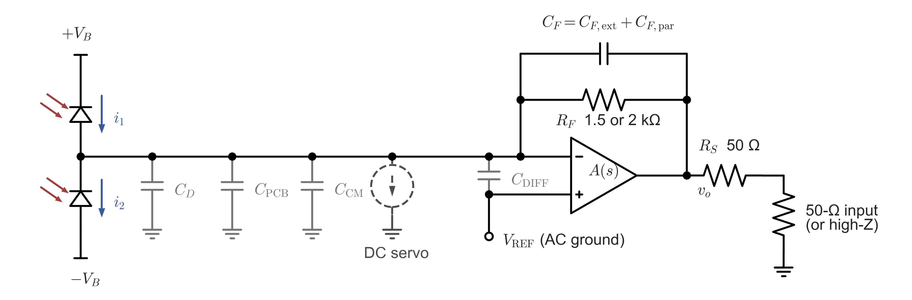

*Figure 1. Inverting TIA for a balanced photodiode pair, with every capacitance that sets stability and noise; parasitic capacitances are drawn in grey. The upper photodiode delivers $i_1$ into the summing node and the lower one draws $i_2$ from it, so $R_F$ carries $i_1 - i_2$. $C_D = C_{D,A} + C_{D,B}$ is the capacitance of both diodes, $C_{\mathrm{PCB}}$ that of the pads and traces at the node, and $C_{\mathrm{CM}}$ and $C_{\mathrm{DIFF}}$ the amplifier's common-mode and differential input capacitances; together they make the total capacitance from the inverting node to AC ground, $C_T = C_D + C_{\mathrm{PCB}} + C_{\mathrm{CM}} + C_{\mathrm{DIFF}}$ (Section 3.1). $C_F$ is the total feedback capacitance, an optional external capacitor plus the parasitic capacitance of $R_F$ and its pads. The dashed current source is the optional DC servo of Chapter 8, and $R_S$ the optional 50-Ω back-termination into the instrument.*

**Orientation.** The upper diode (anode on the summing node, cathode on $+V_B$) drives its photocurrent into the node; on its own it would move the output below the reference voltage $V_{\mathrm{REF}}$ on the non-inverting input. The lower diode (cathode on the node, anode on $-V_B$) draws current out of the node and moves the output up. In the pair only the sign of the imbalance decides the direction. The two directions give different limits for an uncorrected imbalance whenever the input common-mode range is asymmetric (Section 6.4.1). A single-ended detector is the special case with one diode.

### 1.4 Assumed values

Unless a section says otherwise, the numbers in this note use the values of Table 1.1.

*Table 1.1. Assumed values. Applies to every amplifier.*

| Symbol | Meaning | Value used | Where it comes from |
|---|---|---|---|
| $C_D$ | photodiode capacitance at the summing node, $C_{D,A}+C_{D,B}$ (both diodes of the pair) | 1.0 pF baseline; 2.0 pF option, i.e. 1 pF in each diode (Section 1.2) | design specification |
| $C_{\mathrm{PCB}}$ | pad and trace capacitance at the inverting node | 0.35 pF nominal, 0.2–0.5 pF corners | specified range 0.2–0.5 pF |
| $C_{\mathrm{CM}}$, $C_{\mathrm{DIFF}}$ | amplifier common-mode (inverting input to ground) and differential input capacitance | per datasheet | Table A6.1 |
| $C_T$ | $C_D+C_{\mathrm{PCB}}+C_{\mathrm{CM}}+C_{\mathrm{DIFF}}$ | per amplifier | Eq. (7) |
| $C_{F,\mathrm{par}}$ | parasitic feedback capacitance of $R_F$, its pads and the layout | 0.20 pF nominal, 0.1–0.3 pF corners | specified range 0.1–0.3 pF; Texas Instruments (TI) quotes up to 0.2 pF for the resistor alone [A2] |
| $C_F$ | total feedback capacitance, $C_{F,\mathrm{ext}}+C_{F,\mathrm{par}}$ | designed per amplifier, never below $C_{F,\mathrm{par}}$ | Section 6.2 |
| $R_F$ | feedback resistor | 1.5 kΩ and 2 kΩ | design specification |
| $T$ | temperature | 298.15 K (25 °C) | the temperature of datasheet tables |
| $I_{\mathrm{DC}}$ | total DC photocurrent of the pair, $I_1+I_2$; it sets the shot noise | 0, 0.1, 1 and 10 mA; also 20 mA, i.e. 10 mA in each diode | operating range stated for this design |
| $\Delta I$ | DC imbalance $I_1-I_2$, the only DC that reaches $R_F$ | servoed to zero (Section 8.8); limits without a servo in Section 6.4.1 | balanced detection |
| – | supply voltage per amplifier | 5 V single for the 5-V parts; ±5 V to ±6.5 V for the others (Table A6.3) | datasheet recommended range |

### 1.5 Conventions

**Noise and level units.**
- All noise is referred to the photocurrent. Densities are amplitude spectral densities (ASD) in pA/√Hz; band-integrated values are in nA rms.
- Output noise is put in the same units by dividing it by the in-band transimpedance $R_F$, written $v_o/R_F$. Unlike the input-referred density, it includes the roll-off and peaking of $|Z_T|$, so it is what a following stage sees.
- Power densities in dBm/Hz (into 50 Ω) and noise figures appear only as translations for choosing an instrument (Eqs. (34) and (22)), and in the 50-Ω benchmark of Section 2.1, whose amplifier is specified by its noise figure and its input compression level.
- The amplifiers' voltage-noise specifications $e_n$ remain in nV/√Hz; they enter the input-referred noise through Eq. (19).

**Figures of merit.**
- "Penalty" is the ratio of the total input-referred noise without photocurrent to the Johnson noise of $R_F$ alone, in dB: $20\log_{10}(i_{\mathrm{eq}}/i_{R_F})$ at a spot frequency, and $10\log_{10}$ of the ratio of band-integrated power densities over a band.
- "Shot-noise clearance" at a DC photocurrent is the ratio, in dB, of the photocurrent shot-noise density to all other noise densities at the same frequency.
- "Dynamic range" is the electronic dynamic range of Eq. (27) unless it is called usable. The electronic figure assumes that the light can supply any tone up to the TIA's ceiling; the usable figure of Eq. (28) also caps the tone at $I_{\mathrm{DC}}/\sqrt2$ rms, the most the light can supply (Section 3.8).

**Design labels.** These are used in every table.
- *Flat*: the smallest total $C_F$ that gives ≤ 0.01 dB of transimpedance peaking. If that is below 0.2 pF, the realised design uses $C_F$ = 0.2 pF, the parasitic floor.
- *1-dB*: the smallest $C_F$ with ≤ 1 dB of peaking.
- *Largest phase margin*: the maximum over stable $C_F \ge 0.2$ pF.
- *Robust*: the widest bandwidth with phase margin ≥ 45° and ≤ 1 dB of peaking. Up to 8 pF of capacitance may be added deliberately at the inverting node if that is the only way to reach 45°. The robust design is read on the logarithmic grid of $C_F$ of Section 3.5, whose first point above the 0.2-pF floor is 0.206 pF, so it can come out slightly narrower than a flat design on the floor: OPA855 gives 539 MHz robust at 0.21 pF and 557 MHz flat at 0.20 pF with 58° (Table A6.5).
- *$C_F$ window*: the range of total $C_F$ that keeps the phase margin ≥ 45°, the gain margin ≥ 3 dB and the peaking ≤ 1 dB, and, for a decompensated amplifier, keeps the high-frequency noise gain $1 + C_T/C_F$ at or above the minimum stable gain $G_{\min}$ (Section 6.2.4).

**Datasheet value types.** Each datasheet value carries a label. TYP marks a typical value, which is not guaranteed. MIN and MAX mark limits guaranteed at 25 °C unless stated, by test or, where the datasheet says so, by design. CURVE marks a value read from a typical-characteristics plot, given with its reading uncertainty, and SCOPE and PHOTO mark values read from an oscilloscope trace or a raster photograph. SIM marks a value that the manufacturer labels as simulated, TEXT a value stated in prose, and DERIVED a value computed here from datasheet data. n.s. marks a value the datasheet does not specify.

Datasheet citations such as "p9" or "Fig 6-11" refer to the PDF pages and figures of the revisions listed in Appendix D, which gives each document's literature number and source, and "EC" marks a datasheet's table of electrical characteristics. The documents themselves are available from their manufacturers.

**Status of every number.** Every phase margin, bandwidth and noise value in this note is an **analytical estimate**, from the equations of Chapter 3 with each amplifier's datasheet open-loop curve, unless it is labelled SPICE. The SPICE numbers come from the manufacturers' macromodels: Chapter 4 sets the two side by side for its two designs, Chapter 5 checks the analytical estimates against them, and Sections 6.5–6.6, Section 6.8 and Chapter 7 use them directly. Section 9.7 lists the cases where only a simulation or a measurement can settle the answer.

---

## 2. The approaches, and the 50-Ω benchmark

Every front end trades two quantities: the noise it adds, which sets the smallest signal it can detect, and the largest signal it can pass undistorted, its ceiling. The simplest front end needs no feedback at all. The pair terminated in 50 Ω and followed by an RF amplifier has a ceiling set only by the amplifier's compression, but its termination is far noisier than a 2-kΩ feedback resistor. It is the benchmark that every design in this note has to beat, and Section 2.1 states exactly what beating it takes. The inverting op-amp TIA of Figure 1 makes the opposite trade: it is quiet, but its ceiling is the op amp's output swing and slew rate. Most of this note is about choosing that op amp, and Sections 2.2–2.4 explain how we found and screened the candidates. Single-chip TIAs, made for lidar or for coherent receivers, take the same approach with a fixed amplifier (Section 2.5), and composite front ends add a second active device to the op-amp TIA (Section 2.6).

### 2.1 A plain 50-Ω termination as the benchmark

The oldest front end needs no transimpedance amplifier: the photodiode pair is terminated in $R_0$ = 50 Ω at the summing node, a bias tee carries the DC, and an RF low-noise amplifier (LNA), or a 50-Ω instrument, follows. It has gigahertz of bandwidth and no swing limit at the photodiodes, and at high photocurrent it is competitive. Because its bias tee carries the DC photocurrent, it needs none of the circuits of Sections 8.2–8.5 that keep a large DC current out of a TIA's feedback resistor. We use it as the benchmark for every design in this note: a TIA is worth building only where it beats this chain, and this section states what that takes.

**The chain.** We take the termination in parallel with the amplifier's matched input, so the photocurrent sees $R_0/2$ = 25 Ω, and the termination is the 50-Ω source to which the amplifier's noise figure refers. An rms photocurrent $I$ at the tone then delivers to the amplifier the power $(IR_0/2)^2/R_0 = I^2R_0/4$. The amplifier's input noise, referred to its 50-Ω source, is the available power $Fk_BT$ per hertz, the source's own $k_BT$ and the amplifier's $(F-1)k_BT$, with $F = 10^{\mathrm{NF}/10}$ its noise factor, $k_B$ Boltzmann's constant and $T$ = 298.15 K. Setting $I^2R_0/4$ per hertz equal to $Fk_BT$ gives the noise density referred to the photocurrent:

$$
P = \frac{I^2R_0}{4},
\qquad
S_{50} = \frac{4Fk_BT}{R_0}.
\tag{1}
$$

With a noiseless amplifier ($F$ = 1) this is the Johnson noise of 50 Ω, $\sqrt{4\times1.381\times10^{-23}\ \mathrm{J/K}\times298.15\ \mathrm{K}/50\ \Omega}$ = 18.15 pA/√Hz. With NF = 2 dB ($F$ = 1.585) it is $\sqrt{1.585}\times18.15$ = 22.85 pA/√Hz, and over $B$ = 150 MHz it integrates to $22.85\ \mathrm{pA/\sqrt{Hz}}\times\sqrt{1.5\times10^{8}\ \mathrm{Hz}}$ = 279.8 nA rms. Against the Johnson noise $4k_BT/R_F$ of the feedback resistor the chain is noisier by $10\log_{10}(FR_F/R_0)$: 18.0 dB at 2 kΩ and 16.8 dB at 1.5 kΩ.

**Noise against shot noise.** The chain's noise $S_{50}$ equals the shot noise $2qI_{\mathrm{DC}}$ of the pair at

$$
I_{x,50} = \frac{2Fk_BT}{qR_0} = F \times 1.03\ \mathrm{mA}.
\tag{2}
$$

For a 2-dB noise figure, $F$ = 1.58 and $I_{x,50}$ = 1.6 mA. Table A2.1 compares the excess over pure shot noise with the 2-kΩ OPA855 TIA.

**Advantages.**
- The bandwidth is $1/(2\pi\cdot25\,\Omega\cdot1\,\mathrm{pF})$ = 6.4 GHz with the termination and the amplifier's input in parallel, and 3.2 GHz into the amplifier's 50 Ω alone.
- There is no swing limit at the photodiode: the RF voltage is only $(R_0/2)\,i_{\mathrm{RF}}$, 25 mV for 1 mA.
- The dynamic range is then set by the LNA's compression and by the photodiode's own linearity.

**Ceiling and dynamic range.** The amplifier's input compresses at a power $P_{\max}$: its input-referred 1-dB compression point, or the level at which its distortion reaches what the receiver tolerates. By Eq. (1) the largest undistorted rms photocurrent, and the dynamic range in the noise bandwidth $B$ with the shot noise of $I_{\mathrm{DC}} = I_1 + I_2$ included, are

$$
I_{\max,50} = 2\sqrt{\frac{P_{\max}}{R_0}},
\qquad
\mathrm{DR}_{50} = 20\log_{10}\frac{I_{\max,50}}{\sqrt{\left(S_{50} + 2qI_{\mathrm{DC}}\right)B}}.
\tag{3}
$$

In the dark the second form reduces to the dynamic range of any RF receiver, $10\log_{10}[P_{\max}/(Fk_BTB)]$:

$$
\mathrm{DR}_{50}\big|_{I_{\mathrm{DC}}=0} = P_{\max}[\mathrm{dBm}] - \mathrm{NF}[\mathrm{dB}] + 173.9 - 10\log_{10}B[\mathrm{Hz}]
= P_{\max}[\mathrm{dBm}] - \mathrm{NF}[\mathrm{dB}] + 92.1\ \mathrm{dB},
\tag{4}
$$

where 173.9 dB is $-10\log_{10}[k_BT/(1\ \mathrm{mW}\cdot1\ \mathrm{s})]$ at 25 °C and $10\log_{10}(1.5\times10^{8})$ = 81.8 dB.

We do not tie the benchmark to one amplifier. We take NF = 2 dB, which good 50-Ω low-noise amplifiers reach at 100 MHz, and three input compression levels, $P_{\max}$ = −20, −10 and 0 dBm; Table A2.2 gives the family. At −10 dBm, for example, $I_{\max,50} = 2\sqrt{10^{-4}\ \mathrm{W}/50\ \Omega}$ = 2.83 mA rms, and Eq. (4) gives −10 − 2 + 92.1 = 80.1 dB in the dark. With 1 mA of photocurrent the shot noise adds $\sqrt{2qI_{\mathrm{DC}}B}$ = 219.2 nA rms to the 279.8 nA, in power, and the dynamic range falls to $20\log_{10}(2.83\ \mathrm{mA}/355.5\ \mathrm{nA})$ = 78.0 dB.

**What the light can supply.** Eq. (3) gives an electronic dynamic range: it assumes that the light can drive a tone up to the amplifier's ceiling. In a balanced pair the light cannot drive a tone larger than $I_{\mathrm{DC}}/\sqrt2$ rms, because the tone's peak cannot exceed the total photocurrent $I_1 + I_2$, whether the light is intensity-modulated or a heterodyne beat (Eq. (28), Section 3.8). Below $I_{\mathrm{DC}} = \sqrt2\,I_{\max,50}$, which is 1.26, 4.0 and 12.6 mA for the three compression levels, no light can drive the chain into compression, and its usable dynamic range is the same whatever $P_{\max}$ is: 47.8 dB at 0.1 mA and 66.0 dB at 1 mA. A higher compression level helps only above that photocurrent.

**What a TIA must do to beat it.** For the same signal a TIA beats the chain where its band noise is lower, where its ceiling is higher, or both. Three comparisons settle where that is. For the TIA they use three quantities that Chapters 3 and 6 derive: its input-referred noise density without photocurrent, $S_{i,0}(f)$ (Eq. (19) with $I_{\mathrm{DC}} = 0$); its band noise with the shot noise included, $i_{n,B} = \sqrt{\int_0^B S_{i,0}\,df + 2qI_{\mathrm{DC}}B}$ (Eq. (49)); and its ceiling, the largest undistorted rms tone, $I_{\max} = V_{\mathrm{pk}}/(\sqrt2\,|Z_T|)$, with $V_{\mathrm{pk}}$ its largest output amplitude (Eq. (26)) and $|Z_T|$ its transimpedance at the tone (Eq. (9)).

*Small signal.* For the same small tone, the TIA's signal-to-noise ratio exceeds the chain's by the ratio of the band noises, $A = 20\log_{10}(i_{n,B,50}/i_{n,B})$, with $i_{n,B,50} = \sqrt{(S_{50} + 2qI_{\mathrm{DC}})B}$ for the chain and $i_{n,B}$ for the TIA. Both carry the same shot noise, so $A$ is positive whenever the TIA's own band noise is below the chain's, $\int_0^B S_{i,0}\,df < S_{50}B$, which for NF = 2 dB means less than 22.85 pA/√Hz on average over the band. $A$ shrinks toward zero as the photocurrent grows and the shared shot noise takes over; Section 6.8 shows that every design we carry forward keeps a positive $A$ at every photocurrent. The receiver of Section 1.1, a small RF signal on 0.1–10 mA, is in this regime.

*Electronic dynamic range.* The TIA's ceiling $I_{\max}$ equals the chain's when the chain compresses at $P_{\mathrm{eq}}$, and their electronic dynamic ranges are equal when it compresses at $P_x$:

$$
P_{\mathrm{eq}} = \frac{R_0}{4}\,I_{\max}^2,
\qquad
P_x\,[\mathrm{dBm}] = P_{\mathrm{eq}}\,[\mathrm{dBm}] + A\,[\mathrm{dB}].
\tag{5}
$$

The second form follows from Eq. (3): equal dynamic ranges need $I_{\max,50}/i_{n,B,50} = I_{\max}/i_{n,B}$, i.e. $I_{\max,50} = I_{\max}\,10^{A/20}$, and since the power goes as the square of the current that is $A$ decibels more power than $P_{\mathrm{eq}}$. A chain that compresses above $P_x$ has the larger electronic dynamic range, one that compresses below it the smaller.

*Usable dynamic range.* For a chain that compresses above $P_{\mathrm{eq}}$, the light limits the tone in both front ends up to $I_{\mathrm{DC}} = \sqrt2\,I_{\max}$, and the TIA leads by $A$. Above it the TIA clips while the chain still follows the light, and the chain overtakes the TIA where the chain's light-limited dynamic range exceeds the TIA's electronic one. To keep its lead with fully modulated light up to $I_{\mathrm{DC}}$, the TIA needs $I_{\max} \ge (I_{\mathrm{DC}}/\sqrt2)\,10^{-A/20}$, i.e. an output amplitude

$$
V_{\mathrm{pk}} = \sqrt2\,|Z_T|\,I_{\max} \ge |Z_T|\,I_{\mathrm{DC}}\,10^{-A/20},
\tag{6}
$$

which tends to $R_FI_{\mathrm{DC}}$ at high photocurrent, where $A \to 0$. At 2 kΩ and 10 mA that limit is $R_FI_{\mathrm{DC}}$ = 20 V; Section 6.8 evaluates Eq. (6) for each leading design and sets it against the design's output amplitude.

Section 4.8 applies these three comparisons to the two design examples of Chapter 4, Section 6.8 to every leading design, and Section 9.4 collects the outcome; Chapter 7 asks what it takes to raise a TIA's ceiling.

### 2.2 How the list of op-amp candidates was built

The inverting op-amp TIA of Figure 1 is the front end this note designs, so the list of amplifiers we analyse decides what the comparisons of Chapter 6 can find. We built it in three steps, from six parts known at the start, through a search across manufacturers, to a selection rule aimed at the four equations of Section 4.1. This section gives each step with the parts it kept and removed.

**The starting list.** Six parts were on the list from the start of the study: OPA847, OPA846, OPA818, OPA855, OPA856 and ADA4899-1.

**The search.** From these six, the search extended across manufacturers:
- Texas Instruments: 47 product pages checked;
- Analog Devices (ADI), including Linear Technology and Maxim;
- 3PEAK;
- Renesas and Intersil;
- STMicroelectronics;
- onsemi, Microchip, Nisshinbo, ROHM, SGMICRO, Runic and Novosense.

**Selection rule.** A voltage-feedback amplifier qualified by one of three routes, each aimed at a term of the four equations of Section 4.1.
- A low-noise part qualified with a gain–bandwidth product (GBW) of at least about 800 MHz (at least 1 GHz if decompensated) and $e_n$ ≤ 3 nV/√Hz (bipolar) or ≤ 6 nV/√Hz (FET). By Eq. (35), 800 MHz gives $12.62\sqrt{800/(2\times2.35)}$ = 165 MHz at 2 kΩ on the 2.35 pF of the OPA855 design of Section 4.2, so a slower part misses 150 MHz even with an input capacitance as small as OPA855's.
- A part with unusually low input capacitance qualified at a lower GBW, because a low capacitance lowers $C_{\mathrm{tot}}$ both in the bandwidth of Eq. (35) and in the $e_n$ term of Eq. (33).
- A part with ±5 V of output swing qualified with a GBW of at least 500 MHz, because the dynamic range grows with the output amplitude (Eq. (36)).

**Result.** 25 parts were analysed in full, with LMH6629 in two compensation settings, so 26 configurations; Table A2.3 groups them. Five of the analysed parts fall below the GBW floor of the first route: THS4271, AD8045 and ADA4817-1, with 400–410 MHz; ADA4899-1, one of the six starting parts, whose GBW is not specified (about 300–370 MHz derived); and OPA843, whose 800 MHz misses the 1-GHz floor for decompensated parts ($G_{\min}$ = 3). They were analysed all the same. The first four miss 150 MHz, as the floor predicts, and OPA843 reaches it only marginally (Section 6.2.1).

**Excluded families.** Current-feedback amplifiers are excluded: their inverting input has a low impedance and tens of pA/√Hz of current noise, which a 2-kΩ TIA cannot tolerate. Fully differential amplifiers (LTC6409) and integrated TIAs are listed in Sections 2.3 and 2.5.

**Rejected parts.** The reasons are recorded in `data/market_scan.md`:
- obsolete or last-time-buy: OPA686/687/643/642/655, MAX4105/4106/4107/4305, LTC6252;
- too slow: OPA656, OPA659, THS4631, THS4031, OPA842, LMH6628, LTC6226/7, NJM2725, SGM8058x;
- too noisy: NCS2551.

**The landscape.** Figure 2 shows the analysed parts in the plane that matters first, input voltage noise against GBW. The marker size is proportional to input capacitance, which multiplies $e_n$ in the noise of Eq. (19).

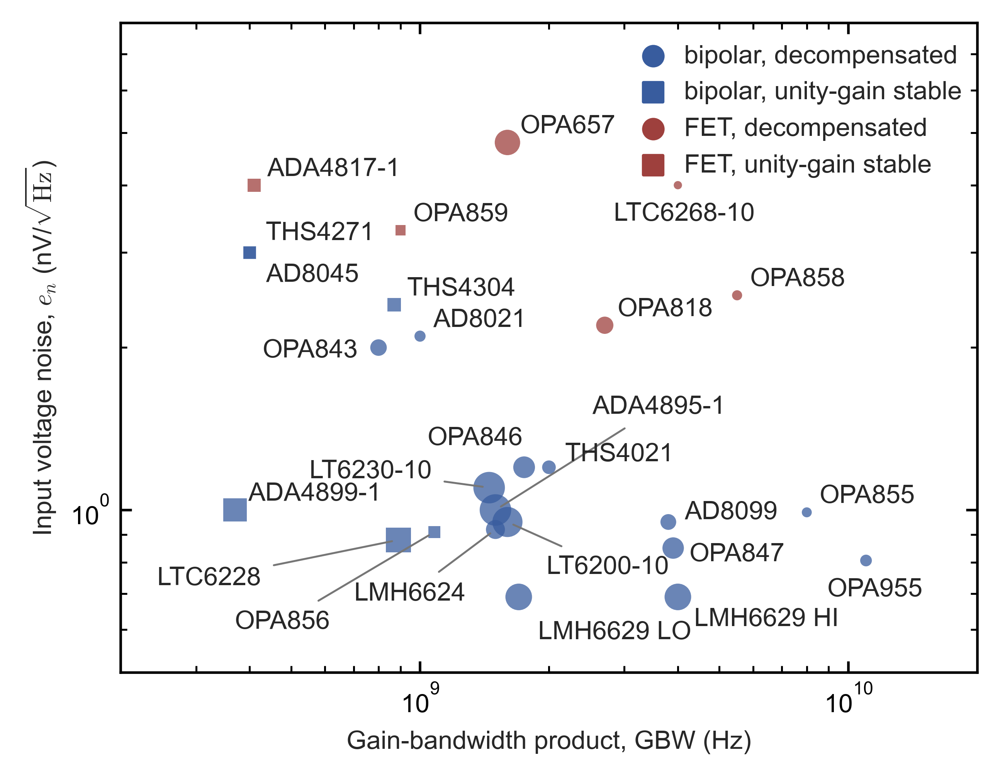

*Figure 2. Input voltage noise against gain–bandwidth product. Amplifiers: all 25 analysed parts, each labelled in the plot; LMH6629 appears twice, with its compensation pin high (COMP HI) and low (COMP LO). Circles are decompensated, squares unity-gain stable; blue is bipolar, dark red FET or CMOS input. Marker area is proportional to $C_{\mathrm{CM}} + C_{\mathrm{DIFF}}$, capped at 8 pF. Values are datasheet typicals (Tables A6.1 and A6.2). The figure is a map, not a ranking: OPA847, AD8099 and LTC6268-10 sit in the attractive corner and fail on stability (Section 6.2).*

### 2.3 Parts with datasheets in hand that were not analysed

Table A2.4 lists the parts whose datasheets we read but did not analyse in full, with the reason for each. OPA817, OPA814 and LMH6609 reach only 59–75 MHz at 2 kΩ, OPA699 about 140 MHz with 11 dB more noise than the 2-kΩ floor at 100 MHz, LTC6409 is a fully differential amplifier, and OPA857 and LMH32401 are integrated TIAs (Section 2.5). Where the datasheet gives no reason, we derive it with the bandwidth and noise equations of Section 4.1, Eqs. (35) and (33).

### 2.4 Candidates found in the market scan but not modelled

Table A2.5 lists the parts that passed the selection rule, or came close, but for which no open-loop curve was digitized, so they do not appear in Sections 6.2–6.4. Among them, TPH2861 from 3PEAK is an OPA855-class part and a possible second source. Their status and prices are in `data/market_scan.md`.

### 2.5 Single-chip TIAs

A single-chip TIA puts the amplifier and its feedback resistor on one die. It would replace the whole front end with one part, and its feedback capacitance would no longer depend on the board, so it is worth asking whether one suits this receiver. In the balanced pair with its imbalance servoed to zero (Sections 1.2 and 8.8), a single-chip TIA carries no DC, so what decides is its linear input range against its noise; Section 6.7 compares both with the op-amp designs on the definition of Eq. (50). Two classes exist. The first is built for pulsed microampere-level signals in lidar and avalanche-photodiode (APD) receivers, with high transimpedance, input clamps, and DC ranges of microamperes to about 3 mA. Table A2.4 covers the two whose datasheets were read, OPA857 and LMH32401, and the market scan also found:
- LMH32404 (4 channels, 20 kΩ, 350 MHz);
- LMH34400 (40 kΩ, 240 MHz);
- MAX40658/MAX40659 (18/36 kΩ, 360 MHz);
- MAX40660/MAX40661 (25/50 kΩ, up to 490 MHz);
- MAX40662 (4 channels);
- LTC6560/LTC6561 (74 kΩ, 220 MHz, linear to 30 µA);
- ADA4355 (a receiver module with ADC);
- HMC799 (10 kΩ, 700 MHz, last-time-buy).

**LMH32401** comes closest. It has a 2-kΩ setting, 450 MHz at 1 pF (Table A2.4; 461 MHz read from its Fig 6-1, Table A6.34) and 8.7 pA/√Hz at 100 MHz, 6.4 dB above the 2-kΩ OPA855 design (LMH32401 p11–p12, Figs 6-1 and 6-11). Its DC limits matter for a single-ended detector, which would put the whole photocurrent on its input: it carries only 0.7 mA without its ambient-light cancellation, and the cancellation is limited to 2 mA (minimum) to 3 mA (typical), works only with the photodiode sinking current, and adds noise (p9, p21–p23).

The other lidar TIAs (MAX40658–MAX40662, LTC6560/6561, LMH32404, LMH34400, HMC799) specify no operation with milliamperes of DC. The second class, the TIAs of coherent optical receivers, is made for this topology: a balanced pair with one photodiode on each of two inputs, whose DC each input removes with its own loop. Their gain control holds the output at a few hundred millivolts, which limits their linear input at the gains where their noise is published. Section 6.7 treats both classes, together with three optical-communication TIAs that are not linear amplifiers in this sense, and finds every single-chip TIA with public figures at least 8.8 dB behind the op-amp designs at 1 mA; the best lidar TIA, LMH32401, is 10.4–13.5 dB behind.

### 2.6 Composite front ends and the DC photocurrent

An op-amp TIA leaves two quantities to the amplifier that a discrete stage can improve. Its noise floor is set by the amplifier's input transistors; a low-noise transistor at the summing node, a silicon JFET, a GaAs pHEMT (pseudomorphic high-electron-mobility transistor) or a SiGe bipolar transistor, can take over that role while the op amp supplies the loop gain (Section 7.1). Its ceiling is set by the amplifier's output swing and slew rate; a fast high-voltage amplifier inside the $R_F$ loop can raise it (Section 7.2). Both are composites, whose loop closes around two or three active stages, and their stability needs its own analysis, which Chapter 7 gives with SPICE verification.

The DC photocurrent constrains every option. In the balanced pair only the imbalance reaches $R_F$ (Section 1.2). Chapter 8 gives four ways of removing a large DC current, a resistive sink driven by a slow servo, AC coupling, an inductive bias tee and a two-stage split of the gain, which matter for a single-ended detector and for an imbalance too large to servo (Sections 8.2–8.5). It shows why bootstrapping and cascoding the photodiodes do not pay at 0.5–1 pF (Sections 8.6 and 8.7), gives the servos for the imbalance and for the photodiode bias (Section 8.8), and ends with the proposed balanced front end (Section 8.9).

---

## 3. TIA theory

Before any design is laid out, this chapter derives the relations that every design in this note rests on, from the circuit of Figure 1: the transimpedance, the noise gain and the loop gain, the stability of a decompensated amplifier, the open-loop model that gives the phase margins, the noise and the definitions of dynamic range. It then checks the model where it can be checked without a simulator. Chapter 4 applies these relations to two designs and collects the four that give a first estimate in practical units. The derivation runs from the capacitance at the summing node (Section 3.1) through the feedback loop and its stability (Sections 3.2–3.5) to the noise (Sections 3.6–3.7) and the dynamic range (Section 3.8). The checks compare the model with the closed-loop and TIA data printed in the datasheets (Section 3.9) and with a bench measurement on an OPA846 board (Section 3.10). Symbols are defined where they first appear in each section.

### 3.1 Total input capacitance

The stability, the bandwidth and the noise derived below all depend on the capacitance from the inverting node to AC ground, which sets the noise gain and multiplies $e_n$ in the noise. All capacitance between the inverting node and AC ground adds. The non-inverting input sits at a decoupled reference, so the differential input capacitance $C_{\mathrm{DIFF}}$ also connects the inverting node to AC ground:

$$
C_T = C_D + C_{\mathrm{PCB}} + C_{\mathrm{CM}} + C_{\mathrm{DIFF}}
\tag{7}
$$

Here $C_D = C_{D,A} + C_{D,B}$ is the capacitance of both photodiodes, $C_{\mathrm{PCB}}$ the pad and trace capacitance at the inverting node, $C_{\mathrm{CM}}$ the datasheet common-mode capacitance of one input to ground and $C_{\mathrm{DIFF}}$ the capacitance between the two inputs. TI's application report SBOA122 uses the same sum for its "source capacitance" [A1], as do the OPA818 (p20, Fig 8-3) and LMH6629 (p28) datasheets.

### 3.2 Transimpedance, noise gain and loop gain

Three functions describe the TIA: its transimpedance, which turns the photocurrent into a voltage; its noise gain, which acts on the amplifier's voltage noise; and its loop gain, which decides whether it is stable. The feedback network is $R_F$ in parallel with the total feedback capacitance $C_F$:

$$
Z_F(s) = \frac{R_F}{1 + sR_FC_F}
\tag{8}
$$

where $s=j2\pi f$ is the complex frequency.

Kirchhoff's current law at the inverting node, with node voltage $v_-$ and output voltage $v_o$, reads $i_{\mathrm{ph}} = sC_Tv_- + (v_- - v_o)/Z_F$. The amplifier imposes $v_o = -A(s)\,v_-$, where $A(s)$ is the open-loop gain. Eliminating $v_-$ gives the transimpedance

$$
Z_T(s) \equiv \frac{v_o}{i_{\mathrm{ph}}} = -\,\frac{Z_F(s)}{1 + \dfrac{1 + sC_TZ_F(s)}{A(s)}} = -\,Z_F(s)\,\frac{T(s)}{1+T(s)}
\tag{9}
$$

with the noise gain $NG(s)$ and the loop gain $T(s)$ defined as

$$
NG(s) = 1 + sC_TZ_F(s) = \frac{1 + sR_F\,(C_T + C_F)}{1 + sR_FC_F},
\qquad
T(s) = \frac{A(s)}{NG(s)}.
\tag{10}
$$

The noise gain is the closed-loop gain seen by the amplifier's own input voltage noise. It has a zero at $f_z = 1/[2\pi R_F(C_T+C_F)]$, a pole at $f_p = 1/(2\pi R_FC_F)$, and the high-frequency asymptote

$$
NG_\infty = 1 + \frac{C_T}{C_F}.
\tag{11}
$$

The loop crosses over at the frequency $f_c$ where $|A(j2\pi f_c)| = |NG(j2\pi f_c)|$, and the phase margin is $\phi_M = 180^\circ + \angle T(j2\pi f_c)$. Two consequences matter for the design. In band, where $|T| \gg 1$, $Z_T \approx -Z_F$, so $R_F$ and $C_F$ alone set the gain. Near crossover $T/(1+T)$ peaks when the margin is small, while $Z_F$ is already rolling off, so a flat $|Z_T|$ does not prove an adequate margin (Section 5.2, Figure 17).

### 3.3 A flat (Butterworth) response with a single-pole amplifier

With $R_F$ fixed by the specification, the feedback capacitance $C_F$ is the one value left to choose, and it decides both how flat the response is and how far it extends. For an amplifier with a single pole the loop can be solved exactly, and the solution gives the $C_F$ of a maximally flat response and the bandwidth it reaches. These are the formulas behind the bandwidth estimate of Eq. (35), with which Chapter 4 lays out its two designs, and the starting point of every design in Chapter 6. Above its dominant pole a compensated amplifier behaves as $A(s)=\omega_A/s$, with $\omega_A = 2\pi\,\mathrm{GBW}$ and GBW the gain–bandwidth product in hertz. Substituting this and Eq. (8) into Eq. (9):

$$
Z_T(s) = \frac{-R_F}{1 + s\left(R_FC_F + \dfrac{1}{\omega_A}\right) + s^2\,\dfrac{R_F(C_T+C_F)}{\omega_A}}.
\tag{12}
$$

This is a second-order low-pass. Comparing it with $1/(1 + s/(Q\omega_0) + s^2/\omega_0^2)$ gives the natural frequency $\omega_0$ and quality factor $Q$:

$$
\omega_0 = \sqrt{\frac{\omega_A}{R_F\,(C_T+C_F)}}, \qquad \frac{1}{Q\,\omega_0} = R_FC_F + \frac{1}{\omega_A}.
\tag{13}
$$

A maximally flat (Butterworth) response has $Q = 1/\sqrt{2}$, and its −3-dB frequency equals $\omega_0/2\pi$. Setting $Q=1/\sqrt2$ in Eq. (13), squaring and cancelling the common term $2R_FC_F/\omega_A$:

$$
\left(R_FC_F\right)^2 = \frac{2R_FC_T}{\omega_A} - \frac{1}{\omega_A^2}
\;\;\Rightarrow\;\;
C_F \simeq \sqrt{\frac{2\,C_T}{2\pi R_F\,\mathrm{GBW}}},
\qquad
f_{-3\,\mathrm{dB}} = \sqrt{\frac{\mathrm{GBW}}{2\pi R_F\,(C_T + C_F)}}.
\tag{14}
$$

The approximation drops $1/\omega_A^2$, which is valid when $R_FC_T\omega_A \gg 1$; for 2 kΩ, 2.5 pF and 1.6 GHz this product is 50. Two comparisons with TI's forms:
- The bandwidth expression is TI's Eq. (12) in SBOA122 [A1] with $C_F$ kept in the sum.
- The $C_F$ expression is TI's $C_F = 1/(2\pi\cdot0.707\,R_Ff_{-3\,\mathrm{dB}})$ written differently [A2].

TI's datasheet "TIA bandwidth" curves use $f_{-3\,\mathrm{dB}} = \sqrt{\mathrm{GBW}/(2\pi R_F C_{\mathrm{TOT}})}$ with $C_F$ and the PCB capacitance left out of $C_{\mathrm{TOT}}$ (Section 3.9). That omission makes them 10–15 % more optimistic than Eq. (14) at 2 kΩ.

**In practical units.** With GBW in MHz, $R_F$ in kΩ and capacitances in pF, Eq. (14) becomes the form that Chapter 4 uses (Eq. (35)):

$$
f_{-3\,\mathrm{dB}}\,[\mathrm{MHz}] = 12.62\sqrt{\frac{\mathrm{GBW}[\mathrm{MHz}]}{R_F[\mathrm{k\Omega}]\;C_{\mathrm{tot}}[\mathrm{pF}]}},
\qquad
C_F\,[\mathrm{pF}] = 17.84\sqrt{\frac{C_T[\mathrm{pF}]}{R_F[\mathrm{k\Omega}]\;\mathrm{GBW}[\mathrm{MHz}]}},
\tag{15}
$$

where $C_{\mathrm{tot}} = C_T + C_F$. The constants are $12.62 = \sqrt{10^6/(2\pi\cdot10^3\cdot10^{-12})}/10^6$ and $17.84 = 10^{12}\sqrt{2\cdot10^{-12}/(2\pi\cdot10^3\cdot10^6)}$.

*Example.* Take a unity-gain-stable amplifier with GBW = 1600 MHz, $R_F$ = 2 kΩ and $C_T$ = 2.5 pF.
- It needs $C_F = 17.84\sqrt{2.5/(2\times1600)} = 0.499$ pF; the exact Eq. (14) gives 0.496 pF.
- It reaches $f_{-3\,\mathrm{dB}} = 12.62\sqrt{1600/(2\times2.996)} = 206$ MHz.
- The numerical model of Section 3.5, used in Sections 6.2–6.4, reproduces 206.1 MHz, zero peaking and a phase margin of 66.9° for this case.

**Trading flatness for bandwidth.** Reducing $C_F$ below the Butterworth value raises the bandwidth at the cost of peaking. For the single-pole amplifier the model gives Table A3.1: 1 dB of peaking yields 1.28 times the Butterworth bandwidth with 0.69 of its $C_F$ and 54.3° of phase margin, and 3 dB yields 1.46 times at 41.8°.

The frequently quoted rule $C_F = \sqrt{C_T/(2\pi R_F\,\mathrm{GBW})}$ (for example AN-1803 [A5]) is the Butterworth value divided by $\sqrt2$. In this model it gives 0.89 dB of peaking and 55° of phase margin, not the 45° stated there.

### 3.4 When a decompensated amplifier is stable in a TIA

Most of the parts with sub-nanovolt $e_n$ are decompensated: their internal compensation is lighter than that of a unity-gain-stable part, which buys gain–bandwidth but leaves them stable only at closed-loop gains of at least a minimum $G_{\min}$. Whether such a part can serve a 2-kΩ TIA on a 1-pF photodiode is the first question the comparison of Chapter 6 asks. This section derives the answer: a condition on the capacitance at the summing node, Eq. (16), and a split of the phase margin into the amplifier's own share and the share the feedback network takes, Eq. (17).

**The stability condition.** A decompensated amplifier is stable only when the loop crosses over at an open-loop gain of at least its minimum stable gain $G_{\min}$. Below that gain, the amplifier's second pole has already removed too much phase.
- In a resistive-feedback stage the loop crosses where $|A| = 1 + R_2/R_1$.
- In a TIA it crosses where $|A| = |NG(f_c)|$, so the quantity to compare with $G_{\min}$ is the noise gain **at the crossover frequency**.

TI makes the same point: the minimum gain matters only where the open-loop gain and the noise gain intersect [A6].

**A necessary condition on $C_T$.** The asymptote $NG_\infty$ of Eq. (11) overstates $|NG(f_c)|$, because crossover happens before the noise gain has flattened. In the single-pole Butterworth example of Section 3.3, $|NG(f_c)| = 5.34$ while $NG_\infty = 6.04$, a ratio of 0.885.

Insert the Butterworth $C_F$ of Eq. (14) into Eq. (11), which gives $C_T/C_F = \sqrt{\pi R_F\,\mathrm{GBW}\,C_T}$, and demand $NG_\infty \ge G_{\min}$:

$$
C_T \;\ge\; C_{T,\min} = \frac{2\,(G_{\min}-1)^2}{2\pi R_F\,\mathrm{GBW}},
\qquad
C_{T,\min}\,[\mathrm{pF}] = 318.3\,\frac{(G_{\min}-1)^2}{R_F[\mathrm{k\Omega}]\;\mathrm{GBW}[\mathrm{MHz}]}.
\tag{16}
$$

A decompensated amplifier on a source whose total capacitance is below $C_{T,\min}$ cannot have both a flat response and enough noise gain at crossover. The designer must then do one of three things:
- accept peaking (smaller $C_F$, larger $NG_\infty$);
- add capacitance at the input, which raises the $e_n$ noise (Section 3.6);
- choose another amplifier.

*Example.* A part with $G_{\min} = 12$ and GBW = 3900 MHz (OPA847) at $R_F$ = 2 kΩ needs $C_T \ge 318.3\times11^2/(2\times3900) = 4.94$ pF.

**Where the phase margin goes.** Eq. (16) is necessary but not sufficient. Writing $T = A/NG$ splits the phase margin into a property of the amplifier and a property of the feedback network:

$$
\phi_M = \underbrace{\left[180^\circ + \angle A(j2\pi f_c)\right]}_{\phi_A(f_c)} \;-\; \angle NG(j2\pi f_c),
\qquad
\angle NG(j2\pi f) = \arctan\frac{f}{f_z} - \arctan\frac{f}{f_p}.
\tag{17}
$$

*The first term.* $\phi_A(f_c)$ is the phase margin the same amplifier would have in a resistive stage whose noise gain equals $|A(f_c)|$. Datasheets quote it at $G_{\min}$; OPA818, for example, has about 50° at 7 V/V (p16).

*The second term.* This is the phase lead of the TIA's noise gain. It is positive because the zero $f_z$ lies below the pole $f_p$, and it is subtracted.

*Check on the single-pole example of Section 3.3.* The loop crosses at $f_c$ = 1600/5.34 = 300 MHz, with $f_z$ = 26.6 MHz and $f_p$ = 160 MHz. So $\angle NG = 84.9^\circ - 61.8^\circ = 23.1^\circ$ and $\phi_M = 90^\circ - 23.1^\circ = 66.9^\circ$, exactly the numerical result.

*What it means for decompensated parts.* At its minimum stable gain a decompensated amplifier typically has $\phi_A$ ≈ 50–55°; OPA855, with 62° stated and about 74° on its curve (Table A3.2), is the exception. The noise-gain lead then leaves little: in the OPA818 and OPA846 designs of Table A6.11, $\phi_A$ = 48.2–55.3° and $\angle NG$ = 14.1–23.5° leave $\phi_M$ = 31.6–34.5°. This is the mechanism behind the OPA818 and OPA846 results of Section 6.2.6.

There are only two ways to raise the phase margin:
- make the loop cross at a larger noise gain, where $\phi_A$ is larger. That needs more $C_T$, hence more noise, because lowering $C_F$ instead raises the noise-gain lead at least as much as $\phi_A$ (Table A6.11, Section 6.2.6);
- use an amplifier whose $G_{\min}$ is well below the TIA's noise gain, as OPA855 is here: its $\phi_A$ is 80–83° at the 2-kΩ crossover.

The alternative, accepting the low margin and equalizing the peaking, is examined in Section 6.2.8.

### 3.5 The open-loop model behind every phase margin

The single-pole results of Section 3.3 ignore the higher poles that make a decompensated amplifier decompensated, and near its minimum stable gain those poles set the phase margin (Section 3.4). Every analytical phase margin in this note therefore rests on the amplifier's own open-loop data; this section says where those data come from and how far they can be trusted.

**Primary model: the datasheet curve itself.** The open-loop gain (dB) and phase (degrees) were digitized from each datasheet's open-loop plot:
- from the PDF vector paths where the plot is vector graphics, with an uncertainty of about ±0.2 dB and ±1°;
- by reading the raster otherwise, with about ±0.5–1 dB and ±2–5°.

The model interpolates both linearly in log-frequency and continues the last segment beyond the highest plotted point.

Phase conventions were normalised:
- curves plotted as $180^\circ + \angle A$ (LTC6228, ADA4899-1, LMH6629, AD8021, LT6200-10, LT6230-10) received a −180° offset;
- LTC6228's off-scale phase below 20 MHz was set to the dominant-pole value of −90°.

**Check model.** A least-squares fit of

$$
A(s) = \frac{A_0\,e^{-s\tau}}{(1 + s/\omega_1)(1 + s/\omega_2)(1 + s/\omega_3)}
\tag{18}
$$

to the same points, with $A_0$ the DC gain, $\omega_1$ the dominant pole, $\omega_{2,3}$ two higher poles and $\tau$ an excess-phase delay. Where the two models disagree the tables quote the interpolated one.

**Calibrated variant.** Three TI datasheets state a phase margin or GBW in the text or table that disagrees with their own plotted curve (Table A3.2).

For these parts a calibrated variant scales the curve's magnitude to the table GBW and adds the pure delay that reproduces the text phase margin at the stated gain. It is reported alongside the plotted curve (Section 6.2.3). For all three parts the vendors' macromodels side with the stated values rather than with the plotted curves (Section 5.4).

**Constructed model.** LTC6268-10 has no usable open-loop curve, so it uses a two-pole model with 4 GHz GBW and an assumed 45° at gain 10.

**How the loop is evaluated.** For every candidate and both feedback resistors, Eqs. (9)–(10) were evaluated with this open-loop model on 6000 logarithmically spaced points from 10 kHz to 50 GHz.

The loop metrics were taken as follows:
- **Crossover** is the first downward crossing of $|T| = 1$, and the phase margin is read there.
- **Gain margin** is read where the loop phase first reaches −180°.
- **Second crossing.** A design whose loop gain rises above 1 again beyond 1.2 $f_c$ is counted as unstable. This happens at the 4–7 GHz open-loop bumps of OPA855 and OPA955 when $C_F$ is too large.
- **Design search.** $C_F$ was scanned from 0.02 to 3 pF on a logarithmic grid of 160 values. The flat and 1-dB designs were then refined by bisection; the robust design was read on the grid, whose first point above the 0.2-pF floor is 0.206 pF.

**Limits that apply to every number derived this way.**
- Datasheet open-loop curves are typical curves at one stated load, and several are labelled simulated.
- A 100-Ω load (a back-terminated 50-Ω cable) lowers the open-loop gain of parts with tens of ohms of open-loop output impedance.
- The model omits package and board parasitics beyond $C_{\mathrm{PCB}}$ and $C_{F,\mathrm{par}}$.
- Above the highest plotted frequency, about 1 GHz for most parts, the loop gain is the curve's last segment continued, so a gain margin or second crossing found there is only indicative; the upper limit of $C_F$ is therefore the manufacturers' minimum-gain rule (Section 6.2.4).
- The curves give the gain from the non-inverting input, while the TIA drives the inverting one. Above 1 GHz the two differ, which with the loaded output impedance makes this method's gain margins 4–7 dB optimistic (Sections 5.3 and 5.9).

TI's OPA858 reference design shows the size of the effect for a first-order estimate: the hand calculation predicted 55° of phase margin, and the vendor macromodel gave 45.9° at 267 MHz [A7]. Section 3.9 compares the model with every TIA response printed in the datasheets. Phase margins below about 50° should be read with the SPICE results of Chapter 5 where they cover the design, and as needing a measurement otherwise.

### 3.6 Noise referred to the photocurrent

The smallest RF photocurrent the TIA can resolve is set by its noise; referring every source to the photocurrent puts the TIA, the shot noise and the 50-Ω benchmark in the same units. Four independent sources are present in Figure 1:
- the Johnson noise current of $R_F$, with power spectral density $4k_BT/R_F$, in parallel with $R_F$;
- the amplifier's input voltage noise $e_n$ (V/√Hz), in series with the non-inverting input;
- the amplifier's input current noise $i_n$ (A/√Hz) at the inverting input (the non-inverting input's current noise is shunted by the reference decoupling);
- the shot noise of the DC photocurrent, $2qI_{\mathrm{DC}}$. For the balanced pair $I_{\mathrm{DC}} = I_1 + I_2$: the shot noises of the two diodes are independent and add in power.

How each reaches the output:
- A current injected at the inverting node, whether signal, $i_n$, the $R_F$ noise or shot noise, reaches the output through $Z_F\,T/(1+T)$, exactly like the signal.
- The voltage noise reaches the output through $NG\,T/(1+T)$.

Dividing the output noise by the signal transfer function $Z_F\,T/(1+T)$ refers each source to the photocurrent. For $e_n$ the closed-loop factor cancels and $NG/Z_F = 1/Z_F + sC_T = 1/R_F + s(C_F + C_T)$. The input-referred current-noise power spectral density is therefore

$$
S_i(f) = \frac{4k_BT}{R_F} + i_n^2 + e_n^2\left[\frac{1}{R_F^2} + \left(2\pi f\,C_{\mathrm{tot}}\right)^2\right] + 2qI_{\mathrm{DC}},
\qquad C_{\mathrm{tot}} = C_T + C_F.
\tag{19}
$$

Eq. (19) assumes that the amplifier's noise is represented by $e_n$ and $i_n$ at its inputs, as the datasheets give it, that $e_n$ acts on the whole of $C_{\mathrm{tot}}$, including the amplifier's own input capacitance, and that $e_n$ and $i_n$ are uncorrelated. Section 3.7 shows where the last two fail for FET inputs, and Section 5.3 finds that OPA846's macromodel drives only 2.28 pF of its 3.07 pF with its $e_n$.

Three features of Eq. (19) organise the whole comparison:
- **The input-referred noise does not depend on the open-loop gain or on the phase margin.** Those enter only through $C_F$ and through the output noise, $v_o(f) = \sqrt{S_i(f)}\,|Z_T(f)|$, which carries any peaking.
- **The $e_n$ term rises in proportion to $f\,C_{\mathrm{tot}}$.** At 100–200 MHz the product $e_n\,C_{\mathrm{tot}}$ matters, not $e_n$ alone. An amplifier's own input capacitance enters twice: once through the bandwidth and once through this term.
- **The $i_n^2$ and $4k_BT/R_F$ terms are flat.** A bipolar amplifier's 2–3 pA/√Hz of base-current shot noise therefore competes directly with the 2.87 pA/√Hz of a 2-kΩ resistor. Section 6.3.1 shows that at 100 MHz this, not $e_n$, is the largest amplifier contribution in OPA855 and OPA856.

A fifth source is the Johnson noise of the photodiodes' series resistance $R_{\mathrm{ser}}$. In each diode it drives a current of density $4k_BTR_{\mathrm{ser}}(2\pi fC)^2$ into the node, with $C$ that diode's capacitance, so for equal resistances the pair contributes $4k_BTR_{\mathrm{ser}}(2\pi f)^2(C_{D,A}^2 + C_{D,B}^2)$. It is left out of the tables because $R_{\mathrm{ser}}$ is not specified (Appendix C, item 6). With 20 Ω in front of the whole 1 pF it reaches, at 200 MHz, $1.647\times10^{-20}\ \mathrm{J}\times20\ \Omega\times(2\pi\times2\times10^{8}\ \mathrm{Hz}\times10^{-12}\ \mathrm{F})^2 = 5.20\times10^{-25}\ \mathrm{A^2/Hz}$, i.e. 0.72 pA/√Hz, which adds 0.27 dB to the 2-kΩ floor there. For the baseline pair, two 0.5-pF diodes with 20 Ω each, $C_{D,A}^2 + C_{D,B}^2 = C_D^2/2$, so the density is $0.72/\sqrt2$ = 0.51 pA/√Hz, which adds $10\log_{10}(1 + 0.51^2/2.87^2)$ = 0.14 dB.

**In practical units.** With $i_n$ in pA/√Hz, $e_n$ in nV/√Hz, $f$ in MHz, $C_{\mathrm{tot}}$ in pF, $R_F$ in kΩ and $I_{\mathrm{DC}}$ in mA, Eq. (19) becomes the form that Chapter 4 collects as Eq. (33):

$$
i_{\mathrm{eq}}\,[\mathrm{pA}/\sqrt{\mathrm{Hz}}] = \sqrt{\frac{16.47}{R_F} + i_n^2 + \frac{e_n^2}{R_F^2} + \left(6.283\times10^{-3}\,e_n\,f\,C_{\mathrm{tot}}\right)^2 + 320.4\,I_{\mathrm{DC}}}.
\tag{20}
$$

The constants:
- $4k_BT = 1.647\times10^{-20}$ J at 25 °C, which gives $16.47$ pA² kΩ/Hz.
- $2\pi\times10^{-9}\,\mathrm{V}\times10^{6}\,\mathrm{Hz}\times10^{-12}\,\mathrm{F} = 6.283\times10^{-15}$ A, i.e. $6.283\times10^{-3}$ pA.
- $2q\times10^{-3}\,\mathrm{A} = 3.204\times10^{-22}$ A²/Hz, i.e. 320.4 pA²/Hz per mA.

**Reference levels at 25 °C.** Table A3.3 lists the levels that follow from Eq. (20): the Johnson noise of both feedback resistors and of 50 Ω, the shot noise of the four photocurrents, and the crossover current derived next.

The crossover current follows from equating $2qI_x$ with $4k_BT/R_F$. With $k_BT/q = 25.69$ mV at 25 °C, $I_x = 2\times25.69\,\mathrm{mV}/2\,\mathrm{k\Omega} = 25.7$ µA.

**Band-integrated noise.** Averaging the $f^2$ term of Eq. (19) over a brick-wall band from 0 to $B$ gives $\frac{1}{B}\int_0^B (2\pi f C_{\mathrm{tot}} e_n)^2\,df = (2\pi B\,C_{\mathrm{tot}}\,e_n)^2/3$. This is the capacitive-noise term of TI's Eq. (13) in SBOA122 [A1] (written there with $C_S$ in place of $C_{\mathrm{tot}}$). Band penalties in this note integrate Eq. (19) numerically over 10–150 MHz and 10–200 MHz:

$$
\Delta N_{[f_1,f_2]} = 10\log_{10}\frac{\int_{f_1}^{f_2} S_i(f)\,df}{\int_{f_1}^{f_2} 4k_BT/R_F\,df}.
\tag{21}
$$

**Output noise, and the instrument referred to the photocurrent.** The output noise density is $v_o(f) = \sqrt{S_i(f)}\,|Z_T(f)|$. Divided by the in-band gain, $v_o/R_F$ is the output noise in input-referred units; it differs from $\sqrt{S_i}$ only by the factor $|Z_T|/R_F$, i.e. by the peaking and the roll-off. With a 50-Ω series back-termination driving a 50-Ω input, the instrument sees $v_o/2$.

An instrument of noise factor $F$, with noise figure NF = $10\log_{10}F$, has a noise power density $Fk_BT$ referred to its 50-Ω input. That includes the thermal noise of the back-termination resistor, which is the instrument's 50-Ω source. Across the input it is a voltage density $\sqrt{50\,\Omega\cdot Fk_BT}$. Doubling it to the TIA output and dividing by $|Z_T|$ refers it to the photocurrent. The TIA's own noise, conversely, reaches the instrument as a power density:

$$
i_{\mathrm{inst}} = \frac{2\sqrt{50\,\Omega\cdot Fk_BT}}{|Z_T|},
\qquad
P_n = 10\log_{10}\frac{(v_o/2)^2}{50\,\Omega\times1\,\mathrm{mW}} = -173.0 + 20\log_{10}\left(v_o[\mathrm{nV}/\sqrt{\mathrm{Hz}}]\right)\ \mathrm{dBm/Hz}.
\tag{22}
$$

The constants are $2\sqrt{50\times1.381\times10^{-23}\times298.15}$ = 0.907 nV/√Hz, which gives the bench form $i_{\mathrm{inst}}$ [pA/√Hz] = $0.907\times10^{\mathrm{NF}/20}/|Z_T|$[kΩ], and $10\log_{10}[(10^{-9})^2/(4\times50\times10^{-3})] = 10\log_{10}(5\times10^{-18}) = -173.0$. Writing $v_o = i_{\mathrm{eq}}|Z_T|$, with pA/√Hz times kΩ giving nV/√Hz, yields Eq. (34). The instrument adds to the TIA in power, $\sqrt{i_{\mathrm{eq}}^2 + i_{\mathrm{inst}}^2}$.

*Example.* For the 2-kΩ OPA855 design of Section 4.2 at 100 MHz, an instrument with a 10-dB noise figure adds 1.44 pA/√Hz, half the 2.87 pA/√Hz Johnson noise of $R_F$. In output terms, a 2-kΩ resistor alone delivers −157.8 dBm/Hz to the instrument, 16.0 dB above the −173.9 dBm/Hz ($k_BT$) of a matched 50-Ω source at 25 °C.

### 3.7 Current noise of FET-input amplifiers at high frequency

**Why it matters here.** The amplifier's input current noise $i_n$ adds directly to the noise of the photocurrent (Eq. (19)), and at $R_F$ = 2 kΩ it competes with the feedback resistor's own $\sqrt{4k_BT/R_F}$ = 2.87 pA/√Hz. A bipolar input carries the shot noise of its base current, which is flat with frequency: 2.6 pA/√Hz for OPA855 (Table 4.1). A FET input carries only the shot noise of its gate leakage, which at DC is about a femtoampere per root hertz; 5 pA of leakage, for example, gives $\sqrt{2qI}$ = 1.3 fA/√Hz. On paper, therefore, a FET input removes current noise from the budget, and only its voltage noise $e_n$ remains. At the frequencies of this receiver that is not certain. Several FET-input datasheets show current-noise curves that rise in proportion to frequency from 1–10 MHz up and reach picoamperes per root hertz near 100 MHz (Table A3.4), the same order as the resistor's noise. How much of that rise is real, and additional to what Eq. (19) already counts, decides how much of the FET parts' advantage survives at 100–200 MHz. The bipolar OPA955 also shows a rise, from 0.56 to 1.10 pA/√Hz at 100 MHz, an excess of 0.95 pA/√Hz in quadrature.

**Why the datasheets do not settle it.** Two mechanisms produce an input current proportional to frequency:
- **The amplifier's own $e_n$ acting on its own input capacitance.** Eq. (19) already contains it, because $C_T$ includes $C_{\mathrm{CM}} + C_{\mathrm{DIFF}}$.
- **The induced gate noise of the input transistor.** The channel's thermal noise couples capacitively to the gate, and is partly correlated with the drain noise that makes $e_n$.

None of these datasheets says which mechanism its curve represents. Adding the curve to Eq. (19) may therefore count the first mechanism twice, and leaving it out may miss the second. We therefore do not pick one. We bound the current noise from below with a physical model of the input pair, take Eq. (19) as the central estimate, and bound it from above by adding the datasheet curve as an independent source. The tables of Chapter 6 give the central value with the upper bound in brackets; for the FET parts the two differ by 0.3–2.7 dB in band noise (Section 6.3).

**A lower bound from the physics of the input pair.** Consider a FET differential pair: M1 has its gate on the inverting node, M2 on the reference, and the tail is ideal. Each transistor has
- transconductance $g_m$ and gate–source capacitance $C_g$;
- channel thermal-noise current $i_{d}$ with density $4k_BT\gamma g_m$;
- induced gate-noise current $i_g$ with density $4k_BT\delta\,\omega^2C_g^2/(5g_m)$, correlated with its own $i_d$ by the coefficient $c = 0.395j$.

The long-channel values are $\gamma = 2/3$ and $\delta = 4/3$ [B1, B2].

The derivation, step by step:
1. The tail forces the two drain currents to change in opposite directions. The input-referred voltage noise is therefore $e_n = (i_{d1} - i_{d2})/g_m$, with $e_n^2 = 8k_BT\gamma/g_m$.
2. With the loop closed, the inverting node moves by $-e_n$ and the common-source node moves by $i_{d2}/g_m$. The gate–source voltage of M1 is then $-i_{d1}/g_m$, so the current through $C_g$ carries only M1's channel noise.
3. Summing the currents into the node, the induced gate noise, and the correlation between $i_{g1}$ and $i_{d1}$ gives the $f^2$ part of the input-referred density as

$$
S_{i,f^2}^{\mathrm{low}} = e_n^2\,\omega^2\left[C_{\mathrm{tot}}^2 - 0.25\,C_gC_{\mathrm{tot}} + 0.325\,C_g^2\right],
\qquad C_g \approx 2\,C_{\mathrm{DIFF}},
\tag{23}
$$

where $\omega = 2\pi f$. Where the terms come from:
- The coefficient 0.325 is 0.25 (the M1 channel noise acting through $C_g$), plus 0.2 (the induced gate noise, $\delta/(5\gamma)/2$), minus 0.125 (part of the correlation term).
- The term $-0.25\,C_gC_{\mathrm{tot}}$ is the rest of the correlation term, $-2\times0.395\times\sqrt{0.4}/2 = -0.25$.
- $C_g \approx 2C_{\mathrm{DIFF}}$ because the two gate capacitances appear in series between the inputs.

For every FET part in this note $C_g \ll C_{\mathrm{tot}}$. Eq. (23) then differs from the "central" $e_n^2\omega^2C_{\mathrm{tot}}^2$ of Eq. (19) by less than 0.2 dB; for OPA818, $C_g$ = 1.0 pF and $C_{\mathrm{tot}}$ = 4.24 pF give −0.18 dB.

**The three estimates.**

$$
S_i^{\mathrm{low}} = \text{Eq. (19) with Eq. (23)},\qquad
S_i^{\mathrm{central}} = \text{Eq. (19)},\qquad
S_i^{\mathrm{high}} = \text{Eq. (19)} + \max\!\left[0,\;i_{n,\mathrm{curve}}^2(f) - i_{n,\mathrm{white}}^2\right]
\tag{24}
$$

The high estimate adds the datasheet's rising curve as an independent source above 1 MHz, and continues its last slope beyond the plotted range. Here $i_{n,\mathrm{curve}}(f)$ is the datasheet's current-noise curve, $i_{n,\mathrm{white}}$ its flat level, and $C_{\mathrm{in}} = C_{\mathrm{CM}} + C_{\mathrm{DIFF}}$ the amplifier's own input capacitance. It is what Linear Technology does in its own LTC6268-10 TIA noise breakdown, where the current-noise curve is added separately (LTC6268-10 p13, Fig 2).

The high estimate is credible as an upper bound, not as a double count, wherever the curve exceeds what $e_n$ on $C_{\mathrm{in}}$ alone can produce:
- **OPA858.** Its curve at 100 MHz (4.65 pA/√Hz) is 3.6 times $e_n\omega C_{\mathrm{in}}$ (2.5 nV/√Hz × 2π × 100 MHz × 0.82 pF = 1.29 pA/√Hz). It is 16.6 times the long-channel induced gate noise (0.28 pA/√Hz). TI attributes the rise to coupling from the gate oxide to the channel.
- **OPA818.** Its curve (2.62 pA/√Hz) is below $e_n\omega C_{\mathrm{in}}$ (3.32 pA/√Hz), so for this part the high estimate may double count.

Tables give the central value with the high value in brackets. The low value differs from the central by less than 0.2 dB and is not tabulated. For the parts of Chapter 6 the high estimate lies 0.3–2.7 dB above the central one in band noise (Section 6.3), and OPA955, whose curve also rises, is treated the same way.

### 3.8 How the dynamic range is defined

Dynamic range is the priority of this receiver (Section 1.1), so its definition decides how Chapter 6 ranks the candidates. It is the largest RF photocurrent the TIA passes undistorted divided by its band noise. This section states the two limits on that photocurrent, the DC through $R_F$ and the RF swing, and then defines the dynamic range in its electronic and usable forms.

**DC-coupled photocurrent limit.** Let $V_{\mathrm{OL}}$ and $V_{\mathrm{OH}}$ be the output swing limits and $V_{\mathrm{ICL}}$ and $V_{\mathrm{ICH}}$ the input common-mode limits. $V_{\mathrm{REF}}$ on the non-inverting input sets both the input common mode and the dark output level.

- With the photocurrent flowing into the node (anode on the node), the output falls by $|\Delta I|R_F$ from $V_{\mathrm{REF}} \le \min(V_{\mathrm{ICH}},V_{\mathrm{OH}})$.
- With the photocurrent flowing out of the node (cathode on the node), it rises from $V_{\mathrm{REF}} \ge \max(V_{\mathrm{ICL}},V_{\mathrm{OL}})$.

Here $\Delta I = I_1 - I_2$ is the DC through $R_F$: in the balanced pair the imbalance (Section 1.2), which this limits where it is left uncorrected, and in a single-ended detector the whole photocurrent. The largest DC current that can flow through $R_F$ is therefore

$$
I_{\mathrm{DC,max}} = \frac{1}{R_F}\max\left\{\min(V_{\mathrm{ICH}},V_{\mathrm{OH}}) - V_{\mathrm{OL}},\;\; V_{\mathrm{OH}} - \max(V_{\mathrm{ICL}},V_{\mathrm{OL}})\right\}.
\tag{25}
$$

**Largest undistorted RF amplitude.** At a tone frequency $f_0$ the output amplitude is limited by the smallest of three quantities:
- the swing remaining around the DC operating point, $V_{\mathrm{sw}}$;
- the slew rate SR;
- the linear output current $I_{\mathrm{out}}$, which must drive the load $R_L$, the feedback network and $C_F$:

$$
V_{\mathrm{pk}} = \min\left\{V_{\mathrm{sw}},\;\; \frac{\mathrm{SR}}{2\pi f_0},\;\; \frac{I_{\mathrm{out}}}{1/R_L + 1/R_F + 2\pi f_0C_F}\right\}.
\tag{26}
$$

With the DC photocurrent removed (Chapter 8), $V_{\mathrm{sw}} = (V_{\mathrm{OH}} - V_{\mathrm{OL}})/2$ with the output centred. With DC coupling, $V_{\mathrm{sw}}$ is the smaller distance from the DC output level to either limit.

**Dynamic range.** The dynamic range in a noise bandwidth $B$ is the ratio of the largest RF photocurrent, expressed as an rms value, to the integrated input-referred noise current:

$$
\mathrm{DR}_B = 20\log_{10}\frac{V_{\mathrm{pk}}/\left(\sqrt2\,|Z_T(f_0)|\right)}{\sqrt{\int_0^B S_i(f)\,df}}.
\tag{27}
$$

We use $B$ = 150 MHz and $f_0$ = 100 MHz. The same ratio in a 1-Hz bandwidth, $20\log_{10}[V_{\mathrm{pk}}/(\sqrt2|Z_T|)/\sqrt{S_i(f_0)}]$ in dB·Hz, is the carrier-to-noise density ratio. It is stored in `data/results/results.json` but not tabulated.

**Electronic and usable dynamic range.** Eq. (27) counts the largest tone the electronics can pass and assumes that the light can supply it. We call it the electronic dynamic range, and every dynamic range in this note is of this kind unless it is called usable. The light sets a second ceiling. In the balanced pair the signal is the difference current $i_1(t) - i_2(t)$. If the two beams are modulated sinusoidally, $i_{1,2}(t) = I_{1,2}\left(1 \pm m_{1,2}\cos 2\pi f_0t\right)$ with modulation depths $m_{1,2} \le 1$, the tone's amplitude is $I_1m_1 + I_2m_2 \le I_1 + I_2 = I_{\mathrm{DC}}$. Balanced heterodyne detection meets the same bound: a local oscillator of power $P_{\mathrm{LO}}$ beating with a signal of power $P_S$ gives the amplitude $2\mathcal{R}\sqrt{P_{\mathrm{LO}}P_S} \le \mathcal{R}\left(P_{\mathrm{LO}} + P_S\right) = I_{\mathrm{DC}}$, with $\mathcal{R}$ the responsivity, and the two are equal only for equal powers. The largest tone the light can supply is therefore $I_{\mathrm{DC}}/\sqrt2$ rms, and the usable dynamic range is set by the smaller of the two ceilings, against the same noise:

$$
I_{\mathrm{tone}} \le \frac{I_{\mathrm{DC}}}{\sqrt2},
\qquad
\mathrm{DR}_{B,\mathrm{usable}} = 20\log_{10}\frac{\min\!\left(I_{\max}(f_0),\; I_{\mathrm{DC}}/\sqrt2\right)}{i_{n,B}},
\tag{28}
$$

with $I_{\max}(f_0) = V_{\mathrm{pk}}/(\sqrt2\,|Z_T(f_0)|)$ the numerator of Eq. (27) and $i_{n,B} = \sqrt{\int_0^B S_i(f)\,df}$ its denominator. In the dark the light supplies no tone at all. The two figures agree above $I_{\mathrm{DC}} = \sqrt2\,I_{\max}$, where the light could drive the TIA past its ceiling, and differ below it: for the OPA855 design of Section 4.8, whose ceiling is 0.540 mA rms, that is 0.76 mA. Below it the light, not the TIA, limits the largest tone, and a better amplifier gains only through lower noise. We use the usable figure where a front end with a much higher ceiling, the 50-Ω chain of Section 2.1, is compared with the TIAs (Sections 4.8 and 6.8).

**Shot-noise-limited form.** When $2qI_{\mathrm{DC}}$ dominates $S_i$ (in practice $I_{\mathrm{DC}} \ge 1$ mA), the denominator of Eq. (27) is $\sqrt{2qI_{\mathrm{DC}}B}$ and $|Z_T| = R_F$ in band. Then

$$
\mathrm{DR}_{\mathrm{shot}} = 20\log_{10}\frac{V_{\mathrm{pk}}}{\sqrt2\,R_F\sqrt{2qI_{\mathrm{DC}}B}}
= 91.9 + 20\log_{10}\frac{V_{\mathrm{pk}}[\mathrm{V}]}{R_F[\mathrm{k\Omega}]\sqrt{I_{\mathrm{DC}}[\mathrm{mA}]\,B[\mathrm{MHz}]}},
\tag{29}
$$

which is Eq. (36). The constant is $-20\log_{10}\left(\sqrt2\times10^{3}\times\sqrt{3.204\times10^{-19}\times10^{-3}\times10^{6}}\right) = -20\log_{10}(2.531\times10^{-5}) = 91.9$ dB, where $10^3$ converts kΩ to Ω and $10^{-3}$ and $10^6$ convert mA and MHz.

Eq. (29) states the central trade of this design. Once the DC is removed and shot noise dominates, dynamic range grows only with the output amplitude $V_{\mathrm{pk}}$ and with a smaller $R_F$, by 6 dB per halving. In this regime a smaller $R_F$ costs no sensitivity, because the shot noise, not the resistor, sets the floor. It does cost loop stability with a decompensated amplifier, because a smaller $R_F$ lowers the noise gain at crossover (Section 6.2.2).

**Noise added by a DC sink.** Eq. (29) presumes that the DC has been removed before $R_F$, and whatever removes it adds noise at the summing node. Removing $I_{\mathrm{DC}}$ through a resistor $R_s$ that drops $V_S = I_{\mathrm{DC}}R_s$ injects its Johnson noise $4k_BT/R_s$ into the node. Relative to the shot noise of the current it carries,

$$
\frac{S_{\mathrm{sink}}}{S_{\mathrm{shot}}} = \frac{4k_BT/R_s}{2qI_{\mathrm{DC}}} = \frac{2k_BT}{qV_S} = \frac{51.4\ \mathrm{mV}}{V_S},
\tag{30}
$$

independent of the current. With $V_S$ = 5 V the sink adds 1.0 % (−19.9 dB) to the shot-noise power, i.e. 0.04 dB. The same holds for a bipolar or MOS current sink whose output noise is set by an emitter or source degeneration resistor dropping $V_S$. An undegenerated bipolar sink instead adds its own full collector shot noise and doubles the noise power (+3 dB). Sections 8.2–8.4 apply it to Options A–C. In the balanced pair a sink or servo has to carry only the imbalance, and its noise ratio shrinks by the fractional imbalance (Eq. (79)).

### 3.9 What the datasheets say about the model

Before the model's phase margins and bandwidths are used, it must reproduce the closed-loop and TIA data printed in the datasheets. Table A3.5 collects every such comparison. They test the loop and bandwidth part of the model, Sections 3.2–3.5; Section 3.10 tests the noise of Section 3.6 and the peaking together on one board.

**What Table A3.5 shows.** The model reproduces the datasheets' closed-loop data well enough to rank the amplifiers, within the limits below.
- Where the datasheet shows a real or simulated TIA response, the model reproduces the bandwidth to within 5 %.
- The resistive comparisons use $A/(1 + A/G)$ and so leave out the amplifier's input capacitance, which the TIA model includes in $C_T$. Without it, the model reproduces the phase margin at each decompensated part's minimum gain to within a few degrees, except OPA846, whose peaking it puts about 1 dB low. With it, the capacitance and the low gain-setting resistors form a pole at 1–3 GHz that costs 12–19° at these crossovers, and the OPA818 and OPA846 curves predict more peaking than their datasheets show (4.3 against 1.4 dB, and 5.6 against 3.1 dB; Section 5.4). The TIA phase margins of these two parts in this note are therefore, if anything, pessimistic, as the vendors' macromodels confirm (Sections 5.4 and 5.9).
- The 4–7 GHz region of the OPA855 and OPA955 curves, the OPA858 curve as plotted, and the LMH6629 curve are not trustworthy in detail. The text points out each place where that matters.
- The vendors' front-page "TIA bandwidth" curves are calculations, 10–15 % optimistic at 2 kΩ because they leave out $C_F$ and the board capacitance (Section 3.3). The formula quoted there reproduces them within 1 % (last row of Table A3.5), so they are no test of the model, and they say nothing about phase margin.

### 3.10 A measurement on an OPA846 board at $R_F$ = 1.2 kΩ

The comparisons of Section 3.9 test the loop part of the model against the datasheets, but not its noise, and not on a real board. A prototype TIA with OPA846 tests both at once. Its measured transimpedance and noise at 50 MHz are compared here with the model, and together they tell how much capacitance the board puts at the summing node and across $R_F$, the two quantities that the designs of this note can only assume (Table 1.1). Sections 4.4 and 4.5 lay out and simulate the design that the same amplifier gives at 2 kΩ on this note's 1-pF photodiode.

**The measurement.** A prototype TIA was built with OPA846 and $R_F$ = 1.2 kΩ. It has no external feedback capacitor, so $C_F$ is only the parasitic of the resistor and its pads. Two results were measured:
- the transimpedance at 50 MHz is 1.45 kΩ, i.e. 21 % (+1.6 dB) above $R_F$. The response peaks because the parasitic $C_F$ is small;
- the input-referred noise at 50 MHz is about 7 pA/√Hz: the output noise density divided by the transimpedance measured at the same frequency.

Four pieces of information that would pin the circuit down were not recorded with the result (Appendix C, item 11):
- the photodiode capacitance at the operating bias;
- how the photodiode is connected to the amplifier;
- the frequency of the response peak;
- the noise floor of the measuring instrument.

The two results can be compared with the model independently, because the noise depends only on $C_{\mathrm{tot}}$ (Eq. (19)) while the peaking depends on $C_T$, $C_F$ and the loop.

**What the noise alone implies.** Solving Eq. (20) for the capacitance at a measured noise density $i_{\mathrm{eq}}$, in the same practical units (pA/√Hz, kΩ, nV/√Hz, MHz, pF):

$$
C_{\mathrm{tot}} = \frac{\sqrt{i_{\mathrm{eq}}^2 - 16.47/R_F - i_n^2 - e_n^2/R_F^2}}{6.283\times10^{-3}\,e_n\,f}.
\tag{31}
$$

The inputs are $i_{\mathrm{eq}}$ = 7 pA/√Hz, $R_F$ = 1.2 kΩ, $f$ = 50 MHz, and the OPA846 typical values $e_n$ = 1.2 nV/√Hz and $i_n$ = 2.8 pA/√Hz (Table A6.1). The capacitance-independent terms are $16.47/1.2 = 13.73$, $2.8^2 = 7.84$ and $1.2^2/1.2^2 = 1.00$ pA²/Hz. So

$$
C_{\mathrm{tot}} = \frac{\sqrt{49 - 13.73 - 7.84 - 1.00}}{6.283\times10^{-3}\times1.2\times50} = \frac{5.14}{0.377} = 13.6\ \mathrm{pF}.
$$

The 1-pF photodiode on the layout assumed in this note has $C_{\mathrm{tot}}$ = 1 + 0.35 + 3.8 + 0.2 = 5.35 pF. Eq. (20) then gives 5.16 pA/√Hz, and the guaranteed maximum noise values (1.3 nV/√Hz and 3.5 pA/√Hz, OPA846 p3) give only 5.65 pA/√Hz. Part-to-part spread therefore cannot account for 7 pA/√Hz. Table A3.6 gives the noise of Eq. (20) at 50 MHz for node capacitances from 5.35 to 20 pF. Eq. (31) takes the noise as measured without photocurrent.

**What the peaking alone implies.** Any second-order low-pass has

$$|H| = \frac{1}{\sqrt{(1-x^2)^2 + (x/Q)^2}} \le \frac{1}{1-x^2}, \qquad x = f/f_n < 1,$$

whatever its $Q$. Combining this with $f_n^2 = \mathrm{GBW}/(2\pi R_F C_{\mathrm{tot}})$, the natural frequency $\omega_0/2\pi$ of Eq. (13), gives a lower bound on the capacitance that can produce a measured $|Z_T(f)|$:

$$
C_{\mathrm{tot}} \ge \frac{\mathrm{GBW}\,\left(1 - R_F/|Z_T(f)|\right)}{2\pi R_F f^2},
\qquad
C_{\mathrm{tot}}\,[\mathrm{pF}] \ge 159.2\,\frac{\mathrm{GBW}[\mathrm{MHz}]\,\left(1 - R_F/|Z_T(f)|\right)}{R_F[\mathrm{k\Omega}]\;f[\mathrm{MHz}]^2}.
\tag{32}
$$

With GBW = 1750 MHz, $R_F/|Z_T|$ = 1.2/1.45 = 0.828 and $f$ = 50 MHz:

$$C_{\mathrm{tot}} \ge 159.2\times1750\times0.172/(1.2\times2500) = 16.0\ \mathrm{pF}.$$

The full model, with the OPA846 datasheet open-loop curve, lowers the bound slightly. The decompensated amplifier's extra phase lag helps the peaking. The model's results:
- With $C_T$ = 5.15 pF (1-pF photodiode), no $C_F$ gives more than 1.29 kΩ at 50 MHz.
- At 8 pF and 12 pF the maxima are 1.34 kΩ and 1.42 kΩ.
- Reaching 1.45 kΩ requires $C_T$ ≥ 14 pF. Table A3.7 lists the designs that do.

**Reading.** The two independent results point to the same circuit. The noise puts the total node capacitance, $C_F$ included, near 13.6 pF (the numerical model, with the datasheet noise curves, reaches 7 pA/√Hz at $C_T$ = 13.1 pF; Section 5.8), and the peaking requires $C_T$ ≥ 14 pF. The smallest design of Table A3.7 that reproduces 1.45 kΩ, 14 pF with 0.295 pF, meets both, so the board has about 14 pF at the summing node and about 0.3 pF of feedback capacitance.
- **Agreement.** The model then gives 1.45 kΩ and 7.25 pA/√Hz at 50 MHz. Its noise is 5.8 dB above the 1.2-kΩ floor of 3.70 pA/√Hz, against 5.5 dB measured, so the two agree within 0.3 dB.
- **Under-compensation.** For 14 pF at 1.2 kΩ the maximally flat $C_F$ of Eq. (15) would be $17.84\sqrt{14/(1.2\times1750)} = 1.46$ pF, five times the parasitic. That is why the board peaks. The model places a strong resonance near 115–125 MHz with very little phase margin. The exact margin of that resonance is uncertain by several degrees (Table A3.5), but a board in this state rings near 120 MHz and has little room before oscillating. Section 6.2.8 gives the change that makes it robust: raising the total $C_F$ to 0.9–1.1 pF leaves 22–28° in the worst case and keeps 193–199 MHz.
- **Where the extra 9 pF can come from:**
  - the photodiode's capacitance at low reverse bias, which can be several times its value at rated bias;
  - its package, leads and fibre receptacle;
  - a cable or connector between photodiode and amplifier (about 1 pF per cm of 50-Ω coax);
  - pads and vias under the summing node.

**An alternative explanation for the noise, and how to tell.** Suppose the node really carries only about 5.4 pF. The missing 4.7 pA/√Hz (in quadrature) at 50 MHz could then come from either of two sources:
- **The instrument.** By Eq. (34), with $|Z_T|$ = 1.45 kΩ at 50 MHz, 4.7 pA/√Hz is what an instrument of 17.6 dB noise figure adds behind a 50-Ω back-termination; it would show the TIA's missing noise as −156.3 dBm/Hz. That is typical of a spectrum analyser without its preamplifier. A high-impedance probe sees the whole output rather than half of it, so it would need an input noise of 6.9 nV/√Hz to do the same.
- **The non-inverting input.** Any resistance $R$ there adds $\sqrt{4k_BTR}$ to $e_n$, and that is multiplied by $\omega C_{\mathrm{tot}}$ like $e_n$ itself.

Neither of these produces the +1.6 dB of transimpedance at 50 MHz, so a larger node capacitance is the explanation consistent with both measurements. Three measurements on the bench separate the two cases:
1. **The frequency of the response peak.** From Table A3.7: about 120 MHz for 14–16 pF, 95 MHz for 20 pF, 80 MHz for 25 pF.
2. **The noise at 10 MHz, where the capacitive term is small.** Eq. (20) gives 4.86 pA/√Hz for 13.6 pF and 4.77 pA/√Hz for 5.35 pF. An instrument floor is white at the TIA's output, so referred to the photocurrent it grows as $|Z_T|$ falls from 1.45 kΩ at 50 MHz to about $R_F$ = 1.2 kΩ at 10 MHz. The missing $\sqrt{7^2 - 5.16^2}$ = 4.73 pA/√Hz then becomes $4.73\times1.45/1.2$ = 5.72 pA/√Hz, and the total $\sqrt{4.77^2 + 5.72^2}$ = 7.44 pA/√Hz; a floor white at the input would give $\sqrt{4.77^2 + 4.73^2}$ = 6.72 pA/√Hz. A resistance at the non-inverting input cannot be told apart from a larger node capacitance this way, because its noise scales with $f\,C_{\mathrm{tot}}$ like the capacitive term; the peak frequency of item 1, or a look at the network on that input, settles it.
3. **The instrument floor**, measured with its input terminated in 50 Ω.

---

## 4. Two design examples: OPA855 and OPA846 at 2 kΩ

With the relations of Chapter 3 in hand, we now lay out two complete designs and check each in simulation, so that every quantity the later chapters compare across 25 amplifiers can first be seen at work in one circuit. Both designs use the 2-kΩ feedback resistor and the balanced pair with 1 pF at the summing node (Section 1.2), and both amplifiers are decompensated bipolar parts with a minimum stable gain of 7. They differ in what decides the design. OPA855, which Chapter 6 confirms as the best production part, has 8 GHz of gain–bandwidth product and only 0.8 pF of input capacitance: its loop has phase to spare, the parasitic capacitance of the feedback resistor sets the design, and the question is how far that parasitic and the photodiode may move. OPA846, one of the six parts on the starting list (Section 2.2) and the amplifier of the bench board of Section 3.10, has 1.75 GHz and 3.8 pF: its loop crosses over close to its minimum stable gain, its own input capacitance dominates the noise, and the question is whether it can be made stable at all.

Both designs go through the same steps. Section 4.1 collects the four results of Chapter 3 that give a first estimate in practical units. Sections 4.2 and 4.4 lay out the two designs with them, and Sections 4.3 and 4.5 check each design in simulation in two independent ways: with our analytical model of Section 3.5, which evaluates the loop with the open-loop curve digitized from the datasheet, and with the vendor's SPICE macromodel in ngspice, whose loop gain is read by Middlebrook's double injection (Section 5.2) and whose small-signal quantities Chapter 5 examines for these and five other amplifiers. Section 4.6 asks how each design depends on the photodiode capacitance and on the feedback capacitance, Section 4.7 checks the large-signal limits and the dynamic range, Section 4.8 sets both designs against a plain 50-Ω termination, and Section 4.9 lists what the four equations cannot tell us. Every simulated number of this chapter and every curve of Figures 4 and 6–8 is reproduced by `scripts_archive/case_studies.py`, which writes `spice/results/case_studies.json`, and by `scripts_archive/make_case_figures.py`, which draws the figures from that file (Appendix B.2).

### 4.1 Four equations for a first estimate

Chapter 3 derived four results that, written in practical units, give a first estimate of any design by hand: the input-referred noise (Eq. (20)), the noise of an instrument behind the TIA referred to the same photocurrent (Eq. (22)), the bandwidth of a maximally flat design together with the stability condition of a decompensated amplifier (Eqs. (15) and (16)), and the shot-noise-limited dynamic range (Eq. (29)). We collect them here in kΩ, pF, MHz, nV/√Hz and pA/√Hz, so that every number of the two designs can be checked by hand. Their symbols and units are these.
- $R_F$ is the feedback resistor in kΩ.
- $e_n$ (nV/√Hz) and $i_n$ (pA/√Hz) are the amplifier's input voltage and current noise densities.
- $f$ is frequency in MHz.
- $C_{\mathrm{tot}} = C_T + C_F$ in pF. $C_T$ is all capacitance from the inverting node to AC ground: the photodiodes, the board, and the amplifier's own input capacitance $C_{\mathrm{CM}} + C_{\mathrm{DIFF}}$. The datasheet gives these two separately. $C_{\mathrm{CM}}$ is the capacitance of the inverting input to ground, and $C_{\mathrm{DIFF}}$ the capacitance between the two inputs. Because the non-inverting input sits at a decoupled reference, an AC ground, $C_{\mathrm{DIFF}}$ also connects the inverting node to AC ground, so the two add (Eq. (7)). $C_F$ is the total feedback capacitance.
- $I_{\mathrm{DC}}$ is the total DC photocurrent of the balanced pair, $I_1 + I_2$, in mA. It sets the shot noise; the DC that flows through $R_F$ is only the imbalance $I_1 - I_2$ (Section 1.2).

**Input-referred noise current density** (Eq. (20)):

$$
i_{\mathrm{eq}}\,[\mathrm{pA}/\sqrt{\mathrm{Hz}}] = \sqrt{\frac{16.47}{R_F} + i_n^2 + \frac{e_n^2}{R_F^2} + \left(6.283\times10^{-3}\,e_n\,f\,C_{\mathrm{tot}}\right)^2 + 320.4\,I_{\mathrm{DC}}}
\tag{33}
$$

**The instrument after the TIA, referred to the photocurrent** (Eq. (22)). An instrument of noise figure NF (in dB, referred to $k_BT$ at 25 °C) behind a 50-Ω series back-termination adds the input-referred noise current $i_{\mathrm{inst}}$, in power, to the TIA's $i_{\mathrm{eq}}$. The second form translates the TIA's own noise into the power density the instrument receives. Here $|Z_T|$ is the transimpedance magnitude in kΩ at the frequency considered; it equals $R_F$ in band.

$$
i_{\mathrm{inst}}\,[\mathrm{pA}/\sqrt{\mathrm{Hz}}] = \frac{0.907\times10^{\mathrm{NF}/20}}{|Z_T|[\mathrm{k\Omega}]},
\qquad
P_n\,[\mathrm{dBm/Hz}] = -173.0 + 20\log_{10}\!\left(i_{\mathrm{eq}}[\mathrm{pA}/\sqrt{\mathrm{Hz}}]\cdot|Z_T|[\mathrm{k\Omega}]\right)
\tag{34}
$$

**Bandwidth of a maximally flat design and the minimum source capacitance of a decompensated amplifier** (Eqs. (15) and (16)). GBW is the gain–bandwidth product in MHz and $G_{\min}$ the manufacturer's minimum stable gain. The first form holds for an amplifier with one dominant pole. The second is a necessary condition only: OPA818 and OPA847 satisfy it and still have too little phase margin (Section 6.2.6), and so does OPA846 (Section 4.5).

$$
f_{-3\,\mathrm{dB}}\,[\mathrm{MHz}] = 12.62\sqrt{\frac{\mathrm{GBW}}{R_F\,C_{\mathrm{tot}}}},
\qquad
C_{T,\min}\,[\mathrm{pF}] = 318.3\,\frac{(G_{\min}-1)^2}{R_F\,\mathrm{GBW}}
\tag{35}
$$

**Shot-noise-limited dynamic range** in a noise bandwidth $B$ (MHz), for a full-scale tone of peak output voltage $V_{\mathrm{pk}}$ (V), valid where the shot noise dominates the band noise and $|Z_T| = R_F$ at the tone, in practice from $I_{\mathrm{DC}}$ = 1 mA up (Eq. (29)):

$$
\mathrm{DR}_{\mathrm{shot}}\,[\mathrm{dB}] = 91.9 + 20\log_{10}\frac{V_{\mathrm{pk}}}{R_F\sqrt{I_{\mathrm{DC}}\,B}}
\tag{36}
$$

### 4.2 Laying out the design for OPA855 at 2 kΩ

Table 4.1 lists the values that go into the four equations for both designs, each with its datasheet source; this section uses its OPA855 column and Section 4.4 its OPA846 column. Figure 3 shows the OPA855 design as it is simulated, with every value. Three results below come from the numerical model of Section 3.5, which evaluates Eq. (9) with the open-loop curve digitized from the datasheet: the transimpedance at 100 MHz (1.996 kΩ), the bandwidth and phase margin of the flat design (557 MHz, 58°) and the full dynamic range (67.6 dB, Table A6.29).

*Table 4.1. The values that go into Eqs. (33)–(36) for the two designs. Amplifiers: OPA855 and OPA846, $R_F$ = 2 kΩ, $C_D$ = 1 pF.*

| Quantity | OPA855 | OPA846 | Source |
|---|---|---|---|
| $e_n$ | 0.99 nV/√Hz (white level, flat to 97 MHz) | 1.2 nV/√Hz (1.22 nV/√Hz at 98 MHz on the curve) | OPA855 Fig 6-11, p9 (table: 0.98 nV/√Hz TYP at 1 MHz, p6); OPA846 p3, f > 1 MHz, and curve p6 |
| $i_n$ | 2.6 pA/√Hz (white level) | 2.8 pA/√Hz (2.87 pA/√Hz at 98 MHz on the curve) | OPA855 Fig 6-11, p9 (table: 2.5 pA/√Hz TYP at 1 MHz, p6); OPA846 p3 and curve p6 |
| $C_T$ | 1.0 + 0.35 + 0.6 + 0.2 = 2.15 pF | 1.0 + 0.35 + 1.8 + 2.0 = 5.15 pF | photodiode, PCB, $C_{\mathrm{CM}}$, $C_{\mathrm{DIFF}}$ (OPA855 p6 EC; OPA846 p3) |
| $C_F$ | 0.20 pF: the flat design needs 0.19 pF, below the parasitic floor of Table 1.1, so no discrete capacitor is fitted | 0.75 pF: the flat design needs 0.745 pF; 0.55 pF fitted beside the 0.20-pF parasitic | Table A6.5 |
| GBW, $G_{\min}$ | 8000 MHz, 7 V/V | 1750 MHz (1275 MHz MIN), 7 V/V | OPA855 p6 EC, p25; OPA846 p3, p1 |
| $V_{\mathrm{pk}}$ | (4.10 − 1.05)/2 = 1.525 V (output swing, 5 V, 200 Ω) | 625 V/µs / (2π × 100 MHz) = 0.995 V (slew rate); swing (4.16 + 4.44)/2 = 4.30 V on ±6 V | OPA855 p7 EC; OPA846 p3 (slew rate), p8 (swing curve) |
| $f$, $B$ | 100 MHz, 150 MHz | 100 MHz, 150 MHz | design specification |

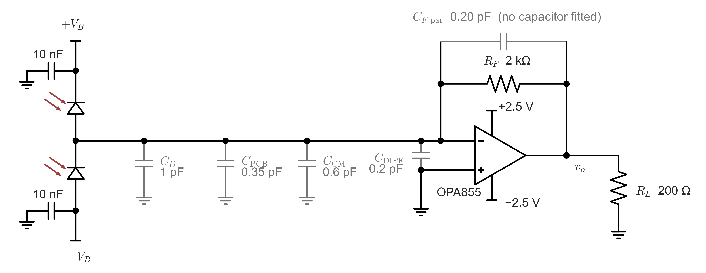

*Figure 3. The OPA855 design of Section 4.2 as it is simulated, with every value of Table 4.1; parasitic capacitances are drawn in grey. The balanced pair of Figure 1 delivers its photocurrents to the summing node. Each bias pin is decoupled by 10 nF to ground, which makes the far end of each diode an AC ground, so the capacitance of both diodes, 1 pF in total ($C_D$), loads the summing node. $C_{\mathrm{PCB}}$ = 0.35 pF is the pad and trace capacitance of Table 1.1, and $C_{\mathrm{CM}}$ = 0.6 pF and $C_{\mathrm{DIFF}}$ = 0.2 pF are the amplifier's input capacitances, which the vendor's macromodel contains itself (0.80 pF, Section 5.3); together they make $C_T$ = 2.15 pF (Eq. (7)). No feedback capacitor is fitted: the design needs 0.19 pF, less than the 0.20 pF that the 2-kΩ resistor and its pads bring ($C_{F,\mathrm{par}}$). The amplifier runs from ±2.5 V, which is its 5-V supply with the reference at mid-supply, so the non-inverting input is grounded. $R_L$ = 200 Ω is the load under which the datasheet's open-loop curve was taken; every small-signal run keeps it, so that the macromodel and the curve see the same load, and the large-signal runs of Section 4.7 use 1 MΩ, the light load of Table A6.28. In the simulations the pair is a current source in parallel with $C_D + C_{\mathrm{PCB}}$ = 1.35 pF, and the loop gain is read by injecting between the amplifier's output pin and the feedback network (Section 5.2).*

**The numbers.**
- Eq. (33) at 100 MHz with $I_{\mathrm{DC}} = 0$: $\sqrt{16.47/2 + 2.6^2 + 0.99^2/2^2 + (6.283\times10^{-3}\times0.99\times100\times2.35)^2} = \sqrt{8.24 + 6.76 + 0.25 + 2.14} = 4.17$ pA/√Hz. This is 3.2 dB above the 2.87 pA/√Hz of the resistor alone. The numerical model gives the same 4.17 pA/√Hz (Table A6.15).
- Eq. (33) with $I_{\mathrm{DC}}$ = 1 mA: the extra 320.4 pA²/Hz gives 18.38 pA/√Hz, only 0.23 dB above the 17.90 pA/√Hz of shot noise alone.
- Eq. (34): with $|Z_T|$ = 1.996 kΩ at 100 MHz, an instrument of 10 dB noise figure adds $0.907\times10^{0.5}/1.996$ = **1.44 pA/√Hz** referred to the photocurrent. Against the 4.17 pA/√Hz of the dark TIA that is $10\log_{10}(1 + 1.44^2/4.17^2)$ = 0.49 dB; against the 18.38 pA/√Hz at 1 mA it is 0.03 dB. In output terms the dark TIA delivers −173.0 + 20 log₁₀(4.17 × 1.996) = −154.6 dBm/Hz to the instrument.
- Eq. (35), bandwidth: 12.62 √(8000/(2 × 2.35)) = 521 MHz. The numerical model gives 557 MHz at 58° of phase margin at the same $C_F$ (Table A6.5).
- Eq. (35), minimum source capacitance: 318.3 × 6²/(2 × 8000) = 0.72 pF, well below the 2.15 pF present. The same check gives 2.12 pF for OPA818 (3.75 pF present), 4.94 pF for OPA847 (5.05 pF present) and 3.27 pF for OPA846 (5.15 pF present); all three pass, and all three still have too little phase margin (Sections 6.2.6 and 4.5).
- Eq. (36) with $I_{\mathrm{DC}}$ = 10 mA: 91.9 + 20 log₁₀(1.525/(2 × √(10 × 150))) = 91.9 − 34.1 = **57.8 dB**. At 1 mA the same equation gives 67.8 dB, and the full calculation, which includes the amplifier noise, gives 67.6 dB (Table A6.29). With 10 mA in each diode ($I_{\mathrm{DC}}$ = 20 mA) it gives 91.9 + 20 log₁₀(1.525/(2 × √(20 × 150))) = **54.8 dB**.

### 4.3 The OPA855 design in simulation

The four equations give a bandwidth but no phase margin, gain margin, step response or tolerance, and they assume a pure input capacitance and datasheet noise. This section supplies what they leave out by simulating the design of Figure 3 with our analytical model and with the vendor's macromodel. Figure 4 shows the results and Table A4.1 lists them; the agreement between the two descriptions is close enough that the design's numbers can be trusted wherever the loop is well damped.

**Transimpedance (Figure 4a).** The response is flat to within 0.01 dB in both, and falls by 3 dB at 563 MHz in SPICE and 557 MHz in our model. Both exceed the 521 MHz of Eq. (35). Eq. (35) is the maximally flat response of a single-pole amplifier, whose loop has 66.9° of phase margin (Section 3.3), while OPA855's loop has 58–60°: its closed loop peaks slightly near the crossover, where $Z_F$ is already rolling off from its pole at $1/(2\pi R_FC_F)$ = 1/(2π × 2 kΩ × 0.20 pF) = 398 MHz, and the two combine into a flat response that extends further. Above 1 GHz SPICE shows a resonance at 3.3 GHz, 19.7 dB below $R_F$. It is the trace of the gain margin set by the plateau of the macromodel's open-loop gain from the inverting input (Section 5.5), and our model, which has no such plateau, does not show it.

**Loop gain (Figure 4b).** SPICE puts the crossover at 801 MHz with 59.6° of phase margin and 6.8 dB of gain margin; our model puts it at 795 MHz with 58.4° and 8.0 dB. The gain margin follows Eq. (47): the high-frequency noise gain is $NG_\infty = 1 + C_T/C_F$ = 1 + 2.15/0.20 = 11.75 (Eq. (11)), and $20\log_{10}(11.75/5.3)$ = 6.9 dB, as simulated. The 1.2-dB difference from our model is the error of reading a gain margin from a datasheet curve that Section 5.3 found for this part.

**Step response (Figure 4c).** A 10-µA photocurrent step with a 20-ps rise gives 20.0 mV at the output, with 4.2 % overshoot, a 603-ps rise from 10 to 90 % and settling to 1 % in 1.92 ns. Our model, whose step response is the inverse Fourier transform of its transimpedance with the same input, gives 4.0 %, 600 ps and 1.95 ns. A rise of 603 ps corresponds to $0.35/603\ \mathrm{ps}$ = 580 MHz, the bandwidth above.

**Noise (Figure 4d).** SPICE gives 4.10 pA/√Hz at 100 MHz, our model and Eq. (33) 4.17 pA/√Hz. Over 10–150 MHz the noise lies 3.01 dB above the Johnson noise of $R_F$ in SPICE and 3.13 dB in our model (Eq. (21)), and from 0 to 150 MHz it integrates to 49.5 and 50.2 nA rms. The terms of Eq. (33) at 100 MHz show where the noise comes from: 8.24 pA²/Hz from $R_F$, 6.76 from $i_n$, 0.25 from $e_n/R_F$ and 2.14 from $e_n\omega C_{\mathrm{tot}}$. The base-current noise of the input transistor is therefore the largest amplifier term at 100 MHz, as Section 6.3.1 finds for OPA855 and OPA856, and the $e_n$ term overtakes the resistor only at $2.87/(6.283\times10^{-3}\times0.99\times2.35)$ = 196 MHz. The total stays below the 5.66 pA/√Hz of shot noise at $I_{\mathrm{DC}}$ = 0.1 mA up to 291 MHz. The SPICE curve is reproduced exactly by Eq. (19) with the quantities fitted to the macromodel in Section 5.3 (0.968 nV/√Hz, 0.80 pF and 2.52 pA/√Hz at 100 MHz give 4.104 pA/√Hz), so the small difference from our model is one of parameters, not of the circuit.

**Output noise.** Without a filter the output carries 0.54 mV rms in SPICE, of which only 0.10 mV rms lies below 150 MHz: the rest is the voltage noise amplified by the high-frequency noise gain above the crossover and by the 3.3-GHz resonance. This is why the proposed front end ends in a low-pass filter at 200–250 MHz (Section 8.9, Table A8.10).

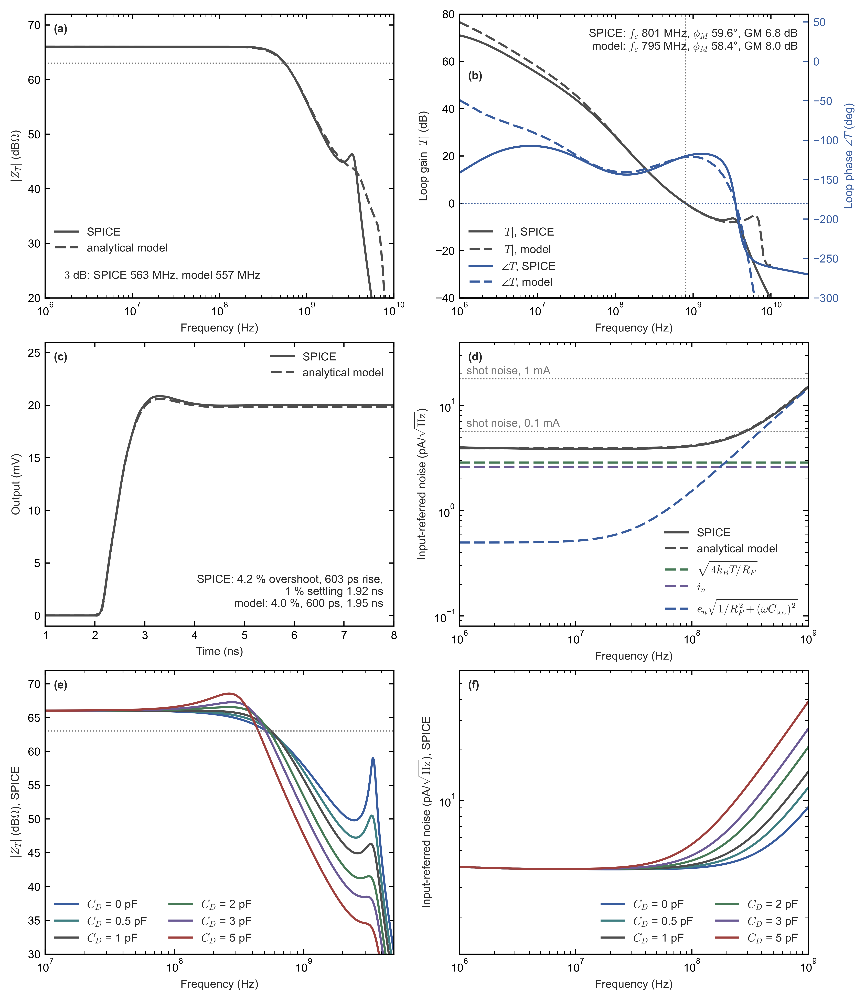

*Figure 4. The OPA855 design of Figure 3 in simulation: SPICE with the vendor's macromodel (solid) against our analytical model with the datasheet's open-loop curve and noise values (dashed). Amplifier: OPA855, $R_F$ = 2 kΩ, $C_F$ = 0.20 pF. (a) Transimpedance at $C_D$ = 1 pF; the dotted line marks −3 dB (63.0 dBΩ). (b) Loop gain, magnitude (black, left axis) and phase (blue, right axis), from Middlebrook's double injection in SPICE (Eq. (39)) and from $T = A/NG$ in our model (Eq. (10)); the axes are aligned so that 0 dB and −180° fall on the same dotted line, and the vertical line marks the SPICE crossover. (c) Response to a 10-µA photocurrent step with a 20-ps rise starting at 2 ns, with the output's DC level before the step subtracted; our model's curve is the inverse Fourier transform of its transimpedance with the same input. (d) Input-referred noise without photocurrent, with the three terms of Eq. (19) from the datasheet values: the Johnson noise of $R_F$, the current noise $i_n$ and the voltage noise acting through $1/R_F$ and $C_{\mathrm{tot}}$ = 2.35 pF; the dotted lines mark the shot noise of $I_{\mathrm{DC}}$ = 0.1 and 1 mA. (e) Transimpedance and (f) input-referred noise in SPICE at photodiode capacitances of 0–5 pF with $C_F$ fixed at 0.20 pF (Section 4.6). Below 1 pF the 3.3-GHz resonance of the gain margin rises, to 7.0 dB below $R_F$ at $C_D$ = 0; above 1 pF the response peaks near 300 MHz, by 2.5 dB at 5 pF, and the noise rises as $e_n\omega C_{\mathrm{tot}}$ with the larger capacitance.*

### 4.4 Laying out the design for OPA846 at 2 kΩ

OPA846 has nearly the voltage noise of OPA855, 1.2 against 0.99 nV/√Hz, and slightly more current noise, but 4.75 times the input capacitance (3.8 against 0.8 pF) and 0.22 times the gain–bandwidth product. Laying out the same TIA with it shows what these two numbers do to a design whose amplifier would otherwise look as quiet. Figure 5 shows the design with every value, and the numbers follow from the OPA846 column of Table 4.1.

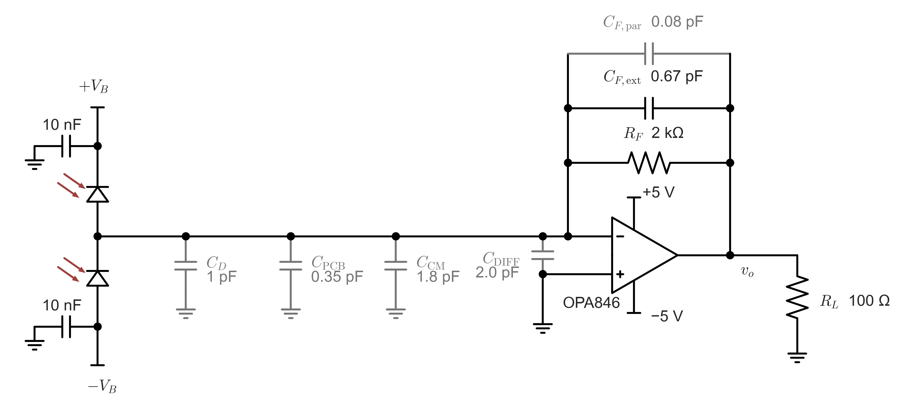

*Figure 5. The OPA846 design of Section 4.4 as it is simulated, with every value of Table 4.1; parasitic capacitances are drawn in grey. The photodiode pair, its decoupled bias, $C_D$ and $C_{\mathrm{PCB}}$ are those of Figure 3. The amplifier's input capacitances, $C_{\mathrm{CM}}$ = 1.8 pF and $C_{\mathrm{DIFF}}$ = 2.0 pF, make $C_T$ = 5.15 pF (Eq. (7)); the vendor's macromodel contains 3.07 pF of its own, of which its voltage noise drives 2.28 pF (Section 5.3). The flat design needs 0.745 pF of total feedback capacitance, so a 0.55-pF capacitor $C_{F,\mathrm{ext}}$ is fitted beside the 0.20 pF of the resistor and its pads, 0.75 pF in total. The amplifier runs from ±5 V, the supply of its datasheet tables, with the non-inverting input grounded; the large-signal runs of Section 4.7 use ±6 V, the supply of Table A6.3, and 1 MΩ. $R_L$ = 100 Ω is the load of the datasheet's open-loop curve, the same as a 50-Ω back-termination into a 50-Ω instrument.*

**The numbers.**
- Eq. (33) at 100 MHz with $I_{\mathrm{DC}} = 0$: with $C_{\mathrm{tot}}$ = 5.15 + 0.75 = 5.90 pF, $\sqrt{16.47/2 + 2.8^2 + 1.2^2/2^2 + (6.283\times10^{-3}\times1.2\times100\times5.90)^2} = \sqrt{8.24 + 7.84 + 0.36 + 19.79} = 6.02$ pA/√Hz, 6.4 dB above the 2.87 pA/√Hz of the resistor. The $e_n\omega C_{\mathrm{tot}}$ term, 19.79 pA²/Hz, is now the largest: the product $e_nC_{\mathrm{tot}}$ is 1.2 × 5.90 = 7.08 nV·pF/√Hz against 0.99 × 2.35 = 2.33 for OPA855, three times larger, so the term is 9.2 times larger. The numerical model gives 6.07 pA/√Hz (Table A6.15).
- Eq. (33) with $I_{\mathrm{DC}}$ = 1 mA: $\sqrt{36.22 + 320.4}$ = 18.88 pA/√Hz, 0.47 dB above the shot noise alone.
- Eq. (34): with $|Z_T|$ = 1.935 kΩ at 100 MHz from the numerical model, an instrument of 10 dB noise figure adds $0.907\times10^{0.5}/1.935$ = 1.48 pA/√Hz, which raises the dark noise by $10\log_{10}(1 + 1.48^2/6.02^2)$ = 0.26 dB; the dark TIA delivers −173.0 + 20 log₁₀(6.02 × 1.935) = −151.7 dBm/Hz to the instrument.
- Eq. (35), bandwidth: the maximally flat $C_F$ of Eq. (15) is $17.84\sqrt{5.15/(2\times1750)}$ = 0.684 pF, and with it $12.62\sqrt{1750/(2\times(5.15 + 0.684))}$ = 155 MHz; with the 0.75 pF actually needed, 154 MHz. The numerical model puts the flat design at 0.745 pF with 235 MHz but only 34° of phase margin (Table A6.5).
- Eq. (35), minimum source capacitance: 318.3 × 6²/(2 × 1750) = 3.27 pF against 5.15 pF present. The design passes, but by a factor of 5.15/3.27 = 1.6, against 2.15/0.72 = 3.0 for OPA855.
- Eq. (36): at 100 MHz OPA846's amplitude is set by its slew rate, 625 V/µs/(2π × 100 MHz) = 0.995 V (Eq. (26)); the slew limit equals the 4.30-V swing at 625 V/µs/(2π × 4.30 V) = 23 MHz, and above that frequency it is the smaller. With 0.995 V, 91.9 + 20 log₁₀(0.995/(2 × √(1 × 150))) = 91.9 − 27.8 = **64.1 dB** at 1 mA, **54.1 dB** at 10 mA and 51.1 dB at 20 mA, 3.7 dB below OPA855 throughout, the ratio $20\log_{10}(1.525/0.995)$ of the two amplitudes. The full calculation gives 64.0, 54.3 and 51.4 dB (Table A4.1): it includes the amplifier noise, which costs 0.4 dB at 1 mA and less at higher photocurrents, and the transimpedance at 100 MHz, 1.935 rather than 2 kΩ, which raises the largest photocurrent tone by $20\log_{10}(2/1.935)$ = 0.29 dB.

On these numbers OPA846 at 2 kΩ is a 154-MHz design with 6.0 pA/√Hz at 100 MHz and 3.7 dB less dynamic range than OPA855. Why the numerical model's bandwidth is half as large again as Eq. (35)'s, and whether the design is stable enough to use, is what the phase margin decides; Section 4.5 finds it.

### 4.5 The OPA846 design in simulation

Here the two descriptions of the amplifier disagree, and the disagreement is the main result. Figure 6 shows the design of Figure 5 in both, and Table A4.1 lists the numbers.

**Loop gain (Figure 6b).** SPICE puts the crossover at 308 MHz with 44.7° of phase margin and 11.6 dB of gain margin; our model puts it at 237 MHz with 34.1° and 5.8 dB. The difference is the one Section 5.3 found between the two open-loop gains: from 100 to 300 MHz the macromodel has 1.3–2.6 dB more gain than the datasheet curve and, at 300 MHz, 13° less phase lag. Where the part lies, the datasheet's own closed-loop test circuit tells (Section 5.4): at a gain of +7 it measures 3.1 dB of peaking, about 41° of margin by the relations given there, against 1.4 dB (about 51°) in the macromodel and 5.6 dB from the curve with the input capacitance. The part therefore lies between the two descriptions, about 10° below the macromodel in that circuit. If the same gap holds in the TIA, the design has about 35°, near our model's value. Our model's split of the margin (Eq. (17), Table A6.11) shows where it goes: the amplifier's own phase at the crossover, $\phi_A$ = 55.3°, less the noise gain's lead, $\angle NG$ = 21.3°, leaves 34°.

**Transimpedance (Figure 6a) and step response (Figure 6c).** Both responses are flat, without any peaking, and both meet 150 MHz, but they fall by 3 dB at 163 MHz in SPICE and at 233 MHz in our model. The lower margin widens the response: $Z_F$ rolls off from $1/(2\pi\times2\ \mathrm{k\Omega}\times0.75\ \mathrm{pF})$ = 106 MHz, and the closed loop, which peaks more at 34° than at 45°, holds $|Z_T|$ up beyond that pole. At 100 MHz $|Z_T|$ is already 1.71 kΩ in SPICE, 1.4 dB below $R_F$, against 1.94 kΩ in our model. The step shows the same: no overshoot in SPICE, with a rise of 2.13 ns and settling to 1 % in 5.05 ns, and 2.2 % overshoot, 1.48 ns and 5.39 ns in our model. Neither response reveals the margin; only the loop gain does (Section 5.2, Figure 17). The bandwidth of an OPA846 design is therefore as uncertain as its phase margin, between 163 and 233 MHz at 0.75 pF.

**Noise (Figure 6d).** SPICE gives 5.34 pA/√Hz at 100 MHz against 6.07 in our model and 6.02 from Eq. (33); over 10–150 MHz the penalty is 5.03 against 6.01 dB, and from 0 to 150 MHz the noise integrates to 61.9 against 69.0 nA rms. The difference is again one of parameters. The macromodel's voltage noise drives only 2.28 pF of its own input capacitance, against the datasheet's 3.8 pF, while its current noise rises from 2.8 to 3.2 pA/√Hz (Section 5.3). Eq. (19) with those quantities at 100 MHz (1.14 nV/√Hz, 2.28 pF and 3.20 pA/√Hz) gives 8.23 + 10.23 + 0.32 + 9.80 = 28.59 pA²/Hz, i.e. 5.35 pA/√Hz, the SPICE value. In our model the $e_n\omega C_{\mathrm{tot}}$ term crosses the resistor's noise at $2.87/(6.283\times10^{-3}\times1.2\times5.90)$ = 65 MHz, and the total crosses the shot noise of 0.1 mA near 90 MHz (Section 6.3.1); in SPICE at 113 MHz. Our model, with the datasheet's capacitance, is the more conservative of the two. The bench board of Section 3.10, whose noise points to about 14 pF at the node, cannot decide between them.

**What to do with it.** OPA846 at 2 kΩ on 1 pF reaches 150 MHz with 6.0 pA/√Hz, but with 34–45° of phase margin, depending on which description holds. Section 4.6 shows that no feedback capacitance and no photodiode up to 5 pF gives it a robust 45° in our model, and only a marginal one in SPICE. That leaves the two options of Section 6.2: equalize the peaking afterwards, for which Section 6.2.8 shows that a nominal 25° with $C_F$ ≥ 0.4 pF keeps every unit stable, or add capacitance at the node, which our model says needs 8 pF for 45° and then gives 116 MHz (Table A6.5). Table 9.1 sums up the part as worse than OPA818 on every axis except price.

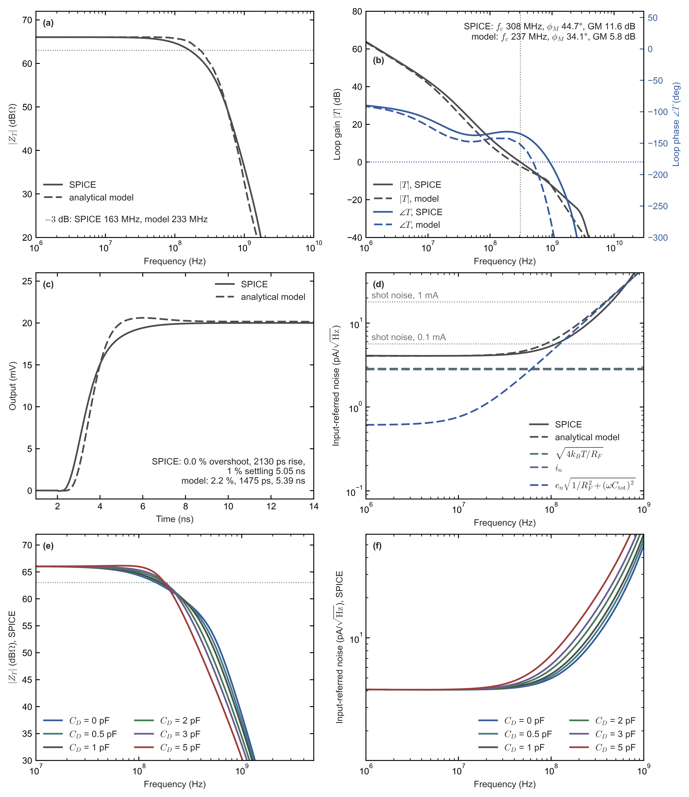

*Figure 6. The OPA846 design of Figure 5 in simulation, in the layout of Figure 4: SPICE with the vendor's macromodel (solid) against our analytical model (dashed). Amplifier: OPA846, $R_F$ = 2 kΩ, $C_F$ = 0.75 pF. (a) Transimpedance at $C_D$ = 1 pF. (b) Loop gain, magnitude and phase: 44.7° in SPICE against 34.1° in our model. (c) Response to a 10-µA step: no overshoot in SPICE, 2.2 % in our model. (d) Input-referred noise with the three terms of Eq. (19) from the datasheet values ($C_{\mathrm{tot}}$ = 5.90 pF); SPICE lies below our model because the macromodel's voltage noise drives 2.28 pF of its own capacitance, not the datasheet's 3.8 pF. (e) Transimpedance and (f) input-referred noise in SPICE at photodiode capacitances of 0–5 pF with $C_F$ fixed at 0.75 pF (Section 4.6). The response changes little with $C_D$: the phase margin stays at 43–45° (Figure 7c), and only above 3 pF does the step overshoot by more than 2 %.*

### 4.6 How the two designs depend on the photodiode and feedback capacitances

A design is laid out for one photodiode capacitance and one feedback capacitance, but neither is fixed on a board. The photodiode's capacitance changes with its bias and from part to part, and a front end is often moved to another photodiode; the feedback capacitance is set largely by the parasitics of the resistor and its pads. This section asks two questions of both designs: how far the photodiode capacitance may move before the design fails, and what each amplifier can do with another photodiode when $C_F$ is chosen anew. The criteria are those of Section 6.2.4: a phase margin of at least 45°, a gain margin of at least 3 dB and at most 1 dB of peaking. Figure 7 shows the results, and Tables A4.2 and A4.3 list them.

**The feedback capacitance at $C_D$ = 1 pF (Figure 7a and b).** For OPA855 the phase margin rises from 36.6° at 0.10 pF to 69° at 0.34 pF while the bandwidth falls from 794 to 280 MHz. Below 0.15 pF the response peaks by more than 1 dB, and above 0.33 pF the gain margin falls below 3 dB, so at the nominal photodiode capacitance the criteria hold from 0.15 to 0.33 pF; over $C_D$ ± 0.2 pF the window narrows to 0.157–0.300 pF (Section 5.5). From 0.50 pF, where $NG_\infty$ = 1 + 2.15/0.50 falls to 5.3, the macromodel oscillates near 3 GHz (Eq. (47)). Our model agrees within 5.3° and 10 MHz up to 0.38 pF, where its loop gain regains unity on the plotted 4–7 GHz bump (Section 5.5). The design, 0.20 pF, sits at 59.6° and 563 MHz, inside the window, 0.04–0.05 pF above its lower edge and 0.10–0.13 pF below its upper edge. Section 8.9 proposes 0.25 pF for the front end, nearer the window's centre, at the price of 431 MHz instead of 563 (Table A5.6).

For OPA846 the phase margin behaves differently: in SPICE it rises from 24.7° at 0.30 pF to a maximum of 44.8° at 0.80–0.85 pF and falls again beyond it, to 40.1° at 1.25 pF, and our model's curve has the same shape, 10° lower, with a maximum of 34.5°. Beyond the maximum a larger $C_F$ lowers the noise gain at the crossover, so the loop crosses where the amplifier's own phase is smaller (Eq. (17), Section 6.2.6). The bandwidth falls meanwhile from 298 MHz at 0.30 pF to 163 MHz at 0.75 pF and 98 MHz at 1.00 pF. Only 0.70–0.95 pF gives more than 44° in SPICE, and 150 MHz needs $C_F$ ≤ 0.78 pF, so only 0.70–0.78 pF has both, and the design's 0.75 pF lies in that narrow range.

**The photodiode capacitance, with $C_F$ fixed (Figure 7c, e and f; Figures 4e–f and 6e–f).** For OPA855 at 0.20 pF, a photodiode capacitance growing from 0 to 5 pF lowers the phase margin from 64.1° to 42.5° and raises the gain margin from 2.0 to 15.4 dB, exactly as Eq. (47) predicts with $NG_\infty$ = 1 + $C_T$/0.20 pF (Figure 7e). Above 1 pF the response begins to peak, by 0.52 dB at 2 pF and 2.5 dB at 5 pF, and the step overshoots by 10.5 % and 23.9 %. The criteria fix the range of photodiodes the design serves. The gain margin reaches 3 dB at $NG_\infty$ = 7.5 (Eq. (47)), i.e. at $C_T$ = 6.5 × 0.20 = 1.30 pF, which is $C_D$ = 1.30 − 0.35 − 0.80 = 0.15 pF. The peaking reaches 1 dB between 2.5 pF (0.88 dB) and 3 pF (1.24 dB), at 2.5 + 0.5 × (1 − 0.88)/(1.24 − 0.88) = 2.7 pF. The phase margin stays above 45° up to 4.2 pF. The design of Figure 3 therefore serves any photodiode from 0.15 to 2.7 pF without a change, with 518–563 MHz. A smaller photodiode costs gain margin, which shows as the 3.3-GHz resonance rising to 7.0 dB below $R_F$ at $C_D$ = 0 (Figure 4e). The noise penalty rises from 2.71 dB at 0 pF to 3.01 dB at 1 pF and 5.12 dB at 5 pF.

For OPA846 at 0.75 pF the phase margin in SPICE stays between 43.1° and 45.4° over the whole range, and our model's between 30.7° and 36.6°. A larger photodiode raises the noise gain at the crossover, which moves the crossover to where the amplifier's phase is larger, and it also raises the noise gain's own lead; in Eq. (17) the two nearly cancel. A larger photodiode, or capacitance added on purpose, therefore buys OPA846 little phase margin at a fixed $C_F$. The gain margin rises from 10.5 to 15.3 dB, the bandwidth from 147 MHz at 0 pF to 181 MHz at 3–4 pF, and the noise penalty from 4.46 to 7.59 dB; the step begins to overshoot only from 2.5 pF, by 7.3 % at 5 pF.

**The feedback capacitance chosen anew at each photodiode capacitance (Figure 7d, Table A4.3).** The scans of Figure 7a–b, repeated at each $C_D$, give the widest-band $C_F$ that meets the three criteria, never below the 0.20-pF parasitic floor. For OPA855, 0.20 pF remains the best choice up to $C_D$ = 2.5 pF, with 525–563 MHz; at 3, 4 and 5 pF the best choices are 0.22, 0.24 and 0.26 pF, with 484, 439 and 404 MHz and at most 0.89 dB of peaking. At $C_D$ = 0 no $C_F$ at or above the floor gives 3 dB of gain margin (2.0 dB at 0.20 pF), so a photodiode smaller than 0.15 pF needs capacitance added at the node or a resistor with less parasitic capacitance. For OPA846 the scan in SPICE reaches 45° from $C_D$ = 1.25 pF, with 0.80 pF and 147 MHz, and with 0.75 pF from 1.5 to 4 pF, with 170–181 MHz (0.80 pF and 167 MHz at 5 pF), never by more than 0.9°; below 1.25 pF its best is 43.1–44.8°. In our model no $C_F$ reaches 45° at any $C_D$ up to 5 pF; the best is 44.9° at 5 pF, with 1.20 pF and only 104 MHz. Either way, choosing $C_F$ cannot make OPA846 robust at 2 kΩ; Section 6.5 reached the same verdict for $C_D$ = 1 ± 0.2 pF (44.5° and 144 MHz at 0.80 pF).

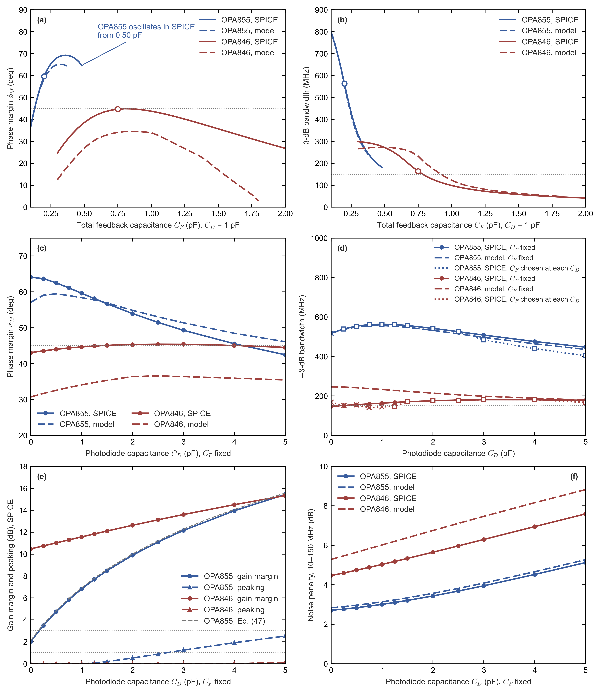

*Figure 7. Both designs against the feedback capacitance and against the photodiode capacitance: SPICE (solid) and our analytical model (dashed). Amplifiers: OPA855 (blue) and OPA846 (red), $R_F$ = 2 kΩ. (a) Phase margin and (b) bandwidth against the total feedback capacitance at $C_D$ = 1 pF; the circles mark the designs, 0.20 and 0.75 pF. The OPA855 macromodel oscillates from 0.50 pF, where its gain margin reaches 0 dB (Eq. (47)), and our model's curve ends at 0.38 pF, where its loop gain regains unity on the plotted 4–7 GHz bump; neither is drawn beyond. (c) Phase margin and (d) bandwidth against the photodiode capacitance, with $C_F$ fixed at the design value; in (d) the dotted lines are SPICE with $C_F$ chosen anew at each $C_D$ (Table A4.3), with squares where the three criteria are met and crosses where they are not. (e) Gain margin and peaking in SPICE with $C_F$ fixed; the grey dashed line is Eq. (47) for OPA855 with $C_T$ = $C_D$ + 0.35 + 0.80 pF. The dotted lines in (a), (c) and (e) mark 45°, 3 dB and 1 dB, and those in (b) and (d) 150 MHz. (f) Noise penalty over 10–150 MHz relative to the Johnson noise of $R_F$ (Eq. (21)), $C_F$ fixed.*

### 4.7 Large signals and dynamic range of the two designs

From about 0.15 mA up, the largest undistorted tone, not the noise, sets the dynamic range (Section 6.6.3), and the four equations take that tone from the datasheet's swing and slew rate through Eq. (26). This section checks those ceilings in the two macromodels and gives the dynamic range of both designs. The method is that of Section 5.7: a sine photocurrent at 20, 50, 100, 150 and 200 MHz, whose output amplitude is stepped in fractions of the amplitude of Eq. (26), with a 1-MΩ load, and the total harmonic distortion of harmonics 2–5 (Eq. (48)) read at each step. OPA855 runs from ±2.5 V, as before, and OPA846 from ±6 V, the supply of Table A6.3. Figure 8a and Table A4.4 show where each model reaches −60 and −40 dBc.

**OPA855.** Its amplitude is set by its swing, 1.525 V at every tone. The model behaves as Section 5.7 found for variant A. Up to 0.7 times that amplitude its distortion stays at the numerical floor, near −140 dBc; it reaches −60 dBc at 0.88–0.93 times (1.34–1.42 V) and −40 dBc at 0.99–1.05 times (1.51–1.60 V), as the waveform runs into the swing limit. The macromodel has no distortion of its own below that limit, so for small signals the datasheet's figures near 100 MHz, −73 dBc of second and −89 dBc of third harmonic at 1 Vpp (Table A8.11), remain the reference.

**OPA846.** Its macromodel behaves differently. Its distortion grows smoothly with the amplitude, by about 6 dB for each doubling, the second harmonic dominating, and it grows steeply with frequency. Above 20 MHz it is the distortion, not the slew rate, that sets the ceiling. The THD reaches −60 dBc at 4.16 V at 20 MHz, at 0.41 V at 50 MHz, at 78 mV at 100 MHz, and below 33 and 25 mV at 150 and 200 MHz. It reaches −40 dBc at 2.41 V at 50 MHz, 0.66 V at 100 MHz, 0.28 V at 150 MHz and 0.15 V at 200 MHz. At the slew-rate amplitude of Eq. (26) it is −36 dBc at 100 MHz. At 20 MHz the model stays below −55 dBc up to 5.6 V, beyond the datasheet's 4.30-V swing on ±6 V. How far the part shares this the datasheet cannot say, because it plots distortion only up to 20 MHz: −66 dBc of second harmonic at 2 Vpp in a gain of +10 with 200 Ω (Table A6.31). At 20 MHz and 1 V peak in the TIA the model gives about −75 dBc. The TIA has more loop gain there than the gain-of-10 stage: its noise gain at 20 MHz is $|1 + jf/f_z|/|1 + jf/f_p|$ = 1.76, with $f_z = 1/[2\pi R_F(C_T + C_F)]$ = 13.5 MHz and $f_p = 1/(2\pi R_FC_F)$ = 106 MHz, against 10. That 15 dB of extra loop gain would bring the datasheet's −66 dBc to about −81 dBc, so the model is of the right order where the two can be compared. Above 20 MHz nothing tests it, and its quiescent current, 4.8 against 12.6 mA (Section 5.3), suggests internal stages biased unlike the part's. Its distortion near 100 MHz therefore needs a measurement (Appendix C, item 18).

**Dynamic range (Figure 8b, Table A4.1).** With the amplitude of Eq. (26) and the noise integrated from 0 to 150 MHz, Eq. (27) gives the dynamic range for a 100-MHz tone. For OPA855 it is 80.7, 76.0, 67.6, 57.8 and 54.8 dB at $I_{\mathrm{DC}}$ = 0, 0.1, 1, 10 and 20 mA, the same in SPICE and in our model within 0.1 dB. For OPA846 it is 76.4, 72.9, 65.1, 55.4 and 52.4 dB in SPICE and 74.4, 71.4, 64.0, 54.3 and 51.4 dB in our model. SPICE is higher by 1.0–2.0 dB, from its lower noise (61.9 against 69.0 nA rms) and from its lower transimpedance at 100 MHz (1.71 against 1.94 kΩ), which raises the largest photocurrent tone by 1.1 dB. As an example, OPA846 in SPICE at 1 mA: the largest tone is $0.995\ \mathrm{V}/(\sqrt2\times1.712\ \mathrm{k\Omega})$ = 0.411 mA rms, the noise is $\sqrt{61.9^2 + 219.2^2}$ = 227.8 nA rms, with $\sqrt{2qI_{\mathrm{DC}}B}$ = 219.2 nA rms of shot noise, and $20\log_{10}(0.411\ \mathrm{mA}/227.8\ \mathrm{nA})$ = 65.1 dB. If OPA846's ceiling is instead the amplitude at which its model reaches −40 dBc, 0.66 V at 100 MHz, every figure falls by $20\log_{10}(0.995/0.659)$ = 3.6 dB, to 61.5 dB at 1 mA. At −60 dBc, 78 mV, it falls by 22 dB. At 1 mA OPA855 leads OPA846 by 2.5–3.6 dB on the amplitudes of Eq. (26), and by 6.1 dB if OPA846 must stay below −40 dBc.

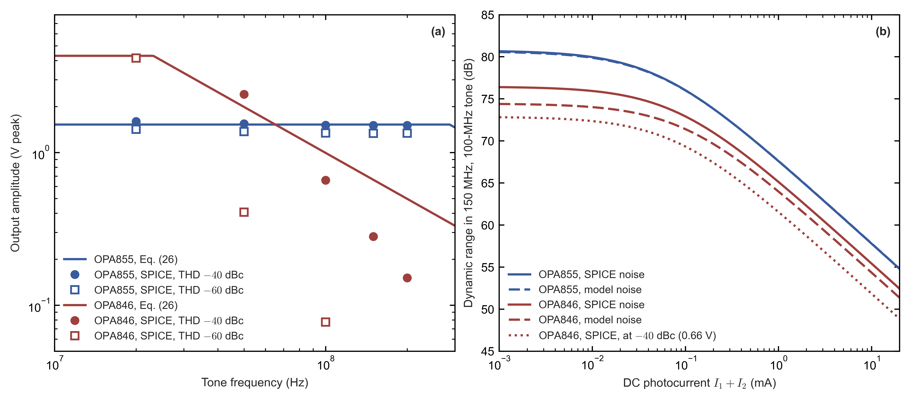

*Figure 8. Large-signal limits and dynamic range of the two designs. Amplifiers: OPA855 (blue, ±2.5 V) and OPA846 (red, ±6 V), $R_F$ = 2 kΩ, $C_D$ = 1 pF, 1-MΩ load. (a) Largest output amplitude against the tone frequency: Eq. (26) from the datasheets' swing and slew rate (lines), and the amplitudes at which each macromodel's THD (Eq. (48)) reaches −40 dBc (filled circles) and −60 dBc (open squares). OPA855's model limits where Eq. (26) says; OPA846's distorts from far below its slew limit, and at 150 and 200 MHz reaches −60 dBc below 0.05 times the amplitude of Eq. (26), the smallest step simulated, so those points are missing; at 20 MHz it stays below −40 dBc up to 1.3 times. (b) Dynamic range in 150 MHz for a 100-MHz tone (Eq. (27)) against the DC photocurrent $I_1 + I_2$, with the amplitude of Eq. (26) and the noise of SPICE (solid) or of our model (dashed); the dotted line is OPA846 with the amplitude at which its macromodel reaches −40 dBc, 0.66 V.*

### 4.8 How the designs compare with a plain 50-Ω termination

We now set both designs against the 50-Ω benchmark of Section 2.1, with a 2-dB noise figure, using the spot values of Eq. (33) at 100 MHz.

**Noise.** The dark OPA855 TIA's 4.17 pA/√Hz at 100 MHz is $20\log_{10}(22.85/4.17)$ = 14.8 dB below the chain's 22.85 pA/√Hz (Eq. (1)); integrated over the band, the measure $A$ of Section 2.1, the lead is 15.0 dB with the vendor's macromodel (Section 6.8). With photocurrent the shot noise is common to both. At $I_{\mathrm{DC}}$ = 1 mA it is 17.90 pA/√Hz: the TIA gives 18.38 pA/√Hz and the chain $\sqrt{22.85^2 + 17.90^2}$ = 29.03 pA/√Hz, so the TIA still leads by $20\log_{10}(29.03/18.38)$ = 4.0 dB. At 10 mA the shot noise is 56.61 pA/√Hz, the TIA gives 56.76 pA/√Hz and the chain $\sqrt{22.85^2 + 56.61^2}$ = 61.05 pA/√Hz, a lead of 0.63 dB. For a small RF signal on the DC, as in the receiver of Section 1.1, the TIA therefore wins at every photocurrent, by an amount that shrinks as the shot noise takes over.

**Ceiling.** The design's largest tone at 100 MHz is $V_{\mathrm{pk}}/(\sqrt2\,|Z_T|)$ = 1.525 V/(√2 × 1.996 kΩ) = 0.540 mA rms. A chain reaches the same current when it compresses at $P_{\mathrm{eq}} = (R_0/4)I_{\max}^2$ = 12.5 Ω × (0.540 mA)² = 3.65 µW, i.e. −24.4 dBm (Eq. (5)). A low-noise amplifier that compresses at −10 dBm has a ceiling 14.4 dB higher.

**Dynamic range.** At 1 mA the design has the 67.6 dB found in Section 4.2. The chain that compresses at −10 dBm has 78.0 dB (Table A2.2), 10.4 dB more, but only for a tone of 2.83 mA rms, which the light cannot supply: at 1 mA the largest tone is 0.71 mA rms (Eq. (28)). On that tone the chain's dynamic range is 66.0 dB, 1.6 dB below the TIA's, although the light already exceeds the TIA's ceiling. From $I_{\mathrm{DC}} = \sqrt2\times0.540$ mA = 0.76 mA up, the TIA's largest tone stays at 0.54 mA rms while the chain's grows with the light, and from about 1.2 mA up the chain's larger tone outweighs the TIA's lower noise (Section 6.8).

**OPA846.** The OPA846 design leads the chain by less and gives way to it sooner. Its dark noise at 100 MHz, 6.02 pA/√Hz by Eq. (33), is $20\log_{10}(22.85/6.02)$ = 11.6 dB below the chain's. Over the band its lead $A$ is 13.1 dB with the macromodel's noise and 12.2 dB with ours; at 1 mA it is 3.9 dB and at 10 mA 0.6 dB, so for small signals it, too, wins at every photocurrent. Its largest tone at 100 MHz is 0.995 V/(√2 × 1.935 kΩ) = 0.364 mA rms with our transimpedance (0.411 mA rms with the macromodel's 1.71 kΩ). A chain reaches that current at $P_{\mathrm{eq}}$ = 12.5 Ω × (0.364 mA)² = 1.65 µW, i.e. −27.8 dBm (−26.8 dBm with the macromodel). From $I_{\mathrm{DC}} = \sqrt2\times0.364$ mA = 0.51 mA up the light can drive the chain harder than the TIA, and from 0.84 mA up (0.93 mA with the macromodel) the chain's usable dynamic range is the larger, against 1.16 mA for OPA855. These figures come from `scripts_archive/case_studies.py` with the benchmark definitions of `scripts_archive/benchmark_50ohm.py`.

### 4.9 What the four equations cannot tell us

The four equations answer the easy questions, and the simulations of Sections 4.3–4.7 show where they stop. They get the noise of both designs and the bandwidth of the well-damped one within a few per cent: 4.17 pA/√Hz and 521 MHz for OPA855 against 4.10 pA/√Hz and 563 MHz in SPICE. They give no phase margin, and for a decompensated amplifier near its minimum stable gain the phase margin depends on the amplifier's higher poles. OPA846 passes the necessary condition of Eq. (35) with 5.15 against 3.27 pF and still has only 34–45°, and with it its bandwidth moves between 163 and 233 MHz. They give no gain margin either, and OPA855's gain margin sets the upper edge of its window of $C_F$, 0.157–0.300 pF over $C_D$ ± 0.2 pF (Section 5.5), and the smallest photodiode its design serves, 0.15 pF (Section 4.6). They take the ceiling from the datasheet's swing and slew rate, which OPA855's macromodel confirms and OPA846's does not: in that model its distortion sets the ceiling above 20 MHz (Section 4.7).

Within their range the four equations show the shape of the problem. OPA855's noise is within 0.23 dB of the shot noise at 1 mA, so at the planned photocurrents the amplifier's noise matters only near 0.1 mA and at the top of the band. Its 1.525-V output amplitude, not its noise, sets the dynamic range from a few tens of microamperes up (31–63 µA for the 5-V parts, Eq. (51) of Section 6.6.3). Its stability rests on a feedback capacitance that the parasitics of the resistor and its pads largely set. Chapter 5 tests our analytical model against the manufacturers' SPICE macromodels of seven leading amplifiers, including these two, and explains the methods used here; Chapter 6 applies both to every candidate.

---

## 5. SPICE cross-check with the vendors' macromodels

Every phase margin, bandwidth and noise density of Chapter 3 comes from our own model, fed with datasheet curves. Before Chapter 6 compares the candidates on those numbers, this chapter tests the model against the manufacturers' SPICE macromodels in the same circuits. Chapter 4 has already set two of these macromodels against our model, for its OPA855 and OPA846 designs; this chapter explains the methods used there and extends the test to the leading candidates. The first seven amplifiers are the leading candidates:
- OPA855 and OPA818, the two variants of the proposed front end (Section 8.9);
- OPA856, OPA858, OPA859 and LMH6629 (COMP pin high);
- OPA846, the amplifier of the bench board of Section 3.10.

Section 5.1 explains why the cross-check is needed and what a macromodel can and cannot settle. Sections 5.2 and 5.3 give the method: Middlebrook's double injection, which reads the loop gain of the intact circuit, and the small-signal quantities extracted from each macromodel, with which our equations predict the closed loop. Sections 5.4–5.8 give the results. The datasheets' own test circuits decide between curve and macromodel where the two disagree (Section 5.4); the TIA designs with scans of their feedback capacitance, the noise, the large-signal limits and the measured OPA846 board follow (Sections 5.5–5.8). Eleven further amplifiers run through the same fixtures and test circuits (Section 5.1), and Section 6.5 finds every part's best design in SPICE. Section 5.9 collects what the cross-check found and what it changes in our analysis. The simulator is ngspice-46, driven from a Python script without a schematic; Appendix B.1 explains how to run it this way, and Appendix B.2 says how to reproduce every number.

### 5.1 Why a SPICE cross-check, and what a macromodel can settle

The analytical model of Chapter 3 evaluates Eqs. (9), (10) and (19) with two inputs per amplifier: the open-loop curve digitized from its datasheet and a pure input capacitance taken from the datasheet. Both inputs are weakest where our designs are marginal. Several curves end near 1 GHz (OPA818's at 0.96 GHz, Figure 10), so a gain margin at gigahertz frequencies rests on extrapolation or, for OPA855, on a plotted 4–7 GHz bump that Table A3.5 shows to be exaggerated. A datasheet curve gives the gain from the non-inverting input, while a TIA drives the inverting one. And three TI datasheets state a phase margin or GBW that disagrees with their own plotted curve (Table A3.2). Section 3.5 therefore reads every phase margin below about 50° with the results of this chapter.

A vendor's macromodel can settle three things. It is a complete circuit, so its small-signal quantities, measured in simple fixtures and put into our equations, test whether the equations leave anything out (Section 5.3). It extends to tens of gigahertz, so the double injection of Section 5.2 reads its loop gain, and both margins, beyond the end of the datasheet curves. And where a datasheet contradicts itself, the closed-loop test circuit printed in it decides which description is consistent with it (Section 5.4).

A macromodel cannot settle what it does not contain. It is the vendor's fit to a chosen set of the part's characteristics, and the TI models list which ones (Table B.1). Where a model is fitted to the datasheet's closed-loop response, agreeing with that response confirms the fit, not the model (Section 5.4), so where the datasheet and the macromodel disagree, neither is automatically right. An input capacitance or a current noise that a model gets wrong stays open whatever SPICE gives, and board parasitics at gigahertz frequencies, unit-to-unit spread and temperature are outside every model used here.

The designs checked are those that Chapters 6 and 8 choose with the analytical model; Section 5.5 lists them with their values, so that this chapter does not depend on the later ones. Variant A is OPA855 on 5 V and variant B is OPA818 on ±6.5 V, the two variants of the proposed front end (Section 8.9), each in four configurations: 1 or 2 pF at the node, and 2 or 1.5 kΩ. A corner is one of the nine combinations of the total $C_F$ moved by 0 or ±0.1 pF and $C_D$ by 0 or ±0.2 pF. Eleven further amplifiers run through the same fixtures and test circuits:
- OPA955, the candidate with the largest gain–bandwidth product and the lowest noise penalty, which TI supplies only as a TINA-TI file that stores the netlist as plain text (Appendix B.1);
- eight parts that our analysis found less suitable, OPA657, OPA847, LMH6624, THS4021, ADA4817-1, AD8099, ADA4899-1 and ADA4895-1, to see whether their models agree with that verdict;
- OPA817 and OPA814, which our analysis left out (Table A2.4).

Sections 5.3–5.5 report them under their own headings, and Section 6.5 finds their best designs.

### 5.2 Reading the loop gain with Middlebrook's double injection

**Why not just simulate the TIA?** A closed-loop simulation gives $Z_T(f)$, and Eq. (9) shows how little that reveals.
- $Z_T = -Z_F\,T/(1+T)$ is flat wherever $\lvert T\rvert \gg 1$.
- Above crossover it follows $Z_F$, which the feedback capacitor makes small. A low margin there shows up only as a small bump far below the in-band level.
- Example: variant A at its worst-gain-margin corner, total $C_F$ = 0.35 pF and $C_D$ = 0.8 pF. Its $Z_T$ has no in-band peaking at all, and its only trace of trouble is a bump 11 dB below $R_F$ at 3.4 GHz. Yet its gain margin is 1.9 dB (Figure 9a–c).
- A closed-loop sweep or step therefore shows that a design works, not by how much. Figure 17 (Section 6.2.7) shows the same for OPA818 and OPA846, whose responses are flat at 32–34° of phase margin.

The loop gain $T(f)$ shows the margins directly:
- the crossover frequency $f_c$ where $\lvert T\rvert$ = 1;
- the phase margin $180° + \angle T(f_c)$;
- the gain margin $-20\log_{10}\lvert T\rvert$ where the phase reaches −180°;
- any second crossing at higher frequency.

It is also the quantity of our own model (Eq. (10)), so it can be compared like for like.

**How to get $T$ without breaking the loop.** Cutting the loop and driving one side changes the operating point and the loading. Closing it at DC through a large inductor, as in Appendix B.1, keeps the operating point but still loses the loading.

Middlebrook's double injection [S2] keeps the circuit intact. A small AC source is inserted at one point of the loop, here between the amplifier output `oa` and the feedback network `fb`, first as a voltage and then as a current:
- **Voltage injection.** The source $V_{\mathrm{inj}}$ in series. The voltage $v_b$ on the feedback side and $v_a$ on the amplifier side give
$$
T_v = -\frac{v_a}{v_b}.
\tag{37}
$$
In the deck, $v_a$ = `v(oa)` and $v_b$ = `v(fb)`.
- **Current injection.** A current $I_{\mathrm{inj}}$ into the node, which divides between the amplifier side ($i_a$) and the feedback side ($i_b$):
$$
T_i = \frac{i_a}{i_b}.
\tag{38}
$$
In the deck, with 1 A injected, $i_a$ = `i(vinj)`: ngspice counts the current through `Vinj` from `fb` to `oa`, i.e. into the amplifier side. So $i_b = 1 - i_a$.
- **Combination.**
$$
T = \frac{T_vT_i - 1}{T_v + T_i + 2}.
\tag{39}
$$

**Why the combination is exact.** Model the loop, at the injection point, as two halves:
- the amplifier side, a Thévenin source $-G\,v_b$ behind an impedance $Z_1$;
- the feedback side, an impedance $Z_2$ to ground.

Here $G$ is the gain around the rest of the loop: from the voltage $v_b$ driving the feedback network, through the network and the amplifier, back to the amplifier's internal (open-circuit) source. $Z_1$ is the amplifier's output impedance in parallel with its load. $Z_2$ is the impedance looking into the feedback network.

The loop gain is $G$ reduced by the divider that the two halves form when one drives the other:
- With voltage injection, the loop current $I$ flows from the amplifier side through the source into $Z_2$. So $v_b = IZ_2$ and $v_a = -Gv_b - IZ_1$, and Eq. (37) gives $T_v = G + Z_1/Z_2$.
- With current injection, the node voltage $v$ drives $i_a = [v - (-Gv)]/Z_1 = (1+G)v/Z_1$ into the amplifier side and $i_b = v/Z_2$ into the feedback side, so $T_i = (1+G)Z_2/Z_1$.

Together:
$$
T = \frac{G\,Z_2}{Z_1 + Z_2},\qquad T_v = G + \frac{Z_1}{Z_2},\qquad T_i = (1+G)\,\frac{Z_2}{Z_1}.
\tag{40}
$$

Substituting $T_v$ and $T_i$ into Eq. (39):
$$
T_vT_i - 1 = \frac{G\,[(1+G)Z_2 + Z_1]}{Z_1},
\qquad
T_v + T_i + 2 = \frac{(Z_1 + Z_2)\,[(1+G)Z_2 + Z_1]}{Z_1Z_2},
$$
whose ratio is $GZ_2/(Z_1+Z_2) = T$. Neither injection alone is exact:
- $T_v$ carries the error $Z_1/Z_2$, small only when the amplifier side has much lower impedance than the feedback side;
- $T_i$ carries the opposite error.

In a TIA, $Z_1$ is the amplifier's output impedance, 4–37 Ω in these models (Table A5.2), in parallel with its load. $Z_2$ is the feedback network: kilohms in band, but only about 140 Ω at 5 GHz, where $C_F$ and $C_T$ in series are a low impedance (0.25 pF in series with 2.2 pF). A single voltage injection is therefore accurate at crossover, but at the gain-margin frequency only where $Z_1 \ll Z_2$ still holds: for variant A it gives the same gain margins as the double injection, and for OPA856 it is 18.5 dB off (Table A5.1).

**What the method adds, in numbers.**
- **The margins appear directly.** Variant A's 1.9-dB corner, invisible in $Z_T$, is a single number.
- **A single voltage injection gets the phase margin right to 1.3° and the gain margin wrong by up to 18.5 dB.** For OPA856 and LMH6629 it even reports a second crossing at 10–14 GHz that does not exist (Figure 9d). There $Z_1/Z_2$ grows above 1 because the feedback network becomes a low impedance. The double injection removes both errors.
- **The operating point and every loading stay those of the real circuit.** No element is added except a 0-V source, which is a short at DC.
- **The result is directly comparable with our $T = A/NG$** (Eq. (10)), so the comparison of Section 5.3 can name the cause of every difference.

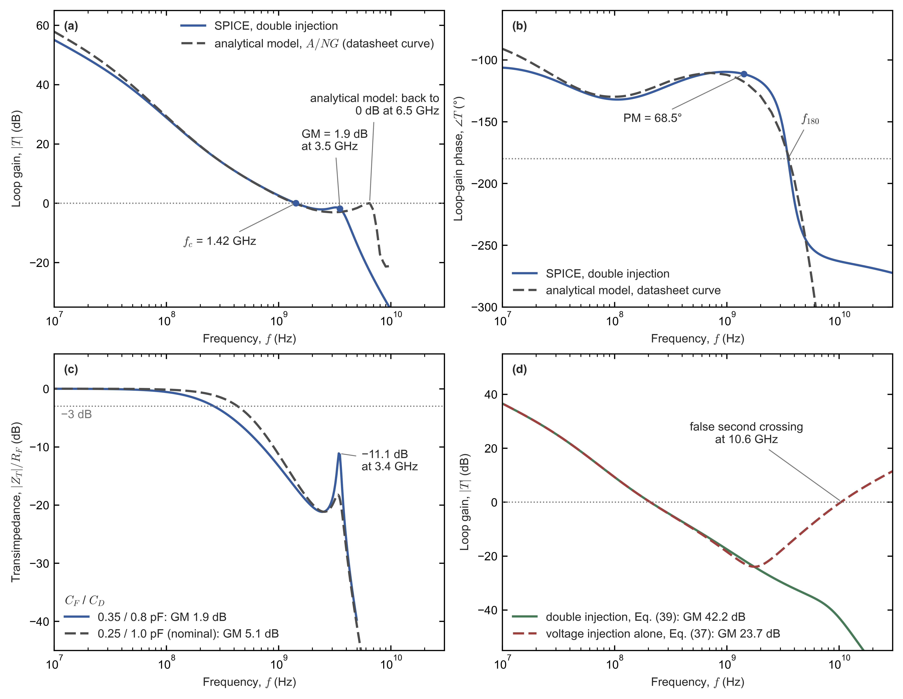

*Figure 9. Loop gain and transimpedance of variant A at its worst-gain-margin corner, and what a voltage injection alone reports. Amplifiers: OPA855 (a–c) and OPA856 (d). (a, b) Loop gain of the 1-pF, 2-kΩ design at total $C_F$ = 0.35 pF and $C_D$ = 0.8 pF, from the double injection, Eq. (39), against our $T = A/NG$ with the digitized datasheet curve, drawn to the end of that curve at 9.7 GHz. SPICE gives $f_c$ = 1.42 GHz and 68.5° of phase margin. Between $f_c$ and $f_{180}$ = 3.5 GHz, the frequency at which the loop phase reaches −180° (Section 5.5), the loop gain stays between −2.1 and 0 dB, on the plateau of $A_-$, the open-loop gain from the inverting input (Section 5.3, Figure 10a), so the gain margin is only 1.9 dB. Our curve gives 62.7° and returns to 0 dB at 6.5 GHz, by 0.01 dB, on the plotted 4–7 GHz bump: the second crossing of Table A5.7. (c) Transimpedance of the same corner, computed from the SPICE loop gain with Eq. (9) and drawn up to 5 GHz, with the directly simulated response of the nominal design ($C_F$ = 0.25 pF, $C_D$ = 1.0 pF, gain margin 5.1 dB) for comparison. Neither has in-band peaking; the 1.9-dB margin shows only as a resonance 11.1 dB below $R_F$ at 3.4 GHz. At the neighbouring scan point (0.34 pF, 0.8 pF), Eq. (9) reproduces the directly simulated $Z_T$ to 0.11 dB from 1 MHz to 4 GHz. Above about 5 GHz the photocurrent that reaches the output through $C_F$, which Eq. (9) leaves out, dominates. (d) OPA856, 1 pF, 2 kΩ, $C_F$ = 0.55 pF: double injection against voltage injection alone, Eq. (37). The latter carries the error $Z_1/Z_2$ of Eq. (40), which grows above 2 GHz as the feedback network becomes a low impedance. It understates the gain margin by 18.5 dB (23.7 against 42.2 dB) and crosses 0 dB again at 10.6 GHz, where the loop does not.*

### 5.3 What is extracted from each macromodel, and how it predicts the closed loop

**The idea.** Treat each macromodel like an unknown amplifier on a bench. Measure its small-signal quantities in simple test fixtures, then predict the TIA from those quantities with our equations, and compare with the full TIA simulation. Agreement shows two things:
- the equations are complete, so nothing in the circuit simulation lies outside them;
- every remaining difference between SPICE and our analysis can be traced to one quantity, with its size.

**The quantities and their fixtures.**

1. **Open-loop gain from each input.** In the fixtures of Appendix B.1, with the voltages $v_o$ (output), $v_+$ and $v_-$ (inputs) taken from the simulation:
$$
A_+ = \frac{v_o}{v_+ - v_-},\qquad A_- = -\frac{v_o}{v_-}\quad (v_+ = 0).
\tag{41}
$$
$A_+$ is the gain with the non-inverting input driven, the usual open-loop measurement and presumably what the datasheet curves show. $A_-$ is the gain with the inverting input driven and the non-inverting input grounded, which is how a TIA uses the amplifier. They differ when the amplifier's common-mode rejection is finite: a single-ended drive carries a common-mode component of half the differential signal, with opposite sign for the two inputs.

2. **Input admittance of the inverting input**, with the non-inverting input grounded. A source $V_t$ drives the inverting input through $C_B$; $L_B$ = 1 mH closes the DC loop. The current into the pin is the source current, $-i(V_t)$ in ngspice's sign convention, plus the current through $L_B$:
$$
Y_{\mathrm{in}} = \frac{-i(V_t) + (v_o - v_-)/(sL_B)}{v_-}.
\tag{42}
$$
The capacitance is $\mathrm{Im}(Y_{\mathrm{in}})/\omega$, the resistance $1/\mathrm{Re}(Y_{\mathrm{in}})$. The run is repeated with the output held at AC ground by a large capacitor. Equal results mean that no capacitance couples the output back to the input (none does in the first seven models; OPA847's does, as noted below).

3. **Open-loop output impedance.** With both inputs at AC ground, a 1-A AC current $i_z$ into the output:
$$
Z_o = \frac{v_o}{i_z}.
\tag{43}
$$

4. **Noise: $e_n$, $i_n$, and the capacitance that $e_n$ actually drives.** $e_n$ alone comes from the open-loop fixture: `noise v(out) Vp` with both inputs at AC ground and a noiseless load gives `inoise_spectrum` = $e_n(f)$.
   - A macromodel may place its voltage-noise source before or after its own input capacitance, so the capacitance that $e_n$ drives must be measured, not assumed.
   - It also may or may not add a current noise that rises with frequency.
   - Four TIA noise runs with noiseless $R_F$ and $R_L$ (`.model rnl r(noisy=0)`) and external capacitances $C_x$ = 0, 1, 3 and 6 pF give, at each frequency, the input-referred density
$$
S_i(C_x) = i_n^2 + e_n^2\left[\frac{1}{R_F^2} + \omega^2\,(C_0 + C_x)^2\right],
\tag{44}
$$
a quadratic in $C_x$.
   - A least-squares fit $S_i = a + bC_x + cC_x^2$ gives $e_n = \sqrt{c}/\omega$ and $C_0 = b/(2c)$, and then $i_n^2 = a - e_n^2/R_F^2 - e_n^2\omega^2C_0^2$.
   - $C_0$ minus the test circuit's $C_F$ is the capacitance of the model's own that its $e_n$ drives.
   - The fit is done in pA²/Hz and pF so that the three columns of the least-squares problem are of similar size. In SI units the $C_x^2$ column is $10^{24}$ times smaller than the constant one, and the solver discards it.

**From these quantities to the closed loop.** Our loop gain, Eq. (10), is $T = A/NG$ with $NG = 1 + sC_TZ_F$. The complete version uses:
- the gain from the inverting input, $A_-$;
- the node admittance $Y_{\mathrm{node}} = s(C_D + C_{\mathrm{PCB}}) + Y_{\mathrm{in}}$ in place of $sC_T$;
- the output impedance loaded by $R_L$ and by the feedback network.

The gain $A_-$ was measured with only $R_L$ at the output. The amplifier's internal open-circuit gain is therefore $A_-(R_L + Z_o)/R_L$, and in the TIA it drives $Z_o$ into the load $Z_L$ formed by $R_L$ in parallel with the feedback path $Z_F + 1/Y_{\mathrm{node}}$:
$$
T = A_-\,\frac{R_L + Z_o}{R_L}\,\frac{Z_L}{Z_L + Z_o}\,\frac{1}{1 + Z_F\,Y_{\mathrm{node}}},
\qquad
Z_L = \left(\frac{1}{R_L} + \frac{1}{Z_F + 1/Y_{\mathrm{node}}}\right)^{-1}.
\tag{45}
$$
The transimpedance then follows from Eq. (9). The noise follows from Eq. (19), with the fitted $e_n$ and $i_n$ and with $C_{\mathrm{tot}} = C_D + C_{\mathrm{PCB}} + C_F + (C_0 - C_F^{\mathrm{test}})$.

**What Table A5.2 shows.**
- **$e_n$ and the input capacitance match the datasheets**, except in three cases:
  - LMH6629 has 1.3 pF against the datasheet's 5.7 pF. Its own parameter sheet lists 1.7 pF of "input capacitance", which matches the datasheet's common-mode value. That figure is consistent with 0.85 pF from each input to ground: with the non-inverting input grounded, the inverting input then sees 0.85 pF plus the model's 0.45 pF between the inputs. The 4-pF differential capacitance is not in the model.
  - OPA846 has 3.07 pF against 3.8 pF. The fit shows that its $e_n$ drives only 2.28 pF of that: part of the capacitance belongs to the model's input transistor itself, inside the mechanism that generates the noise.
  - OPA859's $e_n$ is 3.03 against 3.3 nV/√Hz, and rises to 3.65 nV/√Hz at 500 MHz.
- **Current noise differs by model family:**
  - The bipolar parts have current noise close to their datasheet values. OPA855, OPA856 and LMH6629 are flat; OPA846 rises from 2.8 to 3.2 pA/√Hz between 10 and 100 MHz.
  - The OPA858 and OPA859 models have essentially none: 0.03 pA/√Hz at 100 MHz. OPA858's datasheet curve rises to 4.65 pA/√Hz at 100 MHz (Table A3.4).
  - The OPA818 model adds a current noise that rises with frequency: 1.15, 2.36 and 4.22 pA/√Hz at 10, 50 and 100 MHz. That is 1.6–1.9 times the datasheet curve (0.59, 1.42 and 2.56 pA/√Hz at 10, 50 and 97.6 MHz), on top of the $e_n$ that drives the model's own 2.37 pF.
  - Between 50 and 100 MHz the OPA818 datasheet curve lies within 10 % of $e_n\cdot2\pi f\cdot C_{CM}$ with $C_{CM}$ = 1.9 pF: at 97.6 MHz, 2.2 nV/√Hz × 2π × 97.6 MHz × 1.9 pF = 2.56 pA/√Hz. That is the input-capacitance noise that Eq. (19) already contains. If the curve is that noise, as its values suggest (it is labelled simulated, Appendix C, item 3), the model counts it twice. In any case the model's current noise is larger than the datasheet's.
- **$I_Q$ matches** except for OPA846, whose 2011 model carries 4.8 mA against 12.6 mA. The supply current does not enter the quantities measured here, but a model biased this differently may not describe the part, and Section 5.4 finds it peaking less than the datasheet's measured response (Appendix C, item 18).
- **The output impedances are 5–18 Ω for the newer models and 37 Ω for OPA846.**
- **The further amplifiers of Section 6.5.**
  - Two ADI models carry an input capacitance far from their datasheets: ADA4899-1 0.40 pF against 4.4 pF, and AD8099 5.1 pF against 2.0 pF.
  - OPA847's model has 220 Ω of input resistance at 100 MHz, and a current noise that rises from 3.5 to 10.8 pA/√Hz between 10 and 100 MHz. Its datasheet gives 2.5 pA/√Hz for f > 1 MHz and plots it only to 10 MHz. The model's input capacitance also differs with the output free and grounded (8.5 against 7.6 pF), so its output couples back to its input.
  - The other models agree with their datasheets within 0.7 nV/√Hz and 1.2 pF.

**What Table A5.3 shows.**
- **OPA855.** The magnitudes agree within 0.2 dB up to 1 GHz. The plotted 4–7 GHz bump (14.7 dB at 5 GHz on the datasheet curve) is absent from $A_+$, which has 1.1 dB there. $A_-$, however, has a plateau of 14.6–14.8 dB at 2–3 GHz, 1–2 dB above $A_+$ (Figure 10a). It has 4–13° more phase lag there and 25–39° more at 4–5 GHz. That plateau sets variant A's gain margin (Section 5.5).
- **OPA818.** The macromodel has 16° less phase lag than the curve at 300 MHz (−106° against −123°), and the gap widens towards 1 GHz (Figure 10d). At variant B's crossover (300–390 MHz) this is the whole difference between our 33° and SPICE's 49°.
- **OPA858.** The macromodel's magnitude is 4.3–5.1 dB below the plotted curve up to 1 GHz, i.e. its gain–bandwidth product is that of the table (5.5 GHz, Section 6.2.3), not that of Fig 6-10.
- **OPA856.** The macromodel has 1.2 dB less gain at 100–300 MHz and 2.8 dB less at 1 GHz, with 16° less phase lag there.
- **LMH6629.** The macromodel has 1.4–2.3 dB more gain at 100 MHz–1 GHz and 18° less phase lag at 1 GHz.
- **OPA859.** The macromodel has 1.0–1.4 dB more gain and 6–7° more phase lag at 100–300 MHz.
- **OPA846.** The macromodel has 1.3–2.6 dB more gain at 100–300 MHz and 13° less phase lag at 300 MHz.
- **The two inputs.** For the first seven models $A_-$ and $A_+$ agree within 0.3 dB and 7° up to 1 GHz, so their phase margins depend on which input a curve describes by a few degrees at most, most for LMH6629, whose two gains part by 7° at 1 GHz, near its 801-MHz crossover. OPA955 differs by 0.5 dB and 10° at 1 GHz, OPA657 by 10° and OPA847 by 0.4 dB. At 3 GHz the gains of OPA855, OPA818, OPA856 and LMH6629 differ by 0.7–1.9 dB and 13–21°, and by more above, so the gain margins do depend on it.
- **The further amplifiers of Section 6.5.**
  - OPA847's macromodel has far less gain than its curve above 300 MHz: −3.2 against +13.3 dB at 1 GHz, with unity gain at 0.90 GHz. Its datasheet's own test circuit (Table A5.5) shows that the model is the one that is wrong.
  - OPA657's macromodel has 3.5–4.0 dB less gain than its curve at 100–300 MHz.
  - LMH6624's has 17° less phase lag at 100 MHz and 43° less at 300 MHz; AD8099's (uncompensated) has 27° less at 300 MHz. THS4021's has 21° less lag at 100 MHz and 11° more at 300 MHz.
  - ADA4817-1 and ADA4895-1 agree with their curves within 1.1 dB and 3° up to 300 MHz. ADA4899-1 has 1.1–3.3 dB less gain.
  - OPA955's macromodel matches its curve's magnitude within 1.1 dB up to 3 GHz but has far less phase lag above 300 MHz: 28° less at 1 GHz and 74° less at 3 GHz (−109° against −183°).

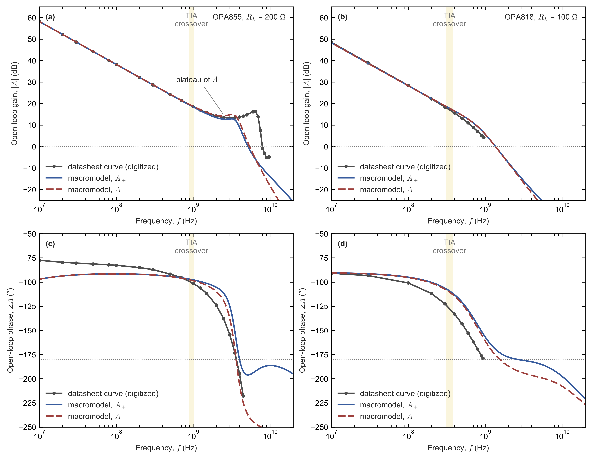

*Figure 10. Open-loop gain from our digitized datasheet curve and from the macromodel, driven at the non-inverting input ($A_+$) and at the inverting input ($A_-$, as in the TIA), each with the datasheet's load. Amplifiers: OPA855 (a, c) and OPA818 (b, d). The shaded bands mark the loop crossovers of each variant's four TIA configurations in SPICE: 880–1032 MHz and 307–386 MHz (Table A5.6). Each datasheet curve is drawn only over its digitized range: for OPA855 the magnitude to 9.7 GHz and the phase to 4.5 GHz, for OPA818 to 0.96 and 0.94 GHz. Beyond these our analysis extrapolates. For OPA855 the magnitudes agree within 0.2 dB up to 1 GHz. Above that, $A_-$ has a 14.6–14.8-dB plateau at 2–3 GHz, 1–2 dB above $A_+$, and that plateau sets variant A's gain margin; the plotted 4–7 GHz bump appears in neither. For OPA818 the macromodel has less phase lag than the curve from 100 MHz up, 16° at 300 MHz, which is the difference between the analytical and the SPICE phase margins for variant B. Section 5.4 shows that the macromodel is the one consistent with the datasheet's measured closed-loop response. Between 10 and 300 MHz OPA855's macromodel has 6–20° more phase lag than its curve (9° at 100 MHz, 20° at 10 MHz). At 10–100 MHz, where the gap exceeds 8°, the loop gain of variant A is 26–56 dB, so the margins do not depend on it.*

**How Table A5.4 is read.**
- **The two-port column reproduces SPICE**: to 0.1° of phase margin, 0.1 dB of gain margin and 1 % of bandwidth for the thirteen designs of the first seven amplifiers, and the noise to 0.3 %. The closed-loop simulation therefore holds nothing that Eqs. (9), (19) and (45) and the quantities of Table A5.2 do not.
  - For the further amplifiers of Section 6.5 the agreement is within 0.3°, 0.1 dB, 1.4 % and 1.5 %, with one exception, OPA847: 4.0°, 1.3 dB and 9 %. Its output couples back to its inverting input (Table A5.2), which Eq. (45) leaves out.
- **Our method differs from it by method alone**: one open-loop curve and a pure input capacitance, with the same model's numbers.
  - The phase margin moves by at most 1.8° for OPA855, OPA818, OPA858 and OPA859. It moves by 6.4° for LMH6629, whose $A_-$ and $A_+$ part by 7° at 1 GHz, near its 801-MHz crossover (Table A5.3), and by 2.6° for OPA856 and 3.1° for OPA846, whose two gains differ by only 5° and 0° even at 1 GHz, far above their 208-MHz and 308-MHz crossovers; the input admittance and the loaded output impedance of Eq. (45) account for the rest. For OPA955 our method is 9° optimistic: its gain from the inverting input has 10–18° more lag than from the non-inverting input at 1–3 GHz (Table A5.3).
  - The bandwidth moves by at most 6 % for the first seven amplifiers.
  - The gain margin is 4.6–4.9 dB optimistic for OPA855, 6.0–7.0 dB for OPA818, 4.1 dB for OPA858 and 5.4 dB for LMH6629. The cause is $A_-$ against $A_+$ above 2 GHz and the loaded output impedance.
- **Every difference between our analysis and SPICE in Sections 5.5–5.7 is therefore a difference of parameters**, datasheet against macromodel, except these gain-margin offsets and the phase-margin offsets of LMH6629 (6.4°) and OPA955 (9°).

### 5.4 The datasheets' test circuits decide between curve and macromodel

Where a datasheet's open-loop curve and the vendor's macromodel disagree, our phase margins could follow either, and with them the choice between designs. The datasheets offer an independent test. Each states the closed-loop behaviour of one test circuit, measured or at least published as typical, and both descriptions of the amplifier claim to reproduce it, so that circuit acts as a referee between them. For a non-inverting stage with gain resistors $R_F$ and $R_G$, the amplifier's input capacitance $C_{\mathrm{in}}$ loads the inverting node:
$$
\beta = \frac{Z_G}{Z_G + R_F},\quad Z_G = \frac{R_G}{1 + sR_GC_{\mathrm{in}}},\qquad
T = A_-\,\beta,\qquad G_{\mathrm{cl}} = \frac{A_+}{1+T}.
\tag{46}
$$
Here $\beta$ is the feedback factor, $T$ the loop gain and $G_{\mathrm{cl}}$ the closed-loop gain. The input pole lies at $1/(2\pi R_{\parallel}C_{\mathrm{in}})$, where $R_{\parallel}$ is $R_G$ in parallel with $R_F$. For OPA818, $R_{\parallel}$ = 301 × 50.5/351.5 = 43.2 Ω and $C_{\mathrm{in}}$ = 2.4 pF put that pole at 1.5 GHz. Across the five circuits of the first seven parts that have gain-setting resistors (OPA856 and OPA859 are tested as buffers) it lies at 1–3 GHz, close enough to their 240–1250 MHz crossovers to cost 12–19° of phase (Table A5.5). Table A3.5 compared the curves with these circuits using $A/(1 + A/G)$, i.e. without $C_{\mathrm{in}}$.

Two cautions apply.
- **The agreement can be by construction.** The models of OPA855, OPA818, OPA856 and OPA955 (TI's Green-Williams-Lis macromodels, Table B.1) are fitted to the datasheet's closed-loop gain and phase, so their agreement with a closed-loop statement shows that the fit holds, not that the model is independent evidence. What the referee adds is the other half: whether the open-loop curve, used with the datasheet's own input capacitance, is consistent with the same closed-loop data.
- **All of this is typical behaviour of one temperature.** Unit-to-unit spread, including the spread of open-loop gain used in Section 6.2.8 (+1.5 dB, and down to the datasheet minimum GBW or −2 dB), comes on top.

**Reading Table A5.5.** The phase margins of the last column, Eq. (46) with the macromodel's quantities, agree with SPICE within 2.3° for the first seven parts, and for the further amplifiers within 0.5° except OPA847 (19.4° against 33.3°; its output couples back to its input), ADA4817-1 (53.3° against 49.2°) and ADA4899-1 (60.0° against 55.5°). Eq. (46) does not reproduce the closed-loop peaking where the response extends to several gigahertz (OPA855, OPA859): there the signal also passes from input to output through the feedback network, which Eq. (46) leaves out. Across these circuits the macromodels reproduce the stated margins of OPA855, OPA818, OPA858 and OPA859 within 4°, and LMH6629's stated bandwidth within 8 %. Two verdicts change a design conclusion: OPA818's, whose test circuit crosses over where variant B's TIA does, and OPA858's, which settles the conflict in its datasheet; the others say which description to trust for each part. Part by part:
- **OPA818: the curve is inconsistent with the datasheet's own closed-loop data, and the macromodel, fitted to that data, reproduces it.**
  - The datasheet's measured 765 MHz and 1.4 dB are reproduced by SPICE (758 MHz, 1.37 dB). A two-pole loop with 1.4 dB of peaking has about 51° of margin, close to the 54° that SPICE gives: its damping ratio $\zeta$ follows from the peak $M_p = 1/(2\zeta\sqrt{1-\zeta^2})$, and its phase margin from $\mathrm{PM} = \arctan\left(2\zeta/\sqrt{\sqrt{1+4\zeta^4}-2\zeta^2}\right)$; $M_p = 10^{1.4/20}$ = 1.175 gives $\zeta$ = 0.487 and PM = 51°.
  - The datasheet curve agrees only without the input capacitance. With it, which is the physical case, it predicts 4.3 dB of peaking and 40°.
  - Its phase near 350 MHz therefore carries about 12° of lag that the part does not have. One explanation consistent with the numbers is that the plotted phase already contains the loading of the fixture used to obtain it; the datasheet does not say how the curve was made.
  - The TIA crosses over in the same range (300–390 MHz), so the macromodel's TIA margins are the more credible ones for variant B until the first board settles them (Appendix C, item 16).
- **OPA858: the macromodel is right and the plotted curve is not.** SPICE gives 1.34 GHz with 0.4 dB of peaking and 58°, against the table's 1.2 GHz, < 1 dB and 55°. The plotted curve gives 2.6 GHz.
- **OPA855: both are close.** SPICE gives 59.9° against the stated 62°; the curve gives 55° with $C_{\mathrm{in}}$ (74° without).
- **OPA859: the macromodel matches the text (63°).** The curve gives 74°, the discrepancy already noted in Appendix F. Our calibrated variant (Section 6.2.3) was built to reproduce 63°.
- **LMH6629: the macromodel is closer to the table** (834 against 900 MHz, no peaking). It is closer partly because it carries only 1.3 pF at the input. With the datasheet's 5.7 pF the curve predicts 1.4 dB of peaking where the table says none. This is weak evidence that the true input capacitance is below 5.7 pF; it is not a measurement of it.
- **OPA856: the curve is right and the macromodel is optimistic.** The text's 57° as a buffer agrees with the curve (56°); the macromodel gives 66°.
- **OPA846: neither reproduces the plotted +3.1 dB.** The macromodel gives 1.4 dB, optimistic by about 10° of margin: by the same relations the measured 3.1 dB ($M_p$ = 1.429) means $\zeta$ = 0.378 and about 41°, against about 51° for 1.4 dB. The curve with $C_{\mathrm{in}}$ gives 5.6 dB (pessimistic). The part lies between them.
- **The further amplifiers of Section 6.5.**
  - **OPA657: the macromodel is right.** It gives 360 MHz and 5.8 dB against the stated 350 MHz and 7 dB. The curve with the datasheet's 5.2 pF of input capacitance predicts 24 dB of peaking and 5° of margin.
  - **OPA847: the macromodel is far off.** It gives 347 MHz against the stated 600 MHz, with 5.3 against 4.5 dB of peaking. The curve gives 752–839 MHz with 11–16 dB, so neither description fits, and OPA847's bandwidths in this section are not credible.
  - **LMH6624: the macromodel is right and the plotted phase is not.** It gives 212 MHz and 0.3 dB against the curve reading of about 215 MHz and 0.7 dB. The open-loop curve, with its 17–43° of extra lag (Table A5.3), predicts 1.7–2.9 dB. A second datasheet plot, with $R_F$ = 511 Ω, reads 1.3–1.6 dB and 170–182 MHz, so the datasheet agrees with itself only to about 1 dB.
  - **THS4021: both are near.** SPICE gives 336 MHz and 1.4 dB, the curve 307–311 MHz and 2.0–2.3 dB, against 290 MHz and 1.6 dB.
  - **ADA4817-1 and ADA4895-1: the macromodels are right.** They give 1109 against 1050 MHz with 3.3 against 3.1 dB, and 222 against 216 MHz with 2.0 against 2.1 dB.
  - **ADA4899-1: the macromodel is 15 % slow**: 513 against 605 MHz, with the stated peaking. With 0.40 pF of input capacitance against the datasheet's 4.4 pF (Table A5.2), its noise is also optimistic.
  - **AD8099, with the datasheet's compensation network: the macromodel is 15 % fast** (803 against 700 MHz) and peaks 1.2 dB more (4.3 against 3.1 dB).
  - **OPA955: the macromodel is closer than the curve, and conservative.** It gives 2354 MHz and 3.7 dB of peaking against the stated 2.8 GHz and the plotted 1.3 dB: 16 % slow and less damped than the part. The curve with the datasheet's 1.1 pF of input capacitance predicts 14.6 dB of peaking. The datasheet is advance information.

### 5.5 The TIA designs in SPICE

With the macromodels checked against our equations (Section 5.3) and against the datasheets (Section 5.4), we now simulate the TIA designs themselves. The question is whether the designs chosen with our analytical model keep their phase margin and bandwidth when the feedback and photodiode capacitances move to their corners, and what gain margin they have, which our analysis does not give reliably (Section 5.3).

The designs are those chosen with our analytical model:
- variants A and B in their four configurations (Table A8.11);
- the starting values of Table A8.13 for OPA856 and LMH6629;
- OPA858 at variant A's values;
- the flat designs of Section 6.2.1 for OPA859 and OPA846;
- for the further amplifiers of Section 6.5, our own choices at 1 pF and 2 kΩ: the robust design where one exists without added capacitance (ADA4817-1, ADA4899-1), otherwise the flat design (OPA657, ADA4895-1), otherwise the $C_F$ of largest phase margin (OPA847, LMH6624, THS4021, OPA955); AD8099 has none, so its 0.2-pF parasitic $C_F$ alone is used.

Each has the 0.35-pF board capacitance and $R_L$ as in Table A5.3. Variant B runs at ±6.5 V as in Section 8.9, OPA846, OPA657, OPA847, ADA4817-1, AD8099 and ADA4899-1 at ±5 V, LMH6624 at ±6 V, THS4021 at ±15 V, and the others at ±2.5 V.

The corners vary the total $C_F$ by ±0.1 pF and $C_D$ by ±0.2 pF: nine combinations, as in Section 6.2.8 but without the variation of open-loop gain.

**Variant A (OPA855).**
- **Phase margin and bandwidth agree with our analysis.** At every corner of Table A5.7 the SPICE phase margin lies between 0.2° below and 5.8° above ours. The bandwidth is 2–4 % higher, and the step response has at most 1.2 % overshoot.
- **The gain margin is the new information.** It is set at about 3.4 GHz by the plateau of $A_-$ (Table A5.3). It falls as $C_F$ rises, because a larger $C_F$ lowers the high-frequency noise gain $NG_\infty = 1 + C_T/C_F$ (Eq. (11)) and so raises $\lvert T\rvert$ there. At the upper $C_F$ corner it is only 1.4–3.1 dB.
- **The scan below finds how far $C_F$ may move before this margin falls under 3 dB** (Tables A5.8 and A5.9).

**Variant B (OPA818).**
- **SPICE gives 43–50° nominal and 39–45° at the worst corner, with no peaking.** Our analysis gave 27–35° nominal, 23–30° over the same nine corners, and 21–30° over the 27 corners of Table A8.11, which add the spread of open-loop gain. Section 5.4 explains why the macromodel is the better description here.
- **The bandwidth is correspondingly lower**: 226–333 MHz against 302–442 MHz, still above the 150-MHz requirement.
- **The gain margin is 14–19 dB everywhere.**
- **Consequences.** In the vendor's model, variant B needs no equalizer at $C_F$ = 0.55–0.65 pF; the scan below shows what a smaller $C_F$ buys (Table A5.10).

**Scanning the feedback capacitance.** The corner runs above test only the chosen values. To find the edges, the total $C_F$ was stepped:
- from 0.06 to 0.60 pF in 0.02-pF steps for variant A;
- from 0.15 to 0.80 pF in 0.025-pF steps for variant B.

Each step was simulated at the nominal $C_D$ and at $C_D$ ± 0.2 pF, with the loop gain of Eq. (39) and the transimpedance in the same deck: 660 runs in all. An edge is placed by linear interpolation between neighbouring steps. Each proposed value was then simulated again at its nine corners (its own $C_F$ tolerance, and $C_D$ ± 0.2 pF), and its noise with it: 180 further runs. The criteria are those of Section 6.2.4, required at all three photodiode capacitances: phase margin ≥ 45°, gain margin ≥ 3 dB, and peaking ≤ 1 dB. For variant B, whose gain margin is 14–19 dB everywhere, Table A5.10 asks for the phase margin alone, at 45° or 40°; its 40° designs peak by up to 1.53 dB at a corner, more than the 1 dB of variant A's window.

**Reading Table A5.8.**
- **The lower edge is set by peaking, not by phase margin** (Figure 11a–c). At the lower edges the worst-case phase margin is still 50–51°. Phase margin ≥ 45° alone would allow 0.135, 0.159, 0.160 and 0.188 pF in the order of the table. Our analytical model puts the lower edges within 0.011 pF of SPICE.
- **The upper edge is set by the gain margin, and that depends only on $NG_\infty$.** The gain margin is read where the loop phase reaches −180°, at about 3.4 GHz.
  - There $\omega R_FC_F \gg 1$. For example, at 2 kΩ and 0.3 pF, $\omega R_FC_F = 2\pi\times3.4\ \mathrm{GHz}\times2\ \mathrm{k\Omega}\times0.3\ \mathrm{pF} = 12.8$. So $Z_F \approx 1/(j\omega C_F)$, the noise gain of Eq. (10) has reached $NG_\infty$, and $\lvert T\rvert = \lvert A_-\rvert/NG_\infty$.
  - With $f_{180}$ the frequency at which the loop phase is −180°:
$$
\mathrm{GM} = 20\log_{10}\frac{NG_\infty}{\lvert A_-(f_{180})\rvert},\qquad NG_\infty = 1 + \frac{C_T}{C_F}.
\tag{47}
$$
  - In all twelve combinations of configuration and photodiode capacitance, the scan gives 3 dB at $NG_\infty$ = 7.49–7.55. In the six (the 1-pF designs) where 0 dB falls inside the scan, it gives 0 dB at 5.30–5.31. So $\lvert A_-(f_{180})\rvert$ = 5.3 (14.5 dB), the plateau of Table A5.3, and Eq. (47) holds: $20\log_{10}(7.5/5.3) = 3.0$ dB. Figure 11d shows every scan point against it.
- **What the rule means for $C_F$.**
  - The datasheet's minimum stable gain of 7 leaves $20\log_{10}(7/5.3)$ = 2.4 dB.
  - A 3-dB margin needs $NG_\infty \ge 7.5$, i.e. $C_F \le C_T/6.5$, with $C_T$ including the amplifier's own 0.80 pF. For $C_D$ = 0.8 pF this is (0.8 + 0.35 + 0.80)/6.5 = 0.300 pF, the edge in the table.
  - Below $NG_\infty$ = 5.3, i.e. $C_F > C_T/4.3$, the macromodel oscillates at 2.6–3.1 GHz. That is above 0.45–0.55 pF for the 1-pF designs; the 2-pF designs stay stable up to the end of the scan at 0.60 pF.
- **Our analytical model's upper edges lie 0.04–0.07 pF higher.** They sit at the second crossing of the plotted 4–7 GHz bump, close to the minimum-gain rule.
- **The corners that our analysis flags are those that lose gain margin here.** The macromodel has no 4–7 GHz bump but loses margin at the same corners, at about 3.4 GHz, through the plateau of $A_-$, so the flags of Table A8.11 mark a real loss of margin. How large that loss is on a board depends on parasitics no model here contains: the output pin, the feedback pads and $R_F$'s own parasitics at gigahertz.

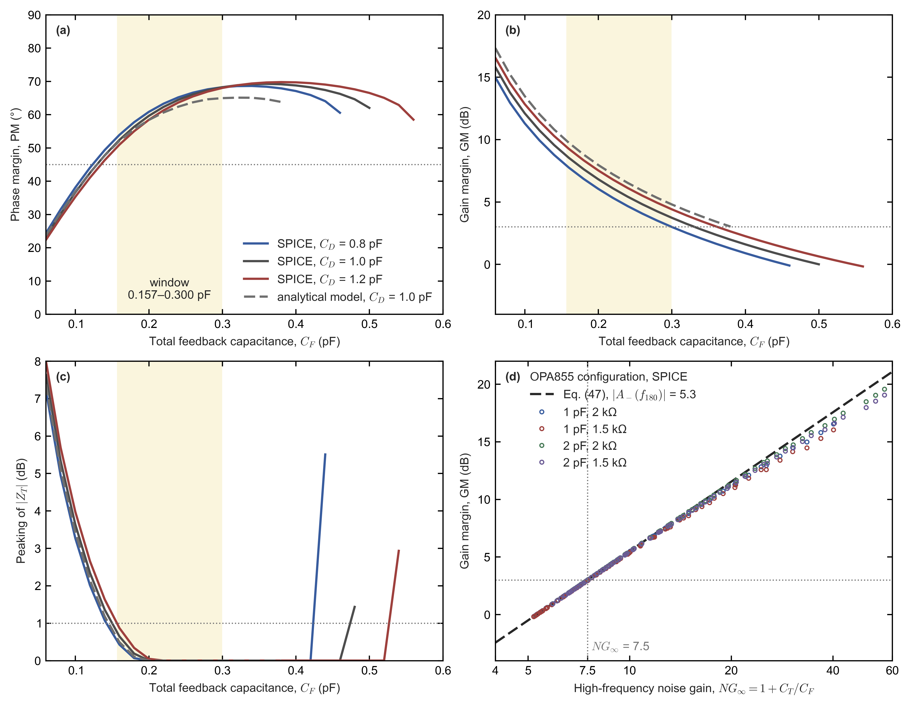

*Figure 11. Variant A's feedback-capacitance scan in SPICE. Amplifier: OPA855. (a)–(c) Phase margin, gain margin and peaking of $\lvert Z_T\rvert$ against total $C_F$ for the 1-pF, 2-kΩ configuration at $C_D$ = 0.8, 1.0 and 1.2 pF, with our analytical model (datasheet curve) at 1.0 pF dashed. Dotted lines mark the criteria of Section 6.2.4: 45°, 3 dB and 1 dB. The shaded band, 0.157–0.300 pF, meets all three at all three photodiode capacitances (Table A5.8). Peaking at $C_D$ = 1.2 pF sets its lower edge, and the gain margin at $C_D$ = 0.8 pF its upper edge. Peaking is drawn only where the loop is stable (gain margin ≥ 0 dB); its rise above 0.42 pF is the 3-GHz resonance as the gain margin approaches 0 dB. Our analytical model's gain margin lies 1.1–1.5 dB above SPICE and ends at 0.38 pF, because from 0.40 pF its loop gain regains unity on the plotted 4–7 GHz bump. (d) Gain margin against the high-frequency noise gain $NG_\infty = 1 + C_T/C_F$, with $C_T = C_D$ + 0.35 pF + 0.80 pF (the model's own input capacitance), for all four configurations at all three photodiode capacitances, one circle per scan point, against Eq. (47) with $\lvert A_-(f_{180})\rvert$ = 5.3. Up to $NG_\infty$ = 20 the points lie at most 0.54 dB below Eq. (47). At larger $NG_\infty$, i.e. the smallest $C_F$, they fall up to 1.55 dB below it. There $\omega R_FC_F$ at $f_{180}$ drops to 1.9–2.6 (0.06 pF, 1.5–2 kΩ, 3.4 GHz), so $Z_F$ is no longer purely capacitive and the noise gain has not yet reached $NG_\infty$.*

**Reading Table A5.9.**
- **The 1-pF windows are narrower than ±0.1 pF.** They are 0.143 pF wide at 2 kΩ and 0.117 pF wide at 1.5 kΩ, so the total $C_F$ must be held to ±0.070 and ±0.055 pF. The ±0.1 pF that Table A8.13 allows for the resistor and pads does not fit. The parasitic must be measured on the first board and trimmed with pad copper, as the notes to Table A8.13 describe.
- **The 2-pF windows allow ±0.130 and ±0.115 pF**, so ±0.1 pF fits without trimming.
- **Every proposal passes at its nine corners**, with 50–51°, 3.0–3.1 dB and ≤ 0.93 dB of peaking.
- **The window controls stability, not bandwidth.** Across the 1-pF, 2-kΩ window the nominal bandwidth runs from 671 MHz at 0.16 pF to 333 MHz at 0.30 pF. At the proposed 0.230 pF it is 481 MHz, but 327–684 MHz across its corners. The post-filter at 200–250 MHz of Table A8.10, not $C_F$, has to set the bandwidth.
- **The noise is that of Table A5.11 within 0.05 pA/√Hz.**

**Reading Table A5.10.**
- **At 1 pF and 2 kΩ the design of Table A8.11 is the 45°, ±0.1-pF design** (Figure 12): the scan returns 0.55 pF, the value of that table. At 2 pF the 45°, ±0.1-pF designs are 0.57 and 0.69 pF, 0.02–0.04 pF above the 0.55 and 0.65 pF of Table A8.11, which keep 44.3° and 43.4° at their worst corner (Table A5.6).
- **At 1 pF and 1.5 kΩ, 45° is not reached at any $C_F$.** The best worst case is 44.7°, at 0.70 pF. Above that, $NG_\infty$ falls towards the minimum stable gain and the margin drops again.
- **A smaller $C_F$ buys bandwidth in two ways.** One is accepting a worst case of 40° instead of 45°; the other is trimming $C_F$ to ±0.05 pF.
  - At 1 pF and 2 kΩ, against the 226 MHz of the design of Table A8.11: 259 MHz (45°, ±0.05 pF), 279 MHz (40°, ±0.1 pF) and 309 MHz (40°, ±0.05 pF, at 0.42 pF). That is 15–37 % more, with at most 1.35 dB of peaking at any corner.
  - In the other configurations the gain is 6–20 %, from 0.45–0.54 pF.
- **The loop sets a ceiling.** Below about 0.35 pF the bandwidth stops rising and the peaking grows. At 0.15 pF the nominal response reaches 375, 331, 434 and 384 MHz, in the order of the table, with 10.6–14.4 dB of peaking.
  - An equalized design in the manner of Section 6.2.8 would therefore gain only about 20 % more than the 40°, ±0.05-pF designs, at the price of the equalizer.
  - Section 6.2.8 reached the same conclusion with the datasheet curve: for OPA818 the loop, not $C_F$, sets the bandwidth.
- **The noise changes by at most 0.15 dB** across these designs.
- **Our analytical model reaches neither 45° nor 40° at any $C_F$ in this range.** Its best worst case over the three photodiode capacitances is 28.6–36.8° across the four configurations, and 33.2° at 1 pF and 2 kΩ. At the nominal $C_D$ alone its best is 29.5–37.5°, and 34.0° at 1 pF and 2 kΩ, as Section 6.2.6 found. Its own conclusion for variant B, an equalized design, rests on that.

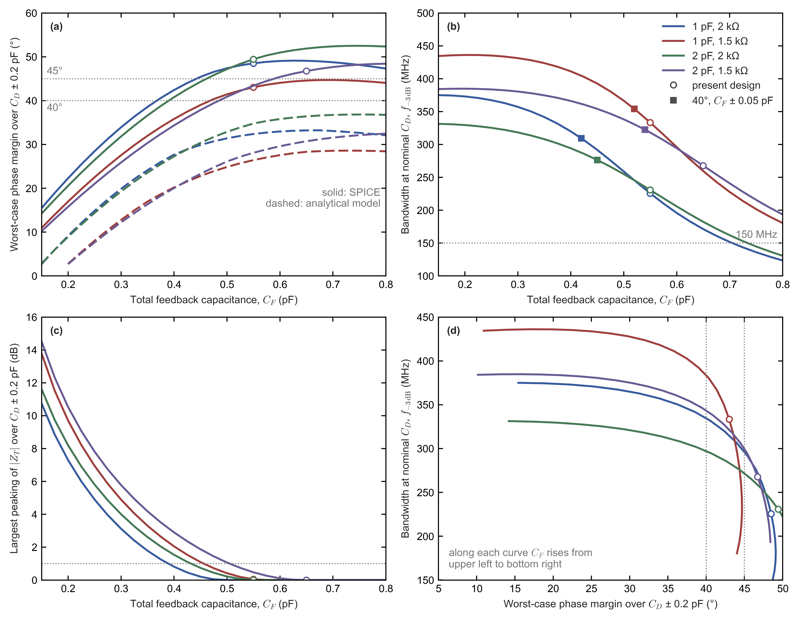

*Figure 12. Variant B's feedback-capacitance scan in SPICE, four configurations. Amplifier: OPA818. (a) Worst-case phase margin over $C_D$ ± 0.2 pF at each total $C_F$: SPICE solid, analytical model (datasheet curve) dashed, with dotted lines at 45° and 40°. (b) Bandwidth at the nominal $C_D$. Open circles mark the designs of Table A8.11 and filled squares the 40°, ±0.05-pF designs of Table A5.10. (c) Largest peaking of $\lvert Z_T\rvert$ over the three photodiode capacitances, with 1 dB dotted. (d) Bandwidth against worst-case phase margin, the trade that $C_F$ sets, with the designs of Table A8.11 marked; along each curve $C_F$ rises from upper left to lower right. In SPICE three configurations reach 45°. At 1 pF and 1.5 kΩ the worst case peaks at 44.7°, at 0.70 pF. Our analytical model peaks at 28.6–36.8°. Below about 0.35 pF the bandwidth stops rising while the peaking, largest over the three photodiode capacitances, grows to 10.8–14.5 dB at 0.15 pF: the loop, not $C_F$, caps the bandwidth at 331–434 MHz.*

**Other parts.** For the other five of the first seven, SPICE moves the margins in the direction that Sections 5.3 and 5.4 explain; the ranges are over the nine corners.
- **OPA858**: its margin collapses at the low-$C_F$ corner (33° at 0.15 pF). In SPICE its window at 1 pF and 2 kΩ is 0.225–1.153 pF, and its best design, 0.280 ± 0.050 pF, keeps 45.9° at 446 MHz (Table A6.32); the alternative is the added input capacitance that Section 6.2.3 recommends for the calibrated curve.
- **LMH6629** has 41–47° in SPICE against our 46–55°, the gap of Section 5.3 between $A_-$ and $A_+$.
- **OPA856 and OPA859** have 50–62° in SPICE.
- **OPA846**: SPICE gives 43–45°, but its referee says that the macromodel overstates OPA846's margin (Section 5.4).

### 5.6 Noise

The noise figures of Chapters 6 and 8 rest on Eq. (19) with the datasheet noise densities. Here each macromodel's own noise sources take their place in the same circuits, which tests those figures.

**Reading Table A5.11.** Eq. (19) does not depend on the loop (Section 3.6), so every difference here is one of parameters. Figure 13a shows the spectra of four of the designs.
- **OPA855 and OPA856 agree within 2.5 % and 0.2 dB**: within 2 % from 10 MHz up, and 2.4 % at 1 MHz. Variant A's noise figures in Sections 6.3, 6.4 and 8.9 stand.
- **OPA858 matches our central estimate exactly**, because its model has no current noise. The FET current-noise question of Section 3.7 therefore remains open; SPICE cannot settle it.
- **OPA859 is 0.5 dB below the central estimate**, because its model's $e_n$ is 3.03 instead of 3.3 nV/√Hz.
- **LMH6629 and OPA846 are lower in SPICE** because their models carry less input capacitance than their datasheets: 1.30 against 5.70 pF, and 2.28 driven by $e_n$ against 3.8 pF.
- **OPA818 is higher than even our high estimate.** At 100 MHz for variant B at 1 pF and 2 kΩ, Eq. (19) with the model's quantities is:
  - $4k_BT/R_F$ = 8.23 pA²/Hz;
  - $e_n^2/R_F^2$ = (2.174 nV/√Hz / 2 kΩ)² = 1.18 pA²/Hz;
  - $i_n^2$ = 4.22² = 17.8 pA²/Hz;
  - $(e_n\omega C_{\mathrm{tot}})^2$ with $C_{\mathrm{tot}}$ = 1 + 0.35 + 0.55 + 2.37 = 4.27 pF: $(2.174\ \mathrm{nV}\times2\pi\times10^{8}\ \mathrm{Hz}\times4.27\ \mathrm{pF})^2$ = 5.83² = 34.0 pA²/Hz.

  The sum is 61.2 pA²/Hz, i.e. 7.83 pA/√Hz, as SPICE gives (Figure 13b). Our central estimate has no $i_n$ term and a slightly lower $e_n$ (2.12 nV/√Hz, the datasheet curve at 1 MHz), and gives 6.49 pA/√Hz.

  The difference is the model's rising current noise, 1.6–1.9 times the datasheet curve (Section 5.3), so the SPICE figure is an upper bound. With it:
  - variant B's dark noise at 100 MHz is 1.6 dB above our central estimate and 1.0 dB above its high estimate;
  - its dark dynamic range falls by up to 1.6 dB, the change in band penalty;
  - with photocurrent, shot noise dilutes the change. Over 10–150 MHz the amplifier and $R_F$ contribute 35.7 pA²/Hz on average in our analysis and 51.3 pA²/Hz in SPICE. Against the 64.1 pA²/Hz of shot noise at 0.1 mA per diode the totals differ by 0.6 dB, and at 1 mA per diode (641 pA²/Hz) by 0.1 dB.

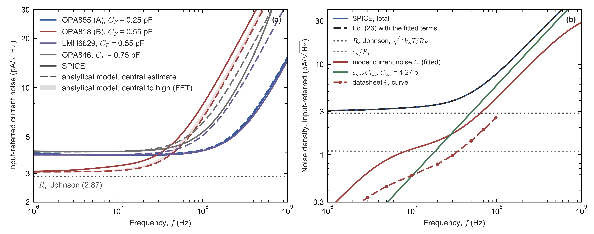

*Figure 13. Input-referred noise in SPICE against our analytical model, without photocurrent. Amplifiers: OPA855 (variant A), OPA818 (variant B), LMH6629 (COMP HI) and OPA846 in (a); OPA818 in (b). (a) The 1-pF, 2-kΩ designs: SPICE solid, our central estimate dashed, and for the FET input of OPA818 the range up to our high estimate shaded. OPA855 agrees within 2 % from 10 MHz up (2.4 % at 1 MHz). LMH6629 and OPA846 are lower in SPICE because their models carry less input capacitance than their datasheets. OPA818 is higher than even the high estimate (Table A5.11). (b) OPA818, variant B at 1 pF and 2 kΩ ($C_F$ = 0.55 pF): the SPICE total and the terms of Eq. (19) with the quantities fitted to the macromodel (Section 5.3). The terms are the Johnson noise of $R_F$, $e_n/R_F$, the model's current noise $i_n$, and $e_n\omega C_{\mathrm{tot}}$ with $C_{\mathrm{tot}}$ = 1 + 0.35 + 0.55 + 2.37 = 4.27 pF. Their quadrature sum (dashed) lies on the SPICE curve. The model's $i_n$ is 1.6–1.9 times the datasheet's current-noise curve (dashed with points, digitized to 97.6 MHz). At 100 MHz it contributes 17.8 of the 61.2 pA²/Hz.*

**Noise against margin and bandwidth, across the amplifiers.** Figure 14 places the seven 1-pF, 2-kΩ designs by their SPICE noise penalty, worst-case phase margin and bandwidth, next to our values for the same designs. Each point is one design as chosen in Sections 6.2 and 8.9, not each amplifier's best: $C_F$ was set there from the datasheet curves.
- **Four designs meet both requirements of this note, 45° at the worst corner and 150 MHz**: OPA855 (3.02 dB, 48.7°, 431 MHz), OPA856 (3.27 dB, 50.0°, 184 MHz), OPA859 (5.91 dB, 49.7°, 196 MHz) and OPA818 (7.95 dB, 45.4°, 226 MHz). OPA855 is the quietest of them and has 1.9 times the bandwidth of the next, OPA818 (431 against 226 MHz).
- **LMH6629 is as quiet in SPICE (3.05 dB) but has 41.1° and 169 MHz.** Its model carries 1.3 pF of input capacitance against the datasheet's 5.7 pF (Section 5.3). If the datasheet's value is right, its SPICE noise is optimistic.
- **OPA858 is the widest (508 MHz) at 4.02 dB, with 32.6° at its low-$C_F$ corner**; Section 5.5 gives the remedy.
- **OPA818's case (variant B) rests on the larger output swing of Table A6.28**, which a dark-noise penalty does not show.
- **The largest moves from our analysis to SPICE** are in phase margin for OPA818 (+15.5°), OPA846 (+11.3°) and OPA858 (−16.7°), and in noise for LMH6629 (−1.6 dB) and OPA818 (+1.6 dB over the central estimate).

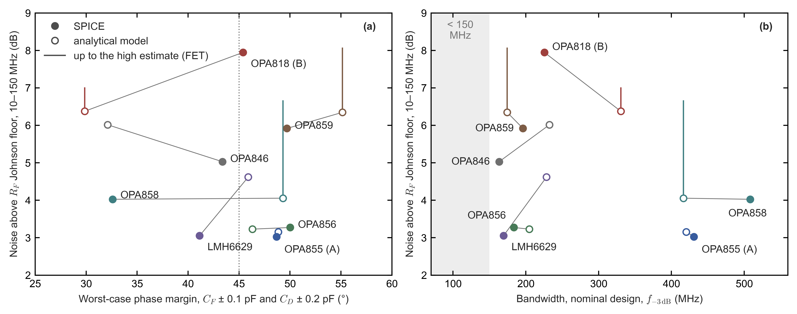

*Figure 14. Noise penalty over 10–150 MHz, relative to the Johnson noise of the 2-kΩ $R_F$ and without photocurrent (Table A5.11), against (a) the worst-case phase margin over the nine capacitance corners ($C_F$ ± 0.1 pF, $C_D$ ± 0.2 pF) and (b) the bandwidth of the nominal design, for the 1-pF, 2-kΩ designs of Table A5.6. Amplifiers: OPA855 (variant A, $C_F$ = 0.25 pF), OPA818 (variant B, 0.55 pF), OPA856 (0.55 pF), LMH6629 (COMP HI, 0.55 pF), OPA858 (0.25 pF), OPA859 (0.54 pF) and OPA846 (0.75 pF). Filled circles are SPICE with the vendors' macromodels. Open circles are our analytical model with the datasheet curves and its central noise estimate, with a bar up to the high estimate for the FET inputs. A thin line joins the two for each amplifier. The shaded band in (b) lies below the 150-MHz requirement.*

### 5.7 Large-signal limits

From about 0.15 mA up, the largest undistorted tone, not the noise, sets the dynamic range (Section 6.6.3), and our analysis takes that tone from the datasheet swing and slew rate through Eq. (26). This section checks those limits in the macromodels by driving the designs with a tone until they distort.

The tone check drives a sine photocurrent into the 1-pF, 2-kΩ designs of both variants, at 20, 50, 100, 150 and 200 MHz. The output amplitude is swept from 0.5 to 1.3 times the amplitude of Table A6.28 in steps of 0.05, with a 1-MΩ load (the light load of Table A6.28). Each run lasts 48 periods with 256 points per period; the last 32 periods are windowed (Hann) and transformed. Harmonics 2–5 give
$$
\mathrm{THD} = 10\log_{10}\frac{\sum_{k=2}^{5} \lvert V_k\rvert^2}{\lvert V_1\rvert^2},
\tag{48}
$$
with $V_k$ the amplitude of the $k$-th harmonic.

The numerical floor was checked at 0.1 of the Table A6.28 amplitude: HD2 −138 dBc and HD3 −152 dBc, unchanged with a hundredfold tighter tolerance (`reltol` 10⁻⁵).

**Reading Table A5.12.**
- **The macromodels limit where Table A6.28 says**, within 7 %. The swing limit of OPA855 bends the waveform gradually: −60 dBc needs 0.88–0.93 of the Table A6.28 amplitude, 0.6–1.1 dB less. OPA818's slew limit is abrupt: below it the model stays under −60 dBc, a few per cent above it the THD passes −40 dBc.
- **These are the limits of the models' clipping and slewing elements, not distortion predictions.** Below their limits the macromodels are nearly linear (−138 dBc at 0.1 of full scale). The datasheets' measured distortion near 100 MHz (Table A8.11: −73/−89 dBc for OPA855 and −49 to −54 dBc HD2 for OPA818 at 1 Vpp) remains the reference for small-signal linearity, and it is the stricter limit for OPA818.

### 5.8 The measured OPA846 board in SPICE

Section 3.10 inferred from two measurements on an OPA846 board — 1.45 kΩ and about 7 pA/√Hz at 50 MHz, with $R_F$ = 1.2 kΩ and no external feedback capacitor — that about 14 pF sits at the summing node and about 0.3 pF across $R_F$. That inference rests on our analytical model, which for OPA846 predicts more peaking than the part shows (Section 5.4), so here we repeat it with the vendor's macromodel. The same circuit was simulated with the OPA846 macromodel at ±5 V with $R_L$ = 100 Ω. $C_T$ is the total node capacitance, including the model's own 3.07 pF; the external capacitance is $C_T$ − 3.07 pF.

**Reading Table A5.13.**
- **The noise points to the same node capacitance as Section 3.10** (Figure 15b). SPICE reaches 7 pA/√Hz at 50 MHz at about 14.8 pF, by linear interpolation between 14 and 16 pF: 14 + 2 × (7.00 − 6.80)/(7.32 − 6.80) = 14.8 pF. Our analytical model reaches it at 12 + 2 × (7.00 − 6.69)/(7.25 − 6.69) = 13.1 pF. The baseline's total node capacitance of 5.15 pF (1-pF photodiode, 0.35 pF of board and the datasheet's 3.8 pF) gives only 5.1–5.2 pA/√Hz in both; in SPICE that total includes the model's 3.07 pF.
- **The transimpedance agrees in kind.** At 14–16 pF SPICE gives 1.37–1.40 kΩ at 50 MHz against the measured 1.45 kΩ. It needs more capacitance than our analytical model for the same value, as expected from a model that peaks less than the part (Section 5.4).
- **Both put the board close to oscillation.** SPICE gives 7–8° of phase margin and a +17 dB resonance at 130–150 MHz; our analytical model gives 2° and +30 dB at 123 MHz. The peak frequency of the bench response, the first of the three measurements Section 3.10 proposes, is thus expected near 120–150 MHz.
- **The noise at 10 MHz is 4.8–4.9 pA/√Hz in both**, whatever the capacitance. A 10-MHz reading near 6.7–7.4 pA/√Hz would still point to an instrument floor instead (Section 3.10).

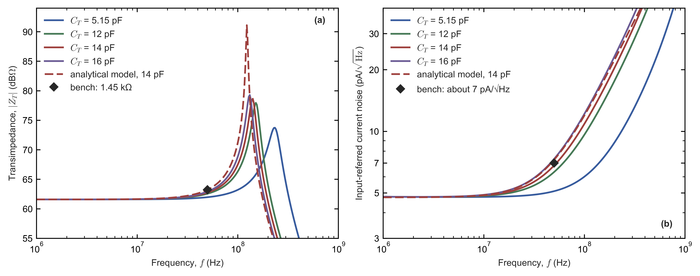

*Figure 15. The OPA846 bench board in SPICE ($R_F$ = 1.2 kΩ, total $C_F$ = 0.30 pF, ±5 V, $R_L$ = 100 Ω) for total node capacitances $C_T$ = 5.15, 12, 14 and 16 pF, which include the model's own 3.07 pF. Our analytical model at 14 pF is dashed, and the two bench readings at 50 MHz are diamonds. Amplifier: OPA846. (a) Transimpedance. SPICE gives 1.37–1.40 kΩ at 50 MHz for 14–16 pF, against the measured 1.45 kΩ (63.2 dBΩ), and a resonance of +16 to +18 dB at 130–150 MHz for 12–16 pF. Our analytical model gives 1.45 kΩ and +30 dB at 123 MHz for 14 pF. (b) Input-referred noise. The bench's 7 pA/√Hz at 50 MHz lies between the 14- and 16-pF curves (14.8 pF by interpolation, Table A5.13). The 5.15-pF case, our 1-pF baseline photodiode on this board, gives 5.1 pA/√Hz.*

### 5.9 What the cross-check found, and what it changes

**Our method holds, except for gain margins.** Fed with each macromodel's own quantities, its open-loop gain, input admittance, output impedance and noise sources, our equations reproduce every SPICE result of the first seven parts: the loop gain to 0.1° of phase margin and 0.1 dB of gain margin, the bandwidth to 1 % and the noise density to 0.3 % (Section 5.3, Table A5.4). With the simpler inputs used throughout this note, one open-loop curve and a pure input capacitance, the phase margin moves by at most 1.8° for OPA855, OPA818, OPA858 and OPA859, 2.6° for OPA856, 3.1° for OPA846 and 6.4° for LMH6629. The gain margin, however, comes out 4–7 dB optimistic for OPA855, OPA818, OPA858 and LMH6629, because above 1 GHz the gain from the inverting input differs from that from the non-inverting input and the output impedance loads the feedback network. Above 1 GHz the datasheet curves also differ from the macromodels by more than this error, so our gain margins from the curves differ from SPICE in both directions. Over the nominal designs and the worst of their nine corners they are about 1.1 dB above SPICE for OPA855 (Figure 11b), 2.3–2.5 dB above for LMH6629 and 5.1 dB above for OPA859, and 4.5–4.9 dB below for OPA818, 5.7–5.8 dB below for OPA846, 11.8–12.4 dB below for OPA858 and 17.1–18.3 dB below for OPA856 (the SPICE values are in Table A5.6, ours in `spice/results/loop.json`). Gain margins from the datasheet curves are therefore indicative only; the phase margins from the curves differ from SPICE as Sections 5.4 and 5.5 describe.

**Variant A (OPA855) is confirmed, with a tighter window of $C_F$.** In all four configurations SPICE gives 62.5–69.1° of phase margin, 291–548 MHz and noise within 2.5 % of our analysis. The new information is the gain margin at about 3.4 GHz, set by the plateau of $A_-$ (Table A5.3). It follows Eq. (47), GM = $20\log_{10}(NG_\infty/5.3)$, so 3 dB needs $NG_\infty \ge 7.5$, i.e. $C_F \le C_T/6.5$; the datasheet's minimum gain of 7 leaves 2.4 dB, and below $NG_\infty$ = 5.3 the model oscillates at about 3 GHz. At the upper corner ($C_F$ + 0.1 pF with $C_D$ − 0.2 pF) the margin is only 1.4–3.1 dB. Together with ≥ 45° and ≤ 1 dB of peaking at all three photodiode capacitances, this gives windows of 0.157–0.300 pF (2 kΩ) and 0.181–0.298 pF (1.5 kΩ) for the 1-pF designs, whose total $C_F$ must therefore be held to 0.230 ± 0.070 pF or 0.240 ± 0.055 pF, or trimmed on the first board, instead of the ±0.1 pF of Table A8.13. The 2-pF designs, with windows of 0.188–0.454 pF and 0.217–0.453 pF, keep ±0.1 pF at 0.320 ± 0.130 and 0.335 ± 0.115 pF (Tables A5.8 and A5.9). The corners that lose this margin are those at which Table A8.11 flags a second crossing on the plotted 4–7 GHz bump; the mechanism differs, but the flags mark a real loss of margin.

**Variant B (OPA818) is more stable and slower in the vendor's model.** SPICE gives 43–50° nominal and 39–45° at the worst of the nine capacitance corners, against our 27–35° and 23–30° (21–30° over the 27 corners of Table A8.11, which add the spread of open-loop gain), with no peaking, and 226–333 MHz against our 302–442 MHz (Section 5.5). Section 5.4 favours the model: it reproduces the datasheet's measured response at a gain of 7, 758 MHz and 1.37 dB of peaking against 765 MHz and 1.4 dB, while the datasheet's open-loop curve, used with the part's input capacitance, predicts 4.3 dB. Because TI fits this model to that closed-loop data, the test shows the curve to be inconsistent rather than the model to be independently confirmed; the first board decides (Appendix C, item 16). If the model is right:
- variant B needs no equalizer;
- at 1 pF and 2 kΩ the 0.55 pF of Table A8.11 is the 45°, ±0.1-pF design, and accepting 40°, or trimming $C_F$ to ±0.05 pF, buys 15–37 % of bandwidth there (309 MHz at 0.42 pF) and 6–20 % in the other configurations (Table A5.10);
- the loop caps the bandwidth near 331–434 MHz whatever $C_F$ is, which only an equalized design with about 10 dB of peaking approaches.

In the model its dark noise is 7.83 against our central 6.49 pA/√Hz at 100 MHz, 1.6 dB above the central estimate and 1.0 dB above the high one. The model adds a rising current noise, 1.6–1.9 times the datasheet's curve, on top of the $e_n\omega C$ of its own input capacitance, so the SPICE value is an upper bound (Section 5.6). Variant B's dynamic-range lead at high photocurrent and for tones below about 100 MHz (Table A6.28, Section 8.9) is unaffected: the slew and swing limits are confirmed (Section 5.7), and the noise change is small next to the 3–11-dB lead. Only in the dark at a 100-MHz tone, where variant B leads by only 0.6 dB on the central estimate (Section 8.9), does the extra noise exceed the lead; at their best SPICE designs OPA818 overtakes OPA855 from $I_1 + I_2$ = 30 µA (Section 6.6.2).

**The other parts of the first seven** differ from our analysis in the direction that Sections 5.3 and 5.4 explain.
- **OPA858's open-loop gain is the table's 5.5 GHz**, not the plotted curve's: the macromodel's gain is 4–5 dB below the curve, and it reproduces the closed-loop table at a gain of 7. Its 2-kΩ design at 0.25 pF has 49° nominal and 33° at the low-$C_F$ corner, so the plotted-curve entries of Tables A9.1 and A9.2 (539 MHz, 58°) are optimistic, as Section 6.2.3 warned, and the calibrated entries are the ones to use.
- **LMH6629's model has 1.3 pF at the inverting input against the datasheet's 5.7 pF** ($C_{CM}$ 1.7 pF plus a simulated $C_{DIFF}$ of 4 pF), so its SPICE noise is low: 4.76 against 7.65 pA/√Hz at 200 MHz. SPICE cannot settle this; a measurement of the input capacitance must.
- **OPA856 agrees within 4° and 10 %**, with the macromodel the optimistic one (Section 5.4), and **OPA859 within 3° of our calibrated curve (Table A6.7) and 12 % in bandwidth**. The spot noise of both agrees within 0.5 dB.
- **OPA846 lies between the two descriptions.** For its datasheet's test circuit the macromodel gives 1.4 dB of peaking and the curve with its input capacitance 5.6 dB, against 3.1 dB measured, so its 2-kΩ design lies between our 34° and SPICE's 45°. SPICE confirms the bench board of Section 3.10 in kind: about 15 pF at the node for the measured 7 pA/√Hz at 50 MHz, 7–8° of phase margin and a +17 dB resonance at 130–150 MHz (Section 5.8).

**Large signals.** The amplitudes of Table A6.28 are where the macromodels limit hard, within 7 %: the THD reaches −40 dBc at 0.98–1.07 times them, and −60 dBc needs a swing-limited output below 0.88–0.93 of them. Below these limits the models are nearly linear, so the datasheets' distortion figures remain the reference for small signals (Section 5.7).

**All eighteen macromodels at their best designs (Section 6.5).** One rule for all parts at 1 pF and 2 kΩ, 45°, 3 dB and ≤ 1 dB of peaking over $C_D$ ± 0.2 pF and $C_F$ ± 0.05 pF, ranks them (Table A6.32, Figure 23).
- **OPA955 is the strongest**: 0.90 dB above the Johnson floor and 560 MHz without added capacitance. With OPA855's 5-V supply and 1.52-V swing, it improves the dark noise by about 2 dB without changing the large-signal limit. Its datasheet is advance information, the part is preproduction, and its macromodel is conservative against its datasheet's test circuit.
- **OPA855 follows at 3.01 dB and 535 MHz, then OPA858 at 4.08 dB and 446 MHz.**
- **The parts our analysis found less suitable stay so.** Six reach no robust design at any $C_F$: OPA846, OPA847, ADA4895-1, OPA657, LMH6624 and THS4021. Two verdicts change in detail. LMH6624's macromodel follows its datasheet's closed-loop curve better than its plotted open-loop phase does and is far more stable than our analytical model, but it still reaches no robust design (29° worst case). Uncompensated AD8099 has a robust window in its model (202 MHz, 5.1 dB) where our analysis found none. OPA847's model fails its own datasheet's test circuit by 42 % in bandwidth, so this cross-check says nothing reliable about OPA847.
- **The JFET-input OPA817 and OPA814 confirm Table A2.4**: robust only below 100 MHz, with 13.7–14.9 dB of noise penalty.

**What SPICE cannot settle.** Each of these needs a measurement (Section 9.7):
- the input capacitance of LMH6629 (5.7 or 1.3 pF) and of ADA4899-1 (4.4 or 0.40 pF);
- the high-frequency current noise of the FET parts: the OPA818 model adds one, and the OPA858 and OPA859 models have none;
- OPA847's high-frequency current noise: its model gives 10.8 pA/√Hz at 100 MHz, about four times the datasheet's 2.5 pA/√Hz, which is plotted only to 10 MHz;
- OPA955's production performance;
- board parasitics at 1–5 GHz, which set variant A's gain margin;
- unit-to-unit spread.

---

## 6. The op amps compared

With the model of Chapter 3 tested against the macromodels in Chapter 5, we can compare the candidates on the three properties that the specification makes decisive, in the order in which they remove candidates: stability at the 1-pF, 2-kΩ operating point (Section 6.2), noise relative to the shot noise of the lowest photocurrent (Section 6.3), and the output amplitude that sets the dynamic range once the shot noise dominates (Section 6.4). Section 6.1 first collects the datasheet values these comparisons rest on. Each comparison opens with a chart of every part, and the tables behind the charts are in Appendix A6. Sections 6.5 and 6.6 then let SPICE find each part's best design and recompute the dynamic range of the leading designs from their macromodels, and Sections 6.7 and 6.8 set the op-amp designs against the single-chip TIAs and against the 50-Ω benchmark. Section 6.9 then asks what changes if the receiver must also resolve signals below about 100 kHz, where the amplifiers' 1/f noise decides, and Section 6.10 follows the leading parts to larger feedback resistors, up to 10 kΩ, for a pair that carries less light.

### 6.1 The candidates' datasheet specifications

We start from the datasheets. Section 6.1.1 explains the specification tables, which give for every analysed part the values a TIA design depends on, and Section 6.1.2 collects, part by part, what a designer must know that those tables do not show.

#### 6.1.1 Specification tables

Tables A6.1–A6.4 give, for every analysed part, the datasheet values a TIA design depends on, with typical and guaranteed values kept apart and every value cited to its page. The values the analysis actually used are the typical ones, listed in `scripts_archive/parts_db.py`. Where the datasheet gives a swing only for a 100-Ω load (LMH6629) or only for one supply, the analysis used that value; the differences are below 0.1 V and only make the dynamic-range results slightly conservative.

All values are taken from the datasheet revisions listed in Table A6.4. Type labels are those of Section 1.5. Citations "pN" are PDF pages, equal to printed pages for all parts except AD8021 ("PDF N"; printed page = PDF page − 1). "EC" is the electrical-characteristics table. THS4021 values refer to the THS4021D (SOIC) characterization unless marked DGN. LMH6629 appears once in Tables A6.1, A6.3 and A6.4 and three times (WSON-8 COMP HI, WSON-8 COMP LO, SOT-23-5) in Table A6.2.

#### 6.1.2 What a TIA designer must know that the tables do not show

One entry per analysed part, in the order of Table A6.1. Page citations are to the datasheet revisions in Table A6.4.


- **OPA855**: FB pin 1 is tied internally to OUT and isolated from IN− by NC pin 2, so $R_F$ sits between pins 1 and 3 on one side of the package (p3, p17). PD pin 8 (thresholds referenced to VS−; tie to VS+ to enable); in power-down a differential input above one diode drop opens a low-impedance path from IN+ to OUT (p20). Requires a high-frequency noise gain ≥ 7 (TIA: $1 + C_{TOT}/C_F$, Eq 2 p25). $I_B$ −12 µA TYP (−18.5 µA MIN). Abs max differential input 1 V with anti-parallel input diodes (p5, p17). Output swing limited to ≈3 V by design (p19); the TI signal chain biases the TIA common mode at 3.8 V on 5 V to maximize negative swing (p21–p22). Layout (p29–p30): if $C_F$ < 0.15 pF use two series $R_F$/2 resistors; 10–20 Ω $R_{ISO}$ at IN−. Datasheet TIA bandwidth and noise curves (Figs 9-2, 9-3) are calculated.
- **OPA955**: Advance Information: every value preliminary; the only orderable (XOPA955DSGR) is preproduction, sold without warranty and only with a waiver. No phase-margin statement and no TIA compensation section; derived phase margin ≈40° at noise gain 7, table overshoot 10 %. Current noise rises above ≈100 MHz (to 9.84 pA/√Hz at 948 MHz) and may already contain the $e_n$·ω$C_{in}$ term, so adding that term again in a TIA noise model could double count it. Abs max continuous output current ±50 mA (OPA855: ±100 mA). No outline, land-pattern or stencil drawing. FB pin 1, PD pin 8 (reference node not stated). Datasheet TIA example: $R_F$ = 10 kΩ, $C_F$ = 0.1 pF, $C_{IN}$ = 4.7 pF, ≈112 MHz (measured or simulated not stated).
- **OPA858**: CMOS input: $I_B$ 0.4 pA TYP, no bias-current offset with large $R_F$, but current noise rises ∝ f (4.65 pA/√Hz at 100 MHz), described as "unavoidable" gate-oxide coupling; origin of the curve not stated. Overdrive recovery 200 ns TYP (to 0.1 %), far slower than the bipolar OPA855. The 55° phase margin and 5.7 GHz GBW come from simulated figures; Fig 6-10 disagrees by ≈4 dB. FB pin 1 with NC pin 2; PD pin. Input common-mode range reaches 0 V (V−) to 3.6 V on 5 V; the TI APD example biases IN+ at 3.4 V for negative output swing. Datasheet TIA curves are calculated (TI TIA calculator); $C_F$ not stated. If $C_F$ < 0.15 pF use two series $R_F$/2 resistors.
- **OPA859**: unity-gain-stable sibling of OPA858 with the same 0.62 / 0.2 pF input and the identical rising current-noise curve (origin not stated); $A_{OL}$ only 65 dB TYP (60 MIN). FB pin 1; PD pin. Datasheet TIA curves ($R_F$ = 2 / 5 kΩ in the legends, 10 / 20 kΩ in the text) are calculated.
- **OPA856**: slew rate only 350 V/µs TYP and large-signal bandwidth 110 MHz at 2 Vpp (the 2750 V/µs text value is inconsistent); distortion degrades steeply above ≈20 MHz. Unity-gain stability permits a diode clamp across $R_F$ (p19, Fig 9-1). Measured TIA example: $R_F$ = 1 kΩ, $C_F$ = 1 pF, $C_{IN}$ ≈ 4 pF, −3 dB ≈220 MHz small-signal and ≈160 MHz at ≈1 Vpp; pulse extension grows with overdrive (0.45–5.3 ns up to 640 mV). FB pin 1 with NC pin 2; PD pin 8 (in power-down, IN+ to OUT path if the differential input exceeds a diode drop). Output swing ≈3 V. $I_B$ −15 µA TYP.
- **LMH6629**: COMP pin (WSON-8 only; internal pull-down): LO or open gives minimum gain 4, GBW 1.7 GHz, 530 V/µs; HI gives minimum gain 10, GBW 4 GHz, 1600 V/µs; the datasheet recommends COMP HI (or SOT-23-5) for maximum TIA speed. SOT-23-5: fixed minimum gain 10, no PD, COMP or FB pin, θJA 179 °C/W, more peaking. $C_{DIFF}$ 4 pF is a simulation result and enters $C_{IN}$ = $C_D$ + 1.7 + 4 pF. Current noise flat only to 10 MHz; nothing above. Datasheet TIA example ($R_F$ = 1.2 kΩ, $C_F$ = 0.6 pF, $C_D$ = 10 pF, ≈200 MHz) is calculated; the TIA noise analysis ignores the capacitive noise-gain rise. Bias-current cancellation $R_b$ ≥ 25 Ω; at least 25 Ω in series with IN+ when driven from 0 Ω (p23). HD2 strongly layout dependent (decoupling between $V^+$ and $V^-$). Output ±250 mA linear.
- **OPA818**: open-loop curve and current-noise curve are both labelled "Simulation"; the current-noise curve is "common-mode noise" with no definition, rising from 0.142 pA/√Hz at 1 MHz to ≈2.56 pA/√Hz at ≈100 MHz; $e_n$ plotted only to 1 MHz. Abs max continuous output current 25 mA and FB-pin current 13 mA (electromigration) despite ±55 mA MIN linear drive. FB and PD pins on WSON-8 only; PD polarity stated inconsistently. No back-to-back diodes between the inputs (±5 V differential abs max). Swing on supplies above ±5 V not specified; ground lies outside the input common-mode range below ±4 V supplies (p17). Front-page TIA bandwidth curves are calculations (Eq 1, GBWP 2.7 GHz, $C_{TOT}$ = $C_D$ + 2.4 pF). "Transimpedance gains of 50 kΩ or greater benefit from the low-current-noise JFET input" (p16). Text: "do not exceed 105 °C" junction temperature (p24).
- **OPA846**: minimum stable noise gain 7; external compensation methods for lower gains (inverting $C_S$/$C_F$ shaping; noninverting resistor across the inputs) (p12–p14). TIA examples use a matched resistor on +IN for bias-current cancellation (50 kΩ ∥ 0.1 µF ∥ 100 pF; 10 kΩ ∥ 0.01 µF). No shutdown or FB pin; output and inverting input on opposite package sides, so $R_F$ is placed under the package on the other board side (p18). Resistors above 1.5 kΩ with ≈0.2 pF parasitic add a pole or zero below 500 MHz (p18). Phase margin not specified (derived only). Datasheet TIA bandwidths are calculated or not stated as measured.
- **OPA847**: minimum stable noise gain 12 (4.5 dB TYP / 7 dB MAX peaking at G = +12), so the TIA high-frequency noise gain must stay above 12. DIS pin (active low, referenced to +VS, power-saving only; turn-off slower with transimpedance networks; ≈180 µA when pulled low). Noise curves only to 10 MHz. Resistors above 2.0 kΩ with ≈0.2 pF parasitic add a pole or zero below 400 MHz. OPA847ID and OPA847IDBVT orderables are Last Time Buy. Datasheet OC-3 TIA example (12 kΩ, 1 pF diode, 0.18 pF parasitic feedback) is calculated; Eq 3 contains a typo.
- **OPA843**: large-signal bandwidth and overdrive recovery are given only as curves (p4, p7); distortion is tabulated only at 5 MHz. Minimum stable noise gain 3; below +3 "runs the risk of sustained oscillation". Specified for split supplies of ±4 V MIN to ±6 V MAX operating (8–12 V total) (p3). Open-loop plot implies ≈670 MHz against 800 MHz TYP. No shutdown or FB pin.
- **THS4304**: single-supply part, 2.7–5.5 V only; swing 1.1–3.9 V into 100 Ω on 5 V. No transimpedance content and no guidance on capacitive feedback; phase margin ≈45° at the unity-gain crossover from a curve with unstated load. SOT-23 gives ≈6 dB better HD2 than MSOP into 100 Ω (p16). No shutdown pin; θJA 255.4 °C/W (SOT-23).
- **OPA657**: JFET input ($I_B$ 2 pA TYP, doubles every 10 °C); current noise drawn flat at 1.3 fA/√Hz with no stated origin. $C_{CM}$ 4.5 pF dominates the 5.2 pF input capacitance. Minimum gain +7; derived ≈30° at a resistive noise gain of 7 (7 dB peaking at G = +7). GBW uncertainty: 1.6 GHz table against 2.2–2.5 GHz from Fig 16. Resistors above 1.5 kΩ with ≈0.2 pF parasitic add a pole or zero below 500 MHz. Datasheet TIA examples are at 200 kΩ (measured output noise matches simulation). No shutdown or FB pin.
- **THS4271**: "may have low-level oscillation when the die temperature exceeds +60 °C" (bias circuit; not mitigated externally; cannot be screened) (p1, p19). Table 1 maximum ambient for $T_J$ < 60 °C at 27 mA: SOIC 28.8–33.7 °C, VSON 45.3–47.6 °C, PowerPAD MSOP 41.3–44.2 °C, MSOP (DGK) −23.2 to −10.2 °C; THS4211 / THS4215 recommended as replacements. Unity gain in SOIC may be unstable (≈+17.5 dB peaking with $R_f$ = 0, Fig 92). $e_n$ still falling at 1 MHz (3.4 nV/√Hz), flat at 2.7 nV/√Hz only above ≈3–5 MHz. No transimpedance content. THS4275 variant: PD and REF pins; power-down output is not high impedance. No thermal shutdown.
- **THS4021**: the widest supply range of the parts listed (9–32 V, specified at ±15 V and ±5 V); D and DGN versions are characterized separately with materially different numbers (DGN derived phase margin ≈23° at noise gain 10 against ≈47° for D). Minimum gain +10 or −9; phase reaches −180° at ≈320–360 MHz where $A_{OL}$ ≈ +11 dB, so the TIA high-frequency noise gain must stay ≥ ≈10 at crossover (not discussed in the datasheet). Slew rate 470 V/µs limits large signals (full-power bandwidth 7.5 MHz at 20 Vpp). Offset-null pins 1 and 8. No transimpedance content; noise curves only to 100 kHz. Capacitive loads above 10 pF need ≥ 20 Ω series resistance (p23). Orderable THS4021CD obsolete.
- **LMH6624**: minimum closed-loop gain 10 with no compensation pin; the TIA section does not state that the high-frequency noise gain $1 + C_{IN}/C_F$ must stay ≥ 10. GBW 1.5 GHz (text) against 1.0–1.15 GHz from the open-loop plots. $C_{CM}$ / $C_{DIFF}$ are simulation results. Noise curves appear to be LMH6626 data; TIA noise Fig 59 is copied from LMH6629. Datasheet TIA example ($R_F$ = 1.2 kΩ, $C_D$ = 10 pF, ≈124 MHz) is calculated. Input common-mode range excludes $V^-$ (≈1.5–2 V headroom needed); output swings ±4.9 V into 100 Ω on ±6 V. At least 25 Ω in series with +IN when driven from 0 Ω; bias-cancellation $R_b$ ≥ 25 Ω (p17). Distortion versus frequency, gain and swing is given only as curves (Figs 31–36, p14).
- **ADA4899-1**: DISABLE pin: < 2.4 V disables, open enables, 4.3–5 V selects the low-bias-current mode ($I_B$ −0.1 µA TYP) at the cost of doubling current noise to 5.2 pA/√Hz. FEEDBACK pin (secondary output beside −IN). G = +1 needs 24.9 Ω at +IN. GBW not specified (≈300–370 MHz derived). Single 4.4 pF input capacitance (no split). Current noise above 100 kHz effectively unspecified. No TIA content. Linear output current not specified. EP must be soldered to the ground plane. ADI names it as the replacement for the discontinued LTC6228.
- **ADA4817-1**: values come from the 2009 Rev. A Chinese-language edition; later revisions exist and may differ. JFET input ($I_B$ 2 pA TYP, ×1.7 per 10 °C); no current-noise-versus-frequency data. FB pin; PD pin must not float (tie to $+V_S$). EP internally floating (GND, $-V_S$ or float). SOIC adds 1–1.5 dB peaking at G = +1. Input common-mode range $-V_S$ to $+V_S$ − 2.8 V. Photodiode preamplifier equations (45° phase margin) and a 50 kΩ / 30 pF / 0.5 pF example (≈6.4 MHz, calculated) on p19–p20.
- **AD8099**: external compensation (CC pin): uncompensated only above gain 15; gains 2–10 need the RC / CC / C1 / CF network of Table 4. Only the uncompensated open-loop curve is published; no phase margin for compensated settings and no TIA guidance. CC-pin area very sensitive to parasitic capacitance (no trace near the pin when uncompensated) (p23). FEEDBACK pin; DISABLE pin (4.3–5 V low-bias mode doubles $i_n$ to 5.2 pA/√Hz). Noise curves above ≈100–150 MHz show measurement roll-off. Input capacitance 2 pF single value (Fig 18 implies 5.6–5.9 pF with fixture). EP soldered to the ground plane. Linear output current not specified.
- **ADA4895-1**: decompensated (G ≥ 10); for a TIA the capacitive noise gain $(C_S + C_M + C_F + C_D)/C_F$ must be kept > 10 (p21). 3 mA supply, rail-to-rail output (+4.77 / −4.85 V into 100 Ω on ±5 V). $C_{DIFF}$ 11 pF. Current noise plotted only to 1 MHz (rising at the end); the high-frequency $e_n$ curve is shaped by the test circuit. $I_B$ −11 µA TYP matters with large $R_F$. DISABLE pin. Distortion plots stop at 10 MHz. Photomultiplier-preamplifier equations given without a numerical example.
- **AD8045**: EP is internally connected to −VS; soldering it to a ground plane shorts −VS to ground and "can cause irreparable damage" (p23). Derived phase margin only ≈33° at the ≈425 MHz unity-gain crossover; magnitude flattens between 0.8 and 1.5 GHz. FEEDBACK pin (optional). Differential input capacitance not specified (Fig 48 implies ≈4.3 pF total). No TIA content; stray capacitance at −IN with the feedback resistor forms a pole that "degrades the phase margin, leading to instability" (p22). 100 Ω in series with +IN at G = +1.
- **AD8021**: external compensation capacitor $C_C$ (pin 5 to −VS) set by noise gain; $C_C$ = 0 only for $G_N$ ≥ 10 (≈1 GHz GBW, ≈60° derived); $C_C$ must be a COG/NPO SMD part at the package with a guard ring around pin 5 tied to the output (PDF 22). Specified up to ±12 V (24 V total): −10.6 / +10.2 V into 1 kΩ; 100 Ω swing given only at ±5 V (+2.87 / −3.21 V). Noise characterized only to 10 MHz; differential input capacitance not specified. DISABLE pin 8 and logic-reference pin 1 (open = enabled). Differential input limited to ±0.8 V (input diodes, no series resistors). No TIA example.
- **LTC6268-10**: CMOS input ($I_B$ ±3 fA TYP) but current noise rises ∝ f (7.06 pA/√Hz at 100 MHz, 12.0 at 200 MHz) and dominates TIA noise at high frequency; no physical explanation. TIA rule $C_{IN}$/$C_F$ ≥ 10 with Table 1 minimum / maximum $C_F$ (p13). No usable open-loop curve and no phase-margin statement; GBW 4 GHz specified by design (Note 8). SHDN pin (active low, floating = enabled). SOIC pins 1 and 4 are NC for an input guard ring. Capacitive loads above 5 pF cause appreciable ringing (p16). Supply 3.1–5.25 V only. TIA examples with parasitic-only $C_F$: 20 kΩ / 210 MHz (appears measured, not labelled; p1) and 100 kΩ / 90 MHz (measured; p22). Differential input must stay below 2.0 V. Settling and overdrive recovery not specified.
- **LTC6228**: LAST TIME BUY (PDN 23_0089). Bias-current cancellation enabled with SHDN within 350 mV of $V^+$ ($I_B$ 0.6 µA TYP) raises $i_n$ to 6.3 pA/√Hz and is ineffective with $V_{CM}$ within ≈500 mV of $V^-$; SHDN below $V^+$ − 2.75 V shuts down. SOIC pin 1 is FB (tied to OUT); DFN EP is $V^-$. GBW 890 MHz is specified at 5 MHz, but the open-loop gain falls faster than 20 dB/decade above ≈50 MHz and crosses 0 dB at only ≈295 MHz. $C_{DIFF}$ 3.5 pF. Back-to-back input diodes clamp ±0.7 V. Current noise plotted only to ≈30 MHz, with an upturn above 10 MHz. The datasheet photodiode circuit uses a JFET front end (1 MΩ, 4.6 MHz), not comparable with a 2 kΩ TIA.
- **LT6200-10**: rail-to-rail input and output; decompensated $A_V$ ≥ 10; nothing on capacitive feedback or noise-gain shaping for the -10; the only photodiode circuit uses the unity-gain LT6200 with a JFET buffer and no component values. $C_{CM}$ / $C_{DIFF}$ 3.1 / 4.2 pF. $I_B$ changes with input common mode as the input pairs switch (−10 µA TYP at half supply, +8 µA at $V^+$, −23 µA at $V^-$). Output swing specified against load current, not load resistance (50 mA headroom 0.57 / 1.01 V on 5 V). High-frequency $e_n$ rises to 1.67 nV/√Hz at 112 MHz (conditions not stated); $i_n$ not specified above 100 kHz. SHDN pin (active low). Back-to-back input diodes without series resistors; thermal shutdown at 160 °C.
- **LT6230-10**: ENABLE pin must be driven low (≤ 0.3 V) to operate; within 0.35 V of $V^+$ it shuts down (p18). Output current 30 mA (features) and short-circuit ±45 mA TYP limit drive into low impedances. High-frequency $e_n$ photo shows a ≈5.3 nV/√Hz hump at ≈20 MHz (conditions not stated). $C_{DIFF}$ 6.5 pF (8.9 pF total). Input common-mode range −3 to +4 V on ±5 V (NPN input; not rail-to-rail). The datasheet APD TIA uses the unity-gain LT6230 ($R_F$ = 1.5 kΩ, $C_F$ = 4.7 pF, 20 MHz, measured). Distortion plots end at 2 MHz. Output can phase-invert at $A_V$ ≥ 2 under very heavy overdrive (p18). TSOT-23-6 only.

### 6.2 Stability and bandwidth

Stability is compared first, because it removes most candidates before noise is considered. A 1-pF photodiode on a 2-kΩ feedback resistor gives a high-frequency noise gain of only about 7–12, which is exactly the minimum stable gain of the decompensated amplifiers, and these include most of the parts with sub-nanovolt $e_n$. The loop also crosses over while the noise gain is still rising, and that lead costs 14–30° of phase in the designs of Table A6.11, compared with a resistive stage at the same gain (Eq. (17), Section 3.4). A decompensated part therefore needs enough source capacitance for its GBW (Eq. (16)) and, in addition, enough phase of its own, $\phi_A$, at the crossover; a unity-gain-stable part has no such trap, and its GBW sets its bandwidth through Eq. (14). These phase margins come from the datasheet open-loop curves; the vendors' macromodels give OPA818, OPA955 and AD8099 more phase margin, and OPA858 and LMH6629 less (Sections 5.5, 5.9 and 6.5).

Figure 16 shows the result for every analysed part at both feedback resistors: (a) the widest bandwidth with a phase margin of at least 45° and at most 1 dB of peaking, the robust design, and (b) the phase margin of the flat design. At 2 kΩ seven configurations reach 150 MHz robustly without added input capacitance: OPA855 (539 MHz), LMH6629 with the COMP pin high (276 MHz) and low (171 MHz), OPA856 (231 MHz), OPA859 (211 MHz), THS4304 (191 MHz) and OPA843 (150 MHz). OPA955 and OPA818 get there only with 3 and 8 pF added at the input. OPA858's robust design, with its open-loop curve as plotted, also adds 0.25 pF, although its flat design already reaches 558 MHz at 58° without it. Seven more reach 45° only below 150 MHz, and nine parts have no robust design at all. Among the decompensated parts with the lowest noise, OPA955, OPA818 and OPA846 have flat designs below 45° (36°, 32° and 34°), and OPA847 has no stable flat design; Sections 6.2.6 and 6.2.8 explain why, and what it costs to accept. Tables A6.5 and A6.6 give the numbers behind the figure, and the sections below explain them.

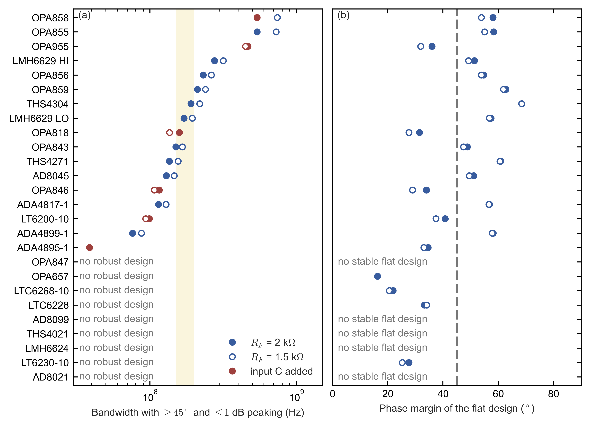

*Figure 16. Stability and bandwidth of every analysed part, $C_D$ = 1 pF, nominal parasitics, from the analytical model with the datasheet open-loop curves. (a) Widest bandwidth with phase margin ≥ 45° and ≤ 1 dB of peaking (the robust design) at $R_F$ = 2 kΩ (filled) and 1.5 kΩ (open); dark red where the robust design adds input capacitance (1–8 pF to reach 45°; 0.25 pF for OPA858 at 2 kΩ, whose flat design already reaches 558 MHz at 58° without it). The shaded band is 150–200 MHz. (b) Phase margin of the flat design; the dashed line marks 45°. Amplifiers: all 25 analysed parts, 26 configurations (LMH6629 with the COMP pin high and low), sorted by robust bandwidth at 2 kΩ; OPA858 with its open-loop curve as plotted (Table A6.7 gives its calibrated variant). Values from Tables A6.5 and A6.6.*

#### 6.2.1 Results at $R_F$ = 2 kΩ

Table A6.5 lists every configuration analysed. $C_T$ is Eq. (7) with nominal parasitics. "Required / realised" $C_F$ is the total feedback capacitance the flat design calls for, and what a board with 0.2 pF of parasitic actually has.

Entries marked with an asterisk in Table A6.5 use a $C_F$ above $C_T/(G_{\min}-1)$, where the high-frequency noise gain falls below the manufacturer's minimum stable gain; the model finds them stable only because the curves stop at about 1 GHz (Section 6.2.4).

**Reading Table A6.5.** Four groups emerge.

*Low-noise decompensated parts with large GBW and small input capacitance: OPA855, OPA858.* At 2 kΩ the minimum stable gain is no trap for these two. Their GBW is so large that the loop crosses at 0.8–0.9 GHz with $|NG(f_c)|$ = 9–10.5. There the amplifier's own phase margin $\phi_A$ is still 80–83° (Table A6.11), so they reach 58° at 557 MHz with no added capacitance.

*Unity-gain-stable parts: OPA856, OPA859, THS4304, and OPA843 ($G_{\min}$ = 3, effectively stable here).* These give 49–69° flat designs at 134–195 MHz (OPA843 49°), and 150–231 MHz in their robust designs. Their bandwidth is set by GBW and Eq. (14), not by stability.

*LMH6629.* It sits between the two groups. With the COMP pin high ($G_{\min}$ = 10, 4 GHz) its 5.7 pF of input capacitance raises the noise gain enough to give 51° at 235 MHz.

*Parts that cannot be used at this operating point.*
- LMH6624, THS4021, AD8099, AD8021 and LTC6268-10 miss Eq. (16): their source capacitance is too small for their GBW and minimum stable gain. For THS4021, $C_{T,\min}$ = 318.3 × 9²/(2 × 2000) = 6.45 pF against the 2.85 pF present.
- OPA846, OPA818, OPA847, OPA657, LT6230-10 and OPA955 meet Eq. (16) (OPA818 needs 2.12 pF and has 3.75 pF, Section 4.2) but have too little phase of their own at the crossover (Eq. (17), Section 6.2.6). OPA955's plotted curve leaves only about 40° at a gain of 7 (Table A6.2), so its flat design has 36°, and a smaller $C_F$ lowers it further (30° at 0.15 pF, Table A6.13).
- ADA4895-1 and LT6200-10 carry 14 and 7.3 pF of input capacitance of their own and reach 45° only with 8 and 1 pF added, at 39 and 99 MHz.
- Unity-gain-stable parts with too little GBW for 150 MHz: ADA4899-1, ADA4817-1, AD8045 and THS4271.
- LTC6228, whose 5 pF of input capacitance and 0.89 GHz GBW give at most 44°.

With 2 pF added, OPA955 is the quietest robust design of all (Section 6.2.6), and in the vendors' macromodels OPA818, OPA955 and AD8099 reach robust designs (Section 6.5).

#### 6.2.2 Results at $R_F$ = 1.5 kΩ

A smaller $R_F$ raises the feedback pole and lowers the noise gain at crossover. That helps the unity-gain-stable parts and hurts the decompensated ones.

At 1.5 kΩ, OPA818 and OPA846 lose another 5° of phase margin, and OPA955 needs 3 pF of added capacitance to reach 45° (366 MHz; 6 pF gives the widest ≥ 45° bandwidth, 450 MHz). The unity-gain-stable parts gain 11–15 % in robust bandwidth and 15–16 % in flat bandwidth (Tables A6.5 and A6.6), close to the $\sqrt{2/1.5}$ = 1.15 of Eq. (14): OPA856 reaches 263 MHz and OPA859 239 MHz robustly.

#### 6.2.3 With the open-loop curves calibrated to the datasheet tables

Three TI datasheets state a gain–bandwidth product or phase margin that disagrees with their own plotted open-loop curve (Table A3.2), so for those parts the results above depend on which of the two is right. We therefore repeat the analysis with the calibrated variant of Section 3.5, which scales the plotted curve to the table GBW and adds the delay that reproduces the stated phase margin. Table A6.7 compares the two.

**What the calibration changes.**
- **OPA859.** Calibration changes almost nothing.
- **OPA855.** The 26-ps delay costs 7° of phase margin. Robust designs remain possible with no added capacitance; the flat design at 2 kΩ then has 51°.
- **OPA858.** Calibration matters most: 4 dB less gain and 93 ps of delay. The flat design falls to 40°, and 45° then needs 1 pF (2 kΩ) or 2 pF (1.5 kΩ) of added input capacitance. Only the calibrated variant comes close to TI's closed-loop table (Table A3.5), and the macromodel sides with the table (Section 5.4), so OPA858's bandwidths and phase margins from the plotted curve are optimistic. Its noise and dynamic range at a given $C_F$ depend little on the open-loop curve (Eq. (19)), and SPICE confirms them within 0.2 dB (Section 6.6.2).

#### 6.2.4 The feedback-capacitance window of the leading parts

A board cannot set $C_F$ exactly. The resistor's own capacitance, its pads and the copper around them vary by about ±0.1 pF (Section 1.4). A useful design therefore needs a window of total $C_F$ that is wide compared with that tolerance. Table A6.8 gives it for every part that has one. Two rules bound it:
- **Lower edge:** phase margin ≥ 45°, gain margin ≥ 3 dB, peaking ≤ 1 dB, from the model.
- **Upper edge, for decompensated parts:** the manufacturers' minimum-gain rule, $1 + C_T/C_F \ge G_{\min}$, i.e.

$$
C_F \le \frac{C_T}{G_{\min}-1}.
$$

This is Eq. (11) with $NG_\infty = G_{\min}$. TI states it for OPA855 ("requires a high-frequency gain of 7 V/V or greater to be stable", p25), and the LMH6629 datasheet states the equivalent rule for its TIA (p28). It is applied here even where a model curve that stops at 1 GHz would allow more.

**Consequences for each part.**
- **OPA855 at 2 kΩ.** The window spans a factor of 2.5 in $C_F$ and 2.8 in bandwidth. A target of 0.25 pF total sits in the middle: on the datasheet curve ±0.1 pF of parasitic variation stays inside it and moves the bandwidth between about 700 and 260 MHz (Section 8.10). The upper edge also means that OPA855 cannot be band-limited much below 250 MHz by $C_F$; a narrower noise bandwidth needs a filter after the TIA. The vendor's macromodel narrows the window to 0.157–0.300 pF, because its gain margin at 3–4 GHz falls to 3 dB at $C_F = C_T/6.5$ (Eq. (47)); the total $C_F$ must then be held to 0.230 ± 0.070 pF or trimmed on the first board (Section 5.5).
- **LMH6629.** Its window is narrower in ratio (1.8) but sits at larger, more reproducible capacitances.
- **The unity-gain-stable parts.** They have no upper edge at all, which is what makes them easy to lay out.

#### 6.2.5 What the board's parasitic capacitances do to a fixed design

A board is built with one external feedback capacitor, chosen before its parasitic capacitances are known, and the parasitics then land somewhere in their tolerance. To see what that does, we froze the flat design's external $C_F$ and set $C_{\mathrm{PCB}}$ to 0.2 or 0.5 pF and $C_{F,\mathrm{par}}$ to 0.1 or 0.3 pF, the corners of the ranges in Table 1.1.

**What the corners show.**
- **$C_{F,\mathrm{par}}$ matters, $C_{\mathrm{PCB}}$ hardly at all.** The board capacitance at the input moves every design by only 1–5 %. The parasitic feedback capacitance is the sensitive quantity.
- **OPA955, OPA855 and OPA858 are the most sensitive (Tables A6.9 and A6.10).** Their flat designs rely on the parasitic alone. If an 0201 resistor with small pads gives only 0.1 pF, OPA855 and OPA858 fall to 35–38° with 3.0–3.8 dB of peaking and OPA955 to 17–18° with 8.0–8.7 dB; with 0.3 pF OPA855 and OPA858 give a well-damped 320 MHz at 2 kΩ. These parts are therefore safest with a deliberate total of about 0.25 pF (Section 8.10).
- **OPA818 and OPA846 have no margin to lose.** Their flat designs sit at 28–34°, and 0.1 pF of parasitic takes OPA818 to 24–27° with 2.4–2.8 dB of peaking and OPA846 to 27–33°.
- **The unity-gain-stable parts move by about 30 % in bandwidth and never fall below 49°;** OPA843 ($G_{\min}$ = 3) falls to 45–46° and LMH6629 to 44–46°.

#### 6.2.6 Why three decompensated amplifiers fail on a 1-pF photodiode, and what added capacitance buys

OPA847 and OPA846 have some of the lowest voltage noise of all the candidates, 0.85 and 1.2 nV/√Hz, and OPA818 combines a JFET input with the largest output swing of the leading parts. Yet on their datasheet curves none of the three reaches 45° of phase margin at this operating point without capacitance added at the input (Section 6.2.1). This section shows where their phase margin goes and what it costs in noise to buy it back. Table A6.11 splits the phase margin of representative designs into the two terms of Eq. (17).

**OPA818 and OPA846: the two terms trade against each other.** Raising $C_F$ lowers the noise-gain lead $\angle NG$, but it also lowers $|NG(f_c)|$. The loop then crosses at a higher frequency, where the amplifier's own phase $\phi_A$ is lower. The phase margin saturates at 34°, with $|NG(f_c)|$ already at or below the minimum stable gain of 7. In its macromodel, which reproduces the datasheet's measured closed loop at a gain of 7, OPA818 keeps 39–45° at the worst capacitance corner (Sections 5.4–5.5).

**OPA847.** Even at its minimum gain of 12, the plotted curve leaves only 27–39° of $\phi_A$. That is consistent with the 4.5 dB of peaking TI specifies at G = +12. Nothing is left after the noise-gain lead.

**OPA855.** By contrast, the loop crosses where OPA855's second pole is still far away ($\phi_A$ ≈ 80°), so the same 17–24° lead leaves 58–63°.

**What added input capacitance buys.** Table A6.12 shows the price of buying phase margin with capacitance added deliberately at the inverting node, for OPA818 and OPA846 and, for comparison, OPA955 and OPA855. The noise columns use the central model of Section 3.7 at 2 kΩ.

At 1.5 kΩ the same exercise needs more capacitance:
- OPA818 reaches 40° only with 4 pF (184 MHz, 10.5 dB) and 45° only with 8 pF (136 MHz, 13.6 dB).
- OPA846 needs 5 pF for 40° (167 MHz, 8.6 dB) and 8 pF for 45° (107 MHz).
- OPA955 needs 3 pF for 45° (366 MHz, 2.3 dB).

**Reading Table A6.12.**
- **The cost is the $e_n\omega C$ term of Eq. (19).** Each picofarad added to OPA818 costs about 1 dB of band noise, because its $e_n$ of 2.2 nV/√Hz acts on it.
- **The OPA818 and OPA846 designs that reach 45° need 5–8 pF, lose 3.7–8.3 dB of band noise and drop below 160 MHz.** OPA818 loses 6.1–8.3 dB and OPA846 3.7–5.4 dB against their flat designs (Tables A6.12 and A6.15).
- **OPA955 is the exception.** Its $e_n$ (0.81 nV/√Hz) and $i_n$ (0.56 pA/√Hz) are so low that 2–3 pF of added capacitance buys 45° at 427–466 MHz for a band penalty of only 2.1–2.8 dB. That is still better than any production part without added capacitance.
- **An added RC instead of a capacitor changes nothing in band.** TI's datasheets suggest an RC network from the inverting input to ground for stabilising decompensated parts at low gain (OPA818 p22: 10 Ω + 10 pF). Below its corner frequency, $1/(2\pi RC)$ = 1.6 GHz for that example, such a network is the same added capacitance and carries the same noise cost.

#### 6.2.7 Transimpedance responses and the bandwidth–noise trade

Figure 17 shows why a flat response does not prove a stable loop: OPA818 and OPA846 are flat at 32–34° of phase margin, because the roll-off of $Z_F$ hides the loop's peaking (Section 5.2). In Figure 18 a part reaches the wide, quiet corner only if its own loop supplies the phase margin, as OPA855's does; added input capacitance costs $e_n\omega C$ noise (Section 6.2.6).

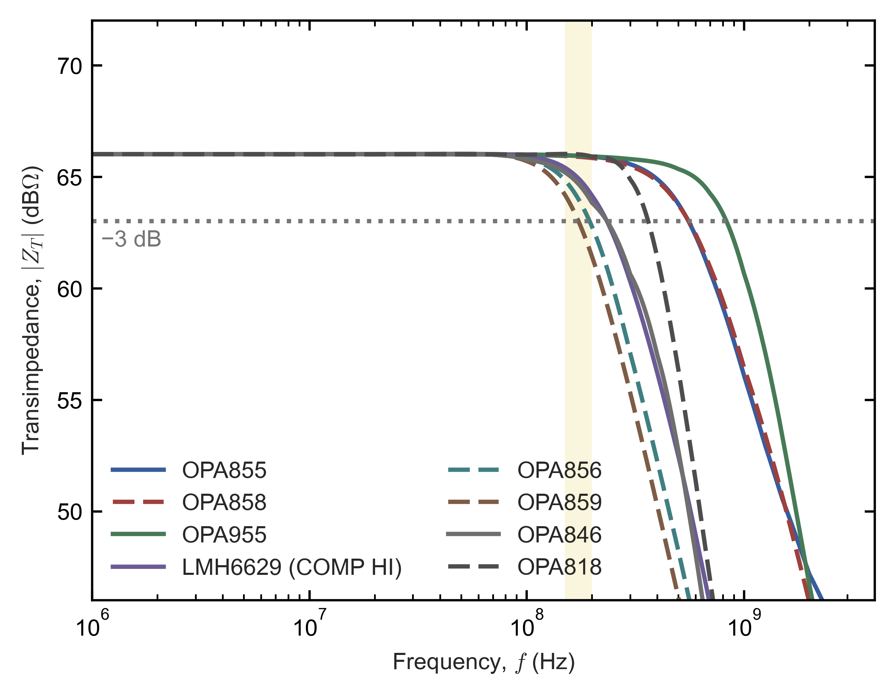

*Figure 17. Closed-loop transimpedance magnitude of the flat designs at $R_F$ = 2 kΩ. Amplifiers: OPA855, OPA858, OPA955, LMH6629 (COMP HI), OPA856, OPA859, OPA846, OPA818, as named in the plot legend. The dotted line marks −3 dB (63.0 dBΩ), and the shaded band marks the 150–200 MHz target. Curves are computed from each datasheet open-loop curve with nominal parasitics. OPA818 and OPA846 have flat responses despite 32–34° of loop phase margin: the loop's closed-loop peaking is masked by the roll-off of $Z_F$, which is why flatness alone is not a stability criterion.*

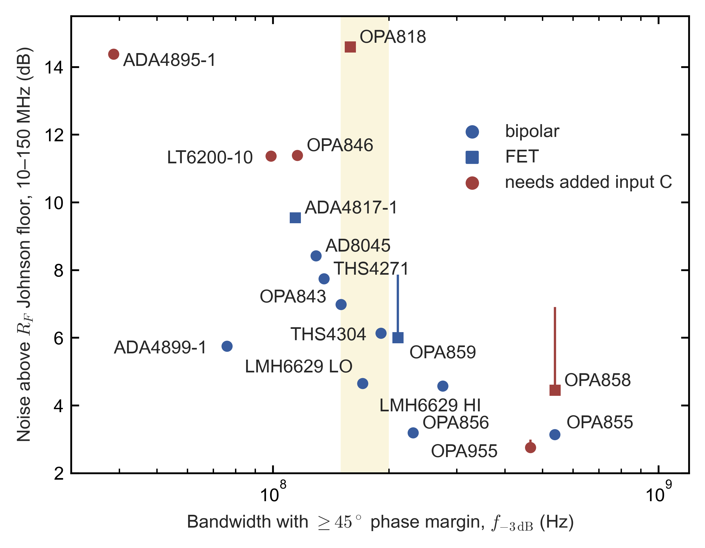

*Figure 18. Bandwidth of the robust design (phase margin ≥ 45°, ≤ 1 dB peaking) against its noise penalty over the 2-kΩ Johnson floor, integrated over 10–150 MHz. Amplifiers: every configuration of Table A6.5 that has a robust design, each labelled in the plot. Squares are FET inputs and circles bipolar. Dark red marks designs that needed deliberately added input capacitance to reach 45°. Vertical bars on FET parts span the central-to-high current-noise estimates of Section 3.7. The shaded band is 150–200 MHz. The best corner (wide and quiet) is lower right; OPA855 sits there, with OPA955 (with 3 pF added) next to it.*

**The bench board of Section 3.10 and Figure 18.** The OPA846 point in Figure 18 is the robust design at 2 kΩ, with 8 pF added. Its node capacitance, $C_T$ = 13.15 pF, is almost that of the bench board, so its 6.82 pA/√Hz at 50 MHz is close to the bench result. In the figure's metric (Eq. (21), 10–150 MHz) the fitted bench circuit has a penalty of 9.4 dB over its own 1.2-kΩ floor, against 11.4 dB for the Figure 18 point over the 2-kΩ floor. The plot and the board agree: the noise of OPA846 sits this far above thermal whenever about 13–14 pF sits at its input.

#### 6.2.8 How much phase margin is enough when the peaking is equalized later

**Why peaking can be acceptable.** The input-referred noise of Eq. (19) does not depend on the loop gain, so a peak in $Z_T$ raises the signal and the noise by the same factor. An equalizer after the TIA, analogue or digital, restores a flat response at the same signal-to-noise ratio at every frequency. Two conditions apply:
- the peaked signal must not clip or slew-limit before the equalizer (Eq. (26));
- the noise boosted above the band must be filtered before any sampling, or it aliases into the band.

What the peaking must never become is oscillation, in any unit and at any temperature. This section finds the phase margin that guarantees that.

**Method.** Each design was evaluated at its nominal values and at all 27 combinations of three variations:
- the total $C_F$ moved by ±0.1 pF (resistor and pad parasitic);
- $C_T$ moved by ±0.2 pF (photodiode bias and board);
- the open-loop gain scaled down to the datasheet minimum GBW or up by 1.5 dB. The downward scaling is −2.75 dB for OPA846 (1275 against 1750 MHz), −2.0 dB for OPA847 (3100 against 3900 MHz), and −2 dB where no minimum is given.

A combination counts as stable when the loop gain crosses unity once and the phase margin there is positive. The worst phase and gain margins over all combinations, and the range of peak heights and frequencies, are what an equalizer would have to accommodate.

Table A6.13 flags OPA855's combinations at the upper $C_F$ corner; the note to the table explains them.

**Findings from Table A6.13.**
1. **A nominal phase margin of about 25° or more is enough, when $C_F$ ≥ 0.4 pF.** At that size the ±0.1 pF parasitic is at most a quarter of $C_F$. Every combination then stays stable with a worst case of 18–28°, and the nominal peak stays below about 4 dB. Below 20° nominal, the worst cases fall to 2–12° and the peak can grow by 10–20 dB in some combinations; units at that point sit close to oscillation.
2. **Designs with $C_F$ ≤ 0.2 pF are governed by the parasitic, not by the nominal margin.** OPA955 at 2 kΩ and 0.15 pF has 30° nominal but only 1° worst case, because the −0.1 pF corner leaves 0.05 pF. OPA855 at 0.15 pF drops from 44–50° to 16–19°. Such designs need the parasitic controlled to better than ±0.1 pF, or a larger $C_F$: OPA955 at 0.25 pF keeps a 28° worst case.
3. **Peaking buys little bandwidth for OPA846 and OPA818.** At 2 kΩ:
   - OPA846 goes from 235–237 MHz (flat, $C_F$ = 0.74 pF) to 266–272 MHz at $C_F$ = 0.3–0.5 pF;
   - OPA818 goes from 363 MHz to 377 MHz.
   The loop crossover, not $C_F$, sets this bandwidth (Section 6.2.6).
4. **The real gain is avoiding added input capacitance.** The noise stays at 5.8–6.1 pA/√Hz (OPA846) and 6.1–6.5 pA/√Hz (OPA818) at 100 MHz. The 45° designs of Table A6.12 cost 9.6–17.1 pA/√Hz.
5. **The equalizer must follow a moving peak.** At 7 dB nominal (OPA846, 2 kΩ, 0.4 pF) the combinations span 2.9–12.0 dB and 130–188 MHz, so a fixed equalizer would leave errors of several dB. At about 4 dB nominal the span is 0.7–7.7 dB. Per-board calibration with temperature tracking is needed in either case.
6. **The peak costs headroom.**
   - At the peak frequency, the largest usable input shrinks by the peak height.
   - OPA846 can slew only 0.62 V peak at 160 MHz (Eq. (26)).
   - The unfiltered output noise, divided by $R_F$, rises from 161 nA rms (OPA846 flat) to 265 nA rms (OPA846, 0.3 pF). For comparison, the flat design's in-band input noise over 10–150 MHz is 67.8 nA rms (Table A6.19), so the out-of-band part must be filtered before any sampling.
7. **OPA847 cannot be rescued by equalization.** No $C_F$ keeps every combination stable: the worst margin is 0–1° and the gain margin at most 0.2 dB.
8. **OPA955 benefits most.** At 2 kΩ and 0.25 pF it is flat to 530 MHz, with a 28° worst-case margin and a 0.9 dB band penalty (Table A6.15). It is still Advance Information.

**The bench board of Section 3.10.** The same method applies to the OPA846 board at $R_F$ = 1.2 kΩ with about 14 pF at its input. Because that capacitance is only inferred, Table A6.14 uses $C_T$ = 14 pF ± 1 pF in place of ± 0.2 pF.

**What Table A6.14 means for the board.**
- **As built, it is close to oscillating.** The model gives 2° of phase margin. Across the combinations it reaches 0.1°, and the peak can grow to over 50 dB.
- **Recommended change:** raise the total $C_F$ to 0.9–1.1 pF, i.e. add about 0.6–0.8 pF. The board then has 26–32° nominal and 22–28° worst case, a +2.5 to +4.8 dB peak near 115–122 MHz, and keeps 193–199 MHz of bandwidth. The noise at 50 MHz rises only from 7.25 to 7.4–7.5 pA/√Hz.
- **The choice is robust to the uncertain capacitance.** At 12 pF and at 16 pF, $C_F$ = 0.9–1.1 pF gives 26–33° nominal and 22–29° worst case.
- **The real check is the board itself.** The model's OPA846 phase margin is uncertain by several degrees (Table A3.5), so the peak should be measured after the change.

### 6.3 Noise

Noise is compared second, and over most of the planned range it decides little. The shot noise of the pair is already 5.66 pA/√Hz at 0.1 mA, 5.9 dB above the 2.87 pA/√Hz of a 2-kΩ resistor, and 17.90 pA/√Hz at 1 mA (Sections 1.1 and 4.2). The amplifier adds a flat part, chiefly the base-current shot noise $i_n$ of a bipolar input, and the term $e_n\omega C_{\mathrm{tot}}$, which rises with frequency and with the total input capacitance (Eq. (19)). Its noise therefore matters only near 0.1 mA and at 150–200 MHz, and the ranking follows $i_n$ and the product $e_nC_{\mathrm{tot}}$, not $e_n$ alone.

All noise numbers in this section use Eq. (19) for the design named in each table, with the amplifier's datasheet $e_n(f)$ and $i_n(f)$ curves where they exist.
- FET-input parts and OPA955 show the central estimate of Section 3.7 with the high estimate in brackets.
- Tables A6.15 (2 kΩ) and A6.17 (1.5 kΩ) give the noise of the flat designs, and Table A6.18 that of the robust designs at 2 kΩ, with the capacitance that OPA858, OPA955, OPA846 and OPA818 need added to reach 45°. They show ten amplifiers: the nine parts with a robust design at ≥ 150 MHz in Figure 16 (LMH6629 with the COMP pin high only) and OPA846, which was on the starting list (Section 2.2). Figure 19 adds every other part with a stable flat design.
- At 2 kΩ the reference floor is 2.87 pA/√Hz. Over 10–150 MHz that integrates to 33.9 nA rms, and over 10–200 MHz to 39.6 nA rms.
- Band noise in Sections 6.2–6.3 is integrated over 10–150 MHz (Eq. (21)), and the dynamic ranges of Sections 6.4–6.8 over 0–150 MHz (Eqs. (27) and (49)); the lowest 10 MHz raise the Johnson noise of 2 kΩ from 33.9 to 35.1 nA rms and the shot noise of 0.1 mA from 67.0 to 69.3 nA rms.
- Every value is referred to the photocurrent (Section 1.5). Output noise appears as $v_o/R_F$. $I_{\mathrm{DC}}$ is the total photocurrent $I_1 + I_2$ of the balanced pair (Section 1.2).

Figure 19 ranks every analysed part with a stable flat design by its band noise above the Johnson floor of $R_F$, over 10–150 MHz, at both feedback resistors. The bipolar parts with sub-nanovolt $e_n$ and little input capacitance lead: at 2 kΩ OPA955 is 0.9 dB above the floor, OPA855 3.1 dB and OPA856 3.2 dB. For the FET-input parts and OPA955 a bar runs to the high estimate of Section 3.7, which lies 0.3–2.7 dB above the central one. All of them lie below the 50-Ω benchmark, which with a 2-dB noise figure is 18.0 dB above the 2-kΩ floor and 16.8 dB above the 1.5-kΩ floor (Eq. (1)). In the dark a TIA is therefore more sensitive than the plain termination by the difference of the two penalties over 10–150 MHz: 17.1 dB for OPA955, 14.9 dB for OPA855 and 0.9 dB for OPA657, the noisiest part. With the macromodels' band noise over 0–150 MHz, the measure $A$ of Section 6.8, OPA955 and OPA855 lead by 17.2 and 15.0 dB (Table A6.35).

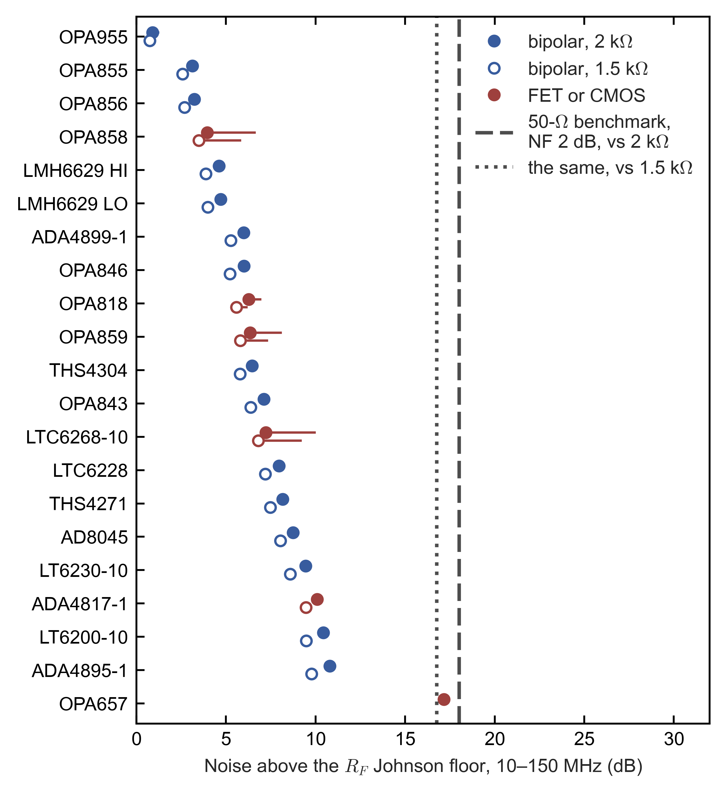

*Figure 19. Input-referred noise integrated over 10–150 MHz, relative to the Johnson noise of $R_F$ (the band penalty), flat design, $C_D$ = 1 pF, from the analytical model, at $R_F$ = 2 kΩ (filled) and 1.5 kΩ (open). Dark red marks FET- or CMOS-input parts; a horizontal bar extends to the high estimate where it differs (OPA858, OPA859, OPA818, LTC6268-10 and OPA955). The dashed and dotted lines mark the 50-Ω benchmark with a 2-dB noise figure against the same floors, 18.0 dB at 2 kΩ and 16.8 dB at 1.5 kΩ (Eq. (1)). Amplifiers: the 21 configurations with a stable flat design (one per row), sorted by the penalty at 2 kΩ; OPA657 has one only at 2 kΩ. Values for the ten amplifiers of Tables A6.15 and A6.17 from those tables, for the others from `data/results/results.json`.*

#### 6.3.1 Input-referred noise and its components

Figure 19 ranks the parts by their band noise, and this section explains the ranking. Table A6.16 splits each design's noise at 100 and 200 MHz into the terms of Eq. (19), so that one can see which property of each amplifier puts it where it is, and Figure 20 shows the spectra of eight of the designs.

**What Table A6.16 shows.** The split explains the ranking better than any single specification can.

*Bipolar parts with low input capacitance: OPA855 and OPA856.* Their largest amplifier contribution at 100 MHz is the base-current shot noise $i_n$, 2.5–2.6 pA/√Hz, nearly equal to the resistor's 2.87. The $e_n$ term stays small:
- OPA855: 0.99 nV/√Hz on 2.35 pF, giving 1.54 pA/√Hz at 100 MHz;
- OPA856: 0.91 nV/√Hz on 3.03 pF, giving 1.79 pA/√Hz.

*Parts with large $e_n$ or large input capacitance: OPA818, OPA859, THS4304, OPA843 and LMH6629.* For these the $e_n\omega C$ term dominates and grows linearly with frequency. At 200 MHz it reaches 11 pA/√Hz for OPA818 (2.1–2.2 nV/√Hz on 4.24 pF) and OPA859 (3.3 nV/√Hz on 2.71 pF).

*OPA955.* It is quiet because it combines a bipolar $e_n$ of 0.81 nV/√Hz with a base-current noise of only 0.56 pA/√Hz. The datasheet says nothing about how that is achieved; the part is still Advance Information.

At 1.5 kΩ the absolute noise is higher, because the resistor floor rises by 1.25 dB. The penalty relative to that higher floor is 0.5–0.9 dB smaller.

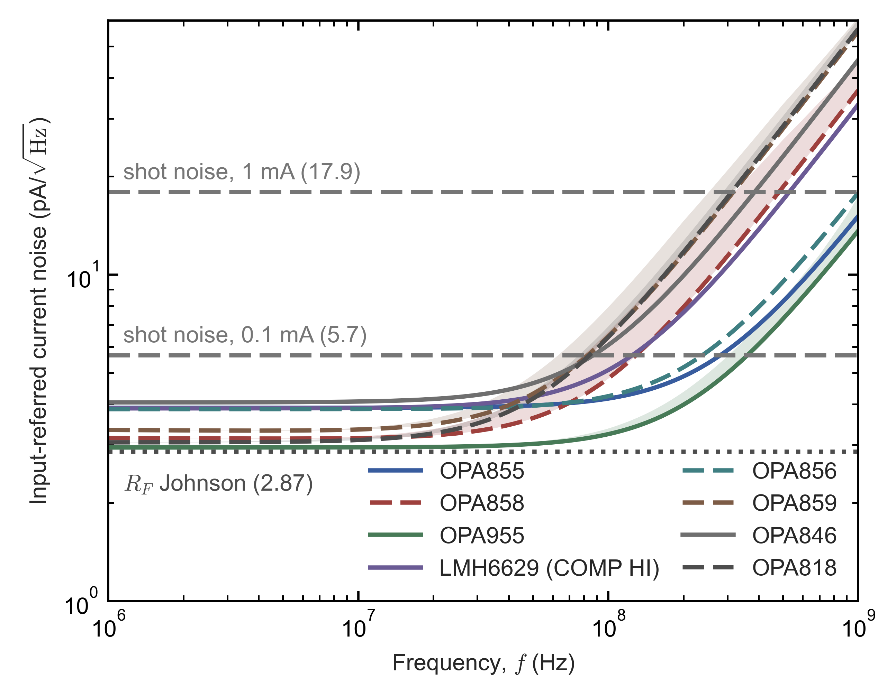

*Figure 20. Input-referred noise current density of the flat designs at $R_F$ = 2 kΩ. Amplifiers: OPA855, OPA858, OPA955, LMH6629 (COMP HI), OPA856, OPA859, OPA846, OPA818, as named in the plot legend.*
- *Lines are the central estimate. Shaded bands extend to the high estimate for the parts with rising current-noise curves (Section 3.7).*
- *The dotted line is the 2-kΩ Johnson floor (2.87 pA/√Hz). The dashed lines are the shot noise of 0.1 mA and 1 mA.*
- *Above about 30 MHz every curve rises as $e_n\omega C_{\mathrm{tot}}$. The low-capacitance bipolar parts (OPA855, OPA856, OPA955) stay below the 0.1-mA shot noise to beyond 200 MHz. OPA818, OPA859, OPA846 and OPA858 (high estimate) cross it near 80–90 MHz, and LMH6629 and OPA858 (central) near 125 MHz.*

#### 6.3.2 Band-integrated noise

A receiver sees its noise integrated over its band, not at one frequency, and an integral of this kind enters the dynamic range (Eq. (27)). Table A6.19 integrates each design's input-referred noise over 10–150 MHz and 10–200 MHz. For comparison, the shot noise of the DC photocurrent integrated over 10–150 MHz is $\sqrt{2qI_{\mathrm{DC}}\times140\ \mathrm{MHz}}$ (Table A6.20).

Integrated over the band, the comparison with 0.1 mA (67.0 nA rms) splits the parts into three groups:
- OPA955, OPA855, OPA856, OPA858 (central) and LMH6629 stay below it.
- OPA846 (67.8 nA rms) equals it.
- OPA818, OPA859, THS4304 and OPA843 (70–77 nA rms) slightly exceed it.

#### 6.3.3 Total noise with photocurrent, and the noise at the output

The receiver runs with 0.1–10 mA of photocurrent, so what matters in the end is the total noise, the amplifier's together with the shot noise. Table A6.21 gives it at 100 MHz for each design. Table A6.22 gives the noise at the output, which is what a following instrument sees, referred back to the photocurrent through the in-band gain.

**Reading Table A6.21.** The first row is the ideal, a noiseless amplifier with only the Johnson noise of $R_F$ and the shot noise. At 1 mA every part is within 0.03–0.50 dB of it at 2 kΩ; at 10 mA within 0.05 dB, and at 20 mA within 0.03 dB, because shot noise dominates. Any entry translates into the power density that a 50-Ω instrument receives through the back-termination by Eq. (34), with $|Z_T|$ at 100 MHz. Section 4.2 works it for OPA855.

Where $v_o/R_F$ falls below the input-referred density of Table A6.15, as it does for the slower designs (OPA856, LMH6629, OPA859, THS4304, OPA843 and OPA846) at 150–200 MHz, the TIA has begun to roll off. Signal and noise fall together there, and their ratio is unchanged.

**The last column of Table A6.22 matters for a broadband instrument.** The wide flat designs integrate a great deal of noise beyond 200 MHz, because the $e_n\omega C$ term keeps rising until the loop rolls off:
- OPA855 and OPA955 integrate to 275–312 nA rms out to 0.6–0.8 GHz;
- OPA858 reaches 537 nA rms;
- OPA856 integrates to only 72 nA rms, because it rolls off at 200 MHz.

For comparison, the same OPA855 design has 48.7 nA rms over 10–150 MHz (Table A6.19), and the shot noise of 1 mA is 212 nA rms over the same band (Table A6.20). The shot noise is white as well: without a filter, a broadband digitizer integrates it over the TIA's whole noise bandwidth. For OPA855's maximally flat 557-MHz response that bandwidth is $1.11\times557$ = 619 MHz, 6.2 dB more shot-noise power than in 150 MHz.

A filter after the TIA removes most of this excess and costs nothing in signal-to-noise ratio in band. The dynamic ranges of Sections 6.4–6.8 assume an ideal noise band of 150 MHz; a second-order Butterworth filter at 200 MHz has a noise bandwidth of $1.11\times200$ = 222 MHz and leaves $10\log_{10}(222/150)$ = 1.7 dB more shot noise at high photocurrent, against 6.2 dB without a filter. It is the recommended way to set the noise bandwidth of the OPA855 and OPA955 designs at 1 pF, whose $C_F$ cannot be raised enough to do it (Section 6.2.4). With 2 pF at the node, OPA855's $C_F$ alone can set 200–300 MHz (Section 6.3.5).

#### 6.3.4 How far the amplifier noise stays below the shot noise

At the planned photocurrents the amplifier's job is to keep its own noise well below the shot noise (Section 1.1). The shot-noise clearance of Section 1.5 measures that directly: the ratio, in decibels, of the shot noise to all other noise at the same frequency. A clearance of $x$ dB means the TIA adds $10\log_{10}(1 + 10^{-x/10})$ dB to the shot-noise-limited density (Table A6.24).

**The regime of Section 1.1, in numbers (Tables A6.23 and A6.24).**
- **At 10 mA**, every part listed is within 0.1 dB of the shot-noise limit at 100 MHz and within 0.2 dB at 200 MHz.
- **At 1 mA**, the low-capacitance bipolar parts stay within 0.1–0.4 dB at 100–200 MHz. OPA818, OPA859, OPA843 and THS4304 lose 1.5–1.7 dB at 200 MHz.
- **At 0.1 mA**, only OPA955, OPA855 and OPA856 keep the shot noise above the TIA noise out to 200 MHz.

#### 6.3.5 The option of 1 pF in each diode

With 1 pF in each diode of the pair the node carries 2 pF (Section 1.2). Tables A1.3 and A1.4 give the leading amplifiers for that option, with the same nominal parasitics and design rules as Section 6.2; their last column repeats the 1-pF band penalty of Tables A6.15 and A6.17 for comparison. The option changes five things.
- **Noise.** The band penalty rises by about 0.5 dB for OPA855, OPA856, OPA955 and LMH6629, whose $e_n$ is below 1 nV/√Hz, and by 0.8–2.2 dB for the others. The added picofarad raises the $e_n$ term of Eq. (19) by $e_n^2(2\pi f)^2\left[(C_{\mathrm{tot}} + 1\ \mathrm{pF})^2 - C_{\mathrm{tot}}^2\right]$, which grows with both $e_n$ and $C_{\mathrm{tot}}$: OPA846 (1.2 nV/√Hz on 5.9 pF) goes from 6.0 to 6.8 dB, OPA818 from 6.3 to 7.8 dB and OPA859 from 6.4 to 8.6 dB at 2 kΩ.
- **Bandwidth.** Robust bandwidths fall by 2–17 %: OPA855 from 539 to 521 MHz, LMH6629 from 276 to 257 MHz, OPA856 from 231 to 198 MHz, OPA859 from 211 to 175 MHz at 2 kΩ.
- **Stability of the decompensated parts improves slightly.** The flat designs of OPA846 and OPA818 move from 34° and 32° to 37° and 35°, and 45° needs 6 pF of added capacitance instead of 8 pF at 2 kΩ. OPA955 needs 2 pF added instead of 3 pF, which gives the same 466 MHz.
- **OPA855's $C_F$ window widens.** At 2 kΩ it becomes 0.175–0.525 pF (0.204–0.525 pF at 1.5 kΩ), against 0.15–0.36 pF at 1 pF, because its upper limit $C_T/(G_{\min}-1)$ grows with $C_T$. Inside the window $C_F$ alone sets the bandwidth from 576 MHz at 0.175 pF to 176 MHz at 0.50 pF, so a 200–300 MHz design no longer needs a post-filter to define its bandwidth (Section 8.10).
- **With photocurrent the difference shrinks.** At $I_1 + I_2$ = 1 mA, OPA855's total noise rises by only 0.03 dB at 100 MHz and 0.11 dB at 200 MHz.

### 6.4 Dynamic range

Dynamic range is the ratio of the largest undistorted tone, $I_{\max} = V_{\mathrm{pk}}/(\sqrt2\,\lvert Z_T(f_0)\rvert)$, to the band noise (Eq. (27)). The amplifier's dark noise sets the floor only below the photocurrent at which the shot noise of the pair equals it, $I_{\mathrm{DC}}^{\times}$ of Eq. (51): 31–63 µA for the 5-V parts and 0.10–0.15 mA for the noisier OPA818 (Figure 22, Section 6.6.3). Above it the shot noise, the same for every part, sets the floor, and the dynamic range approaches Eq. (29): it falls by 10 dB per decade of photocurrent and rises by 6 dB for every doubling of $V_{\mathrm{pk}}$. The ceiling is the smaller of the swing and the slew-rate amplitude of Eq. (26), which cross at $f_{\times} = \mathrm{SR}/(2\pi V_{\mathrm{sw}})$ (Eq. (52)), so a larger supply helps only for tones below $f_{\times}$.

Figure 21 shows the electronic dynamic range (Eq. (27)) in 150 MHz for a 100-MHz tone of the ten amplifiers carried forward, at $R_F$ = 2 kΩ with the imbalance servoed to zero, in the dark and at $I_1 + I_2$ = 0.1, 1 and 10 mA. In the dark the quietest parts lead, OPA955 with 82.9 dB. From 0.1 mA up the order follows the ceiling $I_{\max}$ instead: OPA818, with 2.23 V at 100 MHz, leads with 78.0, 70.7 and 61.1 dB, 3.1 dB ahead of OPA855 at 1 mA, and OPA856, slew-limited to 0.56 V, trails OPA855 by 8.5–8.6 dB at every current. The dashed lines mark the 50-Ω benchmark compressing at −10 dBm, which Section 6.8 sets against these designs. Table A6.29 gives the numbers, and the sections below derive them.

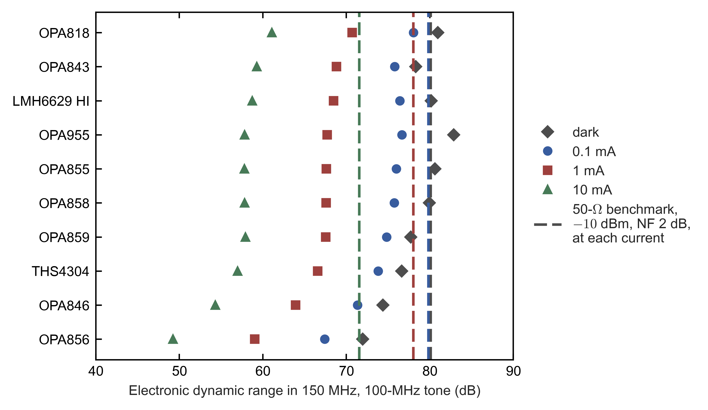

*Figure 21. Electronic dynamic range (Eq. (27)) in 150 MHz for a 100-MHz tone, $R_F$ = 2 kΩ, $C_D$ = 1 pF, flat design, imbalance servoed to zero, from the analytical model; dark (diamonds) and $I_1 + I_2$ = 0.1, 1 and 10 mA. The dashed lines, in the colour of each current, mark the 50-Ω benchmark compressing at −10 dBm with a 2-dB noise figure (Table A2.2); its dark and 0.1-mA lines nearly coincide (80.1 and 79.8 dB). Amplifiers: the ten of Table A6.29 (one per row), sorted by the value at 1 mA. Values from Table A6.29.*

#### 6.4.1 How much DC current $R_F$ can carry

Any DC current through $R_F$ moves the output away from the centre of its swing and takes headroom from the RF signal. In the balanced pair (Section 1.2) that current is the imbalance $I_1 - I_2$ left uncorrected; in a single-ended detector it would be the whole photocurrent. Eq. (25), with the typical swing and input common-mode limits of Section 6.1, gives the largest such current for each part in Table A6.25. "Anode on node" corresponds, in the pair, to an imbalance with more current in the upper diode.

The last two columns give the DC current up to which the full RF amplitude $V_{\mathrm{pk}}$ of Table A6.26 survives. They apply to a known, fixed DC current, for which $V_{\mathrm{REF}}$ can be chosen to centre the output at that current; that current is then at most $I_{\mathrm{full}} = I_{\mathrm{DC,max}} - V_{\mathrm{pk}}/R_F$. An imbalance that wanders around zero costs headroom from the first microampere instead (Table A1.2).

**Three conclusions.**
- **No surveyed amplifier can carry 10 mA through 2 kΩ or 1.5 kΩ.** That would take 20 V or 15 V of output swing. Even the ±12-V AD8021 and ±15-V THS4021, which have the swing, are not stable at this operating point (Table A6.5). A single-ended detector at 10 mA is therefore not an option; the balanced pair is (Section 1.2).
- **In a single-ended detector, above about 0.8 mA (5-V parts) or 4.4 mA (OPA818), the DC photocurrent starts eating the RF headroom** unless it is removed before $R_F$. Sections 8.2–8.5 and 2.1 show how to do that.
- **In the balanced pair only the imbalance reaches $R_F$**, and for the widest dynamic range it is servoed to zero (Section 8.8).

The OPA818 orientation matters. Its JFET input range reaches the negative rail but stops 3.2 V below the positive rail. With the cathode on the summing node (in the pair: more current in the lower diode), the dark output can sit near −5.4 V and rise with light, which gives 5.5 mA. With the anode on the node, the limit is only 4.35 mA.

#### 6.4.2 Largest RF amplitude

Once the shot noise dominates the floor, the largest RF amplitude the output can deliver sets the dynamic range (Eq. (29)), so this is where the amplifiers differ most at high photocurrent. Eq. (26) at 100 and 150 MHz, with the DC removed and the output centred, gives Table A6.26. This is the amplitude at which the output clips or slews, not a distortion limit (Section 6.4.4). At 100 and 150 MHz the current limit, with a 100-Ω load (50-Ω back-termination plus 50-Ω instrument), never binds for these parts. Into 100 Ω the 5-V parts lose a further 0.05–0.1 V of swing.

**Where swing helps and where slew limits.**
- **Slew rate is what limits the large-swing parts.** OPA818 has 11 V of output range, but at 1400 V/µs it can deliver only 2.23 V peak at 100 MHz, and 1.49 V at 150 MHz. Its real advantage over the 5-V parts is therefore 3.3 dB at 100 MHz and none at 150 MHz.
- **OPA846 at 625 V/µs delivers less amplitude above 65 MHz than OPA855 does on 5 V.**
- **For an RF difference current that is a fraction $m$ of $I_{\mathrm{DC}} = I_1 + I_2$, the RF amplitude is $mI_{\mathrm{DC}}$.** At 10 mA and 2 kΩ, the 5-V parts are full scale at $m$ ≈ 8 %, OPA818 at 11 %, and OPA856 already at 3 %. With "small RF", say $m$ = 1 % (0.2 V at 2 kΩ), the headroom at 10 mA is $20\log_{10}(V_{\mathrm{pk}}/0.2\ \mathrm{V})$ (Table A6.27).

**The tone frequency decides how much the larger supplies help.** Table A6.28 repeats Eq. (26) at five tone frequencies, together with the shot-limited dynamic range of Eq. (29) for 10 mA in each diode ($I_1 + I_2$ = 20 mA) in 150 MHz.

**Reading Table A6.28.**
- **The 5-V parts are swing-limited at every frequency** (except OPA856, which slews), so their amplitude, and with it the dynamic range at high photocurrent, does not depend on the tone frequency.
- **The ±5-V to ±6.5-V parts are slew-limited above 20–50 MHz**, so their amplitude falls as $1/f$. OPA818 leads OPA855 by 11.1 dB at 20 MHz, 9.3 dB at 50 MHz and 3.3 dB at 100 MHz. It ties at 150 MHz and trails by 2.8 dB at 200 MHz.
- **The choice between OPA855 and OPA818 therefore depends on where the signal lies.** Below about 100 MHz OPA818's larger swing is worth its lower phase margin, provided the peaking is equalized (Section 6.2.8), which its macromodel shows to be unnecessary at $C_F$ = 0.55–0.65 pF (Section 5.5), or OPA818 works in a second stage (Section 8.5). Above about 150 MHz OPA855 is as good or better. Section 8.9 therefore carries both, as variants A and B of the proposed front end.
- **Into a back-terminated 50-Ω load**, Eq. (26) with OPA818's 55 mA of linear output current allows about 5.2 V at 20 MHz (55 mA into the 95 Ω of the load in parallel with $R_F$), 0.4 dB below the light-load value. A sustained tone at that level exceeds the 25-mA absolute-maximum continuous output current of Section 6.1.2, since a sine of 55 mA peak carries $55/\sqrt2$ = 38.9 mA rms. At 100 MHz the slew-limited 2.23 V drives 2.23 V / 95.2 Ω = 23.4 mA peak, 16.6 mA rms, within the rating. The 5-V parts lose about 0.1 V of swing into this load.

#### 6.4.3 Dynamic range in a 150-MHz band

Tables A6.29 and A6.30 combine the noise of Section 6.3 and the amplitude of Section 6.4.2 into the dynamic range of Eq. (27), in 150 MHz for a 100-MHz tone, at $R_F$ = 2 kΩ and 1.5 kΩ, in the dark and at 0.1, 1 and 10 mA. Figure 22 draws it against the photocurrent for four of the amplifiers at 2 kΩ, with the imbalance servoed to zero and, for comparison, for a single-ended detector whose DC flows through $R_F$.

**How to read Tables A6.29 and A6.30.**
- **From 1 mA up the dynamic range approaches Eq. (29), which depends only on the ceiling.** OPA818's 2.23 V against 1.52 V is worth 3.3 dB, reached at 10 mA; at 1 mA its amplifier noise leaves 3.1 dB (Section 6.6.2). The smaller $R_F$ of 1.5 kΩ gains up to $20\log_{10}(2/1.5)$ = 2.5 dB, but only 2.0–2.1 dB for OPA843 and THS4304 (Table A6.30), whose flat designs are already rolling off at 100 MHz. Eq. (27) credits a smaller $\lvert Z_T(f_0)\rvert$ with a larger $I_{\max}$: OPA843's $\lvert Z_T\rvert$ = 1.59 V / 0.91 mA = 1.75 kΩ, 1.2 dB below $R_F$, places it second at 1 and 10 mA in Table A6.29, and, as for LMH6629 in Section 6.6.2, that credit holds only for a tone at 100 MHz.
- **Dark, the quietest amplifier wins.** OPA955 reaches 82.9 dB despite its 5-V swing.
- **The back-termination costs 0–0.6 dB**, the swing the 5-V parts lose into 100 Ω (Section 6.4.2).
- **With 10 mA in each diode** ($I_1 + I_2$ = 20 mA), every entry of the 10-mA column falls by a further 3.0 dB (Eq. (29)): OPA855 54.8 dB and OPA818 58.1 dB at 2 kΩ, 57.3 and 60.6 dB at 1.5 kΩ.
- **The noise is integrated to 150 MHz**, which presumes a post-filter (Section 6.3.3).
- **These numbers assume the imbalance servoed to zero.** An uncorrected imbalance costs the amounts of Table A1.2; a single-ended detector keeps them only up to the currents in the last column of Table A6.25.

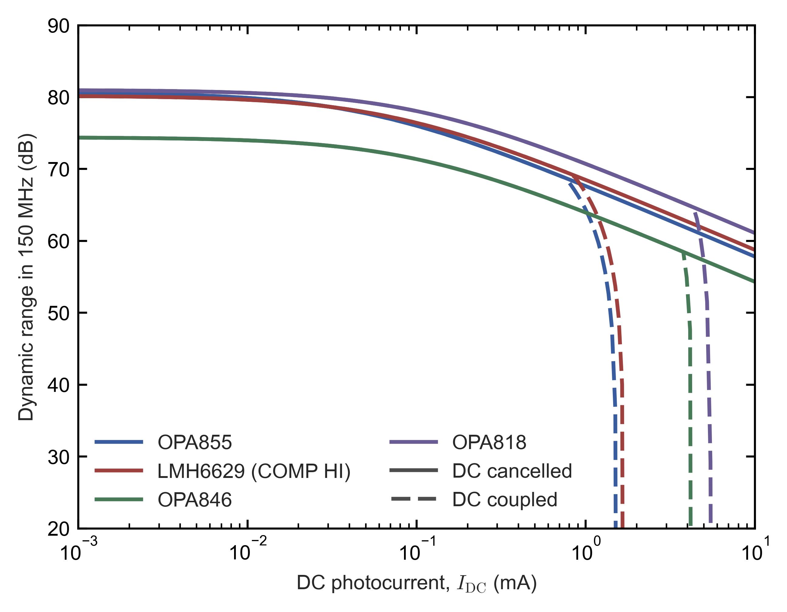

*Figure 22. Dynamic range in 150 MHz for a 100-MHz tone against DC photocurrent ($I_1 + I_2$ for the balanced pair), $R_F$ = 2 kΩ, flat designs. Amplifiers: OPA855, LMH6629 (COMP HI), OPA846, OPA818, as named in the plot legend.*
- *Solid lines: imbalance servoed to zero, or DC removed before $R_F$. Dashed lines: a single-ended detector whose DC is carried by $R_F$, with the better photodiode orientation and the output centred as far as the input range allows.*
- *Above $I_{\mathrm{DC}}^{\times}$ of Eq. (51), where the shot noise equals the dark band noise, the solid lines approach 10 dB per decade (Eq. (29)); for OPA818 in this model $I_{\mathrm{DC}}^{\times} = (70.7\ \mathrm{nA})^2/(2\times1.602\times10^{-19}\ \mathrm{C}\times150\ \mathrm{MHz})$ = 0.104 mA. The 25.7 µA of Section 1.1 is the crossover for $R_F$ alone.*
- *The dashed lines collapse at the $I_{\mathrm{DC,max}}$ of Table A6.25: 1.5 mA for OPA855, 1.7 mA for LMH6629, 4.3 mA for OPA846 and 5.5 mA for OPA818.*

Section 6.6 recomputes these numbers from the macromodels and shows, for OPA818, which noise and which large-signal limit set them (Figure 25).

#### 6.4.4 Linearity and overload recovery

The ceiling of Section 6.4.2 is the amplitude at which the output clips or slews. Below it the amplifier still distorts, and a receiver with a distortion limit meets that limit first; an overload, in turn, costs the time the amplifier needs to recover. Datasheet distortion is measured in voltage-gain circuits whose loop gain differs from that of the TIA. To first order, harmonic distortion generated in the output stage is divided by the loop gain $|T|$. Table A6.31 therefore lists, next to the datasheet figure, the loop gain of the 2-kΩ TIA at the same frequency and that of the datasheet's test circuit.

**The loop-gain columns change how the datasheet distortion should be read.**
- **Decompensated parts (OPA855, OPA858, OPA818).** The TIA has 3.6–7.3 dB more loop gain at 100 MHz than the datasheet's G = 7 circuit. Their datasheet distortion is therefore a conservative proxy for the TIA. OPA855 at 1 Vpp into a light load should reach better than −73 dBc HD2 and −89 dBc HD3 at 100 MHz.
- **Unity-gain-stable parts (OPA856, OPA859).** These are characterised as unity-gain buffers. In the TIA, the noise gain at 100 MHz is about 3, so the loop gain is 9.4–10.1 dB lower than in the datasheet test. Their TIA distortion at 100 MHz will be correspondingly worse than the datasheet figures. OPA856 is additionally slew-limited above 0.56 V peak.
- **OPA818's second harmonic is the weakest of the leading parts.** At 100 MHz its datasheet gives −43 dBc at 2 Vpp into 100 Ω and −50 dBc into 1 kΩ, less than half of its 4.46-Vpp ceiling (2.23 V peak), against −65 dBc for OPA855 at 2 Vpp into 200 Ω (Table A6.31). Its larger swing buys dynamic range against noise, not against distortion. Where the receiver sets a distortion limit, each ceiling is the amplitude at which the distortion reaches it, as Section 7.2 does for the high-voltage composite, and OPA818's lead holds only if its distortion at that amplitude is acceptable.

**Overload recovery matters if the RF modulation or optical transients can drive the TIA into its rails.**
- OPA855, OPA955 and LMH6629 recover in 2–3 ns, OPA856 in about 1 ns and OPA846 in about 19 ns (Table A6.31).
- OPA818 recovers in 25 ns.
- OPA858 needs 200 ns, 20 periods of a 100-MHz tone, after each overload.
- TI's OPA856 measurement shows that a TIA driven into saturation stretches the pulse by 0.5–5 ns for 0–0.64 V of overdrive (OPA856 Figs 9-5 and 9-6). Servoing the imbalance to zero, which keeps the operating point centred, is the first defence against this (Section 8.8).

### 6.5 Eleven further amplifiers, and every part's best design in SPICE

The comparisons above use the datasheet open-loop curves. With the macromodels checked in Chapter 5, we can also let SPICE find each part's best design, and add eleven amplifiers: OPA955, eight parts that our analytical comparison found less suitable, and OPA817 and OPA814, which it left out.

**Why these parts.**
- **OPA955** is our fastest and quietest bipolar candidate (11 GHz, 0.81 nV/√Hz). TI supplies its model only as a TINA-TI file.
- **Parts our analysis found less suitable**, to see whether their models agree with that verdict:
  - OPA657, a FET classic for TIAs (4.8 nV/√Hz on 5.2 pF);
  - the decompensated bipolar parts OPA847 (G ≥ 12), LMH6624 and THS4021 (G ≥ 10);
  - AD8099, which needs external compensation below a gain of 15;
  - ADA4899-1 and ADA4895-1 (1 nV/√Hz, but 4.4 and 14 pF);
  - ADA4817-1, a FET-input part marketed for TIAs but slow (410 MHz).
- **OPA817 and OPA814**, the JFET-input parts that Table A2.4 leaves out. They have no datasheet curve in our analysis, so they run only the checks that need none: the model's own quantities (Table A5.2) and the scan below.

Appendix B.1 lists four points these models need beyond the general procedure, and Appendix B.2 says where to obtain the model files (Table B.1), which are not distributed with this note. Our own designs for the further parts are in Tables A5.4, A5.6 and A5.11, and their datasheets' test circuits in Table A5.5.

**Every part's best design.** We chose the designs of Table A5.6 from the datasheet curves, so a part whose macromodel differs from its curve is not at its best there. Each part therefore gets the same scan at 1 pF and 2 kΩ:
- The total $C_F$ is stepped from 0.10 to 2.40 pF in 0.05-pF steps at $C_D$ = 0.8, 1.0 and 1.2 pF, about 2,700 runs for the eighteen parts.
- The window is found as in Table A5.8: the range of $C_F$ in which phase margin ≥ 45°, gain margin ≥ 3 dB, peaking ≤ 1 dB and no second crossing hold at all three photodiode capacitances.
- If the window is at least 0.10 pF wide, the design is its lower edge plus 0.05 pF. That is the widest band that still holds for $C_F$ ± 0.05 pF, and it is checked at its nine corners. A narrower window gives its centre and the tolerance it allows; a part without a window is listed at its largest worst-case phase margin.
- The noise is simulated at the design.

This rule is one for all parts. It differs from variant A's proposal (Table A5.9), which centres OPA855's window to allow ±0.07 pF.

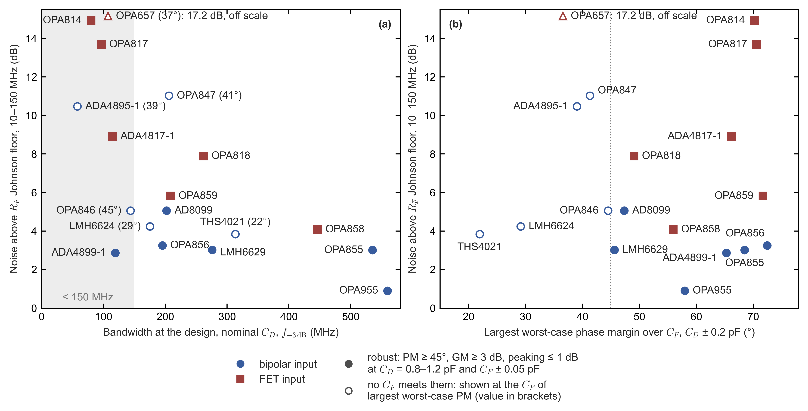

*Figure 23. Every amplifier at its best design in SPICE at 1 pF and 2 kΩ (Table A6.32): the noise penalty over 10–150 MHz against (a) the bandwidth at the nominal photodiode capacitance and (b) the largest worst-case phase margin that any $C_F$ reaches. Amplifiers: OPA855, OPA818, OPA856, OPA858, LMH6629 (COMP HI), OPA859, OPA846, OPA657, OPA847, LMH6624, THS4021, ADA4817-1, AD8099, ADA4899-1, ADA4895-1, OPA955, OPA817 and OPA814. Filled markers meet phase margin ≥ 45°, gain margin ≥ 3 dB and ≤ 1 dB of peaking at $C_D$ = 0.8–1.2 pF with $C_F$ ± 0.05 pF. Open markers meet them at no $C_F$; such a part is shown at its largest worst-case phase margin, given in brackets in (a). Circles are bipolar inputs and squares FET inputs. OPA657 (17.2 dB) is drawn at the top edge. The shaded band in (a) lies below 150 MHz. Two models carry far less input capacitance than their datasheets (LMH6629 1.3 against 5.7 pF, ADA4899-1 0.40 against 4.4 pF), so their noise here is optimistic. OPA847's model fails its datasheet's test circuit (Table A5.5), and OPA955's datasheet is advance information.*

**Reading Table A6.32 and Figure 23.**
- **OPA955 is the best part in SPICE.** At 0.220 ± 0.050 pF it adds only 0.90 dB to the 2-kΩ Johnson floor and gives 560 MHz with 46° at the worst corner. It needs none of the 2–3 pF that our analysis adds for 45° (Section 6.2.6), and its window, 0.167–0.813 pF, is the widest of the fast bipolar parts. Its noise agrees with our own estimate for it (0.9 dB, Table A9.2).
  - Its macromodel has far less open-loop phase lag than the plotted curve above 300 MHz (Table A5.3). Against its datasheet's own test circuit it is 16 % slow and less damped than the part (Table A5.5), which makes it conservative for stability.
  - The datasheet is advance information, and the part is preproduction.
- **OPA855 follows at 3.01 dB and 535 MHz**, with a window only 0.141 pF wide (Table A6.32). LMH6629 matches its noise (3.01 dB) at half the bandwidth, in an even narrower window (0.131 pF), and with an input capacitance in its model that its datasheet does not support.
- **AD8099 has a robust window in SPICE**, 0.587–1.087 pF (202 MHz, 5.05 dB), where our analysis found no stable design at all. Its macromodel has 27° less phase lag at 300 MHz than the plotted curve (Table A5.3). It also carries 5.1 pF of input capacitance against the datasheet's 2.0 pF, which costs noise.
- **Six parts reach no robust design at any $C_F$**: OPA846 (44.5°), OPA847 (41.3°), ADA4895-1 (39.1°), OPA657 (36.6°), LMH6624 (29.2°) and THS4021 (22.0°, with 9.6 dB of peaking and 1.4 dB of gain margin). In all but THS4021 only the phase margin fails, and $\lvert Z_T\rvert$ peaks by at most 0.4 dB at that $C_F$: the hidden margin of Section 5.2.
- **The JFET-input parts confirm Table A2.4.** OPA817 and OPA814 are robust only at 97 and 81 MHz, with 13.7 and 14.9 dB of noise penalty: 4.4–5.3 nV/√Hz on 2.7–3.0 pF of input capacitance. OPA657 (4.8 nV/√Hz on 5.2 pF) is worse still, and OPA818 (2.2 nV/√Hz on 2.4 pF) is the only JFET-input part above 150 MHz; the CMOS-input OPA858 and OPA859 reach 446 and 209 MHz (Table A6.32).

### 6.6 Dynamic range of the leading designs in SPICE

Section 6.4 gives the dynamic range of every candidate from our analytical model, and Chapter 5 checks the leading designs' noise and stability against the manufacturers' macromodels. Here we return to dynamic range, the receiver's priority. Section 6.6.1 states how it is computed. Section 6.6.2 recomputes it for the five leading amplifiers at their best designs in SPICE (Table A6.32), from the macromodels' own noise and transimpedance, and compares our analytical model at the same feedback capacitance (Table A6.33, Figure 24(a)–(b)). Section 6.6.3 examines one design, OPA818, in detail: which noise sets the floor and which large-signal limit sets the ceiling at each photocurrent and tone, and what a faster amplifier or a higher supply would buy (Figure 25). Section 6.7 then puts single-chip TIAs on the same definition, and Section 6.8 the 50-Ω benchmark.

#### 6.6.1 How the dynamic range is computed

The definition is that of Section 3.8, Eq. (27), with the noise split into the TIA's own part and the shot noise of the photocurrent. Referred to the photocurrent, the largest undistorted tone and the band noise are

$$
I_{\max}(f_0) = \frac{V_{\mathrm{pk}}(f_0)}{\sqrt2\,\lvert Z_T(f_0)\rvert},
\qquad
i_{n,B} = \sqrt{\int_0^B S_{i,0}(f)\,df + 2qI_{\mathrm{DC}}B},
\tag{49}
$$

and the dynamic range is their ratio,

$$
\mathrm{DR}_B = 20\log_{10}\frac{I_{\max}(f_0)}{i_{n,B}}.
\tag{50}
$$

Here $I_{\max}$ is the rms photocurrent of the largest tone at $f_0$ whose output stays inside the limits of Eq. (26); $V_{\mathrm{pk}}(f_0)$ is that output amplitude and $\lvert Z_T(f_0)\rvert$ the transimpedance at the tone. $S_{i,0}(f)$ is the input-referred noise density of the TIA without photocurrent (amplifier and $R_F$), $q$ the electron charge, $I_{\mathrm{DC}} = I_1 + I_2$ the DC photocurrent of the balanced pair, and $B$ = 150 MHz the noise bandwidth. The imbalance is servoed to zero, as in Table A6.29, so $R_F$ carries no DC and the output is centred. Eq. (50) is Eq. (27) with $S_i = S_{i,0} + 2qI_{\mathrm{DC}}$.

The inputs come from three places:
- **Op amps in SPICE.** $S_{i,0}(f)$ is the noise spectrum simulated at each part's best design at 1 pF and 2 kΩ (Table A6.32), and $\lvert Z_T(f_0)\rvert$ the simulated transimpedance at the nominal photodiode capacitance. The integral runs over exactly 0–150 MHz: the spectrum is interpolated at 150 MHz and held at its 100-kHz value below the first point of the sweep, which changes nothing visible (100 kHz is 0.07 % of the band).
- **Op amps in our analytical model.** Eqs. (9) and (19) with the datasheet open-loop curve and noise data, at the same total $C_F$.
- **Both** take $V_{\mathrm{pk}}$ from Eq. (26) with the datasheet's light-load swing, slew rate and output current (Table A6.28). The macromodels' own large-signal behaviour was checked separately in Section 5.7.
- **Single-chip TIAs** (Section 6.7): $I_{\max}$ is the datasheet's linear input range, as rms, and $S_{i,0}$ the datasheet's input-referred noise density, taken as white over 0–150 MHz. For the variable-gain coherent-receiver TIAs both are taken at the one gain setting at which the noise is published (Eq. (53)).

#### 6.6.2 The leading designs in SPICE and in our analytical model

Section 6.4 computed the dynamic range with our analytical model and the datasheet curves. Here the macromodels supply the noise and the transimpedance of the five leading amplifiers, each at the best design SPICE found for it (Table A6.32), and Table A6.33 compares the two computations at the same feedback capacitance. One example shows how each entry is obtained.

**Example: OPA855 at $I_1 + I_2$ = 1 mA.** The swing limit gives $I_{\max}$ = 1.525 V / ($\sqrt2$ × 1994 Ω) = 0.541 mA rms. The shot noise is $\sqrt{2qI_{\mathrm{DC}}B} = \sqrt{2 \times 1.602\times10^{-19}\ \mathrm{C} \times 1\ \mathrm{mA} \times 150\ \mathrm{MHz}}$ = 219.2 nA rms, and with the 49.6 nA of dark noise $i_{n,B} = \sqrt{49.6^2 + 219.2^2}$ nA = 224.7 nA rms. Then $\mathrm{DR}_{150\,\mathrm{MHz}} = 20\log_{10}(0.541\ \mathrm{mA}/224.7\ \mathrm{nA})$ = 67.6 dB.

**How to read Table A6.33 and Figure 24(a)–(b).**
- **For OPA955, OPA855 and OPA858, SPICE confirms our dynamic range within 0.2 dB** at every photocurrent. Their dark band noise agrees within 1.4 % and their transimpedance at 100 MHz within 2.3 %, and the values match Table A6.29, computed at our own flat designs, within 0.2 dB.
- **OPA818 loses 1.5 dB in the dark and 0.8 dB at 0.1 mA in SPICE, and nothing from 1 mA up.** Its macromodel is noisier than our central estimate (84.8 against 70.7 nA rms; Section 5.6). Once the shot noise of 1 mA, 219.2 nA rms, dominates, the floor no longer depends on the amplifier, and both give 70.7 dB.
- **LMH6629 gains 2.8 dB in the dark and 1.4 dB from 1 mA up in SPICE; neither gain should be counted.**
  - The dark gain comes from the macromodel's 1.3 pF of input capacitance against the datasheet's 5.7 pF (Section 5.3): less capacitance means less $e_n$ noise through $C_T$.
  - The gain at high photocurrent comes from the ceiling. At this $C_F$ the macromodel's transimpedance is already 0.5 dB down at 100 MHz (1879 Ω), while our analytical model peaks by 0.8 dB (2194 Ω). A smaller $\lvert Z_T(f_0)\rvert$ lets a larger photocurrent reach the same output limit, and Eq. (49) credits that. The credit holds only for a tone at 100 MHz: a signal spread over the band meets the output limit where $\lvert Z_T\rvert$ is largest, which is $R_F$ in both.
- **Which part leads depends on the photocurrent** (Figure 24(a)).
  - In the dark OPA955 leads with 82.9 dB; LMH6629's 82.1 dB is optimistic.
  - OPA818 overtakes OPA855 at $I_1 + I_2$ = 30 µA and OPA955 at 69 µA.
  - From 1 mA on, OPA818 leads OPA955, OPA855 and OPA858 by 2.9–3.4 dB, and LMH6629 by 1.7–2.0 dB on its optimistic SPICE figures. Against the 1.52-V parts its larger amplitude is worth $20\log_{10}(2.23/1.52)$ = 3.3 dB. At 1 mA its higher amplifier noise takes back 0.4 dB (it adds 0.6 dB to the shot noise, against 0.1–0.3 dB for the 5-V parts), and its transimpedance at 100 MHz, 0.1 dB lower, returns 0.1 dB.
- **Which part leads also depends on the tone** (Figure 24(b), 1 mA).
  - The 5-V parts are limited by their 1.52-V swing at every tone up to 200 MHz. Their slew rates would take over only above the crossover of Eq. (52) (Section 6.6.3), $\mathrm{SR}/(2\pi V_{\mathrm{sw}})$ = 209 MHz (OPA858), 287 MHz (OPA855) and 391 MHz (OPA955).
  - OPA818 is limited by its swing only up to 40.5 MHz, where it reaches 78.4 dB, 10.7–10.8 dB above OPA955, OPA855 and OPA858. Above that its slew rate sets the ceiling, which falls as $1/f_0$: 76.6 dB at 50 MHz, 70.7 dB at 100 MHz, 67.6 dB at 150 MHz and 65.9 dB at 200 MHz.
  - OPA818 loses its lead over OPA955, OPA858 and OPA855 at 144.5, 146.0 and 147.9 MHz (136.0–142.2 MHz in our analytical model). At 200 MHz it trails them by 1.9–2.1 dB.
  - LMH6629 is slew-limited above 151 MHz. Its SPICE curve rises up to there because its transimpedance falls, as discussed above.

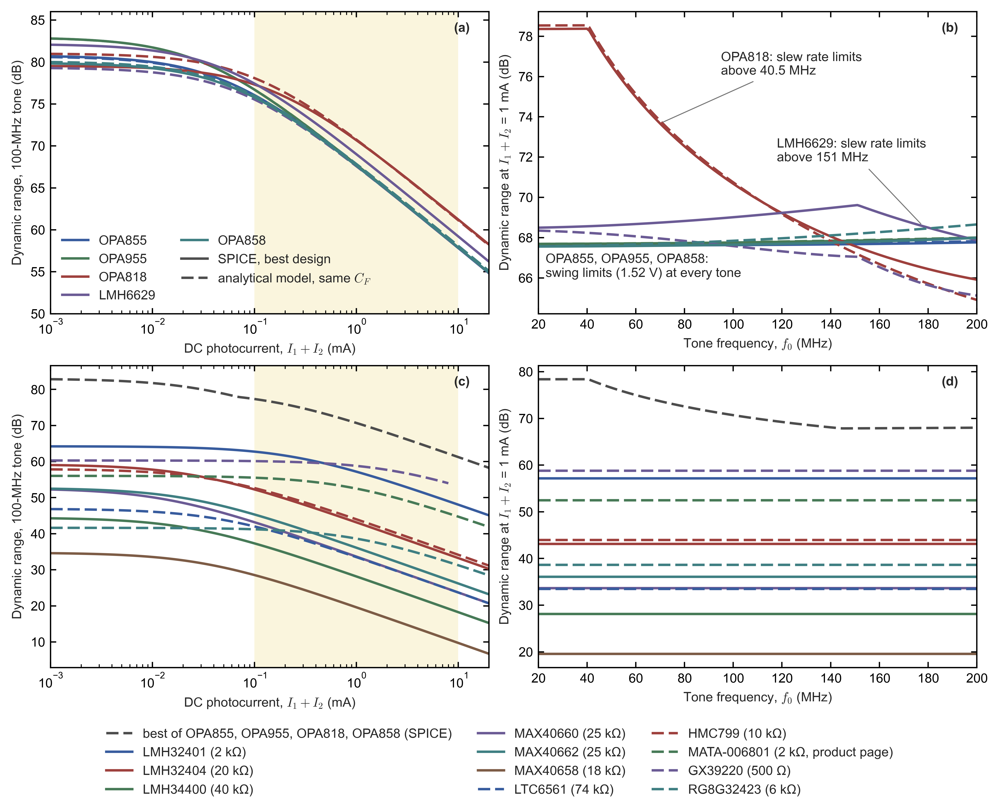

*Figure 24. Dynamic range in 150 MHz (Eq. (50)), with the imbalance servoed to zero.*
- *(a) The five leading amplifiers at their best SPICE designs at 1 pF and 2 kΩ (Table A6.33), against $I_1 + I_2$ for a 100-MHz tone: SPICE solid, our analytical model at the same $C_F$ dashed. Shaded: the receiver's range of 0.1–10 mA.*
- *(b) The same against the tone frequency at $I_1 + I_2$ = 1 mA. The annotations mark where the slew rate takes over from the swing (Eq. (52)).*
- *(c) The single-chip TIAs of Table A6.34 that reach 150 MHz with a linear gain, against $I_1 + I_2$ for a 100-MHz tone, from their datasheets' linear input range and band noise. The coherent-receiver TIAs (MATA-006801, GX39220, RG8G32423) are drawn at the gain at which their noise is published (Eq. (53)); GX39220's curve ends at 8 mA, its limit of 4 mA of DC on each input. Dashed dark grey: the best of OPA855, OPA955, OPA818 and OPA858 in SPICE at each point; LMH6629 is left out (Section 6.6.2).*
- *(d) The same at $I_1 + I_2$ = 1 mA against the tone. Below their bandwidths the TIAs' values do not depend on the tone.*
- *Amplifiers: OPA855, OPA955, OPA818, LMH6629 (COMP HI) and OPA858; single-chip TIAs: LMH32401, LMH32404, LMH34400, MAX40660, MAX40662, MAX40658, LTC6561, HMC799, MATA-006801 (2 kΩ, product-page values), GX39220 (500 Ω) and RG8G32423 (6 kΩ, short-form datasheet).*

#### 6.6.3 What limits the dynamic range of the OPA818 design

Knowing which limit sets the dynamic range tells where an improvement would pay: a quieter amplifier where the noise sets the floor, more swing or slew rate where the ceiling does. We examine the OPA818 design, the one with the largest ceiling, because both of its large-signal limits, swing and slew rate, bind within the band, while the 5-V parts are limited by their swing alone (Section 6.6.2). Figure 25 draws the two sides of Eq. (50) separately for the OPA818 design of Table A6.33 ($C_F$ = 0.495 pF, 262 MHz), both as rms photocurrent: the band noise floors at the bottom and the ceilings of Eq. (26) at the top. The dynamic range is the vertical distance from the floor to the lowest ceiling, 20 dB per decade.

**The floor.** Three noises add in power over 0–150 MHz:
- the Johnson noise of $R_F$ alone, $\sqrt{4k_BTB/R_F}$ = 2.87 pA/√Hz × $\sqrt{150\ \mathrm{MHz}}$ = 35.1 nA rms;
- the amplifier's own noise, mostly $e_n$ acting on $C_T$ (Eq. (19)), which raises the dark floor to 84.8 nA rms in SPICE (70.7 nA in our analytical model). The amplifier's part is $\sqrt{84.8^2 - 35.1^2}$ nA = 77.1 nA rms;
- the shot noise of the pair, $\sqrt{2qI_{\mathrm{DC}}B}$ = 69.3, 219.2 and 693.3 nA rms at $I_1 + I_2$ = 0.1, 1 and 10 mA.

The shot noise equals the dark floor at

$$
I_{\mathrm{DC}}^{\times} = \frac{i_{n,B}^2(0)}{2qB} = \frac{(84.8\ \mathrm{nA})^2}{2 \times 1.602\times10^{-19}\ \mathrm{C} \times 150\ \mathrm{MHz}} = 0.150\ \mathrm{mA},
\tag{51}
$$

where $i_{n,B}(0)$ is the dark band noise of Eq. (49). Below $I_{\mathrm{DC}}^{\times}$ the amplifier sets the floor and the dynamic range is nearly flat. Above it the shot noise does, and the dynamic range falls by 10 dB per decade of photocurrent (Eq. (29)). At 0.1, 1 and 10 mA the amplifier still adds 4.0, 0.6 and 0.06 dB to the shot noise. For the 5-V parts of Table A6.33, $I_{\mathrm{DC}}^{\times}$ is only 31–63 µA.

**The ceiling.** With the DC removed and the output centred, Eq. (26) gives the smaller of the swing and the slew-rate amplitude. The third limit, 55 mA of output current into $1/R_F + 2\pi f_0 C_F$, would allow more than 38 V at every tone up to 300 MHz and never binds. Swing and slew rate cross at

$$
f_{\times} = \frac{\mathrm{SR}}{2\pi V_{\mathrm{sw}}} = \frac{1400\ \mathrm{V/\mu s}}{2\pi \times 5.50\ \mathrm{V}} = 40.5\ \mathrm{MHz},
\tag{52}
$$

with SR the slew rate and $V_{\mathrm{sw}}$ the swing on ±6.5 V. Below 40.5 MHz the swing sets the ceiling: $I_{\max}$ = 5.50 V / ($\sqrt2$ × 1998 Ω) = 1.95 mA rms at 30 MHz. Above it the slew rate does: at 100 MHz, $V_{\mathrm{pk}}$ = 1400 V/µs / (2π × 100 MHz) = 2.23 V and $I_{\max}$ = 2.23 V / ($\sqrt2$ × 1961 Ω) = 0.803 mA rms.

**Example at 100 MHz and $I_1 + I_2$ = 1 mA:**

$$
\mathrm{DR}_{150\,\mathrm{MHz}} = 20\log_{10}\frac{0.803\ \mathrm{mA}}{\sqrt{(84.8\ \mathrm{nA})^2 + (219.2\ \mathrm{nA})^2}} = 20\log_{10}\frac{0.803\ \mathrm{mA}}{235.1\ \mathrm{nA}} = 70.7\ \mathrm{dB}.
$$

At 30 MHz the same floor under the 1.95-mA ceiling gives 78.4 dB (Figure 25(a)). In the dark at 100 MHz it is 79.5 dB, at 0.1 mA 77.3 dB, and at 10 mA 61.2 dB (Figure 25(b)).

**What each change would buy at 100 MHz.**
- **The slew rate is the binding limit above 40.5 MHz, and it moves the dynamic range at every photocurrent.**
  - Doubling it to 2800 V/µs raises the ceiling by $20\log_{10}(4.46/2.23)$ = 6.0 dB on ±6.5 V.
  - On ±5 V the 4.00-V swing caps the gain at $20\log_{10}(4.00/2.23)$ = 5.1 dB.
  - Halving it to 700 V/µs costs 6.0 dB.
- **The supply matters only at low tones.** On ±5 V (4.00 V of swing into 1 kΩ, Table A6.3) the ceiling at 100 MHz is unchanged, because 2.23 V is less than 4.00 V. Below 40.5 MHz it is $20\log_{10}(5.50/4.00)$ = 2.8 dB lower, and the loss vanishes at 1400 V/µs / (2π × 4.00 V) = 55.7 MHz.
- **The 5-V parts' 1.52-V swing lies 3.3 dB below OPA818's slew limit at 100 MHz.** The two meet at 1400 V/µs / (2π × 1.525 V) = 146 MHz, which is why the curves of Figure 24(b) cross at 144.5–147.9 MHz.
- **A quieter amplifier helps only below about 1 mA.** A noiseless one, leaving the 35.1 nA of $R_F$ alone, would gain 7.7 dB in the dark, 3.0 dB at 0.1 mA, 0.5 dB at 1 mA and 0.05 dB at 10 mA.
- **$R_F$ moves the ceiling once the shot noise dominates.** The floor then no longer depends on $R_F$, while $I_{\max}$ scales as $1/\lvert Z_T\rvert$, so 1.5 kΩ gains 2.5 dB (Eq. (29), Table A6.30).

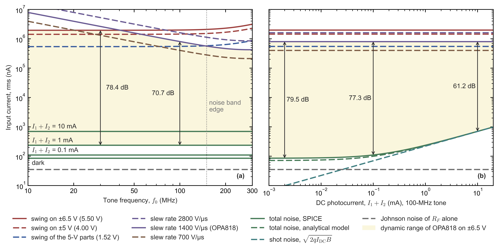

*Figure 25. What sets the dynamic range of the OPA818 design of Table A6.33 ($R_F$ = 2 kΩ, total $C_F$ = 0.495 pF, 1 pF at the node, 262 MHz), with every quantity referred to the photocurrent as an rms current. Bottom: band noise over 0–150 MHz, the Johnson noise of $R_F$ alone (grey, dashed) and the total with the SPICE amplifier noise, in the dark and with the shot noise of $I_1 + I_2$ = 0.1, 1 and 10 mA (green). Top: the largest undistorted tone, $V_{\mathrm{pk}}/(\sqrt2\lvert Z_T(f_0)\rvert)$ of Eq. (49), for the swing on ±6.5 V (5.50 V) and on ±5 V (4.00 V), the swing of the 5-V parts (1.52 V), and slew rates of 700, 1400 (OPA818) and 2800 V/µs. Shaded: the dynamic range of OPA818 on ±6.5 V. (a) Against the tone frequency; the shading and the arrows are for $I_1 + I_2$ = 1 mA. The ceilings rise above about 150 MHz, where $\lvert Z_T\rvert$ rolls off, and the dotted line marks the edge of the noise band. (b) Against $I_1 + I_2$ for a 100-MHz tone, with our analytical model of the total noise dashed and the shot noise alone in teal. Amplifier: OPA818.*

### 6.7 Single-chip TIAs

Section 2.5 listed the single-chip TIAs on the market and showed that none can carry 0.1–10 mA of DC through its input. With the balanced pair and its imbalance servoed to zero (Section 8.8), a TIA with one input carries no DC. Three kinds are compared here: the lidar TIAs and the coherent-receiver TIAs of Section 2.5, the latter made for a balanced photodiode pair with one photodiode on each of two inputs, and three optical-communication TIAs, which prove not to be linear amplifiers. Their dynamic range on the definition of Eq. (50) depends on two datasheet quantities, the linear input current and the input-referred noise:
- **Linear input.** The pair's RF difference current swings both ways around zero. $I_{\mathrm{pk}}$ is therefore the largest bipolar peak current that the datasheet shows as linear, at about 1–3 % of gain change unless stated otherwise. For a part that takes current in one direction only, it is half of that range, centred by a DC offset current. $I_{\max} = I_{\mathrm{pk}}/\sqrt2$ in Eq. (49).
- **Noise.** The datasheet's input-referred noise integrated over 0–150 MHz, at the photodiode capacitance nearest 1 pF. Where only a density is given, it is taken as white. The coherent-receiver TIAs give one noise figure for their whole 24–65-GHz band; for GX39220 it is the average up to 65 GHz (note 1 on p. 10). Across such a band the voltage noise acting on the input capacitance dominates the upper part (Eq. (19)), and their noise within 150 MHz is not published (Appendix C, item 19).

**Variable gain.** The coherent-receiver TIAs have a gain control, manual or automatic, that holds their differential output at a few hundred millivolts for the ADC that follows. Their documents quote a largest linear input that holds only at a low gain beside a noise figure that is lowest at the highest gain, so both must be taken at one setting. At the setting where the noise is published,

$$
I_{\mathrm{pk}} = \min\!\left(\frac{V_{\mathrm{lin,pp}}}{2Z_T},\ \frac{I_{\mathrm{in,pp}}}{2}\right),
\tag{53}
$$

where $V_{\mathrm{lin,pp}}$ is the largest differential output, peak to peak, that the document shows as linear, $Z_T$ the differential transimpedance at that setting, and $I_{\mathrm{in,pp}}$ the largest differential input current, peak to peak, that the document allows. These parts define the differential input current as $I_{\mathrm{in}} = I_{\mathrm{INP}} - I_{\mathrm{INN}}$, the difference of the currents into their two inputs (GX39220, note 1 on p. 10). That is the pair's difference current, the current the op-amp TIA receives, so their input and noise figures compare directly with Table A6.33. For GX39220 at 500 Ω, Eq. (53) gives $I_{\mathrm{pk}} = \min(0.50\ \mathrm{V}/(2 \times 500\ \Omega),\ 3\ \mathrm{mA}/2) = \min(0.50,\ 1.5)$ mA = 0.50 mA.

**Example: LMH32401 at $I_1 + I_2$ = 1 mA.** $I_{\max}$ = 250 µA / $\sqrt2$ = 176.8 µA rms, and $i_{n,B} = \sqrt{109^2 + 219.2^2}$ nA = 244.8 nA rms with the shot noise of Section 6.6.2. Then $\mathrm{DR}_{150\,\mathrm{MHz}} = 20\log_{10}(176.8\ \mathrm{\mu A}/244.8\ \mathrm{nA})$ = 57.2 dB, against 67.6 dB for OPA855 and 70.7 dB for OPA818.

**Example: GX39220 at 500 Ω and $I_1 + I_2$ = 1 mA.** Eq. (53) gives $I_{\mathrm{pk}}$ = 0.50 mA, so $I_{\max}$ = 0.50 mA / $\sqrt2$ = 353.6 µA rms. Its 28 pA/√Hz, taken as white, gives 28 pA/√Hz × $\sqrt{150\ \mathrm{MHz}}$ = 342.9 nA rms, and with the shot noise $i_{n,B} = \sqrt{342.9^2 + 219.2^2}$ nA = 407.0 nA rms. Then $\mathrm{DR}_{150\,\mathrm{MHz}} = 20\log_{10}(353.6\ \mathrm{\mu A}/407.0\ \mathrm{nA})$ = 58.8 dB, 8.8 dB below OPA855 and 11.9 dB below OPA818.

**How to read Table A6.34 and Figure 24(c)–(d).**
- **The linear input range decides, and the lidar TIAs have 3–250 µA of it.** They are built for microampere pulses: 10–74 kΩ of transimpedance into an output of 0.5–2 V. The op-amp designs at 2 kΩ reach $I_{\mathrm{pk}} = V_{\mathrm{pk}}/\lvert Z_T\rvert$ = 0.77 mA (the 5-V parts) to 1.14 mA (OPA818). Once the shot noise dominates, Eq. (50) follows the ratio of the two: at 10 mA the LMH32401's 250 µA puts it $20\log_{10}(0.765/0.250)$ = 9.7 dB behind OPA855 and $20\log_{10}(1.136/0.250)$ = 13.2 dB behind OPA818.
- **LMH32401 at 2 kΩ is the only lidar TIA within reach, and it is 10.4–13.5 dB behind at 1 mA.**
  - Its noise, 109 nA rms in 150 MHz, is also 2.2 times OPA855's 49.6 nA, which puts it 16.6 dB behind in the dark.
  - Readings more generous than 2 % of gain change narrow the gap but do not close it. At 400 µA its gain is down 8 %, and the dynamic range at 1 mA would be 61.3 dB.
  - Centring its asymmetric window (−250 to +700 µA) with a deliberate 225-µA imbalance would allow about ±475 µA and 62.7 dB, still 4.9 dB behind OPA855. That centring is untested.
- **The DC is no obstacle in the balanced pair.** The ambient-light cancellation of the TI parts and the OFFSET inputs of the Maxim parts would carry the residual imbalance, which the servo of Section 8.8 holds near zero, and the shot noise of $I_1 + I_2$ is the same as for the op amps. A coherent-receiver TIA instead carries each photodiode's DC, about half of $I_1 + I_2$, on its own input and removes it with its DC loops. GX39220 allows 4 mA on each input and ±0.5 mA between the two (p. 9), so $I_1 + I_2$ up to 8 mA.
- **OPA857 and ADA4355 are too slow for the 150-MHz band**: 125 MHz at 1.5 pF and 43 MHz at 2 kΩ. They are listed but not plotted.
- **The optical-communication TIAs are not linear amplifiers in this sense.**
  - PHY1095 (1.25 Gb/s, 60 kΩ) holds its output at 320–480 mVpp for any input above 8 µApp, by automatic gain control.
  - PHY1090 (10 Gb/s, 2 kΩ) is linear to 2 mApp only with 2–6.5 % harmonic distortion, also under gain control.
  - MAX3654, a 47–870-MHz CATV receiver, has a differential input and 21 dBm of output intercept, but it states no linear input current and its band starts at 47 MHz.
  - All three are last-time-buy or not recommended for new designs.
- **The coherent-receiver TIAs are 8.8–32.1 dB behind the op-amp designs at 1 mA, at the gains where their noise is published** (Figure 24(c)–(d)).
  - Their output is held at a few hundred millivolts, so their linear input falls as their gain rises: at the 0.5–6 kΩ where their noise is quoted, Eq. (53) allows 38–500 µA peak. Their full 3 mAppd of linear input needs 167 Ω (GX39220) to 233 Ω (MATA-006801), where no noise is published.
  - The dynamic range of 20 to more than 30 dB stated in their documents is the range of their gain control, which an automatic loop (1.1 MHz for GX39220, p. 10) uses to follow slow changes of the input level. It is not the ratio of the largest linear signal to the noise at one setting, which Eq. (50) measures.
  - GX39220 (Renesas, 2 × 96 Gbaud) is the only one with a full public datasheet. Its noise is 19, 22 and 28 pA/√Hz at 3.25 kΩ, 1 kΩ and 500 Ω, each the average up to 65 GHz, and its THD 1.5 % for outputs below 500 mVppd and 2 % up to 550 mVppd (p. 9). The 500-Ω setting gives the most, 58.8 dB at 1 mA and 1.6 dB above LMH32401; 1 kΩ gives 54.1 dB and 3.25 kΩ 44.6 dB. It is specified with a 30–50-fF photodiode on a 150–300-pH bond wire (p. 8), not with 1 pF. It is obsolete: Renesas's notice PLC250030 of 12 September 2025 set its last shipment for 12 September 2026 and names GX39221 as the replacement, whose full datasheet is not public.
  - MATA-006801 (MACOM, 2 × 64 Gbaud) lists 2 kΩ, 16 pA/√Hz and a 700-mVppd output swing, and calls differential inputs up to 3 mApp linear (product page). At 2 kΩ the swing allows 0.35 mApp, 175 µA peak, which gives 52.5 dB at 1 mA. At its manual-mode maximum of 1.5 kΩ, with the noise of 2 kΩ, it would give 55.0 dB. Pairing its 3 mApp with its 16 pA/√Hz, two figures that hold at different gains, would give 71.1 dB at 1 mA and 63.4 dB at 10 mA; that is an upper bound, reached only if its noise at 233 Ω were as low as at 2 kΩ.
  - RG8G32423 (Renesas, 4 × 32 Gbaud, active) gives 38.6 dB at 1 mA at 6 kΩ, from its short-form datasheet's noise below 18 pA/√Hz and THD below 3 % at 450 mVppd (p. 1).
- **The other coherent-receiver TIAs publish no figures that Eq. (53) can use.**
  - Renesas's short-form datasheets of GX39221, RG8G31220, RG8G31223, RG8G3122B and RG8G31420 (active) and of GX32222, GX32223, GX36220, GX36420 and RG8G3122A (obsolete) give only the gain range and the bandwidth, and GX32424's datasheet needs a login.
  - Marvell's (formerly Inphi's) product briefs of IN3250TA, IN3252TA, IN3254TA, IN6450TA, IN6452TA and IN6454TA give no gain, noise or linearity figure.
  - MaxLinear's MxL9105 and MxL9162 appear only in announcements from 2017.
  - Qorvo's TGA4861, TGA4864, TGA4868 and TGA4872 are discontinued. Their product pages give 20–24 pA/√Hz at 4.8–7.5 kΩ and THD below 1 % up to 350 mVpp single-ended, i.e. 700 mVppd, which on Eq. (53) gives 40.0–43.0 dB at 1 mA.
  - MACOM's other coherent TIAs (MATA-006406, MATA-006806, MATA-009803-06, MATA-012403 and MATA-012803) have product pages only, like MATA-006801.

**What the coherent class could reach depends on its noise at low gain, which no public document gives.** With 3 mAppd of linear input and no amplifier noise at all, the shot noise alone would allow 83.7, 73.7 and 63.7 dB at 0.1, 1 and 10 mA, above OPA818's 77.3, 70.7 and 61.2 dB. From Eqs. (49)–(50), the in-band noise density that a TIA may add and still match a design of dynamic range $\mathrm{DR}_{\mathrm{ref}}$ at the photocurrent $I_{\mathrm{DC}}$ is

$$
i_{n,\mathrm{allowed}} = \sqrt{\frac{1}{B}\left[\left(\frac{I_{\max}}{10^{\mathrm{DR}_{\mathrm{ref}}/20}}\right)^{2} - 2qI_{\mathrm{DC}}B\right]}.
\tag{54}
$$

With $I_{\max}$ = 1.5 mA / $\sqrt2$ = 1.061 mA rms and OPA818's 70.68 dB at 1 mA, the total noise may be 1.061 mA / 3418 = 310.3 nA rms. The shot noise takes 219.2 nA of it, which leaves $\sqrt{310.3^2 - 219.2^2}$ nA = 219.6 nA rms, so $i_{n,\mathrm{allowed}}$ = 219.6 nA / $\sqrt{150\ \mathrm{MHz}}$ = 17.9 pA/√Hz. Matching OPA855's 67.6 dB allows 31.2 pA/√Hz. GX39220's 28 pA/√Hz at 500 Ω is an average up to 65 GHz, and none of these parts states its noise at the 167–233-Ω setting (Appendix C, item 19).

### 6.8 How the designs compare with the 50-Ω benchmark

We now set the leading designs against the benchmark family of Section 2.1, with both definitions of Section 3.8: the electronic dynamic range of Eq. (50), and the usable dynamic range of Eq. (28), which caps the tone at what the light can supply. The designs are the three leading op amps at their best SPICE designs (Table A6.33), the pHEMT composite of Section 7.1, a cascoded CE3512K2 GaAs pHEMT at the summing node followed by an OPA859 buffer (Table A7.4), and the high-voltage composite of Section 7.2, in which OPA859 at the summing node drives a THS3491 stage of gain 5.5 inside the $R_F$ loop (Table A7.7); their band noise and their ceiling at a 100-MHz tone come from those tables. The two composites are designed in Chapter 7; they appear here so that every front end meets the benchmark in one place. The benchmark is the 50-Ω chain with a 2-dB noise figure, compressing at −20, −10 or 0 dBm (Table A2.2). Tables A6.35 and A6.36 give the numbers, and Figure 26 draws them.

**Small signal.** For the same small tone, a design's advantage is $A = 20\log_{10}(i_{n,B,50}/i_{n,B})$, the ratio of the band noises with the shot noise of the pair in both (Figure 26(a)); it does not depend on the chain's compression level. In the dark it is 17.7 dB for the pHEMT composite, 17.2 dB for OPA955, 15.0 dB for OPA855, 10.4 dB for OPA818 and 6.2 dB for the high-voltage composite, in the order of their dark band noise, 36.5, 38.8, 49.6, 84.8 and 136.5 nA rms against the chain's 279.8 nA. For OPA855 at 1 mA, for example, the shot noise $\sqrt{2qI_{\mathrm{DC}}B}$ = 219.2 nA rms brings the TIA to $\sqrt{49.6^2 + 219.2^2}$ = 224.8 nA and the chain to $\sqrt{279.8^2 + 219.2^2}$ = 355.5 nA, and $A = 20\log_{10}(355.5/224.8)$ = 4.0 dB. The common shot noise compresses every lead in the same way: at 1 mA they are 2.8–4.1 dB, and at 10 mA 0.5–0.6 dB. No design falls behind at any photocurrent.

**Electronic dynamic range.** The chain's electronic dynamic range equals a design's when the chain compresses at $P_x = P_{\mathrm{eq}} + A$ (Eq. (5)), and a chain that compresses above $P_x$ has more. For the op amps and the pHEMT composite $P_{\mathrm{eq}}$ is −24.4 to −20.9 dBm, so $P_x$ falls from −10.6 to −5.9 dBm in the dark to −20.4 to −17.3 dBm at 1 mA and −23.7 to −20.3 dBm at 10 mA. A 50-Ω amplifier that compresses at −10 dBm therefore has the larger electronic dynamic range from 0.1 mA up. Against the ten amplifiers of Figure 21 its lead is 1.8 dB (OPA818) to 12.4 dB (OPA856) at 0.1 mA and 7.3 to 19.0 dB at 1 mA, but most of the tones it assumes are larger than the light can supply. The high-voltage composite, with $P_{\mathrm{eq}}$ = −9.0 dBm, needs a chain that compresses above −2.7 dBm in the dark and above −8.5 dBm at 10 mA.

**Usable dynamic range.** The chain's higher ceiling counts only for tones the light can supply (Figure 26(b)). Up to $I_{\mathrm{DC}} = \sqrt2\,I_{\max}$ of a design, 0.76–0.83 mA for OPA955, OPA855 and the pHEMT composite, 1.14 mA for OPA818 and 4.50 mA for the high-voltage composite, the light limits both, and the design leads by $A$. Above it the design clips, while the chain follows the light up to its own clip point, $\sqrt2\,I_{\max,50}$ = 1.26, 4.0 or 12.6 mA. The chain overtakes OPA955, OPA855 and the pHEMT composite at 1.16–1.25 mA whatever its compression level, because the light still limits the chain there. It overtakes OPA818 at 1.56 mA if it compresses at −10 dBm or above, and at 6.04 mA if it compresses at −20 dBm. It overtakes the high-voltage composite only if it compresses above that design's $P_{\mathrm{eq}}$ of −9.0 dBm: a 0-dBm chain does so above 5.0 mA. Over 0.1–10 mA the best usable dynamic range of any design is 59.1 dB at 0.1 mA (pHEMT composite; OPA955 59.0 dB), 69.6 dB at 1 mA (OPA818) and 73.1 dB at 10 mA (high-voltage composite), against 47.8, 66.0 and 71.6 dB for the chain that compresses at −10 dBm.

**What it takes to stay ahead.** A design keeps its lead over every chain up to a photocurrent $I_{\mathrm{DC}}$ only if it can pass the full-modulation tone there, which by Eq. (6) takes an output amplitude of $|Z_T|\,I_{\mathrm{DC}}\,10^{-A/20}$. For OPA855 that is 1.994 kΩ × 1 mA × $10^{-4.0/20}$ = 1.26 V at 1 mA, which its 1.525 V covers, and 18.5 V at 10 mA. For 10 mA in each diode it is 1.994 kΩ × 20 mA × $10^{-0.33/20}$ = 38 V. The op amps have 1.5–2.2 V, and the high-voltage composite 8.3 V, enough to 4.5 mA. A smaller $R_F$ lowers the requirement in proportion and costs noise that the shot noise hides at high photocurrent (Eq. (29)), which is why the benchmark's strength lies there.

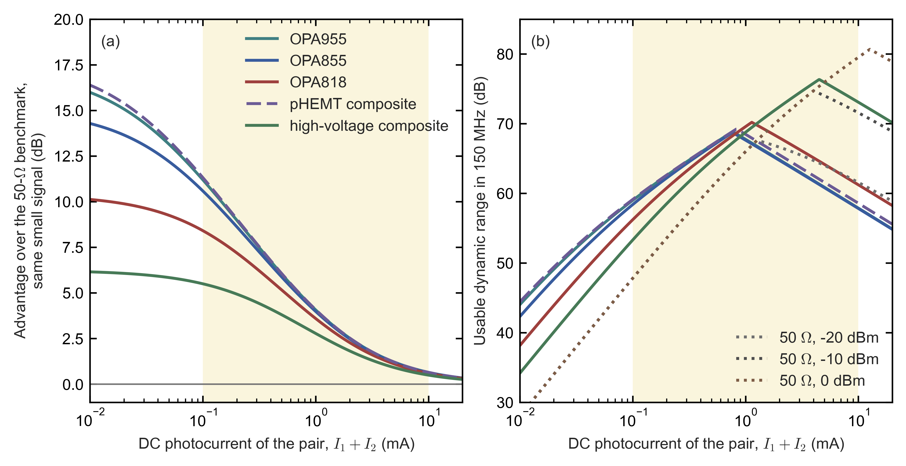

*Figure 26. The leading designs against the 50-Ω benchmark: the pair terminated in 50 Ω in parallel with the input of an amplifier of 2 dB noise figure; 150-MHz noise band, 100-MHz tone, imbalance servoed to zero. (a) Small-signal advantage $A$ (Eq. (5)), the ratio of the benchmark's band noise to the design's, with the shot noise of $I_1 + I_2$ in both; it does not depend on the benchmark's compression level. (b) Usable dynamic range (Eq. (28)), with the tone limited by the design's ceiling or by the light, whichever is lower; dotted, the benchmark compressing at −20, −10 and 0 dBm at the input. The three dotted curves coincide below 1.26 mA, where the light, not the amplifier, limits the benchmark, and separate at 1.26, 4.0 and 12.6 mA. The shaded band is the planned 0.1–10 mA. Designs: OPA955, OPA855 and OPA818 at their best SPICE designs at 1 pF and 2 kΩ (Table A6.33); the pHEMT composite of Section 7.1, a cascoded CE3512K2 at the summing node followed by an OPA859 buffer (Table A7.4); and the high-voltage composite of Section 7.2, in which OPA859 drives a THS3491 stage of gain $G_2$ = 5.5 inside the $R_F$ loop (Table A7.7). Values in Tables A6.35 and A6.36.*

### 6.9 Noise at low frequencies

The specification fixes the top of the band, 150 MHz, but not its bottom. If the receiver must also resolve signals between about 100 Hz and 100 kHz, such as a slow modulation, a lock-in measurement or the drift of the balance itself, the amplifiers' 1/f noise decides there, and it ranks them almost in the reverse of their order at 100 MHz. This section states what an amplifier may add at low frequency, compares the ten amplifiers carried forward on their datasheets' noise curves (Table A6.37), and lists what changes in the choice and in the front end.

**What an amplifier may add.** Below about 100 kHz the capacitive term of Eq. (19) vanishes: at 10 kHz, $2\pi fC_{\mathrm{tot}}$ = 2π × 10 kHz × 6 pF = 0.38 µS, against $1/R_F$ = 500 µS. The amplifier then adds $i_n^2(f) + e_n^2(f)/R_F^2$, and both densities rise toward low frequency as $e_n^2(f) = e_w^2(1 + f_{ce}/f)$ and $i_n^2(f) = i_w^2(1 + f_{ci}/f)$, with $e_w$ and $i_w$ the white levels and $f_{ce}$ and $f_{ci}$ the 1/f corners. Against the floor of Eq. (19), $S_0 = 4k_BT/R_F + 2qI_{\mathrm{DC}}$, the amplifier stays negligible only while

$$
i_n(f) \ll \sqrt{S_0}, \qquad e_n(f) \ll R_F\sqrt{S_0}.
$$

At 2 kΩ these limits are 2.87 pA/√Hz and 5.74 nV/√Hz in the dark. At $I_1 + I_2$ = 0.1, 1 and 10 mA they are 6.35, 18.1 and 56.7 pA/√Hz, and 12.7, 36.3 and 113 nV/√Hz. They are the limits of a 2-kΩ resistor and of the light, and the 1/f corners of a fast amplifier lie far above them. The current noise of OPA855, for example, has a white level of 2.6 pA/√Hz and a corner near 190 kHz, derived from its Fig 6-11 (p9). That gives $2.6\sqrt{1 + 190/1.05}$ = 35.2 pA/√Hz at 1.05 kHz, where the curve reads 35.2 pA/√Hz: twelve times the limit in the dark, and 5.5 times the limit at 0.1 mA.

**What Table A6.37 shows.**
- **Fast bipolar inputs lose through their current noise.** The base current of a fast bipolar input carries 1/f noise with a corner far above that of its voltage noise. OPA855 adds 35.2 pA/√Hz at 1 kHz, which is 15.0 dB above the floor at 0.1 mA and 6.8 dB at 1 mA; at 10 kHz it still adds 6.4 dB at 0.1 mA. OPA856 (21 pA/√Hz at 1 kHz), THS4304 (17.8) and LMH6629 (6.4) follow.
- **FET and CMOS inputs lose through their voltage noise.** Their gate current is tiny, but their voltage-noise corners are high. OPA858 and OPA859, with corners near 110 and 120 kHz, have 25.2 and 32.2 nV/√Hz at 1 kHz, which become 12.6 and 16.1 pA/√Hz through 2 kΩ. OPA818, with a corner of 15 kHz, has 8.4 nV/√Hz at 1 kHz and 25.5 nV/√Hz at 102 Hz, which become 4.2 and 12.8 pA/√Hz.
- **OPA955, OPA846 and OPA843 have low corners in both.** OPA955 adds 1.06 pA/√Hz at 1 kHz and 2.61 pA/√Hz at 105 Hz, 0.1 and 0.7 dB above the floor at 0.1 mA; its white current noise is only 0.55 pA/√Hz.
- **The shot noise relaxes the comparison.** From 1 mA up, OPA955, OPA846, OPA843, OPA818 and LMH6629 add at most 0.5 dB at 1 kHz, but at 100 Hz only OPA955, OPA846 and OPA843 stay within 1 dB.

**What it changes in the choice.** If the band must reach below about 100 kHz, the order of Section 9.2 changes.
- OPA955 is the only amplifier that is quiet at both ends: 560 MHz with a 0.90-dB band penalty in SPICE (Table A6.32), and at most 0.7 dB above the floor at 100 Hz from 0.1 mA up. It is still Advance Information.
- Among production parts OPA818, variant B, balances the two. It keeps 262 MHz in SPICE (Table A6.32) and the largest ceiling of the single amplifiers, and it adds 0.2 dB at 1 kHz and 1.7 dB at 100 Hz from 1 mA up, against 1.6 and 7.0 dB at 0.1 mA.
- OPA846 and OPA843 are quieter at low frequency, but neither reaches 150 MHz robustly at 1 pF: the best SPICE design of OPA846 gives 144 MHz at 44.5° (Table A6.32), and the robust design of OPA843 150 MHz (Table A6.5).
- OPA855, variant A, remains the choice only where nothing below about 100 kHz matters.

**What it changes in the front end.** Four points follow.

*The servo sets the lowest frequency.* A servo makes the TIA a high-pass at its unity-gain frequency, which Section 8.2 places at 1–10 kHz. Signals near 100 Hz need it a decade lower, near 10 Hz, and the imbalance is then followed correspondingly more slowly.

*The servo resistor must be a low-noise type.* The resistor through which the servo injects its current carries the imbalance, up to 12 V across 24 kΩ in the design of Section 8.8 (d). A resistor with a DC voltage $V$ across it adds 1/f excess noise. Its noise index NI is the rms excess noise in microvolts per volt of DC per decade of frequency, and a $1/f$ density integrates over one decade to its value at $f$ times $\sqrt{f\ln 10}$, so that

$$
e_{\mathrm{ex}}(f) = \frac{10^{\mathrm{NI}/20}\ \mathrm{\mu V/V}\times V}{\sqrt{f\ln 10}}.
$$

This stays below the resistor's Johnson noise, $\sqrt{4k_BT\times24\ \mathrm{k\Omega}}$ = 19.9 nV/√Hz, at 100 Hz only if $\mathrm{NI} < 20\log_{10}\!\left(19.9\ \mathrm{nV}\times\sqrt{100\times\ln 10}/12\ \mathrm{\mu V}\right)$ = −32 dB, a figure to check in the datasheet of the resistor chosen. $R_F$ carries only the residual imbalance, so its own excess noise does not matter.

*The laser's intensity noise may set the floor.* The residual of Eq. (77), $(I_1 - I_2)^2\,10^{\mathrm{RIN}/10}$, stays below the shot noise $2q(I_1 + I_2)$ only while $|I_1 - I_2|/(I_1 + I_2) < \sqrt{2q/(I_{\mathrm{DC}}\,10^{\mathrm{RIN}/10})}$. A laser with a RIN of −120 dB/Hz at 100 Hz, for example, allows 1.8 % of imbalance at 1 mA. The intensity noise of a laser usually rises toward low frequency, so near 100 Hz this residual, not the amplifier, may set the floor; the RIN of the laser used, at the frequency of interest, decides.

*A split front end could keep OPA855 for the band.* The fast TIA would take the photocurrent through a coupling capacitor, and a precision JFET-input TIA would take the low frequencies and the DC through a resistor $R_s$. The fast amplifier's low-frequency current noise would then stay inside its own loop, and its output would carry no DC. In the band, $R_s$ adds its Johnson noise, $\sqrt{4k_BT/R_s}$ = 0.91 pA/√Hz for 20 kΩ against 2.87 pA/√Hz for $R_F$, and the photodiode bias moves by the imbalance times $R_s$. This arrangement has not been analysed (Appendix C, item 21).

### 6.10 Larger feedback resistors, up to 10 kΩ

So far the pair has carried 0.1–10 mA, enough for its shot noise to bury the Johnson noise of a 2-kΩ resistor. A receiver with less light gives up that margin. The shot noise of $I_{\mathrm{DC}}$ equals the resistor's Johnson noise at $I_{\mathrm{DC}} = 2k_BT/(qR_F)$ (Section 3.6), which is 25.7 µA at 2 kΩ, 17.1 µA at 3 kΩ, 10.3 µA at 5 kΩ and 5.1 µA at 10 kΩ. With tens of microamperes in the pair, a larger resistor restores the light's lead. We therefore follow the amplifiers carried forward up to 10 kΩ, where the companion note takes over.

**The resistor's own capacitance now sets the bandwidth.** Its pole, $1/(2\pi R_FC_{F,\mathrm{par}})$, lies at 398 MHz for 2 kΩ with our nominal 0.2 pF, but at 159 MHz for 5 kΩ and 80 MHz for 10 kΩ. A band of 150 MHz therefore needs $R_F \le 1/(2\pi\times150\ \mathrm{MHz}\times0.2\ \mathrm{pF})$ = 5.3 kΩ, or 10.6 kΩ if the layout holds the parasitic to 0.1 pF. Table A6.38 runs the analysis of this chapter at 2, 3, 5 and 10 kΩ with 0.2 pF, and Table A6.39 with 0.1 pF. Each design is the robust one of Table A9.2, with a phase margin of at least 45° and at most 1 dB of peaking, but with no capacitance added at the input. With 0.2 pF, four parts still reach 150 MHz at 5 kΩ: OPA955 with 191 MHz, OPA855 with 182 MHz, OPA858 with 180 MHz and LMH6629 with 169 MHz, while OPA856 falls just short with 149 MHz. At 10 kΩ every design stays between 69 and 129 MHz. With 0.1 pF, OPA955, OPA855 and OPA858 keep 200–232 MHz even at 10 kΩ.

**The loop becomes easy to stabilize.** The noise gain at crossover grows with $R_F$ (Section 3.2), so the minimum-gain trap of the 2-kΩ design disappears. OPA855's phase margin rises from 59° at 2 kΩ to 66°, 73° and 78° at 3, 5 and 10 kΩ, with the 0.2-pF parasitic as its only feedback capacitance. OPA955, OPA818 and OPA846, which need added input capacitance at 2–3 kΩ, are robust without it from 5 kΩ up. Added capacitance still buys bandwidth, because a loop with up to 1 dB of peaking carries the response past the resistor's pole, but it costs noise: 8 pF gives OPA855 99 MHz instead of 84 MHz at 10 kΩ, with a band penalty of 11.5 dB instead of 7.4 dB (`data/results/medium_gain.json`).

**The bipolar parts keep their lead.** Their current noise, 2.1–2.8 pA/√Hz for all but OPA955, exceeds the resistor's Johnson noise from about 2–4 kΩ up, and at 5 kΩ that noise is only 1.82 pA/√Hz. Yet over a band of tens of megahertz the voltage noise acting on the node capacitance weighs more. At 5 kΩ OPA855 and OPA856 stay within 5.5 dB of the resistor's noise, against 6.4 dB for OPA858 and 9.0 dB for OPA818. At 10 kΩ, over the narrower band that each design then reaches, OPA855, OPA856 and OPA859 stay within 7.3–7.4 dB and OPA858 within 5.1 dB. OPA955, with 0.79 nV/√Hz and 0.55 pA/√Hz, stays within 1.7–1.9 dB at 5–10 kΩ. With its calibrated open-loop curve (Table A6.7), OPA858 keeps nearly the same bandwidth and noise at 3–10 kΩ, but with 46–64° of phase margin instead of 66–77°.

**Less light is needed for the light to dominate.** The DC photocurrent of the pair whose shot noise equals the TIA's own noise in the band falls with $R_F$. For OPA855 it falls from 53 µA at 2 kΩ to 37 µA at 5 kΩ and 28 µA at 10 kΩ, for OPA858 to 16 µA at 10 kΩ, and for OPA955 to 16 and 8 µA at 5 and 10 kΩ (Table A6.38).

**What it costs.** The largest RF current the output can carry falls as $1/R_F$. With 2 V of peak output it is 1 mA at 2 kΩ, 0.4 mA at 5 kΩ and 0.2 mA at 10 kΩ, so a larger resistor suits a pair whose signal is as small as its light. The imbalance must still stay out of $R_F$ (Section 8.1): at 10 kΩ, 0.1 mA of imbalance would take 1 V of the swing.

**The choice for a weaker pair.** With 20–50 µA in the pair and 150 MHz to cover, 3–5 kΩ is the range. There OPA855 keeps 182–334 MHz with 66–73° of phase margin and needs no added capacitance, and the pair's shot noise exceeds its own noise from 37–44 µA. OPA955, once released, lowers that to 16 µA at 5 kΩ. 10 kΩ serves 150 MHz only if the parasitic is held to about 0.1 pF.

**Where the companion note continues.** From 10 kΩ up the companion note takes over. Its Section 6.9 evaluates 10 kΩ on photodiodes of 20 pF to 1 nF, and it runs its single-pole model and our model on our node at 2 kΩ and 10 kΩ with a common design rule. At 10 kΩ the two agree on bandwidth within 2–6% for OPA855, OPA858 and LMH6629, within 11% for OPA955 and within 15% for OPA818. At 2 kΩ the single-pole model falls short by up to a third, which is why this note uses the full open-loop curves, and why the two notes meet at 10 kΩ. The companion note also runs OPA855, OPA955 and OPA818 at 10 kΩ on our node in SPICE, with our supplies, loads and double injection (its Section 9.8). For OPA855 the macromodel reproduces our design of Table A6.38 within 0.2% in bandwidth and 0.4° in phase margin, at 84 MHz and 78.8°, and its noise lies 0.3 dB below our model's, close to the agreement found at 2 kΩ (Section 5.6); at 0.10 pF of total feedback capacitance it gives 215 MHz, against 207 MHz from our model. For OPA955 the macromodel reproduces Table A6.38 within 0.2% in bandwidth and 0.05 dB in noise, at 85 MHz, but gives 70.7° of phase margin against our 55.4°, because it has far less phase lag above 300 MHz than the datasheet curve (Section 5.3). For OPA818 it gives 115 MHz and 56.5° against our 129 MHz and 47°, and 2.2 dB more noise, in the same direction as at 2 kΩ, where OPA818's macromodel had 15.5° more phase margin and 1.6 dB more noise than our analysis.

---

## 7. Composite front ends

Section 6.6.3 shows that from about 0.15 mA up the ceiling, not the noise, sets the dynamic range of every op-amp design, and Section 6.8 that the 50-Ω benchmark overtakes them above about 1.2 mA for the same reason. This chapter asks what a second active device adds. Section 7.1 places a discrete transistor at the summing node, a silicon JFET, a GaAs pHEMT or a SiGe bipolar transistor, to lower the floor, and designs and verifies such composites. Section 7.2 raises the ceiling instead, with a fast high-voltage amplifier inside the $R_F$ loop: its stability, noise, slew rate, distortion and power. Section 7.3 documents the SPICE models and decks of both and the convergence messages met.

### 7.1 A discrete transistor at the summing node

This section asks whether a discrete transistor at the summing node, a silicon JFET, a GaAs pHEMT or a SiGe bipolar transistor, can lower the floor enough to matter below about 0.15 mA, where the noise still sets the dynamic range (Section 6.6.3).

**Why the question arises.** In our analytical model at its SPICE design, OPA855's input noise at 100 MHz, 4.17 pA/√Hz, is $\sqrt{2.87^2 + 2.60^2 + 1.54^2}$ pA/√Hz. Of this, 2.87 pA/√Hz is the Johnson noise of $R_F$, 2.60 pA/√Hz the bipolar input current noise, and 1.54 pA/√Hz its $e_n$ of 0.99 nV/√Hz acting on 2.36 pF of node and feedback capacitance, together with the small $e_n/R_F$ term (Eq. (19)). At this node OPA855 thus loses more to its base current than to its voltage noise. A FET removes the current noise but adds its own capacitance, and Eq. (56) below decides which effect wins. OPA955, with 0.56 pA/√Hz of current noise, has little to remove. OPA818's current noise is negligible in the central treatment of Section 3.7, but its 2.2-nV/√Hz voltage noise on 4.24 pF gives it the largest dark band noise of the three, 84.8 nA rms, and the most to gain (Table A7.1).

The front end considered is a common-source FET with a cascode at its drain, followed by an op amp, with $R_F$ from the op amp's output back to the FET's gate. Referred to the photocurrent, its input noise density is

$$
S_i(f) = \frac{4k_BT}{R_F} + 2qI_G + e_n^2\left[(2\pi f C_T)^2 + \frac{1}{R_F^2}\right],
\qquad
C_T = C_D + C_{\mathrm{PCB}} + C_F + C_{\mathrm{iss}} + C_{\mathrm{rss}},
\tag{55}
$$

where $k_B$ is Boltzmann's constant, $T$ = 298.15 K, $I_G$ the gate current, $e_n$ the FET's input voltage noise density, $C_{\mathrm{iss}}$ its input capacitance and $C_{\mathrm{rss}}$ its gate–drain capacitance. $C_{\mathrm{rss}}$ is counted once inside $C_{\mathrm{iss}}$ and once more as the Miller term of the cascoded drain, whose voltage gain is about −1. The op amp's own noise, divided by the FET's gain, is neglected. Integrated over 0–$B$,

$$
i_{n,B}^2 = B\left(\frac{4k_BT}{R_F} + 2qI_G + \frac{e_n^2}{R_F^2}\right) + \frac{e_n^2\,(2\pi C_T)^2\,B^3}{3}.
\tag{56}
$$

All numbers are for our baseline: $C_D$ = 1 pF, $C_{\mathrm{PCB}}$ = 0.35 pF, $C_F$ = 0.25 pF and $R_F$ = 2 kΩ, so the node without the FET is $C_x = C_D + C_{\mathrm{PCB}} + C_F$ = 1.60 pF. They come from `scripts_archive/fet_composite_bound.py`, with the device values of Table D.3.

**The most any front end can gain.** A noiseless amplifier leaves only the Johnson noise of $R_F$, $\sqrt{4k_BTB/R_F}$ = 35.1 nA rms over 150 MHz. At the same ceiling, a front end with the dark band noise $i_{n,B}$ gains over a design with the dark band noise $i_{n,B,\mathrm{ref}}$, at the photocurrent $I_{\mathrm{DC}}$,

$$
\Delta\mathrm{DR} = 10\log_{10}\frac{i_{n,B,\mathrm{ref}}^2 + 2qI_{\mathrm{DC}}B}{i_{n,B}^2 + 2qI_{\mathrm{DC}}B}.
\tag{57}
$$

For OPA855 at 0.1 mA and a noiseless amplifier, $\Delta\mathrm{DR} = 10\log_{10}[(49.6^2 + 69.3^2)/(35.1^2 + 69.3^2)] = 10\log_{10}(7267/6039)$ = 0.80 dB. Table A7.1 gives the rest. In the receiver's range of 0.1–10 mA, no front end can gain more than 0.80 dB over OPA855, 0.19 dB over OPA955 or 2.98 dB over OPA818, each at its own ceiling. The composites below keep the 1.5-V ceiling of their OPA859 buffer, so OPA955, with nearly the same ceiling, is the design they have to beat.

**What a FET would need.** Write the FET's transconductance as $g_m = 2\pi f_T C_{\mathrm{iss}}$, with $f_T$ its transit frequency, and its channel noise as $e_n^2 = 4k_BT\Gamma/g_m$, with $\Gamma$ = 2/3 for an ideal long-channel FET and about 1 for short channels. Neglecting $C_{\mathrm{rss}}$, the $e_n$ term of Eq. (56) is then proportional to $(C_x + C_{\mathrm{iss}})^2/C_{\mathrm{iss}}$, which is smallest at $C_{\mathrm{iss}} = C_x$. There $C_T = 2C_x$ and

$$
\frac{e_n^2\,(2\pi C_T)^2\,B^3}{3} = \frac{4k_BT\Gamma}{2\pi f_T C_x}\cdot\frac{(4\pi C_x)^2\,B^3}{3} = \frac{32\pi}{3}\,\frac{k_BT\,\Gamma\,C_x\,B^3}{f_T}.
\tag{58}
$$

A FET matches OPA855's band noise, with no gate current, if the term of Eq. (58) stays below $(49.59\ \mathrm{nA})^2 - (35.14\ \mathrm{nA})^2 = (34.99\ \mathrm{nA})^2$. For $\Gamma$ = 2/3 that needs $f_T \ge (32\pi/3) \times 4.116\times10^{-21}\ \mathrm{J} \times (2/3) \times 1.60\ \mathrm{pF} \times (150\ \mathrm{MHz})^3/(34.99\ \mathrm{nA})^2 = 4.966\times10^{-7}\ \mathrm{A^2\,Hz}/1.224\times10^{-15}\ \mathrm{A^2}$ = 0.41 GHz, and 0.61 GHz for $\Gamma$ = 1; either way $e_n$ must be at most 1.64 nV/√Hz at $C_{\mathrm{iss}}$ = 1.6 pF. Matching OPA955 leaves only 16.4 nA rms for the term and needs 1.84–2.76 GHz, with $e_n \le$ 0.77 nV/√Hz. A FET whose $C_{\mathrm{iss}}$ differs from $C_x$ needs $(C_x + C_{\mathrm{iss}})^2/(4C_xC_{\mathrm{iss}})$ times that $f_T$: 2.1 times for the 10 pF of BF862 and 1.5 times for the 6 pF of CPH3910.

**Why a pHEMT or a SiGe bipolar transistor rather than a silicon JFET.** At a node of a few picofarads, what decides is not the input capacitance alone but the transconductance a device delivers per picofarad of the capacitance it adds, $g_m/C_{\mathrm{iss}} = 2\pi f_T$, the quantity that sets Eq. (58). Above a few tens of megahertz the part of a FET front end's input-referred noise that depends on the device is its voltage noise acting on all the capacitance at the summing node,

$$
i_{n,e}(f) = e_n\,2\pi f\,C_T,
\qquad
e_n^2 = \frac{4k_BT\Gamma}{g_m},
\tag{59}
$$

the $e_n$ term of Eq. (55). Lowering $e_n$ needs a large $g_m$. In a JFET of a given technology that means a wider channel, and the gate capacitance grows in proportion, so the designer can only match $C_{\mathrm{iss}}$ to the rest of the node (Eq. (58)) and must accept the $f_T$ that the technology gives. The way past that compromise is a device with a higher $f_T$, which delivers the same $g_m$ from less capacitance.

Two properties of a device set its $f_T$. The first is how fast its carriers move: the electrons of a pHEMT travel in an InGaAs quantum well, where their mobility at room temperature is several times that in a silicon channel. The second, and larger, is the gate length, since $f_T$ scales with the carrier velocity divided by the gate length, or with the mobility divided by its square in a long channel. Microwave pHEMTs are made with gates a fraction of a micrometre long, while the diffused junction gates of discrete silicon JFETs are several micrometres long. The datasheets of Table D.3 do not state the gate length; these are general properties of the two technologies. A SiGe heterojunction bipolar transistor reaches a high $f_T$ by another route. Its transconductance is set by the collector current alone, $g_m = qI_C/k_BT$ = 38.9 mS per mA at 298 K, whatever the transistor's size, and its thin, graded base keeps the charge-storage capacitance $g_m\tau_F$ small ($\tau_F$ = 2.15 ps in Infineon's BFP740ESD model [S22]).

Table A7.3 gives the devices at the operating points of the composites below, from their SPICE models. CPH3910 delivers 41.0 mS from 6.01 pF of input capacitance, 6.8 mS per picofarad, and LSBF862 35.2 mS from 7.27 pF, 4.8 mS/pF. CE3512K2 delivers 69.0 mS from 0.27 pF, 259 mS/pF. BFP740ESD delivers 36.8–304 mS from 0.79–1.34 pF at 1–10 mA, 46–226 mS/pF; about 0.5 pF of that capacitance lies outside the transistor itself, in the model's pad, package and protection network. At 100 MHz the term of Eq. (59) is

$$
i_{n,e} = 0.52\ \mathrm{nV/\sqrt{Hz}} \times 2\pi \times 100\ \mathrm{MHz} \times 9.9\ \mathrm{pF} = 3.2\ \mathrm{pA/\sqrt{Hz}}
$$

for CPH3910 at its $C_T$ = 9.9 pF (Table A7.2), more than the 2.9 pA/√Hz of $R_F$ itself, and

$$
i_{n,e} = 0.40\ \mathrm{nV/\sqrt{Hz}} \times 2\pi \times 100\ \mathrm{MHz} \times 1.87\ \mathrm{pF} = 0.47\ \mathrm{pA/\sqrt{Hz}}
$$

for CE3512K2 at its 1.87 pF. The pHEMT's term is seven times smaller although its $e_n$ is only 1.3 times lower: most of the difference is capacitance that the device does not add. The same capacitance sets the bandwidth. A loop with one dominant pole reaches a closed-loop bandwidth $f_{3\,\mathrm{dB}}$ only with a gain–bandwidth product of about $2\pi R_FC_Tf_{3\,\mathrm{dB}}^2$: 2.8 GHz for 150 MHz with the JFET's 9.9 pF, and 0.53 GHz with the pHEMT's 1.87 pF.

What the pHEMT gives up is everything a microwave transistor is not specified for. Its gate is a Schottky barrier whose leakage is specified in microamperes, not the picoamperes to nanoamperes of a silicon JFET's junction; its noise is specified only from 0.5 GHz up (CE3512K2's from 8 GHz); and it is potentially unstable at microwave frequencies. The bipolar transistor gives up a base current, whose shot noise $2qI_B = 2qI_C/\beta$ is known and grows with the bias current. In exchange it comes with a vendor SPICE model, a current gain specified between limits, integrated ESD protection and specified DC characteristics. Silicon JFETs remain the right choice for photodiodes of tens of picofarads, where their large $C_{\mathrm{iss}}$ matches the node, and at low frequencies, where their picoampere gate current and low 1/f noise matter.

**Silicon JFETs do not work at 1 pF.** Their sub-nanovolt noise comes from large devices, and the 6–20 pF that comes with it swamps a node of 1.6 pF. BF862, the classic choice, comes out at 80.2 nA rms, close to OPA818's 84.8 nA and 4.2 dB worse than OPA855 in the dark. Only CPH3910 reaches parity, at 49.4 nA rms, and only if its noise sits at the channel-thermal value, which its datasheet does not state. NXP has discontinued BF862, and Linear Systems sells LSBF862 as its replacement.

**GaAs pHEMTs could reach the floor of $R_F$, on four conditions.** Their 0.3–2.6 pF and $f_T$ of 16–44 GHz bring the band noise to 36.2–36.6 nA rms with 1 µA of gate current, within 0.4 dB of $R_F$ alone and 0.5–0.6 dB below OPA955 in the dark. Four things stand in the way:
- No datasheet gives the gate current at the operating point. The leakage figures they do give, 10–200 µA with the gate reverse-biased at −2.7 to −4 V, carry 1.8–8.0 pA/√Hz of shot noise; at those figures five of the seven would be worse than OPA855 (52.3–104.3 nA rms), and the two CEL parts, at 10 µA, still 1.5 dB better.
- No noise is specified below 0.5 GHz, so their 1/f and trap noise in the 150-MHz band is unknown.
- Of the parts read, DigiKey lists SAV-551+ and CE3512K2 as active (27 October 2026); whether Broadcom still makes the ATF parts was not settled.
- A loop with a microwave transistor inside it must be stable twice: at baseband, which the compensation of Eqs. (60)–(61) below secures, and at microwave frequencies, where the transistor alone is potentially unstable and only the layout can secure it (bias, package and layout, below).

Even if all four go right, the gain over OPA855 in the receiver's range is at most 0.75 dB at 0.1 mA and 0.10 dB at 1 mA (Table A7.2), close to the bound of Table A7.1.

**Such front ends in the literature.** Discrete GaAs FETs of this kind have been used at photodiode nodes in quantum-optics detectors. Serikawa and Furusawa [A23] buffer two 2.0-pF silicon photodiodes, 4.6 pF together with the amplifier's input, with a source follower made of CEL's NE3509M04 hetero-junction FET (0.28 nV/√Hz), ahead of a Mini-Circuits CMA-5043+ monolithic microwave amplifier, in a resonant 500-MHz homodyne detector (Sec. III A, p. 4, Fig. 4 and Table I of the arXiv version). They prefer the hetero-junction FET to a bipolar transistor because of the base current's shot noise. They put 150 Ω in series with the gate to stop the follower from oscillating at several gigahertz, with 10 nH in parallel to reduce the resistor's thermal noise at 500 MHz, and they hold the gate at 0 V through ferrite beads and set 10 mA with a 47-Ω source resistor. Bowden, Vianello and Hobson [A24] put a common-source CEL GaAs FET (CE3521M4 in the text, CE3514M4 in Fig. 1; the paper calls it a JFET) between a 2-pF photodiode and an LMH6624 op amp in a resonant 90-MHz detector (Fig. 1, p. 1). They report 1.2 pA/√Hz against the 1.0 pA/√Hz Johnson limit of its 16-kΩ transimpedance, and state that their prototypes with the op amp alone did not get below 3 pA/√Hz at 50 MHz and above (pp. 1–2). Both detectors are resonant, so neither needs a broadband loop with phase margin. The composites below carry the same idea into a broadband TIA with feedback through $R_F$.

**The composite circuit (Figure 27).** The input transistor Q1 works in common source (common emitter) with its gate (base) at the summing node $v_g$. A second transistor of the same type, Q2, works in common gate (common base) above it at node $v_x$, with its gate held at a fixed bias. A resistor $R_D$ runs from $V_{DD}$ = 15 V to Q2's drain $v_d$, a compensation capacitor $C_N$ from $v_d$ to ground, and OPA859 serves as a unity-gain buffer from $v_d$, through a DC level shift, to the output $v_o$. $R_F \parallel C_F$ returns from $v_o$ to the gate, and the buffer also drives 200 Ω, as in Chapter 5.
- The cascode removes the Miller multiplication of Q1's gate–drain capacitance, so $C_{\mathrm{rss}}$ counts twice in $C_T$ and not $g_mR_D$ times (Eq. (55)).
- The voltage gain from gate to drain at low frequencies is $g_m$ times $R_D$ in parallel with the cascode's output resistance: 9–13 for the JFETs, about 70 for the pHEMT and 350–430 for the bipolar transistor. The gain–bandwidth product is $g_m/2\pi(C_N + C_d)$, where $C_d$ is the capacitance already at the drain node: Q2's gate–drain (collector–base) capacitance and the buffer's 0.62 pF of input capacitance.
- $R_D$'s Johnson current, referred to the gate, is a voltage noise $\sqrt{4k_BT/R_D}/g_m$ in series with Q1's own. A JFET that needs 19–32 mA for its $g_m$ leaves only 220–360 Ω for $R_D$ from the 15-V supply, which adds 0.19–0.21 nV/√Hz; the pHEMT at 10 mA has 1.1 kΩ and 0.06 nV/√Hz.
- The level shift is an ideal DC source in the simulations and sets the drain voltage. The summing node, and with it the output, sits at the DC voltage that the input transistor needs for its drain current (bias, package and layout, below).

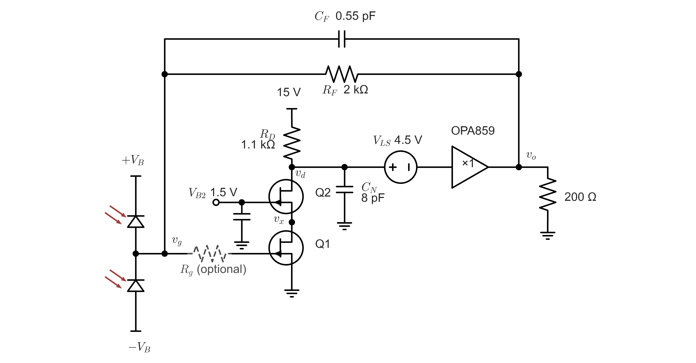

*Figure 27. The discrete-transistor composite of Section 7.1, with the values of the pHEMT design of Table A7.4 (CE3512K2 at 10 mA). Q1 works in common source with its gate at the summing node $v_g$, and Q2, of the same type, works in common gate on top of it, which removes the Miller multiplication of Q1's gate–drain capacitance. $V_{B2}$ = 1.5 V holds Q2's gate and is bypassed to ground; it puts Q1's drain $v_x$ at 2 V, so both transistors see 2 V from drain to source and the same gate–source voltage at the shared current. $R_D$ = 1.1 kΩ from 15 V sets that current, 10 mA, with the drain $v_d$ at 4 V. $C_N$ = 8 pF from the drain to ground sets the gain–bandwidth product, $g_m/2\pi(C_N + C_d)$, and with it the loop's crossover. The ideal level shift $V_{LS}$ = 4.5 V takes the drain's 4 V down to the gate's −0.5 V, so that the OPA859 unity-gain buffer and the output $v_o$ sit at the gate's DC voltage, as $R_F$ requires; the paragraphs on bias, package and layout explain why the source is lifted in practice. $R_F$ = 2 kΩ with $C_F$ = 0.55 pF closes the loop, and 200 Ω loads the buffer as in Chapter 5. The dashed $R_g$ is the optional gate stopper of Eq. (63). The bipolar design of Table A7.4 has the same circuit with BFP740ESD transistors at 1 mA, $R_D$ = 11.7 kΩ, $C_N$ = 4 pF, $C_F$ = 0.60 pF and Q1's emitter at −0.73 V. Amplifiers: OPA859 with CE3512K2 or BFP740ESD.*

Each transistor is described by its common-source two-port admittances at its own operating point: $y_{11}$, $y_{12}$, $y_{21}$ and $y_{22}$ for Q1, and $y'_{11}$ to $y'_{22}$ for Q2, whose gate–source voltage is $-v_x$ and drain–source voltage $v_d - v_x$. The buffer is described by its gain $B$ and input admittance $Y_b$, and $Y_x = j\omega(C_D + C_{\mathrm{PCB}})$ and $Y_F = 1/R_F + j\omega C_F$. The three node equations are then

$$
\begin{aligned}
(Y_x + Y_F + y_{11})\,v_g + y_{12}\,v_x - Y_F B\,v_d &= i_{\mathrm{in}},\\
y_{21}\,v_g + (y_{22} + S')\,v_x - (y'_{12} + y'_{22})\,v_d &= 0,\\
-(y'_{21} + y'_{22})\,v_x + \Big(\frac{1}{R_D} + j\omega C_N + Y_b + y'_{22}\Big)\,v_d &= 0,
\end{aligned}
\tag{60}
$$

with $S' = y'_{11} + y'_{12} + y'_{21} + y'_{22}$, $v_o = Bv_d$ and $Z_T = v_o/i_{\mathrm{in}}$. The loop gain at the buffer's output, where SPICE injects (Section 5.2), follows from the same equations with $i_{\mathrm{in}}$ = 0, the term $-Y_FBv_d$ taken out of the first row, and the feedback side of $R_F \parallel C_F$ driven by 1 V, which puts $Y_F$ on the right of the first row:

$$
T = -B\,v_d.
\tag{61}
$$

Every noise source enters the same equations at its own node, and its input-referred density is its contribution to $v_o$ divided by $Z_T$.
- $R_F$'s Johnson current, a FET's gate current (shot noise $2qI_G$) and a bipolar transistor's base current ($2qI_B$) enter at $v_g$ and are referred to the input unchanged.
- A FET's channel noise is a current $y_{21}e_n$ from drain to source, with $e_n$ its input voltage noise with the gate AC-grounded. Because this current moves the gate, every capacitance at the node carries noise current, the transistor's own $C_{gs}$ included, as Eq. (55) assumes.
- A bipolar transistor's collector shot noise, $2qI_C$, enters at $v_x$ in the same way. The thermal noise of its base resistance $r_b$, $4k_BTr_b$, is instead a voltage in series with the base terminal: the loop holds the transistor's own base–emitter voltage, so this noise moves the summing node without driving the transistor's input capacitance.
- $R_D$'s current enters at $v_d$, Q2's channel or collector noise flows from $v_d$ to $v_x$, and the buffer's voltage noise adds at its input.

For a bipolar transistor these sources give, to first order,

$$
e_n^2 = \frac{2(k_BT)^2}{qI_C} + 4k_BTr_b,
\qquad
i_n^2 = \frac{2qI_C}{\beta},
\tag{62}
$$

so a larger collector current lowers $e_n$ and raises $i_n$. For BFP740ESD at 1 mA, with $r_b$ = 6.41 Ω (the RB and RE of Infineon's model [S22]), $e_n^2 = 2(4.116\times10^{-21}\ \mathrm{J})^2/(1.602\times10^{-19}\ \mathrm{C} \times 1\ \mathrm{mA}) + 4 \times 4.116\times10^{-21}\ \mathrm{J} \times 6.41\ \Omega$ = $2.12\times10^{-19} + 1.06\times10^{-19}\ \mathrm{V^2/Hz}$, so $e_n$ = 0.56 nV/√Hz, and with $\beta$ = 365, $i_n$ = 0.94 pA/√Hz. At 9.97 mA, $e_n$ = 0.36 nV/√Hz and, with $\beta$ = 302, $i_n$ = 3.25 pA/√Hz, more than the 2.9 pA/√Hz of $R_F$. The device data come from ngspice at each composite's own operating point (Section 7.3).

**What the composites achieve.** Table A7.4 gives, for each transistor, the design that is robust over every capacitance corner and has the largest dynamic range at 0.1 mA, from a scan of $C_N$ = 0–100 pF and $C_F$ = 0.10–1.50 pF. The criteria are those of Section 6.2.4 over the corners of Section 5.5: phase margin ≥ 45°, gain margin ≥ 3 dB and peaking ≤ 1 dB at every combination of $C_D$ ± 0.2 pF and $C_F$ ± 0.1 pF, and here also $f_{3\,\mathrm{dB}}$ ≥ 150 MHz. Where no design is robust, the table gives the widest-band design that keeps the margins. SPICE confirms Eqs. (60)–(61) on 36 designs at nominal capacitances, 18 with the three FETs (six each) and 18 with the bipolar transistor ($C_N$ = 0–60 pF, $C_F$ = 0.20–0.60 pF). The 34 that are stable agree with the analysis within 0.8° of phase margin, 0.4 dB of gain margin, 1.4 MHz of bandwidth and 0.6 nA (1.0 %) of band noise; the two unstable ones, CE3512K2 without $C_N$, cross over above 1.2 GHz and differ by up to 5.5°. At the worst of the nine corners of each design in Table A7.4, SPICE and the analysis agree within 0.1° and 0.5 dB.
- **The silicon JFETs do not reach 150 MHz.** With about 10 pF at the node they need about 2.8 GHz of gain–bandwidth (above), and their cascodes give 2.2–2.9 GHz with no compensation capacitor at all ($g_m/2\pi C_d$ with $C_d$ = 1.96 and 2.93 pF). LSBF862 reaches 141 MHz at the worst corner (164 MHz nominal) with no compensation capacitor, and CPH3910, whose widest-band design that keeps the margins has $C_N$ = 2 pF, 98 MHz (110 MHz). Their band noise, 53.5 and 55.4 nA, is above OPA855's 49.6 nA. Their voltage noise on about 10 pF contributes 25.9–33.4 nA. Eq. (56) leaves out the second stage and the drain resistor, and in the composite they add 18.5–29.3 nA from the buffer, whose noise the small gate-to-drain gain at high frequencies does not suppress, and 12.9–14.0 nA from $R_D$; that is why CPH3910's 49.4 nA in Table A7.2 becomes 55.4 nA here.
- **The pHEMT composite is robust with $C_N$ = 8 pF and $C_F$ = 0.55 pF.** It has 51.6° of phase margin and 152 MHz at the worst corner (199 MHz nominal). Its 36.5 nA is 35.1 nA of $R_F$ with 6.9 nA from the assumed 1 µA of gate current, 6.3 nA from the channel and 4.5 nA from the buffer. The 8 pF of compensation it needs shows how much gain–bandwidth the pHEMT has to spare.
- **The bipolar composite is robust at every bias current tried.** At 1 mA ($C_N$ = 4 pF, $C_F$ = 0.60 pF) it has 46.3° and 155 MHz at the worst corner and 39.1 nA, of which 11.5 nA is base current, 9.6 nA collector shot noise and 4.7 nA base resistance. Raising the collector current to 3 and 10 mA lowers $e_n$ but raises the base-current noise, so the band noise rises to 41.7 and 54.0 nA. For this node 1 mA is close to the optimum of Eq. (62), and there the composite matches OPA955's 38.8 nA within 0.3 nA.
- **The dynamic range follows.** With the buffer's ceiling of 1.5 V at 100 MHz, which assumes the output is centred in the buffer's range (bias, package and layout, below), Eq. (50) gives 84.2, 77.5, 68.5 and 58.6 dB at 0, 0.1, 1 and 10 mA for the pHEMT composite and 83.3, 77.1, 68.2 and 58.3 dB for the bipolar composite at 1 mA, against 82.9, 76.7, 67.8 and 57.9 dB for OPA955 (Table A6.33). Their transimpedance is 7–10 % low at 100 MHz (1.80–1.85 kΩ), which Eq. (49) credits, as Section 6.6.2 explains for LMH6629. With $\lvert Z_T\rvert$ = $R_F$ the pHEMT composite gives 83.2, 76.6, 67.6 and 57.7 dB and ties OPA955 within 0.3 dB from the dark to 10 mA, inside the bound of Table A7.1.

**A bipolar front end at high photocurrent.** A receiver that works mainly at 0.1–10 mA tolerates a bipolar transistor's base current. At $I_1 + I_2$ = 1 mA the photocurrent's own shot noise is $\sqrt{2q \times 1\ \mathrm{mA}}$ = 17.9 pA/√Hz, against 0.94–3.25 pA/√Hz of base-current noise at 1–10 mA of collector current, so the base current adds 0.3–3.3 % to the noise power at 1 mA and a tenth of that at 10 mA. The same shot noise hides every other part of the front end's noise too. At 1 mA the designs of Table A7.4 give 67.4–67.6 dB with $\lvert Z_T\rvert$ = $R_F$, against 67.6 dB for OPA855 and 67.8 dB for OPA955, and the bipolar composite biased at 10 mA gives the same as at 1 mA within 0.1 dB. A bipolar input stage is therefore no obstacle at high photocurrent, but no input transistor raises the dynamic range there either: the bound of Table A7.1, which allows 0.11 dB over OPA855 at 1 mA, holds for every front end that keeps OPA855's ceiling. The bipolar transistor's advantages over the pHEMT are practical ones. Infineon publishes its SPICE model [S22], its current gain is specified between 160 and 400 at 25 mA (BFP740ESD datasheet p11), its pins are protected to ±2 kV HBM (p9), and its DC characteristics are specified. A lower-noise input stage pays only where the amplifier's own noise is large, as in the high-voltage composite of Section 7.2, whose first stage contributes 94–113 nA of its 121–137 nA.

**Using an RF transistor at the summing node: bias, package and layout.** The pHEMT's numbers above hold only if a few practical conditions are met; most of them follow from its being built and specified for microwave amplifiers.
- **The gate sits at $V_{GS}$, and with a grounded source so does the output.** CE3512K2 is a depletion device that carries 10 mA at about −0.5 V (p4) and cuts off between −0.39 and −1.10 V (p3). The bias loop through $R_F$ puts the summing node, and with it the buffer's output, at $V_{GS}$: −0.50 V in the simulation. That leaves 0.90 V of symmetric swing in the OPA859's range of −1.40 to +1.60 V instead of 1.5 V, which is 4.4 dB less ceiling and so 4.4 dB less dynamic range at every photocurrent. Lifting the source to $\lvert V_{GS}\rvert$ restores it, with a stiff, well-bypassed source supply or with a source resistor bypassed far into the gigahertz range, since any impedance left at the source degenerates the stage and its noise adds directly to $e_n$. Serikawa and Furusawa bias their source follower the same way, with the gate at 0 V and 47 Ω from the source setting 10 mA [A23, p. 4]. The gate voltage also follows the part-to-part spread of $V_{GS(\mathrm{off})}$, 0.7 V between minimum and maximum (p3), so the source voltage has to be set for each part, for example by a slow servo on the output's DC level. An enhancement-mode part avoids the negative gate. SAV-551+ needs +0.22 to +0.46 V for 15 mA at 3 V (p2), and ATF-54143 needs about +0.6 V for 60 mA (p10). With the source grounded the output of a SAV-551+ composite would sit at +0.34 V, which costs 1.5 dB of symmetric swing in the same buffer. The bipolar composite puts its emitter at −$V_{BE}$ for the same reason, and its base current then shifts the output by $I_BR_F$, 5–66 mV at 1–10 mA.
- **The gate current must be measured.** The Schottky gate of a pHEMT leaks microamperes. CE3512K2 specifies 0.4 µA typical and 10 µA maximum at $V_{GS}$ = −3 V (p3), with an absolute maximum of 80 µA (p2). No datasheet gives it at the operating point or over temperature, and Table A7.2 and the simulation assume 1 µA. At 1 µA its shot noise adds 6.9 nA to the band noise; at 10 µA it would add 21.9 nA, raising the band noise from 36.5 to 42.0 nA and costing 1.2 dB in the dark. Impact ionization in the channel adds gate current at high drain voltage, a general property of pHEMTs and one more reason to keep $V_{DS}$ within the recommended 1–3 V (p2).
- **Nothing is specified at baseband.** CE3512K2's S-parameters start at 2 GHz and its noise parameters at 8 GHz (its S2P files), and its datasheet gives the noise figure at 12 GHz (p1, p3). SAV-551+ is specified from 45 MHz (p2), but its noise only from 0.5 GHz (noise parameters, pp. 7–9). The 1/f, generation–recombination and random-telegraph noise of these parts across 0.1–150 MHz is unknown. Their small-signal parameters at baseband are not those of the microwave data either. CE3512K2's output conductance is about 2.5 mS from its I–V curves (p4), against Re($y_{22}$) = 5.1 mS in its S-parameters at 2 GHz, and its transconductance 69 mS (p3), against Re($y_{21}$) = 71.0 mS. The designs above use the values at DC; the noise at baseband has to be measured.
- **The transistor alone is potentially unstable at microwave frequencies.** From CE3512K2's S-parameters at 2 V and 10 mA, the Edwards–Sinsky stability factor μ is below 1 from 2.0 to 12.6 GHz, with 0.19 at 2 GHz, and again from 19.9 to 26 GHz, and the file starts at 2 GHz; Rollett's K is 0.23 at 2 GHz and 0.92 at 10 GHz (`scripts_archive/fet_front_end/phemt_stability_factors.py`, run on the S-parameter files that CEL publishes with CE3512K2). The TIA's loop, which crosses over at a few hundred megahertz, neither causes nor suppresses an oscillation there; one would show up as excess noise, a shifted bias point or distortion. The layout has to keep the impedances at the gate and the drain inside the stable region. Both source leads (pins 1 and 3, p2) go to ground through vias at the pads, Q2's gate is bypassed at its pin, and a resistor of a few ohms in series with each drain adds loss at gigahertz frequencies, where the TIA needs no gain. Avago's LNA application circuit terminates the gate and the drain resistively at low frequencies, which improves the low-frequency stability (ATF-54143 p10, Fig. 23, R3 and R4); a TIA's gate cannot take such a resistor without adding its noise.
- **Package and handling.** CE3512K2 comes in a four-lead hollow (air-cavity) plastic Micro-X package (p1), and SAV-551+ and the Avago parts in the four-lead SOT-343 (p1 of each). GaAs gates are sensitive to electrostatic discharge: CEL asks for ESD precautions at all times (p8), and Avago rates ATF-54143 at HBM Class 1A and ATF-34143 and ATF-55143 at HBM Class 0 (p1 of each). The summing node connects to the photodiodes, so any protection added there adds capacitance and leakage to the very node the pHEMT is chosen to keep small. BFP740ESD carries its own ±2 kV protection (p9), whose capacitance is part of its 0.79–1.34 pF. Each transistor dissipates 20 mW at 10 mA and 2 V, well inside CE3512K2's 125 mW (p2).

**A gate stopper costs little at this node.** A resistor $R_g$ in series with the gate adds its Johnson noise to $e_n$,

$$
e_n'^2 = e_n^2 + 4k_BT\,\mathrm{Re}\{Z_g\},
\qquad
Z_g = R_g \parallel j\omega L_g,
\tag{63}
$$

with an optional inductor $L_g$ across it. Like a bipolar transistor's $r_b$, this noise acts on the capacitance of the node outside the transistor. With $R_g$ = 10 Ω alone, 0.41 nV/√Hz adds to the device's 0.40 nV/√Hz, but at this small node the channel's share of the band noise is only 6.3 nA, so the total rises from 36.5 to 37.0 nA, 0.1 dB in the dark. Serikawa and Furusawa's 150 Ω with 10 nH in parallel [A23, p. 4, Table I] costs even less. At 100 MHz, Re{$Z_g$} = 150 Ω × (6.28 Ω)²/[(150 Ω)² + (6.28 Ω)²] = 0.26 Ω, or 0.07 nV/√Hz, while at 3 GHz the resistor damps with 92 Ω.

A discrete transistor at the summing node therefore lowers the floor by no more than the bound of Table A7.1, which the pHEMT and bipolar composites approach; from 0.1 mA up the dynamic range has to come from the ceiling.

### 7.2 A high-voltage output stage inside the $R_F$ loop

From about 0.15 mA up the dynamic range follows the output amplitude dB for dB (Section 6.6.3, Figure 25), and Section 7.1 shows that no input transistor changes that. Raising $V_{\mathrm{pk}}$ at 100 MHz from OPA818's 2.23 V to 10 V would add $20\log_{10}(10/2.23)$ = 13.0 dB at every photocurrent at unchanged noise; that needs a slew rate of at least $2\pi \times 100\ \mathrm{MHz} \times 10\ \mathrm{V}$ = 6.3 kV/µs and rails of about ±12 V. This section builds that composite: a first stage at the summing node, which sets the noise, driving a fast high-voltage amplifier inside the $R_F$ loop. The numbers are for the baseline (1 pF, 0.35 pF of board, 2 kΩ) and come from `scripts_archive/composite_tia.py`, `spice_composite_checks.py` and `composite_report_numbers.py`.

**The output amplifier.** Besides that slew rate, $2\pi f_0V_{\mathrm{pk}}$, and rails of ±12 V or more, it needs a closed-loop bandwidth several times the TIA's loop crossover. THS3491 comes closest of the high-voltage current-feedback amplifiers read for this note (Table D.4): 900 MHz at a gain of 5 and 2 Vpp, 320 MHz at 10 Vpp, 8000 V/µs at 20 Vpp, supplies of ±7 to ±16 V, ±420 mA of linear output current and 1.7 nV/√Hz (SBOS875C p1). THS3091 and THS3095 give 6000 V/µs at a gain of 5, 305 MHz at a gain of 2 and ±310 mA (SLOS423K p1), THS3061 and THS3062 7000 V/µs, 300 MHz at unity gain and ±145 mA into 50 Ω (SLOS394B p1), and THS3001 6500 V/µs, 420 MHz at unity gain and 100 mA (SLOS217I p1). TI designed THS3491 for better than 40 dB of spurious-free dynamic range with a 100-MHz, 20-Vpp signal into 100 Ω, and its datasheet states how large a signal stays linear (p29). Some internal devices saturate with large signals above 100 MHz and the loop then opens, so Fig 9-4 (p29) gives the maximum recommended output voltage that keeps the amplifier linear. On ±15 V it falls from 26.0 Vpp at 1–10 MHz to 20.1 Vpp at 100 MHz and 14.2 Vpp at 150 MHz. These readings, and every other THS3491 curve used here, were checked against the figures' vector paths with `scripts_archive/overlay_digitized.py`, which also draws them on the datasheet figures; the largest residuals, in `data/digitization_checks/`, are 0.008 Vpp, 0.005 dB and 0.005°.

**The first stage.** The composite's loop contains the gains of both stages, so its gain–bandwidth product is that of the first stage times the THS3491's gain $G_2$. A decompensated first stage such as OPA855 or OPA955, with 8–11 GHz of gain–bandwidth and stable only from gains of 7 up (Section 6.1.1), would put the crossover far beyond the THS3491's bandwidth. The first stage has to be unity-gain stable, because in the topology that works (below) it closes a fast local loop at a noise gain of about 2, and slow enough that its gain–bandwidth times $G_2$ stays within reach of the output stage. Among our unity-gain-stable candidates OPA859, with 900 MHz of gain–bandwidth and 3.3 nV/√Hz at 1 MHz on ±2.5 V (Section 6.1.1), is the one that fits: it reaches its 1.50-V swing at 100 MHz, while the quieter OPA856 (0.91 nV/√Hz) slews only 0.56 V there and THS4304 only 1.26 V (Table A6.26), which would cap the composite at that amplitude times $\lvert H_2\rvert$. Its voltage noise is the price, and it dominates the composite's noise (below). Its output swing of ±1.5 V then limits the composite's output to about $G_2$ × 1.5 V.

**The THS3491 as a stage.** A current-feedback amplifier at a non-inverting gain $G = 1 + R_{F2}/R_{G2}$ has the closed-loop gain

$$
H_2 = \frac{G(s)}{1 + \big(R_{F2} + G(s)\,Z_i\big)/Z_{OL}},
\qquad
G(s) = 1 + \frac{R_{F2}}{R_{G2}} + sR_{F2}C_n,
\tag{64}
$$

where $Z_{OL}$ is its open-loop transimpedance, $Z_i$ the impedance of its inverting input (15 Ω typical, open-loop measurement, p9) and $C_n$ the capacitance at its inverting node, which acts across $R_{G2}$ and raises the gain at high frequencies. The datasheet states no $C_n$. TI's model of the part [S21], whose header states that it was aligned with the datasheet on ±15 V for the bandwidth at a gain of 5, among other parameters, has 1.2 pF at its internal inverting node. With that value and the model's own $Z_{OL}$ and $Z_i$, Eq. (64) reproduces the model's closed loop at all four gains of Table 9-2 within 0.5 dB and 1.6° up to 3 GHz (Table A7.5).

The datasheet's own two curves do not agree with each other. Fig 8-22 (p16) gives the open-loop transimpedance and phase without load, and Fig 8-1 (p13) the measured closed-loop response in the circuit of Fig 9-1 (p27). Eq. (64) with Fig 8-22 does not reproduce Fig 8-1, with or without $C_n$. With $C_n$ = 1.2 pF it predicts 1.9 GHz with 3.6 dB of peaking at a gain of 5, against 944 MHz with no peaking measured, and no −3-dB point below 5 GHz at a gain of 2. With $C_n$ = 0, the textbook form, it predicts 1.4 GHz with 1.1 dB of peaking at a gain of 5, and 340 MHz at a gain of 2, against 730 MHz measured. The phase of Fig 8-22 agrees with the model's internal transimpedance within 3.4° from 100 to 770 MHz, but its magnitude lies above the model's by 0.8 dB at 100 and 300 MHz, 1.6 dB at 500 MHz and 2.8 dB at 770 MHz (51.8 against 49.0 dBΩ). The model, in contrast, reproduces Fig 8-1 at gains of 5, 10 and 20 within 5–13 % in bandwidth, with 0.4–0.8 dB more peaking; at a gain of 2 it gives about twice the measured bandwidth (Table A7.5). The model's noise matches the datasheet too: 16.2 nV/√Hz at the output at a gain of 5, against 15.9 nV/√Hz from the datasheet's $e_n$, $i_n$ and resistors, and 16.8 mA of supply current against 16.7 mA (p9). The analysis below therefore describes the THS3491 by Eq. (64) with its model's $Z_{OL}$, $Z_i$ and $C_n$, its input by the model's 50 kΩ ∥ 1.5 pF, and its noise by the datasheet's $e_n$, $i_n$ and resistors. It describes the OPA859 by its model's open-loop gain, output impedance, input capacitance (0.82 pF) and voltage noise (Chapter 5). SPICE runs of the whole composite with both vendor models check the result (below and Section 7.3).

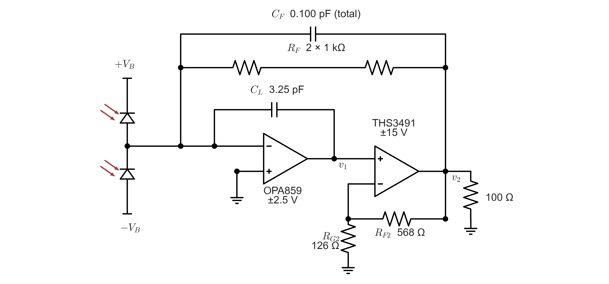

*Figure 28. The dual-feedback high-voltage composite of Section 7.2, with the values of its $G_2$ = 5.5 design (Table A7.7). OPA859 on ±2.5 V, its non-inverting input grounded, is the first stage at the summing node. THS3491 on ±15 V follows as a non-inverting stage of gain $G_2 = 1 + R_{F2}/R_{G2}$ = 1 + 568 Ω/126 Ω = 5.5, with $R_{F2}$ interpolated from the datasheet's Table 9-2 and $R_{G2} = R_{F2}/(G_2 - 1)$. $R_F$ = 2 kΩ returns from the THS3491's output $v_2$, split into two 1-kΩ resistors in series because the total $C_F$ of 0.100 pF lies below the parasitic capacitance of a single resistor (Section 8.10). $C_L$ = 3.25 pF from the OPA859's output $v_1$ closes the fast local loop that makes the composite stable; without it the circuit is the plain composite, which is unstable (Table A7.6). The THS3491 drives 100 Ω, the load of its datasheet characterization. Amplifiers: OPA859 and THS3491.*

**Two topologies (Figure 28).** In the plain composite, $R_F \parallel C_F$ runs from the THS3491's output $v_2$ to the summing node $v_s$, and the OPA859, with its non-inverting input grounded, drives the THS3491 directly. In the dual-feedback composite a capacitor $C_L$ also runs from the OPA859's output $v_1$ to the summing node; it closes a fast local loop around the first stage and takes over the feedback at high frequencies. The THS3491 drives 100 Ω, the load of its datasheet characterization, in parallel with its own feedback network and $R_F$. The OPA859 is a Thevenin source $A_1(e_1 - v_s)$ behind its open-loop output impedance $Z_o$, where $e_1$ is its input voltage noise. The THS3491 gives $v_2 = H_2(v_1 + e_2)$ with input admittance $Y_{in2}$, where $e_2$ is its noise referred to its input, 3.0–4.3 nV/√Hz at gains of 5.5 to 4. The node capacitance $C_T = C_D + C_{\mathrm{PCB}} + C_{\mathrm{in1}}$ = 1 + 0.35 + 0.82 pF = 2.17 pF includes the OPA859's input capacitance $C_{\mathrm{in1}}$. With $Y_T = j\omega C_T$, $Y_F = 1/R_F + j\omega C_F$, $Y_L = j\omega C_L$ and $Y_s = Y_T + Y_F + Y_L$, the two node equations are

$$
\begin{aligned}
Y_s\,v_s - (Y_L + Y_FH_2)\,v_1 &= i_{\mathrm{in}} + Y_FH_2\,e_2,\\
(A_1 - Y_LZ_o)\,v_s + \big(1 + Z_o(Y_{in2} + Y_L)\big)\,v_1 &= A_1e_1,
\end{aligned}
\tag{65}
$$

with $Z_T = v_2/i_{\mathrm{in}}$. The loop gain at the first stage's output, where SPICE injects, is

$$
T = \frac{A_1K}{1 + Z_o\big(Y_{in2} + Y_L - Y_LK\big)},
\qquad
K = \frac{Y_L + Y_FH_2}{Y_s},
\tag{66}
$$

which for $Z_o$ = 0 is $T = A_1(Y_L + H_2Y_F)/Y_s$; the plain composite is the case $C_L$ = 0. Every noise source is referred to the input by its contribution to $v_2$ divided by $Z_T$. With $Z_o$ = 0, $e_1$ is seen through $\lvert Y_s\rvert$, so it acts on $C_T + C_F + C_L$, and $e_2$ through $\lvert Y_L + Y_s/A_1\rvert$.

**The plain composite is unstable.** Its loop gain is $A_1H_2Y_F/Y_s$: the first stage's gain–bandwidth times $G_2$, about 0.9 GHz × $G_2$, divided by the noise gain of the TIA. That puts the crossover at 390–640 MHz for $G_2$ = 2–8, where the THS3491 already adds tens of degrees of lag. Even the best total $C_F$ leaves only 15° of phase margin at a gain of 2 and none from 3 up (Table A7.6), so no gain gives a robust design.

**The dual-feedback composite is robust in a narrow window.** $C_L$ closes a local loop around the first stage with a noise gain of $(C_T + C_F + C_L)/C_L$, 1.7–2.0 for the designs below, so the outer loop through the THS3491 no longer has to carry the crossover alone. A first scan over $G_2$ = 2–8, $C_L$ = 0.5–4.0 pF and $C_F$ = 0.10–1.50 pF, and a finer one over $G_2$ = 4–7, $C_L$ = 2.0–4.0 pF in 0.25-pF steps and $C_F$ = 0.100–0.300 pF in 0.025-pF steps, each design over all 27 corners ($C_D$ ± 0.2 pF, $C_F$ ± 0.1 pF and $C_L$ ± 0.1 pF), find robust designs only at $G_2$ = 4–5.5. They are five of the 486 designs of the fine scan, with $C_F$ = 0.100–0.125 pF and 0.55–0.6 pF of $C_L$ per unit of $G_2$; with less $C_L$ the phase margin fails, and with more the bandwidth. A total $C_F$ of 0.100–0.125 pF lies below the 0.2-pF nominal parasitic of one resistor and its pads (Table 1.1), and its −0.1-pF corner reaches 0.000–0.025 pF. It needs $R_F$ split into two series resistors of $R_F/2$, which TI advises for a $C_F$ below 0.15 pF (Section 8.10), and a parasitic measured on the board; the robust window assumes both. Both scans start at 0.10 pF, so smaller values were not explored. Table A7.7 gives the one at each gain with the largest dynamic range at 1 mA. SPICE runs of these four designs at all 27 corners give worst-corner values within 0.2° of phase margin, 0.1 dB of gain margin, 0.01 dB of peaking and 1 MHz of bandwidth of the analysis, and band noise at nominal capacitances within 0.6 nA. Over 16 further designs at nominal capacitances, stable and unstable, SPICE and the analysis agree within 1.3° of phase margin, 0.4 dB of gain margin, 4.5 MHz of bandwidth and 0.8 % of band noise. Described with OPA859's datasheet curve instead of its model, the fine scan would also accept gains of 6 and 7 (29 robust designs at $G_2$ = 4–7). SPICE gives two of these designs, $G_2$ = 6 with $C_F$ = 0.150 pF and $C_L$ = 3.00 pF and $G_2$ = 7 with 0.150 and 3.75 pF, only 34.4° and 36.8° at the worst corner, about 10° less than the datasheet curve predicts.

**Noise and dynamic range.** The composite is 2.4–2.8 times as noisy as OPA855 (49.6 nA), for two reasons that come with the dual feedback. The first stage's voltage noise, about 3.0 nV/√Hz in its model above 10 MHz, acts on $C_T + C_F + C_L$, 4.5–5.5 pF instead of about 2.4 pF, which gives its 94–113 nA. The THS3491's noise reaches the summing node through $C_L$ ($\lvert Y_L + Y_s/A_1\rvert$ in Eq. (65)) and adds 63–67 nA. The ceiling more than pays for both. At $G_2$ = 5.5 the dynamic range at 100 MHz is 87.3, 86.4, 81.8 and 73.1 dB at 0, 0.1, 1 and 10 mA: 7.8, 9.1, 11.1 and 11.9 dB above OPA818 and 4.4, 9.7, 14.0 and 15.2 dB above OPA955. Its transimpedance at 100 MHz is 1.84 kΩ, 0.7 dB below $R_F$, which Eq. (49) credits as it credits OPA818's 1.96 kΩ (0.2 dB below $R_F$); with $\lvert Z_T\rvert$ = $R_F$ the composite gives 86.6, 85.6, 81.1 and 72.4 dB. To use OPA818's 70.7 dB at 1 mA in 150 MHz, an ADC whose full scale matches the TIA's largest tone needs a noise spectral density of $-70.7 - 10\log_{10}(150\ \mathrm{MHz})$ = −152.5 dBFS/Hz, and the composite's 81.8 dB needs −163.6 dBFS/Hz.

**Large signal: swing, slew rate and the THS3491's limit.** At 100 MHz the ceiling is the OPA859's swing times the THS3491's gain at the tone, 1.5 V × $\lvert H_2\rvert$ = 1.5 V × 5.53 = 8.30 V at $G_2$ = 5.5. That is below the THS3491's recommended 10.05 V (Fig 9-4) and its slew-rate limit, 8000 V/µs / (2π × 100 MHz) = 12.7 V. The output then slews at $2\pi \times 100\ \mathrm{MHz} \times 8.30\ \mathrm{V}$ = 5.2 kV/µs and the OPA859 at 0.94 kV/µs, against their 8.0 and 1.15 kV/µs. SPICE tone runs, done as in Section 5.7, find the output clean up to 0.9 times this ceiling, 7.47 V (THD −137 dBc, the numerical floor of the runs), and clipped at 1.0 times, 8.30 V, where the OPA859's output reaches +1.50/−1.45 V and the THD is −36 dBc. At 150 MHz the analysis takes the OPA859's datasheet slew rate as the limit, 1150 V/µs / (2π × 150 MHz) = 1.22 V, times $\lvert H_2\rvert$ = 5.57, which gives 6.80 V, just below the THS3491's recommended 7.08 V (Fig 9-4). The OPA859's model slews faster than its datasheet value. The composite stays clean in SPICE up to 1.1 times, 7.49 V, with the OPA859 at 1.34 V and 1.27 kV/µs, and clips at 1.2 times, 8.16 V, again at the OPA859's swing. The datasheet values are kept for the dynamic range. The internal saturation behind Fig 9-4 is not in the THS3491's model, since SPICE gives a clean 7.49 V at 150 MHz, above the 7.08 V that Fig 9-4 recommends.

**Distortion.** The macromodels are linear until they clip, so the distortion below their limits has to come from the datasheet. THS3491's table gives, at a gain of 5 into 100 Ω, HD2 of −78, −76, −68 and −60 dBc and HD3 of −81, −75, −61 and −51 dBc at 20, 50, 70 and 100 MHz for 10 Vpp, and −51 dBc HD2 and −47 dBc HD3 at 100 MHz for 20 Vpp (p8). Its Figs 8-13 and 8-14 (p15) give the 100-MHz values against output swing into 100 Ω: HD2 rises from −64.2 dBc at 5 Vpp to −55.0 dBc at 16.6 Vpp, and HD3 from −57.8 dBc at 5 Vpp to a plateau between −49.7 and −51.3 dBc from 10 to 17.5 Vpp. Inside the composite the outer loop does not reduce this distortion at the harmonics. A disturbance $v_e$ at the THS3491's output reaches the closed-loop output as $S\,v_e$, where

$$
S = \frac{v_2(e_2)}{H_2\,e_2}
\tag{67}
$$

is the closed-loop response of Eq. (65) to the THS3491's input-referred source $e_2$, divided by its open-loop response $H_2e_2$. At $G_2$ = 5.5, $\lvert S\rvert$ is −3.1 dB at 100 MHz but +1.3 dB at 200 MHz and +3.1 dB at 300 MHz: at those frequencies $C_L$ carries the feedback, and the path through $R_F$ that sees the THS3491's output is weak. At the full 16.6 Vpp the composite therefore carries about −53.7 dBc HD2 and −46.9 dBc HD3 at 100 MHz. OPA818's datasheet gives, at 100 MHz and a gain of 7 into 1 kΩ, −54 and −50 dBc HD2 and −79 and −67 dBc HD3 at 1 and 2 Vpp, and nothing at its 4.5-Vpp ceiling (Table A6.31); OPA855's is −73/−89 dBc at 1 Vpp (Table A8.11). The composite's HD2 at full swing is thus about OPA818's at 1–2 Vpp, and its HD3 20–32 dB worse. If the receiver needs every harmonic below −50, −55 or −60 dBc at 100 MHz, the output must stay below 7.91, 4.95 or 3.95 Vpp, and the dynamic range at 1 mA falls from 81.8 to 75.4, 71.3 or 69.3 dB (Table A7.8). At tones of 20–50 MHz the THS3491's harmonics at 10 Vpp are 16–30 dB lower than at 100 MHz (p8).

**Supplies and power.** On ±15 V the THS3491 draws 16.7 mA (p9), 0.50 W at rest (Table A7.9). With a sine of amplitude $V_{\mathrm{pk}}$ into the load $R_{\mathrm{load}}$, its output stage draws a rectified current from each rail, and the part dissipates

$$
P_{\mathrm{THS}} = 2V_SI_Q + \frac{2V_S}{\pi}\,\frac{V_{\mathrm{pk}}}{R_{\mathrm{load}}} - \frac{V_{\mathrm{pk}}^2}{2R_{\mathrm{load}}}.
\tag{68}
$$

At $G_2$ = 5.5 the load is 100 Ω in parallel with $R_{F2} + R_{G2}$ = 695 Ω and $R_F$ = 2 kΩ, so $R_{\mathrm{load}}$ = 83.8 Ω. At 8.30 V, $P_{\mathrm{THS}}$ = 2 × 15 V × 16.7 mA + (2 × 15 V/π)(8.30 V/83.8 Ω) − (8.30 V)²/(2 × 83.8 Ω) = 0.50 + 0.95 − 0.41 W = 1.04 W, a junction rise of 1.04 W × 49.6 °C/W = 51 °C in the RGT package (p7). That is safe at room temperature, but continuous full-scale tones need the thermal pad and the board copper that the datasheet's thermal resistance assumes. On ±7.5 V the part draws 15.8 mA (p11), 0.24 W at rest and 0.37 W at its 5.11-V ceiling (Fig 9-4: 10.21 Vpp at 100 MHz). The dynamic range at $G_2$ = 5.5 then becomes 83.1, 82.1, 77.6 and 68.8 dB, 4.2–4.3 dB below ±15 V but still 3.6–7.6 dB above OPA818. TI's model is aligned with the datasheet on ±15 V only (its header). The OPA859 adds 20.2 mA on ±2.5 V, 0.10 W (SPICE operating point).

**What a lower-noise first stage would add.** The first stage contributes 113.4 nA of the 136.5 nA at $G_2$ = 5.5. A discrete input transistor of Section 7.1 with 0.40 nV/√Hz in place of OPA859's 3.0 nV/√Hz would cut that share, in proportion to the voltage noise and with the transistor's own 0.27 pF neglected, to 15.0 nA, and the total to 76.4 nA if the THS3491's 66.1 nA stayed as it is. That would add 5.0, 3.4, 0.9 and 0.1 dB at 0, 0.1, 1 and 10 mA. Such a composite has three active stages in its loop, and its stability is not studied here (Appendix C, item 20).

**Verdict.** The high-voltage composite pays wherever the dynamic range follows the ceiling: at a 100-MHz tone it adds 7.8, 9.1, 11.1 and 11.9 dB to OPA818 at 0, 0.1, 1 and 10 mA, although its band noise is 136.5/84.8 = 1.6 times OPA818's. The price is ±15-V rails and 1.04 W in the THS3491, about −47 dBc HD3 at full swing, and robustness only at $G_2$ = 4–5.5 with a total $C_F$ of 0.100–0.125 pF.

### 7.3 SPICE models, decks and convergence for the composites

The checks of Sections 7.1–7.2 run in ngspice-46, loaded as a shared library with PSpice compatibility, as in Chapter 5. `scripts_archive/spice_composite_checks.py` writes every deck under `spice/runs/composite/<check>/<case>/`, runs it, keeps its log and stores the results in `spice/results/composite_<check>.json`. Table A7.10 lists the models. They are not distributed with this note: the OPA859 [S8] and THS3491 [S21] packages come from TI's product pages and the BFP740ESD model [S22] from Infineon's, and `spice_composite_checks.py` expects them under `spice/models/` and writes the cards of Table A7.10 itself.

The decks are these.
- **THS3491 alone.** Its operating point and noise at a gain of 5; the circuit of Fig 9-1 at the four gains of Table 9-2; and its open-loop transimpedance as Fig 8-22 defines it, with the non-inverting input grounded, an AC current into the inverting input and the output fed back for DC only, through 1 GH. The internal transimpedance follows from the quantities at the pin: with $Z_{in}$ the measured inverting-input impedance and $C_n$ = 1.2 pF, $Z_i = Z_{in}/(1 - sC_nZ_{in})$ and $Z_{OL,\mathrm{int}} = Z_{OL,\mathrm{pin}}(1 + sC_nZ_i)$.
- **Loop gain and transimpedance.** Middlebrook's double injection (Section 5.2), at the OPA859's output in the high-voltage composite and at the buffer's output in the discrete-transistor composites, then the transimpedance; 100 points per decade from 100 kHz to 5 GHz.
- **Noise.** The `noise` analysis referred to the photocurrent source, at 50 points per decade from 100 kHz to 1 GHz, in a deck of its own; the band integral runs over exactly 0–150 MHz, as in Section 6.6.1.
- **Transistor data for Eqs. (60)–(61).** At each transistor's operating point inside its composite: its common-source two-port admittances (gate driven, then drain driven), its DC currents and its input voltage noise; and the buffer's gain and input admittance with its loads.
- **Tones.** A sine photocurrent at 100 and 150 MHz from 0.5 to 1.3 times the analytical ceiling, 48 periods at 256 points per period, with the last 32 analysed through a Hann window, as in Section 5.7.

Every log is scanned for the messages that mark a convergence aid, a failure or a warning, and `spice/results/composite_convergence.json` lists them by deck with what was done about each. Table A7.11 summarizes them, together with the netlist problems met while the decks were set up.

---

## 8. The proposed front end

With the amplifier chosen, two parts of the front end remain: what happens to the DC photocurrent, and the component values of the board. The DC matters even in a balanced pair, because the imbalance of the two diodes still flows through $R_F$ and moves the output off centre (Section 8.1). Sections 8.2–8.5 give four ways of removing a large DC current, which matter for a single-ended detector and for an imbalance too large to servo; the 50-Ω termination of Section 2.1 needs none of them, because its bias tee carries the DC. Sections 8.6 and 8.7 explain why bootstrapping and cascoding the photodiodes do not pay at 0.5–1 pF, and Section 8.8 covers the servos for the imbalance and for the photodiode bias, and why they are hard to make quiet. Section 8.9 assembles the proposed balanced front end in two variants, OPA855 and OPA818, Section 8.10 gives its starting component values, and Section 8.11 lists the mistakes the preceding sections rule out.

### 8.1 Where the DC photocurrent goes

At 2 kΩ every milliampere of DC through $R_F$ takes 2 V of output swing, so before anything else the front end must decide where the DC photocurrent goes. In the balanced pair of this design (Section 1.2), the DC photocurrents of the two diodes cancel at the summing node, and only the imbalance $\Delta I = I_1 - I_2$ reaches $R_F$. Three consequences follow.
- **A single-ended detector cannot carry these currents through $R_F$.** At 2 kΩ the DC alone would need 0.2 V at 0.1 mA, 2 V at 1 mA and 20 V at 10 mA of output swing (Table A6.25). The 5-V parts would lose RF headroom above about 0.8 mA, OPA818 above about 4.4 mA, and every part fails at 10 mA. A single-ended detector, or a pair whose imbalance is too large for the servos of Section 8.8, therefore needs the DC removed before $R_F$. Options A–D (Sections 8.2–8.5) do that, and the 50-Ω termination of Section 2.1 avoids the problem, because its bias tee carries the DC. Option A returns in the balanced pair as the resistive servo of Section 8.8 (d).
- **In the balanced pair the imbalance still costs headroom** (Table A1.2). Because dynamic range is the priority, it is servoed to zero.
- **Whatever acts at the summing node** must add little noise next to the shot noise of $I_1 + I_2$, little capacitance at the node, and must not disturb the photodiode bias.

### 8.2 Option A: a resistive DC sink at the summing node, set by a slow servo

Option A is the one we recommend for a single-ended detector, because it keeps the photodiode bias fixed and costs only about 1 % of the shot-noise power (Eq. (69); the four options are compared at the end of Section 8.5). It removes the DC where it arrives, at the summing node, through a resistor whose far end a slow servo moves until the resistor carries exactly the photocurrent.

**Circuit (Figure 29).**
- A resistor $R_s$ runs from the summing node to a voltage that is $V_S$ below the node. Its far end is bypassed to ground with a capacitor of tens of nanofarads, so it is an AC ground.
- A slow integrator compares the TIA's DC output with its set point and drives the far end of $R_s$ through an RC filter.
- In steady state the integrator makes $R_s$ carry exactly $I_{\mathrm{DC}}$, so the output sits at its set point whatever the photocurrent. The photodiode bias does not change, because the summing node stays at $V_{\mathrm{REF}}$.
- For the anode-on-node orientation the far end of $R_s$ must sit $V_S$ below $V_{\mathrm{REF}}$. A 5-V single-supply TIA with $V_S$ = 5 V therefore needs a negative rail for the servo.

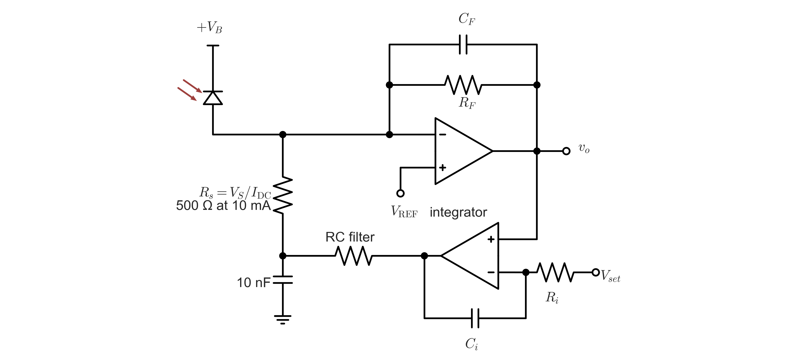

*Figure 29. Option A for a single-ended detector: a resistive DC sink at the summing node, driven by a slow servo. $R_s = V_S/I_{\mathrm{DC}}$ (Table A8.1) carries the photocurrent to its far end, which sits $V_S$ below $V_{\mathrm{REF}}$: 500 Ω at 10 mA for $V_S$ = 5 V. The 10-nF capacitor makes that end an AC ground; with $R_s$ it sets a pole at 32 kHz, above which the servo's own noise no longer reaches the node (Eq. (69)), and the filter resistor keeps the capacitor off the integrator's output. The integrator senses $v_o$ on its non-inverting input and the set point $V_{set}$ through $R_i$ on its inverting input, with $C_i$ in its feedback, so it integrates $v_o - V_{set}$ without inversion. If the photocurrent rises, $v_o$ falls, the integrator lowers the far end of $R_s$, and $R_s$ draws the extra current: the loop through the inverting TIA is a negative-feedback loop. With $\tau = R_iC_i$ its unity-gain frequency is $R_F/(2\pi\tau R_s)$, as in Eq. (80), placed at 1–10 kHz. A TIA on a single supply needs a negative rail for the integrator. Any amplifier.*

**Noise.** With $R_s = V_S/I_{\mathrm{DC}}$ (Table A8.1), $R_s$ adds three current-noise terms at the summing node:
- its own Johnson noise;
- the TIA's $e_n$ acting on the new admittance $1/R_s$;
- whatever voltage noise $e_s$ is left at its far end after the bypass.

Relative to the shot noise,

$$
\frac{S_{\mathrm{sink}}}{S_{\mathrm{shot}}} = \frac{4k_BT/R_s + (e_n^2+e_s^2)/R_s^2}{2qI_{\mathrm{DC}}} = \frac{2k_BT}{qV_S} + \frac{(e_n^2+e_s^2)\,I_{\mathrm{DC}}}{2q\,V_S^2}.
\tag{69}
$$

With $V_S$ = 5 V the first term is 1.0 % (Eq. (30)). The second term is negligible for $e_n$ = 1 nV/√Hz, giving $2.5\times10^{-4}$ at 10 mA. A servo left unfiltered, with $e_s$ = 10 nV/√Hz at 10 mA, would contribute 0.125, or 0.5 dB. A 10-nF bypass at the far end of $R_s$ ($R_s$ = 500 Ω at 10 mA) gives a pole at 32 kHz and removes it.

The resistor's 0.05–0.1 pF of pad capacitance adds to $C_T$ and is covered by the $C_{\mathrm{PCB}}$ corners of Section 6.2.5.

**Low-frequency behaviour.**
- The servo makes the TIA a high-pass at its own bandwidth. A unity-gain frequency of 1–10 kHz leaves 10–200 MHz untouched.
- The DC noise gain rises from 1 to $1 + R_F/R_s$, which is 5 at 10 mA. That raises only the low-frequency output offset and $e_n$ contribution, and the servo removes the offset anyway.

**A fixed photocurrent needs no servo.** If $I_{\mathrm{DC}}$ is fixed, $R_s$ can return to a fixed voltage.

**Active sinks.** An active current sink (a degenerated bipolar or MOS current source) obeys the same Eq. (30), with $V_S$ the voltage across its degeneration resistor. Its advantage is a higher output impedance at low frequency. Its disadvantages are the 0.1–0.5 pF of collector or drain capacitance at the summing node, and the full collector shot noise (+3 dB) if it is not degenerated.

**In the balanced pair** the same circuit has to correct only the imbalance. That makes $R_s$ larger and its noise smaller (Section 8.8 (d), Eq. (79)).

### 8.3 Option B: the photodiode AC-coupled into the TIA

Option B keeps the DC out of the TIA altogether: the photodiode's DC returns through its own bias resistor, and only the RF is coupled into the summing node. It needs no servo, but the photodiode bias then falls as the light rises.

**Circuit (Figure 30).**
- The photodiode's DC flows through a resistor $R_b$ from its anode to a negative bias.
- The RF reaches the TIA through a coupling capacitor $C_c$.
- The TIA never sees the DC, and no servo is needed.

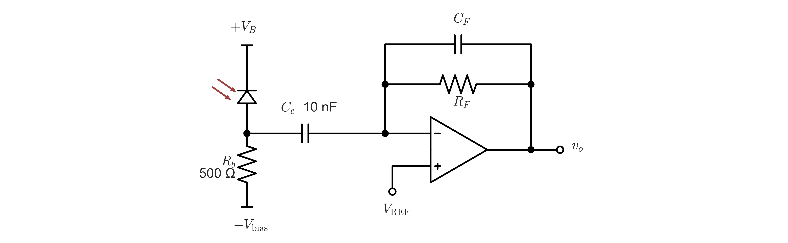

*Figure 30. Option B: the photodiode AC-coupled into the TIA. The photodiode's DC flows through $R_b$ from its anode to the negative bias $-V_{\mathrm{bias}}$; 500 Ω drops 5 V at 10 mA. The RF reaches the summing node through $C_c$ = 10 nF, which with $R_b$ sets the low-frequency corner, $1/(2\pi R_bC_c)$ = 32 kHz. Because the TIA's input impedance is a small inductance (Eq. (70)), almost all of the RF photocurrent enters the TIA rather than $R_b$ (Eq. (71)). Any amplifier.*

**Noise.** $R_b$ obeys Eq. (30) with $V_S = I_{\mathrm{DC}}R_b$.

**RF current lost into $R_b$.** That depends on the TIA's input impedance. From the derivation of Eq. (9), $v_- = -v_o/A$ and $i = (v_- - v_o)/Z_F$, so

$$
Z_{\mathrm{in}} = \frac{Z_F}{1+A} \approx \frac{j\omega R_F}{\omega_A} = j\omega L_{\mathrm{in}},
\qquad
L_{\mathrm{in}}\,[\mathrm{nH}] = 159.2\,\frac{R_F[\mathrm{k\Omega}]}{\mathrm{GBW}[\mathrm{GHz}]},
\tag{70}
$$

valid below the feedback pole $f_p$, where $Z_F \approx R_F$ and $A \approx \omega_A/(j\omega)$. Table A8.2 gives example values.

The fraction of RF photocurrent that reaches the TIA past a shunt impedance $Z_{\mathrm{sh}}$ at the photodiode node is

$$
\left|\frac{i_{\mathrm{TIA}}}{i_{\mathrm{ph}}}\right| = \left|\frac{Z_{\mathrm{sh}}}{Z_{\mathrm{in}} + Z_{\mathrm{sh}}}\right|.
\tag{71}
$$

$Z_{\mathrm{in}}$ is mostly reactive while $R_b$ is resistive, so the two branch currents add nearly in quadrature and the loss is of second order. With $R_b$ = 500 Ω (5 V at 10 mA) at 100 MHz:
- OPA855 ($Z_{\mathrm{in}} \approx j25$ Ω) keeps 99.9 % of the current (−0.01 dB).
- OPA856 ($Z_{\mathrm{in}} \approx j185$ Ω) keeps 94 % (−0.55 dB).

The same numbers apply to the summing-node resistor $R_s$ of Option A.

**Costs.**
- The photodiode's reverse bias falls by $I_{\mathrm{DC}}R_b$ as the light rises. The bias supply must cover that drop plus the bias the photodiode needs at full current for space-charge-limited linearity.
- $C_c$ and the extra node add about 0.1–0.2 pF.
- $C_c$ with $R_b$ sets the low-frequency corner: 10 nF and 500 Ω give 32 kHz.

**When to use it.** Option B is the simplest choice when $I_{\mathrm{DC}}$ is roughly constant and a higher photodiode bias is available.

### 8.4 Option C: an inductive bias tee at the summing node

Option C asks whether the DC sink of Option A can be hidden from the summing node at RF, as the bias tee hides the DC path of the 50-Ω termination (Section 2.1). A choke $L_{\mathrm{ch}}$ in series with the DC path isolates the sink's capacitance and noise from the summing node at RF (Figure 31).

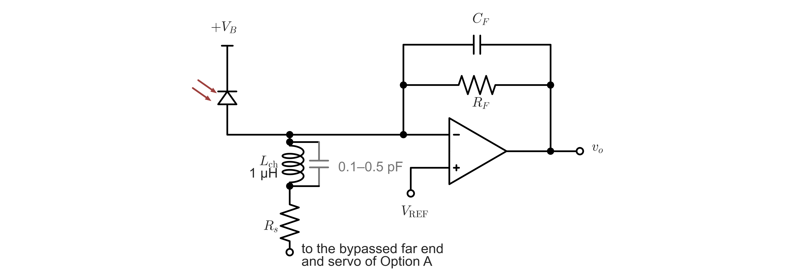

*Figure 31. Option C: an inductive bias tee at the summing node. The 1-µH choke $L_{\mathrm{ch}}$ isolates the sink's capacitance and noise from the node at RF, and the photocurrent divides between $L_{\mathrm{ch}}$ and the TIA's input inductance in the ratio $L_{\mathrm{ch}}/(L_{\mathrm{in}} + L_{\mathrm{ch}})$. The choke still needs a sink, here $R_s$ to the bypassed far end and servo of Option A (Figure 29), and its own self-capacitance of 0.1–0.5 pF, drawn in grey, lands at the summing node. Any amplifier.*

**Current division.** Below $f_p$ both $L_{\mathrm{ch}}$ and $Z_{\mathrm{in}}$ are inductive, so the currents divide in phase. Eq. (71) then becomes the frequency-independent ratio $L_{\mathrm{ch}}/(L_{\mathrm{in}} + L_{\mathrm{ch}})$. For OPA855 and a 1-µH choke that is 0.962 (−0.34 dB).

**Why it is not recommended here.**
- **The choke does not remove the need for a sink.** Its far end must still go to a resistor or current source that sets $I_{\mathrm{DC}}$, so Eq. (30) still governs the noise.
- **It adds what the summing node can least afford.** Its self-capacitance is 0.1–0.5 pF, and its self-resonance (a few hundred MHz for a compact 1-µH part) lands near the band.

It is worth considering only if the sink's own capacitance exceeds about 0.5 pF, for example a large active sink.

### 8.5 Option D: the gain split over two stages

Option D needs no DC sink at all. It splits the transimpedance over two stages: a first TIA whose feedback resistor is small enough to carry the whole photocurrent, and an AC-coupled voltage stage that restores the 2-kΩ gain. The question is what the small first resistor costs in noise.

**Circuit (Figure 32).** A first TIA with a small $R_{F1}$ carries the whole DC. For a 5-V part, $R_{F1}$ ≤ 3.05 V/10 mA = 305 Ω. An AC-coupled voltage stage of gain $G_2$ then follows, with $R_{F1}G_2$ = 2 kΩ, e.g. $R_{F1}$ = 286 Ω and $G_2$ = 7.

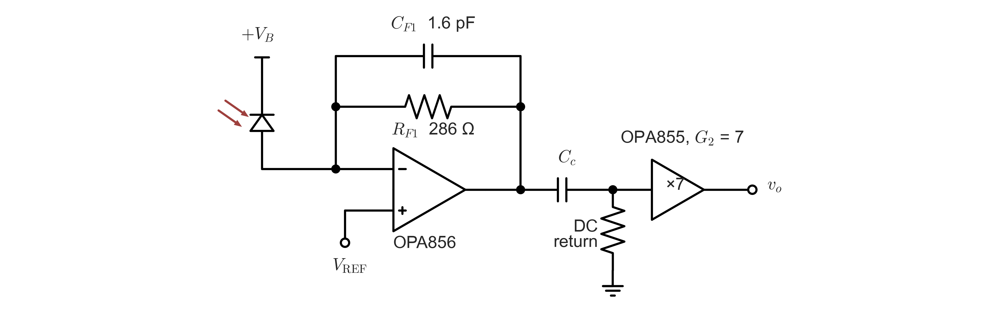

*Figure 32. Option D: two-stage split gain. The first stage, OPA856 with $R_{F1}$ = 286 Ω and $C_{F1}$ = 1.6 pF, carries the whole DC: 10 mA through 286 Ω is 2.86 V, inside the 3.05 V that a 5-V part leaves. $C_c$ AC-couples its output into the second stage, OPA855 at a voltage gain $G_2$ = 7, so that $R_{F1}G_2$ = 2 kΩ; the resistor to ground gives the second stage's input its DC return and, with $C_c$, sets the low-frequency corner. The two-stage loop was not modelled. Amplifiers: OPA856 and OPA855.*

**Advantages.** It needs no DC sink. The second stage sets the output swing, so a ±6.5-V OPA818 at a voltage gain of 7 (its comfortable regime, about 50° phase margin) supplies the 2.23 V peak.

**The first stage must be unity-gain stable.** At 286 Ω a decompensated part fails Eq. (16): OPA855 would need $C_T$ ≥ 5.0 pF. OPA856 at 286 Ω needs $C_F$ = 1.6 pF and gives about 390 MHz by Eq. (15).

**Noise cost.** The first stage's resistor contributes $\sqrt{4k_BT/R_{F1}}$ = 7.6 pA/√Hz. The second stage's voltage noise, referred to the input, adds

$$
i_{n2,\mathrm{eq}} = \frac{e_{n2}}{R_{F1}},
\tag{72}
$$

which is 3.4 pA/√Hz for a 0.98-nV/√Hz second stage and 7.7 pA/√Hz for OPA818. With OPA856 (286 Ω) followed by OPA855 (G = 7), the total low-frequency input noise is about 9.3 pA/√Hz:
- first stage: $\sqrt{57.6 + 6.5 + 10.1}$ = 8.6 pA/√Hz from $R_{F1}$, $i_n$ and $e_n/R_{F1}$;
- second stage: 3.4 pA/√Hz.

A single 2-kΩ OPA855 stage gives 3.9 pA/√Hz at low frequency (4.17 pA/√Hz at 100 MHz). The excess over pure shot noise compares as in Table A8.3.

**Verdict.** Split gain pays off only if the operation is mostly at several mA. This option is an analytical sketch; the two-stage loop was not modelled.

**How the four options compare.** For a single-ended detector Option A is recommended: it keeps the photodiode bias fixed and adds only 0.05–0.1 pF and 1.0 % of the shot-noise power at $V_S$ = 5 V (Eq. (69)). Option B needs no servo and is the simplest where $I_{\mathrm{DC}}$ is roughly constant, but the photodiode bias falls by $I_{\mathrm{DC}}R_b$ and the node gains 0.1–0.2 pF. Option C still needs a sink and adds the choke's 0.1–0.5 pF and a self-resonance near the band. Option D needs no sink, but its excess over shot noise at 0.1 mA is 5.7 dB, against 1.9 dB for a single 2-kΩ stage (Table A8.3).

### 8.6 Bootstrapping the photodiodes

**The idea (Figure 33).** The amplifier's voltage noise $e_n$ appears at the summing node and drives the current $e_n\cdot j\omega C_D$ through the photodiode capacitance. That is the $C_D$ part of the $e_n\omega C_{\mathrm{tot}}$ term of Eq. (19). Bootstrapping drives the far, bias-side terminal of the photodiode with a unity-gain follower whose input is the summing node. The voltage across $C_D$ then stays constant, and $C_D$ carries no current. The photocurrent is unaffected, because the photodiode is a current source.

Hobbs uses the idea on a large-area photodiode in a cascoded front end. A follower $Q_2$ drives the cold end of the diode and forces the drop across $C_d$ to be constant, at frequencies where the reactance of $C_d$ is much larger than the follower's emitter resistance [A11, Fig. 8 and text, p. 45].

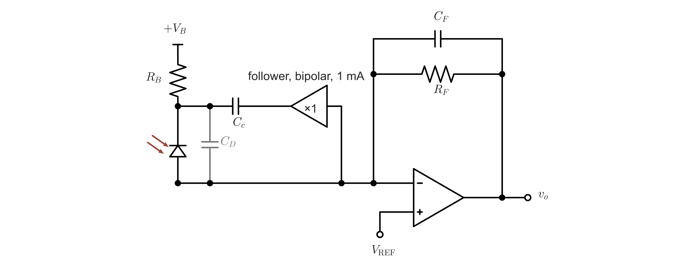

*Figure 33. Bootstrapping a photodiode. A unity-gain follower whose input is the summing node drives the photodiode's far, bias-side terminal through $C_c$, so the voltage across the photodiode capacitance $C_D$ (grey) stays constant and $C_D$ carries no current. $R_B$ feeds the DC bias from $+V_B$; the reactance of $C_c$ must stay well below $R_B$ in the band, or $R_B$ loads the follower. Eq. (73) gives the noise traded, for the 1-mA bipolar follower of Table A8.4. In the balanced pair the lower photodiode's anode is driven the same way through a second coupling capacitor. Any amplifier.*

**What it removes and what it adds.** Let the follower have voltage noise $e_b$, input current noise $i_b$ and input capacitance $C_{\mathrm{in},b}$, which is what remains after its own bootstrapping. It replaces the $e_n\omega C_D$ current by three others:
- its voltage noise now sits across $C_D$, giving $e_b\,\omega C_D$;
- its input current noise enters the summing node directly. For a bipolar follower at collector current $I_C$ and current gain $\beta$ this is the base-current shot noise $2qI_C/\beta$, which is white;
- its input capacitance adds to $C_T$, and the amplifier's $e_n$ acts on it.

The change in the input-referred noise power is therefore

$$
\Delta S_i = -\left(e_n^2 - e_b^2\right)(\omega C_D)^2 + \frac{2qI_C}{\beta} + e_n^2\,(\omega C_{\mathrm{in},b})^2.
\tag{73}
$$

Bootstrapping pays only where $\Delta S_i < 0$. That needs a follower quieter than the amplifier, $e_b < e_n$, and a photodiode capacitance above the break-even value

$$
C_{D,\mathrm{be}} = \frac{\sqrt{2qI_C/\beta + e_n^2(\omega C_{\mathrm{in},b})^2}}{\omega\sqrt{e_n^2 - e_b^2}}.
\tag{74}
$$

*Inputs.* Take a small RF bipolar follower at $I_C$ = 1 mA with $\beta$ = 100 and base resistance $r_b$ = 10 Ω, and $C_{\mathrm{in},b}$ = 0.3 pF. These transistor values are assumptions (Appendix C). Then:
- the emitter resistance is $r_e = k_BT/(qI_C)$ = 25.7 Ω;
- the voltage noise is $e_b = \sqrt{4k_BT(r_b + r_e/2)}$ = 0.61 nV/√Hz;
- the base shot noise is $\sqrt{2q\times10\ \mu\mathrm{A}}$ = 1.79 pA/√Hz.

*Substitution for OPA855* ($e_n$ = 0.98 nV/√Hz) at 200 MHz, where $\omega = 1.257\times10^9$ s⁻¹:
- The numerator of Eq. (74) is $\sqrt{1.79^2 + (0.98\times1.257\times0.3)^2}$ pA/√Hz = $\sqrt{3.20 + 0.14}$ = 1.83 pA/√Hz.
- The denominator is $1.257\times10^9\ \mathrm{s^{-1}}\times\sqrt{0.98^2 - 0.61^2}$ nV/√Hz = 0.964 pA/√Hz per pF.
- So $C_{D,\mathrm{be}}$ = 1.83/0.964 = 1.9 pF.

**Why it is not recommended here.**
- **Noise.** With OPA855 at 1 pF, the term removed (0.62–1.24 pA/√Hz at 100–200 MHz) is smaller than the white base-current noise the follower adds (1.79 pA/√Hz). Bootstrapping therefore raises the noise; at 2 pF it breaks even at 200 MHz (Table A8.4). Only OPA818, with its 2.2-nV/√Hz $e_n$, would gain, and only 0.3 dB at 100 MHz and 0.5 dB at 200 MHz with 2 pF at the node.
- **Stability.** Bootstrapping removes $C_D$ from $C_T$, which lowers the noise gain $NG_\infty = 1 + C_T/C_F$ of Eq. (11). For the decompensated parts that is the wrong direction.
  - OPA855 at 1 pF would keep $C_T$ ≈ 1.15 pF plus the follower's 0.3 pF. $C_F$ would then have to stay below $C_T/6$ ≈ 0.24 pF to respect $G_{\min}$ = 7, against a resistor parasitic of 0.2 ± 0.1 pF.
  - OPA818 needs more input capacitance to reach 40–45° (Section 6.2.6), and bootstrapping takes capacitance away.
- **The pair.** Both diodes' bias nodes would have to be driven, through coupling capacitors that carry the photocurrents' RF components, with the DC bias fed through resistors or chokes. That adds parasitics at exactly the nodes that set the common-mode rejection.
- **Where bootstrapping belongs.** It belongs on large photodiodes, where $e_n\omega C_D$ dominates: $C_D$ above about 5–10 pF at 100 MHz, or tens to hundreds of picofarads at 1–10 MHz. Hobbs' example is a 100-pF photodiode at 2 µA in a 1-MHz front end. There the cascode-plus-bootstrap circuit loses only 3.3 dB of carrier-to-noise ratio at 1 MHz [A11, Figs. 9 and 10, p. 45].

### 8.7 Cascoding the photodiodes

**The idea.** A common-base (CB) transistor between each photodiode and the summing node passes the photocurrent from its emitter to its collector, while holding the photodiode at a constant voltage. The photodiode capacitance then sits at the emitter node, where the impedance is low. The summing node sees only the transistor's collector–base capacitance $C_\mu$, about 0.1–0.3 pF for a small RF transistor.

Hobbs shows the arrangement as the cascoded transimpedance amplifier, in which $Q_1$ isolates the summing junction from $C_d$ [A11, Fig. 5, p. 44]. In his noise canceller, the cascode transistor $Q_3$ "prevents the capacitance of the signal photodiode from loading the summing junction" [A22, p. 906, describing Fig. 3 on p. 907].

**The balanced pair needs a complementary pair (Figure 34).**
- The upper diode drives current into the node, so its CB transistor must pass current from emitter to collector towards the node: a PNP.
- The lower diode draws current out of the node, so its CB transistor is an NPN.

Hobbs' differential noise canceller uses exactly this arrangement: a PNP MPSA64 ($Q_3$) on one signal photodiode and an NPN MPSA14 ($Q_4$) on the other, with the two photodiodes in series [A22, Fig. 19, p. 916].

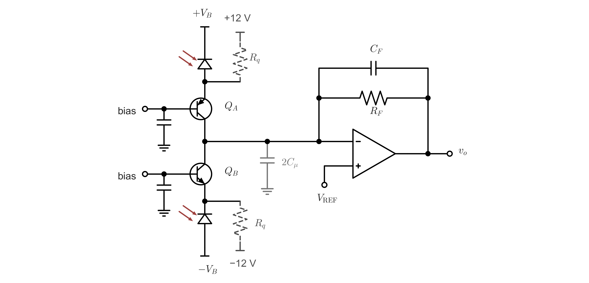

*Figure 34. Cascoding the balanced pair. A common-base PNP, $Q_A$, passes the upper photodiode's current from its emitter to its collector at the summing node, and a common-base NPN, $Q_B$, does the same for the lower photodiode. Each base sits at a DC bias that sets its photodiode's reverse voltage and is bypassed to ground, so the photodiode capacitance sits at the low-impedance emitter node and the summing node sees only the two collector–base capacitances, $2C_\mu$ (grey, 0.1–0.3 pF each). The dashed $R_q = V_q/I_q$ from ±12 V are the optional standing currents of Eq. (76) and Table A8.6, which keep the emitter resistance, and with it the pole of Eq. (75), out of the band at low photocurrent; the two standing currents cancel at the summing node when they are equal. Any amplifier.*

**Transfer.** At emitter current $I$ the small-signal emitter resistance is $r_e = k_BT/(qI)$ [A11, Eq. (7), p. 44]. The photocurrent divides between $r_e$ and the capacitance from the emitter node to AC ground, $C_e = C_D + C_{je}$. Here $C_{je}$ is the base–emitter junction capacitance, and the base is AC-grounded. The transistor adds its transit time $1/(2\pi f_T)$. To first order,

$$
H_{\mathrm{cb}}(f) = \frac{i_{\mathrm{out}}}{i_{\mathrm{ph}}} \simeq \frac{\alpha}{1 + j2\pi f\,\tau_e},
\qquad
\tau_e = r_e\,C_e + \frac{1}{2\pi f_T},
\qquad
r_e = \frac{k_BT}{qI},
\tag{75}
$$

where $\alpha = \beta/(\beta + 1)$ is the common-base current gain.

**Noise, derived.** Use the hybrid-π transistor with transconductance $g_m = 1/r_e$, a collector shot-noise current $i_c$ (density $2qI$) and a base shot-noise current $i_b$ (density $2qI/\beta$). The base is AC-grounded, and the emitter is fed by the photodiode current $i_{\mathrm{ph}}$ in parallel with the admittance $j\omega C_e$. Kirchhoff's current law at the emitter fixes the emitter voltage. The collector current that reaches the summing node is then

$$
i_{\mathrm{out}} = h\,(i_{\mathrm{ph}} - i_b) + (1 - h)\,i_c,
\qquad
h = \frac{\alpha}{1 + j\omega\,\alpha r_eC_e}.
$$

Each source behaves differently:
- The photocurrent and its own shot noise pass together with $h$, so their ratio is preserved.
- The base shot noise passes like the signal.
- The collector shot noise appears with $|1 - h| \approx \omega r_eC_e/\sqrt{1 + (\omega r_eC_e)^2}$, which is the splitting factor of Hobbs' Eq. (8) [A11, p. 44]. Referred to the input, it is $2qI\,(\omega r_eC_e)^2 = 4k_BT(r_e/2)(\omega C_e)^2$, because $2qI\,r_e^2 = 2k_BT\,r_e$.
- The thermal noise of the base resistance $r_b$ moves the emitter like a voltage source and drives $4k_BTr_b(\omega C_e)^2$ through $C_e$.

At low photocurrent $r_e$ is large. A standing current $I_q$ can then be fed into the emitter node from a voltage $V_q$ through a resistor $R_q = V_q/I_q$. A current derived from a quiet voltage through a resistor carries no shot noise, only the resistor's Johnson noise [A11, "Noise considerations", p. 45]. That noise is $4k_BTI_q/V_q$, a fraction $2k_BT/(qV_q)$ of the shot noise of $I_q$ (Eq. (30)). The transistor then carries $I + I_q$.

The input-referred noise that each CB stage adds is therefore

$$
S_{\mathrm{cb}} = \frac{2q(I + I_q)}{\beta} + 4k_BT\left(r_b + \frac{r_e}{2}\right)(\omega C_e)^2 + \frac{4k_BT\,I_q}{V_q},
\qquad
r_e = \frac{k_BT}{q(I + I_q)}.
\tag{76}
$$

The standing currents of the PNP and the NPN flow into and out of the summing node, so they cancel there when equal; any residue is part of the imbalance that the servo removes.

**What cascoding buys here, and what it costs.**
- **In the shot-noise regime it is nearly free.** Self-biased by 1–10 mA per diode, the two transistors add 0.04–0.06 dB to the pair's shot noise (Table A8.5), mostly base-current partition noise, which is $1/\beta$ of the shot noise. At 0.1 mA per diode they add 0.24 dB at 100 MHz and 0.79 dB at 200 MHz, because $r_e$ = 257 Ω makes large the second term of Eq. (76), the voltage noise $e_{cb} = \sqrt{4k_BT(r_b + r_e/2)}$ acting on $C_e$.
- **It is not free in the dark.**
  - At low photocurrent $r_e$ is large, and the pole of Eq. (75) falls into the band: 48 MHz at 10 µA. A standing current keeps it out, but then the pair adds 2.1–3.3 pA/√Hz at 200 MHz (Table A8.6). That is more than the $e_n\omega C$ noise the cascodes remove, 0.75–2.0 pA/√Hz with OPA855.
  - The reason is that OPA855's $e_n$ of 0.99 nV/√Hz (the white level of Fig 6-11, Table 4.1) is itself the Johnson noise of only 59.5 Ω. A CB transistor is quieter only for $r_b + r_e/2$ < 59.5 Ω, i.e. above about 0.26 mA, and at such currents its base shot noise and the standing current's noise dominate.
  - Hobbs notes the same limit for a biased cascode: the base current has full shot noise [A11, p. 45]. A bias current with a fraction $\delta$ of full shot-noise power limits the signal-to-noise ratio above $f_c\sqrt{\delta}$ [A11, Eq. (9), p. 44].
- **It hurts the decompensated amplifiers.** With both $C_D$ replaced by $2C_\mu$ = 0.4 pF, OPA855 sees $C_T$ = 1.55 pF. Its $C_F$ window shrinks to 0.13–0.26 pF at 2 kΩ (0.15–0.26 pF at 1.5 kΩ), which no longer contains the ±0.1 pF spread around the 0.2-pF parasitic: 0.20 pF gives 545 MHz at 59°, 0.25 pF gives 396 MHz at 61°, and 0.30 pF violates $G_{\min}$. Unity-gain-stable OPA856 gains only about 10 % in bandwidth: 227 MHz against 205 MHz, both at 53°.
- **Common-mode rejection.** The two paths now differ in $\alpha$, and a 0.5 % mismatch limits the rejection to −46 dB. They also differ in $\tau_e$, because the NPN and the PNP differ in $f_T$ and each $r_e$ follows its own diode's current. Hobbs warns that excessive photodiode capacitance may make the cascode transistor oscillate [A22, p. 918]; its base must be bypassed with low inductance.
- **What it is good for.** It fixes the photodiode bias independently of the TIA, keeps the photodiodes reverse-biased when the TIA overloads, and isolates a photodiode capacitance that is large or that varies with bias and light. Hobbs' cascode improves the bandwidth 8:1 for a 100-pF photodiode [A11, p. 44] and may allow up to 40 times more amplifier bandwidth in the canceller [A22, p. 906]. With 0.5–1 pF per diode those gains do not arise.

### 8.8 Servos for the imbalance and for the photodiode bias

In the balanced pair the imbalance $I_1 - I_2$ is the only DC that reaches $R_F$, and a few per cent of imbalance at 10 mA per diode costs OPA855 2.6–9.3 dB of dynamic range (Section 1.2, Table A1.2). This section asks how to hold the imbalance at zero without adding noise at the summing node, and how to hold the photodiode bias while the photocurrent changes.

**Is an active servo possible?** Yes. The imbalance can be corrected on the light (b), on a photocurrent (c) or at the summing node (d), and a fourth servo holds the photodiode bias (e). Each has its own noise mechanism, and a low-noise servo is hard for the reasons in (a). Only (b) and (c) null the laser's relative intensity noise (RIN) along with the DC; (b) is preferred where the optics allow because it adds nothing at the node, (d) is the electronic default, and (c) is kept for a large imbalance with a noisy laser (Table A8.10).

**(a) Why a DC servo is hard to make quiet.**
1. **An actuator at the summing node injects its own noise at full gain.**
   - An undegenerated transistor current source carrying $I$ injects its full shot noise, $2qI$.
   - A degenerated one injects $(2k_BT/qV_E)\cdot2qI$, with $V_E$ the voltage across its emitter resistor (Eq. (30)).
   - Its collector capacitance, 0.1–0.5 pF, adds to $C_T$.
2. **The servo amplifier's own noise reaches the node through the actuator's gain**: through $1/R_s$ for a resistor, or through the transconductance of a transistor. Through 500 Ω, 10 nV/√Hz becomes 20 pA/√Hz, seven times the Johnson noise of 2 kΩ. For this reason Hobbs divides the servo voltage 40:1 at the base of his splitting transistor. He notes that most op amps have at least several nanovolts per root hertz, against about 1 nV/√Hz for good transistors [A22, p. 907, text after Eq. (6)].
3. **An electronic correction carries no laser noise.** It removes the DC of the imbalance, but not the RIN that the imbalance current carries:

$$
S_{\mathrm{RIN,res}} = (I_1 - I_2)^2\,10^{\mathrm{RIN}/10}.
\tag{77}
$$

   At RIN = −150 dB/Hz, 0.1 mA of imbalance leaves 3.2 pA/√Hz and 1 mA leaves 32 pA/√Hz, against 316 pA/√Hz from a single 10-mA photodiode. At −160 dB/Hz the residuals are 1.0 and 10 pA/√Hz. Only a correction derived from the light itself nulls the DC and the RIN together. That means trimming the optical split, or dividing a photocurrent, where "the fluctuations split just the same way as the dc" [A22, Fig. 2 caption, p. 906].
4. **The loop contains the TIA.** It turns the TIA into a high-pass at the loop's unity-gain frequency. It must stay stable with the TIA's low-frequency gain, and it must not respond to the RF on the TIA's output.
5. **The bias nodes couple to the summing node through $C_D$** (item (e)). A bank of different capacitors at a bias pin can resonate inside the band.

**(b) Servo on the optical split, preferred where the optics allow (Figure 35).** The light may pass a tunable splitter or attenuator before the two photodiodes; on a photonic chip, for example, a thermo-optic Mach–Zehnder splitter. A slow integrator that nulls the TIA's DC output can then trim the split.
- Nothing electrical is added at the summing node: no noise and no capacitance.
- Because the null is reached by moving light, the RIN cancels together with the DC.
- It is as fast as its actuator: kilohertz for a thermo-optic phase shifter, ample for drift.

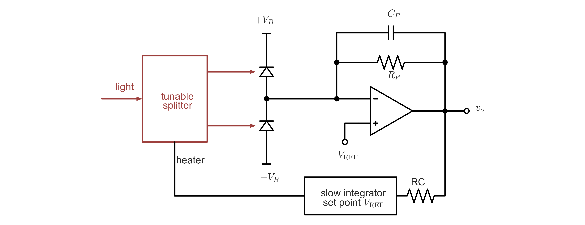

*Figure 35. Servo on the optical split. A tunable splitter, for example a thermo-optic Mach–Zehnder on a photonic chip, divides the light between the two photodiodes. A slow integrator senses the TIA's output through an RC low-pass that keeps the RF out, compares it with the set point $V_{\mathrm{REF}}$, and drives the splitter's heater until the DC output is zero. Nothing electrical is added at the summing node, and the RIN cancels together with the DC. Any amplifier.*

**(c) Servo by dividing a photocurrent: the Hobbs noise canceller.** Hobbs' laser noise canceller [A22] uses a bipolar differential pair as an electronically variable current splitter.
- The pair $Q_1/Q_2$ divides a photocurrent fed into its common emitters. The ratio of the collector currents depends only on the base-voltage difference, $i_{C2}/i_{C1} = \exp(q\Delta V_{BE}/k_BT)$, not on the current itself [A22, Fig. 2 and Eq. (3), p. 906].
- An integrating servo amplifier $A_2$ adjusts $\Delta V_{BE}$ until the DC output of the TIA $A_1$ is zero. A cascode $Q_3$ isolates the other photodiode's capacitance from the summing junction [A22, Fig. 3, p. 907].
- The cancellation bandwidth does not depend on the loop bandwidth, only on the speeds of the photodiodes and the transistors [A22, abstract, p. 903; p. 906].
- The differential, high-dynamic-range version has the topology of this design [A22, Fig. 19, p. 916]. The two signal photodiodes are in series with cascodes, $i_{\mathrm{sig1}}$ is made a few per cent larger than $i_{\mathrm{sig2}}$, and only a small comparison current from a third photodiode passes the pair. With $i_{\mathrm{sig1}}$ = 1.83 mA, $i_{\mathrm{sig2}}$ = 1.77 mA and $i_{\mathrm{comp}}$ = 0.15 mA it reached a 1-Hz signal-to-noise ratio of 160.0 dB, about 0.5 dB below the theoretical value [A22, Fig. 21 and text, p. 917].

Applied here, the pair can divide either of two currents, and Figure 36 draws the first:
- the current of the lower photodiode, made slightly stronger, returning a fraction $1 - f$ to a supply and delivering $f$ to the summing node (the topology of [A22, Fig. 3]);
- a small third photocurrent from a sample of the light (the topology of [A22, Fig. 19]).

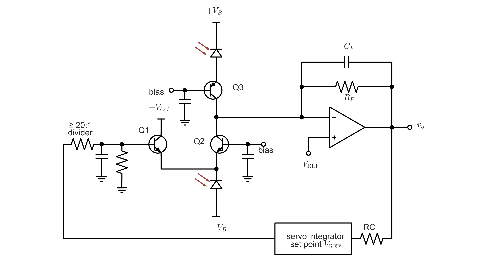

*Figure 36. The photocurrent divider of Hobbs' canceller applied to the pair, in the topology of [A22, Fig. 3]. The lower photodiode, made slightly stronger than the upper one, feeds the common emitters of the differential pair Q1/Q2. Q2 delivers the fraction $f$ of that current to the summing node and Q1 returns $1 - f$ to the supply $+V_{CC}$; the split depends only on the difference of the base voltages. Q2's base sits at a bypassed bias. The servo integrator senses the TIA's output through an RC low-pass, compares it with $V_{\mathrm{REF}}$ and drives Q1's base through a divider of at least 20:1 with an RF bypass, so that its own noise stays small beside that of the base resistances (Eq. (78)). Q3, a common-base PNP, is the matching cascode on the upper photodiode, which isolates that photodiode's capacitance and matches the delay of the divided path (Table A8.10). Any amplifier.*

*The delivered current has full shot noise, whatever the split.* Let a current $I_{\mathrm{sp}}$ with full shot noise feed the common emitters. Let $Q_2$ deliver $I_{C2} = fI_{\mathrm{sp}}$ to the node while $Q_1$ takes $I_{C1} = (1 - f)I_{\mathrm{sp}}$. With the bases AC-grounded and the emitters fed from a high impedance, the input fluctuation divides in the ratio of the transconductances, i.e. as $f$ to $1 - f$. Each collector adds its own shot noise $2qI_{Ck}$, which the emitter node redistributes in the same ratio. Kirchhoff's current law at the emitter node then gives

$$
\langle i_{C2}^2\rangle = f^2\,2qI_{\mathrm{sp}} + (1-f)^2\,2qI_{C2} + f^2\,2qI_{C1} = 2qI_{\mathrm{sp}}\left[f^2 + f(1-f)^2 + f^2(1-f)\right] = 2qI_{C2}.
$$

This is exactly the full shot noise of the delivered current, as Hobbs derives [A22, Appendix A, Eqs. (A3)–(A5), pp. 919–920; result quoted with Eq. (5), p. 907]. A transistor divider is as quiet as an optical beam splitter.

*The base resistances are the real limit.* The base-spreading resistances $r_b'$ of the two transistors, and the Thévenin resistance $R_{\mathrm{th}}$ of the servo's base drive, add a noise voltage to $\Delta V_{BE}$. The split responds to it with the transconductance $\partial I_{C2}/\partial\Delta V_{BE} = I_{\mathrm{sp}}f(1-f)/V_T$, where $V_T = k_BT/q$. The delivered noise is therefore

$$
S_{C2} = 2qI_{C2} + \left[\frac{I_{\mathrm{sp}}\,f(1-f)}{V_T}\right]^2 4k_BT\left(r_{b1}' + r_{b2}' + R_{\mathrm{th}}\right).
\tag{78}
$$

Hobbs gives 40–100 Ω of $r_b'$ for small-signal devices, about 1 nV/√Hz on each base, which limits his basic canceller to about 150 dB in 1 Hz [A22, p. 910; p. 919]. His remedies [A22, pp. 910–911] are:
- a smaller transconductance;
- transistors with low $r_b'$, or paralleled devices;
- diode degeneration;
- the differential version, in which the pair carries only a small current.

He also asks for a divider Thévenin resistance below $r_b'$ [A22, p. 911]. In his Fig. 4 measurement, a large ratio $i_{C2}/i_{C1}$ of about 4 was chosen to reduce the pair's transconductance, and with it this noise [A22, p. 908].

The topology of Fig. 3 is affordable at up to about 1 mA per diode (Table A8.7). At 10 mA per diode it needs $f$ ≥ 0.9 and RF transistors with $r_b'$ of about 10 Ω. In the topology of Fig. 19 the pair carries only a small comparison current, which keeps the base-resistance noise negligible at any photocurrent.

*Speed and common-mode rejection.*
- **Path delay.** The divided path has the delay of Eq. (75), with $C_e = C_D + 2C_{je}$ at the common emitters. The other diode's path lacks it unless it has a matching cascode. For a delay difference $\tau$, common-mode noise is rejected only to $\lvert 1 - 1/(1 + j\omega\tau)\rvert \approx \omega\tau$.
  - Lower diode at 1 mA with 0.5 pF: $\tau$ = 44 ps, giving −51 dB at 10 MHz, −31 dB at 100 MHz and −25 dB at 200 MHz.
  - At 10 mA: $\tau$ = 19 ps, giving −59, −39 and −33 dB.
  - A matching cascode on the other diode, as in Hobbs' Fig. 19, removes most of the difference.
- **Optical path difference.** A path difference $\Delta z$ adds $2\sin(\pi\Delta z f/c)$ [A22, Eq. (16), p. 918]. For −40 dB at 200 MHz the paths to the two diodes must match within 2.4 mm in air, or about 1.1–1.5 mm of waveguide with a group index of 1.6–2.2.
- **Demonstrated speed.** Hobbs measured more than 50 dB of cancellation to 2 MHz and more than 40 dB to at least 8 MHz [A22, Fig. 6(b), p. 910], and expected the method to extend to about 100 MHz [A22, abstract, p. 903; p. 919]. At 100–200 MHz it is not demonstrated; the numbers above are our estimates for a 10-GHz transistor.

**(d) Servo by resistive injection.** Where neither the optics nor a photocurrent divider are available, the imbalance is removed as in Option A (Section 8.2). One difference makes it much quieter: the resistor has to carry only the largest expected imbalance, not the photocurrent. With $R_s = V_S/\Delta I_{\max}$, its Johnson noise relative to the pair's shot noise is

$$
\frac{S_{R_s}}{S_{\mathrm{shot}}} = \frac{4k_BT/R_s}{2q(I_1 + I_2)} = \frac{2k_BT}{qV_S}\cdot\frac{\Delta I_{\max}}{I_1 + I_2},
\tag{79}
$$

which is the single-ended Eq. (30) multiplied by the fractional imbalance.

*The loop (drawn in Figure 37).*
- **Sensing.** The integrator senses the TIA output through an RC low-pass, for example 1 kΩ and 1 nF (160 kHz), so that it never sees the RF.
- **Injection.** It drives the far end of $R_s$ through a filter of 3.3 kΩ and 10 nF (4.8 kHz). That capacitor, with a 100-pF RF capacitor in parallel, returns to the TIA's ground next to the $V_{\mathrm{REF}}$ decoupling.
- **Corner.** With an integrator of time constant $\tau$ the loop gain is $R_F/(j\omega R_s\tau)$, so the TIA becomes a high-pass with corner

$$
f_{\mathrm{HP}} = \frac{R_F}{2\pi\,\tau\,R_s}.
\tag{80}
$$

A few per cent of optical imbalance at 10 mA per diode is 0.2–0.5 mA (Section 1.2); covering ±0.5 mA from a ±12-V integrator takes $R_s$ = 12 V/0.5 mA = 24 kΩ, whose Johnson noise is 0.83 pA/√Hz (Table A8.8). For $f_{\mathrm{HP}}$ = 1 kHz with $R_F$ = 2 kΩ and $R_s$ = 24 kΩ, $\tau = 2000/(2\pi\times1000\times24000)$ = 13.3 µs. The 4.8-kHz filter pole costs $\arctan(1/4.8)$ = 12° of phase margin, leaving 78°.

A servo amplifier with 20 nV/√Hz reaches the summing node through the filter and $R_s$ as 0.36 pA/√Hz at 10 kHz and 0.004 pA/√Hz at 1 MHz, i.e. not at all in the band. Hobbs gives the corresponding loop bandwidth of his canceller as Eq. (7) [A22, p. 908].

**(e) Servo on the photodiode bias voltage.** A servo can also hold each photodiode's reverse bias against the drop across a series resistor. An example is a 100-Ω current-monitor resistor that reads each diode's DC current; it drops 1 V at 10 mA. Without monitor resistors, a fixed regulator through 10 Ω drops only 0.1 V at 10 mA and needs no servo.

Either way, the noise question is how much voltage noise reaches the bias pin. A bias-node voltage $e_B$ couples into the summing node through that diode's capacitance $C_{D,k}$:

$$
i_B = \omega C_{D,k}\,e_B,
\qquad
e_B = \sqrt{e_{\mathrm{reg}}^2 + 4k_BT\,\mathrm{Re}\,Z_s}\;\left|\frac{Z_b}{Z_s + Z_b}\right|.
\tag{81}
$$

Here $e_{\mathrm{reg}}$ is the regulator's output noise, $Z_s$ the series element (resistor, ferrite bead) and $Z_b$ the bypass at the photodiode pin. To keep $i_B$ ≤ 0.5 pA/√Hz through 1 pF at 200 MHz, $e_B$ must stay below 0.40 nV/√Hz.

**The bank of different capacitors at the pin is the trap.**
- Above their own resonances, the 100-nF and 10-µF capacitors are small inductors, 0.33 nH in parallel.
- With the 1-nF capacitor and its 0.25 nH they form a parallel resonance at $1/(2\pi\sqrt{0.58\ \mathrm{nH}\times1\ \mathrm{nF}})$ ≈ 210 MHz, where the bypass impedance rises to 1.5 Ω.
- Behind 10 Ω, a 100-nV/√Hz regulator then injects 17 pA/√Hz per pF of photodiode capacitance at 200 MHz, six times the Johnson noise of 2 kΩ.

A single low-inductance capacitor at the pin, fed through a ferrite bead and the monitor resistor (Figure 37), keeps the injected current below 0.1 pA/√Hz per pF from 10 to 200 MHz. The bulk capacitance belongs upstream of the bead. Hobbs recommends a quiet linear supply for the canceller. Where switching supplies cannot be avoided, he adds linear regulators or capacitance multipliers on the card [A22, pp. 918–919].

*The bias servo itself.*
- It senses the voltage at the photodiode pin through an RC filter, for example 10 kΩ and 100 nF.
- It integrates the difference from the set point with a time constant of 10–100 ms and adjusts the regulator's output. Its loop then runs far below the corner of the series element and the bypass, and its own noise is filtered like the regulator's.
- The monitor resistors give $I_1$ and $I_2$ separately. $I_1 + I_2$ calibrates the shot-noise floor, and $I_1 - I_2$ is a second error signal for the balance.

### 8.9 The proposed balanced front end, in two variants

The arguments of Sections 8.1–8.8 fix everything except the amplifier. In the balanced pair only the imbalance reaches $R_F$ (Section 8.1), so none of the DC sinks of Sections 8.2–8.5 is needed. Bootstrapping and cascoding add more noise than they remove at 0.5–1 pF and lower the noise gain of the decompensated amplifiers (Sections 8.6 and 8.7), so both photodiodes connect directly to the summing node, within 1–2 mm of it. The imbalance is nulled by trimming the optical split where the optics allow, because that adds nothing at the node and nulls the RIN with the DC (Section 8.8 (b)). Otherwise a 24-kΩ resistor to a ±12-V integrator covers ±0.5 mA for 0.83 pA/√Hz (Section 8.8 (d)), and the current splitter of Section 8.8 (c) is kept for a large imbalance with a noisy laser. Each bias pin is fed through a ferrite bead and a 100-Ω monitor resistor to a single low-inductance capacitor, which keeps the injected noise below 0.1 pA/√Hz per pF from 10 to 200 MHz (Section 8.8 (e)). A second-order low-pass at 200–250 MHz after the TIA sets the noise bandwidth (Section 6.3.3). Figure 37 draws the front end, and Table A8.10 lists its parts with their reasons. The front end is designed for 0.5–1 pF in each photodiode and up to 10 mA in each diode, and its two variants differ only in the amplifier and its feedback capacitance:
- **Variant A, OPA855 on 5 V.** It has the lowest noise and the most robust loop, and a dynamic range at least equal to variant B's for tones from 150 MHz up.
- **Variant B, OPA818 on ±6.5 V.** It has the larger dynamic range for tones below about 100 MHz, by up to 11 dB. Two descriptions of its loop disagree. The vendor's macromodel, which reproduces OPA818's measured response at a gain of 7 where the datasheet curve fails once the input capacitance is included (Section 5.4), gives 43–50° nominal and 39–45° at the worst capacitance corner, with no peaking and no equalizer. The datasheet curve gives 27–35° nominal and 21–30° at the worst of the 27 corners of Table A8.11, with peaking to be equalized (Section 6.2.8). The first board decides (Appendix C, item 16).

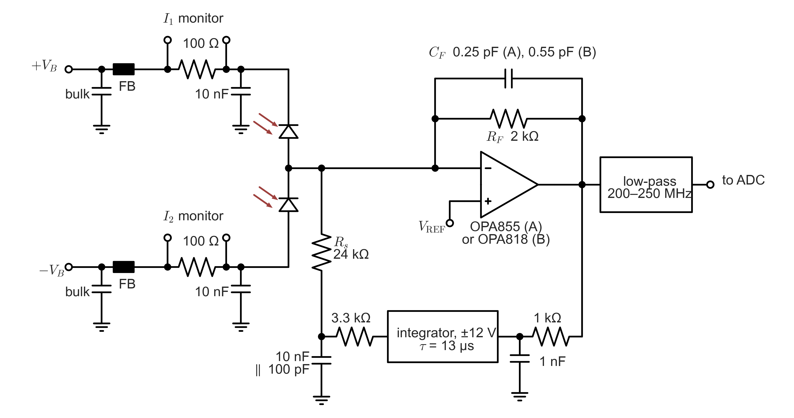

*Figure 37. The proposed balanced front end (Section 8.9, Table A8.10). Each photodiode bias, $\pm V_B$ from a linear regulator, passes bulk capacitance, a ferrite bead (FB, about 430 Ω at 100 MHz) and a 100-Ω monitor resistor to one low-inductance 10-nF capacitor at the photodiode pin. The bead and the single capacitor keep the regulator noise that reaches the summing node through the photodiode capacitance below 0.1 pA/√Hz per pF from 10 to 200 MHz (Section 8.8 (e), Table A8.9), and the drop across each 100 Ω reads that diode's current, $I_1$ or $I_2$, at 1 V per 10 mA. Both photodiodes sit at the summing node, within 1–2 mm. The amplifier is OPA855 on 5 V with $V_{\mathrm{REF}}$ = 2.58 V (variant A) or OPA818 on ±6.5 V with $V_{\mathrm{REF}}$ = 0.1 V (variant B); $R_F$ is 2 kΩ, or 1.5 kΩ for more dynamic range, and the total $C_F$ 0.25 or 0.55 pF (Tables A8.11 and A8.13). The imbalance servo is that of Section 8.8 (d): the integrator, on ±12 V, senses the output through 1 kΩ and 1 nF (160 kHz), integrates its difference from $V_{\mathrm{REF}}$ without inversion with $\tau$ = 13 µs, and drives $R_s$ = 24 kΩ through 3.3 kΩ into 10 nF in parallel with 100 pF (4.8 kHz), for ±0.5 mA of range and a high-pass corner of 1 kHz (Eq. (80)). Where the optics allow, the servo trims the optical split instead (Figure 35) and $R_s$ is left out. A second-order low-pass at 200–250 MHz sets the noise bandwidth before the ADC. Amplifiers: OPA855 (variant A) and OPA818 (variant B).*

Which variant is better depends on where the RF signal lies (Table A6.28), so both are carried here.

*Note on variant A's flagged corners.* The corners flagged in Table A8.11 lie at the upper $C_F$ corner with high open-loop gain, where $NG_\infty = 1 + C_T/C_F$ falls to 6.3–7.7, around the minimum stable gain of 7. There the analytical model finds a second loop-gain crossing at the plotted 4–7 GHz bump, while the main crossover keeps 50–63°. The plotted bump overstates the real one (Table A3.5), as for Table A6.13, but the macromodel shows that these corners do lose margin: the gain margin at 3–4 GHz falls to 1.4–3.1 dB, and 3 dB needs $NG_\infty \ge 7.5$ (Eq. (47), Section 5.5). Variant A therefore needs the tighter $C_F$ tolerance of Section 8.10. The 2-pF designs leave more room: the flag appears at 1 corner of 27 at 2 kΩ.

**How the two variants compare.** The numbers below are for 1 pF at the node and 2 kΩ; the other configurations follow the same pattern.
- **Noise.** Variant A is quieter wherever the amplifier's own noise matters. In the dark it leads by 3.7 dB at 100 MHz and 7.6 dB at 200 MHz; at 0.1 mA per diode by 1.1 and 3.6 dB. At 1 mA per diode the difference shrinks to 0.2 and 0.7 dB, and at 10 mA per diode to 0.02 and 0.08 dB, because shot noise dominates. In the macromodel variant B's dark noise at 100 MHz is 1.6 dB above the central estimate, an upper bound (Section 5.6).
- **Dynamic range at a 100-MHz tone.** Variant B leads by 0.6 dB in the dark, 2.7 dB at 0.1 mA, 3.4 dB at 1 mA and 3.5 dB at 10 mA per diode. On the central noise estimate its larger amplitude outweighs its higher noise even in the dark. With the macromodel's noise, at the best SPICE designs, it does so only from $I_1 + I_2$ = 30 µA up, and OPA855 leads in the dark, 80.8 against 79.5 dB, since OPA818's dark dynamic range there is 1.5 dB lower (Section 6.6.2, Table A6.33).
- **Dynamic range at other tones.** For tones at 20–50 MHz variant B's lead grows to 9–11 dB. At 150 MHz the two tie, and at 200 MHz variant A leads by 2.8 dB (Table A6.28).
- **Robustness.** Variant A keeps a worst case of 45–59° and needs no equalizer, and the macromodel confirms its phase margins, bandwidths and noise within a few degrees and per cent (Section 5.5). On the datasheet curve variant B keeps 21–30° and needs its peaking equalized per board; its 1.5-kΩ designs, at 21–26° worst case, sit at the edge of the Section 6.2.8 rule. In the macromodel it needs no equalizer but is slower: 226 MHz at 1 pF and 2 kΩ, and 333 MHz at 1.5 kΩ. At 1 pF and 2 kΩ its $C_F$ of Table A8.11 is the macromodel's 45°, ±0.1-pF design; accepting 40°, or trimming $C_F$ to ±0.05 pF, gives 259–309 MHz at 0.42–0.50 pF there (Table A5.10), and the loop caps the bandwidth near 375 MHz, which only an equalized design with about 10 dB of peaking approaches.
- **Imbalance.** Variant B tolerates up to 1.6 mA of uncorrected imbalance at 2 kΩ without losing dynamic range at a 100-MHz tone, so its servo can be coarser. Variant A loses dynamic range from the first microampere (Table A1.2).
- **Large signals and transients.** Variant A recovers from overdrive in 3 ns against 25 ns, and its datasheet distortion near 100 MHz is 10–20 dB lower. The macromodels confirm variant B's large-signal advantage below 100 MHz (Table A5.12).

### 8.10 Starting component values

This section turns the designs into parts. Table A8.13 gives starting values for the two variants of Section 8.9 and for the alternatives that Section 9.2 names: OPA856 and LMH6629 for a straightforward board, and OPA955 once it is released. Three properties of the feedback resistor matter.
- **Package.** Use a thin-film $R_F$ in 0402 or 0201. Its body and pads give the 0.1–0.3 pF of parasitic capacitance assumed throughout. TI quotes up to 0.2 pF for the resistor alone [A2].
- **Tolerance.** 1 % is adequate. The transimpedance gain error is the resistor tolerance.
- **Very small $C_F$ and high crossover.** TI recommends two series resistors of $R_F/2$ when the required $C_F$ is below 0.15 pF (OPA818 p23, OPA856 p24, OPA858 p26); above 400 MHz (relevant for OPA855 and OPA955, whose loops cross near 0.8–1 GHz) two 0201 parts in series also halve the distributed RC and series inductance (~0.3–0.5 nH) of a single 0402 resistor.

The external capacitor is the target total minus the 0.2-pF nominal parasitic. Discrete RF capacitors are available down to 0.1 pF in 0.1-pF steps, typically with ±0.05 pF tolerance.

**Notes on Table A8.13.**

*OPA855.*
- **Window and target.** In the vendor's macromodel the window over ±0.2 pF of photodiode capacitance is 0.157–0.300 pF at 2 kΩ: peaking sets its lower edge, and a 3-dB gain margin at 3–4 GHz, i.e. $C_F \le C_T/6.5$ (Eq. (47)), sets its upper edge (Table A5.8). The total $C_F$ should therefore be 0.230 ± 0.070 pF at 2 kΩ and 0.240 ± 0.055 pF at 1.5 kΩ, or be trimmed (Table A5.9). The datasheet curve gives the wider 0.15–0.36 pF at 2 kΩ and 0.17–0.36 pF at 1.5 kΩ, whose upper edge is the minimum-gain rule $C_F \le C_T/6$; it would accept ±0.1 pF around 0.25 pF at 2 kΩ and about ±0.08 pF at 1.5 kΩ. The OPA855 rows of Table A8.13 are these datasheet-curve designs. No discrete capacitor is needed if the resistor and pads give 0.2–0.25 pF.
- **Adjusting on the board.** Measure the peaking of the first board and trim with pad copper. A 0.1-pF capacitor is the right part only if the parasitic proves to be about 0.15 pF or less.
- **Noise bandwidth.** Both designs have 420–540 MHz of bandwidth on the datasheet curve, and 481–630 MHz at the macromodel's targets (Table A5.9). Set the noise bandwidth with a first- or second-order filter at 200–250 MHz after the TIA (Section 6.3.3).
- **Supply.** With 5 V single supply, set $V_{\mathrm{REF}}$ to 2.58 V, which centres the output at zero imbalance and lies inside the 1.1–4.6 V input range.
- **With 2 pF at the node** (1 pF in each diode) the macromodel's window is 0.188–0.454 pF at 2 kΩ, and the total $C_F$ should be 0.320 ± 0.130 pF at 2 kΩ and 0.335 ± 0.115 pF at 1.5 kΩ, so ±0.1 pF fits without trimming (Tables A5.8 and A5.9). On the datasheet curve the window is 0.175–0.525 pF, and a total of 0.35 pF gives 280 MHz at 68°, moving between 201 and 436 MHz for ±0.1 pF (`data/results/balanced_detector.json`).

*OPA856 and LMH6629.* The values are deliberately in the flat-to-0.1-dB region. On the datasheet curves both tolerate the parasitic corners with ≥ 46° of phase margin; in SPICE OPA856 keeps 50–62°, while LMH6629 keeps 41–47°, the gap between its macromodel's gains from the two inputs (Sections 5.3 and 5.5).
- **LMH6629.** The COMP pin must be high (WSON-8), or use the SOT-23-5 version, which is internally fixed at G ≥ 10. TI notes that the SOT-23-5 version peaks more (2 dB at G = 10 in a voltage-gain circuit) and has worse HD2 (LMH6629 p5, p15).
- **OPA856.** It can carry a feedback clamp diode across $R_F$ because it is unity-gain stable (OPA856 p19, Fig 9-1). This is useful against optical overload.

*OPA818 as a 2-kΩ TIA.*
- **Without added capacitance (0.55 pF).** It gives 207–372 MHz, but only 30–34° of phase margin. Across parasitic and part-to-part spread the worst case is 28° (Section 6.2.8), which is enough if any peaking is equalized afterwards. In the macromodel the same design keeps 45.4° at the worst capacitance corner, with no peaking (Table A5.6).
- **With 2 pF added.** It gives 40° at 181 MHz. That costs 3 dB of noise (Table A6.12) and is still below TI's 45° guidance.
- **At 1.5 kΩ.** It is not recommended without equalization. With equalized peaking, $C_F$ = 0.55 pF gives 442 MHz at 27° with a 21° worst case. That is variant B's 1.5-kΩ design (Section 8.9), at the edge of the rule of Section 6.2.8.
- **With 2 pF at the node** (1 pF in each diode) the minimum-gain limit rises to 0.79 pF. At 2 kΩ, 0.55 pF gives 302 MHz at 35° with a 30° worst case, and 0.65 pF gives 239 MHz at 37° with a 32° worst case (Table A8.11).

*OPA955.* These rows are for planning only; all of its datasheet values are preliminary. They add the 2–3 pF that the datasheet curve needs for 45°; its macromodel needs none and is robust at 0.220 ± 0.050 pF with 560 MHz and 46° at the worst corner (Section 6.5, Table A6.32). The 1–2 MHz difference from Table A6.12 comes from rounding $C_F$ to 0.31 and 0.44 pF.

### 8.11 What not to do

Each item below follows from a result of this chapter, cited with it.

- **Bootstrapping or cascoding 0.5–1-pF photodiodes for noise.** It adds more noise than it removes in the dark and at low current, and it lowers the noise gain of the decompensated amplifiers (Sections 8.6 and 8.7).
- **An undegenerated transistor current source at the summing node as the DC actuator.** It adds the full shot noise of its current and 0.1–0.5 pF (Section 8.2, Eq. (30)).
- **Driving the injection resistor straight from an op amp**, or the base of a splitting transistor without a divider and an RF bypass. The servo amplifier's noise then reaches the summing node (Section 8.8 (a)).
- **A bank of capacitors of different values at a photodiode bias pin.** It can resonate inside the band (Section 8.8 (e), Table A8.9).
- **Correcting a large optical imbalance electronically when the laser is noisy.** The imbalance current keeps its RIN (Eq. (77)).
- **Carrying 10 mA of DC through an $R_F$ small enough to hold it, without a second stage.** On a 5-V part that means $R_F$ ≤ 305 Ω (Section 8.5). At 286 Ω its Johnson noise alone, 7.6 pA/√Hz, exceeds the 5.66 pA/√Hz shot noise of 0.1 mA (Table A1.1), and the instrument's noise reaches the photocurrent through a transimpedance 2 kΩ/286 Ω = 7.0 times smaller (Eq. (34)). Option D restores the gain in a second stage.

---

## 9. Conclusions and recommendations

The chapters above follow one argument. The 1-pF, 2-kΩ operating point makes stability, not noise, the first test an amplifier must pass; the balanced pair keeps the DC out of the feedback resistor, provided its imbalance is servoed to zero; and from about 0.15 mA up the light sets the noise floor, so the ceiling sets the dynamic range. This chapter draws the conclusions in that order: the three constraints (Section 9.1), the choice of amplifier and the reasons for it (Section 9.2), the front end that follows (Section 9.3), what limits the dynamic range and what would raise it (Section 9.4), how far the numbers can be trusted (Section 9.5), what the next stage must respect (Section 9.6), and what only a simulation or a measurement can settle (Section 9.7).

### 9.1 The three constraints that decide the design

**(i) Stability at 2 kΩ and 1 pF.** At this operating point the loop crosses over at a noise gain of only about 7–12, the minimum stable gain of the decompensated amplifiers, the class that offers the most gain–bandwidth for the least voltage noise, and the noise gain is still rising there, which costs a further 14–30° of phase (Eq. (17)). Section 6.2 gives the mechanism and the results, and Sections 3.4 and 3.9 the derivation and its check against TI's own TIA data.

This constraint, not noise, is the first filter. With nominal parasitics (Section 1.4), seven parts reach ≥ 150 MHz with a phase margin ≥ 45° and ≤ 1 dB of peaking without deliberately added input capacitance (Table A9.1): OPA855 (539 MHz), OPA858 (539 MHz with its open-loop curve as plotted, and 454 MHz with the more credible calibrated curve and 1 pF added), LMH6629 with the COMP pin high (276 MHz), OPA856 (231 MHz), OPA859 (211 MHz), THS4304 (191 MHz) and OPA843 (150 MHz, marginal). OPA846 and OPA818, two of the six parts on the starting list (Section 2.2), are not among them, and what it would take to rescue them shows what the operating point costs:
- They reach at most 35° and 34° of phase margin at any feedback capacitance. These margins rest on the datasheet open-loop curves; the vendors' SPICE macromodels give more, 49° for OPA818 at $C_F$ = 0.55 pF and 45° for OPA846 at 0.75 pF. OPA818's model reproduces its datasheet's measured response at a gain of 7, which the curve does not once the input capacitance is included, and OPA846's model peaks less than its datasheet shows (Section 5.4).
- Added input capacitance raises the margin at the cost of noise and bandwidth. 40° costs 2 pF and raises the band noise penalty by 1.6 dB (OPA846) or 3.0 dB (OPA818); 45° costs 5–8 pF and 3.7–8.3 dB more noise, and leaves only 114–159 MHz. TI's own OPA818 datasheet calls anything below 40° "not recommended" (OPA818 p22).
- If the peaking is equalized afterwards, a nominal phase margin of about 25° (with $C_F$ ≥ 0.4 pF) keeps every unit stable across parasitic and part-to-part spread (Section 6.2.8). OPA846 and OPA818 then need no added capacitance, but they stay about 3 dB noisier than OPA855.

OPA847 (minimum stable gain 12) reaches only 9°. A larger photodiode capacitance relaxes the constraint slightly: with 1 pF in each diode of the pair (2 pF at the node, Section 6.3.5), OPA855 still reaches 521 MHz robust at 2 kΩ, its band penalty rises from 3.1 to 3.6 dB, and its $C_F$ window widens from 0.15–0.36 pF to 0.175–0.525 pF.

**(ii) The DC photocurrent must stay out of $R_F$.** The 0.1–10 mA of DC photocurrent flows in a balanced pair of photodiodes, not in one photodiode (Section 1.2), and that is what makes the design possible. A single-ended detector at these currents cannot be built around any candidate: at 2 kΩ, 10 mA would need 20 V across $R_F$, and the largest DC current a candidate can carry through $R_F$ is
- 1.5–1.7 mA for the 5-V parts (OPA855, OPA858, OPA859, OPA856, OPA955, LMH6629);
- 4.3 mA for OPA846 on ±6 V;
- 5.5 mA for OPA818 on ±6.5 V, with the current flowing out of the summing node.

In the balanced pair the two DC photocurrents cancel at the summing node, and $R_F$ carries only the imbalance $\Delta I = I_1 - I_2$. An uncorrected imbalance still moves the output off centre and costs dynamic range: on a 5-V part at 2 kΩ, 0.1 mA costs 1.2 dB and 0.5 mA costs 9.3 dB (Table A1.2). Because dynamic range is the priority of this design, the imbalance is servoed to zero (Section 8.8). The quietest way is to trim the optical split, which nulls the DC and the laser's intensity noise together. The electronic way that adds least is a resistor from the summing node to a filtered servo output: covering ±0.5 mA from ±12 V, a 24-kΩ resistor adds 0.83 pA/√Hz.

**(iii) The light sets the noise floor.** The shot noise of a balanced pair is that of the total photocurrent, $2q(I_1 + I_2)$: the shot noises of the two diodes are independent and add in power, while their mean currents subtract. It equals the Johnson noise of 2 kΩ at a total of only 25.7 µA (Section 3.6). At $I_1 + I_2$ = 0.1, 1 and 10 mA it is 5.9, 15.9 and 25.9 dB above the 2-kΩ floor; with 10 mA in each diode (20 mA in total) it is 28.9 dB above. The best TIAs have a total noise, $R_F$ included, of 3.2–5.2 pA/√Hz at 100–200 MHz, against shot noise of 5.66, 17.9, 56.6 and 80.05 pA/√Hz at those currents. Two regimes follow. At ≥ 1 mA every candidate in Table A9.2 is within 0.1–0.6 dB of the shot-noise limit at 100 MHz and within 0.2–1.6 dB at 200 MHz, so the choice is governed by bandwidth margin, output swing and robustness. At 0.1 mA and 150–200 MHz, the amplifier's own noise, its current noise $i_n$ and its voltage noise $e_n$ acting on the input capacitance, still matters. A ranking by GBW or by $e_n$ alone would therefore mislead in both regimes.

### 9.2 The choice of amplifier, and why

The three constraints rank the amplifiers by four criteria, in the order in which the 0.1–10 mA operating range of the balanced pair imposes them:
1. a robust loop (phase margin ≥ 45°) at ≥ 150 MHz without paying for it in noise;
2. noise at 100–200 MHz relative to the shot noise of 0.1 mA, the lowest planned total current;
3. RF amplitude, which sets the dynamic range once the imbalance is servoed to zero, and headroom for an uncorrected imbalance;
4. layout tolerance, package and availability.

GBW and $e_n$ enter only through these criteria. Table 9.1 gives the ranking that results, and Table A9.2 collects the figures of the eight leading amplifiers at 2 kΩ. In Table A9.2, "robust" is the widest bandwidth with a phase margin ≥ 45° and ≤ 1 dB of peaking, adding input capacitance only if needed, and "flat" the smallest feedback capacitance that gives ≤ 0.01 dB of peaking (Section 1.5). Noise is input-referred at 100 / 200 MHz, and the FET-input parts and OPA955 show a central estimate with the upper estimate in brackets (Section 3.7). "Penalty" is the band-integrated noise relative to the 2-kΩ Johnson floor over 10–150 MHz, and "clearance" the shot noise of 1 mA relative to all other noise at 100 / 200 MHz. $I_{\mathrm{DC,max}}$ is the largest DC current that $R_F$ can carry, that is, the largest imbalance $|I_1 - I_2|$ that can be left uncorrected, with the output pushed to one limit (Section 6.4.1). $V_{\mathrm{pk}}$ is the largest undistorted output amplitude at 100 MHz, with what limits it, and DR is in 150 MHz at $I_1 + I_2$ = 1 mA, with the imbalance servoed to zero.

*Table 9.1. Ranking. Amplifiers: OPA855, OPA955, LMH6629 (COMP HI), OPA856, OPA858, OPA859, THS4304, OPA818, OPA846, OPA843, and the remaining parts of Table A6.5 in the last row.*

| Rank | Part | Why |
|---|---|---|
| 1 | **OPA855** | Robust 539 MHz at 2 kΩ and 728 MHz at 1.5 kΩ with no added capacitance. Second-lowest noise of all (3.1 dB band penalty), below the 0.1-mA shot noise to 200 MHz. Full 3-V swing to 150 MHz. Production part, USD 3.05. Weaknesses: 5-V swing, a 0.15–0.36 pF $C_F$ window, WSON-8 2×2 mm |
| (watch) | OPA955 | Lowest noise of all: 0.9–1.2 dB, or 2.1–2.8 dB with the 2–3 pF needed for 45°. Same package and swing as OPA855. Advance Information only; do not design in until it is released |
| 2 | **LMH6629** (COMP HI) | Robust 276 MHz (2 kΩ) and 316 MHz (1.5 kΩ). 250 mA of output current. A wider and larger $C_F$ window (0.44–0.78 pF). SOT-23-5 option. Costs 1.5 dB more noise than OPA855, and its 4-pF differential capacitance is a simulated value |
| 3 | **OPA856** | Unity-gain stable, so any $C_F$ ≥ 0.45 pF works. Nearly OPA855's noise (3.2 dB). Robust 231 MHz (2 kΩ) and 263 MHz (1.5 kΩ). Slew-limited to 0.56 V peak at 100 MHz, and only about 11 dB of loop gain at 100 MHz, so it is weak for large RF signals |
| 4 | OPA858 | As quiet as OPA855 at the central estimate, but its open-loop data conflict. With the more credible calibrated curve it needs 1 pF added to reach 45°. Its FET current noise may add up to 2.6 dB, and its overdrive recovery is 200 ns |
| 5 | OPA859 | Unity-gain stable (211 MHz robust at 2 kΩ), but its 3.3-nV/√Hz CMOS input costs 6.4–8.1 dB of noise |
| 6 | THS4304 | Unity-gain stable, SOT-23-5, very forgiving (64–73° at the corners), 191 MHz robust, 6.5 dB penalty. A 2004 part at USD 7.49 |
| 7 | OPA818 | Highest dynamic range of all the candidates from about 70 µA up, by up to 11 dB for tones at 20–50 MHz (Table A6.28). Phase margin ≤ 34° at this operating point: the best part for a second, voltage-gain stage, or for a TIA whose peaking is equalized (Section 6.2.8) |
| – | OPA846 | Phase margin ≤ 35°, 625 V/µs, 3.8 pF input. Worse than OPA818 on every axis except price |
| – | OPA843 | Robust only to 150 MHz at 2 kΩ (166 MHz at 1.5 kΩ), 7.1 dB penalty |
| – | all others | Fail at ≥ 150 MHz with ≥ 45° (Table A6.5) |

**OPA855 comes first because it is the only production part that meets the first three criteria at once.** It is quiet, with a 3.1 dB band penalty over the 2-kΩ floor and 12.7 dB below the 1-mA shot noise at 100 MHz. It is robustly stable, with 58–63° of phase margin at 2 kΩ and no added capacitance. And it swings its full 3.05 V peak-to-peak at 100 MHz; its slew limit is 4.4 V peak. Its limits are the 5-V supply, which allows 1.5 mA of uncorrected imbalance through $R_F$ and 1.52 V peak of RF, and a narrow feedback-capacitance window. $C_F$ must stay between 0.15 and 0.36 pF at 2 kΩ: the lower limit comes from peaking and the upper from the minimum stable gain of 7 (Section 6.2.4). A SPICE scan with the vendor's macromodel moves the upper limit to $C_T/6.5$, the point where the gain margin at 3–4 GHz falls to 3 dB. Over ±0.2 pF of photodiode capacitance this gives a window of 0.157–0.300 pF, so the total $C_F$ must be held to 0.230 ± 0.070 pF (0.240 ± 0.055 pF at 1.5 kΩ), or trimmed (Section 5.5). With 1 pF in each photodiode (2 pF at the node) OPA855 remains the best part: 521 MHz robust at 2 kΩ, a 3.6 dB band penalty, and a wider $C_F$ window of 0.175–0.525 pF, inside which $C_F$ alone sets the bandwidth anywhere from about 170 to 580 MHz (Section 6.3.5). In SPICE that window is 0.188–0.454 pF, wide enough for ±0.1 pF of spread (Section 5.5). OPA855 is variant A of the proposed front end (Section 8.9). OPA955 is quieter still, with a 0.9–1.2 dB penalty, or 2.1–2.8 dB with the 2–3 pF it needs for 45°, in the same package and with the same swing. However, it exists only as Advance Information and a pre-production (X-prefix) orderable, so we watch it and do not design it in yet.

**For 200–300 MHz OPA855 is again the choice, because its $C_F$ window covers about 250–700 MHz at 2 kΩ.** At $C_F$ = 0.30–0.35 pF it gives 260–330 MHz with 63–66° of phase margin, and at 0.25 pF it gives 420 MHz, which a post-filter brings down. Lower bandwidths always need a post-filter, because $C_F$ above 0.36 pF violates the minimum stable gain. The runner-up is LMH6629 with the COMP pin high, at 229 MHz with 52° or 272 MHz with 46°. It offers 250 mA of output current for driving 50-Ω loads, a 0.44–0.78 pF $C_F$ window and a SOT-23-5 option. It costs 1.5 dB more noise than OPA855, from its 5.7 pF of input capacitance, of which the 4-pF differential part is a simulated, not measured, value.

**For a straightforward board, OPA856 trades amplitude for tolerance.** It is unity-gain stable, so there is no minimum-gain trap: any total $C_F$ from 0.45 to 3 pF gives ≥ 45° of phase margin at 2 kΩ, 0.55 pF gives about 205 MHz and 53°, and ±0.1 pF of resistor parasitic moves it only between 175 and 235 MHz. It is nearly as quiet as OPA855 (3.2 dB penalty). Its slew rate, however, limits it to 0.56 V peak at 100 MHz, so it suits an RF photocurrent below about 0.28 mA peak at 2 kΩ, and with only about 11 dB of loop gain at 100 MHz it is weak for large RF signals. For larger signals the practical choice is LMH6629 with the COMP pin high, which is also available in a leaded SOT-23-5 package, fixed at G ≥ 10.

**OPA818 gives the most dynamic range of any single amplifier, at the price of a marginal loop.** It is the best of the three decompensated parts of the starting list, which Table A9.3 sets side by side. It tolerates the largest uncorrected imbalance of all candidates, 5.5 mA at 2 kΩ and 7.3 mA at 1.5 kΩ. It has the largest RF amplitude, 2.23 V peak at 100 MHz, slew-limited, and 4.5–5.5 V at 20–50 MHz (Table A6.28). With it comes the highest dynamic range of all the candidates for a 100-MHz tone: 78.0, 70.7 and 61.1 dB at $I_1 + I_2$ = 0.1, 1 and 10 mA, and 58.1 dB with 10 mA in each diode. For tones at 20–50 MHz its lead over the 5-V parts grows to 9–11 dB; at 150 MHz it is gone (Table A6.28). Its JFET input has no shot noise of its own. With a 1-pF photodiode at 2 kΩ, however, its phase margin cannot exceed 34°, which leaves three options. We can accept a 33–34° design, with a total $C_F$ ≈ 0.55–0.62 pF and 240–330 MHz, verified in simulation and on the board; its upper end, $C_T/6$, keeps the high-frequency noise gain at the minimum stable gain of 7, and across parasitic and part-to-part spread it keeps a worst case of 25–28° (Section 6.2.8). We can add 2 pF at the input, for 40° at 181 MHz and 3 dB more noise. Or we can move OPA818 to a stage where its noise gain is naturally higher, the second stage of Option D (Section 8.5). As a 33° TIA it should be used only after simulation and a board measurement confirm the phase margin, and it is worth that effort where the RF signal lies below about 100 MHz and dynamic range comes first. It is variant B of the proposed front end (Section 8.9). OPA846 reaches a similar 34.5° with less than half the slew rate (625 against 1400 V/µs) and more input capacitance (3.8 against 2.4 pF), so it is worse than OPA818 on every axis except price; a bench OPA846 TIA at 1.2 kΩ agrees with the model in both noise and peaking, for about 14 pF at its input (Section 3.10). OPA847, with a minimum stable gain of 12, reaches only 9°, has no stable flat design, and cannot be used here.

**If the receiver must also resolve signals below about 100 kHz, the order changes (Section 6.9).** OPA855 then adds the most noise of the ten, 35 pA/√Hz at 1 kHz from the 1/f noise of its base current, and OPA856, THS4304 and the CMOS-input OPA859 and OPA858 follow. OPA955 is quiet at both ends but not yet released. Among production parts OPA818 balances the two: it keeps 262 MHz and adds 0.2 dB at 1 kHz and 1.7 dB at 100 Hz from 1 mA up (Table A6.37).

**If the pair carries only tens of microamperes, a larger feedback resistor restores the light's lead (Section 6.10).** The resistor's own capacitance then sets the band: 150 MHz needs $R_F \le$ 5.3 kΩ with 0.2 pF of parasitic, or 10.6 kΩ with 0.1 pF. Up to that limit OPA855 remains the choice. At 3–5 kΩ it keeps 182–334 MHz with 66–73° of phase margin and no added capacitance, and the pair's shot noise exceeds its own noise from 37–44 µA. Its current noise exceeds the resistor's from about 2.6 kΩ, but in this band it costs less than the voltage noise of the FET parts. Above about 10 kΩ, or with still less light, the companion note continues.

### 9.3 The front end that follows

The proposed balanced front end (Section 8.9) comes in two variants that share everything except the amplifier and its feedback capacitance. Both have the photodiodes directly at the summing node. The imbalance is nulled optically, or by a 24-kΩ servo resistor. The bias is fed through a bead and a single low-inductance capacitor per pin, and a post-filter follows at 200–250 MHz. Which variant is better depends on where the RF signal lies.
- **Variant A, OPA855**, gives the lowest noise, and a dynamic range at least equal to variant B's for tones from 150 MHz up. Its worst-case phase margin is 45–59°, and it needs no equalizer. With 1 pF in each diode it gives 280 MHz at 68° with $C_F$ = 0.35 pF.
- **Variant B, OPA818**, gives the largest dynamic range for tones below about 100 MHz: with equalized peaking and 10 mA in each diode, 3.5 dB more than variant A at a 100-MHz tone (Table A8.12) and 9–11 dB more at 20–50 MHz. It costs 3.7 dB more dark noise at 100 MHz and a worst-case phase margin of 21–30° instead of 45–59°, so its peaking is equalized per board. With 1 pF in each diode it gives 302 MHz at 35° with $C_F$ = 0.55 pF. In the vendor's SPICE macromodel, variant B keeps 39–45° at its worst capacitance corner without an equalizer, at 226–333 MHz, and its dark noise there is up to 1.6 dB higher than our estimate (Chapter 5).

### 9.4 What limits the dynamic range, and what would raise it

**From about 0.15 mA up, the ceiling sets the dynamic range, not the noise.** The shot noise of the pair then dominates the floor. Even a noiseless amplifier would gain only 0.8 dB over OPA855 at $I_1 + I_2$ = 0.1 mA and 0.1 dB at 1 mA, while every doubling of the output amplitude gains 6 dB at every photocurrent (Section 6.6.3, Eq. (51), Figure 25, Table A7.1). SPICE confirms the dynamic range of Table A6.29 for OPA955, OPA855 and OPA858 within 0.2 dB at every photocurrent. OPA818 loses 1.5 dB in the dark and nothing from 1 mA up, and LMH6629's gain in SPICE comes from its model's small input capacitance and is not counted (Section 6.6.2).

**Among single op amps, the amplitude decides.** OPA818, with the largest amplitude, leads from 30–69 µA up, for tones below 145–148 MHz. It is slew-limited above 40.5 MHz, and its 2.23 V at 100 MHz is 3.3 dB above the 1.52 V of the 5-V parts. A faster slew rate would raise the ceiling at every photocurrent, and a higher supply only for tones below the swing–slew crossover (Eq. (52)). OPA855, or OPA955 once released, gives the most in the dark and at the highest tones (Sections 6.6.2–6.6.3).

**Lowering the floor further does not pay.** A discrete transistor at the summing node can match the best op amp's noise but cannot raise the dynamic range from 0.1 mA up, whatever its type. Silicon JFETs bring 6–7 pF to a node of 1.6 pF, so their cascoded composites stay below 150 MHz (98–141 MHz at the worst capacitance corner) and are noisier than OPA855 (53.5–55.4 nA rms against 49.6 nA). A GaAs pHEMT (CE3512K2) and a SiGe bipolar transistor (BFP740ESD at 1 mA) give composites that are robust at 150 MHz with 36.5 and 39.1 nA rms, about OPA955's 38.8 nA, because they deliver 46–259 mS of transconductance per picofarad of input capacitance against 5–7 mS/pF for the JFETs. From 0.1 mA up the photocurrent's shot noise hides the difference, within the bound of 0.8 dB over OPA855 at 0.1 mA, so the pHEMT and bipolar composites, at 36.5–39.1 nA, only tie OPA955; at high photocurrent a bipolar transistor's base current costs nothing, but the shot noise hides every front end alike. In hardware the pHEMT's negative gate voltage, its unspecified gate current and baseband noise, and its stability at microwave frequencies need care (Section 7.1, Tables A7.3–A7.4).

**Raising the ceiling does pay, and a fast high-voltage stage inside the $R_F$ loop is the composite that does it.** OPA859 driving a THS3491 at a gain of 4–5.5, with a capacitor $C_L$ from the OPA859's output to the summing node, is robust over every capacitance corner (45.0–45.6° of worst-case phase margin, 152–171 MHz of worst-case bandwidth) and swings 6.0–8.3 V at 100 MHz, against 2.23 V for OPA818. Without $C_L$ the composite is unstable at every gain from 3 up. At a gain of 5.5 its dynamic range at 100 MHz is 87.3, 86.4, 81.8 and 73.1 dB at 0, 0.1, 1 and 10 mA, 7.8–11.9 dB above OPA818 (11.1 dB at 1 mA), although its noise (136.5 nA rms) is 1.6 times OPA818's. It needs ±15-V rails, dissipates 1.0 W in the THS3491 at its 8.3 V of swing, and has a narrow stability window. At full swing at 100 MHz it carries about −54 dBc HD2 and −47 dBc HD3, because the loop does not suppress the THS3491's harmonics there; a −55-dBc limit on every harmonic would hold the output to 2.5 V and the dynamic range at 1 mA to 71.3 dB (Section 7.2, Tables A7.7–A7.8). The THS3491's datasheet curves do not agree with each other: its open-loop transimpedance (Fig 8-22) does not describe its measured closed loop (Fig 8-1), so the analysis uses its model, which does at gains of 5–20. SPICE runs of the vendors' models confirm the analyses of both composites. Over 52 designs at nominal capacitances, 48 of them stable, the phase margins agree within 1.3° (within 5.5° for two unstable pHEMT designs that cross over above 1.2 GHz), the gain margins within 0.4 dB and the band noise within 1.0 %. At the worst corner of each design of Tables A7.4 and A7.7 they agree within 0.2° and 0.5 dB (Section 7.3).

**Single-chip TIAs fall short for the same reason: their linear input is small.** Every single-chip TIA with public figures is at least 8.8 dB behind at 1 mA. No lidar TIA comes within 10 dB: their linear input ranges are 3–250 µA, against 0.77–1.14 mA for the op-amp designs, and the best, LMH32401 at 2 kΩ, gives 57.2 dB at 1 mA against 67.6–70.7 dB. The coherent-receiver TIAs, made for a balanced pair with one photodiode on each input, are 8.8–32.1 dB behind at 1 mA at the gains where their noise is published, because their output is held at a few hundred millivolts, so at those gains their linear input is only 38–500 µA peak (Eq. (53)). GX39220 at 500 Ω, the only one with a full public datasheet, gives 58.8 dB, and MATA-006801 at its 2 kΩ gives 52.5 dB (Section 6.7). Their full 3 mAppd of linear input holds only at 167–233 Ω, where no noise is published; there a TIA would match OPA818 at 1 mA only if it added no more than 17.9 pA/√Hz within 150 MHz (Eq. (54)). No public document gives that figure; a full datasheet or a measurement of GX39221 or MATA-006801 at that setting would settle it.

**The same trade between floor and ceiling decides the comparison with a plain 50-Ω termination (Section 6.8).** For the receiver as specified, a small RF signal on 0.1–10 mA, every design we carry forward beats a 50-Ω termination with a 2-dB amplifier at every photocurrent, because only the noise matters for a small signal. OPA855 leads by 15.0 dB in the dark, 10.6 dB at 0.1 mA, 4.0 dB at 1 mA and 0.6 dB at 10 mA; OPA955 and the pHEMT composite lead by 17.2 and 17.7 dB in the dark and 11.2 and 11.3 dB at 0.1 mA; and the high-voltage composite, the noisiest, by 6.2 dB in the dark (Figure 26(a)). For this a TIA needs only less band noise than the chain, whose 22.85 pA/√Hz integrate to 279.8 nA rms in 150 MHz; the designs here have 2.0–7.7 times less in the dark. For large signals the benchmark wins from about 1.2 mA up, because its ceiling is higher. A TIA on a 5-V op amp clips at 0.54 mA rms, so it follows fully modulated light only up to $I_1 + I_2$ = 0.76 mA, while a 50-Ω chain that compresses at −20 dBm follows it to 1.26 mA, and one at −10 dBm to 4.0 mA. The chain's usable dynamic range overtakes OPA855's and OPA955's at 1.16–1.17 mA and OPA818's at 1.56 mA (6.04 mA for a chain at −20 dBm). The compression level that matches a design is $P_{\mathrm{eq}} = (R_0/4)I_{\max}^2$: −24.4 dBm for OPA855, −24.3 dBm for OPA955, −23.6 dBm for the pHEMT composite, −20.9 dBm for OPA818 and −9.0 dBm for the high-voltage composite. A chain compressing at −10 dBm has more electronic dynamic range than every op-amp design from 0.1 mA up, but most of the tones that assumes are larger than the light can supply. To beat the chain at every photocurrent, a TIA needs an output amplitude of $|Z_T|\,I_{\mathrm{DC}}\,10^{-A/20}$, about 18.5 V at 10 mA and 2 kΩ (Eq. (6)). The high-voltage composite, with 8.3 V, comes closest: no chain that compresses at −10 dBm or below overtakes it, and a 0-dBm chain only above 5.0 mA.

For dynamic range at 0.1–10 mA, then, a single op amp is the simplest answer and the high-voltage composite the best. OPA818 (variant B) gives the most of any single amplifier for tones below about 145 MHz, OPA855 the most in the dark and at the highest tones, and the high-voltage composite adds 7.8–11.9 dB to OPA818 from the dark to 10 mA at a 100-MHz tone, at the cost of about −47 dBc HD3 at full swing, ±15-V rails and a narrow stability window.

### 9.5 How far the numbers can be trusted, and what to watch

The numbers of Chapters 3, 4, 6 and 8 rest on the analytical model with the datasheet open-loop curves, and Chapter 5 tests that model against the manufacturers' SPICE macromodels of OPA855, OPA818, OPA856, OPA858, OPA859, LMH6629 and OPA846. The test confirms the method. Fed with each macromodel's own open-loop gain, input admittance, output impedance and noise sources, our equations reproduce every SPICE result to 0.1° of phase margin, 1 % of bandwidth and 0.3 % of noise. With only one open-loop curve and a pure input capacitance, as used throughout this note, the phase margins stay within about 2° (6° for LMH6629), but the gain margins come out 4–7 dB optimistic with the same open-loop data. Our own gain margins, from the datasheet curves, are 1.1–5.1 dB above SPICE for OPA855, LMH6629 and OPA859 and 4.5–18.3 dB below it for the other four (Section 5.9). The cross-check confirms variant A (62.5–69.1° of phase margin, 291–548 MHz, noise within 2.5 %) and the large-signal limits of Table A6.28, which are the models' limits within 7 %. It changes four things:
- Variant A's feedback capacitance must be held more tightly. Its gain margin at about 3.4 GHz falls as $20\log_{10}(NG_\infty/5.3)$ with the high-frequency noise gain $NG_\infty = 1 + C_T/C_F$, so 3 dB needs $C_F \le C_T/6.5$. With 1 pF at the node, the total $C_F$ must be held to 0.230 ± 0.070 pF (2 kΩ) or 0.240 ± 0.055 pF (1.5 kΩ), or trimmed on the first board, which is tighter than the ±0.1 pF that Table A8.13 assumes; with 2 pF at the node, ±0.1 pF fits (0.320 ± 0.130 pF at 2 kΩ).
- Variant B is more stable and slower in the vendor's model: 39–45° at the worst capacitance corner, against our 23–30° over the same nine corners (21–30° over the 27 of Table A8.11), no equalizer needed, and 226–333 MHz instead of 302–442 MHz. The model reproduces the datasheet's measured response at a gain of 7, and the datasheet's open-loop curve, used with the part's input capacitance, does not. Accepting 40°, or trimming $C_F$ to ±0.05 pF, buys back 6–37 % of bandwidth (309 MHz at 1 pF and 2 kΩ). Its dark noise in the model is up to 1.6 dB higher than our estimate, an upper bound.
- OPA858's open-loop gain is the table's 5.5 GHz, not the plotted curve's, so its entries that use the plotted curve are optimistic.
- Across eighteen macromodels, OPA955 gives the best design at 1 pF and 2 kΩ: 0.90 dB of noise penalty and 560 MHz without added capacitance, against OPA855's 3.01 dB and 535 MHz. It is still advance information. The parts we ranked as less suitable stay so, and the JFET-input op amps OPA817 and OPA814 cannot reach 150 MHz robustly (Section 6.5).

LMH6629's input capacitance (5.7 pF in the datasheet, 1.3 pF in the model) and the high-frequency current noise of the FET parts remain open; only a measurement can settle them.

Some designs need care whatever the models say, because they are marginal, sensitive to the board's parasitics, or rest on values that are simulated or preliminary:

1. **Every design below 50° of phase margin.** This covers OPA855 with the calibrated curve (51° flat at 2 kΩ; Table A6.7), OPA818 and OPA846 at any $C_F$, and OPA955 with added capacitance (45°). Flat transimpedance hides low phase margin (Figure 17). The output noise and the response to load or supply disturbances still peak. For designs whose peaking will be equalized, Section 6.2.8 gives the worst-case limits. The vendors' macromodels give OPA818 and OPA846 more margin than these analytical numbers (Section 5.5).
2. **OPA855 and OPA858 with no external $C_F$.** The design rests on a parasitic that, at 0.1 pF, gives 36–38° and 3–3.6 dB of peaking (Table A6.9). Aim for 0.25 pF total and verify.
3. **Any external $C_F$ below 0.1 pF.** It is not a reproducible discrete part (Table A8.13, OPA855 rows). Use pad geometry, or two series resistors, as the datasheets advise.
4. **$C_F$ above $C_T/(G_{\min}-1)$ on decompensated parts:** 0.36 pF for OPA855 and OPA858, 0.78 pF for LMH6629 (COMP HI), 0.62 pF for OPA818. This violates the manufacturer's minimum-gain rule, even where the model, whose curves end near 1 GHz, finds the loop stable. In OPA855's macromodel the gain margin at 3–4 GHz is $20\log_{10}(NG_\infty/5.3)$ (Eq. (47)).
   - The rule therefore leaves 2.4 dB.
   - A 3-dB margin needs $NG_\infty \ge 7.5$, i.e. $C_F \le C_T/6.5$, 0.02–0.03 pF below the rule.
   - Below $NG_\infty$ = 5.3 the model oscillates at about 3 GHz (Section 5.5).
5. **OPA858.** Its open-loop data conflicted (plotted 8.8 GHz against the table's 5.5 GHz); the macromodel sides with the table (Section 5.4). Its 2-kΩ design at 0.25 pF then has 49° nominal and 33° at the low-$C_F$ corner. Its FET current noise spans up to 2.6 dB. Its overdrive recovery is 200 ns.
6. **LMH6629.** The 4-pF differential capacitance is simulated, and the model's closed-loop bandwidth at G = 10 is 34 % below the table. The vendor's macromodel carries only 1.3 pF at the inverting input and comes within 8 % of the table's bandwidth (Section 5.4). The LMH6629 numbers are therefore probably conservative, but uncertain until the input capacitance is measured.
7. **OPA856.** It is slew-limited above 0.56 V peak at 100 MHz. In the TIA it has about 10 dB less loop gain at 100 MHz than in its unity-gain distortion test, so expect worse distortion than the datasheet shows.
8. **OPA955.** All values are preliminary (Advance Information).
9. **The front-end transistors and servos of Sections 8.6–8.8.** Their numbers use assumed transistor values ($\beta$ = 100, $r_b'$ = 10 Ω, $C_\mu$ = 0.2 pF, $C_{je}$ = 0.3 pF, $f_T$ = 10 GHz). The current-splitting servo has been demonstrated only to about 10 MHz [A22, Fig. 6(b)].

### 9.6 What the next stage must respect

The TIA drives an instrument or a further amplifier, whose noise adds to the TIA's once both are referred to the photocurrent. A quiet front end is wasted behind a noisy next stage, so this section states how quiet that stage must be. Table A9.4 gives, at 100 MHz, the total input-referred noise of a 2-kΩ OPA855 TIA and the largest instrument noise, referred to the same photocurrent by Eq. (34), that degrades it by no more than 0.5 dB. That limit is $\sqrt{10^{0.05}-1}$ = 0.349 times the TIA noise, because a noise 0.349 times as large raises the total by $10\log_{10}(1+0.349^2)$ = 0.5 dB.

The last two columns are translations. The first gives the same limit as the instrument's noise figure, referred to $k_BT$ = −173.9 dBm/Hz at 25 °C. The second gives the TIA noise as the power density that the instrument receives through the 50-Ω back-termination.

**At 1.5 kΩ** the TIA noise is 4.51, 7.24, 18.46, 56.79 and 80.18 pA/√Hz (Table A6.21). The same instrument then refers to a 1.33 times larger photocurrent, so its noise figure must be 1.8 dB (dark) to 2.5 dB (1–20 mA) lower. The Johnson noise of $R_F$ alone is 2.87 pA/√Hz at 2 kΩ and 3.31 pA/√Hz at 1.5 kΩ.

**Other amplifiers** are within 0.4 dB of these values at 1 mA and within 0.05 dB at 10 and 20 mA, because shot noise dominates there. Dark, the noise at 100 MHz ranges from 3.24 pA/√Hz (OPA955) to 6.97 pA/√Hz (OPA843) (Table A6.21).

### 9.7 What only a simulation or a measurement can settle

The analytical model is validated where the datasheets allow (Table A3.5), but it cannot resolve the following. Each item names the check that settles it. Chapter 5 runs the manufacturers' macromodels; items 1–4 say what that settles.

1. **Phase margin of the chosen design, with package parasitics.** Run the manufacturer's SPICE macromodel (TINA-TI or PSpice, from the product page) with:
   - the photodiode's equivalent circuit;
   - the resistor and capacitor parasitics;
   - the pad capacitances.

   Below about 50° the datasheet curves and the macromodels can differ by 11.3–16.7° (OPA846, OPA818, OPA858; Section 5.6), and a hand calculation by 9.1° (Section 3.5): TI's OPA858 reference design shows 55° against 45.9° [A7]. Then measure the step response or the small-signal frequency response of the first board. A 0.1-dB-flat response with ringing in the step response indicates low phase margin hidden by $Z_F$.

   Section 5.5 runs this check for the designs of Tables A8.11 and A8.13, without package parasitics. The macromodels confirm variant A, give variant B and OPA846 more margin than the datasheet curves, and give OPA858 and LMH6629 less. The board measurement remains necessary.
2. **The 4–7 GHz open-loop region of OPA855 and OPA955, and the true upper limit of $C_F$.** The plotted curves exaggerate it (Table A3.5). The minimum-gain rule is used as the limit until a simulation shows otherwise.

   Section 5.5 runs it for OPA855. The macromodel has no bump in its gain from the non-inverting input, but its gain from the inverting input has a plateau at 2–3 GHz. That plateau limits the gain margin to 1.4–3.1 dB at the upper $C_F$ corner. A scan of $C_F$ shows that the margin depends only on $NG_\infty$ (Eq. (47)). The upper limit for 3 dB is $C_F = C_T/6.5$: 0.30–0.33 pF at 1 pF, 0.02–0.03 pF below the minimum-gain rule. On the board, the parasitics of the output pin and feedback pads at 3–4 GHz decide the rest.
3. **OPA858's open-loop gain.** It is the plotted curve or the table GBW. Only the macromodel or a measurement of the closed-loop response at G = 7 can tell.

   The macromodel settles it in favour of the table (Section 5.4).
4. **High-frequency current noise of the FET parts (Section 3.7).** Measure the dark output noise of the finished TIA from 10 to 200 MHz with a spectrum analyser, behind a low-noise amplifier if needed. Compare it with the central and high curves of Figure 20.

   SPICE does not settle it (Section 5.6). The OPA818 model adds a current noise larger than its datasheet curve; the OPA858 and OPA859 models have none.
5. **The actual parasitic feedback capacitance of the chosen resistor and pads.** Measure it with an impedance analyser or a vector network analyser on a test coupon, or infer it from the TIA's bandwidth and peaking on the first board using Table A8.13.
6. **The photodiode.**
   - its junction capacitance against bias and photocurrent;
   - its series resistance $R_{\mathrm{ser}}$, which adds $4k_BTR_{\mathrm{ser}}\omega^2(C_{D,A}^2 + C_{D,B}^2)$ of noise (Section 3.6);
   - its own linearity and bandwidth at 10 mA per diode (space-charge effects), which can limit the dynamic range before the amplifier does. Hobbs stresses keeping the photodiode current density low in systems that need the highest dynamic range [A22, p. 917].
7. **Distortion of the TIA at 100 MHz into the real load.** This applies especially to OPA856 and OPA859, whose loop gain in the TIA is about 10 dB lower than in their datasheet tests (Table A6.31).
8. **The servos of Sections 8.2 and 8.8.** Check their loop dynamics, their interaction with the TIA at low frequency, and their settling after a step in photocurrent. For a current-splitting servo, also check the cancellation against frequency; it has been demonstrated only to about 10 MHz [A22, Fig. 6(b), p. 910].
9. **Temperature.** All numbers are at 25 °C. TI quotes about 5° of phase-margin change for OPA855 over −40 to 125 °C (p18).
10. **The bench OPA846 result (Section 3.10).** Three measurements decide between a large node capacitance and an instrument floor as the source of its excess noise: the frequency of its response peak, its noise at 10 MHz, and the instrument floor.
11. **The common-mode rejection of the balanced pair at 10–200 MHz.** It depends on three things: how well the photodiodes match; the optical path difference [A22, Eq. (16), p. 918]; and any transistor that sits in one path only (Section 8.8 (c)). Measure it by modulating the intensity common to both beams, as Hobbs did with a Pockels cell driven by the spectrum analyser's tracking generator [A22, p. 908; Figs. 5 and 6].
12. **The bias network at the photodiode pins.** The resonances of Table A8.9 rest on assumed capacitor parasitics. Measure the bypass impedance of the layout, or the dark noise with the bias regulator deliberately disturbed.

---

## Appendix A. Tables

The tables behind the charts and the text of Chapters 1–9, grouped by the chapter that discusses them and numbered in the order of the sections they belong to. Each caption names the amplifiers it covers. Three short tables stay in the text: the assumed values (Table 1.1), the values of the two design examples (Table 4.1) and the ranking (Table 9.1). Tables B.1–B.2, D.1–D.4 and E.1 belong to their own appendices.

### A1. Tables of Chapter 1: What we are designing

*Table A1.1. Shot noise of a balanced pair with equal currents in the two diodes, against the Johnson noise of $R_F$. No amplifier.*

| Current in each diode | $I_1 + I_2$ | Shot noise $\sqrt{2q(I_1+I_2)}$ (pA/√Hz) | Above the 2-kΩ Johnson noise (dB) | Above the 1.5-kΩ Johnson noise (dB) |
|---|---|---|---|---|
| 0.05 mA | 0.1 mA | 5.66 | 5.9 | 4.7 |
| 0.5 mA | 1 mA | 17.90 | 15.9 | 14.7 |
| 5 mA | 10 mA | 56.61 | 25.9 | 24.7 |
| 10 mA | 20 mA | 80.05 | 28.9 | 27.7 |

*Table A1.2. Dynamic range lost to an uncorrected imbalance. Amplifier: OPA855 on 5 V ($V_{\mathrm{sw}}$ = 1.525 V), $R_F$ = 2 kΩ.*

| Imbalance $\lvert\Delta I\rvert$ | 0.1 mA | 0.2 mA | 0.5 mA |
|---|---|---|---|
| Output offset | 0.2 V | 0.4 V | 1.0 V |
| Dynamic range lost | 1.2 dB | 2.6 dB | 9.3 dB |

*Table A1.3. The 2-pF option: 1 pF in each photodiode, $R_F$ = 2 kΩ, nominal parasitics. Amplifiers: OPA855, OPA858, OPA955, LMH6629 (COMP HI), OPA856, OPA859, THS4304, OPA843, OPA846, OPA818 (one per row). Noise is input-referred, central estimate (high estimate in brackets); the penalty is over 10–150 MHz.*

| Part | $C_T$ (pF) | Flat: $f_{-3\,\mathrm{dB}}$, phase margin (total $C_F$) | Robust: $f_{-3\,\mathrm{dB}}$ (capacitance added) | Noise at 100 / 200 MHz (pA/√Hz) | Penalty (dB) | Penalty at 1 pF (dB) |
|---|---|---|---|---|---|---|
| OPA855 | 3.15 | 473 MHz, 59° (0.23 pF) | 521 MHz (none) | 4.43 / 5.73 | 3.6 | 3.1 |
| OPA858 | 3.17 | 490 MHz, 59° (0.22 pF) | 527 MHz (none) | 6.08 (7.66) / 10.90 (14.07) | 5.9 | 4.0 |
| OPA955 | 3.45 | 686 MHz, 39° (0.22 pF) | 466 MHz (2 pF) | 3.49 (3.61) / 4.75 (5.08) | 1.4 | 0.9 |
| LMH6629 (COMP HI) | 8.05 | 218 MHz, 52° (0.57 pF) | 257 MHz (none) | 5.39 / 8.43 | 5.1 | 4.6 |
| OPA856 | 3.45 | 166 MHz, 56° (0.69 pF) | 198 MHz (none) | 4.53 / 6.11 | 3.7 | 3.2 |
| OPA859 | 3.17 | 144 MHz, 64° (0.66 pF) | 175 MHz (none) | 8.49 (9.68) / 16.00 (18.31) | 8.6 | 6.4 |
| THS4304 | 3.85 | 127 MHz, 68° (0.80 pF) | 166 MHz (none) | 7.92 / 14.50 | 8.1 | 6.5 |
| OPA843 | 4.55 | 117 MHz, 50° (1.03 pF) | 134 MHz (none) | 8.14 / 14.63 | 8.4 | 7.1 |
| OPA846 | 6.15 | 195 MHz, 37° (0.81 pF) | 116 MHz (6 pF) | 6.70 / 11.42 | 6.8 | 6.0 |
| OPA818 | 4.75 | 305 MHz, 35° (0.54 pF) | 159 MHz (6 pF) | 7.68 (8.12) / 14.43 (15.24) | 7.8 | 6.3 |

*Table A1.4. The 2-pF option at $R_F$ = 1.5 kΩ. Amplifiers and conventions as in Table A1.3.*

| Part | $C_T$ (pF) | Flat: $f_{-3\,\mathrm{dB}}$, phase margin (total $C_F$) | Robust: $f_{-3\,\mathrm{dB}}$ (capacitance added) | Noise at 100 / 200 MHz (pA/√Hz) | Penalty (dB) | Penalty at 1 pF (dB) |
|---|---|---|---|---|---|---|
| OPA855 | 3.15 | 554 MHz, 58° (0.27 pF) | 667 MHz (none) | 4.76 / 6.01 | 3.0 | 2.6 |
| OPA858 | 3.17 | 576 MHz, 57° (0.26 pF) | 683 MHz (none) | 6.44 (7.94) / 11.18 (14.29) | 5.2 | 3.5 |
| OPA955 | 3.45 | 838 MHz, 36° (0.26 pF) | 450 MHz (4 pF) | 3.89 (4.00) / 5.07 (5.38) | 1.2 | 0.8 |
| LMH6629 (COMP HI) | 8.05 | 256 MHz, 50° (0.66 pF) | 293 MHz (none) | 5.68 / 8.66 | 4.3 | 3.9 |
| OPA856 | 3.45 | 190 MHz, 55° (0.80 pF) | 225 MHz (none) | 4.87 / 6.44 | 3.1 | 2.7 |
| OPA859 | 3.17 | 166 MHz, 63° (0.76 pF) | 201 MHz (none) | 8.95 (10.09) / 16.54 (18.78) | 7.9 | 5.8 |
| THS4304 | 3.85 | 145 MHz, 69° (0.92 pF) | 191 MHz (none) | 8.32 / 14.98 | 7.3 | 5.8 |
| OPA843 | 4.55 | 137 MHz, 49° (1.20 pF) | 152 MHz (none) | 8.54 / 15.15 | 7.6 | 6.4 |
| OPA846 | 6.15 | 265 MHz, 32° (0.94 pF) | 116 MHz (8 pF) | 7.00 / 11.73 | 6.0 | 5.2 |
| OPA818 | 4.75 | 376 MHz, 31° (0.64 pF) | 149 MHz (8 pF) | 8.03 (8.44) / 14.80 (15.60) | 6.9 | 5.6 |

### A2. Tables of Chapter 2: The approaches, and the 50-Ω benchmark

*Table A2.1. Excess over pure shot noise, 50-Ω front end against a TIA. Front ends: 50-Ω termination with an LNA of 2 dB noise figure (no op amp), against OPA855 at $R_F$ = 2 kΩ.*

| $I_{\mathrm{DC}}$ | 50-Ω + LNA ($F$ = 2 dB) | 2-kΩ OPA855 TIA |
|---|---|---|
| 10 mA | +0.65 dB | +0.02 dB |
| 1 mA | +4.2 dB | +0.23 dB |
| 0.1 mA | +12.4 dB | +1.9 dB |

*Table A2.2. The 50-Ω benchmark family: the photodiode pair terminated in 50 Ω in parallel with the 50-Ω input of an amplifier of 2 dB noise figure, whose input compresses at $P_{\max}$. Noise 22.85 pA/√Hz, 279.8 nA rms in 150 MHz in the dark; dynamic range in 150 MHz (Eq. (3)); "usable" caps the tone at $I_{\mathrm{DC}}/\sqrt2$ rms (Eq. (28)). No op amp.*

| $P_{\max}$ (input) | $I_{\max,50}$ (mA rms) | Fully modulated light passes up to $I_1 + I_2$ (mA) | Electronic dynamic range at $I_1 + I_2$ = 0 / 0.1 / 1 / 10 / 20 mA (dB) | Usable dynamic range at 0.1 / 1 / 10 / 20 mA (dB) |
|---|---|---|---|---|
| −20 dBm | 0.894 | 1.26 | 70.1 / 69.8 / 68.0 / 61.6 / 58.9 | 47.8 / 66.0 / 61.6 / 58.9 |
| −10 dBm | 2.83 | 4.00 | 80.1 / 79.8 / 78.0 / 71.6 / 68.9 | 47.8 / 66.0 / 71.6 / 68.9 |
| 0 dBm | 8.94 | 12.6 | 90.1 / 89.8 / 88.0 / 81.6 / 78.9 | 47.8 / 66.0 / 79.5 / 78.9 |

*Table A2.3. The analysed candidates. Amplifiers: all 25 analysed parts, grouped by input stage and compensation.*

| Group | Parts |
|---|---|
| Decompensated bipolar | OPA855, OPA955, OPA846, OPA847, OPA843 ($G_{\min}$ = 3), LMH6629 ($G_{\min}$ = 10 or 4 via the COMP pin), LMH6624, THS4021, AD8099 (uncompensated), ADA4895-1, AD8021 (no compensation capacitor), LT6200-10, LT6230-10 |
| Decompensated FET or CMOS | OPA818, OPA858, OPA657, LTC6268-10 |
| Unity-gain-stable bipolar | OPA856, THS4304, THS4271, ADA4899-1, AD8045, LTC6228 |
| Unity-gain-stable FET or CMOS | OPA859, ADA4817-1 |

*Table A2.4. Parts not included in the analysis. Amplifiers and integrated TIAs: OPA817, OPA814, LMH6609, OPA699, LTC6409, OPA857, LMH32401.*

| Part | What it is | Key numbers | Reason not a candidate for a 1.5–2 kΩ, ≥ 150 MHz discrete TIA | Status; 1ku price (USD) | Datasheet |
|---|---|---|---|---|---|
| OPA817 | TI JFET-input, unity-gain-stable voltage-feedback op amp | GBWP 400 MHz TYP; $e_n$ 4.5 nV/√Hz (f ≥ 200 kHz); $i_n$ 18 fA/√Hz TYP (no frequency), curve rising ∝ f to ≈30 MHz (1.07 pA/√Hz at 10 MHz, ≈5.35 near 100 MHz); $C_{CM}$ / $C_{DIFF}$ 2.9 / 0.1 pF; ±3.7 V into 100 Ω at ±5 V; 23.5 mA; WSON-8 3 × 3 mm with FB and PD pins | DERIVED: Eq. (35) gives about 75 MHz at 2 kΩ ($C_T$ = 4.35 pF, $C_F$ = 1.3 pF); 4.5 nV/√Hz on 5.7 pF gives 16 pA/√Hz at 100 MHz | ACTIVE; 3.61 (OPA817DTKR) | SBOS847B (Dec 2024) |
| OPA814 | TI JFET-input, unity-gain-stable voltage-feedback op amp | GBWP 250 MHz TYP; $e_n$ 5.3 nV/√Hz (f > 100 kHz); $i_n$ 11 fA/√Hz TYP (f > 100 kHz) against a rising curve (0.53 pA/√Hz at 10 MHz, ≈3.9 near 100 MHz); $C_{CM}$ / $C_{DIFF}$ 2.5 / 0.2 pF; ±3.7 V into 100 Ω; 16 mA; SOIC-8, SOT-23-5 | DERIVED: Eq. (35) gives about 59 MHz at 2 kΩ; 5.3 nV/√Hz on 5.7 pF gives 19 pA/√Hz at 100 MHz | ACTIVE; 4.55 (OPA814DBVR) | SBOSA14A (Nov 2023) |
| LMH6609 | TI (formerly National) unity-gain-stable bipolar voltage-feedback op amp | GBP 240 MHz (p13); SSBW 900 MHz ($A_V$ = +1); $e_n$ 3.1 nV/√Hz and $i_n$ 1.6 pA/√Hz (> 1 MHz); $C_{IN}$ 1.2 pF; 1400 V/µs; ±3.5 V into 100 Ω at ±5 V; 7 mA; SOIC-8, SOT-23-5 | DERIVED: with the 240 MHz GBP, Eq. (35) gives about 70 MHz at 2 kΩ | ACTIVE; 1.44 (LMH6609MAX/NOPB) to 1.73 (LMH6609MA/NOPB) | SNOSA84F (Mar 2013) |
| OPA699 | TI decompensated (G ≥ +4) bipolar voltage-feedback op amp with output limiters (VH, VL pins) | GBW 1000 MHz TYP (820 MIN); $e_n$ 4.1 nV/√Hz, $i_n$ 2 pA/√Hz (f ≥ 1 MHz); $C_{CM}$ / $C_{DIFF}$ 1 / 1 pF; 1400 V/µs; limited-step recovery 1 ns TYP; ±4.1 V (≥ 500 Ω, ±5 V); 15.5 mA; SOIC-8 only | DERIVED: Eq. (35) gives about 140 MHz at 2 kΩ ($C_F$ = 0.73 pF, $NG_\infty$ = 5.6 > 4); 4.1 nV/√Hz on 4.1 pF gives 10.5 pA/√Hz at 100 MHz, 11 dB above the 2-kΩ floor. Its output limiters ("transimpedance with fast overdrive recovery" is a listed application) would help only against overload | ACTIVE; 3.44 (OPA699IDR) to 4.12 (OPA699ID) | SBOS261D (Dec 2008) |
| LTC6409 | ADI (Linear Technology) fully differential amplifier, stable at a differential gain of 1 | GBW 10 GHz TYP (9.5 MIN); $e_n$ 1.1 nV/√Hz and $i_n$ 8.8 pA/√Hz at 1 MHz; $C_{DIFF}$ 0.5 pF ($C_{CM}$ n.s.); $I_B$ −70 µA TYP; 52 mA; 2.7–5.25 V; 3 × 2 mm QFN-10 | fully differential amplifier, listed only as an alternative architecture (balanced or differential TIA, or post-amplifier); no TIA, photodiode or capacitive-source example in the datasheet | RECOMMENDED FOR NEW DESIGNS (related ADI pages); from 6.78 (price listings disagree) | 6409fb Rev B (05/17) |
| OPA857 | TI integrated TIA, pseudo-differential output, internal 5 kΩ / 20 kΩ feedback | BW 125 MHz (5 kΩ) / 105 MHz (20 kΩ) TYP; 25 / 15 nA rms integrated noise (135 MHz, 1.5 pF); linear input 240 µA (5 kΩ) / 60 µA (20 kΩ), unipolar; OUT 0.6–1.9 V; 3.3 V, 20.5 mA; VQFN-16 3 × 3 mm | no DC or ambient-light cancellation, so a 0.1–10 mA DC photocurrent is out of range without an external DC-removal circuit; a 100 Ω load cuts bandwidth to 89 MHz (5 kΩ) and 50 Ω drive is not practical | ACTIVE; 2.59 (OPA857IRGTR) to 3.42 (OPA857IRGTT) | SBOS630D (Aug 2016) |
| LMH32401 | TI integrated TIA, differential output, 2 kΩ / 20 kΩ, with ambient-light cancellation (ALC) | 450 MHz (2 kΩ) / 275 MHz (20 kΩ) at $C_{PD}$ = 1 pF; 250 / 49 nA rms; maximum DC input with ALC off 600 MIN / 705 TYP µA (2 kΩ); ALC range 2 mA MIN / 3 mA TYP (adds shot noise; 18 µs settling, 2 kΩ); output 0.75 Vpp (VOD = 0) to ≈1.5 Vpp; 3.3 V, 24 mA TYP; VQFN-16 3 × 3 mm | DC capacity 0.7 mA without ALC and 2–3 mA with it, against 10 mA needed; 8.7 pA/√Hz at 100 MHz (2 kΩ, 1 pF; Fig 6-11), 6.4 dB above the OPA855 design (Section 2.5) | ACTIVE; 5.26 (LMH32401IRGTR) to 6.31 (LMH32401IRGTT) | SBOS965D (Jan 2023) |

*Table A2.5. Candidates found in the market scan but not modelled. Amplifiers: TPH2861, TPH2865Q, OPA2846, LMH6626, MAX4304, MAX4104, LT6200-5, LT1226, LT1222, AD829, LTC6268, ISL55190.*

| Part | Maker | Key numbers (TYP) | Assessment |
|---|---|---|---|
| TPH2861 | 3PEAK | 8 GHz, stable for G > 7; 1.1 nV/√Hz and 3.1 pA/√Hz at 1 MHz; $C_{\mathrm{DIFF}}$ / $C_{\mathrm{CM}}$ 0.5 / 0.6 pF; 2700 V/µs; about 3 Vpp on 5 V; DFN 2×2-8 with FB pin; 19 mA | An OPA855-class part and a possible second source. Its $i_n$ is 0.5 pA/√Hz higher, which at 2 kΩ would add about 0.6 dB at 100 MHz. Lifecycle and price not found |
| TPH2865Q | 3PEAK | 4 GHz, G > 7; 1.25 nV/√Hz; 1000 V/µs; 9.8 mA; DFN 2×2-8, AEC-Q100 | Lower-power sibling. $i_n$ and $C_{\mathrm{in}}$ unknown |
| OPA2846, LMH6626 | TI | duals of OPA846 and LMH6624 | as the single versions |
| MAX4304, MAX4104 | ADI (Maxim) | 2.1 nV/√Hz; G ≥ 2 and G ≥ 1; −3 dB 730 and 880 MHz | Datasheet not read; GBW and swing unverified |
| LT6200-5 | ADI (Linear) | 800 MHz, G ≥ 5; 0.95 nV/√Hz; rail-to-rail | The −10 version (Section 6.2) shows what this family's 7.3 pF input capacitance costs |
| LT1226 | ADI (Linear) | 1 GHz, G ≥ 25; 2.6 nV/√Hz; ±12 V swing into 500 Ω | Eq. (16) needs $C_T$ ≥ 318.3 × 24²/(2 × 1000) = 92 pF at 2 kΩ: unusable here |
| LT1222 | ADI (Linear) | 500 MHz, G ≥ 10 uncompensated; 3 nV/√Hz; ±12 V swing | Eq. (16) needs $C_T$ ≥ 26 pF at 2 kΩ, and the noise is high |
| AD829 | ADI | 750 MHz uncompensated, external compensation pin; 1.7 nV/√Hz, 1.5 pA/√Hz; up to ±15 V | The only low-noise ±15 V option with GBW near 750 MHz. Its compensation would have to be designed for the TIA noise gain; not modelled |
| LTC6268 (unity-gain) | ADI (Linear) | 500 MHz CMOS | Eq. (35) gives about 120 MHz at 2 kΩ |
| ISL55190 | Renesas | 800 MHz (dual), 1.2 nV/√Hz | No product page found; probably discontinued |

### A3. Tables of Chapter 3: TIA theory

*Table A3.1. Peaking against bandwidth and phase margin. Amplifier: generic single-pole amplifier of the example in Section 3.3 (GBW = 1600 MHz, $R_F$ = 2 kΩ, $C_T$ = 2.5 pF), not a specific part. The ratios are nearly the same for any single-pole amplifier with $R_FC_T\omega_A \gg 1$.*

| Peaking | $C_F$ / Butterworth $C_F$ | $f_{-3\,\mathrm{dB}}$ / Butterworth $f_{-3\,\mathrm{dB}}$ | Phase margin |
|---|---|---|---|
| 0 dB (Butterworth) | 1.00 | 1.00 | 66.9° |
| 0.5 dB | 0.78 | 1.20 | 58.6° |
| 1 dB | 0.69 | 1.28 | 54.3° |
| 2 dB | 0.56 | 1.38 | 47.4° |
| 3 dB | 0.47 | 1.46 | 41.8° |

*Table A3.2. Datasheet text against the plotted open-loop curve. Amplifiers: OPA855, OPA858, OPA859.*

| Part | Text or table | Plotted curve |
|---|---|---|
| OPA855 | 62° at noise gain 7 | about 74° |
| OPA858 | 5.5 GHz and 55° | 8.8 GHz |
| OPA859 | 63° as a buffer | about 75° |

*Table A3.3. Reference noise levels at 25 °C. No amplifier: resistor Johnson noise and photocurrent shot noise only.*

| Reference | Formula | Value |
|---|---|---|
| Johnson noise of $R_F$ = 2 kΩ | $\sqrt{4k_BT/R_F}$ | 2.87 pA/√Hz |
| Johnson noise of $R_F$ = 1.5 kΩ | same | 3.31 pA/√Hz |
| Johnson noise of 50 Ω (photodiode terminated directly in 50 Ω) | $\sqrt{4k_BT/50\,\Omega}$ | 18.15 pA/√Hz |
| Shot noise of $I_{\mathrm{DC}} = I_1 + I_2$ = 0.1 / 1 / 10 / 20 mA | $\sqrt{2qI_{\mathrm{DC}}}$ | 5.66 / 17.90 / 56.61 / 80.05 pA/√Hz |
| Photocurrent at which shot noise equals the $R_F$ Johnson noise | $I_x = 2k_BT/(qR_F)$ | 25.7 µA (2 kΩ), 34.3 µA (1.5 kΩ) |

*Table A3.4. Published current-noise curves that rise with frequency. Amplifiers: OPA858, OPA859, OPA818, LTC6268-10.*

| Part | Curve | Value |
|---|---|---|
| OPA858 and OPA859 | Fig 8-8 | 4.65 pA/√Hz at 100 MHz |
| OPA818 | Fig 6-20, labelled "Simulation" and "Common-mode noise" | 2.6 pA/√Hz at 100 MHz |
| LTC6268-10 | G20 | 7.1 pA/√Hz at 100 MHz, 12 at 200 MHz |

*Table A3.5. Model against datasheet closed-loop and TIA data. Amplifiers: OPA856, OPA855, OPA818, OPA846, OPA847, OPA955, OPA858, OPA859, LMH6629 (COMP HI); the last row covers TI's calculator curves for OPA859, OPA858, OPA855, OPA818 and OPA856.*

| Datasheet data | Conditions | Datasheet value | Model | Reading |
|---|---|---|---|---|
| OPA856 measured TIA response (Fig 9-2, p20) | $R_F$ = 1 kΩ, $C_F$ = 1 pF external, $C_{\mathrm{IN}}$ ≈ 4 pF (TI estimate) | −3 dB ≈ 220 MHz (±10 %), +0.7 dB near 160 MHz | 206–227 MHz, ≤ 0.26 dB peaking, for $C_T$ = 3.5–4.5 pF and $C_F$ = 1.0–1.2 pF | bandwidth agrees; the measurement includes photodiode, fibre and analyser path |
| OPA855 TIA response (Fig 9-8, p27, not labelled; looks simulated) | $R_F$ = 1 kΩ, $C_D$ = 1 pF, $C_F$ not stated | −3 dB ≈ 1.09 GHz, +0.7 dB near 0.6 GHz | with $C_F$ = 0.205–0.215 pF (chosen to give 0.7 dB): 1.06–1.13 GHz, peak at 530–560 MHz | agrees |
| OPA818 at noise gain 7 | resistive, p5 EC and p16 | 1.4 dB peaking, 765 MHz, "about 50°" | 1.2 dB, 661 MHz, 51.8° | agrees; bandwidth −14 % |
| OPA846 at G = +7 | p4 curve | +3.1 dB at ≈ 350 MHz, −3 dB at 499 MHz | +2.3 dB at 442 MHz, 671 MHz, $\phi_A$ = 53.6° | model ≈ 1 dB optimistic; the datasheet circuit adds a feedback-network pole |
| OPA847 at G = +12 | p3 table, p4 curve | 4.5 dB TYP (7 dB MAX), 596 MHz; a two-pole loop with this peaking has ≈ 35° | $\phi_A$ = 31.5°, but 11 dB peaking at 567 MHz | phase margin agrees; the plotted phase falls faster above crossover than the real part |
| OPA855 at noise gain 5.3 (−7 V/V test circuit) | Fig 6-1 p8 | 4.3 dB (curve), 5 dB (text) | 18.2 dB at 3.7 GHz | the plotted 4–7 GHz open-loop bump is exaggerated; it only limits the largest usable $C_F$, which the minimum-gain rule limits anyway (Section 6.2.4) |
| OPA955 at noise gain 5.3 | p9 | ≈ 4 dB (curve), 5 dB (text) | 7.3 dB at 2.2 GHz | as for OPA855 |
| OPA858 at G = 7 | p6 EC | < 1 dB, 1.2 GHz | plotted curve: 0 dB, 2.58 GHz; calibrated: 2.0 dB, 1.95 GHz | the plotted Fig 6-10 is 4 dB above the table GBW; neither variant reproduces the table, so OPA858 numbers carry about ±20 % uncertainty |
| OPA859 at G = 1 | p6 EC | 1.8 GHz | calibrated: 1.74 GHz | agrees |
| LMH6629, COMP high, at G = 10 | p5 table | 900 MHz (WSON-8), no peaking | 597 MHz, $\phi_A$ = 70.9° | model conservative for LMH6629 |
| TI TIA-calculator curves (OPA859 p1 and Fig 9-2; OPA858 Figs 9-2/9-3; OPA855 Fig 9-2; OPA818 p1) | $C_{PD}$ = 1 pF, $R_F$ = 2–20 kΩ | e.g. OPA859, 2 kΩ: 199.4 MHz; OPA858, 10 kΩ: 220.6 MHz; OPA855, 6 kΩ: 343.5 MHz; OPA818, 20 kΩ: 79.5 MHz | $\sqrt{\mathrm{GBW}/(2\pi R_F C_{\mathrm{TOT}})}$ without $C_F$ and PCB reproduces all within 1 %: 198.4, 219.3, 343.4, 79.5 MHz | the calculator omits $C_F$, PCB capacitance and the minimum stable gain; OPA856's calculator curve is 9 % above the formula with the table GBW |

*Table A3.6. Input-referred noise at 50 MHz against total node capacitance, Eq. (20) with typical values. Amplifier: OPA846, $R_F$ = 1.2 kΩ.*

| $C_{\mathrm{tot}}$ (pF) | 5.35 | 8 | 10 | 12 | 13.6 | 16 | 20 |
|---|---|---|---|---|---|---|---|
| Noise at 50 MHz (pA/√Hz) | 5.16 | 5.63 | 6.06 | 6.56 | 6.99 | 7.68 | 8.91 |

*Table A3.7. Designs that reproduce the measured $\lvert Z_T(50\ \mathrm{MHz})\rvert$ = 1.45 kΩ (model, datasheet open-loop curve). Amplifier: OPA846, $R_F$ = 1.2 kΩ.*

| $C_T$ | $C_F$ | Phase margin | Peak | $f_{-3\,\mathrm{dB}}$ | Input-referred noise at 50 MHz |
|---|---|---|---|---|---|
| 14 pF | 0.295 pF | 2° | +30.9 dB at 123 MHz | 196 MHz | 7.25 pA/√Hz |
| 16 pF | 0.64 pF | 17° | +9.7 dB at 117 MHz | 186 MHz | 7.96 pA/√Hz |
| 20 pF | 1.01 pF | 28° | +4.7 dB at 95 MHz | 162 MHz | 9.35 pA/√Hz |
| 25 pF | 1.32 pF | 35° | +3.1 dB at 80 MHz | 139 MHz | 11.2 pA/√Hz |
| 30 pF | 1.55 pF | 38° | +2.3 dB at 70 MHz | 122 MHz | 13.0 pA/√Hz |

### A4. Tables of Chapter 4: Two design examples: OPA855 and OPA846 at 2 kΩ

*Table A4.1. The two designs at $C_D$ = 1 pF in our analytical model (datasheet open-loop curve, central noise estimate) and in SPICE with the vendors' macromodels. The dynamic range is Eq. (27) in 150 MHz for a 100-MHz tone, with the amplitude of Eq. (26), 1.525 V for OPA855 and 0.995 V for OPA846, and the transimpedance at 100 MHz of the same column; the usable figure is Eq. (28); the last row uses the amplitude at which the OPA846 macromodel's THD reaches −40 dBc at 100 MHz, 0.66 V. Amplifiers: OPA855 ($C_F$ = 0.20 pF) and OPA846 ($C_F$ = 0.75 pF), $R_F$ = 2 kΩ.*

| Quantity | OPA855, model | OPA855, SPICE | OPA846, model | OPA846, SPICE |
|---|---|---|---|---|
| Crossover $f_c$ (MHz) | 795 | 801 | 237 | 308 |
| Phase margin (°) | 58.4 | 59.6 | 34.1 | 44.7 |
| Gain margin (dB) | 8.0 | 6.8 | 5.8 | 11.6 |
| $f_{-3\,\mathrm{dB}}$ (MHz) | 557 | 563 | 233 | 163 |
| Peaking (dB) | 0.00 | 0.00 | 0.00 | 0.00 |
| $\lvert Z_T\rvert$ at 100 MHz (kΩ) | 1.996 | 2.001 | 1.935 | 1.712 |
| Step: overshoot (%) | 4.0 | 4.2 | 2.2 | 0.0 |
| Step: rise, 10–90 % (ps) | 600 | 603 | 1475 | 2130 |
| Step: settling to 1 % (ns) | 1.95 | 1.92 | 5.39 | 5.05 |
| Noise at 10 MHz (pA/√Hz) | 3.91 | 3.86 | 4.08 | 4.08 |
| Noise at 50 MHz (pA/√Hz) | 3.97 | 3.91 | 4.64 | 4.41 |
| Noise at 100 MHz (pA/√Hz) | 4.17 | 4.10 | 6.07 | 5.34 |
| Noise at 150 MHz (pA/√Hz) | 4.47 | 4.40 | 7.90 | 6.63 |
| Noise at 200 MHz (pA/√Hz) | 4.87 | 4.79 | 9.91 | 8.15 |
| Penalty over 10–150 MHz (dB) | 3.13 | 3.01 | 6.01 | 5.03 |
| Band noise, 0–150 MHz (nA rms) | 50.2 | 49.5 | 69.0 | 61.9 |
| Output noise, unfiltered (mV rms) | – | 0.540 | – | 0.274 |
| Output noise to 150 MHz (mV rms) | – | 0.099 | – | 0.108 |
| Dynamic range at 0 mA (dB) | 80.6 | 80.7 | 74.4 | 76.4 |
| Dynamic range at 0.1 mA (dB) | 76.0 | 76.0 | 71.4 | 72.9 |
| Dynamic range at 1 mA (dB) | 67.6 | 67.6 | 64.0 | 65.1 |
| Dynamic range at 10 mA (dB) | 57.8 | 57.8 | 54.3 | 55.4 |
| Dynamic range at 20 mA (dB) | 54.8 | 54.8 | 51.4 | 52.4 |
| Usable dynamic range at 0.1 mA (dB) | 58.3 | 58.4 | 57.2 | 57.6 |
| Dynamic range at 0 / 0.1 / 1 / 10 mA with the −40-dBc amplitude (dB) | – | – | – | 72.9 / 69.3 / 61.5 / 51.8 |

*Table A4.2. The two designs against the photodiode capacitance with $C_F$ fixed at the design value: SPICE, with our analytical model in brackets. $C_T$ and $NG_\infty = 1 + C_T/C_F$ use the datasheets' input capacitances (OPA855 0.8 pF, OPA846 3.8 pF); the macromodels contain 0.80 and 3.07 pF. The noise is without photocurrent. Amplifiers: OPA855 ($C_F$ = 0.20 pF) and OPA846 ($C_F$ = 0.75 pF), $R_F$ = 2 kΩ.*

| Part | $C_D$ (pF) | $C_T$ (pF) | $NG_\infty$ | $f_c$ (MHz) | Phase margin (°) | Gain margin (dB) | $f_{-3\,\mathrm{dB}}$ (MHz) | Peaking (dB) | Overshoot (%) | Noise at 100 MHz (pA/√Hz) | Penalty, 10–150 MHz (dB) |
|---|---|---|---|---|---|---|---|---|---|---|---|
| OPA855 | 0 | 1.15 | 6.75 | 1414 | 64.1 (57.1) | 2.0 | 518 (517) | 0.00 (0.00) | 0.7 (0.1) | 3.93 (3.99) | 2.71 (2.83) |
| OPA855 | 0.25 | 1.40 | 8.00 | 1164 | 63.7 (59.1) | 3.5 | 539 (537) | 0.00 (0.00) | 0.7 (0.4) | 3.97 (4.03) | 2.77 (2.89) |
| OPA855 | 0.5 | 1.65 | 9.25 | 1002 | 62.5 (59.5) | 4.7 | 554 (550) | 0.00 (0.00) | 1.5 (1.2) | 4.01 (4.07) | 2.84 (2.96) |
| OPA855 | 0.75 | 1.90 | 10.50 | 888 | 61.1 (59.0) | 5.8 | 561 (556) | 0.00 (0.00) | 2.7 (2.5) | 4.05 (4.11) | 2.92 (3.04) |
| OPA855 | 1 | 2.15 | 11.75 | 801 | 59.6 (58.4) | 6.8 | 563 (557) | 0.00 (0.00) | 4.2 (4.0) | 4.10 (4.17) | 3.01 (3.13) |
| OPA855 | 1.25 | 2.40 | 13.00 | 733 | 58.1 (57.7) | 7.7 | 561 (553) | 0.07 (0.02) | 5.9 (5.5) | 4.16 (4.22) | 3.10 (3.23) |
| OPA855 | 1.5 | 2.65 | 14.25 | 678 | 56.7 (56.9) | 8.5 | 556 (548) | 0.19 (0.10) | 7.5 (7.0) | 4.22 (4.28) | 3.20 (3.33) |
| OPA855 | 2 | 3.15 | 16.75 | 595 | 54.0 (54.9) | 9.9 | 542 (532) | 0.52 (0.34) | 10.5 (9.8) | 4.35 (4.42) | 3.43 (3.56) |
| OPA855 | 2.5 | 3.65 | 19.25 | 535 | 51.5 (53.0) | 11.1 | 525 (514) | 0.88 (0.62) | 13.3 (12.3) | 4.50 (4.57) | 3.68 (3.81) |
| OPA855 | 3 | 4.15 | 21.75 | 488 | 49.3 (51.4) | 12.1 | 508 (497) | 1.24 (0.90) | 15.8 (14.6) | 4.67 (4.74) | 3.95 (4.08) |
| OPA855 | 4 | 5.15 | 26.75 | 422 | 45.5 (48.5) | 13.9 | 476 (464) | 1.91 (1.44) | 20.2 (18.5) | 5.04 (5.12) | 4.52 (4.66) |
| OPA855 | 5 | 6.15 | 31.75 | 376 | 42.5 (46.1) | 15.4 | 447 (436) | 2.52 (1.92) | 23.9 (21.7) | 5.45 (5.54) | 5.12 (5.27) |
| OPA846 | 0 | 4.15 | 6.53 | 369 | 43.1 (30.7) | 10.5 | 147 (246) | 0.00 (0.00) | 0.0 (0.4) | 4.96 (5.53) | 4.46 (5.28) |
| OPA846 | 0.25 | 4.40 | 6.87 | 351 | 43.6 (31.7) | 10.7 | 151 (245) | 0.00 (0.00) | 0.0 (0.5) | 5.05 (5.66) | 4.60 (5.46) |
| OPA846 | 0.5 | 4.65 | 7.20 | 335 | 44.0 (32.6) | 11.0 | 156 (242) | 0.00 (0.00) | 0.0 (0.7) | 5.14 (5.79) | 4.74 (5.65) |
| OPA846 | 0.75 | 4.90 | 7.53 | 321 | 44.4 (33.4) | 11.3 | 160 (237) | 0.00 (0.00) | 0.0 (1.2) | 5.24 (5.93) | 4.88 (5.83) |
| OPA846 | 1 | 5.15 | 7.87 | 308 | 44.7 (34.1) | 11.6 | 163 (233) | 0.00 (0.00) | 0.0 (2.2) | 5.34 (6.07) | 5.03 (6.01) |
| OPA846 | 1.25 | 5.40 | 8.20 | 296 | 44.9 (34.7) | 11.8 | 167 (228) | 0.00 (0.04) | 0.0 (3.5) | 5.45 (6.22) | 5.18 (6.20) |
| OPA846 | 1.5 | 5.65 | 8.53 | 285 | 45.1 (35.3) | 12.1 | 170 (223) | 0.00 (0.10) | 0.0 (4.8) | 5.56 (6.36) | 5.33 (6.38) |
| OPA846 | 2 | 6.15 | 9.20 | 265 | 45.3 (36.4) | 12.6 | 176 (214) | 0.00 (0.27) | 0.0 (7.3) | 5.79 (6.66) | 5.65 (6.75) |
| OPA846 | 2.5 | 6.65 | 9.87 | 248 | 45.4 (36.6) | 13.1 | 179 (206) | 0.00 (0.47) | 0.7 (9.5) | 6.03 (6.97) | 5.97 (7.11) |
| OPA846 | 3 | 7.15 | 10.53 | 234 | 45.4 (36.4) | 13.6 | 181 (199) | 0.00 (0.68) | 1.9 (11.5) | 6.28 (7.29) | 6.29 (7.46) |
| OPA846 | 4 | 8.15 | 11.87 | 210 | 45.1 (35.9) | 14.5 | 181 (188) | 0.00 (1.11) | 4.6 (15.0) | 6.82 (7.94) | 6.94 (8.16) |
| OPA846 | 5 | 9.15 | 13.20 | 191 | 44.5 (35.5) | 15.3 | 178 (179) | 0.12 (1.54) | 7.3 (18.0) | 7.39 (8.60) | 7.59 (8.82) |

*Table A4.3. Total $C_F$ chosen anew at each photodiode capacitance: the widest bandwidth with a phase margin of at least 45°, a gain margin of at least 3 dB and at most 1 dB of peaking at that $C_D$, never below the 0.20-pF parasitic floor. Where no $C_F$ of the grid meets all three ("no"), the one with the smallest shortfall, $(45 - \phi_M)^+/45 + (3 - \mathrm{GM})^+/3 + (\mathrm{peaking} - 1)^+/1$, is given. SPICE scans 0.10–0.60 pF in 0.02-pF steps for OPA855 and 0.30–2.00 pF in 0.05-pF steps for OPA846; our analytical model is scanned on the same grid without the gain-margin criterion, which it does not give reliably (Section 5.3). Amplifiers: OPA855 and OPA846, $R_F$ = 2 kΩ.*

| Part | $C_D$ (pF) | $C_F$, SPICE (pF) | Meets | Phase margin (°) | Gain margin (dB) | $f_{-3\,\mathrm{dB}}$ (MHz) | Peaking (dB) | Penalty (dB) | $C_F$, model (pF) | Meets | Phase margin, model (°) | $f_{-3\,\mathrm{dB}}$, model (MHz) |
|---|---|---|---|---|---|---|---|---|---|---|---|---|
| OPA855 | 0 | 0.20 | no | 64.1 | 2.0 | 518 | 0.00 | 2.71 | 0.20 | yes | 57.1 | 517 |
| OPA855 | 0.25 | 0.20 | yes | 63.7 | 3.5 | 539 | 0.00 | 2.77 | 0.20 | yes | 59.1 | 537 |
| OPA855 | 0.5 | 0.20 | yes | 62.5 | 4.7 | 554 | 0.00 | 2.84 | 0.20 | yes | 59.5 | 550 |
| OPA855 | 0.75 | 0.20 | yes | 61.1 | 5.8 | 561 | 0.00 | 2.92 | 0.20 | yes | 59.0 | 556 |
| OPA855 | 1 | 0.20 | yes | 59.6 | 6.8 | 563 | 0.00 | 3.01 | 0.20 | yes | 58.4 | 557 |
| OPA855 | 1.25 | 0.20 | yes | 58.1 | 7.7 | 561 | 0.07 | 3.10 | 0.20 | yes | 57.7 | 553 |
| OPA855 | 1.5 | 0.20 | yes | 56.7 | 8.5 | 556 | 0.19 | 3.20 | 0.20 | yes | 56.9 | 548 |
| OPA855 | 2 | 0.20 | yes | 54.0 | 9.9 | 542 | 0.52 | 3.43 | 0.20 | yes | 54.9 | 532 |
| OPA855 | 2.5 | 0.20 | yes | 51.5 | 11.1 | 525 | 0.88 | 3.68 | 0.20 | yes | 53.0 | 514 |
| OPA855 | 3 | 0.22 | yes | 52.7 | 11.4 | 484 | 0.73 | 3.96 | 0.20 | yes | 51.4 | 497 |
| OPA855 | 4 | 0.24 | yes | 52.1 | 12.5 | 439 | 0.84 | 4.54 | 0.22 | yes | 51.8 | 445 |
| OPA855 | 5 | 0.26 | yes | 52.0 | 13.3 | 404 | 0.89 | 5.16 | 0.24 | yes | 52.4 | 405 |
| OPA846 | 0 | 0.70 | no | 43.1 | 11.0 | 168 | 0.00 | 4.44 | 0.75 | no | 30.7 | 246 |
| OPA846 | 0.25 | 0.75 | no | 43.6 | 10.7 | 151 | 0.00 | 4.60 | 0.80 | no | 31.8 | 196 |
| OPA846 | 0.5 | 0.75 | no | 44.0 | 11.0 | 156 | 0.00 | 4.74 | 0.80 | no | 32.7 | 199 |
| OPA846 | 0.75 | 0.80 | no | 44.4 | 10.8 | 141 | 0.00 | 4.91 | 0.85 | no | 33.7 | 177 |
| OPA846 | 1 | 0.80 | no | 44.8 | 11.1 | 144 | 0.00 | 5.06 | 0.85 | no | 34.5 | 180 |
| OPA846 | 1.25 | 0.80 | yes | 45.2 | 11.4 | 147 | 0.00 | 5.21 | 0.90 | no | 35.4 | 161 |
| OPA846 | 1.5 | 0.75 | yes | 45.1 | 12.1 | 170 | 0.00 | 5.33 | 0.90 | no | 36.2 | 164 |
| OPA846 | 2 | 0.75 | yes | 45.3 | 12.6 | 176 | 0.00 | 5.65 | 0.95 | no | 37.7 | 150 |
| OPA846 | 2.5 | 0.75 | yes | 45.4 | 13.1 | 179 | 0.00 | 5.97 | 0.95 | no | 39.1 | 153 |
| OPA846 | 3 | 0.75 | yes | 45.4 | 13.6 | 181 | 0.00 | 6.29 | 1.00 | no | 40.4 | 141 |
| OPA846 | 4 | 0.75 | yes | 45.1 | 14.5 | 181 | 0.00 | 6.94 | 1.10 | no | 42.8 | 120 |
| OPA846 | 5 | 0.80 | yes | 45.9 | 14.8 | 167 | 0.00 | 7.62 | 1.20 | no | 44.9 | 104 |

*Table A4.4. Large-signal limits in the macromodels: the amplitude of Eq. (26) from the datasheet's swing and slew rate, and the output amplitudes at which the THD of harmonics 2–5 (Eq. (48)) reaches −60 and −40 dBc, with their fraction of Eq. (26) in brackets, and the second and third harmonics at the amplitude of Eq. (26). The amplitude is stepped by 0.1 from 0.5 to 1.3 times Eq. (26), and for OPA846 also at 0.05, 0.1, 0.15, 0.2, 0.3 and 0.4 times; where the THD does not cross a level within that range, the bound is given. 1-MΩ load, OPA855 on ±2.5 V, OPA846 on ±6 V. Amplifiers: OPA855 ($C_F$ = 0.20 pF) and OPA846 ($C_F$ = 0.75 pF), $R_F$ = 2 kΩ, $C_D$ = 1 pF.*

| Part | Tone | Amplitude of Eq. (26) | Set by | SPICE: amplitude at THD = −60 dBc | at THD = −40 dBc | At the amplitude of Eq. (26): HD2, HD3 |
|---|---|---|---|---|---|---|
| OPA855 | 20 MHz | 1.525 V | swing | 1.42 V (0.93 ×) | 1.60 V (1.05 ×) | −61.4, −49.9 dBc |
| OPA855 | 50 MHz | 1.525 V | swing | 1.37 V (0.90 ×) | 1.54 V (1.01 ×) | −58.4, −44.9 dBc |
| OPA855 | 100 MHz | 1.525 V | swing | 1.34 V (0.88 ×) | 1.51 V (0.99 ×) | −55.6, −41.0 dBc |
| OPA855 | 150 MHz | 1.525 V | swing | 1.34 V (0.88 ×) | 1.51 V (0.99 ×) | −53.8, −39.5 dBc |
| OPA855 | 200 MHz | 1.525 V | swing | 1.34 V (0.88 ×) | 1.51 V (0.99 ×) | −52.6, −39.5 dBc |
| OPA846 | 20 MHz | 4.300 V | swing | 4.16 V (0.97 ×) | above 5.59 V (1.3 ×) | −60.8, −65.7 dBc |
| OPA846 | 50 MHz | 1.989 V | slew rate | 0.407 V (0.20 ×) | 2.41 V (1.21 ×) | −44.6, −49.2 dBc |
| OPA846 | 100 MHz | 0.995 V | slew rate | 0.0775 V (0.08 ×) | 0.659 V (0.66 ×) | −36.2, −42.4 dBc |
| OPA846 | 150 MHz | 0.663 V | slew rate | below 0.0332 V (0.05 ×) | 0.282 V (0.43 ×) | −32.4, −40.2 dBc |
| OPA846 | 200 MHz | 0.497 V | slew rate | below 0.0249 V (0.05 ×) | 0.151 V (0.30 ×) | −30.0, −41.0 dBc |

### A5. Tables of Chapter 5: SPICE cross-check with the vendors' macromodels

*Table A5.1. Phase and gain margin from the double injection, Eq. (39), and from a voltage injection alone, Eq. (37), nominal designs. Amplifiers: OPA855 (variant A), OPA818 (variant B), OPA856, LMH6629 (COMP HI), OPA858, OPA859, OPA846.*

| Design | Double injection: $f_c$, PM, GM | Voltage injection only: $f_c$, PM, GM |
|---|---|---|
| OPA855 (A), 1 pF, 2 kΩ, $C_F$ = 0.25 pF | 942 MHz, 65.3°, 5.1 dB | 931 MHz, 65.8°, 5.1 dB |
| OPA855 (A), 1 pF, 1.5 kΩ, $C_F$ = 0.27 pF | 1032 MHz, 62.5°, 4.5 dB | 1018 MHz, 63.1°, 4.5 dB |
| OPA818 (B), 1 pF, 2 kΩ, $C_F$ = 0.55 pF | 371 MHz, 48.9°, 16.1 dB | 369 MHz, 49.0°, 13.3 dB |
| OPA818 (B), 1 pF, 1.5 kΩ, $C_F$ = 0.55 pF | 386 MHz, 43.3°, 15.2 dB | 384 MHz, 43.4°, 12.7 dB |
| OPA856, 1 pF, 2 kΩ, $C_F$ = 0.55 pF | 208 MHz, 57.1°, 42.2 dB | 207 MHz, 57.3°, 23.7 dB; false second crossing at 10.6 GHz |
| LMH6629, 1 pF, 2 kΩ, $C_F$ = 0.55 pF | 801 MHz, 45.1°, 11.6 dB | 786 MHz, 46.3°, 9.7 dB; false second crossing at 13.7 GHz |
| OPA858, 1 pF, 2 kΩ, $C_F$ = 0.25 pF | 605 MHz, 48.9°, 26.7 dB | 603 MHz, 49.1°, 17.9 dB |
| OPA859, 1 pF, 2 kΩ, $C_F$ = 0.54 pF | 233 MHz, 57.1°, 19.9 dB | 232 MHz, 57.2°, 19.1 dB |
| OPA846, 1 pF, 2 kΩ, $C_F$ = 0.75 pF | 308 MHz, 44.7°, 11.6 dB | 303 MHz, 46.0°, 10.5 dB |

*Table A5.2. Small-signal quantities of the macromodels, measured as described above, against the datasheet. $C_{\mathrm{in}}$ and $R_{\mathrm{in}}$ are those of the inverting input with the non-inverting input grounded, at 100 MHz. $I_Q$ is from the operating point at the supply of Table A5.3: ±2.5 V for OPA855, OPA856, OPA858, OPA859, LMH6629, ADA4895-1 and OPA955; ±5 V for OPA818, OPA846, OPA657, OPA847, ADA4817-1, AD8099, ADA4899-1, OPA817 and OPA814; ±6 V for LMH6624; ±15 V for THS4021. The datasheet value for ADA4895-1 is its 3.0 mA at ±5 V (2.8 mA at ±2.5 V). The datasheet values for OPA817 and OPA814 are those of Table A2.4. Amplifiers: OPA855, OPA818, OPA856, OPA858, LMH6629 (COMP HI), OPA859, OPA846, and those of Section 6.5: OPA657, OPA847, LMH6624, THS4021, ADA4817-1, AD8099, ADA4899-1, ADA4895-1, OPA955, OPA817, OPA814 (one per row).*

| Amplifier | $I_Q$ (mA): SPICE / datasheet | $e_n$ (nV/√Hz): SPICE / datasheet | $i_n$ at 10 / 100 MHz (pA/√Hz), SPICE | $C_{\mathrm{in}}$ (pF): SPICE / datasheet $C_{CM} + C_{DIFF}$ | Capacitance driven by $e_n$ (pF) | $R_{\mathrm{in}}$ | $Z_o$ at 100 MHz / 1 GHz (Ω) | Unity gain from IN+ (GHz) |
|---|---|---|---|---|---|---|---|---|
| OPA855 | 17.5 / 17.8 | 0.97 / 0.99 | 2.54 / 2.52 | 0.80 / 0.80 | 0.80 | 4.99 kΩ | 9.5 / 10.8 | 5.19 |
| OPA818 | 27.7 / 27.7 | 2.18 / 2.20 | 1.15 / 4.22 | 2.37 / 2.40 | 2.37 | 43 MΩ | 4.5 / 8.4 | 1.42 |
| OPA856 | 17.2 / 17.2 | 0.91 / 0.91 | 2.59 / 2.59 | 1.10 / 1.10 | 1.10 | 4.49 kΩ | 6.7 / 8.4 | 0.78 |
| OPA858 | 20.2 / 20.5 | 2.44 / 2.50 | 0.00 / 0.03 | 0.82 / 0.82 | 0.82 | 35 MΩ | 7.1 / 7.6 | 3.27 |
| LMH6629 (COMP HI) | 16.0 / 15.5 | 0.69 / 0.69 | 2.60 / 2.60 | 1.30 / 5.70 | 1.29 | 3.52 kΩ | 17.5 / 17.6 | 2.85 |
| OPA859 | 20.2 / 20.5 | 3.03 / 3.30 | 0.01 / 0.03 | 0.82 / 0.82 | 0.82 | 35 MΩ | 6.3 / 8.6 | 0.94 |
| OPA846 | 4.8 / 12.6 | 1.13 / 1.20 | 2.82 / 3.20 | 3.07 / 3.80 | 2.28 | 4.14 kΩ | 37.2 / 36.2 | 1.56 |
| OPA657 | 14.0 / 14.0 | 4.74 / 4.80 | 0.02 / 0.21 | 5.20 / 5.20 | 5.20 | 918 kΩ | 9.6 / 75.7 | 0.75 |
| OPA847 | 18.2 / 18.1 | 0.86 / 0.85 | 3.48 / 10.81 | 7.61 / 3.70 | 2.15 | 220 Ω | 2.8 / 14.1 | 0.90 |
| LMH6624 | 12.0 / 12.0 | 0.89 / 0.92 | 2.07 / 2.13 | 3.80 / 2.90 | 3.53 | 4.25 kΩ | 25.7 / 39.9 | 0.59 |
| THS4021 | 7.9 / 7.5 | 1.26 / 1.20 | 1.06 / 1.41 | 2.62 / 1.50 | 2.44 | 9.54 kΩ | 20.5 / 20.2 | 0.54 |
| ADA4817-1 | 19.0 / 19.0 | 3.39 / 4.00 | 0.05 / 0.05 | 1.60 / 1.40 | 1.60 | 5.0 MΩ | 8.8 / 50.4 | 0.39 |
| AD8099 | 15.0 / 15.0 | 0.88 / 0.95 | 2.40 / 2.40 | 5.10 / 2.00 | 5.10 | 4.00 kΩ | 17.7 / 11.7 | 1.71 |
| ADA4899-1 | 14.7 / 14.7 | 0.93 / 1.00 | 2.45 / 2.45 | 0.40 / 4.40 | 0.40 | 4.00 kΩ | 23.0 / 23.1 | 0.24 |
| ADA4895-1 | 2.9 / 3.0 | 0.93 / 1.00 | 1.52 / 1.52 | 14.00 / 14.00 | 14.00 | 10.0 kΩ | 49.9 / 41.9 | 0.75 |
| OPA955 | 20.2 / 20.2 | 0.80 / 0.81 | 0.55 / 0.55 | 1.10 / 1.10 | 1.10 | 203 MΩ | 9.1 / 15.2 | 6.54 |
| OPA817 | 23.5 / 23.5 | 4.44 / 4.50 | 0.02 / 0.03 | 3.00 / 3.00 | 3.00 | 28 MΩ | 8.5 / 12.5 | 0.39 |
| OPA814 | 16.0 / 16.0 | 5.33 / 5.30 | 0.01 / 0.03 | 2.70 / 2.70 | 2.70 | 35 MΩ | 12.7 / 14.6 | 0.27 |

*Table A5.3. Open-loop gain: macromodel driven at the non-inverting input / our digitized datasheet curve, both with the datasheet's load ($R_L$ = 200 Ω for OPA855, OPA856, OPA858, OPA859 and OPA955; 100 Ω for OPA818, LMH6629, OPA846, OPA657, OPA847, LMH6624, ADA4817-1 and ADA4899-1; 150 Ω for THS4021; 1 kΩ for AD8099 and ADA4895-1). The last two columns give the gain driven at the inverting input relative to the gain driven at the non-inverting input. "Not plotted": beyond the datasheet curve, where our analytical model extrapolates. OPA817 and OPA814 are not listed: our analysis has no digitized curve for them. Amplifiers: OPA855, OPA818, OPA856, OPA858, LMH6629 (COMP HI), OPA859, OPA846, and those of Section 6.5: OPA657, OPA847, LMH6624, THS4021, ADA4817-1, AD8099, ADA4899-1, ADA4895-1, OPA955 (one per row).*

| Amplifier | 100 MHz | 300 MHz | 1 GHz | 3 GHz | $A_-$ against $A_+$ at 1 GHz | at 3 GHz |
|---|---|---|---|---|---|---|
| OPA855 | 38.2 dB, −92° / 38.2 dB, −83° | 28.7 dB, −93° / 28.7 dB, −87° | 18.4 dB, −98° / 18.6 dB, −101° | 12.8 dB, −125° / 13.2 dB, −154° | +0.3 dB, −1° | +1.9 dB, −13° |
| OPA818 | 28.3 dB, −95° / 28.4 dB, −101° | 19.0 dB, −106° / 18.4 dB, −123° | 5.7 dB, −157° / 3.6 dB, phase not plotted | −14.9 dB, −181° / not plotted | +0.0 dB, −4° | −0.9 dB, −13° |
| OPA856 | 19.7 dB, −94° / 20.9 dB, −95° | 9.7 dB, −101° / 10.9 dB, −104° | −3.1 dB, −109° / −0.3 dB, −125° | −14.8 dB, −101° / −10.6 dB, −187° | +0.2 dB, −5° | −0.7 dB, −15° |
| OPA858 | 34.6 dB, −92° / 38.9 dB, −83° | 25.0 dB, −98° / 29.4 dB, −87° | 13.9 dB, −116° / 19.0 dB, −102° | 0.8 dB, −152° / 9.2 dB, −151° | 0.0 dB, 0° | 0.0 dB, 0° |
| LMH6629 (COMP HI) | 34.0 dB, −94° / 31.7 dB, −96° | 24.3 dB, −102° / 22.3 dB, −104° | 12.9 dB, −127° / 11.5 dB, −145° | −1.2 dB, −176° / not plotted | −0.1 dB, −7° | −0.7 dB, −21° |
| OPA859 | 20.0 dB, −93° / 19.0 dB, −86° | 10.4 dB, −100° / 9.0 dB, −94° | −1.0 dB, −117° / −2.5 dB, −112° | −9.0 dB, −141° / −9.3 dB, −151° | 0.0 dB, 0° | 0.0 dB, 0° |
| OPA846 | 26.4 dB, −100° / 23.8 dB, −104° | 16.7 dB, −121° / 15.4 dB, −134° | 4.8 dB, −190° / 4.8 dB, phase not plotted | −20.5 dB, −384° / not plotted | +0.1 dB, 0° | +0.8 dB, −1° |
| OPA657 | 23.8 dB, −106° / 27.8 dB, −113° | 12.7 dB, −136° / 16.2 dB, −154° | −5.4 dB, −191° / −3.6 dB, −231° | −29.4 dB, −238° / not plotted | +0.1 dB, −10° | +1.1 dB, −28° |
| OPA847 | 29.4 dB, −115° / 31.8 dB, −102° | 18.2 dB, −161° / 23.5 dB, −130° | −3.2 dB, −249° / 13.3 dB, phase not plotted | −18.5 dB, −308° / not plotted | −0.4 dB, +1° | −6.0 dB, +14° |
| LMH6624 | 21.2 dB, −113° / 20.0 dB, −130° | 9.7 dB, −154° / 7.0 dB, −197° | −11.1 dB, −244° / not plotted | −43.6 dB, −326° / not plotted | 0.0 dB, −1° | −0.1 dB, −4° |
| THS4021 | 20.4 dB, −105° / 23.5 dB, −126° | 15.5 dB, −174° / 12.8 dB, −163° | −15.8 dB, −310° / −9.8 dB, phase not plotted | −61.9 dB, −446° / not plotted | 0.0 dB, 0° | +1.0 dB, −1° |
| ADA4817-1 | 11.7 dB, −100° / 10.6 dB, −100° | 2.0 dB, −119° / 1.5 dB, −116° | −9.0 dB, −188° / −6.0 dB, −180° | −36.0 dB, −387° / not plotted | 0.0 dB, 0° | 0.0 dB, 0° |
| AD8099 | 30.9 dB, −98° / 31.6 dB, −102° | 21.2 dB, −113° / 22.9 dB, −140° | 8.4 dB, −162° / 11.4 dB, phase not plotted | −12.1 dB, −244° / −10.0 dB, phase not plotted | 0.0 dB, 0° | 0.0 dB, 0° |
| ADA4899-1 | 8.5 dB, −106° / 9.6 dB, −100° | −2.6 dB, −125° / 0.7 dB, −122° | −14.5 dB, −187° / −9.0 dB, phase not plotted | −36.4 dB, −345° / not plotted | 0.0 dB, 0° | 0.0 dB, 0° |
| ADA4895-1 | 23.0 dB, −118° / 23.6 dB, −118° | 12.2 dB, −141° / 12.9 dB, −142° | −6.6 dB, −229° / 0.9 dB, −219° | −35.6 dB, −295° / not plotted | 0.0 dB, −6° | 0.0 dB, −18° |
| OPA955 | 40.3 dB, −91° / 40.9 dB, −94° | 30.5 dB, −95° / 31.2 dB, −102° | 19.2 dB, −97° / 20.3 dB, −125° | 9.5 dB, −109° / 9.8 dB, −183° | +0.5 dB, −10° | −2.4 dB, −18° |

*Table A5.4. Our equations with each macromodel's own quantities, against the full SPICE simulation. "Analytical method": Eqs. (9)–(10) with $A_+$ and a pure capacitance $C_T$ = $C_D$ + 0.35 pF + $C_{\mathrm{in}}$. "Two-port": Eq. (45). Noise: Eq. (19) with the fitted $e_n$, $i_n$ and capacitance, largest deviation from SPICE at 10–200 MHz. The last nine rows are our own designs for the further amplifiers of Section 6.5; a dash means that the loop phase does not reach −180° above crossover. Amplifiers: OPA855 (variant A), OPA818 (variant B), OPA856, LMH6629 (COMP HI), OPA858, OPA859, OPA846, OPA657, OPA847, LMH6624, THS4021, ADA4817-1, ADA4899-1, ADA4895-1, AD8099, OPA955.*

| Design | $C_T$ of the model (pF) | Analytical method: PM, GM, $f_{-3\,\mathrm{dB}}$ | Two-port: PM, GM, $f_{-3\,\mathrm{dB}}$ | SPICE: PM, GM, $f_{-3\,\mathrm{dB}}$ | Noise against SPICE |
|---|---|---|---|---|---|
| OPA855 (A), 1 pF, 2 kΩ, $C_F$ = 0.25 pF | 2.17 | 65.7°, 9.9 dB, 438 MHz | 65.3°, 5.2 dB, 431 MHz | 65.3°, 5.1 dB, 431 MHz | within 0.1 % |
| OPA855 (A), 2 pF, 2 kΩ, $C_F$ = 0.35 pF | 3.18 | 69.9°, 10.4 dB, 295 MHz | 69.1°, 5.6 dB, 291 MHz | 69.1°, 5.5 dB, 291 MHz | within 0.2 % |
| OPA855 (A), 1 pF, 1.5 kΩ, $C_F$ = 0.27 pF | 2.17 | 63.2°, 9.1 dB, 553 MHz | 62.5°, 4.5 dB, 547 MHz | 62.5°, 4.5 dB, 548 MHz | within 0.2 % |
| OPA855 (A), 2 pF, 1.5 kΩ, $C_F$ = 0.40 pF | 3.18 | 68.9°, 9.3 dB, 346 MHz | 67.5°, 4.5 dB, 342 MHz | 67.5°, 4.4 dB, 342 MHz | within 0.2 % |
| OPA818 (B), 1 pF, 2 kΩ, $C_F$ = 0.55 pF | 3.75 | 50.6°, 23.1 dB, 222 MHz | 48.9°, 16.2 dB, 226 MHz | 48.9°, 16.1 dB, 226 MHz | within 0.1 % |
| OPA818 (B), 2 pF, 2 kΩ, $C_F$ = 0.55 pF | 4.76 | 50.8°, 24.8 dB, 227 MHz | 49.5°, 17.9 dB, 231 MHz | 49.5°, 17.9 dB, 231 MHz | within 0.1 % |
| OPA818 (B), 1 pF, 1.5 kΩ, $C_F$ = 0.55 pF | 3.75 | 45.1°, 21.2 dB, 323 MHz | 43.3°, 15.2 dB, 333 MHz | 43.3°, 15.2 dB, 333 MHz | within 0.1 % |
| OPA818 (B), 2 pF, 1.5 kΩ, $C_F$ = 0.65 pF | 4.76 | 48.6°, 22.8 dB, 261 MHz | 46.9°, 16.1 dB, 268 MHz | 46.9°, 16.1 dB, 268 MHz | within 0.1 % |
| OPA856, 1 pF, 2 kΩ, $C_F$ = 0.55 pF | 2.47 | 54.5°, –, 191 MHz | 57.1°, 42.2 dB, 184 MHz | 57.1°, 42.2 dB, 184 MHz | within 0.2 % |
| LMH6629, 1 pF, 2 kΩ, $C_F$ = 0.55 pF | 2.67 | 51.5°, 17.0 dB, 172 MHz | 45.1°, 11.6 dB, 169 MHz | 45.1°, 11.6 dB, 169 MHz | within 0.1 % |
| OPA858, 1 pF, 2 kΩ, $C_F$ = 0.25 pF | 2.19 | 49.2°, 30.8 dB, 505 MHz | 48.9°, 26.7 dB, 508 MHz | 48.9°, 26.7 dB, 508 MHz | within 0.1 % |
| OPA859, 1 pF, 2 kΩ, $C_F$ = 0.54 pF | 2.19 | 57.3°, 18.6 dB, 195 MHz | 57.1°, 19.9 dB, 196 MHz | 57.1°, 19.9 dB, 196 MHz | within 0.1 % |
| OPA846, 1 pF, 2 kΩ, $C_F$ = 0.75 pF | 4.46 | 41.6°, 9.9 dB, 172 MHz | 44.7°, 11.6 dB, 163 MHz | 44.7°, 11.6 dB, 163 MHz | within 0.3 % |
| OPA657, 1 pF, 2 kΩ, $C_F$ = 0.99 pF | 6.61 | 39.2°, 17.0 dB, 151 MHz | 36.2°, 12.3 dB, 161 MHz | 36.1°, 12.3 dB, 162 MHz | within 0.05 % |
| OPA847, 1 pF, 2 kΩ, $C_F$ = 0.35 pF | 8.98 | −2.0°, –, 251 MHz | 34.5°, 8.5 dB, 296 MHz | 30.5°, 9.8 dB, 271 MHz | within 0.05 % |
| LMH6624, 1 pF, 2 kΩ, $C_F$ = 1.17 pF | 5.20 | 29.8°, 8.8 dB, 128 MHz | 29.8°, 8.0 dB, 119 MHz | 29.7°, 8.0 dB, 120 MHz | within 0.4 % |
| THS4021, 1 pF, 2 kΩ, $C_F$ = 0.66 pF | 4.01 | 12.2°, 0.3 dB, 320 MHz | 12.9°, 0.4 dB, 322 MHz | 12.6°, 0.3 dB, 322 MHz | within 0.2 % |
| ADA4817-1, 1 pF, 2 kΩ, $C_F$ = 0.82 pF | 2.98 | 48.6°, 20.9 dB, 119 MHz | 48.5°, 19.7 dB, 119 MHz | 48.5°, 19.7 dB, 120 MHz | within 0.2 % |
| ADA4899-1, 1 pF, 2 kΩ, $C_F$ = 1.28 pF | 1.77 | 55.9°, 20.9 dB, 84 MHz | 61.4°, 20.5 dB, 73 MHz | 61.3°, 20.5 dB, 74 MHz | within 1.5 % |
| ADA4895-1, 1 pF, 2 kΩ, $C_F$ = 1.31 pF | 15.49 | 36.1°, 16.2 dB, 123 MHz | 33.4°, 14.7 dB, 127 MHz | 33.4°, 14.7 dB, 127 MHz | within 1.0 % |
| AD8099, 1 pF, 2 kΩ, $C_F$ = 0.20 pF | 6.51 | 15.0°, 20.4 dB, 325 MHz | 16.4°, 20.4 dB, 324 MHz | 16.4°, 20.4 dB, 324 MHz | within 0.1 % |
| OPA955, 1 pF, 2 kΩ, $C_F$ = 0.25 pF | 2.47 | 65.0°, –, 451 MHz | 55.9°, –, 459 MHz | 55.9°, –, 459 MHz | within 0.05 % |

*Table A5.5. The datasheets' closed-loop test circuits: what the datasheet states; the full SPICE circuit (closed-loop $f_{-3\,\mathrm{dB}}$ and peaking, and phase margin from Eq. (39)); the datasheet curve without and with the datasheet input capacitance; and Eq. (46) with the macromodel's own quantities. For the further amplifiers of Section 6.5 the circuits and statements were read from the datasheets' tables and curves; none of those datasheets states a phase margin, and "curve" marks a value read from a plot. AD8099's circuit carries the datasheet's external compensation, which the open-loop curves do not describe. Amplifiers: OPA855, OPA818, OPA858, OPA856, LMH6629 (COMP HI), OPA859, OPA846, OPA657, OPA847, LMH6624, THS4021, ADA4817-1, AD8099, ADA4899-1, ADA4895-1, OPA955 (one per row).*

| Amplifier and circuit | Datasheet statement | SPICE: $f_{-3\,\mathrm{dB}}$, peak; PM at $f_c$ | Datasheet curve, no $C_{\mathrm{in}}$ (Table A3.5) | Datasheet curve with $C_{CM} + C_{DIFF}$ | Macromodel quantities, Eq. (46) |
|---|---|---|---|---|---|
| OPA855, non-inverting, 453 Ω / 75 Ω, $R_L$ = 200 Ω, ±2.5 V | 62° at noise gain 7 (p18) | 3446 MHz, 0.64 dB; 59.9° at 1138 MHz | 5371 MHz, 6.20 dB; 73.9° at 1245 MHz | 4183 MHz, 3.54 dB; 55.2° at 1152 MHz | 3606 MHz, 2.42 dB; 59.3° at 1151 MHz |
| OPA818, non-inverting, 301 Ω / 50.5 Ω, $R_L$ = 100 Ω, ±5 V | about 50° at noise gain 7 (p16); 765 MHz and 1.4 dB peaking (p5) | 758 MHz, 1.37 dB; 54.0° at 370 MHz | 664 MHz, 1.22 dB; 51.7° at 352 MHz | 669 MHz, 4.26 dB; 39.9° at 344 MHz | 783 MHz, 1.86 dB; 54.0° at 370 MHz |
| OPA858, non-inverting, 453 Ω / 75 Ω, $R_L$ = 200 Ω, ±2.5 V | 55° at noise gain 7 (p18); 1.2 GHz and < 1 dB peaking at G = 7 (p6) | 1338 MHz, 0.42 dB; 58.1° at 702 MHz | 2555 MHz, 0.00 dB; 70.0° at 1277 MHz | 2690 MHz, 2.86 dB; 51.0° at 1186 MHz | 1376 MHz, 0.51 dB; 58.1° at 702 MHz |
| OPA856, unity-gain buffer, $R_L$ = 200 Ω, ±2.5 V | about 57° as a unity-gain buffer (p16) | 1075 MHz, 0.02 dB; 65.8° at 787 MHz | 2398 MHz, 0.69 dB; 56.1° at 961 MHz | as without (a buffer's $\beta$ = 1) | 1039 MHz, 0.05 dB; 68.1° at 777 MHz |
| LMH6629 (COMP HI), non-inverting, 249 Ω / 27.4 Ω, $R_L$ = 100 Ω, ±2.5 V | 900 MHz, no peaking at $A_V$ = +10, $R_L$ = 100 Ω, COMP high (p5) | 834 MHz, 0.00 dB; 64.1° at 452 MHz | 589 MHz, 0.01 dB; 71.2° at 388 MHz | 789 MHz, 1.37 dB; 54.0° at 369 MHz | 854 MHz, 0.00 dB; 63.8° at 455 MHz |
| OPA859, unity-gain buffer, $R_L$ = 200 Ω, ±2.5 V | about 63° as a unity-gain buffer (p18); 1.8 GHz at G = 1 (p6) | 1620 MHz, 1.03 dB; 62.7° at 917 MHz | 1251 MHz, 0.00 dB; 74.1° at 757 MHz | as without | 1429 MHz, 6.12 dB; 64.9° at 901 MHz |
| OPA846, non-inverting, 300 Ω / 50 Ω, $R_L$ = 100 Ω, ±5 V | 500 MHz at G = +7 (p3); +3.1 dB near 350 MHz, −3 dB at 499 MHz (p4 curve) | 521 MHz, 1.38 dB; 51.0° at 261 MHz | 670 MHz, 2.33 dB; 53.7° at 245 MHz | 579 MHz, 5.58 dB; 41.4° at 237 MHz | 592 MHz, 2.02 dB; 49.7° at 267 MHz |
| OPA657, non-inverting, 453 Ω / 75.5 Ω, $R_L$ = 100 Ω, ±5 V | 350 MHz and 7 dB peaking at G = +7 (p5); $R_F$ and $R_G$ not printed, 453 Ω / 75.5 Ω from the page header | 360 MHz, 5.84 dB; 34.4° at 190 MHz | 488 MHz, 6.58 dB; 29.0° at 282 MHz | 427 MHz, 23.90 dB; 5.1° at 256 MHz | 368 MHz, 6.08 dB; 34.4° at 190 MHz |
| OPA847, non-inverting, 431 Ω / 39.2 Ω, $R_L$ = 100 Ω, ±5 V | 600 MHz and 4.5 dB peaking (7 dB max) at G = +12, $R_G$ = 39.2 Ω (p3, p10) | 347 MHz, 5.34 dB; 33.3° at 186 MHz | 839 MHz, 10.96 dB; 31.6° at 407 MHz | 752 MHz, 15.71 dB; 18.0° at 381 MHz | 374 MHz, 11.98 dB; 19.4° at 210 MHz |
| LMH6624, non-inverting, 500 Ω / 55.6 Ω, $R_L$ = 100 Ω, ±6 V | no table value at $A_V$ = +10; curve with $R_F$ = 500 Ω, $R_L$ not printed: about 215 MHz, +0.7 dB (p11 Fig 14) | 212 MHz, 0.34 dB; 57.8° at 108 MHz | 195 MHz, 1.69 dB; 49.9° at 100 MHz | 198 MHz, 2.90 dB; 44.8° at 100 MHz | 219 MHz, 0.43 dB; 57.3° at 109 MHz |
| THS4021, non-inverting, 220 Ω / 24.4 Ω, $R_L$ = 150 Ω, ±15 V | 290 MHz at G = +10, ±15 V (p6, SOIC); curve +1.6 dB (p10 Fig 5-1) | 336 MHz, 1.38 dB; 72.5° at 97 MHz | 307 MHz, 2.00 dB; 47.4° at 140 MHz | 311 MHz, 2.25 dB; 45.7° at 140 MHz | 337 MHz, 1.55 dB; 72.5° at 97 MHz |
| ADA4817-1, unity-gain buffer, $R_L$ = 100 Ω, ±5 V | 1050 MHz at G = +1 (p3); curve +3.1 dB (p8 Fig 8) | 1109 MHz, 3.31 dB; 49.2° at 396 MHz | 1302 MHz, 1.81 dB; 56.5° at 374 MHz | 1302 MHz, 1.81 dB; 56.5° at 374 MHz | 866 MHz, 1.10 dB; 53.3° at 378 MHz |
| AD8099, non-inverting, 250 Ω / 250 Ω with 1.5 pF across $R_F$, 50 Ω in series with IN+, CC network 50 Ω ∥ 1.5 pF then 4 pF to −$V_S$, $R_L$ = 1 kΩ, ±5 V | 700 MHz and 3.1 dB peaking at G = +2 with the SOIC compensation network (p17 Table 4, Fig 61) | 803 MHz, 4.34 dB; 46.6° at 400 MHz | not applicable (externally compensated) | not applicable | not applicable |
| ADA4899-1, unity-gain buffer, 24.9 Ω in series with IN+, $R_L$ = 1 kΩ, ±5 V | 605 MHz at G = +1 with 24.9 Ω in series, $R_L$ = 1 kΩ (p14 Table 4); curve +0.8 dB (p6 Fig 5) | 513 MHz, 0.77 dB; 55.5° at 269 MHz | 920 MHz, 7.63 dB; 52.5° at 342 MHz | 920 MHz, 7.63 dB; 52.5° at 342 MHz | 409 MHz, 0.45 dB; 60.0° at 233 MHz |
| ADA4895-1, non-inverting, 249 Ω / 27.7 Ω, $R_L$ = 1 kΩ, ±2.5 V | 216 MHz at G = +10, ±2.5 V (p4 Table 3); curve +2.1 dB (p10 Fig 8) | 222 MHz, 2.04 dB; 46.7° at 115 MHz | 268 MHz, 1.11 dB; 55.9° at 146 MHz | 298 MHz, 3.91 dB; 39.4° at 140 MHz | 240 MHz, 2.29 dB; 46.6° at 115 MHz |
| OPA955, non-inverting, 453 Ω / 75.5 Ω, $R_L$ = 200 Ω, ±2.5 V | 2.8 GHz at G = +7, 100 mVpp (p5; advance information); curve 2.95 GHz with +1.3 dB, $R_F$ = 453 Ω (p7 Fig 6-1) | 2354 MHz, 3.68 dB; 41.7° at 1169 MHz | 3195 MHz, 3.82 dB; 39.7° at 1437 MHz | 2499 MHz, 14.56 dB; 15.9° at 1272 MHz | 2491 MHz, 4.29 dB; 41.7° at 1169 MHz |

*Table A5.6. TIA designs in SPICE: loop gain by Eq. (39), worst case over the nine capacitance corners, transimpedance and 20-mV step response, against our analytical model with the datasheet curve over the same nine corners. The last nine rows are our own designs for the further amplifiers of Section 6.5, not their best designs in SPICE (those are in Table A6.32). Amplifiers: OPA855 (variant A), OPA818 (variant B), OPA856, LMH6629 (COMP HI), OPA858, OPA859, OPA846, OPA657, OPA847, LMH6624, THS4021, ADA4817-1, ADA4899-1, ADA4895-1, AD8099, OPA955.*

| Design | SPICE nominal: $f_c$, PM, GM | SPICE, 9 corners: worst PM / worst GM | Analytical: PM nominal / worst of 9 | SPICE $f_{-3\,\mathrm{dB}}$, peak | Analytical $f_{-3\,\mathrm{dB}}$, peak | Step: overshoot, 10–90 % rise |
|---|---|---|---|---|---|---|
| OPA855 (A), 1 pF, 2 kΩ, $C_F$ = 0.25 pF | 942 MHz, 65.3°, 5.1 dB | 48.7° / 1.9 dB | 63.1° / 48.9° (second crossing at 1 corner) | 431 MHz, 0.00 dB | 421 MHz, 0.00 dB | 0.3 %, 798 ps |
| OPA855 (A), 2 pF, 2 kΩ, $C_F$ = 0.35 pF | 880 MHz, 69.1°, 5.5 dB | 60.4° / 3.1 dB | 67.9° / 61.2° | 291 MHz, 0.00 dB | 280 MHz, 0.00 dB | 0.0 %, 1188 ps |
| OPA855 (A), 1 pF, 1.5 kΩ, $C_F$ = 0.27 pF | 1032 MHz, 62.5°, 4.5 dB | 47.3° / 1.4 dB | 59.7° / 46.8° (second crossing at 1 corner) | 548 MHz, 0.00 dB | 539 MHz, 0.00 dB | 1.2 %, 621 ps |
| OPA855 (A), 2 pF, 1.5 kΩ, $C_F$ = 0.40 pF | 1006 MHz, 67.5°, 4.4 dB | 60.7° / 2.3 dB | 65.6° / 60.5° | 342 MHz, 0.00 dB | 330 MHz, 0.00 dB | 0.0 %, 999 ps |
| OPA818 (B), 1 pF, 2 kΩ, $C_F$ = 0.55 pF | 371 MHz, 48.9°, 16.1 dB | 45.4° / 14.8 dB | 32.9° / 29.9° | 226 MHz, 0.00 dB | 331 MHz, 0.00 dB | 0.7 %, 1510 ps |
| OPA818 (B), 2 pF, 2 kΩ, $C_F$ = 0.55 pF | 307 MHz, 49.5°, 17.9 dB | 44.3° / 16.6 dB | 34.8° / 30.3° | 231 MHz, 0.00 dB | 302 MHz, 0.00 dB | 3.5 %, 1467 ps |
| OPA818 (B), 1 pF, 1.5 kΩ, $C_F$ = 0.55 pF | 386 MHz, 43.3°, 15.2 dB | 39.0° / 14.1 dB | 26.8° / 22.8° | 333 MHz, 0.01 dB | 442 MHz, 0.79 dB | 4.0 %, 1009 ps |
| OPA818 (B), 2 pF, 1.5 kΩ, $C_F$ = 0.65 pF | 356 MHz, 46.9°, 16.1 dB | 43.4° / 15.0 dB | 31.1° / 28.1° | 268 MHz, 0.00 dB | 373 MHz, 0.00 dB | 2.7 %, 1258 ps |
| OPA856, 1 pF, 2 kΩ, $C_F$ = 0.55 pF | 208 MHz, 57.1°, 42.2 dB | 50.0° / 39.2 dB | 53.2° / 46.3° | 184 MHz, 0.11 dB | 205 MHz, 0.11 dB | 7.0 %, 1866 ps |
| LMH6629, 1 pF, 2 kΩ, $C_F$ = 0.55 pF | 801 MHz, 45.1°, 11.6 dB | 41.1° / 9.8 dB | 52.0° / 45.9° | 169 MHz, 0.00 dB | 229 MHz, 0.00 dB | 0.0 %, 2057 ps |
| OPA858, 1 pF, 2 kΩ, $C_F$ = 0.25 pF | 605 MHz, 48.9°, 26.7 dB | 32.6° / 23.0 dB | 62.4° / 49.3° | 508 MHz, 0.01 dB | 417 MHz, 0.00 dB | 5.6 %, 678 ps |
| OPA859, 1 pF, 2 kΩ, $C_F$ = 0.54 pF | 233 MHz, 57.1°, 19.9 dB | 49.7° / 18.2 dB | 62.5° / 55.2° | 196 MHz, 0.09 dB | 175 MHz, 0.02 dB | 6.6 %, 1741 ps |
| OPA846, 1 pF, 2 kΩ, $C_F$ = 0.75 pF | 308 MHz, 44.7°, 11.6 dB | 43.4° / 10.4 dB | 34.1° / 32.1° | 163 MHz, 0.00 dB | 233 MHz, 0.00 dB | 0.0 %, 2130 ps |
| OPA657, 1 pF, 2 kΩ, $C_F$ = 0.99 pF | 204 MHz, 36.1°, 12.3 dB | 34.7° / 11.4 dB | 16.3° / 15.2° | 162 MHz, 0.00 dB | 321 MHz, 0.00 dB | 0.0 %, 2200 ps |
| OPA847, 1 pF, 2 kΩ, $C_F$ = 0.35 pF | 170 MHz, 30.5°, 9.8 dB | 22.1° / 9.1 dB | 9.0° / 4.6° | 271 MHz, 4.27 dB | 551 MHz, 11.45 dB | 39.8 %, 1167 ps |
| LMH6624, 1 pF, 2 kΩ, $C_F$ = 1.17 pF | 203 MHz, 29.7°, 8.0 dB | 28.7° / 7.3 dB | 2.2° / 0.7° | 120 MHz, 0.00 dB | 232 MHz, 19.71 dB | 0.0 %, 2626 ps |
| THS4021, 1 pF, 2 kΩ, $C_F$ = 0.66 pF | 254 MHz, 12.6°, 0.3 dB | −17.1° / −0.1 dB | 3.4° / 0.5° | 322 MHz, 19.41 dB | 352 MHz, 17.73 dB | 31.2 %, 1212 ps |
| ADA4817-1, 1 pF, 2 kΩ, $C_F$ = 0.82 pF | 109 MHz, 48.5°, 19.7 dB | 44.0° / 18.4 dB | 48.7° / 44.1° | 120 MHz, 0.87 dB | 115 MHz, 1.00 dB | 13.6 %, 2802 ps |
| ADA4899-1, 1 pF, 2 kΩ, $C_F$ = 1.28 pF | 117 MHz, 61.3°, 20.5 dB | 59.3° / 19.6 dB | 49.9° / 46.9° | 74 MHz, 0.00 dB | 76 MHz, 0.87 dB | 0.0 %, 4679 ps |
| ADA4895-1, 1 pF, 2 kΩ, $C_F$ = 1.31 pF | 119 MHz, 33.4°, 14.7 dB | 31.2° / 14.1 dB | 34.6° / 32.5° | 127 MHz, 0.62 dB | 130 MHz, 0.02 dB | 11.1 %, 2782 ps |
| AD8099, 1 pF, 2 kΩ, $C_F$ = 0.20 pF | 216 MHz, 16.4°, 20.4 dB | 3.5° / 8.8 dB | −21.3° / −33.5° (second crossing at 1 corner) | 324 MHz, 9.96 dB | 492 MHz, 9.65 dB | 59.6 %, 887 ps |
| OPA955, 1 pF, 2 kΩ, $C_F$ = 0.25 pF | 954 MHz, 55.9°, no −180° crossing | 42.0° / 41.2 dB | 38.8° / 29.6° | 459 MHz, 0.00 dB | 530 MHz, 0.00 dB | 0.0 %, 747 ps |

*Table A5.7. Variant A at 1 pF and 2 kΩ over the nine corners: SPICE phase margin / gain margin, with our phase margin in brackets; an asterisk marks a second crossing in our analysis. Amplifier: OPA855.*

| Total $C_F$ | $C_D$ = 0.8 pF | $C_D$ = 1.0 pF | $C_D$ = 1.2 pF |
|---|---|---|---|
| 0.15 pF | 51.7° / 8.2 dB (50.9°) | 50.1° / 9.0 dB (50.0°) | 48.7° / 9.7 dB (48.9°) |
| 0.25 pF | 65.9° / 4.4 dB (63.0°) | 65.3° / 5.1 dB (63.1°) | 64.6° / 5.8 dB (62.9°) |
| 0.35 pF | 68.5° / 1.9 dB (62.7° *) | 69.2° / 2.6 dB (65.0°) | 69.5° / 3.2 dB (66.0°) |

*Table A5.8. Variant A: window of total $C_F$ meeting all three criteria, with the criterion that sets each edge. Analytical model: the datasheet curve over the same corners, where a second loop-gain crossing counts as a failure. The minimum-gain rule of Section 6.2.4 is shown at $C_D$ − 0.2 pF and at the nominal $C_D$, with the macromodel's 0.80 pF of input capacitance in $C_T$. Amplifier: OPA855.*

| Configuration | SPICE, nominal $C_D$ | SPICE, $C_D$ ± 0.2 pF | Analytical model, $C_D$ ± 0.2 pF | Minimum-gain rule $C_T/6$, $C_D$ − 0.2 pF / nominal |
|---|---|---|---|---|
| 1 pF, 2 kΩ | 0.150–0.331 pF (peaking / GM) | 0.157–0.300 pF (peaking / GM) | 0.151–0.340 pF (peaking / second crossing) | 0.325 / 0.358 pF |
| 1 pF, 1.5 kΩ | 0.174–0.329 pF (peaking / GM) | 0.181–0.298 pF (peaking / GM) | 0.176–0.340 pF (peaking / second crossing) | 0.325 / 0.358 pF |
| 2 pF, 2 kΩ | 0.182–0.485 pF (peaking / GM) | 0.188–0.454 pF (peaking / GM) | 0.177–0.520 pF (peaking / second crossing) | 0.492 / 0.525 pF |
| 2 pF, 1.5 kΩ | 0.211–0.484 pF (peaking / GM) | 0.217–0.453 pF (peaking / GM) | 0.208–0.520 pF (peaking / second crossing) | 0.492 / 0.525 pF |

*Table A5.9. Variant A: proposed total $C_F$ at the centre of each window of Table A5.8, with the largest tolerance it allows, simulated at its nine corners ($C_F$ ± tolerance, $C_D$ ± 0.2 pF). Amplifier: OPA855.*

| Configuration | Total $C_F$ (tolerance) | Nine corners: worst PM / worst GM / largest peaking | $f_{-3\,\mathrm{dB}}$: nominal (range over corners) | Noise at 100 / 200 MHz (pA/√Hz); penalty 10–150 MHz |
|---|---|---|---|---|
| 1 pF, 2 kΩ | 0.230 ± 0.070 pF | 50.9° / 3.0 dB / 0.87 dB | 481 MHz (327–684 MHz) | 4.11 / 4.81; 3.02 dB |
| 1 pF, 1.5 kΩ | 0.240 ± 0.055 pF | 50.2° / 3.1 dB / 0.89 dB | 630 MHz (476–796 MHz) | 4.46 / 5.12; 2.49 dB |
| 2 pF, 2 kΩ | 0.320 ± 0.130 pF | 51.1° / 3.1 dB / 0.92 dB | 330 MHz (204–567 MHz) | 4.39 / 5.71; 3.49 dB |
| 2 pF, 1.5 kΩ | 0.335 ± 0.115 pF | 50.5° / 3.0 dB / 0.93 dB | 438 MHz (286–658 MHz) | 4.72 / 5.98; 2.90 dB |

*Table A5.10. Variant B: the smallest total $C_F$ that keeps a worst-case phase margin of 45° or 40° at all three photodiode capacitances, and the centre that keeps it over a $C_F$ tolerance of ±0.1 or ±0.05 pF, simulated at its nine corners. Present design: Table A8.11 and Table A5.6. Amplifier: OPA818.*

| Configuration | Present design: total $C_F$, $f_{-3\,\mathrm{dB}}$ | Requirement over the corners | Smallest $C_F$ meeting it at exactly that $C_F$: SPICE / analytical model | Proposed total $C_F$ (tolerance) | Nine corners: worst PM | $f_{-3\,\mathrm{dB}}$ nominal (range) | Peaking nominal (largest) | Noise at 100 / 200 MHz; penalty |
|---|---|---|---|---|---|---|---|---|
| 1 pF, 2 kΩ | 0.55 pF, 226 MHz | PM ≥ 45°, $C_F$ ± 0.1 pF | 0.443 pF / none | 0.55 ± 0.1 pF | 45.4° | 226 MHz (169–294) | 0.00 dB (0.20 dB) | 7.83 / 14.51; 7.95 dB |
| | | PM ≥ 45°, $C_F$ ± 0.05 pF | 0.443 pF / none | 0.50 ± 0.05 pF | 45.4° | 259 MHz (223–294) | 0.00 dB (0.20 dB) | 7.78 / 14.40; 7.89 dB |
| | | PM ≥ 40°, $C_F$ ± 0.1 pF | 0.368 pF / none | 0.47 ± 0.1 pF | 40.2° | 279 MHz (210–341) | 0.02 dB (1.35 dB) | 7.75 / 14.33; 7.86 dB |
| | | PM ≥ 40°, $C_F$ ± 0.05 pF | 0.368 pF / none | 0.42 ± 0.05 pF | 40.2° | 309 MHz (277–341) | 0.39 dB (1.35 dB) | 7.70 / 14.22; 7.80 dB |
| 2 pF, 2 kΩ | 0.55 pF, 231 MHz | PM ≥ 45°, $C_F$ ± 0.1 pF | 0.462 pF / none | 0.57 ± 0.1 pF | 45.5° | 221 MHz (172–271) | 0.00 dB (0.49 dB) | 8.91 / 16.83; 9.03 dB |
| | | PM ≥ 45°, $C_F$ ± 0.05 pF | 0.462 pF / none | 0.52 ± 0.05 pF | 45.5° | 245 MHz (220–271) | 0.04 dB (0.49 dB) | 8.86 / 16.71; 8.98 dB |
| | | PM ≥ 40°, $C_F$ ± 0.1 pF | 0.391 pF / none | 0.50 ± 0.1 pF | 40.8° | 255 MHz (204–299) | 0.14 dB (1.53 dB) | 8.84 / 16.66; 8.96 dB |
| | | PM ≥ 40°, $C_F$ ± 0.05 pF | 0.391 pF / none | 0.45 ± 0.05 pF | 40.8° | 276 MHz (253–299) | 0.62 dB (1.53 dB) | 8.78 / 16.55; 8.91 dB |
| 1 pF, 1.5 kΩ | 0.55 pF, 333 MHz | PM ≥ 45° | not reached: best worst case 44.7° at 0.70 pF / none | – | – | – | – | – |
| | | PM ≥ 40°, $C_F$ ± 0.1 pF | 0.469 pF / none | 0.57 ± 0.1 pF | 40.1° | 319 MHz (242–391) | 0.00 dB (0.78 dB) | 8.08 / 14.68; 7.02 dB |
| | | PM ≥ 40°, $C_F$ ± 0.05 pF | 0.469 pF / none | 0.52 ± 0.05 pF | 40.1° | 354 MHz (318–391) | 0.13 dB (0.78 dB) | 8.03 / 14.57; 6.96 dB |
| 2 pF, 1.5 kΩ | 0.65 pF, 268 MHz | PM ≥ 45°, $C_F$ ± 0.1 pF | 0.589 pF / none | 0.69 ± 0.1 pF | 45.0° | 246 MHz (195–301) | 0.00 dB (0.16 dB) | 9.25 / 17.22; 8.14 dB |
| | | PM ≥ 45°, $C_F$ ± 0.05 pF | 0.589 pF / none | 0.64 ± 0.05 pF | 45.0° | 273 MHz (245–301) | 0.00 dB (0.16 dB) | 9.19 / 17.10; 8.09 dB |
| | | PM ≥ 40°, $C_F$ ± 0.1 pF | 0.485 pF / none | 0.59 ± 0.1 pF | 40.3° | 299 MHz (245–347) | 0.09 dB (1.21 dB) | 9.14 / 16.98; 8.04 dB |
| | | PM ≥ 40°, $C_F$ ± 0.05 pF | 0.485 pF / none | 0.54 ± 0.05 pF | 40.3° | 322 MHz (297–347) | 0.46 dB (1.21 dB) | 9.08 / 16.87; 7.99 dB |

*Table A5.11. Input-referred noise density: SPICE / analytical central estimate (high estimate in brackets for the FET parts), in pA/√Hz, and the band penalty over 10–150 MHz relative to the Johnson noise of $R_F$ (Eq. (21)). The simulated spectrum is integrated over exactly 10–150 MHz, interpolated in $\log f$ at both band edges: the noise sweep has 50 points per decade, and its last point below 150 MHz is 144.5 MHz. No photocurrent, no servo resistor. The last nine rows are our own designs for the further amplifiers of Section 6.5. Amplifiers: OPA855 (variant A), OPA818 (variant B), OPA856, LMH6629 (COMP HI), OPA858, OPA859, OPA846, OPA657, OPA847, LMH6624, THS4021, ADA4817-1, ADA4899-1, ADA4895-1, AD8099, OPA955.*

| Design | 50 MHz | 100 MHz | 200 MHz | Penalty: SPICE / analytical central (high) |
|---|---|---|---|---|
| OPA855 (A), 1 pF, 2 kΩ, $C_F$ = 0.25 pF | 3.92 / 3.97 | 4.11 / 4.18 | 4.83 / 4.91 | 3.02 / 3.15 dB |
| OPA855 (A), 2 pF, 2 kΩ, $C_F$ = 0.35 pF | 3.99 / 4.05 | 4.40 / 4.47 | 5.73 / 5.83 | 3.50 / 3.64 dB |
| OPA855 (A), 1 pF, 1.5 kΩ, $C_F$ = 0.27 pF | 4.28 / 4.33 | 4.47 / 4.52 | 5.14 / 5.21 | 2.50 / 2.60 dB |
| OPA855 (A), 2 pF, 1.5 kΩ, $C_F$ = 0.40 pF | 4.35 / 4.40 | 4.74 / 4.80 | 6.03 / 6.13 | 2.93 / 3.03 dB |
| OPA818 (B), 1 pF, 2 kΩ, $C_F$ = 0.55 pF | 4.85 / 4.19 (4.42) | 7.83 / 6.49 (7.00) | 14.51 / 11.86 (12.84) | 7.95 / 6.37 (7.00) dB |
| OPA818 (B), 2 pF, 2 kΩ, $C_F$ = 0.55 pF | 5.29 / 4.67 (4.88) | 8.89 / 7.69 (8.13) | 16.78 / 14.45 (15.26) | 9.01 / 7.78 (8.24) dB |
| OPA818 (B), 1 pF, 1.5 kΩ, $C_F$ = 0.55 pF | 5.21 / 4.60 (4.82) | 8.06 / 6.77 (7.25) | 14.63 / 12.01 (12.98) | 7.00 / 5.54 (6.11) dB |
| OPA818 (B), 2 pF, 1.5 kΩ, $C_F$ = 0.65 pF | 5.66 / 5.09 (5.28) | 9.20 / 8.04 (8.46) | 17.12 / 14.83 (15.63) | 8.10 / 6.96 (7.38) dB |
| OPA856, 1 pF, 2 kΩ, $C_F$ = 0.55 pF | 3.98 / 3.96 | 4.25 / 4.23 | 5.18 / 5.17 | 3.27 / 3.23 dB |
| LMH6629, 1 pF, 2 kΩ, $C_F$ = 0.55 pF | 3.95 / 4.22 | 4.12 / 5.10 | 4.76 / 7.65 | 3.05 / 4.62 dB |
| OPA858, 1 pF, 2 kΩ, $C_F$ = 0.25 pF | 3.63 / 3.65 (4.36) | 4.85 / 4.86 (6.73) | 8.05 / 8.08 (12.02) | 4.02 / 4.05 (6.65) dB |
| OPA859, 1 pF, 2 kΩ, $C_F$ = 0.54 pF | 4.14 / 4.30 (4.93) | 6.10 / 6.44 (7.94) | 11.08 / 11.55 (14.58) | 5.91 / 6.34 (8.06) dB |
| OPA846, 1 pF, 2 kΩ, $C_F$ = 0.75 pF | 4.41 / 4.64 | 5.34 / 6.07 | 8.15 / 9.91 | 5.03 / 6.01 dB |
| OPA657, 1 pF, 2 kΩ, $C_F$ = 0.99 pF | 11.84 / 11.97 | 22.78 / 23.05 | 45.06 / 45.63 | 17.07 / 17.17 dB |
| OPA847, 1 pF, 2 kΩ, $C_F$ = 0.35 pF | 7.27 / 4.10 | 11.39 / 4.81 | 17.54 / 6.97 | 10.99 / 4.16 dB |
| LMH6624, 1 pF, 2 kΩ, $C_F$ = 1.17 pF | 3.95 / 4.02 | 4.93 / 4.85 | 7.73 / 7.28 | 4.28 / 4.19 dB |
| THS4021, 1 pF, 2 kΩ, $C_F$ = 0.66 pF | 3.61 / 3.95 | 4.82 / 4.57 | 8.09 / 6.47 | 3.99 / 3.75 dB |
| ADA4817-1, 1 pF, 2 kΩ, $C_F$ = 0.82 pF | 5.21 / 5.65 | 8.66 / 9.41 | 16.28 / 17.84 | 8.80 / 9.53 dB |
| ADA4899-1, 1 pF, 2 kΩ, $C_F$ = 1.28 pF | 3.89 / 4.49 | 4.16 / 5.90 | 5.09 / 9.66 | 3.08 / 5.75 dB |
| ADA4895-1, 1 pF, 2 kΩ, $C_F$ = 1.31 pF | 5.84 / 6.20 | 10.18 / 10.98 | 19.40 / 21.20 | 10.15 / 10.80 dB |
| AD8099, 1 pF, 2 kΩ, $C_F$ = 0.20 pF | 4.18 / 4.04 | 5.25 / 4.50 | 8.22 / 6.82 | 4.81 / 3.73 dB |
| OPA955, 1 pF, 2 kΩ, $C_F$ = 0.25 pF | 3.02 / 3.03 (3.07) | 3.24 / 3.25 (3.39) | 4.00 / 4.02 (4.41) | 0.91 / 0.93 (1.24) dB |

*Table A5.12. Output amplitude at which THD reaches −60 and −40 dBc, and HD2 and HD3 at the amplitude of Table A6.28. Amplifiers: OPA855 (variant A) and OPA818 (variant B), 1 pF, 2 kΩ.*

| Amplifier, design | Tone | Table A6.28 amplitude | SPICE: amplitude at THD = −60 dBc | at THD = −40 dBc | At the Table A6.28 amplitude: HD2, HD3 |
|---|---|---|---|---|---|
| OPA855 (A), 1 pF, 2 kΩ | 20 MHz | 1.52 V | 1.42 V (0.93 ×) | 1.59 V (1.04 ×) | −61.4, −49.9 dBc |
| OPA855 (A), 1 pF, 2 kΩ | 50 MHz | 1.52 V | 1.38 V (0.90 ×) | 1.54 V (1.01 ×) | −58.4, −45.1 dBc |
| OPA855 (A), 1 pF, 2 kΩ | 100 MHz | 1.52 V | 1.35 V (0.89 ×) | 1.52 V (1.00 ×) | −55.6, −41.8 dBc |
| OPA855 (A), 1 pF, 2 kΩ | 150 MHz | 1.52 V | 1.35 V (0.88 ×) | 1.52 V (0.99 ×) | −54.2, −40.8 dBc |
| OPA855 (A), 1 pF, 2 kΩ | 200 MHz | 1.52 V | 1.35 V (0.88 ×) | 1.52 V (1.00 ×) | −53.5, −40.9 dBc |
| OPA818 (B), 1 pF, 2 kΩ | 20 MHz | 5.50 V | 5.09 V (0.93 ×) | 5.41 V (0.98 ×) | −45.5, −40.6 dBc |
| OPA818 (B), 1 pF, 2 kΩ | 50 MHz | 4.46 V | 4.43 V (0.99 ×) | 4.61 V (1.03 ×) | −58.9, −56.8 dBc |
| OPA818 (B), 1 pF, 2 kΩ | 100 MHz | 2.23 V | 2.22 V (1.00 ×) | 2.32 V (1.04 ×) | −61.8, −61.3 dBc |
| OPA818 (B), 1 pF, 2 kΩ | 150 MHz | 1.49 V | 1.50 V (1.01 ×) | 1.56 V (1.05 ×) | −69.0, −69.7 dBc |
| OPA818 (B), 1 pF, 2 kΩ | 200 MHz | 1.11 V | 1.15 V (1.03 ×) | 1.19 V (1.07 ×) | −92.1, −93.7 dBc |

*Table A5.13. The OPA846 bench board ($R_F$ = 1.2 kΩ, total $C_F$ = 0.30 pF) against total node capacitance: SPICE and our analytical model (datasheet curve, Eq. (19) with typical values). Measured: $\lvert Z_T\rvert$ = 1.45 kΩ and about 7 pA/√Hz at 50 MHz. Amplifier: OPA846.*

| Total node capacitance $C_T$ | SPICE: PM, GM | SPICE: $\lvert Z_T\rvert$ at 50 MHz; peak | SPICE noise at 10 / 50 MHz (pA/√Hz) | Analytical model: PM; $\lvert Z_T\rvert$ at 50 MHz; peak | Analytical noise at 10 / 50 MHz (pA/√Hz) |
|---|---|---|---|---|---|
| 5.15 pF | 12.6°, 13.8 dB | 1.25 kΩ; +12.1 dB at 234 MHz | 4.78 / 5.10 | 1.3°; 1.28 kΩ; +31.9 dB at 213 MHz | 4.77 / 5.19 |
| 12 pF | 8.3°, 17.9 dB | 1.34 kΩ; +16.4 dB at 151 MHz | 4.84 / 6.32 | 1.6°; 1.41 kΩ; +30.7 dB at 134 MHz | 4.85 / 6.69 |
| 14 pF | 7.7°, 18.8 dB | 1.37 kΩ; +17.1 dB at 141 MHz | 4.86 / 6.80 | 1.8°; 1.45 kΩ; +29.6 dB at 123 MHz | 4.88 / 7.25 |
| 16 pF | 7.2°, 19.6 dB | 1.40 kΩ; +17.7 dB at 132 MHz | 4.89 / 7.32 | 2.1°; 1.49 kΩ; +28.4 dB at 115 MHz | 4.91 / 7.85 |

### A6. Tables of Chapter 6: The op amps compared

*Table A6.1. Noise and input. Amplifiers: all 25 analysed parts (one per row).*

| Part | Input stage | $e_n$ (value, frequency, type) | $e_n$ at high frequency | $i_n$ (value, frequency, type) | $i_n$ at high frequency | $C_{CM}$ / $C_{DIFF}$ (TYP; definition) | Sources |
|---|---|---|---|---|---|---|---|
| OPA855 | bipolar (BiCMOS) | 0.98 nV/√Hz at 1 MHz, TYP | 0.986 nV/√Hz at 97 MHz (last plotted point), CURVE; flat | 2.5 pA/√Hz at 1 MHz, TYP (symbol printed $e_i$) | 2.60 pA/√Hz at 97 MHz, CURVE; flat from ≈10 MHz; n.s. above 100 MHz; method not stated | 0.6 / 0.2 pF; no definition; 0.8 pF total (p2, p22); $C_{TOT}$ = detector + CM + differential (Eq 2, p25) | p6 EC; Fig 6-11 p9 |
| OPA955 | bipolar (BiCMOS) | 0.79 nV/√Hz at 1 MHz, TYP (preliminary) | 0.797 nV/√Hz at 900 MHz (plot to ≈0.95 GHz), CURVE; flat | 0.55 pA/√Hz at 1 MHz, TYP (symbol $e_i$) | 9.84 pA/√Hz at 948 MHz, CURVE; rising, ≈∝ f above ≈100 MHz (1.10 at 100 MHz, 1.88 at 200 MHz); method not stated; excess above floor matches $e_n$·2πf·1.9 pF (DERIVED) | 0.9 / 0.2 pF; no definition; 1.1 pF total (p2) | p5 EC; Fig 6-7 p8 |
| OPA858 | CMOS (MOSFET) | 2.5 nV/√Hz at 1 MHz, TYP | 2.45 nV/√Hz at 96 MHz (plot to 100 MHz), CURVE; flat | n.s. in table (curve only) | 25.5 pA/√Hz at 960 MHz, CURVE (Fig 8-8, both inputs); rising ≈∝ f (0.52 at 10 MHz, 4.65 at 100 MHz, 8.9 at 200 MHz); measured or simulated not stated; attributed to gate-oxide-to-channel coupling (p19) | 0.62 / 0.2 pF; ≈0.8 pF total (p16, p22); TIA input C = photodiode + CM + differential + PCB stray (p21) | p6 EC; Fig 6-11 p9; Fig 8-8 p19 |
| OPA859 | CMOS (MOSFET) | 3.3 nV/√Hz at 1 MHz, TYP | 3.25 nV/√Hz at 50 MHz (curve ends just below 100 MHz), CURVE; flat | n.s. in table (curve only) | 25.5 pA/√Hz at 960 MHz, CURVE (Fig 8-8, identical to OPA858); rising ≈∝ f (4.65 at 100 MHz); origin not stated | 0.62 / 0.2 pF; 0.8 pF total (p22) | p6 EC; Fig 6-11 p9; Fig 8-8 p19 |
| OPA856 | bipolar (BiCMOS) | 0.9 nV/√Hz at 1 MHz, TYP | 0.91 nV/√Hz at 100 MHz (highest plotted), CURVE; flat | 2.5 pA/√Hz at 1 MHz, TYP (symbol ei) | 2.55 pA/√Hz at 100 MHz, CURVE; flat from ≈1 MHz; no rise; method not described | 0.4 / 0.7 pF; no test conditions; 1.1 pF total = $C_{CM}$ + $C_{DIFF}$ (p3, p14); TIA $C_{IN}$ includes both (p20) | p5 EC; Fig 7-5 p7 |
| LMH6629 | bipolar (SiGe process; device type not named) | 0.69 nV/√Hz, f > 1 MHz, TYP | 0.69 nV/√Hz at 10 MHz (highest plotted), CURVE; flat | 2.6 pA/√Hz, f > 1 MHz, TYP; noise model uses $i_n$ = $i_{n+}$ = $i_{n-}$ (p24) | 2.55 pA/√Hz at 10 MHz, CURVE; flat 1–10 MHz; n.s. above 10 MHz | 1.7 pF TYP / 4 pF SIM (note 7, "Simulation results"); TIA: $C_{IN}$ = $C_D$ + $C_{CM}$ + $C_{DIFF}$ (p28) | p5–p6, p9; Figs 28–29 p15 |
| OPA818 | JFET (complementary bipolar SiGe process) | 2.2 nV/√Hz, f ≥ 150 kHz, TYP; 1/f corner 15 kHz | 2.12 nV/√Hz at 0.98 MHz (plotted to 1 MHz only), CURVE; flat; no $e_n$ data above 1 MHz | 3 fA/√Hz at 10 kHz and 145 fA/√Hz at 1 MHz, TYP | ≈2560 fA/√Hz at ≈100 MHz, SIM (Fig 6-20 labelled "Simulation" and "Common-mode noise"); rising (∝ f^0.9–1 to ≈2 MHz, shoulder 3–30 MHz); no definition; nothing above 100 MHz | 1.9 / 0.5 pF (500 GΩ ∥); 2.4 pF total; Fig 8-3 draws both from the inverting node to ground, $C_{TOT}$ = $C_D$ + $C_{DIFF}$ + $C_{CM}$ (p20) | p5 EC; Figs 6-19, 6-20 p10; p1, p16 |
| OPA846 | bipolar | 1.2 TYP / 1.3 MAX nV/√Hz (25 °C), f > 1 MHz | 1.22 nV/√Hz at 98 MHz, CURVE; flat | 2.8 TYP / 3.5 MAX pA/√Hz (25 °C), f > 1 MHz; input not stated | 2.87 pA/√Hz at 98 MHz, CURVE; flat | 1.8 / 2.0 pF ($V_{CM}$ = 0; 4.7 MΩ ∥ 1.8 pF CM, 6.6 kΩ ∥ 2.0 pF differential); TIA design adds (1.8 + 2.0) pF to the photodiode (p11) | p3; p6 noise plot; p8, p11 |
| OPA847 | bipolar | 0.85 TYP / 0.92 MAX nV/√Hz, f > 1 MHz | 0.858 nV/√Hz at 9.8 MHz, CURVE; flat; not shown above 10 MHz | 2.5 TYP / 3.5 MAX pA/√Hz, f > 1 MHz (plot label 2.7) | 2.67 pA/√Hz at 9.8 MHz, CURVE; flat; not shown above 10 MHz | 1.7 / 2.0 pF (2.3 MΩ ∥ 1.7 pF CM, 2.7 kΩ ∥ 2.0 pF differential); TIA text uses (1.2 + 2.5) pF; Eq 3 $C_D$ = total inverting-node capacitance (p11) | p3; p6; p8, p11 |
| OPA843 | bipolar | 2.0 TYP / 2.2 MAX nV/√Hz, f > 1 MHz | 2.05 nV/√Hz at 9.9 MHz, CURVE; flat | 2.8 TYP / 3.35 MAX pA/√Hz, f > 1 MHz | 2.84 pA/√Hz at 9.9 MHz, CURVE; flat; not shown above 10 MHz | 1.2 / 1.0 pF (3.2 MΩ ∥ 1.2 pF CM, 12 kΩ ∥ 1 pF differential); TIA: $C_I$ = (1.0 + 1.2) pF added to $C_D$ (p11) | p3; p6; p11 |
| THS4304 | bipolar (BiCom3 SiGe; "bipolar" not stated) | 2.4 nV/√Hz at 1 MHz, TYP (5 V and 3 V) | 2.4 nV/√Hz at 10 MHz (plot limit), CURVE; flat | 2.1 pA/√Hz at 1 MHz, TYP | 2.0 pA/√Hz at 10 MHz, CURVE; flat (≈2.0–2.15) from 1 MHz; n.s. above 10 MHz; input not stated | single value 1.5 pF, "each input, referenced to GND"; no CM / differential split | p4, p6 EC; Fig 18 p10 |
| OPA657 | JFET | 4.8 nV/√Hz, f > 100 kHz, TYP | 4.77 nV/√Hz at 10 MHz (highest plotted), CURVE; flat | 1.3 fA/√Hz, f > 100 kHz, TYP | drawn as a flat line at 1.3 fA/√Hz to 10 MHz; n.s. above 10 MHz; origin not stated | 4.5 / 0.7 pF (10^12 Ω ∥); p21 adds (0.7 + 4.5) pF to the diode capacitance | p5–p6; Fig 13 p10; p21 |
| THS4271 | bipolar (inferred from $I_B$ and $i_n$; not stated) | 3 nV/√Hz at 1 MHz, TYP | 2.7 nV/√Hz at 100 MHz, CURVE; flat above ≈3–5 MHz (3.4 at 1 MHz, still falling) | 3 pA/√Hz at 1 MHz (±5 V) and at 10 MHz (5 V), TYP | 3.1 pA/√Hz at 100 MHz, CURVE; flat from ≈70 kHz | 0.4 / 0.8 pF; no definition | p4, p6; Fig 18 p11 |
| THS4021 | bipolar | 1.2 nV/√Hz, f > 10 kHz, TYP (D); 1.5 (DGN) | 1.18 nV/√Hz at 100 kHz (plot limit), CURVE (D); flat | 2.3 pA/√Hz, f > 10 kHz, TYP (D); 2 (DGN) | D: 2.1 pA/√Hz at 100 kHz, CURVE, flat; DGN: ≈1.4 at 100 kHz, rising above ≈20 kHz; n.s. above 100 kHz | single "Ci" 1.5 pF; CM or differential not stated | p6–p9 EC; Figs 5-11, 5-12 p11; Fig 5-54 p19 |
| LMH6624 | bipolar (not named) | 0.92 nV/√Hz at 1 MHz, TYP | 1.02 nV/√Hz at 9.3 MHz (highest ≈10 MHz), CURVE; flat (level equals the LMH6626 table value) | 2.3 pA/√Hz at 1 MHz, TYP | 1.81 pA/√Hz at 9.3 MHz, CURVE; flat; n.s. above 10 MHz | 0.9 / 2.0 pF SIM (note 6); TIA: $C_{IN}$ = $C_D$ + $C_{CM}$ + $C_{DIFF}$ (p23) | p5, p7; Figs 1–2 p9 |
| ADA4899-1 | bipolar (XFCB) | 1.0 nV/√Hz at 100 kHz, TYP | 1.0 nV/√Hz at 100 MHz (highest plotted), CURVE; flat | 2.6 pA/√Hz at 100 kHz, TYP (DISABLE floating); 5.2 with bias cancellation on (DISABLE = $+V_S$) | straight line at 2.8 (5.6) pA/√Hz from 100 kHz to 100 MHz; measured trace stops at 100 kHz; effectively n.s. above 100 kHz | single 4.4 pF; no CM / differential split, no definition; Fig 31 ≈5–6 pF DERIVED (includes fixture) | Tables 1–2 p3–p4; Figs 13, 16 p7; Fig 31 p10 |
| ADA4817-1 | JFET (FastFET) | 4 nV/√Hz at 100 kHz, TYP | ≈3.9 nV/√Hz at 100 MHz, CURVE; flat | 2.5 fA/√Hz at 100 kHz, TYP | n.s. (no current-noise-vs-frequency plot in this revision) | 1.3 / 0.1 pF (CM / DM); no frequency range or method; Fig 50 models $C_M$ from each input to ground and $C_D$ between the inputs | p3–p4; Fig 30 p11; Fig 50 p19 |
| AD8099 | bipolar (XFCB) | 0.95 nV/√Hz at 100 kHz, TYP | Fig 49 to ≈400 MHz: 1.0 at 100 MHz, 1.25 at 200 MHz, bump ≈1.33 near 230 MHz, 0.33 at the end, CURVE; the fall is measurement roll-off, values above ≈150 MHz not usable | 2.6 pA/√Hz at 100 kHz, TYP (DISABLE floating); 5.2 (DISABLE = $+V_S$) | 1.34 pA/√Hz at 150 MHz (end), CURVE (DISABLE open); dip ≈2.4 at 20–30 MHz, rise to ≈3.4 at 70–80 MHz, steep fall above ≈110 MHz (roll-off); method not described | single 2 pF; no split, no definition; Fig 18 5.6–5.9 pF DERIVED (fixture included) | Tables 1–2; Figs 48, 49, 51 p13; Fig 18 p8 |
| ADA4895-1 | bipolar (XFCB3 / SiGe) | 1 nV/√Hz at 100 kHz, TYP (G = +25.9) | 0.56 nV/√Hz at 100 MHz, CURVE; peak 1.58 at 30 MHz; shape above a few MHz follows the G = +25.9 measurement response, not intrinsic | 1.6 pA/√Hz at 100 kHz, TYP (±5 V; 1.7 at ±2.5 V and ±1.5 V) | plotted only to ≈1 MHz: 1.69 at 700 kHz, rising toward ≈2, CURVE; n.s. at 10 and 100 MHz | 3 / 11 pF ("Common mode/differential mode") | Tables 2–4 p3–p6; Figs 21, 24 p12 |
| AD8045 | bipolar (XFCB, H-bridge input) | 3 nV/√Hz at 100 kHz, TYP | 2.9 nV/√Hz at 950 MHz (plot to 1 GHz), CURVE; ≈3.0–3.1 to 200 MHz, rising to 4.75 maximum at 700 MHz; conditions not printed | 3 pA/√Hz at 100 kHz, TYP | 2.62 pA/√Hz at 100 MHz (end), CURVE; ≈3.2 flat to 10 MHz, then falling gently; input not identified; method not described | 1.3 pF CM; differential n.s.; Fig 48 implies ≈4.3 pF DERIVED | p3–p4; Figs 44, 45, 48 p13 |
| AD8021 | bipolar (NPN pair) | 2.1 TYP / 2.6 MAX nV/√Hz at 50 kHz | 2.43 nV/√Hz at 9.8 MHz (end ≈10 MHz), CURVE; flat at 2.35–2.4 (plot annotated 2.1) | 2.1 pA/√Hz at 50 kHz, TYP | 2.19–2.21 pA/√Hz flat 50 kHz–9.6 MHz, CURVE; n.s. above 10 MHz | 1 pF CM; differential n.s. | PDF 4–7; Figs 37–38 PDF 15 |
| LTC6268-10 | CMOS input buffer driving a bipolar stage | 4.0 nV/√Hz at 1 MHz, TYP; 1/f corner stated 40 kHz (p12) | 5.8 nV/√Hz at 500 MHz, CURVE (G17); rising (4.2 at 100 MHz, 4.6 at 200 MHz) | 7 fA/√Hz at 100 kHz, TYP | 12.0 pA/√Hz at 200 MHz, CURVE (G20); rising ≈∝ f (0.89 at 10 MHz, 7.06 at 100 MHz); noisy trace, not labelled measured or simulated; no physical explanation | 0.45 pF CM (DC–100 MHz) / 0.1 pF differential (DC–200 MHz); TIA equations use $C_{IN}$ = total inverting-node capacitance | p3, p5; G16–G17 p8; G20 p9; p12–p13 |
| LTC6228 | bipolar (PNP pair; optional bias-current cancellation) | 0.88 nV/√Hz at 1 MHz, TYP | 1.26 nV/√Hz at 50 MHz (plot end), CURVE; rising above ≈5 MHz (1.43 at 30 MHz) | 3 pA/√Hz at 1 MHz, TYP (cancellation disabled); 6.3 (enabled) | 3.2 pA/√Hz at 30 MHz (plot end), CURVE (cancellation disabled); 2.2 at 10 MHz, mild upturn above 10 MHz, unexplained | 1.5 / 3.5 pF (CM / differential); no frequency range or method | p3; G13 p11 |
| LT6200-10 | bipolar, rail-to-rail input (NPN and PNP pairs) | 0.95 nV/√Hz at 100 kHz, TYP (±5 V); 1.4 TYP / 2.3 MAX at 10 kHz | 1.56 nV/√Hz at 150 MHz, CURVE (G78, conditions not stated); rising (1.03 at 10 MHz, 1.52 at 100 MHz, maximum 1.67 at 112 MHz) | 2.2 (balanced) / 3.5 (unbalanced source) pA/√Hz at 10 kHz, TYP | 3.43 pA/√Hz (unbalanced) flat 10–100 kHz, CURVE (G20); n.s. above 100 kHz | 3.1 / 4.2 pF; no definition or conditions | p3, p7; G18, G20 p12; G78 p19 |
| LT6230-10 | bipolar (NPN pair) | 1.1 TYP / 1.7 MAX nV/√Hz at 10 kHz | ≈1.2 nV/√Hz at 50 MHz, PHOTO (G55, conditions not stated); hump ≈5.3 at ≈20 MHz | 1 (balanced) / 2.4 (unbalanced) pA/√Hz at 10 kHz, TYP ($R_S$ = 10 kΩ) | 2.32 pA/√Hz (unbalanced, family curve) to 100 kHz, CURVE; n.s. above 100 kHz | 2.4 / 6.5 pF (±5 V); 2.9 / 7.7 pF (5 V, 3.3 V); no definition | p3, p7; G16 p12; G55 p16 |

*Table A6.2. Loop. Amplifiers: all 25 analysed parts; LMH6629 takes three rows (WSON-8 COMP HI, WSON-8 COMP LO, SOT-23-5).*

Phase convention: unless noted, the open-loop phase is the phase of $A_{OL}$ (0° at DC); phase margin = 180° + phase at the loop crossover. "NG" is noise gain.

| Part | Minimum stable gain (as stated) | GBW TYP / MIN | $A_{OL}$ DC TYP / MIN | Phase-margin statement | Open-loop curve | Sources |
|---|---|---|---|---|---|---|
| OPA855 | ≥ 7 V/V high-frequency gain (p1, p25); phase margin < 0° at gain 1 (p18) | 8 GHz TYP / n.s.; 8.1 GHz DERIVED (Fig 6-10) | 76 / 70 dB (curve peak 80.1 dB) | ≈62° at NG 7, TEXT (p18); ≈74° DERIVED from Fig 6-10 ($A_{OL}$ 16.9 dB at 1.25 GHz, −106.2°) | Fig 6-10 p9: ±2.5 V, $R_L$ = 200 Ω, G = 7; plotted to 9.7 GHz; measured or simulated not stated (process spread, Fig 8-6, simulated) | p1, p6, p9, p18, p25 |
| OPA955 | ≥ 7 V/V (p1) | 11 GHz TYP / n.s.; 11.1 GHz DERIVED (Fig 6-6) | 76 / 70 dB (curve peak 87.3 dB) | not stated; ≈40° DERIVED ($A_{OL}$ 16.9 dB at ≈1.44 GHz, −140°) | Fig 6-6 p7: ±2.5 V, $R_L$ = 200 Ω, G = 7; plotted to 9.7 GHz; not stated; Advance Information (preliminary) | p1, p5, p7 |
| OPA858 | ≥ 7 V/V (p1); phase margin < 0° at gain 1 (p18) | 5.5 GHz TYP / n.s.; 5.7 GHz (Fig 8-5, simulated) and 8.8 GHz (Fig 6-10) CURVE | 75 / 72 dB | close to 55° at NG 7, TEXT/SIM (p18, Figs 8-5/8-6 simulated); ≈72° CURVE from Fig 6-10 (16.9 dB at 1.29 GHz, −108°) | Fig 6-10 p9: ±2.5 V, $R_L$ = 200 Ω; magnitude to 9.5 GHz; not stated; Fig 8-5 p18 (simulated) lies ≈4 dB lower | p6, p9, p18 |
| OPA859 | 1 V/V (unity-gain stable) | 900 MHz TYP / n.s.; 895 MHz CURVE | 65 / 60 dB | ≈63° as unity-gain buffer, TEXT (p18); ≈75° CURVE (0 dB at 757 MHz, −105.4°) | Fig 6-10 p9: ±2.5 V, $R_L$ = 200 Ω; curves end at 4.8 GHz; not stated | p6, p9, p18 |
| OPA856 | 1 V/V (p3, p19) | 1.08 GHz TYP (1.1 GHz on p1, p3) / n.s. | 76 / 70 dB | ≈57° as unity-gain buffer, TEXT (p16); 55–57° CURVE (crossover 0.95–1.0 GHz, phase −123 to −125°) | Fig 7-7 p8: ±2.5 V, $R_L$ = 200 Ω; plot to ≈5 GHz, magnitude off scale above ≈3.7 GHz; not stated | p3, p5, p8, p16 |
| LMH6629, WSON-8, COMP HI | 10 V/V (p1, p20) | 4 GHz TEXT (not in EC table) / n.s.; 3.8 GHz DERIVED (Fig 31) | 78 / 74 dB (5 V; 72 MIN over temperature) | not specified; plotted phase (180° + ∠$A_{OL}$) ≈71° where $A_{OL}$ = 20 dB at ≈400 MHz, CURVE | Fig 31 p16: ±2.5 V, $R_L$ = 100 Ω (page header); plotted to 1 GHz (11.6 dB, 35.6° at 0.99 GHz); phase plotted as 180° + ∠$A_{OL}$; not stated | p1, p6, p16, p20, p29 |
| LMH6629, WSON-8, COMP LO | 4 V/V (default, COMP open; p1, p20) | 1.7 GHz TEXT / n.s.; 1.7 GHz DERIVED (Fig 31) | n.s. separately (table header COMP HI); 79.2 dB at 100 kHz, CURVE | not specified; plotted phase ≈75° where $A_{OL}$ = 12 dB at ≈420 MHz, CURVE | Fig 31 p16, same conditions; gain trace ends at 0.97 GHz and flattens above 600 MHz | p1, p16, p20, p33 |
| LMH6629, SOT-23-5 | 10 V/V, fixed (p1, p20) | 4 GHz TEXT (stated for COMP HI and SOT-23-5) / n.s. | 78 TYP (5 V), 79 TYP (3.3 V) / MIN n.s. | n.s. | none for SOT-23-5 (Fig 31 is WSON-8 only) | p1, p6, p9, p20, p29 |
| OPA818 | NG ≥ 7 V/V (p14, p16) | 2700 MHz TYP (G = 101) / n.s. | 92 / 85 dB ($V_O$ = ±2 V) | ≈50° at NG 7 with 790 MHz SSBW, TEXT (p16); ≈52° DERIVED from the simulated curve (16.9 dB at 351 MHz, −128°) | Fig 6-21 = Fig 7-5 p10/p16: ±5 V, $R_L$ = 100 Ω; plotted to 0.96 GHz (4.2 dB there); SIM ("Simulation") | p5, p10, p14–p16 |
| OPA846 | +7 noise gain (p1); −12 V/V inverting with matched 50 Ω source (p16) | 1750 / 1275 MHz (25 °C; 1200 MIN −40 to 85 °C), G ≥ +40 | 90 / 82 dB (plot 93.7 dB) | not specified; DERIVED: 54° at NG 7 (16.9 dB at 245 MHz, −126°), 66° at NG 10 (20 dB at 162.5 MHz, −114°); −180° at 547 MHz (11.3 dB) | p7 "Open-Loop Gain and Phase": ±5 V, no load stated (page default 100 Ω); gain to 0.99 GHz, phase below −210° above 690 MHz; not stated | p1, p3, p7, p16 |
| OPA847 | +12 noise gain (p1); −22 V/V inverting with matched source (p16) | 3900 / 3100 MHz (25 °C; 2800 MIN −40 to 85 °C), G ≥ +50 | 98 / 90 dB (plot 95.4 dB) | not specified; DERIVED: 32° at NG 12 (21.6 dB at 407 MHz, −148°), 62° at NG 20 (26 dB at 211 MHz, −117.5°); −180° at 605 MHz (19.1 dB) | p7: ±5 V, page default 100 Ω; gain to 0.99 GHz, phase below −210° above 770 MHz; not stated | p1, p3, p7, p16 |
| OPA843 | +3 noise gain; below +3 "runs the risk of sustained oscillation" (p14) | 800 / 562 MHz | 110 / 100 dB (plot ≈116 dB) | not specified; DERIVED: 74° at NG 5 (14 dB at 133 MHz, −106°), 64° at NG 3 (9.5 dB at 227 MHz, −116°), inconsistent with 3.5 dB peaking at G = +3 | p7: ±5 V, page default 100 Ω; plotted to 1 GHz; not stated | p3, p7, p14 |
| THS4304 | 1 V/V (G = +1, $R_F$ = 0) | 870 MHz TYP (G > +10, 5 V) / n.s. | 65 / 54 dB (5 V, $R_L$ = 100 Ω) | ≈45° (±5°) at ≈0.92 GHz unity-gain crossover, CURVE (phase ≈ −135°) | Fig 26 p11: 5 V; load and feedback network not stated; to ≈3 GHz; not stated | p4, p11 |
| OPA657 | +7 noninverting (p3, p14); −12 V/V inverting with matched 50 Ω source (p18) | 1600 MHz TYP, G > +40 (unit printed "dB") / n.s.; Fig 16 implies 2.2–2.5 GHz | 70 / 65 dB | not stated; CURVE: 16.9 dB at 280 MHz with −150° (≈30°, consistent with 7 dB peaking at G = +7); 0 dB at 0.82 GHz, −218° | Fig 16 p10: page header G = 10, $R_F$ = 453 Ω, $R_L$ = 100 Ω (±5 V); plotted to 0.99 GHz; not stated | p3, p5, p10, p14, p18 |
| THS4271 | 1 V/V; in SOIC, unity gain "may result in the device becoming unstable" (p31) | 400 MHz TYP (G > 10, ±5 V) / n.s. | 75 / 65 dB (±5 V, $R_L$ = 499 Ω) | not tabulated; ≈70° at the ≈420 MHz unity-gain crossover, CURVE (phase ≈ −110°) | Fig 25 p12: ±5 V; load not stated (table default 499 Ω); curves end near 850 MHz; not stated | p4, p12, p31 |
| THS4021 | +10 V/V or −9 V/V or less (p1) | 2 GHz (features, no conditions) / n.s.; ≈1.5–2.1 GHz CURVE-derived (Fig 5-8) | 100 / 92 dB (D, ±15 V, 1 kΩ); DGN 60 / 40 V/mV | not specified; CURVE-derived (D, ±15 V): ≈47° at NG 10 (20 dB at ≈140 MHz, −133°); ±5 V ≈43°; −180° at ≈320–360 MHz where $A_{OL}$ ≈ +11 dB; DGN ≈23° (Fig 5-32, ≈330 MHz, −157°) | Fig 5-8 p11 (D): ±15 V and ±5 V; section defaults G = +10, $R_L$ = 150 Ω, load during measurement not stated; curves leave plot near 1.2–1.3 GHz. DGN: Fig 5-32 p16, to 1 GHz; not stated | p1, p6, p8, p11, p16 |
| LMH6624 | closed-loop gain ≥ 10 V/V, inverting or noninverting (p1) | 1.5 GHz TEXT (features, ±6 V) / n.s.; 1.0–1.15 GHz DERIVED (Figs 7, 8) | 81 / 77 dB (±6 V, $R_L$ = 100 Ω); 79 / 75 dB (±2.5 V) | not specified; ≈48–50° DERIVED at NG 10 (20 dB at ≈100 MHz, −130 to −132°); unity-gain crossover ≈0.5 GHz at ≈ −250° | Fig 7 p10: ±2.5 V, load not stated, to 473 MHz; Fig 8 p10: ±6 V, $R_L$ = 100 Ω, to ≈0.5 GHz; three temperatures; not stated | p1, p5–p8, p10 |
| ADA4899-1 | 1 V/V (G = +1 needs 24.9 Ω at +IN, p14) | n.s.; 370 MHz DERIVED (G = +10 × 37 MHz), ≈300 MHz DERIVED (Fig 15) | 85 / 82 dB (±5 V, 1 kΩ) | ≈53° (45–58°) at ≈340 MHz unity-gain crossover, CURVE | Fig 15 p7: ±5 V, $R_L$ = 100 Ω; to 1 GHz (≈ −9 dB); phase plotted as 180° + ∠$A_{OL}$; not stated | Table 1 p3; Table 4 p14; Fig 15 p7 |
| ADA4817-1 | 1 V/V (p1, p14) | "≥410 MHz" printed in the TYP column / n.s.; 410 MHz model $f_{CR}$ (p14); 378 MHz CURVE-derived (Fig 33) | 65 / 62 dB (±5 V, $R_L$ = 100 Ω) | ≈56°, CURVE-derived (crossover ≈378 MHz, phase ≈ −124°) | Fig 33 p12: conditions not printed (page defaults ±5 V, 100 Ω); to 1 GHz; not stated | p3, p12, p14 |
| AD8099 | noise gain 2 with external RC/CC/C1/CF network (Table 4); no network needed above gain 15 (p15–p16); "not unity-gain stable" (p22) | 3.8 GHz TYP (features, no conditions) / n.s.; 3.6–3.8 GHz DERIVED (Fig 14) | 85 / 82 dB (±5 V, 1 kΩ) | not stated (Table 4 gives peaking only); uncompensated: −180° at ≈480 MHz where $A_{OL}$ ≈ 19.5 dB, DERIVED | Fig 14 p7: ±5 V, $R_L$ = 1 kΩ, uncompensated only; to 3 GHz; not stated | p1, p3, p7, p15–p17 |
| ADA4895-1 | G ≥ 10 (p1, p19); TIA capacitive noise gain must be kept > 10 (p21) | "in excess of 1.5 GHz" TEXT (p16) / n.s. | 110 / 100 dB ($V_{out}$ = ±4 V, 1 kΩ) | not stated; ≈56° DERIVED at NG 10 (20 dB at ≈145 MHz, −124°); −180° at ≈620 MHz ($A_{OL}$ ≈ 5.3 dB) | Fig 18 p11: conditions not printed (page default ±2.5 V, 1 kΩ); traces end ≈1.25 GHz; not stated | p1, p3, p11, p16, p19, p21 |
| AD8045 | G = +1 (p1, p16) | 400 MHz TEXT ($f_{CROSSOVER}$, p17, p20) / n.s. | 64 / 62 dB ($V_{OUT}$ = ±3 V) | not stated; ≈33° DERIVED (0 dB at ≈425 MHz, phase ≈ −147°) | Fig 16 p8: ±5 V, $R_L$ = 1 kΩ; gain leaves plot at −10 dB near 2.24 GHz; not stated | p3, p8, p17 |
| AD8021 | $G_N$ = 1 with $C_C$ = 10 pF; $C_C$ = 0 recommended only for $G_N$ ≥ 10 (Table 6, Fig 59) | n.s.; ≈0.93–0.98 GHz DERIVED at $C_C$ = 0 (Fig 16) | 86 / 82 dB (±5 V); 88 / 84 dB (±12 V) | not stated; ≈60° DERIVED at $G_N$ = 10, $C_C$ = 0 (20 dB at ≈100 MHz); simplified Fig 58: ≈60° at G = +1 with $C_C$ = 10 pF, TEXT | Fig 16 PDF 11: ±5 V, ≈1 kΩ load, $C_C$ = 0, inverting test circuit; to ≈1 GHz; phase plotted as 180° + ∠$A_{OL}$; not stated | PDF 4–7, 11, 20–21 |
| LTC6268-10 | $A_V$ ≥ 10; TIA requires $C_{IN}$/$C_F$ ≥ 10 (p13) | 4000 / 3500 MHz (MIN over temperature), specified by design (Note 8) | 250 / 125 V/mV (108 dB TYP, $R_L$ = 10 kΩ); 21 / 10 V/mV (86 dB TYP, 100 Ω) | n.s. | no usable open-loop curve: G21 p9 (only $T_A$ printed) has a 59.5 dB plateau, not $A_{OL}$; to 100 MHz | p1, p4, p9, p13 |
| LTC6228 | 1 V/V (unity-gain stable) | 890 / 700 MHz (650 MIN over temperature), f = 5 MHz | 135 / 120 dB ($R_L$ = 1 kΩ); 120 / 100 dB (100 Ω) | 55.4° (3 V), 55.7° (5 V), 52.4° (10 V), 51.9° (11.5 V), CURVE (G29, 1 kΩ); 51° at the ≈295 MHz 0 dB crossing (G28) | G28 p13: ±5 V, $R_L$ = 1 kΩ; curves end before 1 GHz (−9.1 dB at 800 MHz); phase plotted as 180° + ∠$A_{OL}$ (inferred); not stated | p4, p13 |
| LT6200-10 | $A_V$ ≥ 10 (p1) | 1600 / 1060 MHz (±5 V, 1 MHz) | 200 / 115 V/mV (±5 V, 1 kΩ); 26 / 15 V/mV (100 Ω) | 58.4° (±5 V), 54.0° (3 V), CURVE (G62, gain not stated); 61.3° (5 V), 65.2° (10 V), CURVE (G69); 65.4° at the 20 dB crossing (G67) | G67 p18: ±5 V and ±1.5 V, $R_L$ = 1 kΩ, $C_L$ = 5 pF; curves end near 340 MHz; phase plotted as 180° + ∠$A_{OL}$; not stated | p1, p7, p18 |
| LT6230-10 | $A_V$ ≥ 10 (p1) | 1450 / 1000 MHz (±5 V, 1 MHz) | 260 / 140 V/mV (±5 V, 10 kΩ); 65 / 35 V/mV (1 kΩ) | 57.2° (±5 V), 53.8° (3 V), CURVE ($A_V$ = 10, G42); 55.0° (5 V, G46) | G45 p15: ±5 V and 3 V, $A_V$ = 10, $R_L$ = 1 kΩ, $C_L$ = 5 pF; nothing above ≈480 MHz; phase reads as 180° + ∠$A_{OL}$; not stated | p1, p7, p15 |

*Table A6.3. Output, supply and large signal. Amplifiers: all 25 analysed parts (one per row).*

Distortion values are in dBc; values printed without sign in a datasheet are shown negative and marked.

| Part | Supply range (total) | $I_q$ TYP / MAX | Output swing TYP [guaranteed], supply and load | Linear output current TYP / MIN | Slew rate TYP (MIN) | Large-signal bandwidth (Vpp) | HD2 / HD3 at highest frequency given | Overdrive recovery | Sources |
|---|---|---|---|---|---|---|---|---|---|
| OPA855 | 3.3–5.25 V (abs max 5.5 V) | 17.8 / 19.5 mA (5 V; 16 MIN) | 5 V, 200 Ω to midsupply: 1.05–4.1 V [$V_{OL}$ ≤ 1.15 V, $V_{OH}$ ≥ 3.95 V] | 80 / 65 mA ($R_L$ = 10 Ω, $A_{OL}$ > 60 dB); abs max ±100 mA | 2750 V/µs (n.s.) | 850 MHz (2 Vpp) TYP; 0.95 GHz (G = +7, 2 Vpp) CURVE | 100 MHz, 2 Vpp, 200 Ω, G = 7: −65 / −74 TYP; 97 MHz, 2 Vpp, 100 Ω: −54.1 / −69.1 CURVE | 3 ns TYP (2× output overdrive) | p5–p7 EC; Fig 6-6 p8; Figs 6-15/6-16 p10 |
| OPA955 | 3.3–5.25 V (abs max 5.5 V) | 20.2 / 22 mA (18 MIN) | 5 V, 200 Ω: 1.05–4.1 V [≤ 1.15 V, ≥ 3.95 V] | 80 / 65 mA; abs max ±50 mA | 3750 V/µs (n.s.) | 1.2 GHz (2 Vpp) TYP | 100 MHz, 2 Vpp, 200 Ω, G = 7: −62 / −74 TYP (no curves) | 3 ns TYP (2× overdrive) | p4–p6 EC; Fig 6-5 p7 |
| OPA858 | 3.3–5.25 V (abs max 5.5 V) | 20.5 / 24 mA (18 MIN) | 5 V, 200 Ω: 1.05–4.1 V [≤ 1.15 V, ≥ 3.95 V] | 80 / 65 mA ($R_L$ = 10 Ω); abs max 100 mA | 2000 V/µs (n.s.) | 600 MHz (2 Vpp, G = 7) TYP; 696 MHz CURVE | 100 MHz, 2 Vpp, 200 Ω, G = 7: −64 / −68 TYP (printed without sign); 99 MHz, 100 Ω: −55.5 / −59.3 CURVE | 200 ns TYP (2× output overdrive, to 0.1 %); Fig 6-22 rejoins within a few ns, CURVE | p5–p7; Fig 6-6 p8; Figs 6-13–6-16; Fig 6-22 p11 |
| OPA859 | 3.3–5.25 V (abs max 5.5 V) | 20.5 / 24 mA (18 MIN) | 5 V, 200 Ω: 1.1–4.1 V [≤ 1.15 V, ≥ 3.95 V] | 76 / 65 mA ($R_L$ = 10 Ω) | 1150 V/µs (n.s.) | 400 MHz (2 Vpp, G = 1) TYP | 100 MHz, 2 Vpp, 200 Ω, G = 1: −60 / −64 TYP (printed without sign); 99 MHz: −64.9 / −67.4 CURVE | n.s. in table; Fig 6-22 recovers within a few ns (G = 5, 2× overdrive), CURVE | p5–p7; Figs 6-13/6-14; Fig 6-22 p11 |
| OPA856 | 3.3–5.25 V (abs max 5.5 V) | 17.2 / 19.5 mA (15.4 MIN) | 5 V, 200 Ω: 1.05–4.1 V [≤ 1.15 V, ≥ 3.95 V] | 80 / 65 mA ($R_L$ = 10 Ω); abs max 100 mA | 350 V/µs (n.s.); text p17 says 2750 | 110 MHz (2 Vpp, G = 1) TYP | 50 MHz, 2 Vpp, 200 Ω, G = 1: −50 / −45 TYP; 97 MHz, 2 Vpp: −36 / −27 CURVE | n.s. in table; Fig 7-21 rejoins within ≈1 ns, CURVE; TIA pulse test: 0.45–5.3 ns delay for 0–0.64 V overdrive, CURVE (measured) | p4–p6; Fig 7-3 p7; Figs 7-11/7-12 p8; Fig 7-21 p10; Figs 9-5/9-6 p21–p22 |
| LMH6629 | 2.7–5.5 V (abs max 6.0 V) | 15.5 / 16.7 mA (5 V) | 5 V, 100 Ω to 2.5 V: 0.82–4.19 V [≤ 0.89 V, ≥ 4.0 V]; no load 0.72–4.28 V | 250 mA TYP at $V_O$ = 2.5 V (5 V) / n.s. | 1600 V/µs ($A_V$ = 10, COMP HI); 530 V/µs ($A_V$ = 4, COMP LO); (n.s.) | 380 MHz ($A_V$ = 10, 2 Vpp); 190 MHz ($A_V$ = 4, COMP LO) TYP | 10 MHz, 2 Vpp, 100 Ω, $A_V$ = 10: −70 / −82 TYP; 50 MHz, 2 Vpp: −54.0 / −77.6 (WSON-8), −48.0 / −68.0 (SOT-23-5) CURVE | 2 ns TYP ($V_{IN}$ = 1 Vpp, $A_V$ = 10) | p4–p7; Figs 25–26 p15 |
| OPA818 | 6–13 V (abs max 13.5 V) | 27.7 / 29 mA (26.5 MIN) | ±5 V, 100 Ω: −3.8 / +4.0 V [≤ −3.67 V, ≥ +3.8 V]; 1 kΩ: −3.9 / +4.1 V [−3.8 / +4.0 V]; 13 V supply: n.s. | n.s. / ±55 mA ($V_O$ = ±2.75 V into 50 Ω); abs max continuous 25 mA | 1400 V/µs (G = 7, 4 V step); 1340 (G = 10); (n.s.) | 400 MHz (2 Vpp, G = 7) TYP | 150 MHz, 2 Vpp, G = 7: −38.5 / −43.8 (100 Ω), −45.1 / −53.5 (1 kΩ) CURVE; 50 MHz, 100 Ω: −52 / −74 TYP | 25 ns TYP ($V_O$ = $V_{S-}$ − 1 V to $V_{S+}$ + 1 V) | p4–p6 EC; Fig 6-14 p9 |
| OPA846 | 5–12 V (specified at ±5 V; ±6 V MAX operating; abs max ±6.5 V) | 12.6 / 12.9 mA (12.3 MIN) | ±5 V, 100 Ω: ±3.3 V [±3.2 V]; ≥ 400 Ω: ±3.4 V [±3.3 V] | ±80 / ±65 mA ($V_O$ = 0 V) | 625 V/µs (500) | n.s. in table; 191 MHz (2 Vpp, G = +10), 85 MHz (5 Vpp) CURVE | 20 MHz, 2 Vpp, 200 Ω, G = +10: −66.2 / −69.8 CURVE (curves end at 20 MHz); 5 MHz, 100 Ω: −76 / −109 TYP [−70 / −95 MAX] | n.s. in table; ≈0 ns (positive limit), ≈19 ns (negative limit), CURVE (G = +10) | p2–p5, p7 |
| OPA847 | 5–12 V (specified at ±5 V; ±6 V MAX operating; abs max ±6.5 V) | 18.1 / 18.4 mA (17.8 MIN) | ±5 V, 100 Ω: ±3.4 V [±3.2 V]; ≥ 400 Ω: ±3.5 V [±3.3 V] | +100 / −75 mA TYP; ±60 mA MIN ($V_O$ = 0 V) | 950 V/µs (700) | n.s. in table; 242 MHz (2 Vpp, G = +20), 145 MHz (5 Vpp) CURVE | 20 MHz, 2 Vpp, 200 Ω, G = +20: −67.4 / about −80 CURVE (trace ends 19.9 MHz); 5 MHz, 100 Ω: −74 / −103 TYP [−70 / −96 MAX] | n.s. in table; ≈5.5 ns (positive), ≈16 ns (negative), CURVE (G = +20) | p2–p5, p7 |
| OPA843 | 8–12 V (±4 V MIN to ±6 V MAX operating; abs max ±6.5 V) | 20.2 / 20.8 mA | ±5 V, 100 Ω: −3.5 / +3.0 V [−3.3 / +2.8 V]; > 1 kΩ: −3.7 / +3.2 V [−3.5 / +3.0 V] | ±100 / ±90 mA ($V_O$ = 0 V) | 1000 V/µs (650) | no table value; see p4 curves | 5 MHz, 2 Vpp, G = +5: −76 / −102 TYP [−74 / −100 MAX] (100 Ω); −96 / −110 TYP (500 Ω) | no table value; see p7 curves | p2–p3 |
| THS4304 | 2.7–5.5 V (abs max 6 V) | 18 / 18.9 mA (5 V) | 5 V, 100 Ω: 1.1–3.9 V [1.2–3.8 V]; 1 kΩ: 1.0–4.0 V [1.1–3.9 V] | 140 (source) / 92 (sink) mA TYP; 100 / 65 mA MIN ($R_L$ = 10 Ω) | 790 V/µs (2 V step, G = +2); 830 V/µs (1 V step); (n.s.) | 240 MHz (G = +2, 2 Vpp) TYP | 65 MHz, 2 Vpp, 100 Ω, G = 2 (SOT-23): −63 / −54.6 CURVE; 10 MHz: −84 / −100 TYP | n.s.; Fig 30: no delay visible at 0.1 µs/div, CURVE (qualitative) | p3–p5 EC; Figs 9–10 p9–p10; Fig 30 p12 |
| OPA657 | 8–12 V (±4 V MIN to ±6 V MAX; abs max ±6.5 V) | 14 / 16 mA (11.7 MIN) | ±5 V, 100 Ω: ±3.5 V [±3.3 V]; no load ±3.9 V | ±70 / ±50 mA | 700 V/µs (G = +10, 1 V step); (n.s.) | 180 MHz (G = +10, 2 Vpp) TYP | 20 MHz, 2 Vpp, 200 Ω, G = +10: −54.9 / −73.6 CURVE; 5 MHz: −70 / −99 TYP | n.s.; Figs 23/24 show recovery within a few ns, no value given | p4–p6; Fig 9 p9; Figs 23–24 p11 |
| THS4271 | 5–10 V (revision F; text on p20, p22 still says 5–15 V; abs max 16.5 V) | 22 / 24 mA (±5 V; 20 MIN) | ±5 V, 499 Ω: ±4 V [±3.8 V]; 100 Ω: +3.66 / −3.49 V CURVE (Fig 23) | 160 (source) / 80 (sink) mA TYP; 120 / 60 mA MIN ($R_L$ = 10 Ω); abs max 100 mA | 1000 V/µs (G = −1, 2 V step); 950 V/µs (G = 1); (n.s.) | full-power 80 MHz (G = −1, $V_O$ = 2 Vp) TYP; ≈400 MHz (G = 2, 1 Vpp) CURVE | 30 MHz, 2 Vpp, G = 2: −65 / −80 (150 Ω), −70 / −90 (499 Ω) TYP; worst harmonic ≈ −51 at 60 MHz (G = 2, 2 Vpp), CURVE (±3 dB) | n.s.; Fig 34: extra lag ≈10–30 ns on release from the negative clip, CURVE | p2–p5; Figs 4, 6–9 p10; Fig 23 p12; Fig 34 p13 |
| THS4021 | 9–32 V (±4.5 to ±16 V; abs max 33 V) | 7.5 / 10 mA (D, ±15 V) | ±15 V: ±12.9 V into 250 Ω [±12 V]; ±13.6 V into 1 kΩ [±13 V]; 150 Ω: −12.4 / +12.8 V CURVE | 200 / 80 mA (D, ±15 V, $R_L$ = 10 Ω); DGN 100 / 80 mA ($R_L$ = 20 Ω) | 470 V/µs (G = 10, ±15 V, 20 V step, 25–75 %); (n.s.) | full-power 7.5 MHz (20 Vpp, ±15 V), 23.6 MHz (5 Vpp, ±5 V) TYP; ≈140–150 MHz at 1.6 Vpp (G = 10) CURVE | 10 MHz, 2 Vpp, G = 10, ±15 V: −56 / −72 (1 kΩ); HD2 > −50, HD3 −63.9 (150 Ω) CURVE; table gives THD only (1 MHz, 150 Ω: −68) | n.s. (no figure) | p4, p6–p9 EC; Fig 5-5 p10; Figs 5-13–5-16 p12; Fig 5-28 p14 |
| LMH6624 | 5–12 V (±2.5 to ±6 V; recommended ±2.25 to ±6.3 V; abs max 13.2 V) | 12 / 16 mA (±6 V) | ±6 V, 100 Ω: ±4.9 V [±4.4 V]; no load ±5.2 V [±4.8 V] | 100 mA TYP at $V_O$ = ±4.3 V (±6 V) / n.s. | 350 V/µs ($A_V$ = +20); 400 V/µs ($A_V$ = +10); (n.s.) | not a table parameter; Fig 6 (2 Vpp, ±6 V): 206 MHz ($A_V$ = +10), 104 MHz ($A_V$ = +20) CURVE | 10 MHz, 1 Vpp, 100 Ω, $A_V$ = +20, ±6 V: −63 / −80 TYP; curves to ≈40 MHz on p14 (Figs 31–36) | n.s. | p4, p7–p8; Fig 6 p9 |
| ADA4899-1 | 4.5–12 V (abs max 12.6 V) | 14.7 / 16.2 mA (±5 V) | ±5 V, 100 Ω: ±3.25 V [−3.13 / +3.15 V]; 1 kΩ: ±3.7 V [±3.65 V] | n.s. (no linear output current rating); short-circuit 160 / 200 mA sink / source TYP | 310 V/µs (G = +1, 5 V step); (n.s.) | 80 MHz (G = +1, 2 Vpp, 1 kΩ) TYP | 50 MHz, 2 Vpp, G = +1: HD2 −44, HD3 off scale (> −40) (1 kΩ); HD2 −53 SOIC / −57 LFCSP (100 Ω) CURVE; 10 MHz, 1 kΩ: −80 / −86 TYP | 30 / 50 ns rise / fall TYP ($V_{in}$ = −2.5 to +2.5 V, G = +2, ±5 V) | Tables 1–3 p3–p5; Figs 17, 22 p8–p9 |
| ADA4817-1 | 5–10 V (abs max 10.6 V) | 19 / 21 mA (±5 V) | ±5 V, 100 Ω: −3.6 / +3.7 V [±($V_S$ − 1.5)]; 1 kΩ: ±($V_S$ − 1.0) [±($V_S$ − 1.1)] | 40 mA TYP (1 % error, ±5 V) / n.s. | 870 V/µs (4 V step); (n.s.) | 200 MHz (G = +1, 2 Vpp) TYP; full-power 60 MHz ($V_{IN}$ = 3.3 Vpp, G = +2) | 93 MHz, 2 Vpp, 100 Ω, G = +1: −43 / −38 CURVE; 50 MHz, 1 kΩ: −64 / −66 TYP | 8 ns TYP ($V_{IN}$ = ±2.5 V, G = +2) | p3–p5; Fig 15 p9 |
| AD8099 | "5 V to 12 V" (features); ±6 V MAX (abs max 12.6 V) | 15 / 16 mA (±5 V) | ±5 V, 100 Ω: −3.6 / +3.7 V [−3.4 / +3.5 V]; 1 kΩ: ±3.8 V [±3.7 V] | n.s. (no continuous output-current rating); short-circuit 131 / 178 mA sink / source TYP | 1350 V/µs (1120), G = +10, 6 V step; 470 V/µs (435), G = +2 | 235 MHz (205 MIN), G = +5, 2 Vpp | 50 MHz, 2 Vpp, 1 kΩ: G = +10 −66 / −56 (SOIC), −72 / −58 (LFCSP); G = +2 SOIC −73 / −47, CURVE; 10 MHz, G = +10: −84 / −92 TYP | 30 / 50 ns rise / fall TYP ($V_{in}$ = −2.5 to +2.5 V, G = +2) | Tables 1–3; Figs 24, 29, 32 |
| ADA4895-1 | 3–10 V (abs max 11 V) | 3 / 3.2 mA (2.8 MIN), ±5 V | ±5 V, 100 Ω: +4.77 / −4.85 V [±4.5 V]; 1 kΩ: +4.96 / −4.97 V [±4.85 V] | 80 mA rms TYP (SFDR −45 dBc) / n.s. | 943 V/µs (6 V step); (n.s.) | 146 MHz (2 Vpp, G = +10) TYP | 10 MHz, 2 Vpp, G = +10 (page default ±2.5 V): −58 / −57 (1 kΩ), −43 / −48 (100 Ω) CURVE (plots end at 10 MHz); table gives SFDR only (5 MHz: −64) | 80 ns TYP ($V_{in}$ = ±0.55 V, G = +10) | Tables 2–5 p3–p7; Fig 16 p11 |
| AD8045 | 3.3–12 V (±1.65 to ±6 V; abs max 12.6 V) | 16 / 19 mA (±5 V) | ±5 V, 100 Ω: ±3.6 V [−3.4 / +3.5 V]; 1 kΩ: ±3.9 V [±3.8 V] | 70 mA TYP (definition not stated) / n.s. | 1350 V/µs (1000), G = +1, 4 V step | 350 MHz (300 MIN), G = +1, 2 Vpp | 100 MHz, 2 Vpp, 1 kΩ, G = +1: HD2 −60.4 (LFCSP) / −50.8 (SOIC), HD3 −62.0, CURVE; 70 MHz: −71 (LFCSP) / −60 (SOIC), −71 TYP | 8 ns TYP ($V_{IN}$ = ±3 V, G = +2, ±5 V) | p3–p5; Fig 17 p8 |
| AD8021 | 4.5–24 V (±2.25 to ±12 V; abs max 26.4 V) | 7.0 / 7.7 mA (±5 V); 7.8 / 8.6 mA (±12 V) | ±5 V, 1 kΩ: −3.8 / +3.4 V [−3.5 / +3.2 V]; ±12 V, 1 kΩ: −10.6 / +10.2 V; ±5 V, 100 Ω: +2.87 / −3.21 V CURVE | 60 mA TYP (±5 V), 70 mA (±12 V) / n.s. | 420 V/µs (380), G = +10, $C_C$ = 0; 120 V/µs (95), G = +1, $C_C$ = 10 pF | ≈48 MHz (G = +2, 2 Vpp, 1 kΩ), ≈21 MHz (4 Vpp) CURVE | 20 MHz, 2 Vpp, G = +2, ±5 V: −45.3 / −40.6 (1 kΩ), −34.4 / −32.7 (100 Ω) CURVE; 5 MHz: −70 / −80 TYP | 50 ns TYP (to 50 %, ±2.5 V input step, G = +2, ±5 V) | PDF 4–8; Figs 10–11, 18, 26 |
| LTC6268-10 | 3.1–5.25 V (abs max 5.5 V) | 16.5 / 18 mA (15 MIN), 5 V | 5 V, from the rails: $V^-$ + 80 mV / $V^+$ − 70 mV at 10 mA [140 / 140 mV MAX]; $V^-$ + 130 mV / $V^+$ − 160 mV at 25 mA [200 / 270 mV MAX] | "over ±40 mA over temperature" TEXT; short-circuit 90 / 60 mA TYP / MIN | SR+ 1500 (1100), SR− 1000 (900) V/µs ($A_V$ = 11, $R_L$ = 500 Ω) | full-power 73 MHz (4 Vpp, 5 V; HD2/HD3 < −40 dB at gain 10) TYP | 10 MHz, 2 Vpp, 1 kΩ, $A_V$ = 10, 5 V: −91 / −96 TYP (G23 only to 10 MHz) | n.s. | p2, p4, p16; G23 p9 |
| LTC6228 | 2.8–11.75 V (abs max 12 V) | 16 / 16.9 mA (±5 V) | ±5 V, from the rails: $V^-$ + 140 mV / $V^+$ − 250 mV at 25 mA [220 / 340 mV MAX]; no load 8 / 27 mV [16 / 50 mV] | "more than 90 mA typical" TEXT / 80 mA MIN (front page); abs max ±100 mA | 500 V/µs (320), $A_V$ = +4, 8 V step | full-power 12.5 MHz (8 Vpp, $A_V$ = +2, THD < −40 dBc) TYP | 10 MHz, 2 Vpp, $A_V$ = +1, ±5 V: −74 / −89 (1 kΩ), −72 / −68 (100 Ω) TYP; curves to ≈20–50 MHz on p14 | n.s. (plot G49 p15 only) | p1–p5, p16 |
| LT6200-10 | 2.5–12.6 V (abs max 12.6 V) | 20 / 23 mA (±5 V); 16.5 / 20 mA (5 V) | ±5 V, from each rail: 150 / 225 mV at 20 mA [290 / 420 mV MAX]; no load 12 / 70 mV [50 / 130 mV]; 50 mA (5 V): 0.57 / 1.01 V CURVE | n.s. / 60 mA (features); short-circuit ±90 / ±60 mA TYP / MIN | 450 V/µs (315), $A_V$ = −10 | full-power 47 MHz (33 MIN), 3 Vpp, ±5 V (calculated SR/2π$V_P$) | 10 MHz, 2 Vpp, $A_V$ = 10, ±5 V: −50.5 / −60.1 (100 Ω), −61.4 / −81.1 (1 kΩ) CURVE (plots stop at 10 MHz) | ≈30 ns (5 V, $A_V$ = 10), SCOPE | p1, p4, p7–p9; G08–G09 p11; G74, G76 p19 |
| LT6230-10 | 3–12.6 V (abs max 12.6 V) | 3.3 / 3.9 mA (±5 V); 3.15 / 3.5 mA (5 V) | 5 V or ±5 V, from each rail: 240 / 325 mV at 20 mA [460 / 600 mV MAX]; no load 4 / 5 mV [40 / 50 mV] | 30 mA (features, type not stated); short-circuit ±45 / ±30 mA TYP / MIN (5 V) | 320 V/µs ($A_V$ = −10, ±5 V); no MIN | full-power 11 MHz (HD2 = HD3 ≤ 1 %) TYP | 2 MHz, 2 Vpp, $A_V$ = 10, ±5 V: ≈ −40 / −40 (100 Ω), −68.8 / −61.1 (1 kΩ) CURVE (plots end at 2 MHz) | ≈30 ns (rising), ≈50 ns (leaving upper rail), SCOPE (5 V, $A_V$ = 10) | p1, p4, p7; G51, G53 p16 |

*Table A6.4. Package and status. Amplifiers: all 25 analysed parts (one per row).*

Assembly difficulty for a hand-assembled or prototype-house HF board: low (SOIC / SOT-23 leaded), moderate (0.65–0.95 mm leaded, or 3 × 3 mm QFN / LFCSP / WSON at 0.5–0.65 mm pitch), high (2 × 2 mm WSON / DFN at 0.5 mm pitch or smaller). Prices are 1ku list prices in USD seen on 2026-10-25.

| Part | Packages | Pitch, exposed pad (connection), FB pin | Assembly difficulty | Lifecycle status | 1ku price (USD) and basis | Datasheet revision used |
|---|---|---|---|---|---|---|
| OPA855 | WSON-8 (DSG) 2 × 2 mm; bare die (OPA855YR) | 0.5 mm; EP 0.9 × 1.6 mm to VS−, must be soldered; FB pin 1 (tied to OUT internally) with NC pin 2; PD pin 8 | high: 2 × 2 mm WSON, 0.5 mm pitch, EP | ACTIVE | 3.05 (OPA855IDSGR) to 3.67 (OPA855IDSGT); TI list price at 1ku break, per orderable | SBOS622D (July 2018, rev. May 2025), Production Data |
| OPA955 | WSON-8 (DSG) 2 × 2 mm | 0.5 mm; EP connection worded three ways (heat-spreading power or ground plane p3; negative supply or ground p12; negative supply pin p14); no outline or land-pattern drawing; FB pin 1; PD pin 8 | high: 2 × 2 mm WSON, 0.5 mm pitch; no land-pattern drawing | PREVIEW; only orderable XOPA955DSGR (preproduction) | 6.99 (XOPA955DSGR); TI list price at 1ku break | SLOSEE6 (July 2026, initial release), Advance Information |
| OPA858 | WSON-8 (DSG) 2 × 2 mm; bare die (OPA858YR) | 0.5 mm; EP 0.9 × 1.6 mm to VS−, must be soldered; FB pin 1 with isolating NC pin 2; PD pin | high: 2 × 2 mm WSON, 0.5 mm pitch | ACTIVE | 2.92 (OPA858IDSGR) to 3.51 (OPA858IDSGT); TI list price at 1ku break | SBOS629B (Apr 2018, rev. May 2025), Production Data |
| OPA859 | WSON-8 (DSG) 2 × 2 mm; bare die (OPA859YR) | 0.5 mm; EP 0.9 × 1.6 mm to VS−; FB pin 1; PD pin | high: 2 × 2 mm WSON, 0.5 mm pitch | ACTIVE | 2.55 (OPA859IDSGR) to 3.06 (OPA859IDSGT); TI list price at 1ku break | SBOS852A (Sep 2018, rev. May 2025), Production Data |
| OPA856 | WSON-8 (DSG) 2 × 2 mm (only package) | 0.5 mm; EP 0.9 × 1.6 mm to VS− (ground in single-supply use), must be soldered; FB pin 1 with NC pin 2; PD pin 8 (active low) | high: 2 × 2 mm WSON, 0.5 mm pitch | ACTIVE | 2.91 (OPA856IDSGR); TI list price at 1ku break | SBOS623 (Oct 2020, initial release), Production Data |
| LMH6629 | WSON-8 (NGQ) 3 × 3 mm; SOT-23-5 (DBV) | WSON: 0.5 mm, EP 1.6 × 2.0 mm tied to V− (board copper must be at V−), FB pin 2, COMP pin 6, PD pin 1 (active low); SOT-23-5: 0.95 mm, no EP, no FB, COMP or PD | SOT-23-5 low (leaded); WSON-8 moderate (3 × 3 mm, 0.5 mm, EP) | ACTIVE | 2.75 (LMH6629MFX/NOPB) to 3.30 (LMH6629MF/NOPB); TI list price at 1ku break | SNOSB18I (Apr 2010, rev. Dec 2014), Production Data |
| OPA818 | WSON-8 (DRG) 3 × 3 mm; SOT-23-5 (DBV) | WSON: 0.5 mm, EP 1.45 × 2.4 mm electrically isolated from the die substrate (ESD diodes down-bonded), connect to a heat-spreading plane, typically ground, must be soldered; FB pin 2 (on-chip trace to OUT, 1.2 Ω), PD pin 1; SOT-23-5: 0.95 mm, no EP, no FB or PD | SOT-23-5 low; WSON-8 moderate (3 × 3 mm, 0.5 mm, EP) | ACTIVE | 7.08 (OPA818DBVR) to 8.50 (OPA818DBVT); TI list price at 1ku break | SBOS940B (May 2019, rev. Dec 2025), Production Data |
| OPA846 | SOIC-8 (D); SOT-23-5 (DBV) | 1.27 / 0.95 mm; no EP; no FB; no shutdown | low: SOIC / SOT-23 leaded | ACTIVE | 2.95 (OPA846IDBVR) to 3.54 (OPA846ID); TI list price at 1ku break | SBOS250E (Jul 2002, rev. Dec 2008), Production Data |
| OPA847 | SOIC-8 (D); SOT-23-6 (DBV) | 1.27 / 0.95 mm; no EP; no FB; DIS pin (SO-8 pin 8, SOT-23-6 pin 5) | low: SOIC / SOT-23 leaded | ACTIVE; orderables OPA847ID and OPA847IDBVT LAST TIME BUY | 6.35 (OPA847IDBVR); TI list price at 1ku break | SBOS251E (Jul 2002, rev. Dec 2008), Production Data |
| OPA843 | SOIC-8 (D); SOT-23-5 (DBV) | 1.27 / 0.95 mm; no EP; no FB; no shutdown | low: SOIC / SOT-23 leaded | ACTIVE | 2.77 (OPA843IDBVR) to 3.74 (OPA843ID); TI list price at 1ku break | SBOS268C (Dec 2002, rev. Dec 2008), Production Data |
| THS4304 | SOT-23-5 (DBV); SOIC-8 (D); MSOP-8 / VSSOP (DGK) | 0.95 / 1.27 / 0.65 mm; no EP; no FB; D and DGK have two VOUT pins (5, 6) | low (SOT-23, SOIC); DGK moderate (0.65 mm leaded) | ACTIVE | 7.49 (THS4304D) to 8.99 (THS4304DBVT); TI list price at 1ku break | SLOS436A (Mar 2004, rev. Jul 2004), Production Data |
| OPA657 | SOT-23-5 (DBV); SOIC-8 (D) | 0.95 / 1.27 mm; no EP; no FB | low: SOIC / SOT-23 leaded | ACTIVE | 9.00 (OPA657U/2K5) to 11.88 (OPA657N/250); TI list price at 1ku break | SBOS197F (Dec 2001, rev. Aug 2015), Production Data |
| THS4271 | SOIC-8 (D); MSOP-8 PowerPAD (DGN); MSOP-8 (DGK); VSON-8 (DRB) 3 × 3 mm | 1.27 / 0.65 / 0.65 / 0.65 mm; DGN EP to a thermally dissipative plane (potential not stated); DRB EP must be soldered (potential not stated); no FB (THS4275 variant adds PD and REF pins) | SOIC low; DGN, DGK, DRB moderate (0.65 mm) | ACTIVE | 4.36 (THS4271DGNR) to 5.62 (THS4271DGN); TI list price at 1ku break | SLOS397F (Jul 2002, rev. Oct 2009), Production Data |
| THS4021 | SOIC-8 (D); HVSSOP-8 PowerPAD (DGN) | 1.27 / 0.65 mm; DGN EP electrically isolated, may be tied to any potential from VCC− to VCC+ (typically ground); no FB; offset-null pins 1 and 8 | SOIC low; DGN moderate (0.65 mm, EP) | ACTIVE; orderable THS4021CD OBSOLETE | 4.49 (THS4021IDR) to 6.51 (THS4021CDGN); TI list price at 1ku break | SLOS265F (Aug 1999, rev. Jul 2024), Production Data |
| LMH6624 | SOT-23-5 (DBV); SOIC-8 (D) | 0.95 / 1.27 mm; no EP; no FB | low: SOIC / SOT-23 leaded | ACTIVE | 2.61 (LMH6624MAX/NOPB) to 3.13 (LMH6624MA/NOPB); TI list price at 1ku break | SNOSA42G (Nov 2002, rev. Dec 2014), Production Data |
| ADA4899-1 | LFCSP-8 (CP-8-13) 3 × 3 mm; SOIC_N_EP-8 (RD-8-1) | 0.5 / 1.27 mm; EP 1.74 × 1.45 / 2.29 × 2.29 mm "must be soldered to the ground plane"; FEEDBACK pin (secondary output beside −IN); DISABLE pin | SOIC_N_EP low (leaded; EP must be soldered); LFCSP moderate (3 × 3 mm, 0.5 mm) | PRODUCTION (all four models); PCN 26_0028 (16 Feb 2026, extra fab site) | from 2.85 (all four models); ADI list 1ku via search-engine result (snapshot may be old) | Rev. C (5/2016), D05720-0-5/16(C), distributor copy |
| ADA4817-1 | LFCSP_VD-8 (CP-8-2) 3 × 3 mm; SOIC_N_EP-8 (RD-8-1) | 0.5 / 1.27 mm; EP (≈1.45 × 1.74 / 2.29 × 2.29 mm) internally floating: connect to GND or −V_S plane, or leave floating; FB pin; PD pin (active low, must not float) | SOIC_N_EP low; LFCSP moderate (3 × 3 mm, 0.5 mm) | PRODUCTION (5 models) | 4.00 (LFCSP-8 reels) / 4.52 (SOIC-8 ARDZ); ADI list 1ku via search-engine result; overview page shows 4.40 / 4.98 (pages disagree) | Rev. A (Mar 2009), D07756-0-3/09(A), Chinese-language distributor copy |
| AD8099 | LFCSP-8 (CP-8-13) 3 × 3 mm; SOIC_N_EP-8 (RD-8-1) | 0.5 / 1.27 mm; EP: "solder the exposed paddle to the ground plane"; FEEDBACK pin; CC (compensation) pin; DISABLE pin | SOIC_N_EP low; LFCSP moderate (3 × 3 mm, 0.5 mm) | PRODUCTION; older ACPZ-R2 and non-Z variants discontinued | from 3.28 (all listed models); ADI list 1ku via search-engine result (snapshot may be old) | Rev. E (7/2016), D04511-0-7/16(E), distributor copy |
| ADA4895-1 | SOIC-8; SOT-23-6 (RJ-6); MSOP-10 for the dual only | 1.27 / 0.95 mm; no EP; no FB; DISABLE pin | low: SOIC / SOT-23 leaded | RECOMMENDED FOR NEW DESIGNS | from 2.56; 3.23 (ADA4895-1ARJZ-R2, SOT-23); ADI list 1ku via search-engine result | Rev. B (4/2015), D10186-0-4/15(B), distributor copy |
| AD8045 | SOIC_N_EP-8 (RD-8-1); LFCSP-8 (CP-8-13) 3 × 3 mm | 1.27 / 0.5 mm; EP internally connected to −VS: connect to −VS or leave floating; soldering it to ground "can cause irreparable damage"; FEEDBACK pin (optional) | SOIC_N_EP low; LFCSP moderate (3 × 3 mm, 0.5 mm) | PRODUCTION | from 2.42 (AD8045ARDZ-REEL7); 4.12 (AD8045ACPZ-R2); ADI list 1ku via search-engine result | Rev. C (12/2018), D04814-0-12/18(C), distributor copy |
| AD8021 | SOIC-8 (R-8); MSOP-8 (RM-8) | 1.27 / 0.65 mm; no EP; no FB; $C_{COMP}$ pin 5, DISABLE pin 8 (active low), logic reference pin 1 | SOIC low; MSOP moderate (0.65 mm) | PRODUCTION; PCN 26_0028 (16 Feb 2026) | 'from 1.95' (one snapshot) or 'from 1.54' (another); ADI list 1ku via search-engine result (snapshots disagree) | Rev. F (5/06), C01888-0-5/06(F), distributor copy |
| LTC6268-10 | SOIC-8 (S8; pins 1 and 4 NC for an input guard ring); TSOT-23-6 (S6) | 1.27 / 0.95 mm; no EP; no FB; SHDN pin (active low) | low: SOIC / SOT-23 leaded | Production | 4.68 (LTC6268IS8-10#PBF, SO-8) to 5.44 (H-grade TSOT-23 reel); overview page says 'from 5.15' (pages disagree); ADI list 1ku via search-engine result | 626810f (Rev. F, April 2015), distributor copy |
| LTC6228 | SOIC-8 (S8); TSOT-23-6 (S6); DFN-6 (DC6) 2 × 2 mm | 1.27 / 0.95 / 0.5 mm; DFN EP ≈1.37 × 0.60 mm = V−, must be soldered; SOIC pin 1 = FB (tied to OUT); SHDN pin | SOIC, TSOT-23 low; DFN high (2 × 2 mm, 0.5 mm) | LAST TIME BUY (PDN 23_0089 Rev A; last-time-buy 17 Jan 2025, last-time-ship 28 Feb 2030); ADA4899-1 named as replacement | one snapshot 'from 2.03', another shows price unavailable; ADI list 1ku via search-engine result (unconfirmed) | Rev. B (03/20), distributor copy |
| LT6200-10 | TSOT-23-6 (S6; V− pin fused to lead frame); SO-8 (S8) | 0.95 / 1.27 mm; no EP; no FB; SHDN pin (active low) | low: SOIC / SOT-23 leaded | PRODUCTION (family and sample-buy pages) | 2.27 (LT6200CS6-10, TSOT-23-6); 2.32 (LT6200CS8-10#PBF, SO-8); overview page 2.50 / 2.56; ADI list 1ku via search-engine result | 62001ff Rev F (12/11), distributor copy |
| LT6230-10 | TSOT-23-6 (S6) only | 0.95 mm; no EP; no FB; ENABLE pin (active low, must be driven low to operate) | low: SOT-23 leaded | PRODUCTION (family level; model-level status not shown) | 2.50 (C-grade CS6-10 reel); 2.93 (I-grade IS6-10 reel); family from 2.09; ADI list 1ku via search-engine result | 623012fc Rev C (1/11), distributor copy |

*Table A6.5. Stability and bandwidth, $R_F$ = 2 kΩ, $C_D$ = 1 pF, $C_{\mathrm{PCB}}$ = 0.35 pF, $C_{F,\mathrm{par}}$ = 0.2 pF. Amplifiers: all 25 analysed parts, 26 configurations (one per row; LMH6629 in COMP HI and COMP LO).*

| Part | $C_T$ (pF) | Flat: $C_F$ required / realised (pF) | Flat: $f_{-3\,\mathrm{dB}}$ (MHz) | Flat: PM (°) | 1-dB: $f_{-3\,\mathrm{dB}}$ (MHz) / PM (°) | Largest PM (°) at $C_F$ (pF), $f_{-3\,\mathrm{dB}}$ | Robust: added $C$ (pF), $C_F$ (pF), $f_{-3\,\mathrm{dB}}$ (MHz) |
|---|---|---|---|---|---|---|---|
| OPA855 | 2.15 | 0.19 / 0.20 | 557 | 58 | 557 / 58 | 65 at 0.33, 284 MHz | 0, 0.21, 539 |
| OPA858 | 2.17 | 0.18 / 0.20 | 558 | 58 | 558 / 58 | 63 at 0.27, 383 MHz | 0.25, 0.21, 539 |
| OPA955 | 2.45 | 0.19 / 0.20 | 832 | 36 | 832 / 36 | 39 at 0.25, 536 MHz | 3, 0.30, 466 |
| LMH6629 (COMP HI) | 7.05 | 0.54 / 0.54 | 235 | 51 | 280 / 44 | 59 at 1.00, 95 MHz* | 0, 0.44, 276 |
| LMH6629 (COMP LO) | 7.05 | 0.79 / 0.79 | 145 | 57 | 172 / 49 | 72 at 1.81, 49 MHz | 0, 0.62, 171 |
| OPA856 | 2.45 | 0.58 / 0.58 | 195 | 55 | 233 / 47 | 67 at 1.50, 58 MHz | 0, 0.45, 231 |
| OPA859 | 2.17 | 0.54 / 0.54 | 173 | 63 | 211 / 52 | 80 at 2.12, 38 MHz | 0, 0.39, 211 |
| THS4304 | 2.85 | 0.68 / 0.68 | 146 | 69 | 192 / 55 | 81 at 1.17, 79 MHz | 0, 0.47, 191 |
| OPA843 | 3.55 | 0.92 / 0.92 | 134 | 49 | 159 / 43 | 56 at 1.50, 67 MHz | 0, 0.80, 150 |
| OPA846 | 5.15 | 0.74 / 0.74 | 235 | 34 | 264 / 32 | 35 at 0.85, 180 MHz | 8, 1.17, 116 |
| OPA818 | 3.75 | 0.49 / 0.49 | 363 | 32 | 373 / 30 | 34 at 0.68, 183 MHz* | 8, 0.88, 159 |
| OPA847 | 5.05 | no stable flat design | – | – | – | 9 at 0.35, 552 MHz | none |
| OPA657 | 6.55 | 0.99 / 0.99 | 321 | 16 | 314 / 17 | 17 at 0.91, 315 MHz | none |
| THS4271 | 2.55 | 0.93 / 0.93 | 108 | 61 | 137 / 50 | 76 at 3.00, 28 MHz | 0, 0.66, 136 |
| THS4021 | 2.85 | no stable flat design | – | – | – | 3 at 0.66, 352 MHz | none |
| LMH6624 | 4.25 | no stable flat design | – | – | – | 2 at 1.17, 232 MHz | none |
| ADA4899-1 | 5.75 | 1.69 / 1.69 | 63 | 58 | 77 / 49 | 70 at 3.00, 31 MHz | 0, 1.28, 76 |
| ADA4817-1 | 2.75 | 1.11 / 1.11 | 95 | 57 | 115 / 49 | 70 at 3.00, 29 MHz | 0, 0.82, 114 |
| AD8099 (uncompensated) | 3.35 | no stable flat design | – | – | – | none stable | none |
| ADA4895-1 | 15.35 | 1.31 / 1.31 | 130 | 35 | 135 / 32 | 43 at 2.48, 38 MHz | 8, 2.64, 39 |
| AD8045 | 2.65 | 1.04 / 1.04 | 109 | 51 | 132 / 45 | 60 at 2.48, 35 MHz | 0, 0.82, 129 |
| AD8021 ($C_C$ = 0) | 2.35 | no stable flat design | – | – | – | 13 at 0.85, 367 MHz | none |
| LTC6268-10 | 1.90 | 0.41 / 0.41 | 553 | 22 | 554 / 21 | 26 at 0.82, 105 MHz | none |
| LTC6228 | 6.35 | 1.84 / 1.84 | 94 | 33 | 97 / 31 | 44 at 3.00, 33 MHz | none |
| LT6200-10 | 8.65 | 1.21 / 1.21 | 127 | 41 | 137 / 37 | 43 at 1.36, 111 MHz | 1, 1.50, 99 |
| LT6230-10 | 10.25 | 2.07 / 2.07 | 97 | 28 | 99 / 26 | 31 at 2.82, 48 MHz | none |

\* These values of $C_F$ exceed $C_T/(G_{\min}-1)$, so the high-frequency noise gain falls below the manufacturer's minimum stable gain. Within that rule the largest phase margins are:
- OPA818: 33.8° at 0.625 pF (237 MHz);
- OPA846: 34.5° at 0.858 pF (176 MHz);
- LMH6629 (COMP HI): 57.8° at 0.78 pF (136 MHz).

The model sees these designs as stable only because the curves stop at about 1 GHz (Section 6.2.4). OPA846's entry, 35° at 0.85 pF, already lies within the rule and carries no asterisk.

*Table A6.6. Stability and bandwidth, $R_F$ = 1.5 kΩ, nominal parasitics. Amplifiers: all 25 analysed parts, 26 configurations (one per row, as in Table A6.5).*

| Part | $C_T$ (pF) | Flat: $C_F$ required / realised (pF) | Flat: $f_{-3\,\mathrm{dB}}$ (MHz) | Flat: PM (°) | 1-dB: $f_{-3\,\mathrm{dB}}$ (MHz) / PM (°) | Largest PM (°) at $C_F$ (pF), $f_{-3\,\mathrm{dB}}$ | Robust: added $C$ (pF), $C_F$ (pF), $f_{-3\,\mathrm{dB}}$ (MHz) |
|---|---|---|---|---|---|---|---|
| OPA855 | 2.15 | 0.22 / 0.22 | 683 | 55 | 746 / 52 | 62 at 0.34, 386 MHz | 0, 0.21, 728 |
| OPA858 | 2.17 | 0.21 / 0.21 | 715 | 54 | 761 / 52 | 59 at 0.31, 438 MHz | 0, 0.21, 741 |
| OPA955 | 2.45 | 0.22 / 0.22 | 1068 | 32 | 1106 / 30 | 34 at 0.29, 644 MHz | 6, 0.41, 450 |
| LMH6629 (COMP HI) | 7.05 | 0.62 / 0.62 | 276 | 49 | 329 / 43 | 56 at 1.00, 136 MHz* | 0, 0.53, 316 |
| LMH6629 (COMP LO) | 7.05 | 0.92 / 0.92 | 167 | 57 | 196 / 48 | 70 at 2.12, 56 MHz | 0, 0.73, 195 |
| OPA856 | 2.45 | 0.68 / 0.68 | 224 | 54 | 265 / 46 | 66 at 1.81, 63 MHz | 0, 0.53, 263 |
| OPA859 | 2.17 | 0.62 / 0.62 | 199 | 62 | 242 / 52 | 79 at 2.56, 42 MHz | 0, 0.45, 239 |
| THS4304 | 2.85 | 0.78 / 0.78 | 168 | 69 | 221 / 55 | 78 at 1.36, 89 MHz | 0, 0.53, 219 |
| OPA843 | 3.55 | 1.07 / 1.07 | 156 | 47 | 184 / 41 | 53 at 1.76, 76 MHz | 0, 1.00, 166 |
| OPA846 | 5.15 | 0.87 / 0.87 | 342 | 29 | 344 / 28 | 29 at 0.96, 279 MHz* | 8, 1.60, 107 |
| OPA818 | 3.75 | 0.59 / 0.59 | 440 | 28 | 443 / 27 | 29 at 0.75, 281 MHz* | 8, 1.24, 136 |
| OPA847 | 5.05 | no stable flat design | – | – | – | none stable | none |
| OPA657 | 6.55 | no stable flat design | – | – | – | 12 at 1.06, 351 MHz | none |
| THS4271 | 2.55 | 1.07 / 1.07 | 124 | 61 | 156 / 50 | 75 at 3.00, 38 MHz | 0, 0.75, 156 |
| THS4021 | 2.85 | no stable flat design | – | – | – | none stable | none |
| LMH6624 | 4.25 | no stable flat design | – | – | – | none stable | none |
| ADA4899-1 | 5.75 | 1.95 / 1.95 | 72 | 58 | 88 / 49 | 67 at 3.00, 44 MHz | 0, 1.45, 87 |
| ADA4817-1 | 2.75 | 1.29 / 1.29 | 107 | 57 | 130 / 48 | 69 at 3.00, 39 MHz | 0, 0.96, 129 |
| AD8099 (uncompensated) | 3.35 | no stable flat design | – | – | – | none stable | none |
| ADA4895-1 | 15.35 | 1.54 / 1.54 | 151 | 33 | 157 / 31 | 41 at 2.48, 57 MHz | none |
| AD8045 | 2.65 | 1.20 / 1.20 | 127 | 50 | 152 / 43 | 58 at 2.73, 44 MHz | 0, 1.00, 146 |
| AD8021 ($C_C$ = 0) | 2.35 | no stable flat design | – | – | – | 8 at 0.93, 400 MHz | none |
| LTC6268-10 | 1.90 | 0.53 / 0.53 | 616 | 21 | 617 / 20 | 24 at 1.06, 108 MHz | none |
| LTC6228 | 6.35 | 2.19 / 2.19 | 103 | 34 | 107 / 32 | 41 at 3.00, 61 MHz | none |
| LT6200-10 | 8.65 | 1.42 / 1.42 | 146 | 37 | 168 / 36 | 38 at 1.60, 128 MHz | 6, 2.12, 94 |
| LT6230-10 | 10.25 | 2.47 / 2.47 | 116 | 25 | 116 / 24 | 27 at 3.00, 97 MHz | none |

\* Above $C_T/(G_{\min}-1)$; see the note to Table A6.5. Within the rule, OPA818 reaches 28.5° and OPA846 28.9°.

*Table A6.7. Effect of calibrating the open-loop curve to the phase margin stated in the text and to the table GBW. Amplifiers: OPA855, OPA858, OPA859, each at $R_F$ = 1.5 and 2 kΩ.*

| Part, $R_F$ | Model | Flat: $C_F$ (pF), $f_{-3\,\mathrm{dB}}$ (MHz), PM (°) | Robust: added $C$, $C_F$ (pF), $f_{-3\,\mathrm{dB}}$ (MHz) |
|---|---|---|---|
| OPA855, 1.5 kΩ | datasheet curve as plotted | 0.22, 683, 55 | 0, 0.21, 728 |
| OPA855, 1.5 kΩ | calibrated: 62° at noise gain 7 (+26 ps delay) | 0.22, 759, 47 | 0, 0.21, 821 |
| OPA855, 2.0 kΩ | datasheet curve as plotted | 0.20, 557, 58 | 0, 0.21, 539 |
| OPA855, 2.0 kΩ | calibrated | 0.20, 607, 51 | 0, 0.21, 587 |
| OPA858, 1.5 kΩ | datasheet curve as plotted | 0.21, 715, 54 | 0, 0.21, 741 |
| OPA858, 1.5 kΩ | calibrated: 5.5 GHz (−4.1 dB) and 55° at noise gain 7 (+93 ps) | 0.28, 795, 35 | 2, 0.39, 457 |
| OPA858, 2.0 kΩ | datasheet curve as plotted | 0.20, 558, 58 | 0.25, 0.21, 539 |
| OPA858, 2.0 kΩ | calibrated | 0.24, 614, 40 | 1, 0.29, 454 |
| OPA859, 1.5 kΩ | datasheet curve as plotted | 0.62, 199, 62 | 0, 0.45, 239 |
| OPA859, 1.5 kΩ | calibrated: 63° as a buffer (+40 ps) | 0.63, 205, 59 | 0, 0.47, 245 |
| OPA859, 2.0 kΩ | datasheet curve as plotted | 0.54, 173, 63 | 0, 0.39, 211 |
| OPA859, 2.0 kΩ | calibrated | 0.55, 178, 60 | 0, 0.41, 212 |

*Table A6.8. Window of total $C_F$ with nominal $C_{\mathrm{PCB}}$ (window edges at $C_{\mathrm{PCB}}$ = 0.2 / 0.5 pF in the last column). Amplifiers: OPA855, OPA858, LMH6629 (COMP HI), OPA856, OPA859, THS4304, OPA843; the last row records that OPA846, OPA818 and OPA955 have no window.*

| Part | $R_F$ | Window (pF) | $f_{-3\,\mathrm{dB}}$ at the edges (MHz) | Upper edge set by | Window at $C_{\mathrm{PCB}}$ = 0.2 / 0.5 pF |
|---|---|---|---|---|---|
| OPA855 | 2 kΩ | 0.145–0.36 | 709–256 | $G_{\min}$ = 7 ($C_T/6$ = 0.358 pF); model gain margin < 3 dB at 0.38 pF | 0.142–0.33 / 0.150–0.38 |
| OPA855 | 1.5 kΩ | 0.172–0.36 | 826–360 | same | 0.166–0.33 / 0.175–0.38 |
| OPA858 (plotted curve) | 2 kΩ | 0.142–0.36 | 734–251 | $G_{\min}$ = 7 (curve alone allows 0.72) | 0.137–0.34 / 0.147–0.39 |
| OPA858 (plotted curve) | 1.5 kΩ | 0.166–0.36 | 862–352 | same | 0.160–0.34 / 0.172–0.39 |
| LMH6629 (COMP HI) | 2 kΩ | 0.44–0.78 | 275–136 | $G_{\min}$ = 10 ($C_T/9$; curve alone allows 2.0) | 0.43–0.76 / 0.44–0.80 |
| LMH6629 (COMP HI) | 1.5 kΩ | 0.53–0.78 | 316–198 | same | 0.53–0.76 / 0.54–0.80 |
| OPA856 | 2 kΩ | 0.45– ≥ 3 | 232– < 30 | none (unity-gain stable) | 0.44– / 0.46– |
| OPA856 | 1.5 kΩ | 0.52– ≥ 3 | 264– < 40 | none | 0.51– / 0.54– |
| OPA859 | 2 kΩ | 0.39– ≥ 3 | 210– < 30 | none | 0.38– / 0.40– |
| OPA859 | 1.5 kΩ | 0.45– ≥ 3 | 240– < 40 | none | 0.43– / 0.46– |
| THS4304 | 2 kΩ | 0.46– ≥ 3 | 192– < 30 | none | 0.45– / 0.48– |
| OPA843 | 2 kΩ | 0.80–1.78 | 150–53 | $G_{\min}$ = 3 | 0.79– / 0.80– |
| OPA846, OPA818, OPA955 | both | **no window** | – | phase margin < 45° at every $C_F$ | – |

*Table A6.9. Parasitic corners, $R_F$ = 2 kΩ, flat design ($f_{-3\,\mathrm{dB}}$, phase margin, peaking). Amplifiers: OPA855, OPA858, OPA955, LMH6629 (COMP HI), OPA856, OPA859, THS4304, OPA843, OPA846, OPA818 (one per row).*

| Part | External $C_F$ (pF) | $C_{\mathrm{PCB}}$ / $C_{F,\mathrm{par}}$ = 0.2 / 0.1 pF | 0.2 / 0.3 | 0.5 / 0.1 | 0.5 / 0.3 |
|---|---|---|---|---|---|
| OPA855 | 0.00 | 827 MHz, 38°, +3.2 dB | 320 MHz, 64°, 0 dB | 776 MHz, 36°, +3.6 dB | 328 MHz, 65°, 0 dB |
| OPA858 | 0.00 | 850 MHz, 38°, +3.0 dB | 317 MHz, 62°, 0 dB | 799 MHz, 37°, +3.4 dB | 325 MHz, 64°, 0 dB |
| OPA955 | 0.00 | 986 MHz, 18°, +8.0 dB | 351 MHz, 37°, 0 dB | 924 MHz, 18°, +8.5 dB | 366 MHz, 39°, 0 dB |
| LMH6629 (COMP HI) | 0.34 | 278 MHz, 46°, +0.8 dB | 186 MHz, 55°, 0 dB | 275 MHz, 45°, +0.9 dB | 188 MHz, 55°, 0 dB |
| OPA856 | 0.38 | 227 MHz, 50°, +0.5 dB | 163 MHz, 59°, 0 dB | 221 MHz, 49°, +0.7 dB | 166 MHz, 58°, 0 dB |
| OPA859 | 0.34 | 200 MHz, 58°, +0.4 dB | 149 MHz, 68°, 0 dB | 195 MHz, 56°, +0.6 dB | 150 MHz, 67°, 0 dB |
| THS4304 | 0.48 | 167 MHz, 64°, +0.2 dB | 127 MHz, 73°, 0 dB | 166 MHz, 62°, +0.3 dB | 128 MHz, 72°, 0 dB |
| OPA843 | 0.72 | 149 MHz, 46°, +0.3 dB | 119 MHz, 51°, 0 dB | 147 MHz, 46°, +0.5 dB | 119 MHz, 51°, 0 dB |
| OPA846 | 0.54 | 268 MHz, 32°, +0.7 dB | 181 MHz, 34°, 0 dB | 258 MHz, 33°, +0.9 dB | 183 MHz, 35°, 0 dB |
| OPA818 | 0.29 | 386 MHz, 27°, +2.5 dB | 283 MHz, 33°, 0 dB | 370 MHz, 27°, +2.8 dB | 288 MHz, 34°, 0 dB |

*Table A6.10. Parasitic corners, $R_F$ = 1.5 kΩ, flat design. Amplifiers: OPA855, OPA858, OPA955, LMH6629 (COMP HI), OPA856, OPA859, THS4304, OPA843, OPA846, OPA818 (one per row).*

| Part | External $C_F$ (pF) | 0.2 / 0.1 pF | 0.2 / 0.3 | 0.5 / 0.1 | 0.5 / 0.3 |
|---|---|---|---|---|---|
| OPA855 | 0.02 | 960 MHz, 38°, +3.0 dB | 417 MHz, 61°, 0 dB | 902 MHz, 36°, +3.5 dB | 428 MHz, 62°, 0 dB |
| OPA858 | 0.01 | 998 MHz, 36°, +3.3 dB | 425 MHz, 58°, 0 dB | 937 MHz, 35°, +3.8 dB | 437 MHz, 60°, 0 dB |
| OPA955 | 0.02 | 1156 MHz, 17°, +8.3 dB | 475 MHz, 32°, 0 dB | 1078 MHz, 17°, +8.7 dB | 504 MHz, 35°, 0 dB |
| LMH6629 (COMP HI) | 0.42 | 322 MHz, 45°, +0.6 dB | 226 MHz, 52°, 0 dB | 318 MHz, 44°, +0.7 dB | 228 MHz, 52°, 0 dB |
| OPA856 | 0.48 | 254 MHz, 50°, +0.3 dB | 193 MHz, 58°, 0 dB | 249 MHz, 49°, +0.6 dB | 195 MHz, 57°, 0 dB |
| OPA859 | 0.42 | 226 MHz, 58°, +0.3 dB | 176 MHz, 67°, 0 dB | 220 MHz, 56°, +0.5 dB | 176 MHz, 65°, 0 dB |
| THS4304 | 0.58 | 188 MHz, 65°, +0.1 dB | 148 MHz, 73°, 0 dB | 187 MHz, 63°, +0.2 dB | 150 MHz, 71°, 0 dB |
| OPA843 | 0.87 | 171 MHz, 45°, +0.2 dB | 141 MHz, 50°, 0 dB | 168 MHz, 45°, +0.4 dB | 142 MHz, 49°, 0 dB |
| OPA846 | 0.67 | 356 MHz, 27°, +0.7 dB | 280 MHz, 29°, 0 dB | 334 MHz, 28°, +1.0 dB | 275 MHz, 30°, 0 dB |
| OPA818 | 0.39 | 453 MHz, 24°, +2.4 dB | 416 MHz, 29°, 0 dB | 433 MHz, 25°, +2.6 dB | 397 MHz, 30°, 0 dB |

*Table A6.11. Phase-margin decomposition at $R_F$ = 2 kΩ (nominal parasitics). Amplifiers: OPA855, OPA818, OPA846, OPA847 (two feedback capacitances each).*

| Part, $C_F$ | $f_z$ / $f_p$ (MHz) | $f_c$ (MHz) | $\lvert NG(f_c)\rvert$ | $\phi_A(f_c)$ | $\angle NG(f_c)$ | $\phi_M$ |
|---|---|---|---|---|---|---|
| OPA855, 0.20 pF | 33.9 / 398 | 795 | 10.5 | 82.5° | 24.1° | 58.4° |
| OPA855, 0.25 pF | 33.2 / 318 | 928 | 9.1 | 79.9° | 16.9° | 63.1° |
| OPA818, 0.49 pF (flat) | 18.8 / 162 | 320 | 7.7 | 55.1° | 23.5° | 31.6° |
| OPA818, 0.68 pF (largest PM) | 18.0 / 117 | 388 | 6.2 | 48.2° | 14.1° | 34.0° |
| OPA846, 0.74 pF (flat) | 13.5 / 108 | 235 | 7.2 | 55.3° | 21.3° | 34.0° |
| OPA846, 0.85 pF (largest PM) | 13.3 / 94 | 260 | 6.7 | 51.4° | 16.9° | 34.5° |
| OPA847, 0.35 pF | 14.7 / 227 | 362 | 13.1 | 38.8° | 29.8° | 9.0° |
| OPA847, 0.45 pF | 14.5 / 177 | 440 | 11.3 | 26.9° | 20.0° | 6.9° |

*Table A6.12. Added input capacitance against phase margin, bandwidth and noise, $R_F$ = 2 kΩ. Amplifiers: OPA818, OPA846, OPA955, OPA855. "PM ≥ 40°" and "PM ≥ 45°" are the widest designs with ≤ 1 dB peaking.*

| Part | Added $C$ (pF) | Largest PM | PM ≥ 40°: $f_{-3\,\mathrm{dB}}$, noise at 100 MHz, band penalty | PM ≥ 45°: $f_{-3\,\mathrm{dB}}$, noise at 100 MHz, band penalty |
|---|---|---|---|---|
| OPA818 | 0 | 34.0° | none | none |
| OPA818 | 2 | 40.3° | 181 MHz, 9.18 pA/√Hz, 9.3 dB | none |
| OPA818 | 3 | 42.7° | 213 MHz, 10.39 pA/√Hz, 10.3 dB | none |
| OPA818 | 5 | 46.2° | 211 MHz, 12.93 pA/√Hz, 12.2 dB | 135 MHz, 13.26 pA/√Hz, 12.4 dB |
| OPA818 | 8 | 49.5° | 185 MHz, 16.90 pA/√Hz, 14.5 dB | 159 MHz, 17.10 pA/√Hz, 14.6 dB |
| OPA846 | 0 | 34.5° | none | none |
| OPA846 | 2 | 40.4° | 167 MHz, 7.39 pA/√Hz, 7.6 dB | none |
| OPA846 | 5 | 46.6° | 156 MHz, 9.40 pA/√Hz, 9.5 dB | 114 MHz, 9.58 pA/√Hz, 9.7 dB |
| OPA846 | 8 | 50.0° | 137 MHz, 11.55 pA/√Hz, 11.3 dB | 116 MHz, 11.70 pA/√Hz, 11.4 dB |
| OPA955 | 0 | 38.8° | none | none |
| OPA955 | 1 | 43.6° | 630 MHz, 3.49 pA/√Hz, 1.5 dB | none |
| OPA955 | 2 | 46.6° | 603 MHz, 3.79 pA/√Hz, 2.1 dB | 427 MHz, 3.81 pA/√Hz, 2.1 dB |
| OPA955 | 3 | 49.0° | 555 MHz, 4.13 pA/√Hz, 2.7 dB | 466 MHz, 4.15 pA/√Hz, 2.8 dB |
| OPA855 | 0 | 65.1° | 539 MHz, 4.17 pA/√Hz, 3.1 dB | 539 MHz, 4.17 pA/√Hz, 3.1 dB |
| OPA855 | 2 | 71.4° | 489 MHz, 4.75 pA/√Hz, 4.1 dB | 489 MHz, 4.75 pA/√Hz, 4.1 dB |

*Table A6.13. Peaking tolerance. Amplifiers: OPA846, OPA818, OPA847, OPA955, OPA855. Each with $C_D$ = 1 pF, $C_{\mathrm{PCB}}$ = 0.35 pF, no added input capacitance. "Stable everywhere" means stable at all 27 combinations of $C_F$ ± 0.1 pF, $C_T$ ± 0.2 pF and open-loop gain (minimum GBW, +1.5 dB). Noise is input-referred at 100 MHz, central model; the last column is the unfiltered output rms noise divided by $R_F$, i.e. referred to the photocurrent through the in-band gain.*

| Amplifier | $R_F$ (kΩ) | Total $C_F$ (pF) | Nominal PM (°) | Nominal peak | $f_{-3\,\mathrm{dB}}$ (MHz) | Stable everywhere | Worst PM (°) | Worst GM (dB) | Peak over all combinations | Noise (pA/√Hz) | Unfiltered output rms ÷ $R_F$ (nA) |
|---|---|---|---|---|---|---|---|---|---|---|---|
| OPA846 | 2 | 0.30 | 13 | 11.9 dB at 164 MHz | 266 | yes | 3 | 3.3 | 6.2–25.6 dB, 133–188 MHz | 5.82 | 265 |
| OPA846 | 2 | 0.40 | 20 | 6.9 dB at 164 MHz | 271 | yes | 12 | 6.3 | 2.9–12.0 dB, 130–188 MHz | 5.88 | 211 |
| OPA846 | 2 | 0.50 | 27 | 3.8 dB at 159 MHz | 272 | yes | 20 | 5.3 | 0.7–7.7 dB, 123–188 MHz | 5.93 | 186 |
| OPA846 | 2 | 0.60 | 31 | 1.6 dB at 146 MHz | 268 | yes | 25 | 4.4 | 0–4.9 dB, up to 180 MHz | 5.99 | 172 |
| OPA846 | 2 | 0.74 (flat) | 34 | none | 237 | yes | 28 | 3.3 | 0–2.1 dB, up to 135 MHz | 6.07 | 161 |
| OPA846 | 1.5 | 0.40 | 14 | 10.5 dB at 193 MHz | 317 | yes | 5 | 4.3 | 6.5–19.7 dB, 155–241 MHz | 6.13 | 322 |
| OPA846 | 1.5 | 0.50 | 19 | 6.6 dB at 193 MHz | 327 | yes | 12 | 4.6 | 3.8–11.2 dB, 153–250 MHz | 6.18 | 273 |
| OPA846 | 1.5 | 0.60 | 24 | 3.9 dB at 189 MHz | 335 | yes | 17 | 3.9 | 1.4–7.5 dB, 147–258 MHz | 6.24 | 247 |
| OPA846 | 1.5 | 0.74 | 27 | 1.2 dB at 170 MHz | 344 | yes | 22 | 2.9 | 0–4.2 dB, up to 260 MHz | 6.31 | 229 |
| OPA846 | 1.2 | 0.60 | 17 | 7.1 dB at 236 MHz | 380 | yes | 11 | 3.2 | 4.5–11.4 dB, 173–329 MHz | 6.48 | 342 |
| OPA846 | 1.2 | 0.74 | 22 | 3.7 dB at 246 MHz | 399 | yes | 16 | 2.5 | 1.7–6.3 dB, 165–377 MHz | 6.56 | 309 |
| OPA846 | 1.2 | 0.86 | 24 | 1.5 dB at 251 MHz | 420 | yes | 16 | 1.8 | 0–4.3 dB, up to 438 MHz | 6.62 | 296 |
| OPA818 | 2 | 0.20 | 9 | 14.5 dB at 243 MHz | 368 | no | 9 | 9.1 | 5.9–14.9 dB, 209–285 MHz | 6.09 | 568 |
| OPA818 | 2 | 0.30 | 20 | 6.5 dB at 249 MHz | 377 | yes | 9 | 9.1 | 1.5–14.9 dB, 207–285 MHz | 6.20 | 376 |
| OPA818 | 2 | 0.40 | 28 | 2.3 dB at 243 MHz | 377 | yes | 20 | 9.8 | 0–7.0 dB, up to 285 MHz | 6.32 | 309 |
| OPA818 | 2 | 0.49 (flat) | 32 | none | 363 | yes | 25 | 9.1 | 0–3.4 dB, up to 281 MHz | 6.42 | 277 |
| OPA818 | 2 | 0.55 | 33 | none | 331 | yes | 28 | 8.6 | 0–1.8 dB, up to 253 MHz | 6.49 | 261 |
| OPA818 | 1.5 | 0.30 | 13 | 10.8 dB at 285 MHz | 428 | yes | 2 | 1.8 | 5.3–28.9 dB, 238–349 MHz | 6.49 | 590 |
| OPA818 | 1.5 | 0.40 | 20 | 5.4 dB at 290 MHz | 438 | yes | 12 | 8.1 | 1.7–11.1 dB, 241–367 MHz | 6.60 | 456 |
| OPA818 | 1.5 | 0.49 | 25 | 2.4 dB at 287 MHz | 443 | yes | 18 | 8.2 | 0–6.5 dB, up to 365 MHz | 6.70 | 398 |
| OPA818 | 1.5 | 0.55 | 27 | 0.8 dB at 277 MHz | 442 | yes | 21 | 7.9 | 0–4.4 dB, up to 375 MHz | 6.77 | 372 |
| OPA818 | 1.2 | 0.49 | 19 | 5.3 dB at 341 MHz | 491 | yes | 12 | 6.8 | 2.3–10.1 dB, 272–439 MHz | 6.98 | 545 |
| OPA818 | 1.2 | 0.55 | 22 | 3.5 dB at 349 MHz | 497 | yes | 15 | 7.0 | 0.9–7.1 dB, 266–459 MHz | 7.05 | 502 |
| OPA818 | 1.2 | 0.62 | 24 | 1.7 dB at 356 MHz | 501 | yes | 18 | 6.7 | 0–4.7 dB, up to 450 MHz | 7.12 | 467 |
| OPA847 | 2 | 0.30 | 8 | 13.6 dB at 346 MHz | 524 | no | 0 | 0.1 | 4.7–42.4 dB, 243–487 MHz | 4.79 | 526 |
| OPA847 | 2 | 0.35 | 9 | 11.5 dB at 383 MHz | 551 | no | 1 | 0.2 | 3.6–36.8 dB, 253–483 MHz | 4.81 | 500 |
| OPA847 | 2 | 0.45 | 7 | 11.5 dB at 468 MHz | 594 | no | 1 | 0.1 | 2.9–33.0 dB, 273–523 MHz | 4.84 | 561 |
| OPA955 | 2 | 0.15 | 30 | 2.4 dB at 587 MHz | 942 | yes | 1 | 2.5 | 0–36.5 dB, up to 687 MHz | 3.23 | 312 |
| OPA955 | 2 | 0.20 | 36 | none | 832 | yes | 17 | 6.4 | 0–9.2 dB, up to 725 MHz | 3.24 | 268 |
| OPA955 | 2 | 0.25 | 39 | none | 530 | yes | 28 | 5.3 | 0–3.5 dB, up to 658 MHz | 3.25 | 243 |
| OPA955 | 1.5 | 0.25 | 34 | none | 957 | yes | 22 | 5.1 | 0–6.2 dB, up to 862 MHz | 3.67 | 339 |
| OPA955 | 1.5 | 0.30 | 34 | none | 591 | yes | 23 | 4.2 | 0–2.4 dB, up to 790 MHz | 3.68 | 315 |
| OPA855 | 2 | 0.15 | 50 | 0.8 dB at 365 MHz | 695 | yes | 19 | 3.9 | 0–9.3 dB, up to 617 MHz | 4.16 | 265 |
| OPA855 | 2 | 0.20 | 58 | none | 557 | flagged* | 34 | 3.3 | 0–4.3 dB, up to 535 MHz | 4.17 | 239 |
| OPA855 | 2 | 0.25 | 63 | none | 421 | flagged* | 46 | 3.6 | 0–1.6 dB, up to 367 MHz | 4.18 | 222 |
| OPA855 | 1.5 | 0.15 | 44 | 1.7 dB at 493 MHz | 876 | yes | 16 | 3.9 | 0–10.7 dB, up to 729 MHz | 4.49 | 356 |
| OPA855 | 1.5 | 0.20 | 52 | 0.2 dB at 319 MHz | 746 | flagged* | 29 | 3.3 | 0–5.5 dB, up to 660 MHz | 4.50 | 321 |

\* OPA855: every flagged combination is a second loop-gain crossing at the plotted 4–7 GHz open-loop bump. It occurs at the upper $C_F$ corner, where $NG_\infty = 1 + C_T/C_F$ falls to 6.6–7.7, around the minimum stable gain of 7, while the margin at the main crossover stays at 55–63°. Table A3.5 shows that the plotted bump overstates the real one, but the vendor's macromodel loses gain margin at the same corners (Section 5.5): by Eq. (47) it has only $20\log_{10}(6.6/5.3)$ = 1.9 dB to $20\log_{10}(7.7/5.3)$ = 3.2 dB there. The flags therefore mark the upper edge of the $C_F$ window at gigahertz frequencies, not a peaking limit.

*Table A6.14. The bench board. Amplifier: OPA846, $R_F$ = 1.2 kΩ, $C_T$ = 14 pF (± 1 pF in the combinations), total $C_F$ from 0.3 pF (as built) upward. Noise is input-referred at 50 MHz.*

| Total $C_F$ (pF) | Nominal PM (°) | Nominal peak | $f_{-3\,\mathrm{dB}}$ (MHz) | $\lvert Z_T(50\ \mathrm{MHz})\rvert$ (kΩ) | Stable everywhere | Worst PM (°) | Worst GM (dB) | Peak over all combinations | Noise at 50 MHz (pA/√Hz) |
|---|---|---|---|---|---|---|---|---|---|
| 0.3 (as built) | 2 | 29.6 dB at 123 MHz | 196 | 1.45 | no | 0.1 | 0.1 | 16.6–56.3 dB | 7.25 |
| 0.5 | 11 | 13.5 dB at 126 MHz | 200 | 1.43 | yes | 6 | 10.2 | 9.9–19.1 dB | 7.31 |
| 0.7 | 19 | 8.1 dB at 126 MHz | 201 | 1.40 | yes | 15 | 10.1 | 5.5–10.6 dB | 7.37 |
| 0.9 | 26 | 4.8 dB at 122 MHz | 199 | 1.36 | yes | 22 | 8.8 | 2.6–7.1 dB | 7.43 |
| 1.1 | 32 | 2.5 dB at 115 MHz | 193 | 1.32 | yes | 28 | 7.7 | 0.7–4.7 dB | 7.49 |
| 1.3 | 37 | 0.9 dB at 88 MHz | 183 | 1.27 | yes | 34 | 6.7 | 0–3.0 dB | 7.55 |
| 1.6 | 42 | none | 153 | 1.19 | yes | 38 | 5.4 | 0–1.2 dB | 7.64 |

*Table A6.15. Input-referred noise current density, $R_F$ = 2 kΩ, flat design (pA/√Hz), and band penalty over the 2.87 pA/√Hz floor. Amplifiers: OPA855, OPA858, OPA955, LMH6629 (COMP HI), OPA856, OPA859, THS4304, OPA843, OPA846, OPA818 (one per row).*

| Part | 1 MHz | 10 MHz | 50 MHz | 100 MHz | 150 MHz | 200 MHz | Penalty 10–150 MHz (dB) | Penalty 10–200 MHz (dB) |
|---|---|---|---|---|---|---|---|---|
| OPA855 | 3.90 | 3.91 | 3.97 | 4.17 | 4.47 | 4.87 | 3.1 | 3.4 |
| OPA858 | 3.15 | 3.15 | 3.63 (4.35) | 4.80 (6.68) | 6.30 (9.27) | 7.94 (11.92) | 4.0 (6.6) | 5.4 (8.4) |
| OPA955 | 2.95 | 2.95 | 3.03 | 3.24 (3.38) | 3.57 (3.83) | 3.99 (4.37) | 0.9 (1.2) | 1.3 (1.8) |
| LMH6629 (COMP HI) | 3.89 | 3.90 | 4.22 | 5.09 | 6.28 | 7.64 | 4.6 | 5.7 |
| OPA856 | 3.87 | 3.87 | 3.96 | 4.24 | 4.66 | 5.19 | 3.2 | 3.7 |
| OPA859 | 3.34 | 3.35 | 4.31 (4.93) | 6.45 (7.95) | 8.94 (11.23) | 11.57 (14.59) | 6.4 (8.1) | 8.2 (10.0) |
| THS4304 | 3.70 | 3.74 | 4.56 | 6.49 | 8.81 | 11.28 | 6.5 | 8.1 |
| OPA843 | 4.13 | 4.17 | 5.00 | 6.97 | 9.38 | 11.97 | 7.1 | 8.7 |
| OPA846 | 4.06 | 4.08 | 4.64 | 6.07 | 7.90 | 9.91 | 6.0 | 7.4 |
| OPA818 | 3.06 | 3.11 (3.17) | 4.16 (4.40) | 6.42 (6.93) | 9.00 (9.77) | 11.70 (12.69) | 6.3 (6.9) | 8.2 (8.9) |

*Table A6.16. Components of the input-referred noise at 100 and 200 MHz, $R_F$ = 2 kΩ, flat design (pA/√Hz). Amplifiers: the ten of Table A6.15, two rows each. The $e_n$ term is $e_n\sqrt{1/R_F^2+(2\pi fC_{\mathrm{tot}})^2}$; the last-but-one column is what the high estimate adds.*

| Part | $f$ | $R_F$ Johnson | $i_n$ | $e_n$ term | Extra in high estimate | Total, central (high) |
|---|---|---|---|---|---|---|
| OPA855 | 100 MHz | 2.87 | 2.60 | 1.54 | – | 4.17 |
| OPA855 | 200 MHz | 2.87 | 2.60 | 2.95 | – | 4.87 |
| OPA858 | 100 MHz | 2.87 | 0.00 | 3.85 | 4.65 | 4.80 (6.68) |
| OPA858 | 200 MHz | 2.87 | 0.00 | 7.40 | 8.90 | 7.94 (11.92) |
| OPA955 | 100 MHz | 2.87 | 0.56 | 1.40 | 0.95 | 3.24 (3.38) |
| OPA955 | 200 MHz | 2.87 | 0.56 | 2.71 | 1.80 | 3.99 (4.37) |
| LMH6629 (COMP HI) | 100 MHz | 2.87 | 2.60 | 3.31 | – | 5.09 |
| LMH6629 (COMP HI) | 200 MHz | 2.87 | 2.60 | 6.59 | – | 7.64 |
| OPA856 | 100 MHz | 2.87 | 2.55 | 1.79 | – | 4.24 |
| OPA856 | 200 MHz | 2.87 | 2.55 | 3.50 | – | 5.19 |
| OPA859 | 100 MHz | 2.87 | 0.00 | 5.78 | 4.65 | 6.45 (7.95) |
| OPA859 | 200 MHz | 2.87 | 0.00 | 11.20 | 8.90 | 11.57 (14.59) |
| THS4304 | 100 MHz | 2.87 | 2.00 | 5.46 | – | 6.49 |
| THS4304 | 200 MHz | 2.87 | 2.00 | 10.73 | – | 11.28 |
| OPA843 | 100 MHz | 2.87 | 2.80 | 5.70 | – | 6.97 |
| OPA843 | 200 MHz | 2.87 | 2.80 | 11.28 | – | 11.97 |
| OPA846 | 100 MHz | 2.87 | 2.80 | 4.56 | – | 6.07 |
| OPA846 | 200 MHz | 2.87 | 2.80 | 9.06 | – | 9.91 |
| OPA818 | 100 MHz | 2.87 | 0.00 | 5.74 | 2.62 | 6.42 (6.93) |
| OPA818 | 200 MHz | 2.87 | 0.00 | 11.34 | 4.93 | 11.70 (12.69) |

*Table A6.17. Input-referred noise, $R_F$ = 1.5 kΩ, flat design (pA/√Hz); reference floor 3.31 pA/√Hz. Amplifiers: OPA855, OPA858, OPA955, LMH6629 (COMP HI), OPA856, OPA859, THS4304, OPA843, OPA846, OPA818 (one per row).*

| Part | 1 MHz | 10 MHz | 50 MHz | 100 MHz | 150 MHz | 200 MHz | Penalty 10–150 MHz (dB) | Penalty 10–200 MHz (dB) |
|---|---|---|---|---|---|---|---|---|
| OPA855 | 4.26 | 4.27 | 4.33 | 4.51 | 4.80 | 5.18 | 2.6 | 2.9 |
| OPA858 | 3.75 | 3.73 | 4.14 (4.78) | 5.21 (6.98) | 6.63 (9.49) | 8.22 (12.11) | 3.5 (5.8) | 4.7 (7.5) |
| OPA955 | 3.40 | 3.41 | 3.47 | 3.66 (3.78) | 3.96 (4.20) | 4.35 (4.70) | 0.8 (1.0) | 1.1 (1.5) |
| LMH6629 (COMP HI) | 4.24 | 4.25 | 4.55 | 5.39 | 6.55 | 7.89 | 3.9 | 4.8 |
| OPA856 | 4.23 | 4.23 | 4.32 | 4.59 | 5.00 | 5.53 | 2.7 | 3.1 |
| OPA859 | 4.02 | 4.01 | 4.88 (5.44) | 6.94 (8.36) | 9.43 (11.62) | 12.07 (15.00) | 5.8 (7.3) | 7.5 (9.2) |
| THS4304 | 4.19 | 4.22 | 5.00 | 6.90 | 9.22 | 11.73 | 5.8 | 7.4 |
| OPA843 | 4.54 | 4.58 | 5.39 | 7.37 | 9.82 | 12.47 | 6.4 | 7.9 |
| OPA846 | 4.41 | 4.44 | 4.98 | 6.38 | 8.21 | 10.23 | 5.2 | 6.5 |
| OPA818 | 3.60 | 3.65 | 4.62 (4.83) | 6.81 (7.29) | 9.38 (10.12) | 12.10 (13.06) | 5.6 (6.2) | 7.4 (8.0) |

*Table A6.18. Input-referred noise, $R_F$ = 2 kΩ, robust design (phase margin ≥ 45°; added input capacitance as in Table A6.5). Amplifiers: OPA855, OPA858, OPA955, LMH6629 (COMP HI), OPA856, OPA859, THS4304, OPA843, OPA846, OPA818 (one per row).*

| Part | 1 MHz | 10 MHz | 50 MHz | 100 MHz | 150 MHz | 200 MHz | Penalty 10–150 MHz (dB) | Penalty 10–200 MHz (dB) |
|---|---|---|---|---|---|---|---|---|
| OPA855 | 3.90 | 3.91 | 3.97 | 4.17 | 4.48 | 4.87 | 3.1 | 3.5 |
| OPA858 (+0.25 pF) | 3.15 | 3.16 | 3.74 (4.43) | 5.11 (6.91) | 6.82 (9.63) | 8.67 (12.42) | 4.4 (6.9) | 6.0 (8.7) |
| OPA955 (+3 pF) | 2.95 | 2.96 | 3.29 | 4.15 (4.25) | 5.27 (5.45) | 6.53 (6.77) | 2.8 (3.0) | 4.0 (4.2) |
| LMH6629 (COMP HI) | 3.89 | 3.90 | 4.21 | 5.06 | 6.23 | 7.57 | 4.6 | 5.6 |
| OPA856 | 3.87 | 3.87 | 3.95 | 4.21 | 4.60 | 5.10 | 3.2 | 3.6 |
| OPA859 | 3.34 | 3.34 | 4.21 (4.84) | 6.18 (7.73) | 8.50 (10.88) | 10.95 (14.11) | 6.0 (7.8) | 7.8 (9.8) |
| THS4304 | 3.70 | 3.73 | 4.46 | 6.22 | 8.37 | 10.67 | 6.1 | 7.7 |
| OPA843 | 4.13 | 4.17 | 4.95 | 6.85 | 9.18 | 11.68 | 7.0 | 8.6 |
| OPA846 (+8 pF) | 4.06 | 4.20 | 6.82 | 11.70 | 16.95 | 22.32 | 11.4 | 13.5 |
| OPA818 (+8 pF) | 3.06 | 3.49 (3.54) | 8.95 (9.06) | 17.10 (17.30) | 25.42 (25.70) | 33.78 (34.14) | 14.6 (14.7) | 16.9 (17.0) |

*Table A6.19. Input-referred noise integrated over 10–150 MHz and 10–200 MHz (nA rms), flat design, central (high). Amplifiers: the ten of Table A6.15, ordered by noise; the first row is the feedback resistor alone.*

| Part | 2 kΩ: 10–150 MHz | 2 kΩ: 10–200 MHz | 1.5 kΩ: 10–150 MHz | 1.5 kΩ: 10–200 MHz |
|---|---|---|---|---|
| $R_F$ alone | 33.9 | 39.6 | 39.2 | 45.7 |
| OPA955 | 37.7 (39.0) | 46.2 (48.6) | 42.7 (43.9) | 51.8 (54.0) |
| OPA855 | 48.7 | 58.8 | 52.8 | 63.5 |
| OPA856 | 49.3 | 60.3 | 53.5 | 65.1 |
| OPA858 | 53.5 (72.6) | 73.5 (104.4) | 58.6 (76.4) | 78.7 (108.1) |
| LMH6629 (COMP HI) | 57.7 | 75.9 | 61.3 | 79.7 |
| OPA846 | 67.8 | 92.6 | 71.5 | 96.8 |
| OPA818 | 70.0 (75.3) | 101.4 (109.6) | 74.6 (79.6) | 106.6 (114.4) |
| OPA859 | 70.6 (85.9) | 101.3 (125.5) | 76.5 (90.9) | 107.9 (131.0) |
| THS4304 | 71.5 | 100.8 | 76.4 | 106.5 |
| OPA843 | 77.1 | 107.9 | 81.7 | 113.6 |

*Table A6.20. Shot noise of the DC photocurrent integrated over 10–150 MHz. No amplifier.*

| $I_{\mathrm{DC}}$ | Integrated shot noise, 10–150 MHz |
|---|---|
| 0.1 mA | 67.0 nA rms |
| 1 mA | 212 nA rms |
| 10 mA | 670 nA rms |

*Table A6.21. Total input-referred noise at 100 MHz with photocurrent, flat designs, central estimate (pA/√Hz). $I_{\mathrm{DC}} = I_1 + I_2$; 20 mA is 10 mA in each diode. Amplifiers: the ten of Table A6.15, ordered by dark noise at 2 kΩ (one per row); the first row is a noiseless amplifier.*

| Part | 2 kΩ: dark | 0.1 mA | 1 mA | 10 mA | 20 mA | 1.5 kΩ: dark | 0.1 mA | 1 mA | 10 mA | 20 mA |
|---|---|---|---|---|---|---|---|---|---|---|
| $R_F$ Johnson plus shot noise only | 2.87 | 6.35 | 18.13 | 56.68 | 80.11 | 3.31 | 6.56 | 18.21 | 56.71 | 80.12 |
| OPA955 | 3.24 | 6.52 | 18.19 | 56.70 | 80.12 | 3.66 | 6.74 | 18.27 | 56.73 | 80.14 |
| OPA855 | 4.17 | 7.03 | 18.38 | 56.76 | 80.16 | 4.51 | 7.24 | 18.46 | 56.79 | 80.18 |
| OPA856 | 4.24 | 7.07 | 18.40 | 56.77 | 80.17 | 4.59 | 7.29 | 18.48 | 56.79 | 80.19 |
| OPA858 | 4.80 | 7.42 | 18.53 | 56.81 | 80.20 | 5.21 | 7.69 | 18.64 | 56.85 | 80.22 |
| LMH6629 (COMP HI) | 5.09 | 7.61 | 18.61 | 56.84 | 80.22 | 5.39 | 7.81 | 18.69 | 56.86 | 80.24 |
| OPA846 | 6.07 | 8.30 | 18.90 | 56.93 | 80.28 | 6.38 | 8.53 | 19.00 | 56.97 | 80.31 |
| OPA818 | 6.42 | 8.56 | 19.02 | 56.97 | 80.31 | 6.81 | 8.85 | 19.15 | 57.01 | 80.34 |
| OPA859 | 6.45 | 8.58 | 19.03 | 56.97 | 80.31 | 6.94 | 8.96 | 19.20 | 57.03 | 80.35 |
| THS4304 | 6.49 | 8.61 | 19.04 | 56.98 | 80.32 | 6.90 | 8.92 | 19.18 | 57.03 | 80.35 |
| OPA843 | 6.97 | 8.98 | 19.21 | 57.03 | 80.36 | 7.37 | 9.29 | 19.36 | 57.08 | 80.39 |

*Table A6.22. Output noise referred to the input through the in-band gain, $v_o/R_F$, $R_F$ = 2 kΩ, flat design, dark (pA/√Hz), and the unfiltered rms output noise up to the amplifier's own roll-off, divided by $R_F$ (nA rms). Amplifiers: OPA855, OPA858, OPA955, LMH6629 (COMP HI), OPA856, OPA859, THS4304, OPA843, OPA846, OPA818 (one per row).*

| Part | 1 MHz | 10 MHz | 50 MHz | 100 MHz | 150 MHz | 200 MHz | Unfiltered rms ÷ $R_F$ (nA) |
|---|---|---|---|---|---|---|---|
| OPA855 | 3.90 | 3.91 | 3.97 | 4.16 | 4.45 | 4.81 | 312 |
| OPA858 | 3.15 | 3.15 | 3.63 | 4.78 | 6.24 | 7.78 | 537 |
| OPA955 | 2.95 | 2.95 | 3.02 | 3.23 | 3.55 | 3.94 | 275 |
| LMH6629 (COMP HI) | 3.89 | 3.90 | 4.23 | 5.04 | 5.86 | 6.17 | 136 |
| OPA856 | 3.87 | 3.87 | 3.97 | 4.14 | 4.08 | 3.57 | 72 |
| OPA859 | 3.34 | 3.34 | 4.31 | 6.22 | 7.26 | 6.82 | 142 |
| THS4304 | 3.70 | 3.74 | 4.54 | 5.85 | 6.08 | 5.44 | 111 |
| OPA843 | 4.13 | 4.17 | 4.99 | 6.10 | 5.82 | 4.68 | 125 |
| OPA846 | 4.06 | 4.08 | 4.65 | 5.90 | 7.19 | 7.71 | 161 |
| OPA818 | 3.06 | 3.11 | 4.16 | 6.40 | 9.01 | 11.55 | 277 |

*Table A6.23. Total input-referred noise and shot-noise clearance (shot noise relative to all other noise, dB), $R_F$ = 2 kΩ, flat design, central estimate; $I_{\mathrm{DC}} = I_1 + I_2$. Amplifiers: the ten of Table A6.15, ordered by clearance (one per row).*

| Part | 0.1 mA: total at 100 / 200 MHz (pA/√Hz) | 0.1 mA: clearance at 100 / 200 MHz (dB) | 1 mA: total at 100 / 200 MHz | 1 mA: clearance (dB) | 10 mA: clearance (dB) |
|---|---|---|---|---|---|
| OPA955 | 6.5 / 6.9 | 4.8 / 3.0 | 18.2 / 18.3 | 14.8 / 13.0 | 24.8 / 23.0 |
| OPA855 | 7.0 / 7.5 | 2.7 / 1.3 | 18.4 / 18.6 | 12.7 / 11.3 | 22.7 / 21.3 |
| OPA856 | 7.1 / 7.7 | 2.5 / 0.7 | 18.4 / 18.6 | 12.5 / 10.7 | 22.5 / 20.7 |
| OPA858 | 7.4 / 9.7 | 1.4 / −2.9 | 18.5 / 19.6 | 11.4 / 7.1 | 21.4 / 17.1 |
| LMH6629 (COMP HI) | 7.6 / 9.5 | 0.9 / −2.6 | 18.6 / 19.5 | 10.9 / 7.4 | 20.9 / 17.4 |
| OPA846 | 8.3 / 11.4 | −0.6 / −4.9 | 18.9 / 20.5 | 9.4 / 5.1 | 19.4 / 15.1 |
| OPA859 | 8.6 / 12.9 | −1.1 / −6.2 | 19.0 / 21.3 | 8.9 / 3.8 | 18.9 / 13.8 |
| OPA818 | 8.6 / 13.0 | −1.1 / −6.3 | 19.0 / 21.4 | 8.9 / 3.7 | 18.9 / 13.7 |
| THS4304 | 8.6 / 12.6 | −1.2 / −6.0 | 19.0 / 21.2 | 8.8 / 4.0 | 18.8 / 14.0 |
| OPA843 | 9.0 / 13.2 | −1.8 / −6.5 | 19.2 / 21.5 | 8.2 / 3.5 | 18.2 / 13.5 |

*Table A6.24. Shot-noise clearance against the noise the TIA adds. Any amplifier: the conversion depends only on the clearance.*

| Clearance | Added to the shot-noise-limited density |
|---|---|
| 12.7 dB | 0.23 dB |
| 3.7 dB | 1.6 dB |
| 0 dB | 3 dB |

*Table A6.25. DC current that $R_F$ can carry (typical swing; light load): the largest uncorrected imbalance of a balanced pair, or the whole photocurrent of a single-ended detector. Amplifiers: OPA855, OPA858, OPA955, LMH6629 (COMP HI), OPA856, OPA859, THS4304, OPA843, OPA846, OPA818 (one per row).*

| Part | Supply | Swing used (V) | Input CM range (V) | Better orientation | $I_{\mathrm{DC,max}}$ at 2 kΩ / 1.5 kΩ (mA) | Full RF amplitude kept up to, 2 kΩ / 1.5 kΩ (mA) |
|---|---|---|---|---|---|---|
| OPA855 | 5 V | 1.05 to 4.10 | 1.1 to 4.6 | anode on node (output falls) | 1.52 / 2.03 | 0.76 / 1.02 |
| OPA858 | 5 V | 1.05 to 4.10 | 0 to 3.6 | cathode on node (output rises) | 1.52 / 2.03 | 0.76 / 1.02 |
| OPA955 | 5 V | 1.05 to 4.10 | 1.1 to 4.6 | anode on node | 1.52 / 2.03 | 0.76 / 1.02 |
| LMH6629 | 5 V | 0.82 to 4.19 | −0.3 to 3.8 | cathode on node | 1.69 / 2.25 | 0.84 / 1.12 |
| OPA856 | 5 V | 1.05 to 4.10 | 1.1 to 4.6 | anode on node | 1.52 / 2.03 | 1.24 / 1.66 |
| OPA859 | 5 V | 1.10 to 4.10 | 0 to 3.6 | cathode on node | 1.50 / 2.00 | 0.75 / 1.00 |
| THS4304 | 5 V | 1.0 to 4.0 | −0.2 to 5.2 | either | 1.50 / 2.00 | 0.87 / 1.16 |
| OPA843 | ±5 V | −3.7 to 3.2 | −3.2 to 3.2 | anode on node | 3.45 / 4.60 | 2.66 / 3.54 |
| OPA846 | ±6 V | −4.44 to 4.16 | −4.6 to 4.5 | either | 4.30 / 5.73 | 3.80 / 5.07 |
| OPA818 | ±6.5 V | −5.4 to 5.6 | −6.5 to 3.3 | cathode on node | 5.50 / 7.33 | 4.39 / 5.85 |

*Table A6.26. Largest undistorted output amplitude and photocurrent, $R_F$ = 2 kΩ, flat design. Amplifiers: OPA855, OPA858, OPA955, LMH6629 (COMP HI), OPA856, OPA859, THS4304, OPA843, OPA846, OPA818 (one per row).*

| Part | $V_{\mathrm{pk}}$ at 100 MHz (V), limit | Slew-rate limit at 100 MHz (V) | $V_{\mathrm{pk}}$ at 150 MHz (V), limit | $I_{\mathrm{pk}}$ at 100 MHz, 2 kΩ / 1.5 kΩ (mA) | $I_{\mathrm{pk}}$ as a fraction of $I_1 + I_2$ = 10 mA, 2 kΩ / 1.5 kΩ |
|---|---|---|---|---|---|
| OPA855 | 1.52, swing | 4.38 | 1.52, swing | 0.76 / 1.02 | 7.6 % / 10.2 % |
| OPA858 | 1.52, swing | 3.18 | 1.52, swing | 0.77 / 1.02 | 7.7 % / 10.2 % |
| OPA955 | 1.52, swing | 5.97 | 1.52, swing | 0.76 / 1.02 | 7.6 % / 10.2 % |
| LMH6629 (COMP HI) | 1.69, swing | 2.55 | 1.69, swing | 0.85 / 1.13 | 8.5 % / 11.3 % |
| OPA856 | 0.56, slew rate | 0.56 | 0.37, slew rate | 0.29 / 0.38 | 2.9 % / 3.8 % |
| OPA859 | 1.50, swing | 1.83 | 1.22, slew rate | 0.78 / 1.02 | 7.8 % / 10.2 % |
| THS4304 | 1.26, slew rate | 1.26 | 0.84, slew rate | 0.70 / 0.89 | 7.0 % / 8.9 % |
| OPA843 | 1.59, slew rate | 1.59 | 1.06, slew rate | 0.91 / 1.14 | 9.1 % / 11.4 % |
| OPA846 | 0.99, slew rate | 0.99 | 0.66, slew rate | 0.51 / 0.67 | 5.1 % / 6.7 % |
| OPA818 | 2.23, slew rate | 2.23 | 1.49, slew rate | 1.12 / 1.50 | 11.2 % / 15.0 % |

*Table A6.27. RF headroom for an RF current of 1 % of $I_1 + I_2$ = 10 mA at $R_F$ = 2 kΩ and 100 MHz. Amplifiers: OPA855, OPA858, OPA955, OPA859, LMH6629 (COMP HI), THS4304, OPA843, OPA818, OPA846, OPA856.*

| Part | Headroom at $m$ = 1 %, 10 mA |
|---|---|
| OPA855, OPA858, OPA955, OPA859 | 17.5–17.6 dB |
| LMH6629 (COMP HI) | 18.5 dB |
| THS4304 | 16.0 dB |
| OPA843 | 18.0 dB |
| OPA818 | 20.9 dB |
| OPA846 | 13.9 dB |
| OPA856 | 8.9 dB |

*Table A6.28. Largest undistorted output amplitude against tone frequency (Eq. (26), light load, flat design at 2 kΩ, 1-pF baseline), and the shot-limited dynamic range in 150 MHz at $I_1 + I_2$ = 20 mA (Eq. (29)), at 2 kΩ / 1.5 kΩ. Amplifiers: OPA855, OPA955, LMH6629 (COMP HI), OPA856, OPA843, OPA846, OPA818 (one per row; OPA855 and OPA955 share a row).*

| Part | 20 MHz | 50 MHz | 100 MHz | 150 MHz | 200 MHz |
|---|---|---|---|---|---|
| OPA855, OPA955 (5 V) | 1.52 V, swing; 54.8 / 57.3 dB | 1.52 V, swing; 54.8 / 57.3 dB | 1.52 V, swing; 54.8 / 57.3 dB | 1.52 V, swing; 54.8 / 57.3 dB | 1.52 V, swing; 54.8 / 57.3 dB |
| LMH6629 (COMP HI) (5 V) | 1.69 V, swing; 55.6 / 58.1 dB | 1.69 V, swing; 55.6 / 58.1 dB | 1.69 V, swing; 55.6 / 58.1 dB | 1.69 V, swing; 55.6 / 58.1 dB | 1.27 V, slew; 53.2 / 55.7 dB |
| OPA856 (5 V) | 1.52 V, swing; 54.8 / 57.3 dB | 1.11 V, slew; 52.0 / 54.5 dB | 0.56 V, slew; 46.0 / 48.5 dB | 0.37 V, slew; 42.5 / 45.0 dB | 0.28 V, slew; 40.0 / 42.5 dB |
| OPA843 (±5 V) | 3.45 V, swing; 61.9 / 64.4 dB | 3.18 V, slew; 61.2 / 63.7 dB | 1.59 V, slew; 55.1 / 57.6 dB | 1.06 V, slew; 51.6 / 54.1 dB | 0.80 V, slew; 49.1 / 51.6 dB |
| OPA846 (±6 V) | 4.30 V, swing; 63.8 / 66.3 dB | 1.99 V, slew; 57.1 / 59.6 dB | 0.99 V, slew; 51.1 / 53.6 dB | 0.66 V, slew; 47.5 / 50.0 dB | 0.50 V, slew; 45.0 / 47.5 dB |
| OPA818 (±6.5 V) | 5.50 V, swing; 65.9 / 68.4 dB | 4.46 V, slew; 64.1 / 66.6 dB | 2.23 V, slew; 58.1 / 60.6 dB | 1.49 V, slew; 54.5 / 57.0 dB | 1.11 V, slew; 52.0 / 54.5 dB |

*Table A6.29. Dynamic range (Eq. (27)) in 150 MHz for a 100-MHz tone, $R_F$ = 2 kΩ, flat design, with the imbalance servoed to zero (or, single-ended, the DC removed); $I_{\mathrm{DC}} = I_1 + I_2$. The last column is the same into a back-terminated 50-Ω load (100 Ω). Amplifiers: the ten of Table A6.25 (one per row).*

| Part | Supply | DR at $I_{\mathrm{DC}}$ = 0 / 0.1 / 1 / 10 mA (dB) | Same into 100 Ω |
|---|---|---|---|
| OPA818 | ±6.5 V | 81.0 / 78.0 / 70.7 / 61.1 | 81.0 / 78.0 / 70.7 / 61.1 |
| OPA955 | 5 V | 82.9 / 76.7 / 67.7 / 57.8 | 82.4 / 76.2 / 67.3 / 57.4 |
| LMH6629 (COMP HI) | 5 V | 80.2 / 76.4 / 68.5 / 58.7 | 80.2 / 76.4 / 68.5 / 58.7 |
| OPA855 | 5 V | 80.6 / 76.0 / 67.6 / 57.8 | 80.2 / 75.6 / 67.2 / 57.4 |
| OPA858 | 5 V | 79.9 / 75.8 / 67.6 / 57.8 | 79.4 / 75.2 / 67.0 / 57.2 |
| OPA843 | ±5 V | 78.3 / 75.8 / 68.8 / 59.3 | 78.3 / 75.8 / 68.8 / 59.3 |
| OPA859 | 5 V | 77.7 / 74.8 / 67.5 / 57.9 | 77.3 / 74.4 / 67.1 / 57.5 |
| THS4304 | 5 V | 76.7 / 73.8 / 66.6 / 57.0 | 76.7 / 73.8 / 66.6 / 57.0 |
| OPA846 | ±6 V | 74.4 / 71.4 / 63.9 / 54.3 | 74.4 / 71.4 / 63.9 / 54.3 |
| OPA856 | 5 V | 72.0 / 67.4 / 59.0 / 49.3 | 72.0 / 67.4 / 59.0 / 49.3 |

*Table A6.30. The same as Table A6.29 at $R_F$ = 1.5 kΩ. Amplifiers: the ten of Table A6.25 (one per row).*

| Part | Supply | DR at $I_{\mathrm{DC}}$ = 0 / 0.1 / 1 / 10 mA (dB) | Same into 100 Ω |
|---|---|---|---|
| OPA818 | ±6.5 V | 83.0 / 80.3 / 73.2 / 63.6 | 83.0 / 80.3 / 73.2 / 63.6 |
| OPA955 | 5 V | 84.3 / 78.8 / 70.1 / 60.3 | 83.8 / 78.4 / 69.7 / 59.9 |
| LMH6629 (COMP HI) | 5 V | 82.1 / 78.6 / 70.9 / 61.2 | 82.1 / 78.6 / 70.9 / 61.2 |
| OPA855 | 5 V | 82.4 / 78.2 / 70.1 / 60.3 | 82.0 / 77.8 / 69.6 / 59.8 |
| OPA858 | 5 V | 81.6 / 77.9 / 70.0 / 60.3 | 81.0 / 77.3 / 69.4 / 59.7 |
| OPA843 | ±5 V | 79.8 / 77.5 / 70.8 / 61.3 | 79.8 / 77.5 / 70.8 / 61.3 |
| OPA859 | 5 V | 79.3 / 76.8 / 69.8 / 60.3 | 78.9 / 76.3 / 69.3 / 59.8 |
| THS4304 | 5 V | 78.2 / 75.7 / 68.7 / 59.1 | 78.2 / 75.7 / 68.7 / 59.1 |
| OPA846 | ±6 V | 76.3 / 73.5 / 66.3 / 56.7 | 76.3 / 73.5 / 66.3 / 56.7 |
| OPA856 | 5 V | 73.7 / 69.5 / 61.4 / 51.6 | 73.7 / 69.5 / 61.4 / 51.6 |

*Table A6.31. Distortion near 100 MHz and overload recovery. Amplifiers: OPA855, OPA955, OPA858, OPA859, OPA856, LMH6629 (WSON-8), OPA818, OPA846 (one per row).*

| Part | Datasheet HD2 / HD3 (conditions) | Loop gain at 100 MHz: TIA (2 kΩ, flat) / datasheet test | Overdrive recovery | Source |
|---|---|---|---|---|
| OPA855 | −65 / −74 dBc TYP at 100 MHz, 2 Vpp, 200 Ω, G = 7; curve at 97 MHz, 1 Vpp: −73 / −89 dBc; 2 Vpp into 100 Ω: −54 / −69 dBc | 28.6 / 21.3 dB | 3 ns (2× overdrive) | p6 EC, Figs 6-13 to 6-16 |
| OPA955 | −62 / −74 dBc TYP at 100 MHz, 2 Vpp, 200 Ω, G = 7 (Advance Information) | not modelled (similar to OPA855) | 3 ns | p5 EC |
| OPA858 | −64 / −68 dBc TYP at 100 MHz; curve at 99 MHz: −65 / −71 dBc (2 Vpp, 200 Ω, G = 7) | 29.2 / 22.0 dB | 200 ns | p6, distortion curves |
| OPA859 | −60 / −64 dBc TYP at 100 MHz; curve at 99 MHz: −65 / −67 dBc (2 Vpp, 200 Ω, G = 1) | 9.6 / 19.0 dB | see Table A6.3 | p6 |
| OPA856 | at 97 MHz, 200 Ω, G = 1: −61 / −62 dBc (0.5 Vpp), −55 / −50 (1 Vpp), −36 / −27 (2 Vpp, slew-limited) | 10.8 / 20.9 dB | about 1 ns (voltage test); TIA saturation adds 0.5–5 ns of pulse extension (measured, Figs 9-5 and 9-6) | p8, Figs 7-11/7-12 |
| LMH6629 (WSON-8) | −54 / −78 dBc at 50 MHz, 2 Vpp, 100 Ω, G = 10 (highest plotted); OIP3 27 dBm at 75 MHz | 13.7 / 11.7 dB | 2 ns | p5, Fig 25 p15 |
| OPA818 | at 100 MHz, G = 7: 1 Vpp −49 / −66 dBc (100 Ω), −54 / −79 dBc (1 kΩ); 2 Vpp −43 / −54 dBc (100 Ω), −50 / −67 dBc (1 kΩ); IMD3 −48.5 dBc at 100 MHz (2 Vpp per tone) | 15.1 / 11.5 dB | 25 ns | p5 EC, Figs 6-13 to 6-16 |
| OPA846 | plotted only to 20 MHz: −66 / −70 dBc at 20 MHz, 2 Vpp, 200 Ω, G = +10 (curve); −76 / −109 dBc TYP at 5 MHz, 100 Ω | 9.0 / 3.8 dB (G = 10) | about 19 ns from the negative limit (curve) | PDF p3, p5, p7 |

*Table A6.32. Every amplifier's widest-band robust design in SPICE at 1 pF and 2 kΩ: the window of total $C_F$ that meets the criteria at $C_D$ = 0.8–1.2 pF, with the criterion that sets each edge; the design and its worst case over its nine corners; bandwidth at the nominal $C_D$ (range over the corners); noise at 100 MHz and the band penalty over 10–150 MHz (Eq. (21)); and the largest worst-case phase margin over all $C_F$. A dash for the gain margin: the loop phase does not reach −180°. Ordered by robust design, then bandwidth. Amplifiers: all eighteen of Table B.1, one per row.*

| Amplifier | Window meeting all criteria (edges set by) | Design: total $C_F$ | Worst PM / GM / peaking over its corners | $f_{-3\,\mathrm{dB}}$ nominal (range) | Noise at 100 MHz; penalty 10–150 MHz | Largest worst-case PM (at $C_F$) |
|---|---|---|---|---|---|---|
| OPA955 | 0.167–0.813 pF (PM / PM) | 0.220 ± 0.050 pF | 46.0° / – / 0.62 dB | 560 MHz (396–739) | 3.24 pA/√Hz; 0.90 dB | 58.0° (0.35 pF) |
| OPA855 | 0.159–0.300 pF (peaking / GM) | 0.210 ± 0.050 pF | 50.9° / 4.1 dB / 0.87 dB | 535 MHz (400–684) | 4.11 pA/√Hz; 3.01 dB | 68.5° (0.35 pF) |
| OPA858 | 0.225–1.153 pF (PM / PM) | 0.280 ± 0.050 pF | 45.9° / 23.6 dB / 0.46 dB | 446 MHz (338–555) | 4.88 pA/√Hz; 4.08 dB | 56.0° (0.45 pF) |
| LMH6629 (COMP HI) | 0.351–0.482 pF (PM / PM) | 0.405 ± 0.050 pF | 45.1° / 12.4 dB / 0.00 dB | 276 MHz (220–364) | 4.10 pA/√Hz; 3.01 dB | 45.6° (0.40 pF) |
| OPA818 | 0.443–0.912 pF (PM / PM) | 0.495 ± 0.050 pF | 45.1° / 15.8 dB / 0.24 dB | 262 MHz (226–297) | 7.77 pA/√Hz; 7.89 dB | 49.1° (0.65 pF) |
| OPA859 | 0.441 pF to beyond 2.40 pF (peaking / –) | 0.495 ± 0.050 pF | 50.1° / 19.1 dB / 0.94 dB | 209 MHz (193–227) | 6.03 pA/√Hz; 5.82 dB | 71.7° (1.55 pF) |
| AD8099 | 0.587–1.087 pF (PM / PM) | 0.640 ± 0.050 pF | 45.1° / 14.5 dB / 0.00 dB | 202 MHz (174–232) | 5.42 pA/√Hz; 5.05 dB | 47.4° (0.80 pF) |
| OPA856 | 0.447 pF to beyond 2.40 pF (peaking / –) | 0.500 ± 0.050 pF | 50.0° / 41.7 dB / 0.97 dB | 196 MHz (182–211) | 4.24 pA/√Hz; 3.25 dB | 72.5° (1.65 pF) |
| ADA4899-1 | 0.654 pF to beyond 2.40 pF (peaking / –) | 0.705 ± 0.050 pF | 47.5° / 22.5 dB / 0.99 dB | 119 MHz (114–126) | 4.04 pA/√Hz; 2.86 dB | 65.3° (2.35 pF) |
| ADA4817-1 | 0.826 pF to beyond 2.40 pF (peaking / –) | 0.880 ± 0.050 pF | 48.0° / 18.3 dB / 0.97 dB | 115 MHz (110–121) | 8.78 pA/√Hz; 8.91 dB | 66.2° (2.40 pF) |
| OPA817 | 0.959 pF to beyond 2.40 pF (peaking / –) | 1.010 ± 0.050 pF | 50.0° / 25.8 dB / 0.99 dB | 97 MHz (94–101) | 15.37 pA/√Hz; 13.68 dB | 70.6° (2.40 pF) |
| OPA814 | 1.089 pF to beyond 2.40 pF (peaking / –) | 1.140 ± 0.050 pF | 50.9° / 29.2 dB / 1.00 dB | 81 MHz (78–83) | 17.76 pA/√Hz; 14.93 dB | 70.2° (2.40 pF) |
| THS4021 | none | 0.50 pF (criteria not met) | 22.0° / 1.4 dB / 9.59 dB | 314 MHz (310–317) | 4.73 pA/√Hz; 3.84 dB | 22.0° (0.50 pF) |
| OPA847 | none | 0.65 pF (criteria not met) | 41.3° / 7.4 dB / 0.42 dB | 206 MHz (203–209) | 11.42 pA/√Hz; 11.01 dB | 41.3° (0.65 pF) |
| LMH6624 | none | 1.10 pF (criteria not met) | 29.2° / 8.1 dB / 0.00 dB | 176 MHz (170–177) | 4.90 pA/√Hz; 4.24 dB | 29.2° (1.10 pF) |
| OPA846 | none | 0.80 pF (criteria not met) | 44.5° / 10.9 dB / 0.00 dB | 144 MHz (142–147) | 5.36 pA/√Hz; 5.06 dB | 44.5° (0.80 pF) |
| OPA657 | none | 1.15 pF (criteria not met) | 36.6° / 11.0 dB / 0.00 dB | 108 MHz (106–109) | 23.25 pA/√Hz; 17.25 dB | 36.6° (1.15 pF) |
| ADA4895-1 | none | 2.05 pF (criteria not met) | 39.1° / 11.3 dB / 0.00 dB | 58 MHz (58–59) | 10.57 pA/√Hz; 10.47 dB | 39.1° (2.05 pF) |

*Table A6.33. Dynamic range in 150 MHz (Eq. (50)) of the five leading amplifiers at their best designs in SPICE at 1 pF and 2 kΩ (Table A6.32), with the imbalance servoed to zero. The ceiling at 100 MHz: the output amplitude $V_{\mathrm{pk}}$ of Eq. (26) and the limit that sets it, $\lvert Z_T\rvert$ at 100 MHz, and $I_{\max}$ of Eq. (49). The dark band noise is $i_{n,B}$ of Eq. (49) at $I_{\mathrm{DC}}$ = 0. Pairs are SPICE / analytical model at the same $C_F$. Amplifiers: OPA955, OPA855, OPA858, LMH6629 (COMP HI), OPA818 (one per row).*

| Part | Design: total $C_F$, $f_{-3\,\mathrm{dB}}$ | $V_{\mathrm{pk}}$ at 100 MHz (limit) | $\lvert Z_T(100\ \mathrm{MHz})\rvert$ | $I_{\max}$ at 100 MHz, rms | Dark band noise (nA rms) | DR at $I_1+I_2$ = 0 / 0.1 / 1 / 10 mA, SPICE (dB) | The same, analytical model (dB) |
|---|---|---|---|---|---|---|---|
| OPA955 | 0.220 pF, 560 MHz | 1.52 V (swing) | 1983 / 1981 Ω | 0.544 / 0.544 mA | 38.8 / 38.9 | 82.9 / 76.7 / 67.8 / 57.9 | 82.9 / 76.7 / 67.8 / 57.9 |
| OPA855 | 0.210 pF, 535 MHz | 1.52 V (swing) | 1994 / 1989 Ω | 0.541 / 0.542 mA | 49.6 / 50.3 | 80.8 / 76.0 / 67.6 / 57.8 | 80.7 / 76.0 / 67.6 / 57.8 |
| OPA858 | 0.280 pF, 446 MHz | 1.52 V (swing) | 1978 / 1934 Ω | 0.545 / 0.558 mA | 55.2 / 55.4 | 79.9 / 75.8 / 67.6 / 57.9 | 80.1 / 76.0 / 67.8 / 58.1 |
| LMH6629 (COMP HI) | 0.405 pF, 276 MHz | 1.69 V (swing) | 1879 / 2194 Ω | 0.634 / 0.543 mA | 49.6 / 58.7 | 82.1 / 77.4 / 69.0 / 59.2 | 79.3 / 75.5 / 67.6 / 57.8 |
| OPA818 | 0.495 pF, 262 MHz | 2.23 V (slew rate) | 1961 / 1985 Ω | 0.803 / 0.794 mA | 84.8 / 70.7 | 79.5 / 77.3 / 70.7 / 61.2 | 81.0 / 78.1 / 70.7 / 61.1 |

*Table A6.34. Single-chip TIAs on the definition of Eq. (50), from their public datasheets, with the imbalance servoed to zero: transimpedance setting and bandwidth at the photodiode capacitance nearest 1 pF; input-referred noise over 0–150 MHz (density in brackets); the largest bipolar peak input current $I_{\mathrm{pk}}$ shown as linear, and its basis; dynamic range for a 100-MHz tone. The coherent-receiver TIAs are taken at the gain at which their noise is published (Eq. (53)). "Curve": read from a plotted curve; "derived": computed here (`data/integrated_tias.json`). For comparison, the SPICE designs of Table A6.33 give 79.5–82.9 dB in the dark and 67.6–70.7 dB at 1 mA. Datasheet revisions: Table D.2. Amplifiers (single-chip TIAs): LMH32401, HMC799, LMH32404, MAX40662, MAX40660, LTC6561, LMH34400, MAX40658, GX39220, MATA-006801, RG8G32423, OPA857, ADA4355 (one per row).*

| TIA (maker) | Setting; bandwidth | Noise, 0–150 MHz | $I_{\mathrm{pk}}$ and its basis | DR at $I_1+I_2$ = 0 / 0.1 / 1 / 10 mA (dB) |
|---|---|---|---|---|
| LMH32401 (TI) | 2 kΩ, differential output; 461 MHz at 1 pF (curve) | 109 nA rms (8.9 pA/√Hz), derived from Fig 6-11 | 250 µA: −2 % gain at −250 µA, within 2 % up to +700 µA (Fig 6-31, curve) | 64.2 / 62.7 / 57.2 / 48.0 |
| HMC799 (ADI) | 10 kΩ, 50-Ω output; 630 MHz at 1 pF | 45 nA rms (3.7), derived | 50 µA: 1-dB compression from the 4-dBm output P1dB (derived; a looser criterion) | 57.9 / 52.6 / 44.0 / 34.1 |
| LMH32404 (TI) | 20 kΩ, four channels; 336 MHz at 1 pF (curve) | 35 nA rms (2.9), derived from Fig 6-7 | 45 µA: −1.4 % at −45 µA (Fig 6-22, curve) | 59.2 / 52.2 / 43.1 / 33.2 |
| MAX40662 (ADI) | 25 kΩ, four inputs; 412 MHz at 1 pF (curve) | 33 nA rms (2.7), derived | 20 µA: half the stated 40-µA linear range, centred with the OFFSET input | 52.6 / 45.3 / 36.1 / 26.2 |
| MAX40660 (ADI) | 25 kΩ; 444 MHz at 1 pF (curve) | 25 nA rms (2.0) at 0.5 pF, derived | 15 µA: within 2 % from −20 to +10 µA (toc11, curve), centred with the OFFSET input | 52.6 / 43.2 / 33.6 / 23.7 |
| LTC6561 (ADI) | 74 kΩ, four channels; 220 MHz at 2 pF | 48 nA rms (3.9) at 2 pF, derived | 15 µA: half of 0–30 µA (one direction only), centred by an offset | 46.9 / 42.0 / 33.5 / 23.7 |
| LMH34400 (TI) | 40 kΩ; 261 MHz at 1 pF (curve) | 34 nA rms (2.8), derived from Fig 5-8 | 8 µA: −1.9 % at −8 µA, but within 2 % to +30 µA the other way (Fig 5-16, curve) | 44.4 / 37.3 / 28.1 / 18.2 |
| MAX40658 (ADI) | 18.3 kΩ; 264 MHz at 1 pF (curve) | 39 nA rms (3.2), derived | 3 µA: within 3 % only from −2.5 to +4.5 µA (toc04a, curve) | 34.7 / 28.5 / 19.6 / 9.7 |
| GX39220 (Renesas) | 500 Ω of 50–3,250 Ω, one photodiode on each input; 65 GHz with a 40-fF photodiode (p9); obsolete | 343 nA rms (28, the average to 65 GHz at 500 Ω, p9, taken as white) | 0.50 mA: THD 1.5 % for outputs below 500 mVppd (p9), at 500 Ω (Eq. (53), derived) | 60.3 / 60.1 / 58.8 / – (54.0 at its 8-mA limit) |
| MATA-006801 (MACOM) | 2 kΩ, one photodiode on each input; 45 GHz | 196 nA rms (16, product page, taken as white) | 175 µA: its 700-mVppd output swing at 2 kΩ (product page; Eq. (53), derived) | 56.0 / 55.5 / 52.5 / 44.7 |
| RG8G32423 (Renesas) | 6 kΩ of 250–6,000 Ω, four channels; 24 GHz | 220 nA rms (< 18, short-form datasheet, taken as white) | 37.5 µA: THD below 3 % at 450 mVppd (short form p1; Eq. (53), derived; a looser criterion) | 41.6 / 41.2 / 38.6 / 31.2 |
| OPA857 (TI) | 5 kΩ; 125 MHz at 1.5 pF, below the band | 26 nA rms (2.2), from 25 nA in 135 MHz | 120 µA: half of 240 µA (one direction only) | 70.2 / 61.2 / 51.7 / 41.7 |
| ADA4355 (ADI) | 2 kΩ with a 14-bit ADC; 43 MHz, below the band | 159 nA rms in 43 MHz | 80 µA (−80 to +800 µA) | – |

*Table A6.35. The leading designs against the 50-Ω benchmark: ceiling and small-signal advantage. The dark band noise is $i_{n,B}$ of Eq. (49) at $I_{\mathrm{DC}}$ = 0; $I_{\max}$ is the largest tone at 100 MHz, rms, and fully modulated light reaches it at $I_1 + I_2 = \sqrt2\,I_{\max}$; $P_{\mathrm{eq}}$ is the compression level at which the benchmark has the same ceiling, $A$ the small-signal advantage and $P_x$ the compression level at which the benchmark's electronic dynamic range equals the design's (Eq. (5)). Benchmark: 2 dB noise figure, 279.8 nA rms in 150 MHz in the dark. Front ends: OPA955, OPA855, OPA818 (best SPICE designs at 1 pF and 2 kΩ, Table A6.33); the pHEMT composite of Section 7.1 (CE3512K2, Table A7.4); the high-voltage composite of Section 7.2 (OPA859 driving a THS3491 stage of gain $G_2$ = 5.5, Table A7.7); one per row.*

| Design | Dark band noise (nA rms) | $I_{\max}$ (mA rms); full modulation up to (mA) | $P_{\mathrm{eq}}$ (dBm) | $A$ at $I_1 + I_2$ = 0 / 0.1 / 1 / 10 / 20 mA (dB) | $P_x$ at 0 / 0.1 / 1 / 10 / 20 mA (dBm) |
|---|---|---|---|---|---|
| OPA955 | 38.8 | 0.544; 0.77 | −24.3 | 17.2 / 11.2 / 4.1 / 0.6 / 0.3 | −7.2 / −13.1 / −20.3 / −23.7 / −24.0 |
| OPA855 | 49.6 | 0.541; 0.76 | −24.4 | 15.0 / 10.6 / 4.0 / 0.6 / 0.3 | −9.3 / −13.8 / −20.4 / −23.7 / −24.0 |
| OPA818 | 84.8 | 0.803; 1.14 | −20.9 | 10.4 / 8.4 / 3.6 / 0.6 / 0.3 | −10.6 / −12.5 / −17.3 / −20.3 / −20.6 |
| pHEMT composite (CE3512K2) | 36.5 | 0.589; 0.83 | −23.6 | 17.7 / 11.3 / 4.1 / 0.6 / 0.3 | −5.9 / −12.3 / −19.5 / −23.0 / −23.3 |
| high-voltage composite (OPA859 + THS3491, $G_2$ = 5.5) | 136.5 | 3.182; 4.50 | −9.0 | 6.2 / 5.5 / 2.8 / 0.5 / 0.3 | −2.7 / −3.5 / −6.2 / −8.5 / −8.7 |

*Table A6.36. The leading designs against the 50-Ω benchmark: usable dynamic range in 150 MHz (Eq. (28)) and the photocurrent above which the benchmark's usable dynamic range is the larger, for each compression level ("none" means not up to 100 mA). Front ends: those of Table A6.35, and in the last three rows the benchmark itself.*

| Design | Usable dynamic range at $I_1 + I_2$ = 0.1 / 1 / 10 / 20 mA (dB) | Benchmark ahead above, for $P_{\max}$ = −20 / −10 / 0 dBm (mA) |
|---|---|---|
| OPA955 | 59.0 / 67.8 / 57.9 / 54.9 | 1.17 / 1.17 / 1.17 |
| OPA855 | 58.4 / 67.6 / 57.8 / 54.8 | 1.16 / 1.16 / 1.16 |
| OPA818 | 56.2 / 69.6 / 61.2 / 58.2 | 6.04 / 1.56 / 1.56 |
| pHEMT composite (CE3512K2) | 59.1 / 68.5 / 58.6 / 55.6 | 1.25 / 1.25 / 1.25 |
| high-voltage composite (OPA859 + THS3491, $G_2$ = 5.5) | 53.3 / 68.7 / 73.1 / 70.1 | none / none / 5.00 |
| 50-Ω benchmark, −20 dBm | 47.8 / 66.0 / 61.6 / 58.9 | – |
| 50-Ω benchmark, −10 dBm | 47.8 / 66.0 / 71.6 / 68.9 | – |
| 50-Ω benchmark, 0 dBm | 47.8 / 66.0 / 79.5 / 78.9 | – |

*Table A6.37. Noise at low frequency at $R_F$ = 2 kΩ, from each datasheet's noise curves (last column): the voltage and current noise at 1 kHz and 100 Hz, the noise the amplifier adds referred to the photocurrent, $\sqrt{i_n^2 + (e_n/R_F)^2}$, and what that adds to the floor of $R_F$ and the shot noise of $I_1 + I_2$ = 0, 0.1, 1 and 10 mA. Where a curve starts at most 6 % above 1 kHz or 100 Hz (1.03–1.05 kHz for OPA855, OPA858 and OPA859, 102–105 Hz for OPA818 and OPA955), its first point is used. Values marked † lie further below the first plotted point of a curve and continue it at its lowest-decade slope, at most 1/f in power; they are extrapolations, not data. Amplifiers: OPA955, OPA846, OPA843, OPA818, LMH6629 (COMP HI), OPA858, OPA859, THS4304, OPA856 and OPA855 (one per row), ordered by the noise they add at 1 kHz.*

| Amplifier | $e_n$ (nV/√Hz) / $i_n$ (pA/√Hz) at 1 kHz | at 100 Hz | Added noise at 1 kHz / 100 Hz (pA/√Hz) | Added to the floor at 1 kHz: 0 / 0.1 / 1 / 10 mA (dB) | at 100 Hz: 0 / 0.1 / 1 / 10 mA (dB) | Curves |
|---|---|---|---|---|---|---|
| OPA955 | 1.56 / 0.717 | 4.26 / 1.51 | 1.06 / 2.61 | 0.6 / 0.1 / 0.0 / 0.0 | 2.6 / 0.7 / 0.1 / 0.0 | Fig 6-7 (p8) |
| OPA846 | 2.08 / 3.47 | 5.4 / 6.6 | 3.62 / 7.13 | 4.1 / 1.2 / 0.2 / 0.0 | 8.6 / 3.5 / 0.6 / 0.1 | noise plot (p6) |
| OPA843 | 3.5 / 3.53 | 9.2 / 7.1 | 3.94 / 8.46 | 4.6 / 1.4 / 0.2 / 0.0 | 9.9 / 4.4 / 0.9 / 0.1 | noise plot (p6) |
| OPA818 | 8.4 / 0.00253† | 25.5 / 0.00253† | 4.2† / 12.8† | 5.0 / 1.6 / 0.2 / 0.0 | 13.2 / 7.0 / 1.7 / 0.2 | Figs 6-19 and 6-20 (p10), the latter labelled simulation |
| LMH6629 (COMP HI) | 0.89 / 6.4 | 1.51† / 15.2† | 6.42 / 15.2† | 7.8 / 3.1 / 0.5 / 0.1 | 14.6 / 8.3 / 2.3 / 0.3 | Figs 28 and 29 (p15) |
| OPA858 | 25.2 / 0.00051 | 78† / 0.00051† | 12.6 / 39† | 13.1 / 6.9 / 1.7 / 0.2 | 22.7 / 15.9 / 7.5 / 1.7 | Figs 6-11 (p9) and 8-8 (p19) |
| OPA859 | 32.2 / 0.00051 | 98.8† / 0.00051† | 16.1 / 49.4† | 15.1 / 8.7 / 2.5 / 0.3 | 24.7 / 17.9 / 9.3 / 2.5 | Figs 6-11 (p9) and 8-8 (p19) |
| THS4304 | 8.1 / 17.3 | 25 / 52 | 17.8 / 53.5 | 15.9 / 9.5 / 2.9 / 0.4 | 25.4 / 18.6 / 9.9 / 2.8 | Fig 18 (p10) |
| OPA856 | 2.8 / 21 | 6.84† / 61.6† | 21 / 61.7† | 17.4 / 10.8 / 3.7 / 0.6 | 26.7 / 19.8 / 11.0 / 3.4 | Fig 7-5 (p7) |
| OPA855 | 2.85 / 35.2 | 7† / 111† | 35.2 / 111† | 21.8 / 15.0 / 6.8 / 1.4 | 31.8 / 24.9 / 15.9 / 6.9 | Fig 6-11 (p9) |

*Table A6.38. Larger feedback resistors with 0.2 pF of feedback parasitic (the nominal value): the robust design of each amplifier carried forward (the widest bandwidth with a phase margin of at least 45° and at most 1 dB of peaking, as in Table A9.2, but with no capacitance added at the input) on the 1-pF node with 0.35 pF of board capacitance. Each cell gives the −3 dB bandwidth and the phase margin; the band-average input-referred noise over 10 MHz to the lower of 150 MHz and the bandwidth, against the Johnson noise of $R_F$ (central FET model, Section 3.7); and the DC photocurrent of the pair whose shot noise equals that noise. Each open-loop curve as plotted; Section 6.10 gives OPA858 with its calibrated curve (Table A6.7). Amplifiers: the ten carried forward. `medium_gain.py`.*

| Part | 2 kΩ | 3 kΩ | 5 kΩ | 10 kΩ |
|---|---|---|---|---|
| OPA855 | 539 MHz, 59°; 3.1 dB; 53 µA | 334 MHz, 66°; 4.1 dB; 44 µA | 182 MHz, 73°; 5.5 dB; 37 µA | 84 MHz, 78°; 7.4 dB; 28 µA |
| OPA955 | needs added input capacitance | needs added input capacitance | 191 MHz, 50°; 1.9 dB; 16 µA | 85 MHz, 55°; 1.7 dB; 8 µA |
| LMH6629 (COMP HI) | 276 MHz, 45°; 4.6 dB; 74 µA | 223 MHz, 47°; 5.7 dB; 64 µA | 169 MHz, 49°; 7.4 dB; 57 µA | 113 MHz, 53°; 9.0 dB; 41 µA |
| OPA856 | 231 MHz, 47°; 3.2 dB; 54 µA | 192 MHz, 48°; 4.1 dB; 44 µA | 149 MHz, 49°; 5.5 dB; 37 µA | 103 MHz, 52°; 7.4 dB; 28 µA |
| OPA858 | 539 MHz, 59°; 4.0 dB; 64 µA | 331 MHz, 66°; 4.9 dB; 53 µA | 180 MHz, 72°; 6.4 dB; 45 µA | 83 MHz, 77°; 5.1 dB; 16 µA |
| OPA859 | 211 MHz, 53°; 6.0 dB; 102 µA | 174 MHz, 53°; 7.0 dB; 86 µA | 134 MHz, 55°; 7.8 dB; 61 µA | 90 MHz, 60°; 7.3 dB; 28 µA |
| THS4304 | 191 MHz, 56°; 6.1 dB; 105 µA | 157 MHz, 55°; 7.3 dB; 91 µA | 122 MHz, 56°; 7.8 dB; 62 µA | 86 MHz, 56°; 8.5 dB; 36 µA |
| OPA818 | needs added input capacitance | needs added input capacitance | 146 MHz, 45°; 9.0 dB; 82 µA | 129 MHz, 47°; 10.5 dB; 57 µA |
| OPA846 | needs added input capacitance | needs added input capacitance | 116 MHz, 45°; 7.9 dB; 63 µA | 91 MHz, 46°; 9.5 dB; 46 µA |
| OPA843 | 150 MHz, 45°; 7.0 dB; 128 µA | 127 MHz, 45°; 7.3 dB; 92 µA | 97 MHz, 47°; 7.9 dB; 63 µA | 69 MHz, 48°; 9.3 dB; 43 µA |

*Table A6.39. Larger feedback resistors with 0.1 pF of feedback parasitic (an optimistic layout): the robust design of each amplifier carried forward (the widest bandwidth with a phase margin of at least 45° and at most 1 dB of peaking, as in Table A9.2, but with no capacitance added at the input) on the 1-pF node with 0.35 pF of board capacitance. Each cell gives the −3 dB bandwidth and the phase margin; the band-average input-referred noise over 10 MHz to the lower of 150 MHz and the bandwidth, against the Johnson noise of $R_F$ (central FET model, Section 3.7); and the DC photocurrent of the pair whose shot noise equals that noise. Each open-loop curve as plotted; Section 6.10 gives OPA858 with its calibrated curve (Table A6.7). Amplifiers: the ten carried forward. `medium_gain.py`.*

| Part | 2 kΩ | 3 kΩ | 5 kΩ | 10 kΩ |
|---|---|---|---|---|
| OPA855 | 706 MHz, 49°; 3.1 dB; 53 µA | 571 MHz, 50°; 4.0 dB; 44 µA | 402 MHz, 57°; 5.5 dB; 36 µA | 200 MHz, 70°; 7.8 dB; 31 µA |
| OPA955 | needs added input capacitance | needs added input capacitance | 447 MHz, 46°; 1.8 dB; 16 µA | 232 MHz, 55°; 3.0 dB; 10 µA |
| LMH6629 (COMP HI) | 276 MHz, 45°; 4.6 dB; 74 µA | 223 MHz, 47°; 5.7 dB; 64 µA | 169 MHz, 49°; 7.4 dB; 57 µA | 120 MHz, 49°; 9.1 dB; 42 µA |
| OPA856 | 231 MHz, 47°; 3.2 dB; 54 µA | 192 MHz, 48°; 4.1 dB; 44 µA | 149 MHz, 49°; 5.5 dB; 37 µA | 105 MHz, 51°; 7.4 dB; 28 µA |
| OPA858 | 737 MHz, 48°; 3.8 dB; 62 µA | 592 MHz, 50°; 4.7 dB; 50 µA | 408 MHz, 58°; 6.1 dB; 42 µA | 200 MHz, 71°; 8.5 dB; 36 µA |
| OPA859 | 211 MHz, 53°; 6.0 dB; 102 µA | 174 MHz, 53°; 7.0 dB; 86 µA | 134 MHz, 55°; 7.8 dB; 61 µA | 96 MHz, 56°; 7.7 dB; 30 µA |
| THS4304 | 191 MHz, 56°; 6.1 dB; 105 µA | 157 MHz, 55°; 7.3 dB; 91 µA | 122 MHz, 56°; 7.8 dB; 62 µA | 86 MHz, 56°; 8.5 dB; 36 µA |
| OPA818 | needs added input capacitance | needs added input capacitance | 146 MHz, 45°; 9.0 dB; 82 µA | 136 MHz, 45°; 10.9 dB; 63 µA |
| OPA846 | needs added input capacitance | needs added input capacitance | 116 MHz, 45°; 7.9 dB; 63 µA | 91 MHz, 46°; 9.5 dB; 46 µA |
| OPA843 | 150 MHz, 45°; 7.0 dB; 128 µA | 127 MHz, 45°; 7.3 dB; 92 µA | 97 MHz, 47°; 7.9 dB; 63 µA | 69 MHz, 48°; 9.3 dB; 43 µA |

### A7. Tables of Chapter 7: Composite front ends

*Table A7.1. The largest dynamic-range gain of any front end over the SPICE designs of Table A6.33 (Eq. (57)): a noiseless amplifier, which leaves the Johnson noise of $R_F$ (35.1 nA rms over 150 MHz), at the same ceiling. Amplifiers: OPA855, OPA955, OPA818 (one per row).*

| Against | Dark band noise (nA rms) | Gain at $I_1+I_2$ = 0 / 0.1 / 1 / 10 mA (dB) |
|---|---|---|
| OPA855 | 49.6 | 2.99 / 0.80 / 0.11 / 0.01 |
| OPA955 | 38.8 | 0.86 / 0.19 / 0.02 / 0.00 |
| OPA818 | 84.8 | 7.65 / 2.98 / 0.49 / 0.05 |

*Table A7.2. Discrete FETs at their datasheet operating points as the input of a cascoded composite at 1 pF and 2 kΩ ($C_F$ = 0.25 pF, $C_x$ = 1.60 pF): transconductance, input and reverse capacitance, $f_T = g_m/(2\pi C_{\mathrm{iss}})$, voltage noise, the node capacitance $C_T$ of Eq. (55), the band noise over 0–150 MHz of Eq. (56) with a gate current of 1 µA or the datasheet's leakage limit if smaller, and with that limit, and the change of dynamic range against OPA855's SPICE design at the same ceiling (Eq. (57), positive is better). For the pHEMTs, $g_m$ is $\lvert Y_{21}\rvert$ and $C_{\mathrm{iss}}$ is $\mathrm{Im}(Y_{11})/\omega$ from their lowest-frequency published S-parameters, package and fixture included, and their $e_n = \sqrt{4k_BT_0R_n}$ comes from the noise resistance $R_n$ at 0.5 GHz with $T_0$ = 290 K; $e_n$ marked "channel-thermal" is $\sqrt{4k_BT(2/3)/g_m}$, not a datasheet figure. Datasheets: Table D.3. Amplifiers (discrete FETs): BF862, LSBF862, BF861C, CPH3910, 2SK3557, J310, LSK170, BF545C, ATF-34143, ATF-54143, ATF-55143, SAV-551+, SAV-541+, CE3512K2, CE3520K3 (one per row).*

| Device (type) | $g_m$ (mS) | $C_{\mathrm{iss}}$ / $C_{\mathrm{rss}}$ (pF) | $f_T$ (GHz) | $e_n$ (nV/√Hz) | $C_T$ (pF) | Band noise (nA rms): $I_G$ ≤ 1 µA / at the leakage figure | Against OPA855 at 0 / 0.1 / 1 mA (dB) | Basis |
|---|---|---|---|---|---|---|---|---|
| BF862 (Si JFET) | 45 | 10 / 1.9 | 0.72 | 0.80 | 13.50 | 80.2 / 80.2 | −4.18 / −1.90 / −0.33 | $\lvert y_{fs}\rvert$, $C_{\mathrm{iss}}$ TYP at $I_{DSS}$; $e_n$ TYP at 100 kHz; $I_{GSS}$ 1 nA MAX (p4) |
| LSBF862 (Si JFET) | 42 | 11.5 / 3.5 | 0.58 | 0.80 | 16.60 | 95.3 / 95.3 | −5.68 / −2.82 / −0.54 | $Y_{fs}$ TYP; $e_n$ TYP at 10 kHz (p2) |
| BF861C (Si JFET) | 25 | 10 / 2.1 | 0.40 | 1.0 | 13.70 | 98.0 / 98.0 | −5.92 / −2.98 / −0.57 | $\lvert y_{fs}\rvert$ 20–30 mS, the middle (Table 7); $e_n$ about 1.0 at 1 MHz (Fig 14) |
| CPH3910 (Si JFET) | 40 | 6.0 / 2.3 | 1.06 | 0.52 | 9.90 | 49.4 / 49.4 | +0.03 / +0.01 / +0.00 | $\lvert y_{fs}\rvert$ TYP (p1); $e_n$ not stated, channel-thermal |
| 2SK3557 (Si JFET) | 35 | 10 / 2.9 | 0.56 | 0.56 | 14.50 | 64.6 / 64.6 | −2.30 / −0.92 / −0.15 | $\lvert y_{fs}\rvert$ TYP (p2); $e_n$ not stated above 1 kHz, channel-thermal |
| J310 (Si JFET) | 12 | 7.0 / 2.2 | 0.27 | 1.7 | 10.80 | 127.7 / 127.7 | −8.22 / −4.63 / −1.05 | Re($y_{fs}$) TYP at 100 MHz (onsemi p2); $e_n$ about 1.7 at 100 kHz and still falling (Fairchild Fig 11) |
| LSK170 (Si JFET) | 22 | 20 / 5 | 0.18 | 0.93 | 26.60 | 168.7 / 168.7 | −10.63 / −6.61 / −1.80 | $G_{fs}$ TYP (p2); $e_n$ flat from 100 Hz to 100 kHz (p6); $I_G$ 0.5 nA MAX |
| BF545C (Si JFET) | 6.5 | 3.0 / 0.9 | 0.34 | 1.3 | 5.50 | 59.7 / 59.7 | −1.62 / −0.62 / −0.09 | $\lvert y_{fs}\rvert$ MAX (Table 7); $e_n$ not stated, channel-thermal |
| ATF-34143 (GaAs pHEMT) | 152 | 1.23 / 0.17 | 19.67 | 0.36 | 3.00 | 36.6 / 52.3 | +2.64 / +0.73 / +0.10 | S-parameters at 3 V, 20 mA, 0.5 GHz (p7), derived; $R_n$ = 8 Ω at 0.5 GHz (p7); $I_{gss}$ 30 µA TYP at −4 V (p3) |
| ATF-54143 (GaAs pHEMT) | 319 | 2.61 / 0.18 | 19.45 | 0.18 | 4.39 | 36.2 / 104.3 | +2.73 / +0.75 / +0.10 | S-parameters at 3 V, 40 mA, 0.1 GHz (p6), derived; $R_n$ = 2 Ω at 0.5 GHz; $I_{gss}$ 200 µA MAX at −3 V |
| ATF-55143 (GaAs pHEMT) | 169 | 1.28 / 0.11 | 21.01 | 0.28 | 2.99 | 36.3 / 76.4 | +2.71 / +0.74 / +0.10 | S-parameters at 2 V, 20 mA, 0.1 GHz (p9), derived; $R_n$ = 5 Ω at 0.5 GHz; $I_{gss}$ 95 µA MAX at −2.7 V |
| SAV-551+ (GaAs pHEMT) | 208 | 2.02 / 0.20 | 16.39 | 0.24 | 3.82 | 36.4 / 76.4 | +2.69 / +0.74 / +0.10 | S2P file at 3 V, 15 mA, 0.1 GHz, derived; $R_n$ = 3.5 Ω at 0.5 GHz (p9); $I_{GSS}$ 95 µA MAX at −3 V |
| SAV-541+ (GaAs pHEMT) | 375 | 2.46 / 0.19 | 24.26 | 0.20 | 4.25 | 36.3 / 104.3 | +2.71 / +0.74 / +0.10 | S2P file, derived; $R_n$ = 2.5 Ω at 0.5 GHz; $I_{GSS}$ 200 µA MAX |
| CE3512K2 (GaAs pHEMT) | 72.9 | 0.27 / – | 43.62 | 0.39 | 1.87 | 36.2 / 41.8 | +2.73 / +0.75 / +0.10 | S-parameters at 2 V, 10 mA, 2 GHz, derived; no noise data below 2 GHz, channel-thermal; $I_{GSO}$ 0.4 µA TYP, 10 µA MAX at −3 V (p3) |
| CE3520K3 (GaAs pHEMT) | 60.0 | 0.35 / – | 27.13 | 0.43 | 1.95 | 36.3 / 41.9 | +2.70 / +0.74 / +0.10 | the same basis as CE3512K2; $I_{GSO}$ 0.4 µA TYP, 10 µA MAX at −3 V (p3) |

*Table A7.3. The transistors at the operating points of the composites, from their SPICE models at 1 MHz: bias; transconductance $g_m$ = Re($y_{21}$); input capacitance $C_{11}$ = Im($y_{11}$)/ω, with the gate–drain capacitance, package and protection network included, and gate–drain capacitance $C_{gd}$ = −Im($y_{12}$)/ω; output conductance $g_{ds}$ = Re($y_{22}$); $g_m/C_{11}$ and $f_T = g_m/2\pi C_{11}$; the input voltage noise $e_n$ with the gate AC-grounded; and the input current noise. LSBF862: Linear Systems' model [S23]; CPH3910 and CE3512K2: cards built from their datasheets (Section 7.3); BFP740ESD: Infineon's model [S22] with the emitter at −$V_{BE}$. Amplifiers (discrete transistors): LSBF862, CPH3910, CE3512K2, and BFP740ESD at 1, 3 and 10 mA (one per row).*

| Transistor | Bias | $g_m$ (mS) | $C_{11}$ / $C_{gd}$ (pF) | $g_{ds}$ (mS) | $g_m/C_{11}$ (mS/pF) / $f_T$ (GHz) | $e_n$ (nV/√Hz) | Input current noise (pA/√Hz) |
|---|---|---|---|---|---|---|---|
| LSBF862 (Si JFET) | 19.0 mA, $V_{DS}$ 4.84 V | 35.2 | 7.27 / 1.12 | 0.37 | 4.8 / 0.77 | 0.57 | negligible |
| CPH3910 (Si JFET) | 31.6 mA, $V_{DS}$ 4.93 V | 41.0 | 6.01 / 2.30 | 0.63 | 6.8 / 1.09 | 0.52 | negligible |
| CE3512K2 (GaAs pHEMT) | 10.0 mA, $V_{DS}$ 2.00 V, $V_{GS}$ −0.50 V | 69.0 | 0.27 / 0.028 | 2.50 | 259 / 41.2 | 0.40 | 0.57 ($I_G$ = 1 µA, assumed) |
| BFP740ESD (SiGe HBT) | 1.00 mA, $V_{CE}$ 2.03 V | 36.8 | 0.79 / 0.10 | 0.006 | 46 / 7.4 | 0.58 | 0.94 ($\beta$ = 365) |
| BFP740ESD | 2.99 mA | 104.8 | 0.94 / 0.10 | 0.018 | 111 / 17.7 | 0.44 | 1.66 ($\beta$ = 349) |
| BFP740ESD | 9.97 mA | 303.6 | 1.34 / 0.10 | 0.059 | 226 / 36.0 | 0.36 | 3.25 ($\beta$ = 302) |

*Table A7.4. Discrete-transistor composites at 1 pF and 2 kΩ: compensation $C_N$ and total $C_F$; phase margin, gain margin, peaking and $f_{3\,\mathrm{dB}}$ at the worst of the nine corners ($C_D$ ± 0.2 pF, $C_F$ ± 0.1 pF), from SPICE with the analytical value of Eqs. (60)–(61) in brackets; nominal $f_{3\,\mathrm{dB}}$; band noise over 0–150 MHz from SPICE, with its analytical parts; transimpedance at 100 MHz; dynamic range at a 100-MHz tone by Eq. (50) with the buffer's 1.5 V, and with $\lvert Z_T\rvert$ = $R_F$. The JFET designs do not reach 150 MHz. Amplifiers (composites): LSBF862, CPH3910, CE3512K2, and BFP740ESD at 1, 3 and 10 mA, each with the OPA859 buffer (one per row).*

| Front end | $C_N$ / $C_F$ (pF) | Worst PM (°), GM (dB), peaking (dB), $f_{3\,\mathrm{dB}}$ (MHz) | Nominal $f_{3\,\mathrm{dB}}$ (MHz) | Band noise (nA rms) and its main parts | $\lvert Z_T\rvert$ at 100 MHz (kΩ) | DR at 0 / 0.1 / 1 / 10 mA (dB): Eq. (49); with $\lvert Z_T\rvert = R_F$ |
|---|---|---|---|---|---|---|
| LSBF862 | 0 / 0.10 | 60.3 (60.3), 14.1 (14.1), 0.63 (0.63), 141 (141) | 164 | 53.5: $R_F$ 35.1, channel 33.4, buffer 18.5, $R_D$ 12.9, Q2 7.0 | 1.79 | 80.9 / 76.6 / 68.4 / 58.6; 79.9 / 75.6 / 67.4 / 57.6 |
| CPH3910 | 2 / 0.10 | 67.2 (67.2), 18.8 (18.8), 0.17 (0.16), 98 (98) | 110 | 55.4: $R_F$ 35.1, buffer 29.3, channel 25.9, $R_D$ 14.0, Q2 8.8 | 1.39 | 82.8 / 78.7 / 70.6 / 60.8; 79.6 / 75.5 / 67.4 / 57.6 |
| CE3512K2 | 8 / 0.55 | 51.6 (51.5), 12.2 (12.7), 0.02 (0.02), 152 (152) | 199 | 36.5: $R_F$ 35.1, gate 6.9, channel 6.3, buffer 4.5 | 1.80 | 84.2 / 77.5 / 68.5 / 58.6; 83.2 / 76.6 / 67.6 / 57.7 |
| BFP740ESD, 1 mA | 4 / 0.60 | 46.3 (46.2), 11.1 (11.4), 0.21 (0.21), 155 (155) | 201 | 39.1: $R_F$ 35.1, base 11.5, collector 9.6, buffer 5.7, $r_b$ 4.7 | 1.85 | 83.3 / 77.1 / 68.2 / 58.3; 82.6 / 76.5 / 67.5 / 57.7 |
| BFP740ESD, 3 mA | 8 / 0.55 | 46.7 (46.7), 8.8 (9.1), 0.00 (0.00), 153 (153) | 207 | 41.7: $R_F$ 35.1, base 20.3, collector 6.3, $r_b$ 4.6, buffer 3.9 | 1.81 | 82.9 / 77.2 / 68.4 / 58.5; 82.1 / 76.3 / 67.5 / 57.7 |
| BFP740ESD, 10 mA | 20 / 0.50 | 49.2 (49.2), 8.6 (8.9), 0.00 (0.00), 153 (153) | 208 | 54.0: $R_F$ 35.1, base 39.8, collector 5.6, $r_b$ 4.5, buffer 4.1 | 1.80 | 80.8 / 76.5 / 68.3 / 58.6; 79.8 / 75.6 / 67.4 / 57.6 |

*Table A7.5. THS3491 at the four gains of Table 9-2 in the circuit of Fig 9-1 ($R_L$ = 100 Ω, ±15 V): −3-dB bandwidth and peaking measured by TI (Fig 8-1, read off its vector paths); from TI's model in SPICE [S21], at the load as in Fig 8-1 and pin to pin in brackets; and from Eq. (64) with the model's $Z_{OL}$, $Z_i$ and $C_n$ = 1.2 pF (with its largest deviation from the model's pin-to-pin response up to 3 GHz), with Fig 8-22's $Z_{OL}$ and $C_n$ = 1.2 pF, and with Fig 8-22's $Z_{OL}$ and $C_n$ = 0. Amplifiers: THS3491 (RGT package) at gains of 2, 5, 10 and 20 (one per row).*

| Gain, $R_{F2}$ | Fig 8-1, measured | SPICE model | Eq. (64), model's $Z_{OL}$ | Eq. (64), Fig 8-22, $C_n$ = 1.2 pF | Eq. (64), Fig 8-22, $C_n$ = 0 |
|---|---|---|---|---|---|
| 2, 976 Ω | 730 MHz, 0.20 dB | 1507 (1660) MHz, 1.47 dB | 1689 MHz, 1.58 dB (0.25 dB, 1.2°) | no −3-dB point below 5 GHz, 10.0 dB | 340 MHz, 0 dB |
| 5, 576 Ω | 944 MHz, 0.02 dB | 847 (858) MHz, 0.53 dB | 874 MHz, 0.55 dB (0.45 dB, 1.6°) | 1893 MHz, 3.63 dB | 1400 MHz, 1.10 dB |
| 10, 499 Ω | 755 MHz, 0.13 dB | 717 (723) MHz, 0.55 dB | 730 MHz, 0.55 dB (0.45 dB, 1.4°) | 1437 MHz, 1.94 dB | 1403 MHz, 1.15 dB |
| 20, 383 Ω | 542 MHz, 0.03 dB | 611 (615) MHz, 0.78 dB | 619 MHz, 0.76 dB (0.50 dB, 1.6°) | 1328 MHz, 0.56 dB | 1350 MHz, 0.28 dB |

*Table A7.6. Plain composite (no $C_L$): the total $C_F$ with the largest worst-corner phase margin at each THS3491 gain, from Eqs. (65)–(66) with the macromodels' parameters (scan of $C_F$ = 0.10–1.50 pF). Amplifiers: OPA859 with THS3491 (one gain per row).*

| $G_2$ | Best $C_F$ (pF) | Nominal crossover (MHz) | Nominal phase margin (°) | Worst-corner phase margin (°) |
|---|---|---|---|---|
| 2 | 0.375 | 393 | 15.2 | 9.0 |
| 3 | 0.325 | 439 | −4.6 | −11.4 |
| 4 | 0.250 | 478 | −23.9 | −32.2 |
| 5 | 0.200 | 545 | −44.9 | −58.1 |
| 6 | 0.175 | 570 | −59.1 | −71.6 |
| 8 | 0.175 | 640 | −82.7 | −93.4 |

*Table A7.7. Dual-feedback composites robust over all 27 corners: THS3491 gain and $R_{F2}$; total $C_F$ and $C_L$; phase margin, gain margin, peaking and $f_{3\,\mathrm{dB}}$ at the worst corner from SPICE, with the analysis in brackets; nominal $f_{3\,\mathrm{dB}}$; band noise over 0–150 MHz from SPICE, with its analytical parts; ceiling and transimpedance at 100 MHz; dynamic range at a 100-MHz tone by Eq. (50). OPA818's design of Table A6.33 is given for comparison. Amplifiers: OPA859 with THS3491 at gains of 4, 4.5, 5 and 5.5, and OPA818 (one per row).*

| $G_2$, $R_{F2}$ | $C_F$ / $C_L$ (pF) | Worst PM (°), GM (dB), peaking (dB), $f_{3\,\mathrm{dB}}$ (MHz) | Nominal $f_{3\,\mathrm{dB}}$ (MHz) | Band noise (nA rms): total; first stage, THS3491, $R_F$ | $V_{\mathrm{pk}}$ (V), $\lvert Z_T\rvert$ (kΩ) at 100 MHz | DR at 0 / 0.1 / 1 / 10 mA (dB) |
|---|---|---|---|---|---|---|
| 4, 709 Ω | 0.125 / 2.25 | 45.6 (45.7), 9.9 (9.8), 0.38 (0.37), 155 (155) | 239 | 120.9; 94.0, 67.0, 35.1 | 6.00, 1.85 | 85.5 / 84.3 / 79.2 / 70.2 |
| 4.5, 643 Ω | 0.100 / 2.50 | 45.6 (45.7), 9.4 (9.4), 0.43 (0.42), 171 (170) | 275 | 122.6; 98.5, 63.2, 35.1 | 6.77, 1.89 | 86.3 / 85.1 / 80.1 / 71.1 |
| 5, 576 Ω | 0.100 / 3.00 | 45.3 (45.5), 8.8 (8.8), 0.00 (0.00), 152 (152) | 238 | 131.9; 108.4, 65.4, 35.1 | 7.55, 1.83 | 86.9 / 85.8 / 81.1 / 72.3 |
| 5.5, 568 Ω | 0.100 / 3.25 | 45.0 (45.2), 8.5 (8.5), 0.02 (0.02), 158 (158) | 253 | 136.5; 113.4, 66.1, 35.1 | 8.30, 1.84 | 87.3 / 86.4 / 81.8 / 73.1 |
| OPA818 alone (Table A6.33) | – | – | 262 | 84.8 | 2.23, 1.96 | 79.5 / 77.3 / 70.7 / 61.2 |

*Table A7.8. Large signal at a 100-MHz tone, $G_2$ = 5.5: THS3491's distortion at a gain of 5 and 100 Ω against output swing (Figs 8-13 and 8-14, p15, read off the vector paths), the composite's at the same swing with $\lvert S\rvert$ = +1.3 dB at 200 MHz and +3.1 dB at 300 MHz (Eq. (67)), and the dynamic range by Eq. (50) with the output held to that swing. Amplifiers: THS3491 alone, and OPA859 with THS3491 at $G_2$ = 5.5 (one swing per row).*

| Output swing (Vpp) | What sets it | THS3491 HD2 / HD3 (dBc) | Composite HD2 / HD3 (dBc) | DR at 0 / 0.1 / 1 / 10 mA (dB) |
|---|---|---|---|---|
| 3.95 | harmonics ≤ −60 dBc | −65.9 / −63.1 | −64.6 / −60.0 | 74.9 / 73.9 / 69.3 / 60.6 |
| 4.95 | harmonics ≤ −55 dBc | −64.3 / −58.1 | −63.0 / −55.0 | 76.8 / 75.8 / 71.3 / 62.6 |
| 7.91 | harmonics ≤ −50 dBc | −61.9 / −53.1 | −60.6 / −50.0 | 80.9 / 79.9 / 75.4 / 66.6 |
| 16.6 | the OPA859's swing | −55.0 / −50.0 | −53.7 / −46.9 | 87.3 / 86.4 / 81.8 / 73.1 |

*Table A7.9. Supplies and dissipation at $G_2$ = 5.5 with a continuous tone at the 100-MHz ceiling (Eq. (68); $I_Q$ from p9 and p11, junction rise with 49.6 °C/W from p7). Amplifiers: THS3491 on ±15 and ±7.5 V (one supply per row).*

| THS3491 supply | Ceiling at 100 MHz (V) | Quiescent (W) | At the ceiling (W) | Junction rise (°C) | DR at 0 / 0.1 / 1 / 10 mA (dB) |
|---|---|---|---|---|---|
| ±15 V | 8.30 (the OPA859's swing) | 0.50 | 1.04 | 51 | 87.3 / 86.4 / 81.8 / 73.1 |
| ±7.5 V | 5.11 (Fig 9-4) | 0.24 | 0.37 | 18 | 83.1 / 82.1 / 77.6 / 68.8 |

*Table A7.10. Models used in Sections 7.1–7.2. Amplifiers and transistors: OPA859, THS3491, LSBF862, CPH3910, CE3512K2, BFP740ESD (one per row).*

| Part | Model | Source and use |
|---|---|---|
| OPA859 | TI macromodel [S8], as in Chapter 5 | first stage of the high-voltage composite; unity-gain buffer of the discrete-transistor composites |
| THS3491 | TI model package SBOMBP9: `ths3491.lib`, subcircuit THS3491RGT, model version 1.0 of 16 February 2018 [S21] | translated as in Appendix B.1, with its helper subcircuits renamed (Table A7.11); pins INP, INN, OUT, PD_not (tied to the positive supply), VCC, VEE and GND (to ground); its header states alignment with the datasheet on ±15 V |
| LSBF862 | Linear Systems' published card, Rev 2 of 9 February 2026 [S23] | typed in from the PDF for ngspice's NJF model with every parameter unchanged and the model renamed from LSBF862_UPDATED to LSBF862 |
| CPH3910 | NJF card built here: VTO = −1.5 V, BETA = 12.0 mA/V², LAMBDA = 0.0222 V⁻¹, CGS = 3.7 pF, CGD = 2.3 pF, PB = 1000 V | matches the datasheet at $V_{DS}$ = 5 V and $V_{GS}$ = 0: 30 mA (of 20–40 mA), 40 mS, $C_{\mathrm{iss}}$ 6.0 pF and $C_{\mathrm{rss}}$ 2.3 pF (p1), and 0.6 mS of output conductance (Fig 2, p2); PB = 1000 V holds the capacitances constant; its cut-off at 100 µA, −1.41 V, lies inside the datasheet's −0.6 to −1.8 V but not at the typical −1.2 V (p1) |
| CE3512K2 | NJF card built here: VTO = −0.79 V, BETA = 59.5 mA/V², LAMBDA = 0.5 V⁻¹, CGS = 0.238 pF, CGD = 0.028 pF, PB = 1000 V; a separate diode of IS = 1 µA from the gate to −5 V for the gate current | matches 10 mA at $V_{GS}$ ≈ −0.5 V (p4), 69 mS (p3) and 2.5 mS of output conductance (p4) at $V_{DS}$ = 2 V, and $C_{11}$ = 0.266 pF and $C_{gd}$ = 0.028 pF from the S-parameters at 2 GHz; ngspice includes the diode's shot noise |
| BFP740ESD | Infineon's Gummel–Poon model with package and ESD network, version 2.0 of June 2011, valid to 10 GHz (its header) [S22] | subcircuit pins C, B, E1 and E2; both emitters on an ideal DC source at −$V_{BE}$ |

*Table A7.11. Convergence messages and netlist issues in the 406 decks of Sections 7.1–7.3, counted from their logs. Amplifiers and transistors: all of Table A7.10.*

| Issue | Where | What it meant and what was done |
|---|---|---|
| "Starting dynamic gmin stepping", then "Dynamic gmin stepping completed" | 317 decks, all of them with the OPA859 or the THS3491 macromodel; the bipolar composites, the stand-alone transistor decks and the THS3491's open-loop decks converge without it | Newton iteration from the initial guess does not converge, and ngspice's automatic gmin stepping finds the operating point. The points it finds are the expected ones (THS3491 16.8 mA, OPA859 20.2 mA, outputs within millivolts of their targets, the designed drain and collector currents), so nothing was changed. |
| "redefinition of .subckt femt, ignored", then "Mismatch: 5 formal but 3 actual params" and "Undefined parameter [glff]" | every deck with both TI models | Both libraries define the noise subcircuits FEMT and VNSE, with different parameter lists, and ngspice keeps the first definition for both models. The translated THS3491 library has all its helper subcircuits renamed THS3491_⟨name⟩, in the subcircuit-name token of each X statement only, since the model also has a node named VICM; the vendor file is untouched. All 3,601 stored results of the THS3491-only decks are the same with and without the renaming. |
| "unrecognized parameter (isr) – ignored", and the same for nr, zxti, alpha, vk and mj | the 26 decks with LSBF862 | These parameters of the card, among them PSpice's recombination current (ISR, NR) and impact ionization (ALPHA, VK), do not exist in ngspice's JFET model. M = 0.33 and MFG are accepted without effect, so the card's junction capacitances keep the exponent 0.5: $C_{gd}$ = 1.12 pF at the operating point, against 1.6 pF with M = 0.33. The card is used as published. |
| "setplot noise1" finds no such plot | a deck with `op` and three `ac` analyses before `noise` | The noise analysis runs in a deck of its own. |
| "has no value, DC 0 assumed", for current-sensing sources inside the OPA859 model | 380 decks | A note on zero-valued sources, with no effect. |
| Singular matrix, time step too small, source stepping, errors | none | All 406 decks, the 36 transient tone runs included, ran to completion. |

### A8. Tables of Chapter 8: The proposed front end

*Table A8.1. DC-sink resistor for $V_S$ = 5 V. Any amplifier: the values depend only on the photocurrent.*

| $I_{\mathrm{DC}}$ | $R_s$ |
|---|---|
| 0.1 mA | 50 kΩ |
| 1 mA | 5 kΩ |
| 10 mA | 500 Ω |

*Table A8.2. TIA input inductance and impedance at $R_F$ = 2 kΩ. Amplifiers: OPA855, OPA856.*

| Part | $L_{\mathrm{in}}$ at 2 kΩ | $\lvert Z_{\mathrm{in}}\rvert$ at 100 MHz |
|---|---|---|
| OPA855 | 159.2 × 2/8 = 39.8 nH | 25 Ω |
| OPA856 | 295 nH | 185 Ω |

*Table A8.3. Excess over pure shot noise, split gain against a single stage. Amplifiers: OPA856 (first stage, $R_{F1}$ = 286 Ω) followed by OPA855 (G = 7), against a single OPA855 stage at 2 kΩ.*

| $I_{\mathrm{DC}}$ | Split gain (OPA856 + OPA855) | Single 2-kΩ OPA855 stage |
|---|---|---|
| 10 mA | 0.1 dB | 0.02 dB |
| 1 mA | 1.0 dB | 0.23 dB |
| 0.1 mA | 5.7 dB | 1.9 dB |

*Table A8.4. Bootstrapping with a 1-mA bipolar follower ($e_b$ = 0.61 nV/√Hz, base shot noise 1.79 pA/√Hz, $C_{\mathrm{in},b}$ = 0.3 pF). Amplifiers: OPA855, OPA818 (two rows each).*

| Amplifier | $C_D$ at the node | $e_n\omega C_D$ removed, 100 / 200 MHz (pA/√Hz) | $e_b\omega C_D$ added, 100 / 200 MHz (pA/√Hz) | Base shot noise added, white (pA/√Hz) | Break-even $C_D$ (Eq. (74)), 100 / 200 MHz |
|---|---|---|---|---|---|
| OPA855 | 1 pF | 0.62 / 1.24 | 0.38 / 0.77 | 1.79 | 3.7 / 1.9 pF |
| OPA855 | 2 pF | 1.24 / 2.49 | 0.77 / 1.53 | 1.79 | 3.7 / 1.9 pF |
| OPA818 | 1 pF | 1.38 / 2.76 | 0.38 / 0.77 | 1.79 | 1.4 / 0.7 pF |
| OPA818 | 2 pF | 2.76 / 5.53 | 0.77 / 1.53 | 1.79 | 1.4 / 0.7 pF |

*Table A8.5. Cascode pair self-biased by the photocurrent ($I_q$ = 0): Eqs. (75) and (76) with 1 pF in each photodiode. Transistors: small RF bipolar, $\beta$ = 100, $r_b$ = 10 Ω, $C_{je}$ = 0.3 pF, $f_T$ = 10 GHz (assumed values, Appendix C). No amplifier.*

| Current in each diode | $r_e$ | Pole of Eq. (75) | $e_{cb} = \sqrt{4k_BT(r_b + r_e/2)}$ | Base shot noise | $e_{cb}\,\omega C_e$ at 100 / 200 MHz | Both transistors add to the pair's shot noise, 100 / 200 MHz |
|---|---|---|---|---|---|---|
| 0.1 mA | 257 Ω | 455 MHz | 1.51 nV/√Hz | 0.57 pA/√Hz | 1.23 / 2.47 pA/√Hz | 0.24 / 0.79 dB |
| 1 mA | 25.7 Ω | 3.2 GHz | 0.61 nV/√Hz | 1.79 pA/√Hz | 0.50 / 1.00 pA/√Hz | 0.05 / 0.06 dB |
| 10 mA | 2.6 Ω | 8.3 GHz | 0.43 nV/√Hz | 5.66 pA/√Hz | 0.35 / 0.70 pA/√Hz | 0.04 / 0.04 dB |

*Table A8.6. Cascode pair in the dark, with a standing current $I_q$ fed from 12 V, at 200 MHz. The last column is what the cascodes save: OPA855's $e_n$ acting on the node capacitance removed, $2C_D - 2C_\mu$ with $C_\mu$ = 0.2 pF. Transistors as in Table A8.5. Amplifier: OPA855.*

| $C_D$ in each diode | $I_q$ ($R_q$ from 12 V) | Pole of Eq. (75) | Noise the pair adds (Eq. (76)) | $e_n\omega C$ removed |
|---|---|---|---|---|
| 0.5 pF | 0.2 mA (60 kΩ) | 1.34 GHz | 2.07 pA/√Hz | 0.75 pA/√Hz |
| 0.5 pF | 1 mA (12 kΩ) | 4.4 GHz | 3.15 pA/√Hz | 0.75 pA/√Hz |
| 1 pF | 0.2 mA (60 kΩ) | 870 MHz | 2.89 pA/√Hz | 1.99 pA/√Hz |
| 1 pF | 1 mA (12 kΩ) | 3.2 GHz | 3.34 pA/√Hz | 1.99 pA/√Hz |

*Table A8.7. The current splitter: noise from the base resistances (second term of Eq. (78), $R_{\mathrm{th}}$ = 0) against the shot noise at the summing node. Transistors: small RF bipolar pair (assumed values, Appendix C). No amplifier.*

| Divided current $I_{\mathrm{sp}}$ | Delivered fraction $f$ | $r_b'$ each | Transconductance $I_{\mathrm{sp}}f(1-f)/V_T$ | Base-resistance noise | Shot noise at the node | Added |
|---|---|---|---|---|---|---|
| 10 mA, lower diode ([A22] Fig. 3 topology) | 0.9 | 10 Ω | 35 mS | 20.1 pA/√Hz | 75.9 pA/√Hz (18 mA) | 0.29 dB |
| 10 mA, lower diode | 0.9 | 50 Ω | 35 mS | 44.9 pA/√Hz | 75.9 pA/√Hz (18 mA) | 1.30 dB |
| 10 mA, lower diode | 0.8 | 10 Ω | 62 mS | 35.7 pA/√Hz | 71.6 pA/√Hz (16 mA) | 0.97 dB |
| 1 mA, lower diode | 0.9 | 10 Ω | 3.5 mS | 2.0 pA/√Hz | 24.0 pA/√Hz (1.8 mA) | 0.03 dB |
| 0.5 mA, third photodiode ([A22] Fig. 19 topology), 10 mA in each signal diode | 0.5 | 10 Ω | 4.9 mS | 2.8 pA/√Hz | 80.6 pA/√Hz (20.25 mA) | 0.01 dB |
| 0.5 mA, third photodiode | 0.5 | 50 Ω | 4.9 mS | 6.2 pA/√Hz | 80.6 pA/√Hz (20.25 mA) | 0.03 dB |

*Table A8.8. Resistive imbalance servo: injection resistor and its noise. The added noise is relative to the shot noise of $I_1 + I_2$ plus the Johnson noise of $R_F$ = 2 kΩ. Any amplifier.*

| Range $\Delta I_{\max}$ | $V_S$ | $R_s$ | Noise current $\sqrt{4k_BT/R_s}$ | Added at $I_1 + I_2$ = 0.2 / 2 / 20 mA |
|---|---|---|---|---|
| 0.1 mA | 5 V | 50 kΩ | 0.57 pA/√Hz | 0.02 / < 0.01 / < 0.01 dB |
| 0.1 mA | 12 V | 120 kΩ | 0.37 pA/√Hz | 0.01 / < 0.01 / < 0.01 dB |
| 0.5 mA | 5 V | 10 kΩ | 1.28 pA/√Hz | 0.10 / 0.01 / < 0.01 dB |
| 0.5 mA | 12 V | 24 kΩ | 0.83 pA/√Hz | 0.04 / < 0.01 / < 0.01 dB |
| 1 mA | 5 V | 5 kΩ | 1.81 pA/√Hz | 0.19 / 0.02 / < 0.01 dB |
| 1 mA | 12 V | 12 kΩ | 1.17 pA/√Hz | 0.08 / 0.01 / < 0.01 dB |

*Table A8.9. Noise current injected through the photodiode capacitance by the bias network (Eq. (81)), in pA/√Hz per pF of photodiode capacitance, for a pessimistic regulator noise of 100 nV/√Hz, flat. Assumed parasitics: 1 nF (0201) with 0.25 nH, 100 nF (0402) with 0.5 nH, 10 µF with 1 nH, 10 nF (0402) with 0.4 nH; ferrite bead about 430 Ω at 100 MHz. No amplifier.*

| Series element; bypass at the pin | 10 MHz | 50 MHz | 100 MHz | 200 MHz | 300 MHz |
|---|---|---|---|---|---|
| 10 Ω; 1 nF + 100 nF + 10 µF | 0.066 | 0.30 | 1.48 | 17.3 | 2.35 |
| 100 Ω; 1 nF + 100 nF + 10 µF | 0.007 | 0.030 | 0.15 | 1.92 | 0.24 |
| 100 Ω; 10 nF only | 0.098 | 0.063 | 0.066 | 0.54 | 1.32 |
| ferrite bead + 100 Ω; 10 nF only | 0.080 | 0.019 | 0.013 | 0.085 | 0.20 |

*Table A8.10. Parts common to both variants. Amplifiers: OPA855 (variant A) and OPA818 (variant B).*

| Item | Choice | Reason |
|---|---|---|
| Photodiodes | Both directly at the summing node, within 1–2 mm; no cable, no cascode, no bootstrap | At 0.5–1 pF neither technique pays (Sections 8.6 and 8.7). A cable adds about 1 pF/cm (Section 3.10); Hobbs also mounts the photodiodes on the board next to the transistors, never on cables [A22, p. 919] |
| $R_F$ | 2 kΩ for the lowest dark noise; 1.5 kΩ for more dynamic range | 1.5 kΩ gains 1.8–2.5 dB of dynamic range at every current for both amplifiers (Tables A6.29 and A6.30), for 0.5–0.7 dB more dark noise and a 1.8–2.5 dB quieter instrument (Section 9.6). For variant B it also costs about 6° of phase margin |
| Post-filter | Second-order low-pass at 200–250 MHz | Sets the noise bandwidth; keeps the $e_n\omega C$ noise and the shot noise beyond the band out of the digitizer (Section 6.3.3) |
| Imbalance, first choice | Trim of the optical split, by a slow integrator on the TIA's DC output | No electrical noise or capacitance; nulls DC and RIN together (Section 8.8 (b)) |
| Imbalance, electronic | 24-kΩ resistor from the summing node to a ±12-V integrator; injection filter 3.3 kΩ / 10 nF with 100 pF; sensing through 1 kΩ / 1 nF; $\tau$ = 13 µs for $f_{\mathrm{HP}}$ = 1 kHz | ±0.5 mA of range for 0.83 pA/√Hz: +0.17 dB dark at 100 MHz with variant A, less with variant B; < 0.05 dB at $I_1 + I_2$ ≥ 0.2 mA. Residual RIN per Eq. (77) |
| Imbalance, large and with a noisy laser | Differential-pair splitter as in [A22, Figs. 3 and 19]; RF transistors ($f_T$ ≥ 10 GHz, $r_b'$ ≈ 10 Ω); $f$ ≥ 0.9, or a small third photocurrent; bases bypassed at RF; servo drive divided ≥ 20:1 with low Thévenin resistance; matching cascode on the other diode | Nulls DC and RIN together; noise per Eq. (78); not demonstrated above about 10 MHz (Section 8.8 (c)) |
| Photodiode bias | $\pm V_B$ from linear regulators, then a ferrite bead, then a 100-Ω monitor resistor, then one 10-nF low-inductance capacitor at each bias pin; bulk capacitance upstream of the bead; optional slow remote-sense servo | Below 0.1 pA/√Hz per pF injected at 10–200 MHz (Table A8.9); $I_1$ and $I_2$ monitors |

*Table A8.11. The two amplifier variants side by side. "Worst case" is the smallest phase margin over the 27 corners of Section 6.2.8: total $C_F$ ± 0.1 pF, $C_T$ ± 0.2 pF, and open-loop gain from the datasheet minimum GBW (or −2 dB) to +1.5 dB. Amplifiers: OPA855 (variant A), OPA818 (variant B).*

| Item | Variant A: OPA855 | Variant B: OPA818 |
|---|---|---|
| Supply; $V_{\mathrm{REF}}$, which centres the output at zero imbalance | 5 V; 2.58 V (output 1.05–4.10 V, input range 1.1–4.6 V) | ±6.5 V; +0.1 V (output −5.4 to +5.6 V, input range −6.5 to +3.3 V) |
| 1 pF at the node, 2 kΩ: total $C_F$; nominal loop | 0.25 pF; 421 MHz, 63°, no peak | 0.55 pF; 331 MHz, 33°, no peak |
| Worst case | 46°; at 4 of 27 corners the model also finds the second crossing at the plotted 4–7 GHz bump (see the note on the flagged corners in Section 8.9) | 28°; all 27 corners stable; peaks 0–1.8 dB |
| 1 pF, 1.5 kΩ: total $C_F$; nominal loop | 0.27 pF; 539 MHz, 60°, no peak | 0.55 pF; 442 MHz, 27°, 0.8-dB peak |
| Worst case | 45°; bump crossing at 4 of 27 corners | 21°; all stable; peaks 0–4.4 dB |
| 2 pF at the node, 2 kΩ: total $C_F$; nominal loop | 0.35 pF; 280 MHz, 68°, no peak | 0.55 pF; 302 MHz, 35°, no peak. With 0.65 pF: 239 MHz, 37° |
| Worst case | 59°; bump crossing at 1 of 27 corners | 30°; all stable; peaks 0–2.8 dB. With 0.65 pF: 32°, peaks 0–0.7 dB |
| 2 pF, 1.5 kΩ: total $C_F$; nominal loop | 0.40 pF; 330 MHz, 66°, no peak | 0.65 pF; 373 MHz, 31°, no peak |
| Worst case | 59°; bump crossing at 3 of 27 corners | 26°; all stable; peaks 0–2.5 dB |
| Minimum-gain limit $C_F \le C_T/(G_{\min}-1)$ | 0.36 pF at 1 pF; 0.525 pF at 2 pF | 0.62 pF at 1 pF; 0.79 pF at 2 pF |
| Largest undistorted amplitude at 20 / 50 / 100 / 150 / 200 MHz (Table A6.28) | 1.52 V at every frequency (swing-limited) | 5.50 / 4.46 / 2.23 / 1.49 / 1.11 V (swing-limited, then slew-limited) |
| Imbalance that costs no dynamic range at a 100-MHz tone | None: any imbalance costs headroom (Table A1.2) | Up to 1.6 mA at 2 kΩ and 2.2 mA at 1.5 kΩ, because the slew rate, not the swing, sets the amplitude there |
| Equalizer | Not needed | Per board, to follow peaks of up to 2–4 dB across the corners (Section 6.2.8) |
| Overdrive recovery (Table A6.31) | 3 ns | 25 ns |
| Datasheet distortion near 100 MHz, G = 7 (Table A6.31) | −73 / −89 dBc HD2 / HD3 at 1 Vpp | −54 / −79 dBc at 1 Vpp into 1 kΩ; −49 / −66 dBc into 100 Ω |
| Package; price (1ku) | WSON-8 2×2 mm; USD 3.05 | WSON-8 3×3 mm or SOT-23-5; USD 7.08 |

*Table A8.12. Expected noise and dynamic range of the two variants, with the 24-kΩ servo resistor included. Noise is input-referred at 100 / 200 MHz (pA/√Hz), central estimate; the dark column gives OPA818's high estimate (Section 3.7) in brackets. The penalty is over 10–150 MHz relative to the Johnson noise of $R_F$, central (high). The dynamic range is in 150 MHz for a 100-MHz tone (Eq. (27), light load, imbalance at zero). Per-diode currents of 0.1, 1 and 10 mA correspond to $I_1 + I_2$ = 0.2, 2 and 20 mA. Amplifiers: OPA855 (variant A) and OPA818 (variant B).*

| Variant and configuration | $f_{-3\,\mathrm{dB}}$, phase margin | Dark | 0.1 mA per diode | 1 mA per diode | 10 mA per diode | Penalty | Dynamic range, dark / 0.1 / 1 / 10 mA per diode |
|---|---|---|---|---|---|---|---|
| A: 1 pF, 2 kΩ, $C_F$ = 0.25 pF | 421 MHz, 63° | 4.26 / 4.98 | 9.07 / 9.43 | 25.67 / 25.80 | 80.17 / 80.21 | 3.3 dB | 80.6 / 73.9 / 64.9 / 55.0 dB |
| B: 1 pF, 2 kΩ, $C_F$ = 0.55 pF | 331 MHz, 33° | 6.55 / 11.89 (7.05 / 12.87) | 10.34 / 14.33 | 26.15 / 27.97 | 80.32 / 80.93 | 6.5 (7.1) dB | 81.2 / 76.6 / 68.3 / 58.5 dB |
| A: 2 pF, 2 kΩ, $C_F$ = 0.35 pF | 280 MHz, 68° | 4.54 / 5.89 | 9.20 / 9.94 | 25.72 / 25.99 | 80.18 / 80.27 | 3.8 dB | 80.4 / 74.1 / 65.1 / 55.2 dB |
| B: 2 pF, 2 kΩ, $C_F$ = 0.55 pF | 302 MHz, 35° | 7.74 / 14.47 (8.17 / 15.29) | 11.13 / 16.54 | 26.47 / 29.16 | 80.43 / 81.35 | 7.8 (8.3) dB | 79.5 / 75.8 / 67.9 / 58.1 dB |
| A: 1 pF, 1.5 kΩ, $C_F$ = 0.27 pF | 539 MHz, 60° | 4.59 / 5.28 | 9.23 / 9.59 | 25.73 / 25.86 | 80.19 / 80.23 | 2.8 dB | 82.3 / 76.2 / 67.3 / 57.4 dB |
| B: 1 pF, 1.5 kΩ, $C_F$ = 0.55 pF | 442 MHz, 27° | 6.82 / 12.04 (7.30 / 13.01) | 10.51 / 14.46 | 26.22 / 28.03 | 80.34 / 80.95 | 5.6 (6.2) dB | 82.8 / 78.5 / 70.3 / 60.5 dB |
| A: 2 pF, 1.5 kΩ, $C_F$ = 0.40 pF | 330 MHz, 66° | 4.87 / 6.18 | 9.37 / 10.11 | 25.78 / 26.06 | 80.20 / 80.29 | 3.2 dB | 82.2 / 76.3 / 67.5 / 57.6 dB |
| B: 2 pF, 1.5 kΩ, $C_F$ = 0.65 pF | 373 MHz, 31° | 8.09 / 14.85 (8.50 / 15.65) | 11.38 / 16.87 | 26.58 / 29.35 | 80.46 / 81.42 | 7.0 (7.4) dB | 81.6 / 78.1 / 70.3 / 60.7 dB |
| Shot noise alone | – | – | 8.01 | 25.32 | 80.05 | – | – |

*Table A8.13. Recommended starting values (nominal $C_{\mathrm{PCB}}$ = 0.35 pF, $C_{F,\mathrm{par}}$ = 0.2 pF) and their tolerance. Amplifiers: OPA855, OPA856, LMH6629 (COMP HI), OPA818, OPA955, each at the $R_F$ given in its row. The parasitic columns keep the same external capacitor and move the total by ∓0.1 pF. For OPA855 the macromodel narrows the tolerance to 0.230 ± 0.070 pF at 2 kΩ and 0.240 ± 0.055 pF at 1.5 kΩ (Section 8.10).*

| Design | $R_F$ | Total $C_F$ target (external) | Nominal: $f_{-3\,\mathrm{dB}}$, PM, peaking | Parasitic 0.1 pF | Parasitic 0.3 pF | $C_{\mathrm{PCB}}$ 0.2 / 0.5 pF | $NG_\infty$ vs $G_{\min}$ |
|---|---|---|---|---|---|---|---|
| **OPA855** | 2 kΩ | 0.25 pF (0.05 pF: no discrete part; pad overlap) | 421 MHz, 63°, 0 dB | 695 MHz, 50°, 0.8 dB | 264 MHz, 65°, 0 dB | 415 / 425 MHz, 63° / 63° | 9.6 vs 7 |
| **OPA855** | 1.5 kΩ | 0.27 pF (0.07 pF: pad overlap) | 539 MHz, 60°, 0 dB | 830 MHz, 48°, 1.0 dB | 344 MHz, 61°, 0 dB | 533 / 543 MHz, 59° / 60° | 9.0 vs 7 |
| **OPA856** | 2 kΩ | 0.55 pF (0.35 pF; e.g. 0.3 + pad) | 205 MHz, 53°, 0.1 dB | 232 MHz, 47°, 1.0 dB | 174 MHz, 58°, 0 dB | 206 / 204 MHz, 54° / 53° | 5.5 vs 1 |
| **OPA856** | 1.5 kΩ | 0.65 pF (0.45 pF) | 231 MHz, 53°, 0.1 dB | 258 MHz, 48°, 0.7 dB | 201 MHz, 57°, 0 dB | 232 / 230 MHz, 54° / 52° | 4.8 vs 1 |
| **LMH6629** (COMP HI) | 2 kΩ | 0.55 pF (0.35 pF) | 229 MHz, 52°, 0 dB | 272 MHz, 46°, 0.7 dB | 182 MHz, 55°, 0 dB | 228 / 229 MHz, 52° / 52° | 13.8 vs 10 |
| **LMH6629** (COMP HI) | 1.5 kΩ | 0.65 pF (0.45 pF) | 262 MHz, 50°, 0 dB | 308 MHz, 46°, 0.4 dB | 213 MHz, 53°, 0 dB | 262 / 263 MHz, 50° / 50° | 11.8 vs 10 |
| OPA818 | 2 kΩ | 0.55 pF (0.35 pF) | 331 MHz, 33°, 0 dB | 372 MHz, 30°, 0.8 dB | 207 MHz, 34°, 0 dB | 335 / 326 MHz, 33° / 33° | 7.8 vs 7 |
| OPA818 | 1.5 kΩ | 0.55 pF (0.35 pF) | 442 MHz, 27°, 0.8 dB | 441 MHz, 23°, 3.6 dB | 426 MHz, 29°, 0 dB | 453 / 432 MHz, 27° / 27° | 7.8 vs 7 |
| OPA818 + 2 pF at the input | 2 kΩ | 0.75 pF (0.55 pF) | 181 MHz, 40°, 0 dB | 243 MHz, 38°, 0 dB | 137 MHz, 40°, 0 dB | 179 / 183 MHz, 40° / 40° | 8.7 vs 7 |
| OPA955 + 2 pF (watch) | 2 kΩ | 0.31 pF (0.11 pF) | 428 MHz, 45°, 0 dB | 649 MHz, 37°, 1.2 dB | 251 MHz, 47°, 0 dB | 423 / 432 MHz, 45° / 45° | 15.4 vs 7 |
| OPA955 + 3 pF (watch) | 1.5 kΩ | 0.44 pF (0.24 pF) | 364 MHz, 45°, 0 dB | 581 MHz, 42°, 0 dB | 250 MHz, 46°, 0 dB | 360 / 368 MHz, 45° / 45° | 13.4 vs 7 |

### A9. Tables of Chapter 9: Conclusions and recommendations

*Table A9.1. Bandwidth with phase margin ≥ 45° and ≤ 1 dB peaking, $R_F$ = 2 kΩ, $C_D$ = 1 pF. Amplifiers: OPA855, OPA858, LMH6629 (COMP HI), OPA856, OPA859, THS4304, OPA843 (one per row).*

| Part | Robust bandwidth (MHz) |
|---|---|
| OPA855 | 539 |
| OPA858 | 539 with its open-loop curve as plotted; 454 with the more credible calibrated curve and 1 pF added |
| LMH6629 (COMP pin high) | 276 |
| OPA856 | 231 |
| OPA859 | 211 |
| THS4304 | 191 |
| OPA843 | 150 (marginal) |

*Table A9.2. The leading amplifiers, $R_F$ = 2 kΩ, $C_D$ = 1 pF, nominal parasitics. Amplifiers: OPA855, OPA955, LMH6629 (COMP HI), OPA856, OPA858, OPA859, OPA818, OPA846 (one per row).*

| Part (status) | Robust: $f_{-3\,\mathrm{dB}}$ | Flat: $f_{-3\,\mathrm{dB}}$, phase margin | Noise at 100 / 200 MHz (pA/√Hz) | Penalty (dB) | Clearance at 1 mA (dB) | $I_{\mathrm{DC,max}}$ (mA) | $V_{\mathrm{pk}}$ at 100 MHz | DR at 1 mA (dB) | Package |
|---|---|---|---|---|---|---|---|---|---|
| **OPA855** (active, USD 3.05) | 539 MHz | 557 MHz, 58° | 4.17 / 4.87 | 3.1 | 12.7 / 11.3 | 1.52 | 1.52 V, swing | 67.6 | WSON-8 2×2 mm |
| **OPA955** (pre-production) | 466 MHz with 3 pF added (427 MHz with 2 pF) | 832 MHz, 36° | 3.24 (3.38) / 3.99 (4.37) | 0.9 (1.2); 2.8 with 3 pF added | 14.8 / 13.0 | 1.52 | 1.52 V, swing | 67.7 | WSON-8 2×2 mm |
| **LMH6629**, COMP high (active, USD 2.75) | 276 MHz | 235 MHz, 51° | 5.09 / 7.64 | 4.6 | 10.9 / 7.4 | 1.69 | 1.69 V, swing | 68.5 | WSON-8 or SOT-23-5 |
| **OPA856** (active, USD 2.91) | 231 MHz | 195 MHz, 55° | 4.24 / 5.19 | 3.2 | 12.5 / 10.7 | 1.52 | 0.56 V, slew | 59.0 | WSON-8 2×2 mm |
| **OPA858** (active, USD 2.92) | 539 MHz as plotted; 454 MHz calibrated, 1 pF added | 558 MHz, 58° (calibrated: 614 MHz, 40°) | 4.80 (6.68) / 7.94 (11.92) | 4.0 (6.6) | 11.4 / 7.1 | 1.52 | 1.52 V, swing | 67.6 | WSON-8 2×2 mm |
| **OPA859** (active, USD 2.55) | 211 MHz | 173 MHz, 63° | 6.45 (7.95) / 11.57 (14.59) | 6.4 (8.1) | 8.9 / 3.8 | 1.50 | 1.50 V, swing | 67.5 | WSON-8 2×2 mm |
| **OPA818** (active, USD 7.08) | 159 MHz only with 8 pF added (penalty 14.6 dB) | 363 MHz, 32°; largest margin 34° | 6.42 (6.93) / 11.70 (12.69) | 6.3 (6.9) | 8.9 / 3.7 | 5.50 | 2.23 V, slew | 70.7 | WSON-8 3×3 mm or SOT-23-5 |
| **OPA846** (active, USD 2.95) | 116 MHz with 8 pF added | 235 MHz, 34°; largest margin 35° | 6.07 / 9.91 | 6.0 | 9.4 / 5.1 | 4.30 | 0.99 V, slew | 63.9 | SOIC-8 or SOT-23-5 |

*Table A9.3. Side-by-side comparison at $R_F$ = 2 kΩ, $C_D$ = 1 pF. Amplifiers: OPA846, OPA818, OPA847 (one per column).*

| Item | OPA846 | OPA818 | OPA847 |
|---|---|---|---|
| Input; $G_{\min}$; GBW | bipolar; 7; 1.75 GHz (1.275 GHz MIN) | JFET; 7; 2.7 GHz | bipolar; 12; 3.9 GHz (3.1 GHz MIN) |
| $e_n$ / $i_n$ | 1.2 nV/√Hz / 2.8 pA/√Hz | 2.2 nV/√Hz / ≈ 0 (rising to 2.6 pA/√Hz at 100 MHz, simulated) | 0.85 nV/√Hz / 2.5 pA/√Hz |
| $C_{\mathrm{CM}}$ + $C_{\mathrm{DIFF}}$ | 1.8 + 2.0 pF | 1.9 + 0.5 pF | 1.7 + 2.0 pF |
| Largest phase margin at 2 kΩ (within $G_{\min}$) | 34.5° at 176 MHz | 33.8° at 237 MHz | 9° (no stable flat design) |
| Flat design | 235 MHz at 34° | 363 MHz at 32° | – |
| ≥ 45° | needs 5 pF: 114 MHz, 9.7 dB penalty | needs 5–8 pF: 135–159 MHz, 12.4–14.6 dB | not reached with ≤ 8 pF |
| Noise at 100 MHz, flat (pA/√Hz) | 6.07 | 6.42 (6.93) | – |
| Band penalty 10–150 MHz | 6.0 dB | 6.3 (6.9) dB | – |
| Supply; largest uncorrected imbalance $I_{\mathrm{DC,max}}$ | ±6 V; 4.30 mA | ±6.5 V; 5.50 mA (cathode on node) | ±6 V; – |
| Slew; $V_{\mathrm{pk}}$ at 100 MHz | 625 V/µs; 0.99 V | 1400 V/µs; 2.23 V | 950 V/µs; 1.51 V |
| DR at $I_1 + I_2$ = 0.1 / 1 / 10 mA | 71.4 / 63.9 / 54.3 dB | 78.0 / 70.7 / 61.1 dB | – |
| HD near 100 MHz | specified only to 20 MHz | −49 / −66 dBc at 1 Vpp, 100 Ω | specified only to 20 MHz |
| Overdrive recovery | ≈ 19 ns | 25 ns | n.s. |
| Bench check | 1.2 kΩ prototype: 1.45 kΩ and about 7 pA/√Hz at 50 MHz, both matching the model for about 14 pF at the input (Section 3.10) | – | – |
| Package; price (1ku) | SOIC-8, SOT-23-5; USD 2.95 | WSON-8 3×3, SOT-23-5; USD 7.08 | SOIC-8, SOT-23-6; USD 6.35 (two orderables last-time-buy) |
| Verdict | not suitable | best of the three; use in a second stage or verify a 33° TIA | not usable |

*Table A9.4. Noise floor at 100 MHz referred to the photocurrent, and the instrument noise it tolerates. Amplifier: OPA855, $R_F$ = 2 kΩ, flat design, 50-Ω back-termination into a 50-Ω instrument; $|Z_T|$ = 1.996 kΩ.*

| Total photocurrent $I_1 + I_2$ (in each diode) | TIA noise (pA/√Hz) | Instrument noise allowed for ≤ 0.5 dB, referred to the photocurrent (pA/√Hz) | Same limit as instrument noise figure | TIA noise at the instrument |
|---|---|---|---|---|
| 0, dark | 4.17 | ≤ 1.46 | ≤ 10.1 dB | −154.6 dBm/Hz |
| 0.1 mA (0.05 mA) | 7.03 | ≤ 2.46 | ≤ 14.6 dB | −150.1 dBm/Hz |
| 1 mA (0.5 mA) | 18.38 | ≤ 6.42 | ≤ 23.0 dB | −141.7 dBm/Hz |
| 10 mA (5 mA) | 56.76 | ≤ 19.8 | ≤ 32.8 dB | −131.9 dBm/Hz |
| 20 mA (10 mA) | 80.16 | ≤ 28.0 | ≤ 35.8 dB | −128.9 dBm/Hz |

---

## Appendix B. Running the SPICE checks

This appendix holds the practical side of Chapter 5: how ngspice is driven from a script, with the pitfalls met on the way (Appendix B.1), and how to reproduce every SPICE number of this note (Appendix B.2).

### B.1 How to run ngspice from a script

**What is needed.**
- **ngspice built as a shared library.** KiCad 10.0 installs ngspice-46 as `bin/ngspice.dll`. It also installs the XSPICE code models as `lib/ngspice/*.cm`: `analog.cm`, `digital.cm`, `spice2poly.cm`, `table.cm`, `tlines.cm`, `xtradev.cm` and `xtraevt.cm`. On Linux the ngspice package provides `libngspice.so`; KiCad on macOS ships `libngspice.dylib` inside its application bundle. The ngspice console program runs the same decks: `ngspice deck.cir` reads the deck and executes its `.control` section [S1, §12.4.3, p. 360].
- **Python 3 with NumPy**, for the driver and the post-processing.
- **The vendor models**: unencrypted PSpice libraries from the product pages (Table B.1).

*Table B.1. The macromodels used. Amplifiers: OPA855, OPA818, OPA856, OPA858, LMH6629 (COMP HI), OPA859, OPA846, and the eleven further amplifiers of Section 6.5: OPA657, OPA847, LMH6624, THS4021, ADA4817-1, AD8099, ADA4899-1, ADA4895-1, OPA955, OPA817, OPA814 (one per row).*

| Amplifier | Package (literature number) | Library file | Pin order of the `.SUBCKT` line | Model type and what it is fitted to |
|---|---|---|---|---|
| OPA855 | SBOMB43D, unencrypted PSpice model, Rev. D [S3] | `opa855_a.lib` | IN+ IN− OUT VCC VEE | TI Green-Williams-Lis macromodel (2020). Its header lists closed-loop gain and phase with $R_L$ and $C_L$, closed-loop output impedance, CMRR and PSRR against frequency, $e_n$ against frequency, input range, bias current, offset, output swing against current, short-circuit current, $I_Q$, slew rate, settling and overload recovery |
| OPA818 | SBOMB74B, Rev. B [S4] | `opa818.lib` | IN+ IN− OUT VCC VEE | As OPA855 (2020) |
| OPA856 | SBOMBI1 [S5] | `opa856_a.lib` | IN+ IN− VCC VEE OUT | As OPA855 (2020) |
| OPA858 | SBOMBK7 [S6] | `OPA858.lib` | IN+ IN− VCC VEE OUT | TI "All In One" model, version 2.0 (2018): small-signal response, $e_n$, input current noise, slew rate, swing, $I_Q$, PSRR, DC CMRR, overload recovery |
| LMH6629 | SNOM133 [S7] | `LMH6629.MOD` | +IN −IN +V −V OUT COMP | National Semiconductor macromodel. Its parameter sheet compares model and datasheet: 900 MHz at $A_V$ = 10, open-loop phase −140° (datasheet −142°) at 1 GHz, 1.7 pF of input capacitance |
| OPA859 | SBOMBQ2 [S8] | `OPA859.lib` (from the package's PSpice project folder) | INP INN VCC VEE OUT PD | As OPA858 (2018). The power-down pin PD is tied to VCC |
| OPA846 | SBOC005C, Rev. C [S9] | `OPA846.LIB` | + − V+ V− Out | TI "All In One" model (2011): a compact transistor-level circuit with an NPN input pair, 0.35 pF and 2.35 nH at the inverting input |
| OPA657 | SBOM137, Rev. F [S10] | `OPA657.lib` | VEE VCC IN− IN+ OUT | TI "All In One" model, version 1.1 (2016; first released 2002). Its header says it predicts DC, small-signal AC, noise and transient behaviour, and not distortion |
| OPA847 | SBOC037, Rev. A [S11] | `OPA847_Model.sub` | + − Dis Out V+ V− | TI macromodel (2006) built from bipolar transistors with full Gummel-Poon parameters; the same claims as OPA657. The disable pin is tied to V+ (enabled) |
| LMH6624 | SNOM130 [S12] | `LMH6624.MOD` | +IN −IN +V −V OUT | National Semiconductor macromodel. Its parameter sheet compares model and datasheet: 21 dB and −113° at 100 MHz (datasheet column 22 dB, −115°); 209 MHz and 0.4 dB of peaking at $A_V$ = +10 with $R_F$ = 500 Ω (datasheet column 200 MHz, 0.8 dB) |
| THS4021 | SLOJ004, Rev. A [S13] | `ths4021.lib` | IN+ IN− VCC+ VCC− OUT | TI transistor-level macromodel (1999). Its compensation capacitor uses PSpice's `CAP` model type, which the translation renames to ngspice's `C` |
| ADA4817-1 | ADI SPICE macro model, Rev. 2.1 (2017) [S14] | `ada4817.cir` | IN+ IN− V+ V− OUT FB PD | ADI behavioural macromodel. Its header lists open-loop gain and phase, voltage and current noise, input common-mode limits, output swing and current limits, slew rate and supply currents; not distortion, PSRR or overload recovery. FB is tied to the output; PD to V+, as the datasheet requires |
| AD8099 | ADI SPICE macro model, Rev. 3.0 (2015) [S15] | `ad8099.cir` | IN+ IN− V+ V− OUT FB PD CC | As ADA4817-1. The compensation pin CC connects to the dominant-pole node; it is left open (uncompensated) in the TIA, as on our open-loop curve. PD is left open (enabled) |
| ADA4899-1 | ADI SPICE macro model, Rev. 3.0 (2015) [S16] | `ada4899.cir` | IN+ IN− V+ V− OUT FB PD | As ADA4817-1; PD left open (enabled) |
| ADA4895-1 | ADI SPICE macro model, Rev. 2.1 (2016) [S17] | `ADA4895.cir` | IN+ IN− V+ V− OUT PD | As ADA4817-1; PD left open (enabled) |
| OPA955 | SLOM544, TINA-TI SPICE model [S18] | `OPA955_from_TINA.lib`, extracted from `OPA955.TSM` | IN+ IN− OUT VCC VEE | TI Green-Williams-Lis op-amp macromodel, netlist dated 2026-07-06. Its header lists closed-loop gain and phase, closed-loop output impedance, CMRR and PSRR, voltage and current noise density, input range, bias current, offset, swing, short-circuit current, $I_Q$, slew rate and overload recovery. The datasheet is advance information |
| OPA817 | SBOMCB7, TINA-TI reference circuit [S19] | `OPA817_from_TINA.lib`, extracted from the `.TSC` schematic | IN+ IN− OUT VCC VEE | TI Green-Williams-Lis model, Rev. A (2022); its header lists open-loop gain and open-loop output impedance among its fitted quantities. Outside our analysis (Table A2.4) |
| OPA814 | SBOMCE1, TINA-TI reference design [S20] | `OPA814_from_TINA.lib`, extracted from `OPA814_v1p1.TSM` | IN+ IN− OUT V+ V− | TI Green-Williams-Lis model (2023). Outside our analysis (Table A2.4) |

All eighteen libraries are plain text with no encryption markers. The TI packages were checked before use with `inspect_model_zip.py`, which lists each `.SUBCKT` line and flags encryption and any control or shell command; the ADI files, which are single text files, were read in full.

**Models in TINA-TI files.** TI offers OPA955, OPA817 and OPA814 only as TINA-TI files. These store the netlist as plain text, one line per record, and `extract_tina_model.py` copies it out unchanged: it follows the chain of records from the `.subckt` line to the last `.ends`, and decrypts or reconstructs nothing. Applied to the TINA-TI file of OPA818 (SBOMB21A), it returns all 259 netlist lines of the PSpice library above, which validates the extraction.

**What may be shared.** The ADI models are offered behind a license agreement on analog.com. Its terms, and those of each TI file, decide what may be shared with this note: the four ADI files unmodified, and no TI file or file extracted from one (`spice/models/README.md`).

**The deck.** A deck is a text file:
- a title line (always the first line);
- the netlist;
- a `.control` … `.endc` block of commands that ngspice executes after reading the netlist [S1, §13.4.3, p. 392].

This is the complete deck of one loop-gain run (variant A, 1 pF, 2 kΩ). The script writes the component values in full precision.

```
* OPA855 TIA loop gain, A, 1 pF, 2 kOhm
.include ../../_models/opa855_a.lib
.temp 25
VCC vcc 0 DC 2.5
VEE vee 0 DC -2.5
XU1 0 inm oa vcc vee OPA855
Vinj fb oa DC 0 AC 1
Iinj 0 fb DC 0 AC 0
RF fb inm 2000
CF fb inm 0.25p
CX inm 0 1.35p
RL oa 0 200
Iph 0 inm DC 0 AC 0
.control
set wr_singlescale
set wr_vecnames
ac dec 100 100k 30G
wrdata vinj.txt real(v(oa)) imag(v(oa)) real(v(fb)) imag(v(fb))
alter @vinj[acmag] = 0
alter @iinj[acmag] = 1
ac dec 100 100k 30G
wrdata iinj.txt real(i(vinj)) imag(i(vinj))
.endc
.end
```

Line by line:
- **`.include`** reads the model library [S1, §2.8, p. 58]. The path is relative to the folder from which the deck is sourced, so the driver changes into the deck's folder first. Paths with spaces are best avoided.
- **`.temp 25`** sets the circuit temperature in °C [S1, §2.14, p. 67]. The log confirms it ("Doing analysis at TEMP = 25.000000 and TNOM = 27.000000"). TNOM, the temperature at which model parameters are specified, stays at ngspice's default of 27 °C.
- **Sources** take a DC value for the operating point and an AC magnitude for the small-signal analyses [S1, §4.1, p. 93].
  - A current source `I name n+ n−` drives its current from n+ through the source into n−. `Iph 0 inm` therefore injects the photocurrent into the summing node, and `Iinj 0 fb` injects into node fb.
  - The voltage source `Vinj` between the amplifier output `oa` and the feedback node `fb` is the series injection of Section 5.2. At AC magnitude 0 it is a short circuit, so the same netlist serves every analysis.
- **`XU1 0 inm oa vcc vee OPA855`** calls the subcircuit with its nodes in the order of the model's `.SUBCKT` line (Table B.1) [S1, §2.6, p. 56]. A wrong order is the easiest error to miss, because the deck often still runs and only the results are nonsense.
- **`CX inm 0 1.35p`** is the 1-pF photodiode plus 0.35 pF of board. The amplifier's own input capacitance is inside the model, so it is not added here.
- **`ac dec 100 100k 30G`** runs a small-signal sweep with 100 points per decade, after an automatic operating point [S1, §§11.3.1 and 13.5.1, pp. 323 and 393].
- **`wrdata file vectors`** writes ASCII columns [S1, §13.5.104, p. 446]. `set wr_singlescale` writes the frequency (or time) column once instead of before every vector, and `set wr_vecnames` adds a header row. Writing `real()` and `imag()` explicitly keeps the column layout unambiguous; a bare complex vector would be written as a real–imaginary pair.
- **`alter @vinj[acmag] = 0`** changes a device parameter between analyses without re-reading the circuit [S1, §13.5.3, p. 394]. Here it switches the voltage injection off and the current injection on, so one deck performs both injections of Section 5.2.

The other analyses used, as `.control` lines:

```
noise v(oa) Iph dec 50 100k 1G
setplot noise1
wrdata noise.txt inoise_spectrum onoise_spectrum
```

`noise v(out) src` computes the output noise density at `v(out)` and the same noise divided by the small-signal gain from the source `src` [S1, §11.3.4, pp. 326–327]. With the photocurrent source as `src`:
- `inoise_spectrum` is the noise referred to the photocurrent, in A/√Hz. That is exactly the quantity of Eq. (19), with every noise source of the macromodel and of the resistors included.
- `setplot noise1` selects the plot that holds the spectral densities; `noise2` holds the integrated values.
- ngspice's other matrix solver, KLU, cannot run a noise analysis [S1, p. 327]; these runs used the sparse solver, as the log shows.

```
Iph 0 inm PULSE(0 10u 2n 20p 20p 30n 60n)
tran 1p 32n 0 2p
linearize v(oa)
wrdata step.txt v(oa)
```

- **`PULSE`** is a 10-µA photocurrent step with 20-ps edges.
- **`tran tstep tstop tstart tmax`** runs a transient [S1, §11.3.10, p. 331]. The fourth argument caps the internal time step, here at 2 ps.
- **`linearize`** resamples the variable-step result onto the uniform `tstep` grid [S1, §13.5.45, p. 417]. An FFT needs that; so does any simple post-processing.

The tone runs use `Iph 0 inm SIN(0 <amplitude> <f0>)` with `tran T/256 48T 0 T/256` for a tone period $T$, and the same `linearize`.

```
op
print v(out) i(vcc) i(vee)
```

These give the operating point and the supply currents [S1, §§13.5.53 and 13.5.58, pp. 421 and 424].

**Measuring an open-loop amplifier inside a closed DC loop.** An operational amplifier cannot be simulated open loop as it stands: its input offset times its DC gain saturates the output. The usual fixture closes the loop at DC only:

```
XU1 inp inm out vcc vee OPA855
Vp inp 0 DC 0 AC 1
LB out inm 1G
CB inm 0 1k
RL out 0 200
```

At DC the inductor $L_B$ is a short and the capacitor $C_B$ an open circuit, so the amplifier is a follower with its output at the offset voltage. At the analysis frequencies $L_B$ is open and $C_B$ shorts the inverting input to ground, so the loop is open. The gain is computed from the simulated node voltages (Eq. (41)), which also corrects any residual feedback through $L_B$.

To drive the inverting input instead, the AC source goes in series with $C_B$ and the non-inverting input is grounded:

```
XU1 0 inm out vcc vee OPA855
Vn x 0 DC 0 AC 1
CB inm x 1u
LB out inm 1m
RL out 0 200
```

**A numerical trap: huge fixture elements swamp small currents.** Values such as 1 GH and 1 kF are customary and harmless when only node voltages are wanted. They ruin any small current that must be taken through them.
- At 100 MHz a 1-kF capacitor has an admittance of $2\pi\times10^{8}\times10^{3} = 6.3\times10^{11}$ S. The amplifier's input current, about 0.5 mA per volt for 0.8 pF at 100 MHz, then comes out as the difference of numbers some $10^{15}$ times larger.
- In the first admittance runs the imaginary part of the current was quantised to multiples of $2^{-11}$ A: for example 4.8828125 × 10⁻⁴ A is exactly $2^{-11}$ A. The input capacitance read from it was wrong by up to about 20 %.
- With 1 mH and 1 µF, and with the pin current computed from the simulated node voltages (Eq. (42)), the admittance comes out clean and frequency-independent.
- The archived `admittance_rounding_pitfall.py` reproduces the failure.

**Vendor PSpice models in ngspice.**
- **PSpice syntax.** `set ngbehavior=psa`, issued before the deck is read, makes ngspice translate PSpice syntax throughout the netlist [S1, §12.11.5, p. 373]. The TI models need it for `VALUE={LIMIT(...)}`, `TABLE`, `IF()`, `PWR()` and `VSWITCH`. The log confirms it with "Compatibility modes selected: ps a".
- **Code models.** PSpice's voltage-controlled switch `VSWITCH` is translated into the XSPICE code model `pswitch`, which lives in `analog.cm`.
  - The console program loads code models from its start-up file `spinit` [S1, §12.5, p. 362]. The shared library, as used here, does not, so the driver issues `codemodel <file>` for every `.cm` file before the first deck [S1, §13.5.15, p. 401].
  - Without this, every TI deck fails with "Unknown model type pswitch".
  - On Windows the code-model path must contain no spaces (the driver uses the 8.3 short form). KiCad's `bin` folder must also be on the process `PATH`, because the code models load runtime libraries from there.
- **Pin order.** Read the `.SUBCKT` line of every model (Table B.1); the TI models do not share one order.
- **Encryption.** Check before trying. An encrypted PSpice model (marked `$CDNENCSTART`) cannot run in ngspice, and neither can a model supplied only as a TINA-TI file (OPA955).
- **Errors.** After a fatal error in a deck, such as a missing include file, the shared library reports that it "cannot recover and awaits to be reset". Every later command fails until the library is reloaded. The driver therefore stops at the first error.

**The noiseless resistors of the TI models.** The TI Green-Williams-Lis models build their transfer functions from resistors declared with

```
.MODEL R_NOISELESS RES (T_ABS=-273.15)
```

In PSpice, `T_ABS` is the absolute temperature of the device in °C. −273.15 °C is 0 K, so these resistors are noiseless and only the model's deliberate noise generators remain. ngspice-46 reads the parameter differently. A probe with a 1-kΩ resistor and a noiseless 1-GΩ load measured the Johnson noise and converted it to a temperature, $T = v_n^2/(4k_BR)$ (Table B.2). The result: the noise is that of $(27 + T_{\mathrm{ABS}})$ °C, whatever `.temp` says.

*Table B.2. Noise temperature of a 1-kΩ resistor with PSpice's T_ABS in ngspice-46 (PSpice compatibility mode), from the noise density at 1 MHz. No amplifier: a single resistor.*

| Resistor model | `.temp 25` | `.temp 75` | PSpice meaning |
|---|---|---|---|
| `res(t_abs=-273.15)` | 1.221 nV/√Hz, 27.0 K | 27.0 K | 0 K, noiseless |
| `res(t_abs=0)` | 4.071 nV/√Hz, 300.1 K | 300.1 K | 273.15 K |
| `res(t_abs=100)` | 4.701 nV/√Hz, 400.1 K | 400.1 K | 373.15 K |
| `res(noisy=0)` | 0 | 0 | – |
| `res()`, default | 4.058 nV/√Hz, 298.1 K | 348.1 K | follows `.temp` |

The "noiseless" resistors are therefore at 27 K in ngspice and still noisy. The effect is large because they sit in the signal path at kilohm to megohm values. Read unchanged, the OPA855 model gave $e_n$ = 2.31 nV/√Hz instead of 0.97, OPA818 3.3 instead of 2.18, and OPA856 26–50 nV/√Hz.

The fix is a translated copy of each model; the originals are untouched:
- every `RES (T_ABS=-273.15)` becomes `R (noisy=0)`, which removes the Johnson noise [S1, §3.3.1, p. 77]. The manual shows `noisy=0` on an element line; the probe confirms that it works on a model card too;
- any other `T_ABS` becomes an element temperature, `temp=<T_ABS>`.

With the translation, every model's $e_n$ matches its datasheet (Table A5.2). OPA859, OPA858, OPA846 and LMH6629 do not use `T_ABS`.

**Driving ngspice from Python.** The shared library exports a handful of C functions [S1, §15.3.2, p. 500]. Two of them are enough:
- `ngSpice_Init` registers three callbacks: console output, status messages, and exit;
- `ngSpice_Command` sends a command line exactly as typed at the console.

A minimal driver:

```python
import ctypes

lib = ctypes.CDLL("ngspice.dll")           # libngspice.so on Linux, libngspice.dylib on macOS
out = []
CHAR = ctypes.CFUNCTYPE(ctypes.c_int, ctypes.c_char_p, ctypes.c_int, ctypes.c_void_p)
EXIT = ctypes.CFUNCTYPE(ctypes.c_int, ctypes.c_int, ctypes.c_bool, ctypes.c_bool,
                        ctypes.c_int, ctypes.c_void_p)
send_char = CHAR(lambda text, ident, user: out.append(text.decode()) or 0)
send_stat = CHAR(lambda text, ident, user: 0)
on_exit = EXIT(lambda status, unload, quit_, ident, user: 0)
lib.ngSpice_Init.argtypes = [CHAR, CHAR, EXIT] + [ctypes.c_void_p] * 4
lib.ngSpice_Command.argtypes = [ctypes.c_char_p]
lib.ngSpice_Init(send_char, send_stat, on_exit, None, None, None, None)

for cmd in ["codemodel <KiCad>/lib/ngspice/analog.cm",  # absolute path without spaces
            "set ngbehavior=psa",                        # PSpice syntax in the whole deck
            "source deck.cir",                           # read the deck, run its .control block
            "destroy all", "remcirc"]:                   # clear results and circuit
    lib.ngSpice_Command(cmd.encode())
print("".join(out))
```

The archived `ngspice_shared.py` is this driver made robust:
- it finds the library from an argument, from the environment variable `NGSPICE_LIBRARY`, from the system search, or in KiCad's and ngspice's default install folders;
- it adds the library's folder to the DLL search path and to `PATH`, and loads every code model;
- it sets PSpice mode;
- its `run_deck()` sources a deck from inside the deck's folder and clears the results and the circuit afterwards (`destroy all`, `remcirc`; [S1, §§13.5.22 and 13.5.62, pp. 404 and 426]).

`spice_tia_checks.py` writes every deck of Chapter 5 into its own folder, runs it, keeps ngspice's log beside it, reads the `wrdata` files with NumPy and writes one JSON file of results per check. `spice_report_tables.py` turns those into the tables of Chapter 5.

**Points specific to the further amplifiers of Section 6.5.**
- **PSpice's capacitor model type `CAP`** (THS4021) is ngspice's `C`; the translation renames it.
- **AD8099 and ADA4899-1 stop every `ac` sweep with "matrix is singular"**, while `noise` sweeps of the same circuit run. Some node of these two models has no AC path to ground. `.options rshunt=1e12`, which puts 1 TΩ from every node to ground, cures it and leaves their noise unchanged to the printed digits; it is applied to these two models only (`scripts_archive/spice_diagnostics/adi_open_loop_probe.py`).
- **TI's newer models declare their noiseless resistors as `RES ( TCE=0 T_ABS=-273.15)`** (OPA955, OPA814). The translation must find `T_ABS` anywhere in the card. A translation that misses it leaves these resistors at about 27 K, as described above for the noiseless resistors of the TI models, and OPA955's input noise then comes out at 76–406 nV/√Hz instead of its 0.80 nV/√Hz.
- **The TINA-TI netlists** are extracted unchanged (Table B.1).

### B.2 Reproducing the runs

1. **Install** KiCad 10.0, or any ngspice ≥ 45 with its shared library and code models, and Python 3 with NumPy, SciPy and Matplotlib. If the library or the code models are not found automatically, set `NGSPICE_LIBRARY` and `NGSPICE_CODEMODELS`.
2. **Download** the model packages of Table B.1 from the product pages and place the library files under `spice/models/<PART>/` with the names in Table B.1 (`scripts_archive/README.md` lists every link).
   - For OPA859, copy `OPA859.lib` out of the package's PSpice project folder; for LMH6624, take `LMH6624.MOD` from the zip inside the package.
   - The ADI models are behind a license agreement on analog.com, accepted on each download. The four ADI files may be shared unmodified with this note; no TI file may be (`spice/models/README.md`).
   - For OPA955, OPA817 and OPA814, extract the netlist from the TINA-TI file, for example
     ```
     python extract_tina_model.py ../spice/models/OPA955/extracted/OPA955.TSM OPA955 ../spice/models/OPA955/OPA955_from_TINA.lib
     ```
3. **Run**, from `scripts_archive/`:
   ```
   python spice_tia_checks.py all
   python spice_report_tables.py
   python dr_comparison.py
   python make_spice_figures.py
   ```
   The first takes about ten minutes, two of them for the scans of variants A and B and four for the scan of all eighteen parts (`pscan`). `--parts OPA955 OPA817` runs the per-part checks for chosen parts only and merges their results into the existing files. `dr_comparison.py` (Section 6.6) and `make_spice_figures.py` read saved data only and take seconds. The checks can also be run one at a time, in the order of the script's help text.

   The two design examples of Chapter 4 have a driver of their own:
   ```
   python case_studies.py run
   python case_studies.py tables
   python case_studies.py notetables
   python make_case_figures.py
   python make_schematics.py ../figures fig32_case_opa855 fig34_case_opa846
   ```
   `case_studies.py run` takes about four minutes, half of it for the large-signal runs; `--parts` and `--steps nominal cd cf tone` run parts of it and keep the rest of `spice/results/case_studies.json`. `tables` writes every result, with the comparisons against the 50-Ω benchmark, to `data/results/case_studies_tables.md`, and `notetables` writes Tables A4.1–A4.4 as printed here.
4. **Find the results**:
   - every deck and its ngspice log under `spice/runs/<check>/<case>/`;
   - the translated model copies under `spice/runs/_models/`;
   - the decks of Chapter 4 under `spice/runs/case_<PART>/`, and its results in `spice/results/case_studies.json`, with the curves in `case_studies_curves.json`;
   - the results under `spice/results/<check>.json`;
   - the tables of Chapter 5 in `spice/results/tables.md`.

   The diagnostic scripts of Appendix B.1, Section 5.3 and Section 6.5 are in `scripts_archive/spice_diagnostics/`. The composites of Chapter 7 run from `scripts_archive/spice_composite_checks.py` (Section 7.3), with the OPA859, THS3491 and BFP740ESD models of Table A7.10 under `spice/models/`.

---

## Appendix C. Open questions and unknowns

Every item below would change a number in this note if resolved. None changes the ranking of Section 9.2, except possibly items 1 and 2.

1. **OPA955 is Advance Information.**
   - All of its values are preliminary, and its only orderable is pre-production.
   - Its rising current-noise curve may already contain the $e_n\omega C_{\mathrm{in}}$ term; the excess matches $e_n\cdot2\pi f\cdot1.9$ pF.
   - Its open-loop curve exaggerates the 2–7 GHz region (Table A3.5).
2. **OPA858's open-loop gain.** The plotted Fig 6-10 implies 8.8 GHz; the table and the simulated Figs 8-5 and 8-6 give 5.5 GHz with 55°. Its stability results span 58° (plotted) to 40° (calibrated) for the flat 2-kΩ design.
   - The vendor's macromodel sides with the table and reproduces its closed-loop values at a gain of 7 (Section 5.4).
   - In that model the 2-kΩ design at 0.25 pF has 49° nominal and 33° at the low-$C_F$ corner, between the plotted and calibrated results.
   - The rows of this note that use the plotted curve are optimistic.
3. **The FET current-noise curves are not explained.** None of the OPA818, OPA858, OPA859 and LTC6268-10 datasheets says what its curve represents. OPA818's curve is labelled simulated. The tables give a range (Section 3.7). The macromodels do not settle it: OPA818's adds a current noise 1.6–1.9 times its datasheet curve, and OPA858's and OPA859's have none (Section 5.3).
4. **The LMH6629 differential input capacitance (4 pF) is a simulated value.** The model's closed-loop bandwidth at G = 10 is 34 % below the table value, so the LMH6629 results are probably conservative.
   - The vendor's macromodel has only 1.3 pF at the inverting input. Its parameter sheet lists 1.7 pF of input capacitance, the datasheet's common-mode value, and it has no 4-pF term.
   - It reproduces the table's bandwidth within 8 % (Section 5.4).
   - Only a measurement of the input capacitance can decide between 5.7 and 1.3 pF; the noise at 200 MHz differs by 4 dB between them (Section 5.6).
5. **OPA856 slew rate.** The datasheet text says 2750 V/µs. The table (350 V/µs) and the transient figure (365/346 V/µs) agree with each other, and the table value is used.
6. **Photodiode parameters other than $C_D$** are not specified: series resistance, capacitance against bias and photocurrent, and linearity at 10 mA. They enter Sections 3.6, 6.4 and 9.7.
7. **The parasitic feedback capacitance** of the resistor and pads actually used is assumed as 0.2 ± 0.1 pF.
8. **Temperature dependence** is not modelled. All values are at 25 °C.
9. **Market-scan items not resolved** (see `data/market_scan.md`, "Open items"):
   - **3PEAK TPH2861.** It is an 8-GHz, G ≥ 7, FB-pin part similar to OPA855: 1.1 nV/√Hz, 3.1 pA/√Hz, 0.5/0.6 pF. Its lifecycle status and price were not found, and it was not modelled.
   - **TPH2865Q.** Its current noise and input capacitance are unknown.
   - **Not checked against their datasheets:** MAX4104 and MAX4304 GBW and swing, LT6200-5 noise and capacitance, and LTC6268 (unity-gain) values.
   - **Lifecycle not confirmed:** ISL55190 and TSH300.
   - **Not read:** ADI's TIA application notes and Analog Dialogue articles; they need a download from analog.com.
   - **Not located:** part 3 of TI's "What you need to know about TIAs".
10. **Analysis inputs that are simpler than the records.** Where a datasheet gives several swing or output-current values, the analysis used one per part. The full sets are in Tables A6.1–A6.4.
    - **LMH6629.** The 100-Ω swing (0.82–4.19 V) was used for both load cases. Its no-load swing is 0.72–4.28 V, so its light-load dynamic range is understated by 0.45 dB.
    - **LT6200-10, LT6230-10, AD8021, THS4271 and THS4021.** Their 100-Ω swing figures are single-condition approximations (package, $I_Q$ and linear $I_{\mathrm{out}}$ entries in `parts_db.py` are synced with Tables A6.3–A6.4). None of these parts is among the ten in Sections 6.3 and 6.4, so those tables are unaffected.
11. **The bench OPA846 measurement (Section 3.10)** lacks four pieces of information: the photodiode capacitance at its operating bias, how the photodiode is connected, the frequency of the response peak, and the instrument noise floor. With them, Section 3.10 could pin down the node capacitance instead of inferring it.
12. **ADI datasheet revisions.** The ADI datasheets were taken from distributor copies. The ADA4817-1 copy is Rev. A of 2009 (current: Rev. H), and the AD8099 copy is Rev. E (current: Rev. F). Values that changed in later revisions would not be reflected. Neither part is a recommendation here.
13. **Parameters of the balanced pair (Section 1.2).**
    - Whether 10 mA is the current in each diode or in the pair. The tables cover both cases: $I_{\mathrm{DC}}$ = 10 mA in total, and 20 mA, i.e. 10 mA in each diode.
    - Whether 1 pF is the capacitance of each diode or of the pair. 1 pF at the node is the baseline, 2 pF the option.
    - The largest imbalance and how fast it drifts. They set the servo range (Eq. (79)) and the residual intensity noise (Eq. (77)).
    - The laser's relative intensity noise at 10–200 MHz.
    - Whether the optics allow the split to be trimmed (Section 8.8 (b)).
    - The lowest signal frequency, which sets the servo's high-pass corner (Eq. (80)).
14. **Transistor values in Sections 8.6–8.8.** These are assumed values for a small RF bipolar transistor: $\beta$ = 100, $r_b'$ = 10 Ω, $C_\mu$ = 0.2 pF, $C_{je}$ = 0.3 pF, $f_T$ = 10 GHz. Hobbs quotes 40–100 Ω of $r_b'$ for small-signal devices [A22, p. 910]; with 50 Ω, Table A8.7 shows the effect.
15. **Bias-network parasitics in Table A8.9.** These are assumed typical values: equivalent series inductances of 0.25–1 nH, and a ferrite bead of about 430 Ω at 100 MHz. The regulator noise, 100 nV/√Hz flat, is a pessimistic placeholder.
16. **OPA818's open-loop phase.** The datasheet curve has 16° more phase lag at 300 MHz than the vendor's macromodel.
    - With the part's 2.4 pF of input capacitance, the curve predicts 4.3 dB of peaking at a gain of 7, against the measured 1.4 dB that the macromodel reproduces (Section 5.4).
    - Variant B's margins in Sections 6.2, 8.9 and 8.10 rest on the curve, those of Chapter 5 on the model.
    - The first board decides, through its step response or frequency response.
17. **Everything above 2 GHz.** The gain margins of Section 5.5 are set at 3–4 GHz. In that range the datasheet curves and the macromodels differ in detail, and a real board adds parasitics that neither contains. They show where margin is short, not how much a board will have.
18. **The OPA846 macromodel** (2011) peaks less than its datasheet's measured response at a gain of 7 (1.4 against 3.1 dB). It also draws 4.8 mA of quiescent current against 12.6 mA. Its margins in Chapters 4 and 5 are therefore optimistic. The 2-kΩ design of Section 4.4 has 44.7° in the model against 34.1° with the datasheet curve. Above 20 MHz the model also distorts from far below its slew-rate limit, reaching −40 dBc at 0.66 V and −60 dBc at 78 mV at 100 MHz, while the datasheet plots distortion only up to 20 MHz (Section 4.7); only a measurement can tell whether the part does the same.
19. **Single-chip TIAs (Section 6.7).**
    - The coherent-receiver TIAs publish their noise only at their higher gains and only as one figure for a 24–65-GHz band. Whether they can approach the op-amp designs depends on their noise within 150 MHz at the 167–233-Ω setting where their 3 mAppd stays linear (Eq. (54)): at most 17.9 pA/√Hz to match OPA818 at 1 mA, and 31.2 pA/√Hz to match OPA855. A full datasheet or a measurement of GX39221 or MATA-006801 at that setting would settle it.
    - MATA-006801's figures come from its product page, which lists a 2-kΩ gain beside a manual-mode range of 65 Ω to 1.5 kΩ and states no conditions for its 16 pA/√Hz. Its datasheet, available on request, would also give its low-frequency and DC behaviour.
    - GX39220 is specified with a 30–50-fF photodiode; its stability and noise with 1 pF are not specified, and it is obsolete.
    - The noise of RG8G32423 (below 18 pA/√Hz) and of the Qorvo parts is taken at their maximum gain, the usual condition, which their documents do not state.
    - Qorvo's datasheets of TGA4861, TGA4864, TGA4868 and TGA4872 were not read; their product pages were used.
    - The linear input ranges of Table A6.34 follow each datasheet's own criterion, about 1–3 % of gain change (1-dB compression for HMC799, 3 % THD for RG8G32423), and several are read off curves.
    - Centring LMH32401's asymmetric window with a deliberate imbalance (±475 µA) is untested.
    - Three ADI copies are older than the current revisions (MAX40660/61 Rev 4 against Rev 6, MAX40658/59 Rev 2 against Rev 4, LTC6561 Rev 0 against Rev C).
20. **The composite front ends (Sections 7.1–7.3).**
    - No pHEMT datasheet gives the gate current at the operating point, or any noise below 0.5 GHz. Table A7.4 and Section 7.1 assume 1 µA; a measurement of the chosen part at its bias and temperature would replace it. The $e_n$ of CPH3910, 2SK3557, BF545C and the two CEL parts in Table A7.2 is the channel-thermal value, and the CPH3910 and CE3512K2 SPICE cards match their datasheets at one operating point only.
    - Whether Broadcom still makes the ATF parts was not settled. NXP's BF862 model file and Nexperia's PMBFJ310 datasheet were not obtained.
    - The stability of the discrete composites at microwave frequencies depends on the layout, which no model here contains. CE3512K2 alone is potentially unstable from 2.0 to 12.6 GHz and from 19.9 to 26 GHz, and its S-parameters start at 2 GHz.
    - THS3491: the datasheet gives no capacitance at the inverting input, so the model's 1.2 pF is used; its Fig 8-22 does not reproduce its Fig 8-1 (Table A7.5); its model differs from Fig 8-1 at a gain of 2; and the internal saturation behind Fig 9-4 is not in the model. The model is aligned with the datasheet on ±15 V only, so the ±7.5-V figures of Section 7.2 rest on Fig 9-4 alone.
    - The distortion of the high-voltage composite is estimated from the THS3491's datasheet at a gain of 5 and the loop's factor of Eq. (67). The OPA859's own distortion at its 3-Vpp output inside the loop is not included, and OPA818's datasheet gives no distortion at its own ceiling, so the two cannot be compared at equal distortion.
    - A composite with a discrete low-noise input transistor, a unity buffer and the THS3491 could lower the high-voltage composite's noise from 136.5 to about 76 nA (Section 7.2); its stability is not studied.
    - Which ADCs reach the −152.5 to −163.6 dBFS/Hz that 70.7–81.8 dB in 150 MHz would need is not studied.
21. **Low frequencies (Section 6.9).**
    - Below the first plotted point of a curve, the values of Table A6.37 are extrapolations: under about 1 kHz for OPA855, OPA856, OPA858 and OPA859, under 200 Hz for LMH6629, and under 10 kHz for the current noise of OPA818, whose curve is labelled simulation.
    - The curves of OPA955 are Advance Information.
    - The noise index of the servo resistor and the intensity noise of the laser at low frequency are properties of the parts chosen and are not known here.
    - The split front end of Section 6.9 has not been analysed: its two loops, the crossover between them and the shift of the photodiode bias need the treatment that Sections 8.2–8.5 give the other options.
22. **Larger feedback resistors (Section 6.10).** The designs at 3–10 kΩ come from our analytical model with the datasheet open-loop curves as plotted, and the companion note's Section 6.9 compares its single-pole model with ours there. Its Section 9.8 runs three of them in SPICE at 10 kΩ on our node: OPA855's macromodel reproduces our design within 0.2% in bandwidth and 0.4° in phase margin, OPA955's within 0.2% in bandwidth and 0.05 dB in noise but with 15° more phase margin, and OPA818's has 11% less bandwidth, 9° more phase margin and 2.2 dB more noise than our model gives. The designs at 3 and 5 kΩ, and the other amplifiers, have not been run in SPICE. With OPA858's calibrated curve (Table A6.7) its phase margins at 3–10 kΩ fall to 46–64°, and it needs added capacitance at 2 kΩ, as in Table A9.2. Above about 5 kΩ the bandwidth follows the feedback parasitic, so its actual value on the board, 0.1–0.3 pF, decides whether 150 MHz is reached. OPA955 is Advance Information.

---

## Appendix D. References


### Datasheets

The datasheets are not part of this note's repository; every one is available from its manufacturer. TI datasheets are at `https://www.ti.com/lit/ds/symlink/<part>.pdf`, with product pages at `https://www.ti.com/product/<PART>`. ADI product pages are at `https://www.analog.com/en/products/<part>.html`. Page numbers cited in this note are PDF page indices, which equal the printed page numbers for the TI datasheets.

*Table D.1. Datasheets and revisions used. Amplifiers: every part of Section 6.1 (one per row).*

| Part | Maker | Document and revision used | Status (25 Oct 2026) |
|---|---|---|---|
| OPA855 | TI | SBOS622D (July 2018, revised May 2025) | Production |
| OPA858 | TI | SBOS629B (April 2018, revised May 2025) | Production |
| OPA859 | TI | SBOS852A (September 2018, revised May 2025) | Production |
| OPA856 | TI | SBOS623 (October 2020) | Production |
| OPA955 | TI | SLOSEE6 (July 2026), Advance Information | Preview |
| OPA818 | TI | SBOS940B (May 2019, revised December 2025) | Production |
| OPA846 | TI | SBOS250E (December 2008) | Production |
| OPA847 | TI | SBOS251E (December 2008) | Production; two orderables last-time-buy |
| OPA843 | TI | SBOS268C (December 2008) | Production |
| OPA657 | TI | SBOS197F (December 2001, revised August 2015) | Production |
| THS4304 | TI | SLOS436A (July 2004) | Production |
| THS4271 | TI | SLOS397F (October 2009) | Production |
| THS4021 | TI | SLOS265F (July 2024) | Production |
| LMH6629 | TI | SNOSB18I (December 2014) | Production |
| LMH6624 | TI | SNOSA42G (November 2002, revised December 2014) | Production |
| LMH32401 | TI | SBOS965D (October 2019, revised January 2023) | Production |
| OPA817, OPA814, LMH6609, OPA699, OPA857 | TI | SBOS847B, SBOSA14A, SNOSA84F, SBOS261D, SBOS630D | Production |
| ADA4899-1 | ADI | Rev. C (May 2016), distributor copy | Production |
| ADA4817-1 | ADI | Rev. A (2009), distributor copy; current revision H | Production |
| AD8099 | ADI | Rev. E (July 2016), distributor copy; current revision F | Production |
| ADA4895-1 | ADI | Rev. B (April 2015), distributor copy | Recommended for new designs |
| AD8045 | ADI | Rev. C (December 2018), distributor copy | Production |
| AD8021 | ADI | Rev. F, distributor copy | Production |
| LTC6268-10 | ADI (Linear Technology) | 626810f (Rev. F), distributor copy | Production |
| LTC6228 | ADI (Linear Technology) | Rev. B (March 2020), distributor copy | Last-time-buy (PDN 23_0089) |
| LT6200-10 | ADI (Linear Technology) | 62001ff (Rev. F), distributor copy | Production |
| LT6230-10 | ADI (Linear Technology) | 623012fc (Rev. C), distributor copy | Production |
| LTC6409 | ADI (Linear Technology) | 6409fb (Rev. B), distributor copy | Recommended for new designs |
| TPH2861, TPH2865Q | 3PEAK | AA20231203A3, AA20240603A2 | not checked |

*Table D.2. Single-chip TIA datasheets of Section 6.7, with the revision used; the documents are available from their manufacturers and are not part of this note's repository. Status and 1ku price as listed on ti.com (26 October 2026), analog.com, renesas.com, qorvo.com and macom.com (27 October 2026). Amplifiers (single-chip TIAs): every part of Table A6.34 and of the text of Section 6.7 (one per row or group).*

| Part | Maker | Document and revision used | Status, 1ku price |
|---|---|---|---|
| LMH32401 | TI | SBOS965D (October 2019, revised January 2023) | Active, USD 5.26 |
| LMH32404 | TI | SBOSA05C (August 2021, revised November 2022) | Active, USD 10.72 |
| LMH34400 | TI | SBOSA56C (March 2022, revised October 2023) | Active, USD 1.44 |
| OPA857 | TI | SBOS630D (December 2013, revised August 2016) | Active, USD 2.59 |
| MAX40660, MAX40661 | ADI (Maxim) | 19-100541 Rev 4 (January 2021), distributor copy; Rev 6 is current | Production, USD 5.67 and 5.37 |
| MAX40662 | ADI (Maxim) | 19-100714 Rev 1 (September 2020), distributor copy | Recommended for new designs, USD 15.27 |
| MAX40658, MAX40659 | ADI (Maxim) | 19-100082 Rev 2 (June 2018), distributor copy; Rev 4 is current | Production, USD 4.00 and 5.49 |
| LTC6561 | ADI (Linear Technology) | Rev 0 (June 2018), broker copy; Rev C is current | Recommended for new designs, USD 6.27 |
| LTC6560 | ADI (Linear Technology) | product page only; the datasheet (Rev B) was not obtained | Recommended for new designs, USD 2.45 |
| HMC799LP3E | ADI (Hittite) | v01.1009, distributor copy | Last time buy |
| ADA4355 | ADI | Rev A (October 2020), distributor copy | Recommended for new designs, USD 159.90 |
| PHY1095, PHY1090 | Phyworks (Maxim) | 19-5689 and 19-5686 (January 2011), archive copies | Not recommended for new designs |
| MAX3654 | Maxim | 19-3745 Rev 0 (July 2005), archive copy | Last time buy |
| MATA-006801 | MACOM | product page only; datasheet on request | not shown |
| GX39220 | Renesas (IDT) | R08DS0227EU0100 Rev 1.00 (28 November 2022) | Obsolete: last-time buy 12 March 2026, last shipment 12 September 2026 (notice PLC250030); replacement GX39221 |
| RG8G32423 | Renesas | short-form datasheet R08DO0023EU0100 Rev 1.00 (3 October 2023) | Active, USD 66.15 |
| GX39221, RG8G31220, RG8G31223, RG8G3122B, RG8G31420 | Renesas | short-form datasheets (GX39221: R08DO0013EU0100 Rev 1.00, 28 September 2023; the RG8G parts: 9 February 2026) | Active; USD 94.19, 157.50, 157.50, not listed, 315.00 |
| GX32222, GX32223, GX36220, GX36420, RG8G3122A | Renesas (IDT) | short-form datasheets (2017–2023) | Obsolete: last shipment 18 July 2024 (GX32222, GX32223; notice PLC230010) and 12 September 2026 (the others; PLC250030) |
| GX32424 | Renesas | datasheet behind a login, not read | Active |
| IN3250TA, IN3252TA, IN3254TA, IN6450TA, IN6452TA, IN6454TA | Marvell (Inphi) | product briefs, revised May 2021 | not stated |
| TGA4861, TGA4864, TGA4868, TGA4872 | Qorvo | product pages; the datasheets were not read | Discontinued (TGA4864: end of life 22 February 2016; TGA4872: last-time buy 28 April 2020) |
| MxL9105, MxL9162 | MaxLinear | announcements of 2017 only | not listed on maxlinear.com |

*Table D.3. Discrete-transistor datasheets of Section 7.1 (Tables A7.2–A7.4), with the revision used; the documents are available from their manufacturers and are not part of this note's repository. The values were typed in with their page and table or figure in `scripts_archive/fet_front_end/fet_front_end_numbers.py` and `scripts_archive/fet_composite_bound.py`. Amplifiers (discrete transistors): every device of Tables A7.2 and A7.3 (one per row or group).*

| Device | Maker | Document and revision used | Values read, and status where checked |
|---|---|---|---|
| BF862 | NXP | product specification (5 January 2000) | $\lvert y_{fs}\rvert$, $C_{\mathrm{iss}}$, $C_{\mathrm{rss}}$, $e_n$, $I_{GSS}$ (p4); discontinued by NXP (Linear Systems announcement, December 2025) |
| LSBF862 | Linear Systems | Doc 201195 Rev A2 (17 February 2026) | $Y_{fs}$, capacitances, $e_n$ (p2) |
| BF861C | NXP | Rev 5 (15 September 2011) | $\lvert y_{fs}\rvert$ (Table 7), $e_n$ (Fig 14) |
| CPH3910 | onsemi | Rev 2 (February 2022) | $\lvert y_{fs}\rvert$ and capacitances (p1) |
| 2SK3557 | onsemi | Rev 3 (September 2024) | $\lvert y_{fs}\rvert$ and capacitances (p2) |
| J310 | onsemi; Fairchild | J309/D Rev 1 (March 2006); MMBFJ309/MMBFJ310 | Re($y_{fs}$) at 100 MHz (p2); $e_n$ (Fig 11) |
| LSK170 | Linear Systems | Doc 201110 Rev A22 (19 November 2019) | $G_{fs}$ (p2), $e_n$ (p6) |
| BF545C | NXP | Rev 4 (15 September 2011) | $\lvert y_{fs}\rvert$ (Table 7), $C_{\mathrm{iss}}$ (Table 8) |
| ATF-34143, ATF-54143, ATF-55143 | Avago (Broadcom) | AV02-1283EN, AV02-0488EN, AV02-0923EN (2012), distributor copies | S-parameters, noise resistance, gate leakage; package, enhancement mode and ESD classes (p1 of each); the bias and low-frequency termination of the LNA circuit (ATF-54143 p10, Fig. 23) |
| SAV-551+, SAV-541+ | Mini-Circuits | Rev F (ECO-010314), with their S2P files | S-parameters, noise resistance, gate leakage; for SAV-551+ also the frequency range and package (p1), the operating gate voltage and the noise figure (p2) and the range of the noise parameters (p7); SAV-551+ active (DigiKey, 27 October 2026) |
| CE3512K2, CE3520K3 | CEL | CDS-0018-05 Issue B (November 2018) and CDS-0019-04 Issue C (July 2019), with their S2P files | S-parameters and noise parameters (S2P files); gate leakage, cut-off voltage and transconductance (p3); for CE3512K2 also the package (p1), pins, maximum ratings and recommended bias (p2), I–V curves (p4) and ESD caution (p8); CE3512K2 active (DigiKey, 27 October 2026) |
| BFP740ESD | Infineon | Data Sheet Rev. 1.1 (8 October 2012), distributor copy (Farnell); SPICE model [S22] | $h_{FE}$, $f_T$, $C_{CB}$ and $V_{(BR)CEO}$ (p11); maximum $I_C$, $P_{\mathrm{tot}}$ and ESD rating (p9) |

*Table D.4. High-voltage output amplifiers of Section 7.2, with the revision used; the documents are available from their manufacturers and are not part of this note's repository. Amplifiers: THS3491, THS3091/THS3095, THS3061/THS3062, THS3001 (one per row).*

| Part | Maker | Document and revision used | Values read |
|---|---|---|---|
| THS3491 | TI | SBOS875C (August 2017, revised February 2023) | features (p1); thermal resistance (p7); bandwidth, slew rate, distortion and noise (p8); inverting-input impedance and supply current on ±15 V (p9); supply current on ±7.5 V (p11); Figs 8-1 (p13), 8-13 and 8-14 (p15), 8-22 (p16); Fig 9-1 and Table 9-2 (p27); the text on the maximum recommended output voltage and Fig 9-4 (p29) |
| THS3091, THS3095 | TI | SLOS423K (September 2003, revised April 2023) | features (p1) |
| THS3061, THS3062 | TI | SLOS394B (July 2002, revised November 2009) | features (p1) |
| THS3001 | TI | SLOS217I (July 1998, revised December 2024) | features (p1) |

### Application notes and articles

Each entry gives its source; the documents themselves are not part of this note's repository.

- **[A1]** X. Ramus, *Transimpedance Considerations for High-Speed Amplifiers*, Texas Instruments SBOA122, 2009. https://www.ti.com/lit/pdf/sboa122
- **[A2]** S. Cherian, *What You Need to Know about Transimpedance Amplifiers – Part 1*, Texas Instruments SSZTBC4. https://www.ti.com/lit/pdf/ssztbc4
- **[A3]** S. Cherian, *What You Need to Know about Transimpedance Amplifiers – Part 2*, Texas Instruments SSZTAY1. https://www.ti.com/lit/pdf/ssztay1
- **[A4]** *Maximizing the Dynamic Range of Analog Front Ends Having a Transimpedance Amplifier*, Texas Instruments Analog Design Journal SLYT773, 2019. https://www.ti.com/lit/pdf/slyt773
- **[A5]** *AN-1803 Design Considerations for a Transimpedance Amplifier*, Texas Instruments (National Semiconductor) SNOA515A, 2008, revised 2013. https://www.ti.com/lit/pdf/snoa515
- **[A6]** *Easily Improve the Performance of Analog Circuits with Decompensated Amplifiers*, Texas Instruments Analog Design Journal SLYT767A, 2019. https://www.ti.com/lit/pdf/slyt767
- **[A7]** *TIDA-060025: Maximizing Transimpedance Bandwidth for LIDAR and ToF Applications*, Rev. A, Texas Instruments TIDUEL3A, 2022. https://www.ti.com/lit/pdf/tiduel3
- **[A8]** *AN-1604 Decompensated Operational Amplifiers*, Rev. B, Texas Instruments (National Semiconductor) SNOA486B. https://www.ti.com/lit/an/snoa486/snoa486.pdf
- **[A9]** M. Steffes, *Noise Analysis for High-Speed Op Amps*, Rev. A, Texas Instruments SBOA066A. https://www.ti.com/lit/pdf/sboa066
- **[A10]** *Noise Analysis of FET Transimpedance Amplifiers* (AB-076), Burr-Brown/Texas Instruments SBOA060. https://www.ti.com/lit/pdf/sboa060
- **[A11]** P. C. D. Hobbs, "Photodiode front ends: the REAL story", *Optics & Photonics News* 12(4), 42–45 (April 2001). https://optica-opn.org/home/articles/volume_12/issue_4/features/photodiode_front_ends_the_real_story. Cited: Fig. 5 and Eqs. (7)–(9) (cascode, p. 44); "Noise considerations" and "Bootstrapping", Figs. 8–10 (p. 45).
- **[A12]** S. Cherian, *SPICE It Up: How to Extract the Input Capacitance of an Op Amp (Part 3)*, Texas Instruments SSZTBI1. https://www.ti.com/lit/pdf/ssztbi1
- **[A13]** P. Liska, *3 Common Questions When Designing with High-Speed Amplifiers*, Texas Instruments SSZT273. https://www.ti.com/lit/pdf/sszt273
- **[A14]** T. Wang, B. Ehrman, *Compensate Transimpedance Amplifiers Intuitively*, Rev. A, Texas Instruments SBOA055A. https://www.ti.com/lit/pdf/sboa055
- **[A15]** A. Kay, B. Zhao, *Analysis and Measurement of Intrinsic Noise in Op Amp Circuits, Part XI: Photodiode Amplifier Noise*, Texas Instruments TechNote, 2011.
- **[A16]** M. Steffes, *Input Impedance Extraction and Application for High Speed Amplifiers* (Insight #9), 2019.
- **[A17]** *Time of Flight and LIDAR – Optical Front End Design*, Rev. A, Texas Instruments SBOA337A, 2022. https://www.ti.com/lit/pdf/sboa337
- **[A18]** P. Semig, *Transimpedance Amplifier Circuit*, Rev. B, Texas Instruments SBOA268B, 2024. https://www.ti.com/lit/pdf/sboa268
- **[A19]** S. Jalaleddine, *TI Precision Labs: Transimpedance Amplifiers 1* (slides), Texas Instruments, 2021.
- **[A20]** *Designing Photodiode Amplifier Circuits with OPA128* (AB-077), Burr-Brown/Texas Instruments SBOA061. https://www.ti.com/lit/pdf/sboa061
- **[A21]** *Comparison of Noise Performance Between a FET Transimpedance Amplifier and a Switched Integrator*, Burr-Brown/Texas Instruments SBOA034. https://www.ti.com/lit/pdf/sboa034
- **[A22]** P. C. D. Hobbs, "Ultrasensitive laser measurements without tears", *Applied Optics* 36(4), 903–920 (1997). https://doi.org/10.1364/AO.36.000903. Cited:
  - the abstract (p. 903);
  - the current splitter, Fig. 2 and Eq. (3) (p. 906);
  - the basic canceller, Fig. 3, with Eqs. (5)–(7) (pp. 906–908);
  - the measured noise floor, Fig. 4 (p. 908);
  - the cancellation against frequency, Figs. 5 and 6 (pp. 909–910);
  - the base-spreading-resistance limit (pp. 910–911);
  - the differential, high-dynamic-range canceller, Figs. 19 and 21 (pp. 916–917);
  - the path-difference limit, Eq. (16), and the construction advice (pp. 918–919);
  - the shot noise of a divided current, Appendix A, Eqs. (A3)–(A5) (pp. 919–920).
- **[A23]** T. Serikawa and A. Furusawa, "500 MHz resonant photodetector for high-quantum-efficiency, low-noise homodyne measurement", *Review of Scientific Instruments* 89(6), 063120 (2018). https://doi.org/10.1063/1.5029859. Read in full in its arXiv version, arXiv:1803.06462v2. Cited for the photodiodes and the capacitance at the node, the NE3509M04 source follower and the reason for preferring it to a bipolar transistor, the gate resistor with its parallel inductor, and the bias (Sec. III A, p. 4, Fig. 4 and Table I).
- **[A24]** W. Bowden, A. Vianello and R. Hobson, "A low-noise resonant input transimpedance amplified photodetector", *Review of Scientific Instruments* 90, 106106 (2019). https://doi.org/10.1063/1.5114896. Read in full in its arXiv version, arXiv:1910.11941v1. Cited for the common-source CEL FET between the photodiode and the op amp (Fig. 1, pp. 1–2), the measured 1.2 pA/√Hz against 1.0 pA/√Hz (abstract and p. 2), and the prototypes with the op amp alone (pp. 1–2).

### Books

- **[B1]** A. van der Ziel, *Noise in Solid State Devices and Circuits*, Wiley, 1986. Source of the channel and induced-gate noise of FETs and their correlation.
- **[B2]** T. H. Lee, *The Design of CMOS Radio-Frequency Integrated Circuits*, 2nd ed., Cambridge University Press, 2004, chapter on MOSFET noise. Long-channel values $\gamma = 2/3$, $\delta = 4/3$, $c = 0.395j$.

### Simulator and simulation models (Chapters 5–7)

The TI model packages [S3]–[S13] and [S18]–[S21] and the Infineon model [S22] are not redistributed with this note; they are downloaded from the manufacturers' pages (Appendix B.2). The LSBF862 card [S23] is reproduced unchanged, renamed from LSBF862_UPDATED to LSBF862, in `scripts_archive/spice_composite_checks.py`; it remains Linear Systems' model and is not covered by this note's CC0 dedication. The ADI models [S14]–[S17] are offered behind ADI's license agreement, which allows unmodified copies to accompany distributed software.

- **[S1]** H. Vogt, G. Atkinson, D. Warning, P. Nenzi, *Ngspice User's Manual, Version 46 (ngspice release version)*, 31 March 2026. https://ngspice.sourceforge.io/docs/ngspice-46-manual.pdf. Cited by section and page:
  - subcircuits, `.include` and `.temp`: §§2.6, 2.8 and 2.14 (pp. 56, 58, 67);
  - resistors and `noisy=0`: §3.3.1 (pp. 76–77);
  - independent sources: §4.1 (p. 93);
  - `.AC`, `.NOISE` and `.TRAN`: §§11.3.1, 11.3.4 and 11.3.10 (pp. 323, 326–327, 331);
  - control mode, `spinit` and PSPICE compatibility mode: §§12.4.3, 12.5 and 12.11.5 (pp. 360, 362, 373);
  - the control section: §13.4.3 (p. 392);
  - the commands `ac`, `alter`, `codemodel`, `destroy`, `linearize`, `op`, `print`, `remcirc` and `wrdata`: §§13.5.1, 13.5.3, 13.5.15, 13.5.22, 13.5.45, 13.5.53, 13.5.58, 13.5.62 and 13.5.104 (pp. 393–446);
  - the shared-library API: §15.3.2 (p. 500).

  The manual's section numbers are written with "§" to keep them apart from this note's own sections.
- **[S2]** R. D. Middlebrook, "Measurement of loop gain in feedback systems", *International Journal of Electronics* 38(4), 485–512 (1975). https://doi.org/10.1080/00207217508920421. Cited as the origin of the double-injection method. Section 5.2 derives the combination formula in full.
- **[S3]** Texas Instruments, *OPA855 Unencrypted PSpice Model Package*, SBOMB43D. https://www.ti.com/lit/zip/sbomb43
- **[S4]** Texas Instruments, *PSPICE Circuit Containing OPA818 Model*, SBOMB74B. https://www.ti.com/lit/zip/sbomb74
- **[S5]** Texas Instruments, *OPA856 Unencrypted PSPICE Model Package*, SBOMBI1. https://www.ti.com/lit/zip/sbombi1
- **[S6]** Texas Instruments, *OPA858 PSpice Model*, SBOMBK7. https://www.ti.com/lit/zip/sbombk7
- **[S7]** Texas Instruments (National Semiconductor), *LMH6629 PSPICE Model*, SNOM133. https://www.ti.com/lit/zip/snom133
- **[S8]** Texas Instruments, *OPA859 PSpice Model*, SBOMBQ2. https://www.ti.com/lit/zip/sbombq2
- **[S9]** Texas Instruments, *OPA846 PSpice Model*, Rev. C, SBOC005C. https://www.ti.com/lit/zip/sboc005
- **[S10]** Texas Instruments, *OPA657 PSpice Model*, Rev. F, SBOM137. https://www.ti.com/lit/zip/sbom137
- **[S11]** Texas Instruments, *OPA847 PSpice Model*, Rev. A, SBOC037. https://www.ti.com/lit/zip/sboc037
- **[S12]** Texas Instruments (National Semiconductor), *LMH6624 PSPICE Model*, SNOM130. https://www.ti.com/lit/zip/snom130
- **[S13]** Texas Instruments, *THS4021 PSpice Model*, Rev. A, SLOJ004. https://www.ti.com/lit/zip/sloj004
- **[S14]** Analog Devices, *ADA4817 SPICE Macro Model*, Rev. 2.1 (2017). https://www.analog.com/media/en/simulation-models/spice-models/ada4817.cir
- **[S15]** Analog Devices, *AD8099 SPICE Macro Model*, Rev. 3.0 (2015). https://www.analog.com/media/en/simulation-models/spice-models/ad8099.cir
- **[S16]** Analog Devices, *ADA4899 SPICE Macro Model*, Rev. 3.0 (2015). https://www.analog.com/media/en/simulation-models/spice-models/ada4899.cir
- **[S17]** Analog Devices, *ADA4895 SPICE Macro Model*, Rev. 2.1 (2016). https://www.analog.com/media/en/simulation-models/spice-models/ADA4895.cir
- **[S18]** Texas Instruments, *OPA955 TINA-TI SPICE Model*, SLOM544 (netlist dated 2026-07-06). https://www.ti.com/lit/zip/slom544
- **[S19]** Texas Instruments, *OPA817 TINA-TI Reference Circuit*, SBOMCB7 (model Rev. A, 2022). https://www.ti.com/lit/tsc/sbomcb7
- **[S20]** Texas Instruments, *OPA814 TINA-TI Reference Design*, SBOMCE1 (model v1.1, 2023). https://www.ti.com/lit/zip/sbomce1
- **[S21]** Texas Instruments, *THS3491* model package SBOMBP9 (TINA-TI and PSpice "All In One" model, version 1.0 of 16 February 2018; file `ths3491.lib`, subcircuit THS3491RGT). https://www.ti.com/lit/zip/sbombp9
- **[S22]** Infineon Technologies, *BFP740ESD Gummel–Poon SPICE model*, version 2.0 (June 2011), file `bfp740esd-spice-v2.mdl`. https://www.infineon.com/assets/row/public/documents/24/70/bfp740esd-spice-v2.mdl
- **[S23]** Linear Systems, *Updated LSBF862 SPICE Model*, Rev 2 (9 February 2026).

---

## Appendix E. Files

*Table E.1. Files of this note.*

| Path | Content |
|---|---|
| `TIA_opamp_survey.md` | this report |
| `TIA_opamp_survey.pdf`, `index.html` | the same report as a PDF and as a web page, built by `build/build_pdf.py` and `build/make_web_html.py` at the root of the repository |
| `figures/` | Figures 1–37 as PNG (600 dpi) and PDF. The file names keep the order in which the figures were drawn: `fig01` and `fig21`–`fig31` are Figure 1 and the schematics of Chapters 7 and 8, Figures 27–37 (`scripts_archive/make_schematics.py`, in the shared style of `scripts_archive/schematic_style.py`); `fig02`–`fig06` are Figures 20, 17, 2, 18 and 22 (`scripts_archive/make_figures.py`); `fig07`–`fig16` are Figures 9–15 and 23–25 (`scripts_archive/make_spice_figures.py`); `fig17`–`fig20` are Figures 16, 19, 21 and 26 (`scripts_archive/make_narrative_figures.py`); and `fig32`–`fig37` are Figures 3–8 of Chapter 4, the two schematics from `scripts_archive/make_schematics.py` and the simulations from `scripts_archive/make_case_figures.py` |
| `datasheets/` | not part of the public repository (Appendix D gives each document's source): datasheets of every part of Chapters 2 and 6; `market_scan_candidates/` holds the market-scan extras, `integrated_tia/` the single-chip TIAs of Section 6.7 with the coherent-receiver documents in `integrated_tia/coherent/` (Table D.2), `fet_front_end/` the discrete FETs and `bjt_front_end/` the bipolar transistor of Section 7.1 (Table D.3), and `hv_output_stage/` the high-voltage amplifiers of Section 7.2 (Table D.4) |
| `appnotes/` | not part of the public repository (Appendix D gives each document's source): the application notes and articles [A1]–[A24], and the ngspice manual [S1] |
| `data/specs/<PART>.json`, `.md` | per-part extraction records, with page and figure citations for every value and the digitized open-loop and noise curves |
| `data/market_scan.md`, `.json` | candidate scan, rejected parts, lifecycle and prices, integrated TIAs, application-note list |
| `data/integrated_tias.json` | the single-chip TIA records of Section 6.7 (Table A6.34), with page and figure citations |
| `data/results/results.json` | complete analysis output |
| `data/results/tables.md` | tables generated from it (Sections 6.1–6.4) |
| `data/results/report_numbers.md` | secondary tables (Sections 6.3, 6.4 and 9.6), including the input-referred totals, $v_o/R_F$ and the instrument limits of Tables A9.4, A6.21 and A6.22 |
| `data/results/balanced_detector.json` | Sections 1.2, 6.4.2 and 8.6–8.9 (Tables A1.1–A1.4, A6.28 and A8.4–A8.12), from `scripts_archive/balanced_detector.py`; the two front-end variants of Section 8.9 are its item 12, recomputed alone by `python balanced_detector.py <json> variants` |
| `data/results/cf_window.json`, `added_cap_tradeoff.json`, `cf_sensitivity.json`, `starting_values.md` | Sections 6.2.4, 6.2.6 and 8.10 |
| `data/results/peaking_tolerance.json` | Section 6.2.8 (Table A6.13); Table A6.14 is printed by `scripts_archive/peaking_tolerance.py bench` |
| `spice/models/<PART>/` | the vendors' model packages and libraries of Table B.1, downloaded separately; of these only the four ADI files are part of the public repository, unmodified and under ADI's terms. `spice/models/README.md` gives each file's terms: no TI file or netlist extracted from one may be shared |
| `spice/runs/<check>/<case>/` | written by `scripts_archive/spice_tia_checks.py` when the checks are run, and not part of the public repository (about 500 MB in 22,000 files): every ngspice deck of Chapter 5 and Section 6.5 with its log and data files; `spice/runs/_models/` holds the translated model copies (vendor files) |
| `spice/results/` | one JSON file per check of `scripts_archive/spice_tia_checks.py`, `tables.md` with the tables of Chapter 5, and `dr_comparison.json` with the dynamic-range comparison of Section 6.6 (`scripts_archive/dr_comparison.py`); `case_studies.json` and `case_studies_curves.json` hold the simulations of Chapter 4 (`scripts_archive/case_studies.py`), whose decks it writes under `spice/runs/case_<PART>/` |
| `spice/runs/composite/<check>/<case>/` | written by `scripts_archive/spice_composite_checks.py` when the checks are run, and not part of the public repository: every ngspice deck of Sections 7.1–7.3 with its log and data files; `spice/runs/_models/` also holds the translated THS3491 library with its renamed subcircuits, `fet_cards.lib` and the translated BFP740ESD model (vendor files) |
| `spice/results/composite_*.json` | one file per check of `scripts_archive/spice_composite_checks.py`; `composite_convergence.json` lists every convergence message by deck, with what was done about it (Table A7.11), and `composite_overlay_curves.json` the SPICE curves drawn on the THS3491 figures |
| `data/results/composite_analytical.json`, `composite_hv_fine_scan.json` | the analytical scans of Sections 7.1–7.2 (`scripts_archive/composite_tia.py`; the fine scan with `--fine`) |
| `data/results/benchmark_50ohm.json` | the 50-Ω benchmark family and the leading designs against it (Sections 2.1 and 6.8; Tables A2.2, A6.35 and A6.36), from `scripts_archive/benchmark_50ohm.py`, whose `--tables` option prints the table rows |
| `data/results/case_studies_tables.md`, `case_studies_note_tables.md` | the two design examples of Chapter 4: every result, with the comparisons against the 50-Ω benchmark, and Tables A4.1–A4.4 as printed here (`scripts_archive/case_studies.py`, actions `tables` and `notetables`) |
| `data/results/table_a6_37.md` | Table A6.37 (Section 6.9), from `scripts_archive/low_frequency_noise.py` |
| `data/results/medium_gain.json`, `table_a6_38.md`, `table_a6_39.md` | Section 6.10 (Tables A6.38–A6.39): the robust designs at 2–10 kΩ for both feedback parasitics, from `scripts_archive/medium_gain.py`; the JSON file also keeps the widest design with added input capacitance and the designs with the calibrated curves of OPA855, OPA858 and OPA859 |
| `data/digitization_checks/` | the residuals of the THS3491 and OPA859 readings against the figures' vector paths, TI's measured Fig 8-1 curves as read from the datasheet, and a manifest with the SHA-256 of every source (`scripts_archive/overlay_digitized.py`, which also draws the readings on the rendered datasheet figures; those renderings are not part of the public repository) |
| `scripts_archive/` | every script, with an index in `scripts_archive/README.md`; the SPICE driver and checks are `ngspice_shared.py`, `spice_tia_checks.py` and `spice_report_tables.py`, the TINA-TI netlist extractor is `extract_tina_model.py`, the diagnostics are in `spice_diagnostics/`; the composites of Sections 7.1–7.3 use `composite_tia.py`, `spice_composite_checks.py`, `overlay_digitized.py`, `composite_report_numbers.py` and `fet_front_end/phemt_stability_factors.py`; the 50-Ω benchmark and the charts of Chapter 6 use `benchmark_50ohm.py` and `make_narrative_figures.py`; the design examples of Chapter 4 use `case_studies.py` and `make_case_figures.py` |

The scripts, their docstrings and the tables they write to `data/results/` and `spice/results/` use the section, table and equation numbers of this note before its reorganization of 27 October 2026, and those written before 4 November 2026 the order in which a design example preceded the theory; `scripts_archive/rework/TIA_opamp_survey.map.txt` and `scripts_archive/rework/case_studies_reorder.map.txt` convert every such number to the present one, and `scripts_archive/README.md` maps the old sections of Chapter 9 to the present ones.

---

## Appendix F. Datasheet inconsistencies found during extraction

Every disagreement found between a datasheet's own table, text and figures, grouped by part. Where the analysis had to choose, the choice is stated in Section 3.5, Table A6.7 or Appendix C.

**OPA855**
- Phase margin: ≈62° at noise gain 7 in the text (p18) against ≈74° DERIVED from Fig 6-10 (p9).
- $A_{OL}$: 76 dB TYP in the table (p6) against ≈80 dB on Fig 6-10 (p9) and Fig 8-5 (p18).
- Small-signal bandwidth: 2.5 GHz in the table (p6) against ≈3.1 GHz on Fig 6-1 (p8, ±2.5 V).
- Large-signal bandwidth: 850 MHz in the table (p6) against ≈0.95 GHz on Figs 6-6 and 6-8 (p8–p9).
- 0.1 dB flatness: 200 MHz in the table (p6) against ≈440 MHz on Fig 6-7 (p9).
- Noise: $i_n$ 2.5 pA/√Hz in the table (p6) against 2.84 pA/√Hz on Fig 6-11 at 1 MHz (p9); $e_n$ at 10 MHz, 25 °C: 0.965 (Fig 6-12), 0.99 (Fig 6-11), 0.98 nV/√Hz (table).
- Labelling: Fig 9-3 legend says $C_F$ where $C_{PD}$ is meant and has a stray "$I_{RN}$, $R_F$ = 2.5 pF" entry (p23); Figs 6-15/6-16 legends read "VOUT = 100 Ω" (p10); Figs 6-37/6-38 y-axis labelled mV for values in volts (p14); "ADC54J64" for ADS54J64 (p22).
- Fig 6-1, G = −7: text quotes 5 dB peaking (p15) against ≈4.3 dB on the curve (p8).
- TIA curves: Figs 9-2 and 9-3 are calculated, not measured (p22–p23); Figs 9-7 to 9-10 give no $C_F$ and no statement of method (p27).

**OPA955**
- $A_{OL}$: 76 dB TYP (p5) against ≈87 dB on Fig 6-6 (p7).
- $i_n$ 0.55 pA/√Hz is below the full shot noise of the typical $I_B$ ($\sqrt{2qI_B}$ = 0.80 pA/√Hz at 2 µA, DERIVED) (p5).
- Fig 6-6 phase starts at +12° at 100 kHz (p7).
- Fig 6-1, G = −7: ≈4 dB peaking on the curve against 5 dB in the text (p9).
- Thermal-pad connection worded three ways (p3 Table 5-1, p12 §8.4.1, p14 Fig 9-2).
- Thermal table and several DC limits identical to OPA855 (p4–p6).
- $V_{IL}$ at 3.3 V: 0.9 V TYP (below 1.1 V at 5 V) but 1.4 V MAX (above 1.35 V at 5 V) (p5).
- Typos: "Bandwdith", "respone", current-noise symbol printed $e_i$.
- Current-noise rise above 100 MHz: measurement definition missing; unclear whether the curve contains $e_n$·ω$C_{in}$ (Fig 6-7 p8).

**OPA858**
- Open-loop data: Fig 6-10 (p9) implies 8.8 GHz against 5.7 GHz from the simulated Fig 8-5 (p18) and 5.5 GHz in the table (p6); the ≈55° phase-margin text matches Fig 8-5, Fig 6-10 implies ≈72°.
- Fig 9-3 legend says $C_F$ where $C_{PD}$ is meant.
- Distortion: HD values printed without sign; 10 MHz HD2 −88 dBc in the table (p6) against −99.5 dBc on the curve (Figs 6-13/6-14).
- 0.1 dB flatness: 130 MHz in the table (p6) against ≈197 MHz on the curve.
- $I_B$: 10 pA on p1 against 0.4 pA TYP / 5 pA MAX in the table (p6).
- Current-noise curve: origin (measured or simulated) not stated; identical to the OPA859 curve (Fig 8-8 p19).

**OPA859**
- TIA curves: p22 text says $R_F$ = 10 / 20 kΩ and $C_{PD}$ = 1 / 2 pF; Figs 9-2/9-3 legends show 2 / 5 kΩ and 0.5 / 1 pF.
- Phase margin: 63° as a buffer in the text (p18) against ≈75° from Fig 6-10 (p9).
- Open-loop magnitude rises back above 0 dB above ≈4.2 GHz (Fig 6-10 p9; Figs 8-5/8-6).
- HD values printed without sign (p6).
- Figs 8-7 and 8-8 copied from the OPA858 datasheet; current-noise origin not stated (p19).
- $I_B$: 10 pA on p1 against ±0.5 pA TYP / ±5 pA MAX in the table (p6).

**OPA856**
- Slew rate: 2750 V/µs in §8.3.4 (p17) against 350 V/µs in the table (p5) and 365 / 346 V/µs in Fig 7-18 (p9).
- $A_{OL}$: 76 dB TYP (p5) against ≈79–80 dB on Figs 7-7 (p8) and 8-5 (p16).
- §8.1 text gives 1.1 GHz GBWP and 0.9 nV/√Hz; table GBWP 1.08 GHz (p5, p14).
- Current-noise symbol printed "ei" (p5).
- Front-page TIA chart states no $C_F$, supply or noise-integration details beyond "calculated" (p1).
- $e_n$ at 10 MHz: 0.85 nV/√Hz on Fig 7-6 against 0.91 on Fig 7-5 (p7).

**LMH6629**
- GBWP (4 GHz COMP HI, 1.7 GHz COMP LO) appears only in application text (p29, p31, p33, p34), not in the specification tables; Fig 31 is consistent (3.8 / 1.7 GHz).
- Output headroom: 0.8 V (p1) against ≈0.85 V (p33); table typical 0.81–0.82 V into 100 Ω (p6).
- $I_B$: −15 µA TYP in the table (p6) against +12 µA on Fig 46 (p18, magnitude of a typical unit).
- Fig 17's 240 Ω trace matches Fig 15's sample for sample although the supplies differ (±1.5 V against ±2.5 V).
- Fig 51: text says "about 1 GHz"; the curve reads −3 dB at 1.22 GHz (0 dB re-crossing 1.02 GHz) (p21–p22).
- TIA bandwidth "around 200 MHz" is calculated; no measured TIA response; the TIA noise analysis ignores $e_n$ × capacitance noise gain (p29–p30).
- Trace-to-label assignment in Fig 13 and Figs 15–18 (750 Ω against 1 kΩ) uncertain.
- COMP LO gain trace flattens above ≈600 MHz (Fig 31 p16).

**OPA818**
- PD polarity: pin table "low = enable, high = disable" (p3) against EC thresholds (p6) and Fig 8-9 "Connect PD to VS+ to enable".
- Supply: §8.3 "6 V to 12 V" (p23) against 13 V maximum (p4, p6) and ±6.5 V (p2).
- $T_J$: "do not exceed 105 °C" (p24) against 125 °C absolute maximum (p4).
- $I_B$: 4 pA TYP in the table and histogram (p5) against ≈25–30 pA on the 25 °C curve of Fig 6-30 (conditions not stated).
- $i_n$: 3 fA/√Hz in the table (p5) against ≈2.5 fA/√Hz on the simulated curve at 10 kHz (Fig 6-20 p10); the curve is a simulation of "common-mode noise" with no definition.
- Eq 3 (p21): $C_{EQ}$ on the left where $C_T$ is meant; text "set $C_{EQ}$ = $C_{TOT}$" where $C_{EQ}$ = $C_F$ is meant.
- §8.2.2 quotes "64 nV/√Hz" and "166 nV/√Hz" at 100 MHz; on Fig 8-8 these match integrated noise in µVrms, not density (p22).
- SSBW at noise gain 7: 765 MHz (EC p5) against 790 MHz (text p16).
- $A_{OL}$: 92 dB (EC p5) against ≈94 dB on the simulated plot (p10).

**OPA846**
- Table row "Peaking at a Gain of +7" has no value (p3); the plot shows +3.1 dB (p4).
- $A_{OL}$: 90 dB TYP (p3) against 93.7 dB on the typical plot (p7).
- Output current: ±80 mA TYP at $V_O$ = 0 (p3) against 128 mA sourcing / 86 mA sinking at 25 °C on the output-current-vs-temperature plot (p8; conditions not stated).
- Eq 5 (p12) prints $C_F$ = 2.86 pF; the formula gives 2.62 pF; Eq 6 then gives the printed $C_S$ = 24.9 pF, while Fig 5 uses $C_F$ = 2.9 pF and $C_S$ = 27 pF.
- Fig 7 (p13): y-axis tick labels −65, −70, −75, −85, −85, −90, −95 (duplicated −85).
- Differential frequency-response plots (p9): x axis labelled "Frequency (Hz)" 1 to 1k; values are MHz.
- Harmonic Distortion vs Noninverting Gain (p5): x axis printed "Gain (−V/V)".
- Thermal example uses 13.9 mA quiescent current, above the 13.2 mA over-temperature maximum (p18 against p3).
- Ordering table (p2) lists "Rails, 100" for OPA846ID; the addendum lists a tube of 75 (p21).
- One current-noise value without stating the input; the TIA equation uses the inverting-input current noise (p3, p11, p15).
- Related-products table gives OPA842 2.4 nV/√Hz; the OPA847 datasheet gives 2.6 nV/√Hz.

**OPA847**
- Input capacitance split: TIA text (1.2 + 2.5) pF (p11) against table 1.7 pF CM / 2.0 pF differential (p3); same 3.7 pF total; impedance plot implies ≈2.0 pF CM and 2.2–2.4 pF differential (p8).
- Eq 3 (p11) squares the 4kT/$R_F$ term and omits the ($E_N$/$R_F$)² term present in the OPA846 version.
- DC-error arithmetic (p11): "±0.5 mV ± 0.6 µA × 12 kΩ = ±7.2 mV" omits the 0.5 mV (sum 7.7 mV); "±1.5 µV/°C ± 2 nA/°C × 12 kΩ = ±21.5 µV/°C" should be 25.5 µV/°C.
- The datasheet's Fig. 3 shows 12 kΩ ∥ 0.1 µF ∥ 100 pF on +IN; text says 0.01 µF and 100 pF (p11).
- $A_{OL}$: 98 dB TYP (p3) against 95.4 dB on the plot (p7).
- Sourcing current: 100 mA TYP (p3) against ≈82 mA on the output-current-vs-temperature plot (p8; conditions not stated).
- Current noise: 2.5 pA/√Hz TYP (p3) against 2.7 pA/√Hz label and curve (p6).
- Labelling: noise plot bottom y tick printed "0" (0.1); overdrive plots label the input axis mV for volt values; HD vs noninverting gain last x tick printed "50" for 60 (p5–p7).
- Inverting overdrive plot (G = −40): output follows −20 × the plotted input, so the plotted input is the source EMF (p7).
- Assignment of the G = −2 and G = −4 traces on the low-gain inverting bandwidth plot uncertain (p6).
- Related-products table gives OPA842 2.6 nV/√Hz; the OPA846 datasheet gives 2.4 nV/√Hz.
- Current-noise curve extends only to 10 MHz (p6).

**OPA843**
- Open-loop plot implies ≈670 MHz GBW against 800 MHz TYP (p7 against p3).
- Phase margin derived at noise gain 3 (64°) is inconsistent with the 3.5 dB peaking tabulated at G = +3 (p7, p3).
- TIA schematic caption duplicates "FIGURE 3. High Dynamic Range IF Amplifier" (p11).

**THS4304**
- Fig 30 overdrive test clips at ≈1.5 / 3.5 V, narrower than the EC swing of 1.1–3.9 V into 100 Ω (p12 against p5).
- Fig 13 is titled "2ND HARMONIC DISTORTION vs OUTPUT VOLTAGE" but its y axis reads "3rd Harmonic Distortion - dBc" (p10).
- 3 V table: two slew-rate rows (750 and 675 V/µs) with the identical condition "G = +2, VO = 1-V Step" (p6).
- Ordering table gives DGK rails of 100 (p2); addendum gives a tube of 80 (p23).
- Output-impedance row (0.016 Ω at 100 kHz) carries test level A although it is a typical value (p5).

**OPA657**
- GBW unit printed "dB" in the table (p5).
- Fig 16 open-loop curve implies 2.2–2.5 GHz against 1.6 GHz in the table (p10 against p5).
- Typical-characteristic plots cite "See Figure 34", which is the ESD figure; the test circuits are Figs 29 and 30.
- Standard-grade offset drift prints ±12 µV/°C in the MIN column (p5).
- Current noise drawn as an idealized flat line; origin not stated (Fig 13 p10).

**THS4271**
- Supply: text on p20 and p22 says "single 5-V to 15-V power supply"; recommended operating range is 5–10 V since revision F (p3, p36).
- Capacitive-load isolation: Fig 24 (p12) gives 25 Ω for 10 pF, 15 Ω for 50 pF, 10 Ω for 100 pF; Fig 88 (p27) pairs 15 Ω with 100 pF and 10 Ω with 50 pF.
- Fig 91 caption uses θJA = 170 °C/W for SOIC against 97.5 °C/W in the package table (p30 against p2).
- 5 V table HD values printed partly without minus sign (p6).
- +PSRR condition printed "VS− = 5 V" (p5).
- $e_n$: 3 nV/√Hz at 1 MHz in the table (p4) against 3.4 nV/√Hz on the curve at 1 MHz (Fig 18 p11).
- THS4275DGK appears in the p2 ordering table but not in the package addendum (p37).

**THS4021**
- Two characterizations with materially different numbers: THS4021D against THS4021DGN ($e_n$ 1.2 against 1.5 nV/√Hz; $i_n$ 2.3 against 2 pA/√Hz; $I_B$ 9 against 3 µA; $A_{OL}$ 100 dB against 60 V/mV; SSBW at G = 10 290 against 350 MHz; $R_O$ 5 against 13 Ω; $I_O$ 200 mA at 10 Ω against 100 mA at 20 Ω) (p6–p9).
- Noise curves below table values: DGN Fig 5-54 ≈1.13–1.33 nV/√Hz and ≈1.2–1.4 pA/√Hz at 10–100 kHz against 1.5 / 2; D Fig 5-12 ≈2.1 against 2.3 pA/√Hz.
- DGN full-power bandwidth 3.7 MHz (20 Vpp) and 11.8 MHz (5 Vpp) are half of SR/(2π$V_{O(peak)}$) = 7.5 / 23.6 MHz with the listed slew rates (p8, note p9).
- DGN table THD and DG/DP conditions printed "gain = 2" although the part is stated stable only for gains ≥ 10 (p8).
- DGN output-swing rows 3–4 printed with $R_L$ = 150 Ω give larger swing (±13.5, ±3.8 V) than the 250 / 150 Ω rows and match the D table's 1 kΩ rows (p9).
- Fig 5-12 (current noise) caption lists "RL = 150 Ω, VOUT = 2 VPP".
- Fig 5-27 captioned "Input Offset Current vs Ambient Temperature" shows a distribution histogram.
- Device Information table (p1) lists THS4022 only in DGN; the addendum lists active THS4022 SOIC orderables.
- DGN exposed pad: two outline drawings (DGN0008D p35, DGN0008H p38) with different pad sizes; which applies is not stated.

**LMH6624**
- GBW: 1.5 GHz in the text against 1.0–1.15 GHz from the open-loop plots (Figs 7, 8, p10); high-gain closed-loop data (Fig 6) give 1.4–1.7 GHz.
- Noise curves (Figs 1–2, p9) show ≈1.0 nV/√Hz and ≈1.85 pA/√Hz, the LMH6626 table values, not the LMH6624's 0.92 / 2.3.
- TIA noise plot Fig 59 is a copy of the LMH6629 plot ($i_n$ 2.6 pA/√Hz, $e_n$ 0.69 nV/√Hz); Fig 61 is the LMH6624 version.
- Offset drift: ±0.1 µV/°C in the description against ±0.2 µV/°C (±6 V) and ±0.25 µV/°C (±2.5 V) in the tables.
- Input capacitance: both values are simulation results (note 6).
- Input common-mode range only implied by the CMRR test conditions (p5, p7).
- Fig 12 labelled 10 Ω but resembles the 100 Ω case (p11).

**ADA4899-1**
- Supply range: Features "5 V to 12 V" against General Description and tables "4.5 V to 12 V".
- Bias-current cancellation: "factor of 60" (p1), "factor of 100" (p16), "< 200 nA" (p13), "100 nA" (Features) against Table 1 −0.1 µA TYP / −1 µA MAX.
- Current-noise curve measured only to 100 kHz and drawn flat to 100 MHz (Fig 16 p7).
- HD2 at 5 MHz, 2 Vpp, G = +1, 1 kΩ: ≈ −96 dBc on Fig 17 against ≈ −92 dBc on Fig 18 (p8).
- Table 1 "Input Bias Current Drift 3 nA/°C" against Table 2 "Input Bias Offset Current Drift 2.5 nA/°C".
- No GBW specification; the open-loop curve uses $R_L$ = 100 Ω (≈80 dB) while Table 1 uses 1 kΩ (85 dB); G·BW from Table 4 (370 MHz) exceeds the open-loop extrapolation (≈300 MHz).
- Input capacitance given as one 4.4 pF value with no CM / differential definition.

**ADA4817-1**
- GBW printed "≥410 MHz" in the TYP column (p3) against ≈378 MHz open-loop crossover on Fig 33 (p12).
- No input-current-noise curve; high-frequency behaviour unknown from this revision.
- Fig 28 (output impedance) and Fig 18 (distortion vs supply) do not print configuration or load.
- p14 figure caption numbering error (Fig 43 repeated); Table 1/2 power-down labels shifted by one row.
- Fig 33 shows a ≈3 dB gain bump (64 → 67 dB) near 100–200 kHz (p12).

**AD8099**
- Differential input current: ±10 mA in Table 3 against a 5 mA steady-state limit in the text (p15).
- Slew rate at G = +2: 475 V/µs (Features) against 470 (Table 1) against 515 SOIC / 475 LFCSP (Table 4).
- GBWP 3.8 GHz (no conditions) against closed-loop G·BW 3.2 GHz (G = +20) and 5.5 GHz (G = +10 with peaking).
- Table 2 (+5 V) repeats the operating range "±5 / ±6 V"; Table 2 swing MIN equals TYP for 1 kΩ, and the 100 Ω TYP equals the 1 kΩ TYP.
- Bias cancellation: "factor of 60" (p21), "< 200 nA" (p15) against Table 1 −0.1 µA TYP / −2 µA MAX.
- Input capacitance 2 pF against ≈5.6–5.9 pF effective from Fig 18 (fixture included).
- Typical-characteristics header cites Figs 63–66, Table 1 cites Figs 60–66; Table 4 has no units.
- Noise curves above ≈100–150 MHz show measurement roll-off; the current-noise bump at 70–80 MHz may or may not be real (p13).
- Only the uncompensated open-loop curve exists; no phase margin for the compensated settings.

**ADA4895-1**
- Junction temperature: 150 °C (Table 5) against "175 °C" in the p7 text.
- Current noise: 1.6 pA/√Hz (Features, ±5 V) against 1.7 pA/√Hz (±2.5 V, ±1.5 V tables and p18 text).
- GBP "in excess of 1.5 GHz" against closed-loop G·BW 2.3–2.36 GHz (with peaking); open-loop slope steeper than 20 dB/decade between 10 and 100 MHz.
- Open-loop plot conditions not printed (Fig 18 p11).
- Voltage-noise curve above a few MHz shaped by the G = +25.9 test circuit; current noise plotted only to 1 MHz (Figs 21, 24 p12).

**AD8045**
- Supply current: 15 mA on the front page against 16 mA TYP in Table 1.
- Slew rate: 1350 V/µs (Table 1) against 1400 V/µs (p17).
- Fig 66 (p18) captioned "Amplifier DC Errors" shows the noise sources.
- Fig 36 legend "RC = 1kΩ OR RC = 150kΩ" probably means $R_L$ = 1 kΩ or 150 Ω.
- Fig 58 curve labels appear swapped relative to Tables 1–2 (headroom 1.15 V for the ±5 V curve, 1.35 V for the +5 V curve; tables imply 1.4 V and 1.2 V at 100 Ω); load reference not stated (p15).
- Input bias current positive in the tables, negative in Fig 55.
- Fig 48 input impedance implies ≈4.3 pF against 1.3 pF CM in the tables.
- Current-noise plot falls slightly above 20 MHz and stops at 100 MHz; method not given.
- Open-loop magnitude flattens near −4 dB between 0.8 and 1.5 GHz while the phase keeps falling (Fig 16 p8).

**AD8021**
- Fig 37 trace (2.35–2.4 nV/√Hz) disagrees with its own "2.1 nV/√Hz" annotation (PDF 15).
- Fig 58 text (≈200 MHz at G = +1 with $C_C$ = 10 pF) disagrees with Table 1 (490 MHz); Fig 58 is labelled simplified (PDF 20).
- Differential input capacitance not specified (1 pF CM only); noise characterized only to 10 MHz.

**LTC6268-10**
- G21 "Gain/Phase vs Frequency" (p9) prints no conditions; its 59.5 dB plateau contradicts $A_{OL}$ of 108 dB (10 kΩ) / 86 dB (100 Ω); no usable open-loop curve.
- Current noise: no physical explanation of the ∝ f rise; Figs 2–3 model curves (p13) are ≈25 % below G20 (p9).
- Fig 3 labelled $R_F$ = 499 kΩ against 402 kΩ in the text and Table 1 (p13).
- Offset: ±2.5 mV maximum over temperature in the text (p16) against 3 mV in the table (p3).
- Short-circuit current: 90 mA TYP in the table (p4) against ≈118 mA sourcing / ≈155 mA sinking on G15 (p8).
- TIA bandwidth: 210 MHz stated against ≈220 MHz on the front-page plot (p1).
- 1/f corner: 40 kHz stated (p12) against ≈70 kHz from the curve (p8).
- G20 y-axis unit printed "ρA/√Hz" (pA); G22 legend "AV = 10V / 100V" means V/V (p9).

**LTC6228**
- G28 phase convention not labelled; agreement with the G29 phase margin indicates 180° + ∠$A_{OL}$ (p13).
- G13 current-noise curve labels ambiguous; identities fixed by the 1 MHz table values; $i_n$ plotted only to ≈30 MHz, $e_n$ to ≈50 MHz (p11).
- Distortion table, ±5 V / 100 Ω: "100 kHz, 4 V p-p" listed twice (second probably 2 V p-p); $V_{OH}$ 5 mA row says "I_SINK" (p4–p5).
- DD package shows $T_{JMAX}$ = 125 °C (p2) against 150 °C absolute maximum.

**LT6200-10**
- Phase margin at 25 °C: 58.4° at ±5 V on G62 against 65.2° at 10 V on G69 (the LT6200-5 shows the same 5–7° gap, G45 against G52); G67 gives 65.4° at the 20 dB crossing (p16, p18).
- G78 (LT6200-10) and G61 (LT6200-5) high-frequency noise spectra are the same trace, without stated conditions (p17, p19).
- $e_n$ at 10 kHz: 1.80 nV/√Hz on G18 (5 V) against 1.5 TYP in the table (p12 against p3).
- G67 at 1 MHz implies 1.78 GHz gain–bandwidth against 1.6 GHz TYP (p18 against p7).
- Labelling: 20 mA $V_{OH}$ row labelled $I_{SINK}$ (should be $I_{SOURCE}$) (p9); "Setting Time" (p8); Table 2 titled "LT6200 8-Lead DD Package" although DD is LT6201 only (p22).

**LT6230-10**
- G55 high-frequency noise photo shows a ≈5.3 nV/√Hz hump at ≈20 MHz with no stated test configuration (p16).
- G45 phase traces start above 90° at low frequency (unexplained) and hook upward above ≈300–400 MHz (p15).
- Possible typos: $V_{OL}$ row on p6 uses 15 mA (other tables 20 mA); $V_{OH}$ row on p6 cites Note 6 instead of Note 8.
- APD TIA example: output offset "500 µV typical" in the figure against "measured at 280 µV" in the text (p24).

**Parts not included in the analysis**
- OPA817: $i_n$ 18 fA/√Hz given without frequency (the curve passes 18 fA/√Hz near 165 kHz); package named WSON but the outline page (p27) is titled WQFN.
- OPA814: $i_n$ 11 fA/√Hz for f > 100 kHz in the table against a rising curve (5 fA/√Hz at 100 kHz, 0.53 pA/√Hz at 10 MHz) (p5, p10); p1 text says SOIC only although DBV is listed; $A_{OL}$ plot annotated $R_L$ = 1 GΩ.
- LMH6609: GBP 240 MHz (p13) against 900 MHz SSBW at $A_V$ = +1 and 260 MHz at $A_V$ = +2 (p2); "100mA of output current" (p13) against 90 mA TYP (p1, p3); θJA 145 / 187 °C/W (p2) against 148 / 250 °C/W (p15); ±3.3 V row "ROUT Input Resistance Close Loop .05 Ω" mixes labels (p4); $V_N$ unit printed "nV/ pA/√Hz" (p4); package captions swapped on the connection diagram (p5).
- OPA699: "internally compensated to be unity-gain stable" (p21) against "stable for gains ≥ +4" (p1, p19); linear to within 20 mV of the limits (p1) against 30 mV (p19); 13 V maximum total supply in the text (p23) against ±6 V / 12 V in the tables (p3, p5).
- LTC6409: current-noise plateau 8.4 pA/√Hz on G18 against 8.8 pA/√Hz in the table (p2, p6); block-diagram $V_{OCM}$ divider (200 k / 50 k) would give 1.0 V against the specified 1.25 V self-bias; no open-loop gain or phase data published.
- OPA857: 5 kΩ bandwidth 125 MHz (p6) against 130 MHz (p21); reference 1.83 V (p6, p15) against 1.85 V (p18); Table 4 load "500 kΩ" for 500 Ω; ESD diodes "typically support 30-mA continuous" (p16) against 10 mA absolute-maximum input current (p5); Figs 35–36 axes labelled mV for volts; Figs 2, 4, 17 plotted to 105–125 °C beyond the 85 °C rating.
- LMH32401: EC integrated noise ≈25 % above the integral of the published density curves; ALC corner "100 kHz" in the text (p23) against 52 kHz (2 kΩ) and 374 kHz (20 kΩ) on Fig 6-9; Eq 1 (p22) printed "$R_L$ × 20 Ω" for "+ 20 Ω"; input-bias-voltage drift 1.1 mV/°C (EC) against ≈0.73 mV/°C (Fig 6-36); Fig 6-18 y-axis unit presumably nV/√Hz; thermal table says "12 pins" for a 16-pin package; EC DC input range (705 µA at "3 dB") tighter than the ≈1 mA −3 dB point of Fig 6-31.

**Single-chip TIAs of Section 6.7**
- LMH32404: the caption of Fig 6-22 reads "vs Ambient Temperature", but the plot is gain against input current (p15); the Fig 6-8 legend lists both "1000 µA" and "1 mA".
- MAX40660/MAX40661: the output noise of toc18a at 1 pF, integrated to 490 MHz, is 0.82 mV rms (DERIVED), against 1.80 mV rms to 490 MHz at 0.5 pF on toc17A (p10): about a factor of 2, and the wrong way round for the extra capacitance. The electrical characteristics define the input current as flowing out of IN, while the test conditions and plots give that same direction as negative (p4–p5, p8).
- MAX40662: the output noise density on toc18a at 10 MHz is about 20 % above the 54 nV/√Hz of the table (p6).
- GX39220: pad 9 (In2N) is described as the input of channel 1 (p5), and pad 36 (VPDS1, a PD1 bias supply) as the PD2 bias supply (p6); the pad drawing gives the die size and the pad and channel pitches in mm where µm is meant (p3).
- MATA-006801 (product page): the specification table lists a 2-kΩ differential transimpedance, the description a manual-mode range of 65 Ω to 1.5 kΩ.
- RG8G3122B and RG8G31420: both short-form datasheets carry the document number R15DO0008EU0100 Rev 1.00 (9 February 2026).

**High-voltage amplifier and RF transistors of Sections 7.1–7.2**
- THS3491: the open-loop transimpedance of Fig 8-22 (p16) does not reproduce the measured closed loop of Fig 8-1 (p13) through Eq. (64) with the 15-Ω inverting input (p9). Without a capacitance at the inverting node it gives 340 MHz at a gain of 2 against 730 MHz measured, and with 1.2 pF it gives 1.9 GHz and 3.6 dB of peaking at a gain of 5 against 944 MHz with none. Its magnitude lies above TI's model by 0.8 dB at 100–300 MHz and by 2.8 dB at 770 MHz, while its phase agrees with the model within 3.4°; the model reproduces Fig 8-1 at gains of 5–20 (Table A7.5).
- THS3491: no capacitance is given for the inverting input, although it sets the response at low gains (Eq. (64)); TI's model has 1.2 pF.
- SAV-551+: page 1 offers it as a replacement for Avago's ATF-55143, while footnote b on the same page names ATF-54143.
