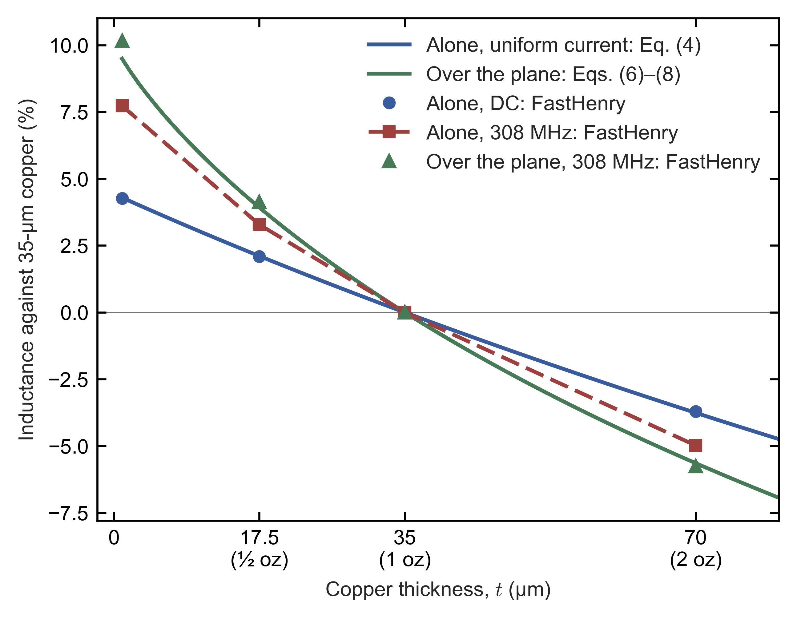
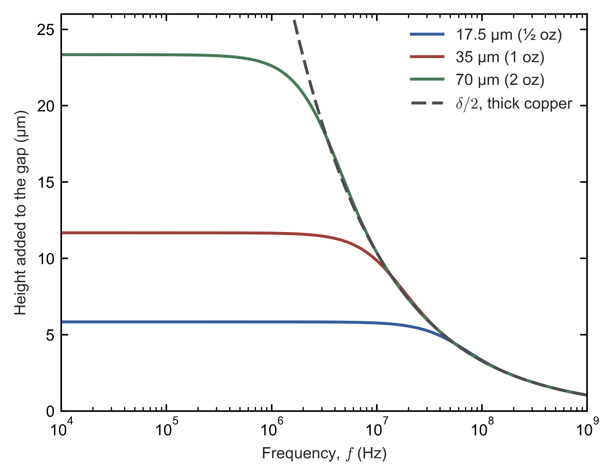

# How the copper's thickness changes the inductance of a trace

Side note to the two transimpedance-amplifier notes and to the side note on feedback layouts: closed forms and FastHenry solutions for traces of ½-, 1- and 2-oz copper, alone and over a plane.

> This note was created with significant AI assistance. It may contain errors, so check the cited datasheet pages, tables and scripts before relying on a figure. The note itself is dedicated to the public domain under CC0 1.0; no copyright is reserved.

## 1. What this note answers

The [side note on feedback layouts](../TIA_feedback_layouts/TIA_feedback_layouts.md) estimates the inductance in series with the feedback network from traces 0.2 mm wide and 35 µm thick, the usual 1-oz copper, and finds that it moves the feedback capacitance of the 2-kΩ OPA846 design by 2–4 % at the loop crossover (its Section 4 and its Appendix C). Boards are also made with ½-oz (17.5 µm) and 2-oz (70 µm) outer copper, and plating adds to the foil. The question is therefore whether the copper's thickness changes that inductance enough to matter, for the layouts of the [balanced-photodiode note](../TIA_opamp_survey_2026-10-25/TIA_opamp_survey.md) and the [high-gain note](../TIA_high_gain_survey_2026-11-02/TIA_high_gain_survey.md) and for traces in general. This note answers it with closed forms and with FastHenry, the field solver of the side note's Appendix C, for a trace alone and for a trace over a plane.

The answers, with the sections that derive them, are these.

- **The thickness changes the inductance by a few percent, and thicker copper lowers it.** Going from 35 to 70 µm lowers the inductance of a trace 2.8 mm long and 0.2 mm wide by 3.7 % at DC and by 5.0 % at 308 MHz, and the inductance per unit length of the same trace 0.2 mm above a plane by 5.8 % at 308 MHz. Going from 35 to 17.5 µm raises the three by 2.1 %, 3.3 % and 4.1 % (Sections 3 and 4, Figure 1).
- **The geometry decides instead.** Halving the trace's height above its plane or doubling its width changes the inductance per unit length by 17–47 %, against 0.7–5.6 % for doubling the copper (Table 3). The inductance measures the magnetic field around the current, and the thickness only adds two side walls, 17.5–70 µm tall, to the outline of the conductor (Section 2).
- **Below a few megahertz the sign reverses, and only wide traces notice.** When the current fills the copper, the field inside it adds a third of the thickness to the gap between a trace and its plane. A wide trace 0.2 mm above its plane, with 2-oz copper in both, is then 10 % more inductive than with 1-oz copper. Above about 10 MHz the copper's weight drops out of this term; at 100 MHz the skin effect decides where the current flows, but the field inside the skin adds only about 3 % to the inductance (Section 5, Figure 2).
- **Nothing in the two notes changes.** With 2-oz instead of 1-oz copper, the fractional change $\delta_1$ that the inductance makes to the feedback capacitance of the OPA846 design in SOIC-8 at 308 MHz moves from 2.85 % to 2.79 %, and with ½-oz copper to 2.89 % (Section 6).

## 2. Where the thickness can enter

An inductance measures the magnetic energy $E$ that a current $I$ stores, $L = 2E/I^2$, and that energy lies wherever the magnetic field is. At high frequency the current flows in a thin skin on the copper's surface, so the field fills the space around the trace, most of it in the gap between the trace and its return current, and the copper only bounds that space. The thickness adds two side walls, 17.5–70 µm tall, to an outline that is 200 µm wide in the layouts of the side note, so it can change the field only near the trace's edges. Sections 3 and 4 put numbers on this for a trace alone and for a trace over a plane. At low frequency the field also fills the copper itself, and a thicker conductor then holds more of it; Section 5 treats that case. Section 6 applies the results to the designs of the two notes.

## 3. A trace alone

The ground planes of the side note's field models leave a window under the feedback network, so its traces have no plane directly beneath them, and the side note sums partial self-inductances (its Section 4). Two parallel filaments of length $l$ that lie side by side over the same span, a distance $d$ apart, have the partial mutual inductance of the side note's Eq. (3),

$$
M(l, d) = \frac{\mu_0}{2\pi}\left[\,l\,\mathrm{asinh}\frac{l}{d} - \sqrt{l^2 + d^2} + d\,\right] ,
\tag{1}
$$

where $\mu_0/2\pi$ = 0.2 nH/mm. A bar of width $w$ and thickness $t$ that carries a uniform current is a bundle of such filaments, and its partial self-inductance is the average of Eq. (1) over pairs of points of its cross-section. Two random points of the rectangle lie $a$ apart across the width and $b$ apart across the thickness, and each offset has the triangular density of the side note's Eq. (4), so

$$
L_{bar}(l, w, t) = \int_0^w\!\!\int_0^t \frac{4(w - a)(t - b)}{w^2t^2}\,M\!\left(l, \sqrt{a^2 + b^2}\right)\mathrm db\,\mathrm da .
\tag{2}
$$

FastHenry computes the same quantity when it carries the bar's current in a single filament, and the two agree to the fourth digit (Table 1).

**Why the thickness enters only weakly.** For $l \gg d$, $\mathrm{asinh}(l/d) = \ln(2l/d) + O(d^2/l^2)$ and $\sqrt{l^2 + d^2} = l + O(d^2/l)$, so Eq. (1) becomes $(\mu_0/2\pi)[\,l\ln(2l/d) - l + d\,]$. Averaged over the cross-section, it gives

$$
L \approx \frac{\mu_0 l}{2\pi}\left[\ln\frac{2l}{g} - 1 + \frac{\bar d}{l}\right] , \qquad \ln g = \langle\ln d\rangle ,
\tag{3}
$$

where $g$ is the geometric mean distance of the cross-section from itself and $\bar d$ the mean distance, whose term is small. The cross-section enters only through $g$, inside a logarithm. For a strip without thickness, the density $2(w - s)/w^2$ of the side note's Eq. (4) gives $\ln g = \ln w - 3/2$, so $g = e^{-3/2}w$ = 0.04463 mm for $w$ = 0.2 mm. For the rectangles, the average of $\ln d$ with the density of Eq. (2) gives $g$ = 0.04863, 0.05256 and 0.06039 mm for 17.5, 35 and 70 µm, each equal to $0.2236\,(w + t)$ within 0.05 %, so a thickness $t$ acts on $g$ as the same extra width would. By Eq. (3), the thickness lowers the inductance by

$$
L(t) \approx L(0) - \frac{\mu_0 l}{2\pi}\ln\frac{g(t)}{g(0)} .
\tag{4}
$$

For the 2.8-mm trace with 35-µm copper, $\mu_0 l/2\pi$ = 0.2 nH/mm × 2.8 mm = 0.56 nH and $\ln(0.05256/0.04463)$ = 0.1637. The strip without thickness has $L(0)$ = 2.1592 nH by the side note's Eq. (4), so Eq. (4) gives $L$ = 2.1592 nH − 0.56 nH × 0.1637 = 2.0675 nH, against 2.0681 nH by Eq. (2) and by FastHenry. Relative to $L(0) \approx (\mu_0l/2\pi)\{\ln[2l/g(0)] - 1\}$, Eq. (4) is a change of $-\ln[g(t)/g(0)]/\{\ln[2l/g(0)] - 1\}$, so a longer trace is affected even less: 70-µm copper lowers the inductance below that of a strip without thickness by $0.3025/(\ln 125.5 - 1)$ = 7.9 % at 2.8 mm and by $0.3025/(\ln 896.3 - 1)$ = 5.2 % at 20 mm, and 35-µm copper by 2.8 % at 20 mm, so that 2-oz copper lowers the inductance of a 20-mm trace against 1-oz copper by $1 - 0.9478/0.9718$ = 2.5 %.

**At 308 MHz.** The current then crowds towards the trace's edges and corners, which lowers the inductance of every trace, and more for the thicker ones, whose cross-section gives the current more room to move: from DC to 308 MHz, FastHenry's traces lose 1.7 % at 1 µm, 3.7 % at 17.5 µm, 4.8 % at 35 µm and 6.1 % at 70 µm. The differences between the copper weights therefore grow a little, to +3.3 % for 17.5 µm and −5.0 % for 70 µm against 35 µm. The filaments are cut as in the side note's Appendix C; from 9 × 5 to 13 × 7 filaments across the width and the thickness each value changes by 0.1 % or less, and the 35-µm values reproduce the side note's Table C.1, 2.068 nH at DC and 1.968 nH at 308 MHz. Table 1 lists the results, and Figure 1, in Section 4, plots them.

*Table 1. A trace 2.8 mm long and 0.2 mm wide with no plane beneath it: the geometric mean distance $g$ of its cross-section; its partial self-inductance with a uniform current, by Eq. (2) and by FastHenry at DC; its partial self-inductance by FastHenry at 308 MHz with 13 × 7 filaments; and the changes from 1-oz copper. The strip of 1 µm stands for a strip without thickness: its $g$ is $e^{-3/2}w$, its value under Eq. (2) is the side note's Eq. (4), and FastHenry cuts it into 13 × 1 filaments at 308 MHz.*

| Copper | $g$ (mm) | Eq. (2) (nH) | FastHenry, DC (nH) | FastHenry, 308 MHz (nH) | Change from 1 oz at DC | Change from 1 oz at 308 MHz |
|---|---|---|---|---|---|---|
| Strip, 1 µm | 0.04463 | 2.1592 | 2.1563 | 2.1203 | +4.3 % | +7.7 % |
| ½ oz, 17.5 µm | 0.04863 | 2.1113 | 2.1113 | 2.0329 | +2.1 % | +3.3 % |
| 1 oz, 35 µm | 0.05256 | 2.0681 | 2.0681 | 1.9682 | — | — |
| 2 oz, 70 µm | 0.06039 | 1.9915 | 1.9915 | 1.8702 | −3.7 % | −5.0 % |

## 4. A trace over a plane

Most traces outside the feedback network run over a plane that carries their return current beneath them, and the inductance per unit length of the pair, $L'$, then describes them. When the currents flow on the surfaces of perfect conductors, the trace and the plane form a transmission line whose inductance and capacitance per unit length satisfy $L'C'_0 = \mu_0\varepsilon_0$, where $C'_0$ is the capacitance per unit length with the dielectric removed; the board's dielectric is not magnetic and leaves $L'$ unchanged. Therefore

$$
L' = \frac{\mu_0\varepsilon_0}{C'_0} = \frac{Z_{L1}}{c_0} ,
\tag{5}
$$

where $Z_{L1}$ is the characteristic impedance of the line in air and $c_0$ the speed of light. The thickness can thus change $L'$ only through the electrostatic field: the side walls carry part of the trace's charge, so the trace acts as a wider one. Hammerstad and Jensen's formula for $Z_{L1}$ [3], as the Qucs technical papers give it [2, Eqs. (11.4) and (11.6)], divided by $c_0$, with the free-space impedance $Z_{F0}$ of [2] giving $Z_{F0}/c_0 = \mu_0$, is

$$
L' = \frac{\mu_0}{2\pi}\ln\left[f_u\frac{h}{W} + \sqrt{1 + \left(\frac{2h}{W}\right)^2}\,\right] ,
\tag{6}
$$

$$
f_u = 6 + (2\pi - 6)\exp\left[-\left(30.666\,\frac{h}{W}\right)^{0.7528}\right] ,
\tag{7}
$$

for a strip without thickness, of width $W$, at the height $h$ above the plane; [2] gives its accuracy as better than 0.01 % for $W/h \le 1$ and 0.03 % for $W/h \le 1000$. For a narrow strip, $f_u \to 6$ and Eq. (6) tends to $(\mu_0/2\pi)\ln(8h/W)$, the inductance of a round wire of radius $W/4$ at the height $h$; for a wide one, $f_u \to 2\pi$ and it tends to $\mu_0h/W$, that of two parallel plates. A thickness $t$, with $h$ measured to the strip's lower face, replaces $W$ in Eqs. (6) and (7) by the wider [2, Eq. (11.22), which writes the widths in units of $h$]

$$
W_1 = W + \frac{t}{\pi}\ln\left[1 + \frac{4e}{(t/h)\coth^2\sqrt{6.517\,W/h}}\right] .
\tag{8}
$$

For the trace of Section 3 with its lower face 0.2 mm above the plane and 35-µm copper, $t/h$ = 0.175, $\sqrt{6.517}$ = 2.5528, $\coth^2 2.5528$ = 1.0245 and $4e/(0.175 \times 1.0245)$ = 60.64, so Eq. (8) adds $(35\ \mu\mathrm m/\pi)\ln 61.64$ = 11.14 µm × 4.121 = 45.9 µm to the width. Then $W_1/h$ = 1.2296, Eq. (7) gives $f_u$ = 6.0000, and Eq. (6) gives $L'$ = 0.2 nH/mm × $\ln[\,6.0000/1.2296 + \sqrt{1 + (2/1.2296)^2}\,]$ = 0.2 nH/mm × $\ln(4.8797 + 1.9094)$ = 0.2 nH/mm × 1.9153 = 0.3831 nH/mm.

**FastHenry.** The same trace was computed 3 mm and 6 mm long over a copper sheet 2 µm thick, 10 mm long and 4 mm wide, cut into cells 0.5 mm along the trace and 0.05 mm across it [1, p. 15]. The port lies between the trace's near end and the node of the sheet below it [1, p. 16], and the far end is joined to the node below it, so the difference of the two loop inductances, divided by 3 mm, is $L'$ without the ends. At 308 MHz such a sheet acts as the ideal plane of Eq. (6). Under the trace, the return current has roughly the density $K(x) = (I/\pi)\,h_c/(h_c^2 + x^2)$ of the image of a line current at the height $h_c$ = 0.2175 mm of the trace's middle, for which $\int K^2\,\mathrm dx = I^2/(2\pi h_c)$. The sheet's resistance per square, $\rho/t_p$ = 8.5 mΩ for its thickness $t_p$ = 2 µm and copper's $\rho = 1.7\times10^{-8}\ \Omega\,\mathrm m$, then gives the resistance per unit length $(\rho/t_p)/(2\pi h_c)$ = 8.5 mΩ/1.37 mm = 6.2 mΩ/mm, 0.8 % of the line's reactance $\omega L'$ = 2π × 308 MHz × 0.39 nH/mm = 0.76 Ω/mm. The field inside the sheet adds a third of its thickness to the gap (Section 5), $\mu_0t_p/(3\times2\pi h_c)$ = 0.0006 nH/mm, 0.2 % of $L'$. Cells half as fine across the trace leave $L'$ unchanged to 0.01 %, and a sheet twice as wide lowers it by 0.2 %. Table 2 compares the results with Eqs. (6)–(8).

*Table 2. A trace 0.2 mm wide with its lower face 0.2 mm above a plane: the widening $W_1 - W$ of Eq. (8); the inductance per unit length by Eqs. (6)–(8) and by FastHenry at 308 MHz with 13 × 7 filaments (13 × 1 for the 1-µm strip, which stands for a strip without thickness); and the changes from 1-oz copper.*

| Copper | $W_1 - W$ (µm) | Eqs. (6)–(8) (nH/mm) | FastHenry, 308 MHz (nH/mm) | FastHenry against Eqs. (6)–(8) | Change from 1 oz, Eqs. (6)–(8) | Change from 1 oz, FastHenry |
|---|---|---|---|---|---|---|
| Strip, 1 µm | 0 | 0.4217 | 0.4315 | +2.3 % | +10.1 % | +10.2 % |
| ½ oz, 17.5 µm | 26.8 | 0.3981 | 0.4079 | +2.5 % | +3.9 % | +4.1 % |
| 1 oz, 35 µm | 45.9 | 0.3831 | 0.3918 | +2.3 % | — | — |
| 2 oz, 70 µm | 76.7 | 0.3615 | 0.3692 | +2.1 % | −5.6 % | −5.8 % |

FastHenry lies 2.1–2.5 % above Eqs. (6)–(8) at every thickness. Equation (6) assumes perfect conductors, while at 308 MHz FastHenry's copper lets the field into a skin 3.74 µm deep, which adds a little inductance (Section 5), and its 1-µm strip, with 17 mΩ per square, is resistive enough to spread its current more evenly across its width than a perfect conductor would. The offset is common to all thicknesses, so the changes from 1-oz copper agree within 0.2 percentage points: 2-oz copper lowers $L'$ by 5.6 % or 5.8 %, and ½-oz copper raises it by 3.9 % or 4.1 %.

**At DC.** The return current then no longer follows the trace but spreads across the whole sheet, so $L'$ rises to 0.555 nH/mm for 35-µm copper, 42 % above its value at 308 MHz; that value belongs to this 4-mm sheet, not to a trace over a plane in general. The thickness changes it by +2.4 % for 17.5 µm and −4.1 % for 70 µm, as it changes the trace alone.

**Other traces.** Table 3 evaluates Eqs. (6)–(8) for other widths and heights. Going from 1-oz to 2-oz copper lowers $L'$ by 0.7–5.6 %, while halving the height or doubling the width lowers it by 17–47 %. A model that treats the copper as a sheet without thickness overestimates $L'$ by 1.2–10.8 %, more than the copper's weight changes it.

*Table 3. Inductance per unit length of a trace over a plane by Eqs. (6)–(8) (nH/mm) for ½-, 1- and 2-oz copper, and the change from the 1-oz value when the copper doubles, when it is a sheet without thickness, when the height halves and when the width doubles.*

| Trace | ½ oz | 1 oz | 2 oz | 1 oz to 2 oz | Sheet without thickness | Height halved | Width doubled |
|---|---|---|---|---|---|---|---|
| 0.2 mm wide, 0.2 mm above the plane (Table 2) | 0.3981 | 0.3831 | 0.3615 | −5.6 % | +10.1 % | −30.0 % | −27.2 % |
| 0.3 mm wide, 0.2 mm above | 0.3317 | 0.3217 | 0.3069 | −4.6 % | +7.8 % | −33.1 % | −31.0 % |
| 0.2 mm wide, 0.1 mm above | 0.2789 | 0.2680 | 0.2530 | −5.6 % | +10.8 % | −35.1 % | −32.6 % |
| 0.3 mm wide, 1.5 mm above, as over a plane on the far side of a 1.6-mm board | 0.7155 | 0.6995 | 0.6746 | −3.6 % | +5.5 % | −19.3 % | −17.2 % |
| 3 mm wide, 0.1 mm above | 0.0371 | 0.0370 | 0.0367 | −0.7 % | +1.2 % | −47.4 % | −47.2 % |

*Figure 1. Inductance of a trace 0.2 mm wide against the thickness of its copper, relative to 35-µm copper. Blue: the trace alone, 2.8 mm long, with a uniform current, by Eq. (4) (line) and by FastHenry at DC (points). Red: the same trace at 308 MHz by FastHenry (points, joined by the dashed line). Green: the trace with its lower face 0.2 mm above a plane, inductance per unit length at 308 MHz, by Eqs. (6)–(8) (line) and by FastHenry (points). The points at 1 µm stand for a strip without thickness (Tables 1 and 2).*

## 5. Below a few megahertz: the field inside the copper

Sections 3 and 4 hold where the current flows in a skin on the copper's surface. At lower frequencies the current fills the copper, the field inside the copper then adds to the inductance, and this is the one case in which thicker copper is the more inductive. The skin depth of copper, $\delta = \sqrt{2\rho/(\omega\mu_0)}$, is 65.6 µm at 1 MHz, 20.7 µm at 10 MHz and 3.74 µm at 308 MHz, and it equals the copper's thickness $t$ at $f = \rho/(\pi\mu_0t^2)$: for 35-µm copper at $1.7\times10^{-8}\ \Omega\,\mathrm m/[\pi\times4\pi\times10^{-7}\ \mathrm{H/m}\times(35\ \mu\mathrm m)^2]$ = 3.52 MHz, for 17.5-µm copper at 14.1 MHz and for 70-µm copper at 0.88 MHz.

Consider a trace much wider than its gap $h$ to the plane, so that the field $H_0 = I/w$ fills the gap and little field lies above the trace or below the plane. Inside each conductor the field obeys the diffusion equation $\mathrm d^2H/\mathrm dy^2 = k^2H$ with $k = (1 + j)/\delta$, and it falls from $H_0$ on the face towards the gap to zero on the far face, so $H(y) = H_0\sinh[k(t - y)]/\sinh(kt)$, with $y$ measured into the conductor from the face towards the gap. The current density is $-\mathrm dH/\mathrm dy$, and the electric field on that face, $\rho$ times the current density there, divided by the current $H_0w$, gives the impedance per unit length of one conductor:

$$
Z'_{int} = \frac{\rho k}{w}\coth(kt) , \qquad k = \frac{1 + j}{\delta} .
\tag{9}
$$

For $|kt| \ll 1$, $\coth x \approx 1/x + x/3$, and since $\rho k^2 = j\omega\mu_0$, Eq. (9) becomes $\rho/(wt) + j\omega\mu_0t/(3w)$: the DC resistance and the inductance $\mu_0t/(3w)$. For $|kt| \gg 1$, $\coth(kt) \to 1$ and Eq. (9) becomes $(1 + j)\rho/(w\delta)$: the resistance of a skin of depth $\delta$ and an equal reactance, the inductance $\rho/(\omega\delta w) = \mu_0\delta/(2w)$. The wide trace therefore has

$$
L' = \frac{\mu_0}{w}\left(h + h_1 + h_2\right) , \qquad h_i = \frac{w\,\mathrm{Im}\,Z'_{int,i}}{\omega\mu_0} ,
\tag{10}
$$

where $h_1$ and $h_2$ are the heights that the trace and the plane add to the gap: a third of the thickness at low frequency and half the skin depth at high frequency. Table 4 and Figure 2 give them for the three copper weights. Equation (10) holds for wide traces; for a narrow trace the field inside the copper is less uniform, and Eq. (10) only indicates the order of the effect.

*Table 4. The height that one conductor adds to the gap of a wide trace through the field inside it, Eqs. (9) and (10) (µm), and the frequency at which the skin depth equals the copper's thickness.*

| Copper | $\delta = t$ at | 0.1 MHz | 1 MHz | 3 MHz | 10 MHz | 100 MHz | 308 MHz |
|---|---|---|---|---|---|---|---|
| ½ oz, 17.5 µm | 14.1 MHz | 5.83 | 5.83 | 5.83 | 5.76 | 3.33 | 1.87 |
| 1 oz, 35 µm | 3.52 MHz | 11.67 | 11.64 | 11.46 | 9.86 | 3.28 | 1.87 |
| 2 oz, 70 µm | 0.88 MHz | 23.33 | 22.60 | 18.63 | 10.39 | 3.28 | 1.87 |

**Below about 1 MHz** each conductor adds a third of its thickness. For a wide trace 0.2 mm above its plane, with both in the same copper, Eq. (10) then exceeds its high-frequency value $\mu_0h/w$ by $2t/(3h)$: 5.8 % for ½-oz, 11.7 % for 1-oz and 23.3 % for 2-oz copper, so 2-oz copper is $1.233/1.117 - 1$ = 10.4 % more inductive than 1-oz copper. With a 0.1-mm gap the shares double, to 11.7, 23.3 and 46.7 %, and the difference becomes 18.9 %. These are small reactances, however. A trace 3 mm wide and 20 mm long, 0.1 mm above its plane, has 0.0370 nH/mm by Eqs. (6)–(8) (Table 3) and, with 1-oz copper at 1 MHz, a further $\mu_0\times2\times11.64\ \mu\mathrm m/3\ \mathrm{mm}$ = 0.0098 nH/mm by Eq. (10), so 20 mm × 0.0468 nH/mm = 0.94 nH and a reactance of 5.9 mΩ. The effect matters for power-distribution planes rather than for signal traces. At still lower frequencies the return current spreads across the plane, as the DC runs of Section 4 show, which raises $L'$ far more than the copper's thickness changes it.

**Above about 10 MHz** the copper's weight drops out of this term: at 10 MHz the three weights add 5.8, 9.9 and 10.4 µm, and at 100 MHz all add half the skin depth, 3.3 µm. At 100 MHz the skin depth is 6.56 µm, a fifth of 1-oz copper, and by the solution above the current density on a conductor's far face is $|1/\cosh(kt)|$ times that on its face towards the gap: 14 % for ½-oz, 1.0 % for 1-oz and less than 0.01 % for 2-oz copper. The skin effect then decides where the current flows and what the copper loses, $\rho/\delta$ = 2.6 mΩ per square whatever the copper's weight, against $\rho/t$ = 0.97, 0.49 and 0.24 mΩ at DC. It hardly decides the inductance, however: the field inside the skin adds $\delta/2$ = 3.3 µm to the gap for each conductor, 3.3 % of a 0.2-mm gap for a trace and its plane together, and this share falls as $1/\sqrt f$. The inductance at 100 MHz is that of the field outside the copper, which Sections 3 and 4 compute, and the copper's thickness enters it only through the side walls.

*Figure 2. The height that one conductor adds to the gap of a wide trace through the field inside it, Eqs. (9) and (10), against frequency, for 17.5-, 35- and 70-µm copper, with half the skin depth, the limit for thick copper (dashed). Below about 1 MHz each conductor adds a third of its thickness; above about 10 MHz all three follow the dashed line.*

## 6. What this means for the two notes

The side note's Section 4 puts $L_x$ = 10.14 nH in series with the feedback network of the 2-kΩ OPA846 design in SOIC-8, 4.35 nH of it in traces and vias. With the design's total feedback capacitance $C_F$ = 0.75 pF and its loop crossover at 308 MHz, the side note's Eqs. (2) and (5) give $\delta_1 = \omega^2L_xC_F$ = 2.85 %, the fraction by which the inductance makes the feedback capacitance look larger. With 2-oz copper a trace loses at most 5.0 % of its inductance at 308 MHz (Table 1). Applying that to all 4.35 nH, vias included, overstates the change and gives $\Delta L_x$ = −0.050 × 4.35 nH = −0.22 nH, so

$$
\delta_1 = (2\pi\times308\ \mathrm{MHz})^2\times(10.14 - 0.22)\ \mathrm{nH}\times0.75\ \mathrm{pF} = 0.0279 ,
\tag{11}
$$

that is 2.79 % instead of 2.85 %. With ½-oz copper the traces gain at most 3.3 %, +0.14 nH, and $\delta_1$ becomes 2.89 %. Both changes are smaller than 0.1 percentage point, while the designs carry ±13 % as the tolerance of the feedback capacitance (the side note's Section 4). In the high-gain range the loop crossovers lie far below the frequencies at which the inductance matters (the side note's Table 4), whatever the copper. The copper's thickness changes the capacitance across the network little as well: copper of 18 or 70 µm instead of 35 µm changes it by −1.6 % and +2.8 % (the side note's Appendix D). The copper's weight can therefore be chosen for what it does change, the resistance below a few megahertz, which falls as $1/t$ (Section 5).

## Appendix A. Files

The FastHenry runs need FastHenry2 (FastFieldSolvers) on Windows, with its automation interface, and Python with pywin32; the closed forms and the figures need NumPy, SciPy and Matplotlib. The paths are relative to this note's folder.

| Path | Contents |
|---|---|
| `TIA_trace_inductance.md` | This note |
| `figures/fig1_thickness.png`, `figures/fig1_thickness.pdf` | Figure 1 |
| `figures/fig2_internal.png`, `figures/fig2_internal.pdf` | Figure 2 |
| `scripts_archive/fasthenry_traces.py` | The FastHenry runs of Sections 3 and 4 (`run alone`, `run plane`) and their report (`report`); 29 runs of 0.2–5 s each |
| `scripts_archive/trace_thickness.py` | The closed forms, every number of the note (`numbers`) and the two figures (`figures`) |
| `scripts_archive/README.md` | The index of the scripts |
| `data/fasthenry/` | The FastHenry inputs and impedance matrices, `results.json` of each group, and `README.md` with every run and the inductance per unit length over the plane |

## References

The two notes and the side note of this repository are cited by name and linked in Section 1. Page numbers are the PDF pages of each document.

- [1] M. Kamon, C. Smithhisler and J. White, FastHenry User's Guide, version 3.0, Research Laboratory of Electronics, Massachusetts Institute of Technology, 26 Sep. 1996, distributed with FastHenry2 (FastFieldSolvers); the runs of this note used the installed FastHenry2.exe, file version 3.6.1.0.
- [2] S. Jahn, M. Margraf, V. Habchi and R. Jacob, Qucs Technical Papers, section "Single microstrip line" of the chapter "Microstrip components", Eqs. (11.4), (11.6) and (11.22), https://qucs.github.io/tech/node75.html, read 8 Nov. 2026.
- [3] E. Hammerstad and Ø. Jensen, "Accurate models for microstrip computer-aided design", Symposium on Microwave Theory and Techniques, pp. 407–409, June 1980, as cited in [2]; this note takes the formulas from [2].
